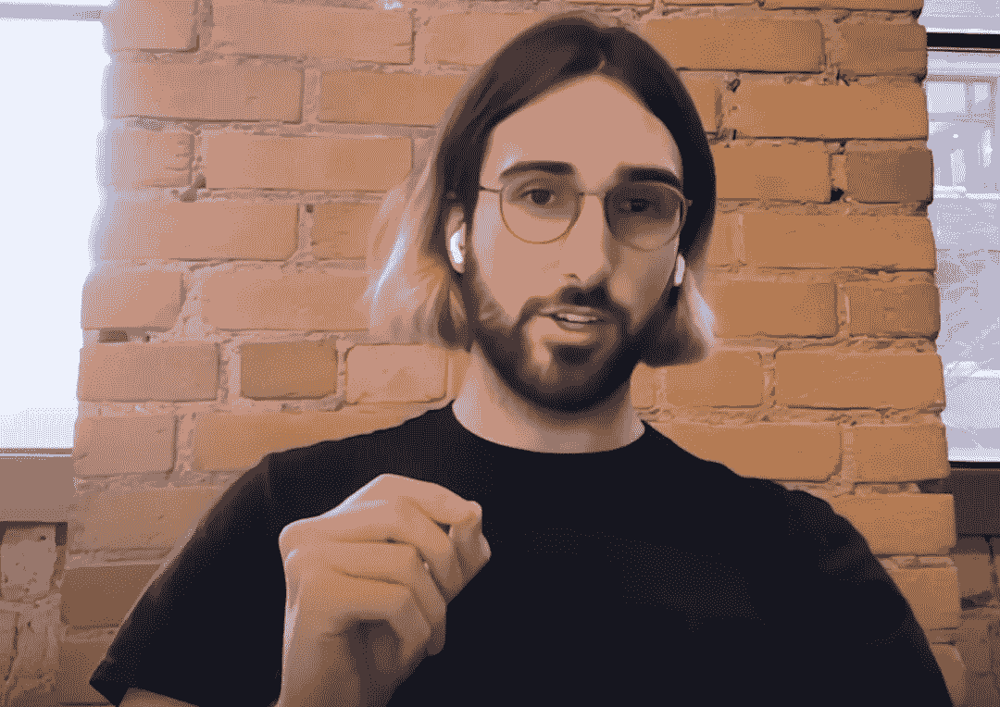
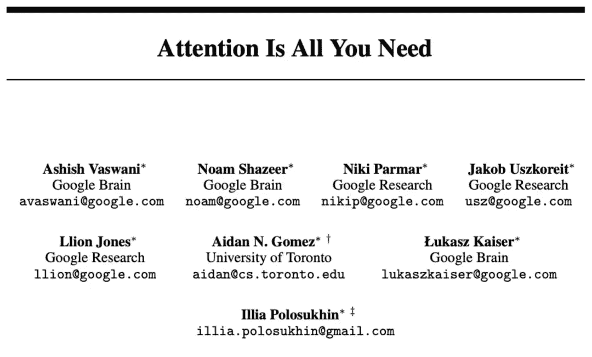

# Transformer作者：指令型智能体的构建之法

> 来源：[https://agijuejin.feishu.cn/docx/JxxRdLjwvot560xt0UHcLS19nGf](https://agijuejin.feishu.cn/docx/JxxRdLjwvot560xt0UHcLS19nGf)

> 来源 | The Robot Brains Podcast

> 翻译：徐佳渝、贾川、杨婷 | OneFlow

> 原文：https://mp.weixin.qq.com/s/Vt_TGHKaifKVfDPfmKaqKw

2017年，Google发布的《Attention Is All You Need》论文提出了Transformer架构，这成为过去十年神经网络领域最具影响力的技术创新之一，并被广泛应用于NLP、计算机视觉、蛋白折叠等诸多领域。更重要的是，它成为后来包括ChatGPT在内的诸多大模型的基石。

不过，Transformer的八位作者如今都离开了Google。其中， Lukasz Kaiser 去了OpenAI， Llion Jones近期也离职创业 ，而其他6位作者分别参与创办了Adept、Cohere、Character.ai、Inceptive、NEAR.AI，这些公司也是业内当红炸子鸡。

其中，作为Transformer背后的研究者之一，Aiden Gomez很早就看到了语言在AI中的潜力，并于2019年与Nick Frosst和Ivan Zhang创立了Cohe[**re，主**](http://mp.weixin.qq.com/s?__biz=MzU5ODY2MTk3Nw==&mid=2247487896&idx=1&sn=033f40b1016d94d45817f7f097273ab4&chksm=fe419faec93616b8034bae5b09071e4618706427f5e42003a1772fa7f3e12acdfa67cddaf62f&scene=21#wechat_redirect)要开发面向企业和开发者的商业化语言大模型。近期，Cohere获得NVIDIA、Oracle、Salesforce等机构的2.7亿美元C轮融资，成为估值达20亿美元的独角兽，值得一提的是， Geoffrey Hinton 、 李飞飞 和Pieter Abbeel等AI学者也是它的投资者。

在Aiden Gomez看来，在技术研究阶段，Google Brain这样的组织形式是研究者们探索的天堂，但在利用技术构建真实产品和体验阶段，Google这样的大公司远不如初创企业那样能自由、灵活、快速地研发部署。

不过，构建大模型并非易事。他认为，Cohere目前所做的事就像人类所做的火箭项目那样，由大量不同的部件和传感器组成，而任何一个板块出现问题，火箭就会爆炸 ——大模型的构建过程也是如此，每一阶段模型的构建都取决于此前阶段的工作质量，精细而复杂。

近 期，在与强化学习大牛Pieter Abbeel的对话中， Aiden分享了对语言大模型的看法与Cohere的创业思路，以及Transformer论文创作背后的故事。

（以下内容经授权后由OneFlow编译发布，转载请联系OneFlow获得授权。 https://www.youtube.com/watch?v=zBK2CPka5jo ）

**语言大模型的基本原理**

**P**ieter Abbeel：作为Cohere的联合创始人兼CEO，你们正在训练语言大模型（LLM），什么是LLM？它们有何作用？

**Aidan Gomez： **说到Transformer以及这一代语言模型，我们能够看到很多功能强大的应用，比如GPT-3、Cohere以及ChatGPT等。它们的基本原则是，通过扩展模型实现对更复杂数据集的建模，显然，最复杂的数据集应该是互联网数据之类的数据，这类大型文本语料库已经积累了几十年，目前，互联网使用人数占到全球总人数的百分之六七十，人们在线上进行各类活动，如开办编程课程、语言课程，并谈论各种事件、问题等等。

如果要对这个大型、高度多样化的数据集建模，我们需要用到极其复杂的模型，而这正是Transformer的用处所在。Transformer是一种神经网络架构，这种结构非常擅长扩展，并且可以有效地进行并行化处理，这在拥有成千上万个GPU加速器的大型超级计算机上进行训练非常重要。扩展模型和数据集带来了极好的成效，正如OpenAI所说：Transformer模型成为了多任务处理大师。

这意味着，相同的模型、同一组权重能够完成多种任务，包括翻译、实体抽取、撰写博客和文章等等。现在，我们创建出了能够通过交流让其完成任务的模型（Cohere称之为命令模型，OpenAI称之为指令模型），语言大模型技术已经走进人们生活，变得更加直观可用。如今，在多数人眼中，我们可以向语言大模型下达自然语言指令，然后模型会按照指令生成相应的结果。

**Pieter Abbeel：本质上说，原始模型是用互联网文本训练的，通过这种方式，模型学会了生成响应等。**但问题是，互联网上的文本质量参差不齐，人们的需求也不尽相同，如何仅通过扩展互联网上的训练数据得到一个超预期的强大模型？

**Aidan Gomez： **如你所说，互联网数据有很多噪音，这些内容对机器学习的影响弊大于利，所以过滤是数据处理管道的重要部分。通过过滤，可以筛掉噪音、空字符串或高度重复的字符串内容，从而尽可能保持数据集的干净。显然，就整个互联网而言，无论使用多么高级精密的过滤器，噪音始终无法避免，数据集始终会有一定比例的噪音，我们能做的就是尽可能降低该比例。

但我认为，训练之后的事情才是关键，它决定了模型功能和用户体验。最开始，我们在互联网上抓取了大量网页数据用来训练巨型模型（网页数据可能经过了过滤），但接下来要在手动整理的精细化数据集上对模型进行微调，最初的大型模型掌握了海量知识，它从网页上收集了大量不同的内容，我们要做的是，引导模型朝着预想的方向发展。

如果最初的原始模型拥有来自网页的万亿级单词，那么在微调阶段，需要的数据数量级要小很多，重要的是这一阶段的数据要体现我们对模型行为的期望。以命令模型（与OpenAI的指令模型类似）为例，我们希望给模型下达一些自然语言指令，然后模型能以直观正确的方式做出响应，比如让模型以兴奋的语调编辑一篇博客文章。为了达成上述目标，需要收集语气兴奋的博客文章，将它们放入数据集，用这些数据对模型进行微调，这样就能将知识渊博的大型模型引向可直观控制的模型。

与ChatGPT或对话模型类似，面对知识渊博且功能强大的模型，我们可用小型精细化的数据集对其进行微调，将模型引向我们所希望的发展方向，如果想要一个对话模型，就需要向模型展示大量对话，模型会根据我们展示的数据集进行调整，经过这几个训练阶段（从最初的混乱大数据集一步步微调），模型逐渐发展成了我们所希望的样子。

**Pie**ter Abbeel：有意思的是，微调能够在如此小的数据集上进行，这省掉了很多大数据集处理相关的麻烦。而且语言模型有最自然的交互界面，能够基于用户所说的内容进行长时间对话。不过，它们都需要隐藏提示，才能生成符合预期的响应，你如何看待这种提示工程？未来会如何发展？

**Aidan Gomez： **提示工程类似于向模型提供指令，并指导模型行为的一种方式。在小型精炼数据集上对模型微调，这是使用数据指导模型的例子，而提示机制是指在给模型的指令提示中，我们可以给模型指定特定的行为或语气等，并提供演示范例，我们可以说“我想要你按照下面这篇博客的语气，写一篇关于X的博客”，然后模型就可以开始写作了。这就是少样本提示（few-shot prompting），可以给模型演示想要其响应的行为。

我希望未来不再需要提示。我很喜欢早期有关语言大模型的类比，当时语言大模型就好比是一种外星技术，我们需要学习如何与之交谈。然而，要做到这一点非常困难，你需要对语言大模型从网上学到的语言做逆向工程，这需要耗费大量心血，随着模型越来越强大，微调越来越精细，我希望掌握和了解特定语言模型不再是一种负担或优势。

不同的模型有不同的个性，“个性”是指如果想要模型按照你的意图行事，那么就必须要学会与模型交流。由于训练数据集存在差异，我们可能需要学习不同的语言，这意味着模型的每次更新，都必须重新调整与模型对话的内部表示。因此，包括我在内的行业里大多数语言大模型建造者希望能够逐渐减少并克服这一问题。

**P**ieter Abbeel：理想情况下，模型应该以最自然的方式进行转换，就像善于团队协作的人类一样，模型有望达到出色合作者的水平。

**Aidan Gomez： **如果能做到，这将会是很惊人的成就。遗憾的是，技术层面还难以达到或者说接近人类的信息共享和对话交谈。我认为， 语言大模型是一个技术接口，它解锁了对话，彻底改变了可以构建的范畴。

**Pieter Abbeel：人们常说，训练语言大模型（模型越大越好）**需要大量算力，这意味着大量资金投入，SOTA语言大模型的训练成本是否仍然高昂？

**Aidan Gomez： **确实如此，从购买设备到招揽人才都需要大量的财力支撑，我和Ivan Zhang创立Cohere的原因之一是想降低这个门槛。使用模型开发产品，不应该仅限于筹措到大量资金的种子轮或A轮融资公司。目前来看，这确实是一个巨大的障碍，但我们正在尝试解决这一问题，解决方案是自己承担计算机、人才和数据采集等成本，并将成本分摊到更广泛的用户当中，从而使模型变得经济实惠，易于使用。

## **语言大模型的机遇**

**Pieter Abbeel：Cohere成立于2019年，是首家专注于语言大模型的创业公司。虽然当时已经有OpenAI做语言大模型，但做的事情很杂。自Cohere成立以来，已经涌现出了很多语言大模型创业公司，例如Anthropic（由OpenAI前员工**创办）、Character.ai（由谷歌前员工创办）以及Adept（由谷歌前员工创办）等等。许多公司已筹集了超1亿美元资金。当然，在这场角逐中还有谷歌、Meta、亚马逊、DeepMind等大公司，他们拥有大量资源，可以说，语言大模型领域正处于群雄逐鹿阶段。你是如何看待这一局面的？

**Aidan Gomez： **语言大模型是一项基础性技术，这也是许多聪明人都想从事这方面工作的原因，对此我们都乐见其成。通用语言的应用十分广泛，有各种类型的产品。由于语言的多样性，它可以提供非常丰富的价值，因此该领域的发展前景非常广阔。

目前，许多公司（从初创公司到全球最大的企业）都正在构建语言大模型，**因为语言大模型能够产出的产品和服**务几乎是无限的。这正是Cohere的主张所在： 提供一个平台，在该平台之上，每个人都可以构建新产品，无需筹集大量资金。 我相信，未来会有更多竞争者和新产品涌现，同时我也期待着科技覆盖面能快速扩展。

**P**ieter Abbeel：这让我想起了Andrej Karpathy（OpenAI科学家）的一条推文：“英语现在是最热门的新编程语言”。

**Aidan Gomez： **这句话确实很好地概括了当前的情况。最近一篇论文提出了一些有趣的编程策略，比如Loop Transformers，它通过将Transformer输出递归地馈送回自身来实现通用性。

此外，还有像LangChain这样的策略，可以组合调用并设置循环和逻辑。这些策略的应用形成了一个生态系统，可以通过不断重复使用来增加效用。我在Sky Hackathon上看到了一个非常棒的项目，该项目的后端完全基于语言大模型的调用，只有一个UI组件，该想法仍具有重要的启发意义， 展示了可以用语言大模型替代多种传统后端架构。

**Pieter Abbeel：世界上有很多种语言，Coh**ere最近也推出了多语言文本理解模型。

**Aidan Gomez： **多语言文本理解模型不同于GPT或者ChatGPT这类生成模型，它是一个类似于Bert的表示模型。该模型涵盖109种语言，主要用于分类或语义检索。

在训练翻译系统或多语言系统时，传统做法是准备成对示例。这些示例需要具有相同的语义内容，一个用语言A表示，一个用语言B表示。部分语言间有大量的成对示例，比如英语和法语，所以模型很擅长这些语言的翻译；但有些语言间的成对示例较少，比如斯瓦希里语和韩语。

对于这类语言，团队首先要抓取一个极其庞大的多样化数据集，但该数据集中没有成对的数据，只有大量无监督文本，然后再收集所有可能的配对数据，并使用更小的配对数据集来对齐不同的语言表示。如此一来，就能得到一个可以跨语言支持的模型。

Cohere目前支持109种语言，这使得在构建分类器时能有更多可能。例如，我是一名开发人员，只会说英语，但我可以使用Cohere上开发的分类器，为其提供一些训练样例，如此便能映射到所有的109种语言中。这样，无论用户使用什么语言与我交流，我都可以为其提供强大的分类功能。在检索信息方面也是如此，即使我只懂英语，也可以在一个包含多种语言的数据集上进行搜索，并检索出所有相关文档。

**Pieter Abbeel：这些技术的实现着实令人惊叹。20、30年前，机器翻译还只是一个遥不可及的梦想，并未取得什**么实质性的成果。而现在，人们已经能够使用这项技术进行109种语言之间的翻译，并且在没有配对数据的语言中也能发挥良好效果。

## **Cohere的用例**

**Pieter Abbeel：Coher**e的用户群体是怎样的？是否有商业用例？

**Aidan Gomez： **从技术应用角度来看，我们仍处于采用曲线的早期阶段。虽然ChatGPT因**广泛的公众认知而取得了一些突破，但从应用曲线来看，仍处于**早期阶段。通常情况下， 首批采用新兴技术的人群是学生、工程师和创业者，Cohere的首批用例和大多数用户也正是这类人群。

现在每个大型企业的高管都在思考“什么是ChatGPT？什么是语言大模型？该如何利用它们？”对这些话题的讨论从几个月前接开始了，预计到2024年，所有的讨论都将转向如何将ChatGPT大规模应用到现有大型企业和产品中去。我相信，这一趋势将涵盖各行各业。

**Pi**eter Abbeel：假如你有一家成千上万个员工的大公司，公司内部人员都使用Slack和电子邮件进行交流，那么我们是否可以使Cohere模型访问所有的交流信息，这样模型就可以回答任何与工作相关的问题了。

**Aidan Gomez： **我们的发展方向是与大型知识库进行交互的助手，这是Cohere的目标之一。虽然我们还没有完全实现这个目标，但已经非常接近了，而且前景非常光明。在学术界，人们一直在努力研究这类问题，例如检索增强生成（Retrieval Augmented Generation）等项目，这些项目的目标是将外部知识库与模型进行连接，以实现知识库的实时更新。理论上，我们只需让模型访问该数据库，就可以检索文档，并将结果以文本形式返回给用户。现在越来越多的应用程序支持这种功能。

想象一下这样一个系统： **用户可**以登录并连接Twitter、Slack、Discord、Gmail等应用程序，从而访问它们的所有内容，并进行搜索。此外，用户还可以向系统提问自身在这些程序中的相关信息，并要求它采取行动（例如发送邮件或购买物品）。我们现在已经离这种系统非常近了，而且肯定能够构建出该系统。 在不久的将来，系统可以访问大规模、维护良好且个性化的知识库，并使用工具采取行动，从而产生实质性的影响和变革。

**Pi**eter Abbeel：我对此非常感兴趣。我从事的是强化学习领域，其中智能体会做决策、采取行动等等。系统不仅会以文本形式作出回应，而且还可直接执行具体任务。你认为在不久的将来，AI助手能否实现这些功能？

**Aidan Gomez： **这种系统在沟通方面具有重要的应用价值，特别是客户支持方面。例如，在需要重置密码等智能体能够解决用户查询的场景下，这种系统可能是最有价值的应用之一。我们希望后续能率先支持这种功能。

目前我们已经构建了所有工具。例如，在浏览器中视频聊天，如果能让模型控制浏览器，或者将浏览器用作工具，那么模型就可以执行浏览器的全部任务，这将十分有用。控制浏览器并浏览网页比调用离散API更具挑战性，因为网页环境更加不规则且多变。但我认为这是目前最令人期待、最具挑战性的项目之一。

**P**ieter Abbeel：我赞同你的说法。如果某项技术能在人们的生活、工作和娱乐等方面提供帮助，那么该技术所在领域就会非常活跃。

## 非盈利组织Cohere for AI的创建

**Pieter Abbeel：我了解到，Co**here还创办了非营利性的研究实验室。

**Aidan Gomez： **Cohere for AI是由Sara Hooker负责的一个独立的非盈利性组织。在创立Cohere之前，我和Ivan Zhang等人成立了一个小型研究团队。当时，我刚从谷歌回到多伦多大学，有很多研究想法想要实践，但苦于缺少志同道合者，于是在多伦多大学CS的Slack中发了条消息，“我准备做机器学习研究，有没有人想要加入？”结果得到了Ivan和一些Google Brian研究员的响应。整个夏天，我们都在一起做项目开发，并将研究成果发表在了ICLR（国际表征学习大会）上。

后来我们决定扩大团队，我们了解到当时有很多本科生、研究生甚至毕业生想要探索机器学习领域，但苦于无人合作，于是我们创办了一个小网站，分享我们所做的工作。网站逐渐吸引了80名不同国家成员（来自18个国家）的加入。

但后来，我和Ivan创办了Cohere，占用了网站维护时间，该社区的发展渐渐停滞。一次和Sara聊天时，我发现，她非常热衷于推动机器学习的发展，乐于帮助他人，推崇导师制。于是，我们一拍即合，决定用Cohere支持一个独立的非营利组织，专注于发布高质量研究成果，并引进一批导师来帮助这些人完成项目、论文，为他们进入机器学习领域提供支持和指导。

因此，当这件事成行时，我欣喜若狂。如今，Cohere for AI内部也拥有了学者计划和AI研究驻地。

**Pieter Abbeel：作为一家初创公司，为什么**董事会愿意花这么多钱来支持非营利组织？

**Aidan Gomez： **我很幸运能拥有如此优秀的董事会成员，比如Mike Volpi（Index 合伙人）和Jordan Jacobs（Radical Ventures管理合伙人）。他们很支持将这项技术推向市场，并且相较于短期利益，更注重公司的长期发展。即使在我们做出像资助非营利组织这样的决定时，他们也会以全面的视角对其进行评估。

## 关于Transformer的诞生

**Piet**er Abbeel：你曾与Google研究者共同撰写了论文《Attention is all you need》，该论文介绍了Transformer架构。这一架构在过去几年里取代了所有的AI技术，而且仍有继续发展的趋势。在撰写那篇论文时，你对自己所做的事情有何想法？你是否预测到了它会带来的影响？还是说你感到震惊，觉得这一切非常新奇？

**Aidan Gomez： ** 当时，我是以实习生的身份加入Google，并且认为自己要做的是完全不同的事情。我们在山景城碰面，很巧的是，我旁边坐的是Noam Shazeer，而Lukasz Kaiser是我的mentor。我们准备构建一个平台，专门用于训练大型自回归模型，该模型可以在分布式计算上进行训练。在Lukas的说服下，Noam加入我们团队，开始参与tensor to tensor的工作。

在翻译领域，由Jakob Uszkoreit领导的团队专注于思考大家从未思考过的东西，比如纯注意力模型。在为期12周的实习中，我们整个团队的研究重点都集中在tensor to tensor的转换上，对架构和超参数进行了优化，并向NeurIPS提交论文，且得以发表。

实习期间，我就“对未来可能产生的影响”与其他作者进行了交流，其中至少有两人独具慧眼，预测到了可能会发生的事情，但我并不是其中之一，这很正常，因为这是我第一次发表论文。在我们向NeurIPS提交论文时，已经是凌晨两点，办公室里只剩下Ashish Vaswani和我。我躺在沙发上，Ashish疲惫不堪地坐在我旁边。他对我说:“我们正在干一件大事”。我只是看着他，问道，“为什么这么说？”他回答说，“我不知道怎么说，反正很重要。”我当时只是敷衍地说着，“也许是”，然后就去睡觉了。

几个月后，学术界就在Transformer架构上趋向一致。我想，大多数作者的想法都和我类似：如果不这样做，就会错失机会。在DeepMind的研究中，已有PixelCNN和WaveNet等类似的工作。因此，Transformer架构被采纳对大多数人来说都是一个非常意外的结果，其受欢迎程度让我们倍感惊讶。

**P**ieter Abbeel：距你的首篇论文发表已经很久了，但相当有趣的是，在那之后要想再写一篇这样的论文就很难了。

**Aidan Gomez： **没错，这就是为什么我想尽快退出研究领域的原因。

**Pie**ter Abbeel：Transformer架构已完全改变了该领域，并且使得以前无法实现的事情成为可能。它似乎更容易从数据中吸收信息，能够处理大量数据。展望未来，您是否期望会出现类似于Transformer的架构变革，或者还有其他因素会决定人工智能的发展方向？

**Aidan Gomez： **我非常希望Transformer不是最终的架构。虽然自Vanilla Transformer以来已经有许多改进，但我不确定最终架构与最初的相比会有多大的突破。也许会出现一些新的特性，例如混合专家系统（Mixture of Experts），拥有大规模的稀疏分布式系统，但这些组件可能仍然很像Transformer。

现在出现了一些新的问题，比如注意力机制真的很重要吗？我们需要多少注意力机制？是否可以在不影响性能的前提下减少一些注意力机制，从而节省计算资源？我真的希望能找到一些更好、更有效、更可扩展的东西，人们能继续在这个领域工作，探索架构方面更多可能性。

**P**ieter Abbeel：从另一个角度看，如果我们能深入了解人脑的结构和功能，就可以将当下的模型架构与之进行对比，从而改进。

**Aidan Gomez： **如果你跟Geoffrey Hinton交流过，就会知道你所说的在一定程度上就是他的灵感来源。他最近的forward-forward非常有趣，不仅生物学上可行，而且潜在地能提高效率，因为前向方法比反向路径更容易实现管道化。完全遵循生物学的底层方法可能过于严谨，但Geoffrey的策略非常灵活，他不拘泥于细节，并且善于从已知的工作系统中获取灵感。我觉得他的方法非常有效。

**Pie**ter Abbeel：Geoffrey让它在执行时非常有效。阅读他的工作、与他交流总是令人鼓舞。他认为，执着于读出模型的权重参数这一点过于死板，实际上应该专注于只训练神经网络，当然，在生产环境中，如果无法将权重复制到另一台机器上可能会有些粗糙，但有些隐含假设限制了我们的思维。

## **AI研究者的进阶**

**P**ieter Abbeel：在你孩提之时，什么最能引起你的注意？这些对你成为一名AI研究人员和企业家有什么帮助？

**Aidan Gomez： **我小时候住在安大略省的一片森林中，家里经营着一个枫树农场，因此，我的成长经历深受加拿大的影响。我觉得这样的生活非常舒适，但也存在缺点，那就是没有网络。事实上，直到现在那里也没有网络，所以我后来给父母买了星链（StarLink），这是目前最好的选择。因此，在我成长的过程中，无法像我的朋友那样接触到很多东西，但也正因如此，网络才更具有吸引力。

我家里有一台带调制解调器的电脑，这也是当时唯一能接触到的东西。因此，我知道要充分利用它，将其作用发挥到极限，于是被迫学会了编码，深入了解到如何使电脑如何使其更好的为我所用。我告诉自己，要把计算机玩得比任何人都要好，并尽可能发挥其性能。

后来，我渐渐学会了些编程技能，并对此产生了兴趣。几乎就在那时，每个人都开始接触互联网，特别是农村地区。因此，许多商店都需要搭建网页并在谷歌地图上标出位置。

于是，我创办了一家小型公司，帮助小镇居民（大概1万人）的企业接入互联网，当然要收取一定费用。现在看来当时的收费很高，但其实很合适，因为已经低于市场价了。这是我第一次创业，也是第一次接触客户。我很喜欢这个过程，因为能够帮助人们实现他们的企业梦想，扩大企业规模，让它们被更多人看到。

**P**ieter Abbeel：对于想要进入AI行业的孩子，你能给他们一些建议吗？他们应该做些什么？最好的实现路径是什么？

**Aidan Gomez： **这取决于个人兴趣、想要介入的技术面以及想要在其中花多少时间。若想成为研究人员，则需要深入学习多元微积分、线性代数、优化理论等，逐步深入神经网络和机器学习，当然，阅读相关论文也必不可少。

记得我在多伦多大学时，经常带着一叠论文去健身房，在休息时读论文、记笔记，Index Ventures合伙人Mike Volpi经常拿这些事情嘲笑我，回想起来非常尴尬。但这种方式其实非常务实，与其在课间或者锻炼的间隙浪费时间，不如读写论文来充实自己。我认为应该对研究资料感到痴迷，并真正投入时间去研究。

刚开始读论文时，你可能一句话都不理解，此时就需要停下来去学习相关知识，然后再继续。因此，可能读一篇论文就会花费你数天甚至数周的时间。但你终究会学会这些知识，对这些内容变得异常熟悉，甚至能在该领域作出新的贡献。

就产品而言，不要把时间浪费在底层细节上，而应该关注那些有意义的产品。把握技术趋势，洞察现在市场还缺少什么产品，思考这种产品需要什么技术才能实现。大胆猜测，并时常与潜在客户进行交流，以此来疯狂求证。总之，选择不同的方向，需要走不同的路线。

其他人都在看

+   [语言大模型的进化轨迹](http://mp.weixin.qq.com/s?__biz=MzU5ODY2MTk3Nw==&mid=2247491825&idx=1&sn=6b7494f1a24520f5e76fbca4b739e199&chksm=fe426ec7c935e7d10925628ee95207e9cd7e4c61b36c176d1e1dbb89bc1c79f1729dde095301&scene=21#wechat_redirect)

+   ChatGPT训练三阶段与RLHF的威力

+    语言大模型100K上下文窗口的秘诀

+   GPT总设计师：大型语言模型的未来

+   为什么ChatGPT用强化学习而非监督学习

+   OneEmbedding:单卡 训练TB级推荐模型不是梦

+   GLM训练加速：性能最高提升3倍，显存节省1/3

试用OneFlow: github.com/Oneflow-Inc/oneflow/