# Kimi 官方插件第一手测评！极度丝滑！

> 来源：[https://agijuejin.feishu.cn/docx/NgjRdEvByofCGIxgRp6cszvwnZb](https://agijuejin.feishu.cn/docx/NgjRdEvByofCGIxgRp6cszvwnZb)

> 作者：特工少女 | 特工宇宙

> 原文：https://mp.weixin.qq.com/s/9NHNTWWyJYKKIfGG1YNETw

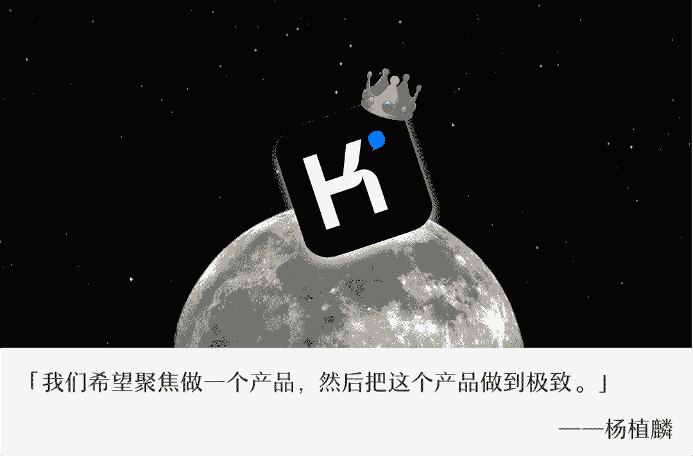

Kimi 是我很早就被圈粉的一个 AI 产品， 半个月前去了趟北京，怀着激动的心情，顺道也去 Kimi 参观了一下。

出乎意料的是，这样一家估值约 30 亿美金的 AI 独角兽，竟挤在两层朴素的办公楼里。甚至门口的牌牌，也是刚装上没多久。

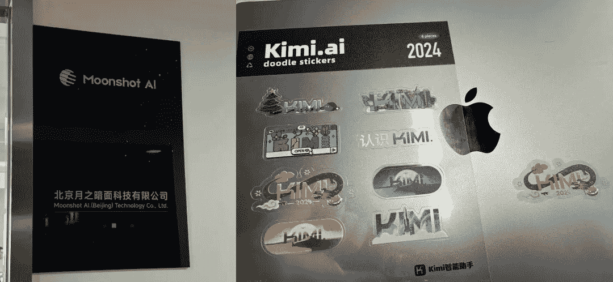

最后礼貌白嫖了一些伴手礼

不是，难道世界真的是个草台班子？当时我就忍不住想吐槽，Kimi 你融了这么多米，招了这么多优秀的工程师，赶紧搬大楼，赶紧更新，赶紧卷起来呀。

你看看隔壁那谁，又推出 X 功能 又推出 Y 产品了，还有那谁，又超越 GPT4 遥遥领先了。

**好好好，“听劝”的 K**imi，这次推出了个 Kimi 浏览器助手 ，我们也第一时间测评了一下，看看“憋出来了个什么大招”。

Kimi 不早有浏览器插件了吗？

No, No, No，之前辣个是一个“跟我同样热爱 AI 但开发能力比我强百倍”的三方作者制作的。

**这个插件一经推出可以说是**好评如潮，这一次官方自己也做了一个， 想必更是“风韵犹存”啊 。

话不多说，我们直接进入官网，点击左侧最下面的「下载 Kimi 浏览器助手」。

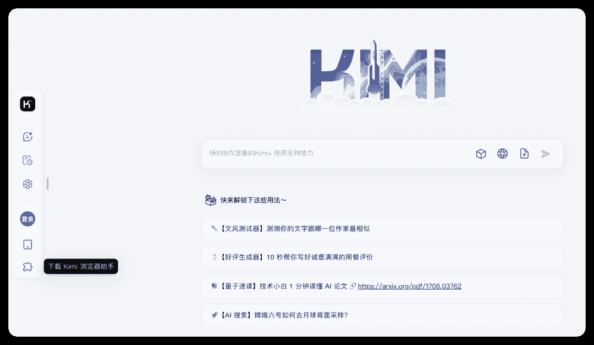

或者打开这个链接：https://kimi.moonshot.cn/extension/download

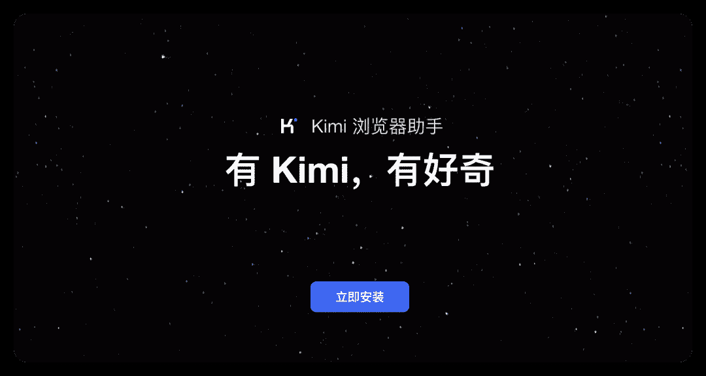

（忍不住夸一句，映入眼帘的就是这该死的黑白简约风的美感，审美快赶的上特工宇宙了

插件安装的速度就跟 Kimi 回复的速度一样飞快。

为防止迷路，可以点这个把「Kimi 浏览器助手」固定住～。

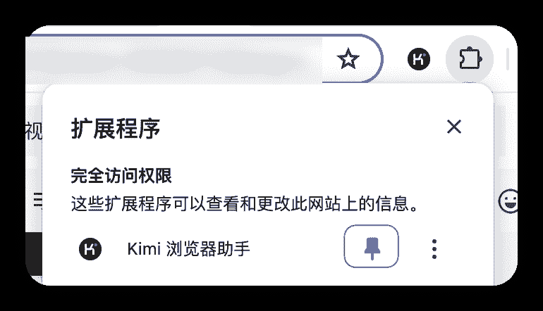

然后，我们可以点击屏幕上出现的小浮窗，或是设置一个快捷键，一键即可唤起它。

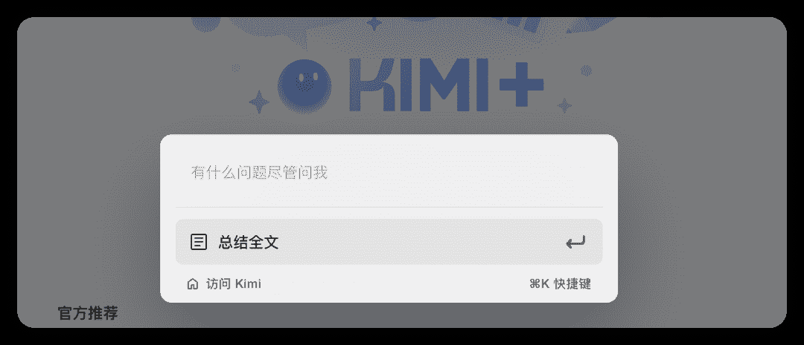

除了浮窗模式，还可以点击这儿，切换成「侧边栏」模式。

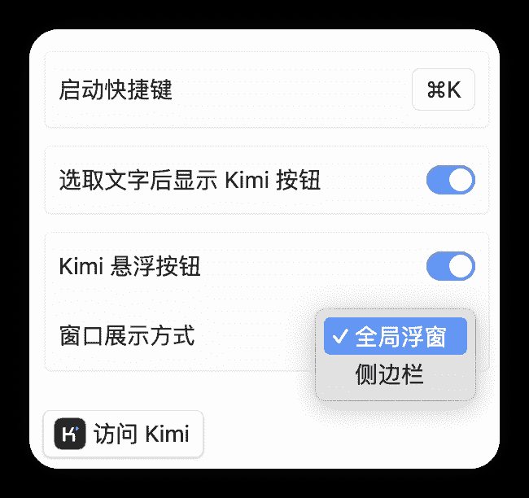

安装完成之后，我们来看看这个插件到底有啥功能，划词翻译啥的都是小儿科，咱们主要来讲讲 Kimi 的特色。

1. 有 问题，划线问 Kimi .

我们浏览网页的时候经常会有一些看不懂的名词或片段，以前大都是复制了问题去搜索，查看四五个搜索页面的结果之后得到一个大致的回答。

而现在，有了 Kimi 插件，你只需要对有疑问的内容，进行划线，然后点击小浮窗，就能快速得到答案。

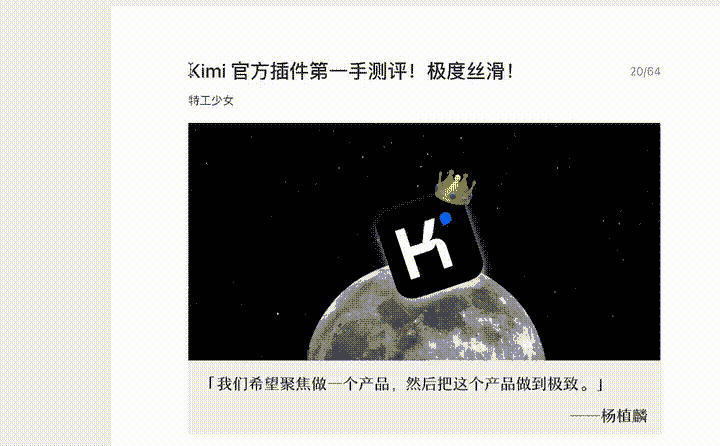

如果仍然有问题，可以继续追问。

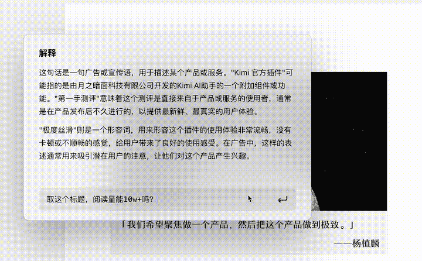

更炸裂的是， 在浏览网页时， Kimi 会通过下划线高亮显示「其他用户关注的内容」 。

仅需将鼠标悬停在这些部分，即可快速访问其中的深度解释和优质问答，轻松连接到同样话题的讨论。

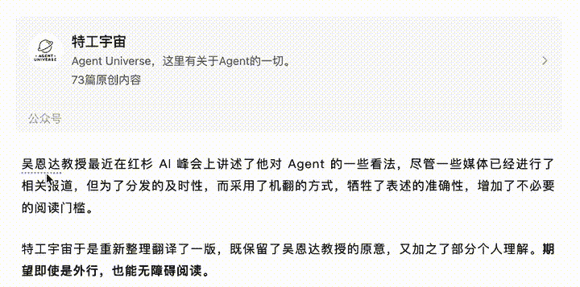

因此可以看到其他用户针对某一段内容的提问，以及多少人问了某问题（有点像微信读书里的划线功能），试想一下，未来你进入一个页面，其中的重点已经被划线出来，并只需要将鼠标放上去，即可看到大家都在问什么，枯燥的页面成了一个“内容社区”。

2. 读文章 ，摘要找 Kimi .

之前要总结文章，都要 复制 文章链接，然后打开 Kimi 官网来问答。

然鹅现在只需要唤起快捷键，点击【总结全文】即可，效率 Up Up!~

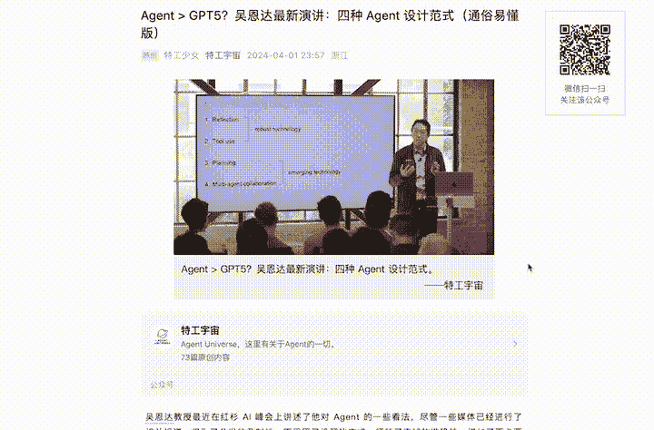

3. 写文章 ，灵感找 Kimi .

作为一个内容创作者，想不出选题的时候是非常痛苦的，调研相关技术也是非常耗时的。

而现在我们可以直接狠狠“压榨” Kimi 小秘书！

先 将浮窗改为【侧边栏】，内容展示更加直观，然后有啥问题直接在侧栏问她。

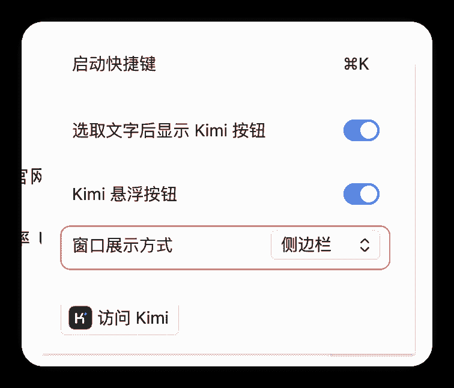

Kimi 小秘书生成好的内容可以一键复制，如果写的不如意，还能继续 CPU 她，改到满意为止

一下子写文章写报告的效率又提升了！

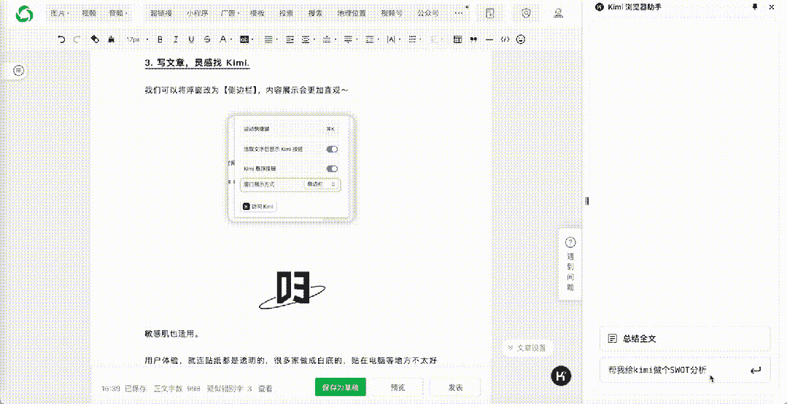

综合体验下来，Kimi 插件虽然是一个轻量的产品，但是非常重视用户体验，极度丝滑（ 敏感肌也适用，不影响开兰博基尼）。

杨植麟最近曾公开表示：“ **我们肯定还是会很聚焦地，只做 K**imi 这一个产品，把这个产品做到极致 。”

作为一个 Kimi 重度使用用户，我是能感受到 Kimi 在交互和模型上细小的更新的。 渐渐的，我开始理解 Kimi.

杨植麟是真正关注第一性原理的，Kimi 是真正重视用户体验的 。

杨是信仰 Scaling Law 的， 有技术 Sense 的，有聚焦点， 注重从模型底层出发去做技术优化。而 Kimi 是一个很有个性的产品，优雅的 UI 和交互，极快的回复速度，较少的幻觉产生，圈粉无数。

之前有调研过在校大学生使用 AI 情况，大部分使用 AI 产品的同学，基本都在使用 Kimi，使用场景集中在文案生成，信息获取，代码生成等生产力方面。而如今 Kimi 上线了个浏览器插件，扩展了 Kimi 能力的使用场景，更大程度地方便了学生党以及 PC 工作者的用户体验。

说到用户体验，额外扯点别的，Kimi 周边贴纸都是贴心地做成透明的，很多家做成白底的，贴在电脑等地方不太好看哈哈哈哈。

最后，希望 Kimi 在保持自己风度的同时，能快快地更新！比如更新个视频和 PDF 的解析功能，再比如「插件上的提问，能云同步到历史记录」...

如果未来能做个桌面版，就能解锁更多的场景啦！ 期待 Kimi 下次带给我们更大的惊喜！