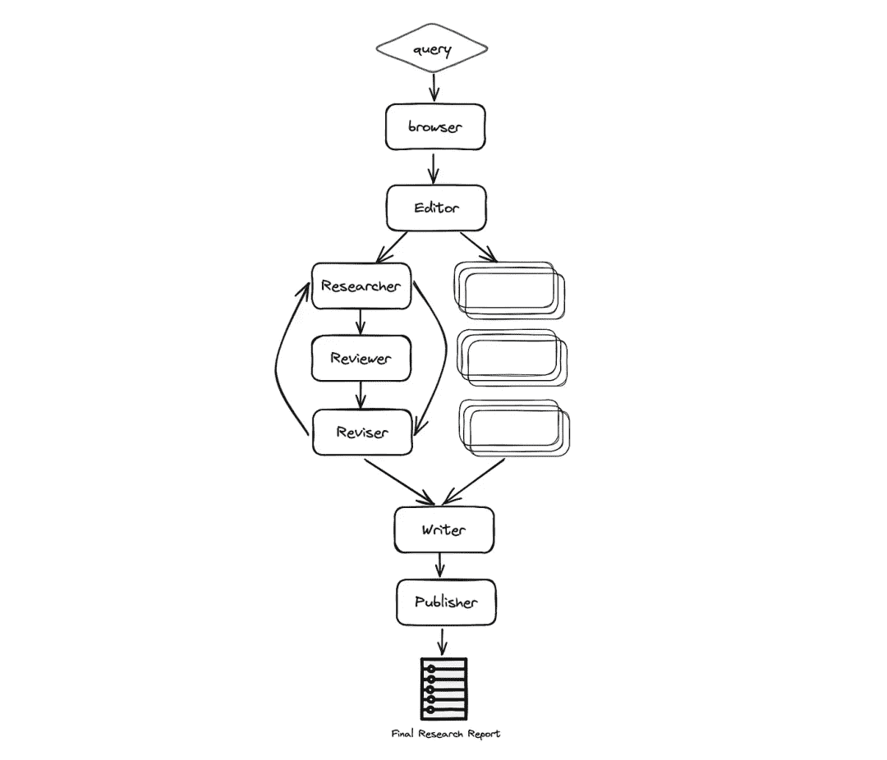

# 如何构建终极的AI自动化系统：多代理协作指南

> 来源：[https://agijuejin.feishu.cn/docx/Q0yVdBvyfovsGXxs5hycDu3Snkc](https://agijuejin.feishu.cn/docx/Q0yVdBvyfovsGXxs5hycDu3Snkc)

> 作者：AI小智

> 原文：https://mp.weixin.qq.com/s/oA06EOgV2b0W1xaSOFiuJA

> **❝**

> **编辑注： **本文经翻译并二次整理自How to Build the Ultimate AI Automation with Multi-Agent Collaboration一文。由Wix的研发负责人Assaf Elovic撰写，他将向我们展示如何利用LangGraph和多个Agent组合，构建一个能够自主进行研究的AI助手。

自GPT Researcher首次发布以来，仅仅一年时间，构建、测试和部署AI代理的方法已经取得了显著进步。从最初的zero-shot或few-shot prompting，迅速发展到代理的function calling、RAG，再到现在的Agent工作流（也称为flow engineering）。

吴恩达 最近指出：“我认为AI代理工作流今年将推动巨大的AI进步，甚至可能超过下一代基础模型。这是一个重要的趋势，我鼓励所有从事AI工作的人士关注。”

在本文中，你将了解到为什么多Agent工作流是目前的最佳实践，以及如何使用LangGraph构建一个最佳的自主研究多Agent助手。

想要跳过教程，可以直接查看GPT Researcher与LangGraph的最终代码实现https://github.com/assafelovic/gpt-researcher/tree/master/multi_agents。

###  **LangGraph简介 **

LangGraph是LangChain的扩展，旨在创建Agent和多Agent流程。它增加了创建循环流程的能力，并内置了短期记忆——这两个特性对于创建Agent至关重要。

LangGraph为开发人员提供了高度的可控性，对于创建定制代理和流程非常重要。几乎所有生产中的代理都针对它们试图解决的特定用例进行了定制。LangGraph为您提供了创建任意定制代理的灵活性，同时提供了一个直观的开发人员体验。

让我们开始构建吧！

###  **构建终极的自主研究代理 **

通过利用LangGraph，研究过程可以通过利用具有专业技能的多个Agent，在深度和质量上得到显著提升。每个代理都专注于特定的技能，这样可以实现更好的关注点分离、可定制性，并随着项目的增长而进一步发展。

受到最近STORM论文的启发，这个例子展示了一个AI代理团队如何协作开展给定主题的研究，从规划到出版。这个例子还将利用领先的自主研究代理GPT Researcher。

###  **研究代理团队 **


研究团队由七位 **LLM Agent **组成：

+   **主编 **— 负责监督整个研究过程和管理团队。这是“主”代理，使用LangGraph协调其他代理。该代理作为主要的LangGraph接口。

+   **GPT Researcher **— 一个专门的自主代理，负责对给定主题进行深入研究。

+   **编辑 **— 负责规划研究大纲和结构。

+   **审稿人 **— 根据一组标准验证研究结果的正确性。

+   **校对者 **— 根据审稿人的反馈校对研究结果。

+   **作家 **— 负责编写最终报告。

+   **出版商 **— 负责将最终报告发布到多种格式，如PDF、Docx、Markdown等。

###  **架构设计 **

正如下面所示，自动化过程基于以下阶段：规划研究、数据收集与分析、审查与修订、撰写报告，以及最终的出版：



研究过程的自动化阶段图

更具体地说，流程包括以下步骤：

+   检索数据（gpt-researcher） — 根据给定的研究任务，在互联网上进行初步研究。这一步对于LLM来说至关重要，因为它可以基于最新和相关信息来规划研究过程，而不是仅依赖于预训练数据。

+   **编辑 **— 根据初步研究结果规划报告的大纲和结构。编辑还负责启动基于计划大纲的并行研究任务。

对于大纲中的每个主题（并行进行）：

+   研究员（gpt-researcher） — 对子主题进行深入研究并撰写草稿。这个代理利用GPT Researcher的Python包，进行优化、深入和事实性的研究报告。

+   **审稿人 **— 根据一组指南验证草稿的正确性，并为校对者提供反馈（如果有的话）。

+   **校对者 **— 根据审稿人的反馈校对草稿，直至满意为止。

+   **作家 **— 负责整合并撰写包含引言、结论和参考文献部分的最终报告。

+   **出版商 **— 将最终报告发布到多种格式，如PDF、Docx、Markdown等。

由于代码量较大，我们不会深入到所有代码细节，但会重点介绍我发现有价值的部分。

###  **定义图形状态 **

LangGraph的一个我最喜爱的特性是state management（状态管理）。在LangGraph中，状态通过结构化方法实现，开发人员定义一个GraphState来封装应用程序的整个状态。图中的每个节点都可以修改这个状态，允许基于交互的不断发展的上下文进行动态响应。

在技术设计的每个开始阶段，考虑整个应用程序的数据模式是关键。在这种情况下，我们将这样定义一个ResearchState：

```
class ResearchState(TypedDict):
    task: dict
    initial_research: str
    sections: List[str]
    research_data: List[dict]
    # 报告布局
    title: str
    headers: dict
    date: str
    table_of_contents: str
    introduction: str
    conclusion: str
    sources: List[str]
    report: str
```

如上所示，状态被分为两个主要部分：研究任务和报告布局内容。随着数据在图代理中流通，每个代理将基于现有状态生成新数据并更新它，以便后续处理图中的其他代理。

然后，我们可以这样初始化图形：

```
from langgraph.graph import StateGraph
workflow = StateGraph(ResearchState)
```

###  使用LangGraph初始化流程

如前所述，多Agent开发的好处之一是可以独立构建每个Agent，使其具有专业和限定的技能。以Researcher代理为例，它使用了GPT Researcher Python包：

```
from gpt_researcher import GPTResearcher

class ResearchAgent:
    def __init__(self):
        pass

    async def research(self, query: str):
        # 初始化研究员
        researcher = GPTResearcher(parent_query=parent_query, query=query, report_type=research_report, config_path=None)
        # 对给定的查询进行研究
        await researcher.conduct_research()
        # 编写报告
        report = await researcher.write_report()

        return report
```

如上所示，我们创建了Research代理的一个实例。现在假设我们已经为团队的每个代理都做了同样的事情。创建完所有代理后，我们将使用LangGraph初始化流程：

```
def init_research_team(self):
    # 初始化代理
    editor_agent = EditorAgent(self.task)
    research_agent = ResearchAgent()
    writer_agent = WriterAgent()
    publisher_agent = PublisherAgent(self.outputdir)
```

###  **初始化研究团队 **

```
    # 定义Langchain StateGraph与ResearchState
    workflow = StateGraph(ResearchState)
    
    # 为每个代理添加节点
    workflow.add_node(&quot;browser&quot;, research_agent.run_initial_research)
    workflow.add_node(&quot;planner&quot;, editor_agent.plan_research)
    workflow.add_node(&quot;researcher&quot;, research_agent.run_parallel_research)
    workflow.add_node(&quot;writer&quot;, writer_agent.run)
    workflow.add_node(&quot;publisher&quot;, publisher_agent.run)
    
    # 添加边以连接节点
    workflow.add_edge(&#x27;browser&#x27;, &#x27;planner&#x27;)
    workflow.add_edge(&#x27;planner&#x27;, &#x27;researcher&#x27;)
    workflow.add_edge(&#x27;researcher&#x27;, &#x27;writer&#x27;)
    workflow.add_edge(&#x27;writer&#x27;, &#x27;publisher&#x27;)
    
    # 设置起始节点和结束节点
    workflow.set_entry_point(&quot;browser&quot;)
    workflow.add_edge(&#x27;publisher&#x27;, END)
    
    return workflow
```

**如上所示，创建La**ng**Graph图非常直**接，主要包括三个函数： add_node 、 add_edge 和 set_entry_point 。首先，你可以向图中添加节点，然后连接边，并最终设置起始点。

如果你一直关注代码和架构，会发现审稿人和校对者代理在初始化中缺失。接下来，我们将讨论这部分内容。

###  **图中图：支持有状态的并行化 **

这是我使用LangGraph时,最令我激动的部分。这个自主助手的一个亮点是能够针对每个研究任务并行运行，然后根据预定义的指南进行审查和修订。

在优化速度的同时，了解如何在流程中利用并行工作至关重要。但如果所有Agent都报告相同的状态，如何触发并行代理工作呢？这可能导致竞态条件和最终数据报告的不一致性。为解决这个问题，可以创建一个子图，该子图将从主LangGraph实例触发，并且这个子图将持有每个并行运行的独立状态，从而解决了上述问题。

按照之前的步骤，我们定义LangGraph状态及其代理。由于这个子图主要审查和修订研究草稿，我们将定义状态以草稿信息为主：

```
class DraftState(TypedDict):
    task: dict
    topic: str
    draft: dict
    review: str
    revision_notes: str
```

在D**raft**State中，我们主要关注讨论的主题，以及审阅者和修订注释，因为它们需要相互沟通，以完成子主题研究报告的最终确定。为了创建循环条件，我们将利用LangGraph的另一个重要特性—— 条件边 ：

```
async def run_parallel_research(self, research_state: dict):
    workflow = StateGraph(DraftState)
    
    workflow.add_node(&quot;researcher&quot;, research_agent.run_depth_research)
    workflow.add_node(&quot;reviewer&quot;, reviewer_agent.run)
    workflow.add_node(&quot;reviser&quot;, reviser_agent.run)
    
    # 设置起始点，以及从研究员到审阅者，再到校对者的边
    workflow.set_entry_point(&quot;researcher&quot;)
    workflow.add_edge(&#x27;researcher&#x27;, &#x27;reviewer&#x27;)
    workflow.add_edge(&#x27;reviser&#x27;, &#x27;reviewer&#x27;)
    # 添加条件边，根据审阅者的反馈决定是接受还是修订
    workflow.add_conditional_edges(&#x27;reviewer&#x27;,
                                   (lambda draft: &quot;accept&quot; if draft[&#x27;review&#x27;] is None else &quot;revise&quot;),
                                   {&quot;accept&quot;: END, &quot;revise&quot;: &quot;reviser&quot;})
```

通过定义条件边，图会根据审阅人的反馈决定是进入校对者节点还是结束流程。回顾我们构建的主图，你会看到这个并行工作是在名为“researcher”的节点下进行的，该节点由主编代理触发。

###  **运行研究助手 **

在完成代理、状态和图形的构建后，是时候启动我们的研究助手了！为了便于定制，助手根据给定的任务.json文件运行：

```
{
  &quot;query&quot;: &quot;AI 是否处于炒作周期？&quot;,
  &quot;max_sections&quot;: 3,
  &quot;publish_formats&quot;: {
    &quot;markdown&quot;: true,
    &quot;pdf&quot;: true,
    &quot;docx&quot;: true
  },
  &quot;follow_guidelines&quot;: false,
  &quot;model&quot;: &quot;gpt-4-turbo&quot;,
  &quot;guidelines&quot;: [
    &quot;报告必须采用APA格式编写&quot;,
    &quot;每个子部分必须包含使用超链接的支持来源。如果不存在，则删除子部分或重写为前一部分的内容&quot;,
    &quot;报告必须用西班牙语编写&quot;
  ]
}
```

任务对象非常直观，但请注意，如果 follow_guidelines 为false，则会导致图形忽略修订步骤和定义的指南。此外， max_sections 字段定义了要研究的子标题数量，这将影响报告的长度。

运行助手将生成最终的研究报告，并提供Markdown、PDF和Docx等格式。

想了解更多或运行示例，请访问GPT Researcher x LangGraph的开源页面。

###  **展望未来 **

展望未来，有许多令人兴奋的发展前景。人为干预对于优化AI体验至关重要。让人类帮助助手修订和专注于正确的研究计划、主题和大纲，将提升整体的质量和体验。此外，确保AI流程中的人为干预可以确保结果的正确性、可控性和确定性。值得高兴的是，LangGraph已经原生支持这些功能，如这里所示。

此外，支持对Web和本地数据的研究将是许多商业和个人用例的关键。

最后，可以进一步努力提高检索来源的质量，并确保最终报告构建在最佳的故事线上。

LangGraph和多代理协作的下一步发展可能是，助手能够根据给定的任务动态规划和生成图形。这一愿景允许助手为特定任务选择一组特定的代理，并根据图形的基本原理规划其策略，这将开启一个全新的可能性世界。鉴于AI领域的创新速度，不久的将来我们可能会看到GPT Researcher的一个新颠覆性版本。我们期待着未来的发展！