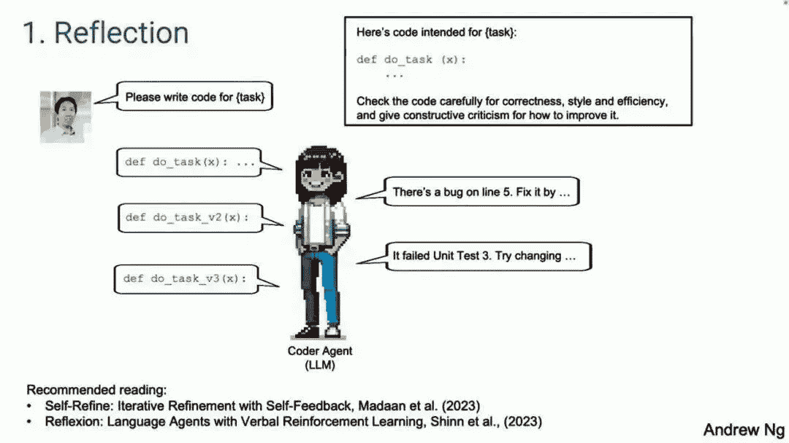
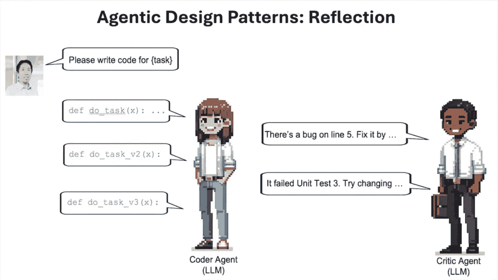
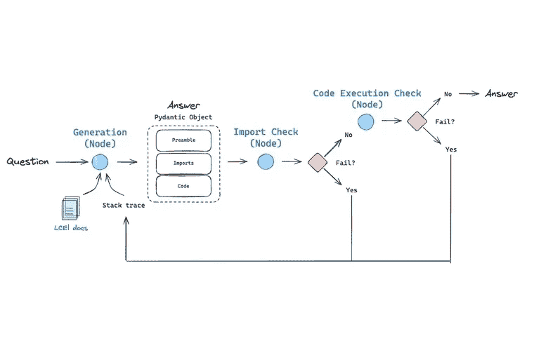

# 超越GPT4的Agent，我用代码实现了！

> 来源：[https://agijuejin.feishu.cn/docx/HVU7dDVZKoFlbfxJvcUct0jAnFe](https://agijuejin.feishu.cn/docx/HVU7dDVZKoFlbfxJvcUct0jAnFe)

> 作者：AI小智

> 原文：https://mp.weixin.qq.com/s/-h3Bz3GaBcywFcOe2PpNOQ


> **❝**

> 最近，人工智能领域的泰斗吴恩达教授提出了一个观点，即通过智能体工作流构建的AI在某些应用场景中的表现甚至可以超越GPT-4。他认为，智能体工作流将是推动今年人工智能发展的重要趋势。本文将深入探讨这一理念，并以LangGraph为例，实现一个能够自我反思和优化代码的智能体。

##  **Agent开发的四种设计模式 **

在吴恩达教授的演讲中，他提到了四种可以显著提升AI智能体性能的设计模式：

1.  **反思（Reflection） **：智能体审视自己的工作，并提出改进的方法。

1.  **使用工具（Tool use） **：智能体利用网络搜索、代码执行等工具来收集信息、采取行动或处理数据。

1.  **规划（Planning） **：智能体制定并执行多步骤计划来达成目标。

1.  多智能体协作（Multi-agent collaboration） ：多个智能体共同工作，通过分配任务和讨论来提出更优的解决方案。


##  反思（Reflection）的深度解析

**在吴恩达教授提出的AI智能体工**作流中， 反思（Reflection） 是一个关键的概念，它指的是智能体在完成任务后，能够自我审视其产出，并主动寻找潜在的改进空间。这种能力不仅对于提升智能体的性能至关重要，也是模拟人类学习过程的关键环节。

###  **反思的过程 **


反思过程通常包括以下几个步骤：

1.  **产出生成 **：智能体根据给定的任务或问题生成初始的解决方案或产出。

1.  **自我评估 **：智能体审视自己的产出，检查是否存在错误、不足或可以改进的地方。

1.  **反馈整合 **：智能体根据自我评估的结果，对产出进行修改和优化。

1.  **迭代循环 **：智能体重复上述过程，通过不断的反思和改进，逐步提升产出的质量。

> **❝**

> 吴恩达教授通过一个代码生成的例子来阐释了反思技术。假设我们要求一个代码智能体为特定任务编写代码，它将根据提示生成代码。然后，我们可以要求智能体检查这段代码的正确性、风格和效率，并提出改进建议。这个过程可以通过多次迭代来不断优化代码。



###  **反思的重要性 **

反思技术的重要性在于它模拟了人类解决问题的方式。在面对复杂问题时，我们往往会先尝试一种解决方案，然后评估其效果，根据反馈进行调整，最终得到一个更好的解决方案。通过在AI智能体中实现这一过程，我们可以使其更加接近人类的思维方式，从而在各种任务中表现得更加出色。

##  基于LangGraph的代码智能体实战



接下来，我们将使用LangGraph来实现一个具有反思能力的代码智能体。我们将分步骤进行，每一步都会有相应的代码示例。



为了进一步充实和细化最后的代码实战章节，我们将深入探讨每个步骤的细节，并提供更多的代码示例和解释，以便读者更好地理解如何实现一个具有反思能力的代码智能体。

###  **1. 定义智能体间的消息通道 **

在构建智能体系统时，状态管理是非常关键的。我们需要一个状态类来跟踪智能体的状态，这包括问题的当前描述、已生成的代码、迭代次数等信息。

```
from typing import Dict, TypedDict

class GraphState(TypedDict):
    keys: Dict[str, any]
```

这个 GraphState 类是一个简单的字典，它允许我们存储和检索智能体的状态信息。这使得我们可以在智能体的不同部分之间传递信息，并在整个工作流中保持状态的一致性。

###  2. 定义代码助手agent和编程导师agent

智能体的工作流程通常包括多个步骤，每个步骤都由一个特定的智能体来执行。在这个例子中，我们有两个智能体：一个代码生成器和一个代码导师。

详细代码见github：https://github.com/q2wxec/langgraph-demo

```
def generate(state: GraphState):
    # 代码生成器智能体的实现
    # ...
    pass

def code_mentor(state: GraphState):
    # 代码导师智能体的实现
    # ...
    pass
```

generate 函数负责根据当前状态和问题生成代码。如果生成的代码在之前的迭代中被标记为不正确，它将使用反馈来改进代码。 code_mentor 函数则扮演一个导师的角色，评估生成的代码，并提供是否正确的判断以及改进的建议。

###  **3. 定义多智能体交互流程 **

智能体之间的交互流程是工作流的核心。我们需要定义一个图结构，指定智能体之间的通信路径和条件。

```
from langgraph.graph import END, StateGraph

# 定义工作流图
workflow = StateGraph(GraphState)

# 添加节点和边
workflow.add_node(&quot;generate&quot;, generate)
workflow.add_node(&quot;code_mentor&quot;, code_mentor)
workflow.set_entry_point(&quot;generate&quot;)
workflow.add_edge(&quot;generate&quot;, &quot;code_mentor&quot;)
workflow.add_conditional_edges(
    &quot;code_mentor&quot;,
    decide_to_finish,
    {
        &quot;end&quot;: END,
        &quot;generate&quot;: &quot;generate&quot;,
    },
)

# 编译工作流
app = workflow.compile()

# 运行工作流
app.invoke({&quot;keys&quot;:{&quot;question&quot;:&quot;如何实现归并排序算法？&quot;,&quot;iterations&quot;:0}})
```

在这个流程中，我们首先从 generate 节点开始，生成初始代码。然后，我们根据 code_mentor 节点的反馈，决定是继续生成代码还是结束流程。如果代码被认为不正确，我们将回到 generate 节点，进行下一轮迭代。这个过程会持续进行，直到我们得到正确的代码，或者达到了预设的迭代次数上限。

###  **案例总结 **

通过这个实战示例，我们展示了如何使用LangGraph来构建一个具有反思能力的代码智能体。这个过程不仅涉及到代码的生成和评估，还包括了智能体之间的协作和信息交换。这种工作流的设计模式能够有效地提升智能体的性能，并使其更加接近人类的解决问题的方式。

在实际应用中，这种方法可以用于自动代码审查、智能编程助手、自动化测试等场景。随着AI技术的不断进步，我们期待看到更多采用这种工作流的智能体出现，并在各个领域发挥重要作用。

##  **结语 **

通过本文的介绍和实战示例，我们可以看到，智能体工作流和反思技术在提升AI性能方面的巨大潜力。随着技术的发展，我们有理由相信，未来的AI将更加智能、高效，能够更好地服务于人类社会。让我们共同期待并推动这一领域的进步。