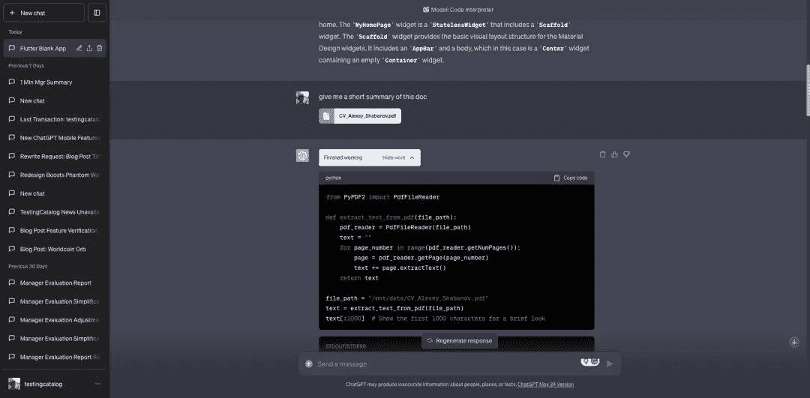
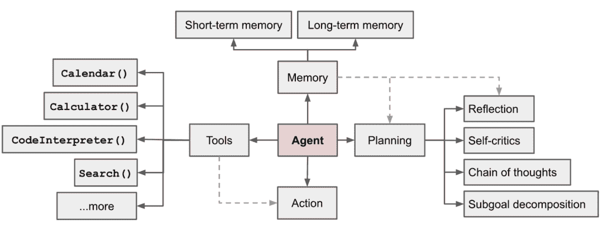
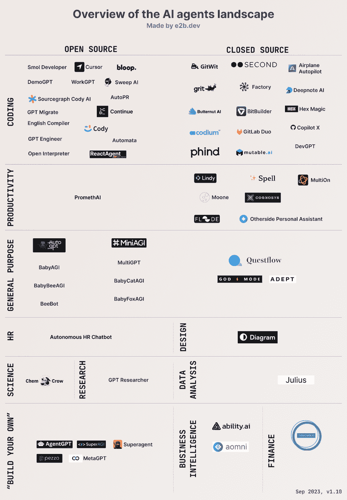

# 「Agent」通俗易懂地聊聊AI Agent（附66个开源+44个闭源Agent项目）

> 来源：`https://agijuejin.feishu.cn/docx/FqGJdFm9noVvzHx0MD6c3VIcnNg`

> 作者：产品欧sir

> 原文：`https://mp.weixin.qq.com/s/HL5WWY🐧gGFnbf7YYBpPCw`

> 先说明一个事实： 像`ChatGPT`这样的AI大语言模型不仅仅是和聊天机器人有关，AI Agent和人类文明模拟的AI模型正在编译 着 我们文明的本质！

斯坦福大学的一篇名为《Generative Agents: Interactive Simulacra of Human Behavior,titled》的论文深入研究了记忆、反应和计划的AI Agent。想象一下人工智能模仿人类的日常任务来处理大量人类的复杂社会行为。`https://arxiv.org/abs/2304.03442`

最近AI圈很火的一个话题就是AI Agent了！AI创投圈也在密切关注着相关创业公司的进展。

很多人也是说大模型都没搞明白，又来了个AI Agent…但是别担心Agent目前也是在起始阶段。

AI Agent能力其实是和大模型相生的，大模型的能力边界还是决定了AI Agent的能力边界~

AI Agent 被认为是 OpenAI 发力的下一个方向。OpenAI 联合创始人 Andrej Karpathy 在近期的公开活动上说 “ 相比模型训练方法，OpenAI 内部目前更关注 Agent 领域的变化，每当有新的 AI Agents 论文出来的时候，内部都会很兴奋并且认真地讨论 ” 。

AI Agent也是被认为是向`AGI`（通用人工智能）又迈进了一步！

下面为大家简单地解释下什么是AI Agent：

## 什么是AI Agent？

目前与AI的交互形式基本上都是你输入指令，AI模型会根据你的指令内容做出响应，这样就是导致你每次在进行提供有效的提示词才能达到你想要的效果。

而AI Agent则不同，它被设计为具有独立思考和行动能力的AI程序。你只需要提供一个目标，比如写一个游戏、开发一个网页，他就会根据环境的反应和独白的形式生成一个任务序列开始工作。就好像是人工智能可以自我提示反馈，不断发展和适应，以尽可能最好的方式来实现你给出的目标。

## 为什么需要AI Agent？

那么为什么大语言模型（`LLM`）刚流行不久，就需要AI Agent呢？

`LLM`与`LangChain` 等工具相结合，释放了内容生成、编码和分析方面的多种可能性，目前在`ChatGPT`插件中比较有代表性的插件就是`code interpreter`。

在这方面的应用上Agent的概念应用发挥着举足轻重的作用。

这里你可以将Agent视为人工智能大脑，它使用`LLM`进行推理、计划和采取行动。

语言模型 (`LLM`) 仅限于它们所训练的知识，并且这些知识很快就会过时。（每天用最新信息重新训练这么大的模型是不可行的。）

以下是`LLM`的一些缺点：

1）会产生幻觉。

2）结果并不总是真实的。

3）对时事的了解有限或一无所知。

4）很难应对复杂的计算。

这就是AI Agent的用武之地，它可以利用外部工具来克服这些限制。

这里的工具是什么呢？工具就是代理用它来完成特定任务的一个插件、一个集成`API`、一个代码库等等，例如：

1）`Google搜索`：获取最新信息

2）`Python REPL`：执行代码

3）`Wolfram`：进行复杂的计算

4）外部`API`：获取特定信息

而`LangChain`则是提供一种通用的框架通过大语言模型的指令来轻松地实现这些工具的调用。

我们都知道在执行一个复杂的任务时，我们需要考虑多方面的影响因素，将复杂任务拆分为细小的子任务去执行。

AI Agent的诞生就是为了处理各种复杂任务的，就复杂任务的处理流程而言AI Agent主要分为两大类：行动类、规划执行类。

### 行动类

行动类Agent负责执行简单直接的任务，例如他们可以通过调用`API`来检索最新的天气信息。

### 规划执行类

Agent首先会制定一个包含多个操作的计划任务，然后按照顺序去执行这些操作。这种方案对于复杂任务的执行而言是非常有用的，`AutoGPT`、`BabyAGI`、`GPTEngineer`等都是这样的例子。

同时Agent在执行计划时会有以下特别重要的两点：

1） **反思与完善**：Agent中设置了一些反思完善的Agent机制，可以让其进行自我批评和反思，与其它一些信息源形成对比，从错误中不断地去吸取教训，同时针对未来的步骤进行完善，提供最终的效果和质量！

2） **长期记忆**：我们常见的上下文学习的提升工程项目都是利用模型的短期记忆来学习的，但是AI Agent则提供了长期保留和调用无限信息的能力，通常是利用外部的向量储存和快速检索来实现！

AI Agent充当大语言模型的大脑，主要有以下几个关键组件进行补充：

### 规划组件（`Planning`）

+   子目标和分解：代理将大型任务分解为更小的、可管理的子目标，从而能够有效处理复杂的任务。

+   反思和完善：智能体可以对过去的行为进行自我批评和自我反思，从错误中吸取教训，并针对未来的步骤进行完善，从而提高最终结果的质量。

### 记忆组件（`Memory`）

+   短期记忆：我认为所有的上下文学习（参见提示工程）都是利用模型的短期记忆来学习。

+   长期记忆：这为代理提供了长时间保留和回忆（无限）信息的能力，通常是通过利用外部向量存储和快速检索。

### 工具组件（`Tools`）

+   代理学习调用外部 `API` 来获取模型权重中缺失的额外信息（通常在预训练后很难更改），包括当前信息、代码执行能力、对专有信息源的访问等。

从技术的专业角度解释AI Agent，大家可以看下面这篇文章：

`https://lilianweng.github.io/posts/2023-06-23-agent/`

我这边创建的AI交流群，想进群的可以关注👸号后获取我的🛰️添加我拉你！

最近很火的AI agent一览表↓

下面为大家整理了目前最全的AI Agent开源和闭源项目清单：

## 开源AI Agent

1. `AgentGPT`

基于浏览器的 `AutoGPT` 实现，可通过无代码平台访问。

`https://agentgpt.reworkd.ai/zh`

2. `AI Legion`

一个让智能体协同工作的平台，其类似于 `AutoGPT` 和 `Baby AGI`，但用 `TypeScript` 编写。

`https://github.com/eumemic/ai-legion`

3. `AutoGPT`

一项旨在使 `GPT-4` 完全自动化的实验性开源尝试，在 GitHub 上拥有超过 14k星标。

`https://agpt.co/?utm_source=awesome-ai-agents`

4. `Automata`

一个复杂的系统，根据项目的上下文自动生成自己的代码。

`https://github.com/emrgnt-cmplxty/automata`

5. `AutoPR`

AI 生成的拉取请求来解决问题，由 `ChatGPT` 提供支持。

`https://github.com/irgolic/AutoPR`

6. `Autonomous HR Chatbot`

企业应用程序 - 由 `GPT-3.5` 提供支持的自主 HR 助理。

`https://github.com/stepanogil/autonomous-hr-chatbot`

7. `BabyAGI`

使用人工智能管理任务的简单框架。

`https://github.com/yoheinakajima/babyagi`

8. `BabyBeeAGI`

`BabyAGI` 之上的任务管理和功能扩展。

`https://yoheinakajima.com/babybeeagi-task-management-and-functionality-expansion-on-top-of-babyagi/`

9. `BabyCatAGI`

`BabyCatAGI` 是 `BabyBeeAGI` 的 mod，`BabyBeeAGI` 是 OG `BabyAGI` 的 mod。

`https://replit.com/@YoheiNakajima/BabyCatAGI`

10. `BabyDeerAGI`

`BabyDeerAGI` 是 `BabyAGI` 的 mod，大约 350 行代码

`https://twitter.com/yoheinakajima/status/1678443482866933760`

11. `BabyElfAGI`

`BabyDeerAGI` 和 OG `BabyAGI` 的最新 mod，大约 895 行代码

`https://twitter.com/yoheinakajima/status/1678443482866933760`

12. `BabyCommandAGI`

一个 AI 代理，旨在测试结合 `CLI` 和 `LLM` 时会发生什么，它们是比 `GUI` 更传统的界面

`https://github.com/saten-private/BabyCommandAGI`

13. `BabyFoxAGI`

`BabyAGI` 的最新版本带有新的并行 UI 面板

`https://github.com/yoheinakajima/babyagi/tree/main/classic/babyfoxagi`

14. `BambooAI`

`BambooAI` 库是一个用户友好的半自主人工智能代理，旨在使非程序员更容易进行数据探索和分析。

`https://github.com/pgalko/BambooAI`

15. `BeeBot`

自主人工智能助手，旨在自主执行各种实际任务。

`https://github.com/AutoPackAI/beebot`

16. `Bloop`

使用 AI 代理的 `GPT-4` 支持的语义代码搜索引擎

`https://bloop.ai/`

17. `Cal.ai`

基于 `Cal.com` 构建的开源日程安排助手。

`https://cal.ai/`

18. `Camel`

大规模语言模型社会“心灵”探索的代理架构。

`https://github.com/camel-ai/camel`

19. `ChemCrow`

一种执行合成、药物发现和材料设计任务的化学试剂。

`https://github.com/ur-whitelab/chemcrow-public`

20. `Clippy`

`Clippy` 的目的是为用户或与用户一起编写代码。 它可以自主规划、编写、调试和测试一些项目。 对于较困难的任务，使用它的最佳方法是查看其工作并向其提供反馈。

`https://github.com/ennucore/clippy/`

21. `Cody by ajhous44`

人工智能助手，旨在让您使用自然语言交互式查询代码库。 通过利用向量嵌入、分块和 `OpenAI` 的语言模型，`Cody` 可以帮助您以高效、直观的方式浏览代码。

`https://github.com/ajhous44/cody`

22. `Cody by Sourcegraph`

`Sourcegraph` 的人工智能代码助手，可以通过阅读您的整个代码库和代码图来编写代码并回答您的问题。

`https://docs.sourcegraph.com/cody`

23. `Continue`

用于软件开发的开源自动驾驶仪。

`https://continue.dev/`

24. `Cursor`

人工智能优先的代码编辑器。 在专为与人工智能进行结对编程而设计的编辑器中更快地构建软件。

`https://www.cursor.so/`

25. `Databerry`

一个超级简单的无代码平台，用于创建根据您自己的数据进行训练的人工智能聊天机器人。

`https://www.databerry.ai/`

26. `Deepnote AI Copilot`

人工智能代码副驾驶可以立即 建立 代码并与整个笔记本环境配合使用。

`https://deepnote.com/blog/introducing-deepnote-ai`

27. `DemoGPT`

一种人工智能，只需使用提示即可快速生成基于 `LLM` 的应用程序的演示。

`https://github.com/melih-unsal/DemoGPT`

28. `DevGPT`

虚拟软件开发团队。

`https://github.com/jina-ai/dev-gpt`

29. `DevOpsGPT`

`DevOpsGPT`：人工智能驱动的软件开发自动化解决方案。

`https://github.com/kuafuai/DevOpsGPT`

30. `English Compiler`

基于 `POC AI` 的编译器，用于将基于英语的 `Markdown` 规范转换为功能代码。

`https://github.com/uilicious/english-compiler`

31. `Friday`

一个开发助手，能够以无限的提示创建整个`nodejs`项目。

`https://github.com/amirrezasalimi/friday/`

32. `GeniA`

Engineering `Gen AI`平台工程团队成员。

`https://github.com/genia-dev/GeniA`

33. `Godmode`

受`Auto-GPT` 和 `BabyAGI` 启发的项目，通过漂亮的 UI 执行各种任务。

`https://godmode.space/`

34. `GPT Engineer`

一个人工智能代理，根据提示生成整个代码库。

`https://github.com/AntonOsika/gpt-engineer`

35. `GPT Migrate`

轻松地将代码库从一种框架或语言迁移到另一种框架或语言。

`https://github.com/0xpayne/gpt-migrate`

36. `GPT Researcher`

基于 `GPT` 的自主代理，可对任何给定主题进行在线综合研究。

`https://github.com/assafelovic/gpt-researcher`

37. `GPT Runner`

与您选择的文件对话！ 管理并运行您的 AI 预设。

`https://github.com/nicepkg/gpt-runner`

38. `Lemon Agent`

计划-验证-解决 (`PVS`) 代理，实现准确、可靠和可重复的工作流程自动化。

`https://github.com/felixbrock/lemon-agent`

39. `Loop GPT`

将流行的 `Auto-GPT` 项目重新实现为适当的 `python` 包，编写时考虑了模块化和可扩展性。

`https://github.com/farizrahman4u/loopgpt/tree/main`

40. `LocalGPT`

受 `privateGPT` 启发，允许使用您自己的文档作为信息源。

`https://github.com/PromtEngineer/localGPT`

41. `Mentat`

`Mentat` 是一款人工智能工具，可以直接从命令行帮助您完成任何编码任务。

与 `Copilot` 不同，`Mentat` 协调多个位置和文件的编辑。 与 `ChatGPT` 不同的是，`Mentat` 已经拥有您项目的上下文 - 无需复制和粘贴！

`https://github.com/biobootloader/mentat`

42. `MetaGPT`

一种多代理框架，根据一条线的要求，返回 `PRD`、设计、任务或存储库。

`https://github.com/geekan/MetaGPT`

43. `Mini AGI`

基于 `GPT-3.5` / `GPT-4` 的最小通用自治代理 。

`https://github.com/muellerberndt/mini-agi`

44. `Multi GPT`

使 `GPT-4` 完全自治的实验性开源尝试。

`https://github.com/rumpfmax/Multi-GPT`

45. `OpenAGI`

开源 `AGI` 研发平台，支持代理执行基准任务和开放式任务。

`https://github.com/agiresearch/OpenAGI`

46. `Open Interpreter`

一个开源解释器，让大语言模型在您的计算机上运行代码来完成任务

`https://openinterpreter.com/`

47. `Pezzo`

旨在简化提示设计、版本管理、发布、协作、故障排除、可观察性等的开发工具包。

`https://www.pezzo.ai/`

48. `Private GPT`

无需互联网连接即可与文档进行私人交互的工具。

`https://www.privategpt.io/`

49. `PromethAI`

个性化人工智能助手，帮助实现营养和其他目标。

`https://github.com/topoteretes/PromethAI-Backend`

50. `React Agent`

开源 `React.js` 自治 `LLM` 代理。

`https://reactagent.io/`

51. `Smol developer`

您自己的初级开发人员，通过 `e2b` 在几秒钟内完成部署。

52. `Superagent`

不是单个代理，而是一个无需编码即可创建代理的工具。

`https://www.superagent.sh/`

53. `SuperAGI`

一个开源自主人工智能框架，支持开发和部署自主代理。

`https://superagi.com/`

54. `Sweep`

`Github` 助手可帮助修复小错误并实现小功能。

`https://sweep.dev/`

### 55. Teenage AGI

一款受BabyAGI启发的智能体，可以回忆无限的记忆，在采取行动之前“思考”，并且在关闭后不会丢失记忆。

https://github.com/seanpixel/Teenage-AGI/blob/main/README.md#experiments

### 56. “Westworld” simulation

《西部世界》的多智能体模拟库，旨在模拟和优化多个智能体交互的系统和环境。

https://theolvs.github.io/westworld/

### 57. Voyager

Minecraft 中由大语言模型驱动的终身学习代理。

https://voyager.minedojo.org/

### 58. WorkGPT

用于调用 API 的 GPT 代理框架。

https://github.com/team-openpm/workgpt

### 59. yAgents

yAgents 是 Yeager.ai 制作的 Agent-Builder Agent，能够设计、编码和调试自己的工具。

https://github.com/yeagerai/yeagerai-agent

### 60. Yourgoal

BabyAGI 的快速实现。

https://github.com/pj4533/yourgoal/?utm_source=awesome-ai-agents

我这边创建的AI交流群，想进群的可以关注👸号后获取我的🛰️添加我拉你！

---

# 闭源AI Agent

### 1. Ability AI

为企业提供安全、以人为本的自主人工智能代理。

https://ability.ai/

### 2. Adept AI

机器学习研究和产品实验室通过使人类和计算机创造性地协作来构建通用智能。

https://www.adept.ai/?utm_source=awesome-ai-agents

### 3. Airkit.ai

Airkit 是一个开发人员优先的平台，用于构建、测试和部署 AI 代理。

https://www.airkit.ai/

### 4. Airplane Autopilot

Airplane 是一家构建内部工具的公司，他们正在构建自动驾驶仪人工智能助手。

https://www.airplane.dev/autopilot/?utm_source=awesome-ai-agents/

### 5. Aomni

专为商业智能设计的AI代理。

https://www.aomni.com/?utm_source=awesome-ai-agents

### 6. BitBuilder

“开发人员虚拟实习生”，通过针对您的存储库提出的 PR 生成代码。

https://www.bitbuilder.ai/?utm_source=awesome-ai-agents

### 7. broadn

AI 无代码副驾驶，允许用户构建AI应用程序。

https://www.broadn.io/?utm_source=awesome-ai-agents

### 8. Butternut AI

一款可在 20 秒内创建功能齐全、可随时启动的网站的工具。

https://butternut.ai/

### 9. Codium AI

由人工智能驱动的交互式代码完整性开发工具使开发人员能够更快地交付软件并减少错误。

https://www.codium.ai/

### 10. Commit

软件开发人员的职业副驾驶和人工智能代理。

https://commit.dev/

### 11. Cognosys

基于网络的 AutoGPT/babyAGI 版本。

https://cognosys.ai/

### 12. Diagram

人工智能驱动的设计工具适用于从文案写作到从文本生成独特图标的所有内容，最近被 Figma 收购。

https://diagram.com/

### 13. encode

完全自主的软件工程师。

https://encode.software/

### 14. Factory

致力于开发用于端到端构建软件的自主编码机器人。

https://www.factory.ai/

### 15. Fine

使用 AI 代理构建软件。 最大限度地利用 AI 并将您的开发速度提高 10 倍。

https://www.fine.dev/

### 16. Fine Tuner

用于无代码构建 AI 代理的平台。

https://fine-tuner.ai/

### 17. Fixie

用于创建由大语言模型支持的应用程序（例如人工智能代理）的平台

https://www.fixie.ai/

### 18. Floode

人工智能行政助理，可自动处理通信事务。

https://floodehq.com/

### 19. GitHub Copilot X

人工智能驱动的软件开发商。

https://github.com/features/preview/copilot-x

### 20. GitLab Duo

适用于软件开发生命周期每个步骤的一套人工智能功能。

https://about.gitlab.com/gitlab-duo/

### 21. GitWit

为全栈开发人员创建的自动化代码生成工具（测试版）。

https://www.gitwit.dev/

### 22. Grit

自动修复技术差距、将代码迁移和依赖项升级置于自动驾驶仪的工具的测试版。

https://www.grit.io/

### 23. Heights Platform

您的AI教练和AI副驾驶，适合课程创建者、社区建设者和教练。 内置于一体化课程创建和社区软件中。

https://www.heightsplatform.com/

### 24. Hex Magic

Hex 人工智能驱动的工具帮助人类利用数据做出惊人的事情。

https://hex.tech/product/magic-ai/

### 27. Heymoon.ai

终身私人助理：让您随时掌握日历、任务和信息。

https://heymoon.ai/

### 28. Julius

Julius AI允许数据处理、分析和可视化。

https://julius.ai/

### 29. Kad oa

使用 AI 自动驾驶仪进行网页抓取

https://www.kadoa.com/

### 30. Lindy

人工智能助手，可以帮助完成日常任务，例如日历管理、电子邮件起草和合同发送。

https://www.lindy.ai/

### 31. Minion AI

由 GitHub Copilot 的创建者制作，目前处于候补阶段。

https://minion.ai/

### 32. MultiOn

AI私人助理，保持首个AI机票预订、点餐（一个汉堡）和职场证明记录。

https://multion.ai/

### 33. Mutable AI

人工智能加速软件开发。

https://mutable.ai/

### 34. Naut

仍处于早期阶段，有抢先体验的等候名单。

https://www.naut.ai/

### 35. Otherside's AI Assistant

用于日常任务的人工智能浏览助手，可以操作网络浏览器来完成几乎任何任务。

https://www.hyperwriteai.com/personal-assistant

### 36. Phind

个人编程和研究助理。

https://www.phind.com/

### 37. Proficient AI

交互 API 和 SDK 允许开发人员在其应用程序中构建、部署和操作对话式 AI 代理。

https://proficientai.com/

### 38. Questflow

Questflow 是一个面向无代码自主人工智能工作者的市场。

https://questflow.ai/

### 39. Saga

数字AI助手，集成笔记、任务和工具的AI驱动的工作空间。

https://saga.so/ai

### 40. Second

每个代码库的自动迁移和升级。

https://www.second.dev/

### 41. Spell

带有插件的AutoGPT代理

https://spell.so/

### 42. Superluminal

只需几行代码即可将人工智能副驾驶添加到产品的数据仪表板中。

https://superluminal.dev/

### 43. TalktoData

TalktoData AI允许高级数据发现、清理、分析和可视化。

https://talktodata.ai/

### 44. ThinkChain AI

使用您自己的知识库的金融人工智能代理平台。

https://www.thinkchain.ai/
