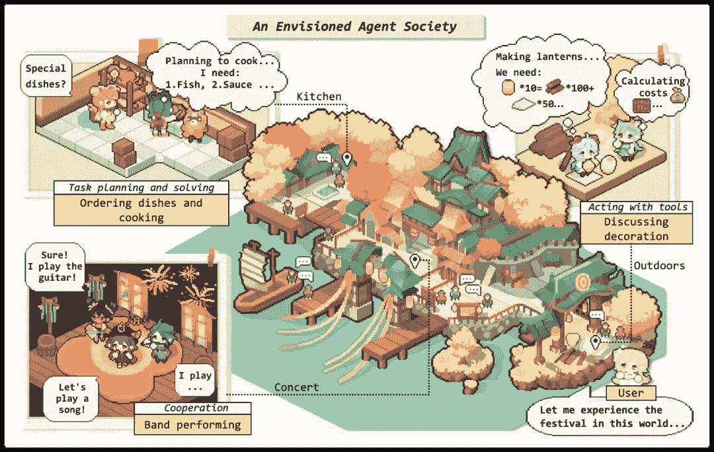
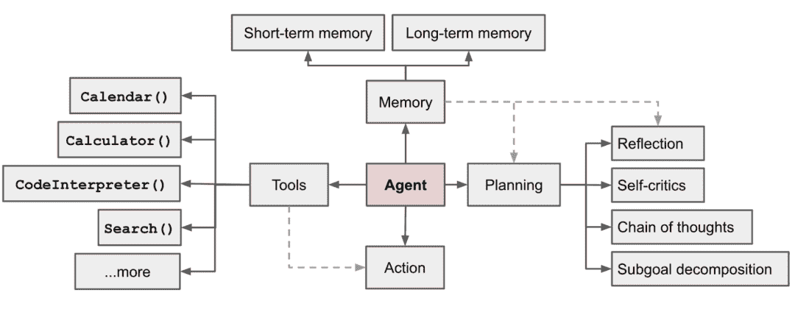
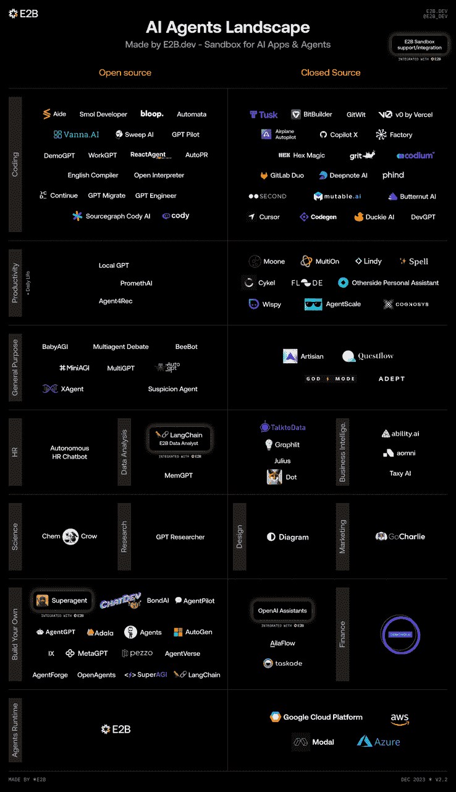
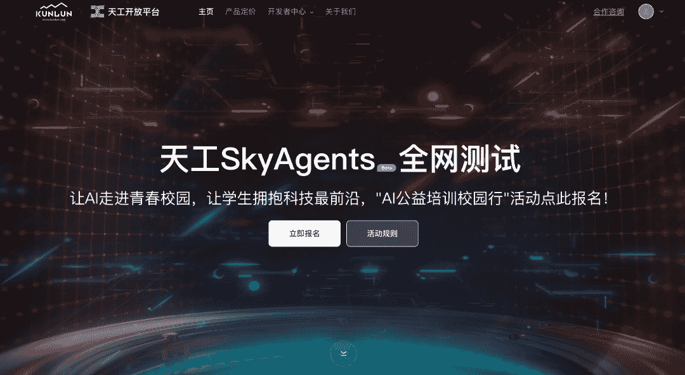
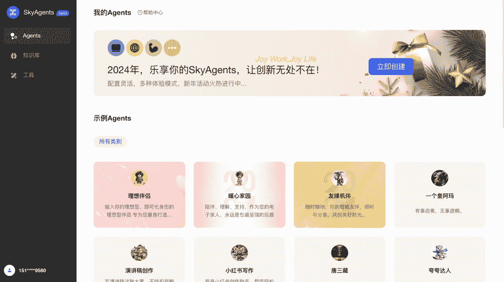
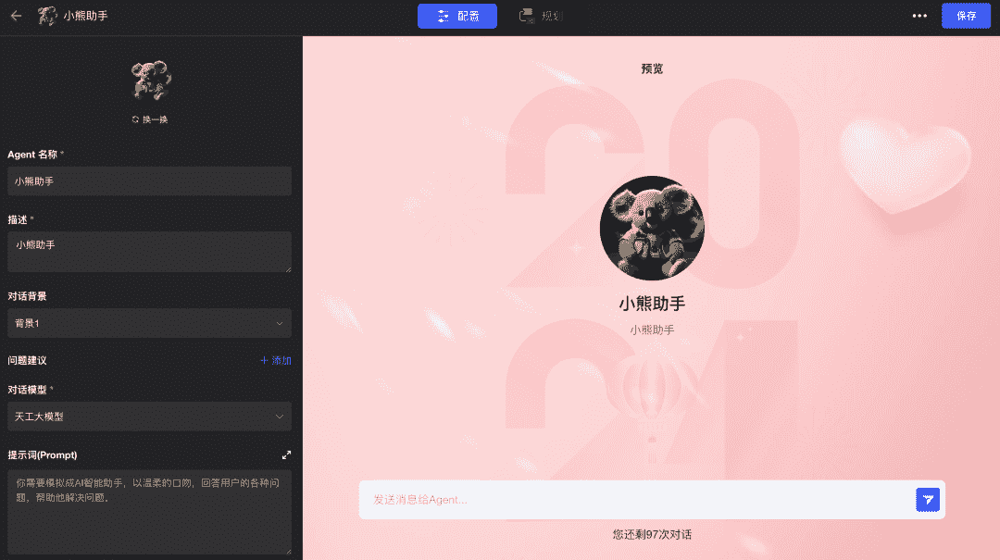
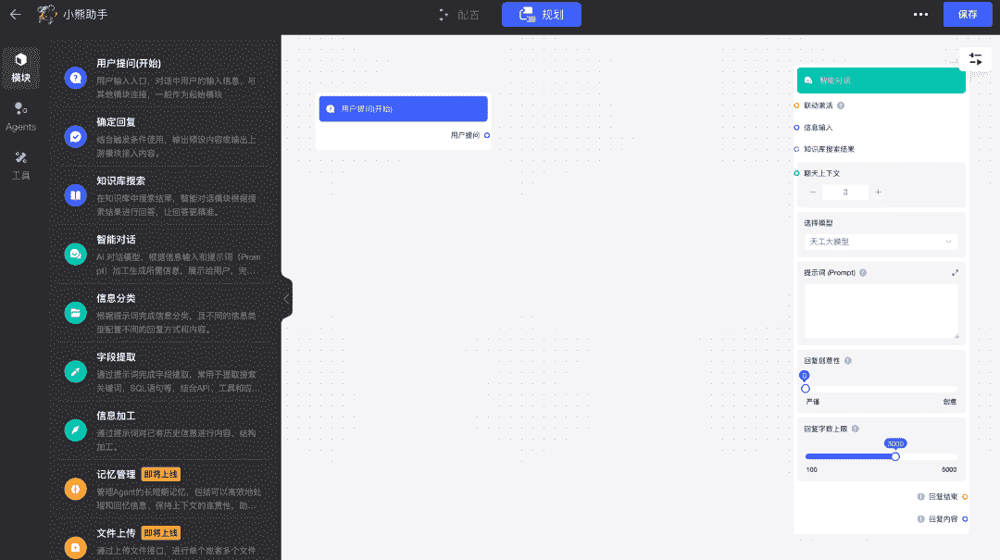
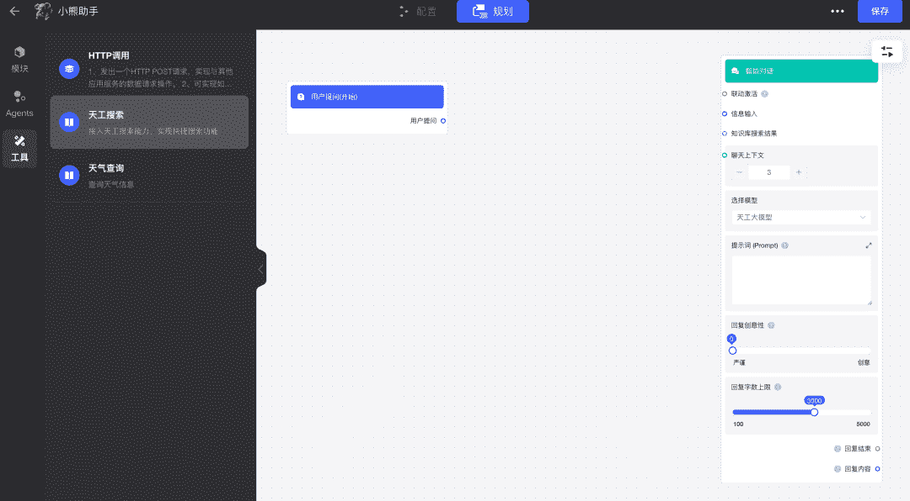
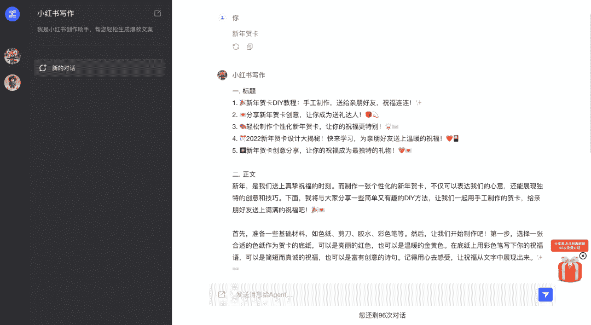

# 打造国内人人可用的Agents，SkyAgents实测体验！

> 来源：[https://agijuejin.feishu.cn/docx/WAq7dBmDmofRPQxKkqZcUvl9n0c](https://agijuejin.feishu.cn/docx/WAq7dBmDmofRPQxKkqZcUvl9n0c)

> 作者：产品欧sir

> 原文：https://mp.weixin.qq.com/s/qwDj8dooYi-LkVGfsJH7ow

首先还是先给大家普及下什么是Agent，以及Agent有什么价值（我会尽量用通俗易懂的语言给大家描述下）：

> “If they find a parrot who could answer to everything, I would claim it to be an intelligent being without hesitation.”

> 如果他们发现一只能对所有事情作出回答的鹦鹉，我会毫不犹豫地宣称它是一个智能生物。

—Denis Diderot, 1875

这张图描绘了一个由 AI 代理构成的理想社会场景，人类也可以参与其中。

上图展示了社会中的一些具体场景：

1）在厨房里，一个代理负责点菜，而另一个代理负责规划和解决烹饪任务。

2）在音乐会上，三个代理正在合作表演乐队。

3）在户外，两个代理正在讨论制作灯笼的计划，包括所需材料和财务，通过选择和使用工具。

用户可以参与这些社会活动阶段的任何一个。

这张图是一个阐述Agent很好的一个例子。

目前人类与AI的交互形式基本上都是你输入指令，AI模型会根据你的指令内容做出响应，这样就是导致你每次在进行提供有效的提示词才能达到你想要的效果。

而AI Agent则不同，它被设计为具有独立思考和行动能力的AI程序。

你只需要提供一个目标，比如写一个游戏、开发一个网页，他就会根据环境的反应和独白的形式生成一个任务序列开始工作。

就好像是人工智能可以自我提示反馈，不断发展和适应，以尽可能最好的方式来实现你给出的目标。

**以**大模型为底座的Agent目前主流的核心构成分成四个部分： 行动（action）、规划执行（planning）、记忆组件（Memory）、工具组件（Tools）。 其大概结构和逻辑如下图：

Agent概念 从去年 斯塔福小镇开始一路被带火， 国外 在 Agent 成熟 度 在目前看来已经十分完善了，最新的统计具体可看 E2B统计的这张图：

虽然有很多概念性的内容都已经非常成熟，但是国内真正落地的却很少，很大部分原因是因为国内生态不够开放，同时基于数据安全政策的一些限制。

抛开这些原因不谈的话，其实还有一个更重要的原因是Agents类的产品操作门槛太高！

但是，人工智能的引领者OpenAI发布了GPTs，给很多**企业带来了关于Agents创**建的灵感： 做人人可用的Agents！

在国内打造人人可用的Agents领域里面，大模型厂商昆仑万维算是先行者了、国内Agents新领域的开创者，在去年12月底时，基于昆仑天工为大模型底座的SkyAgents开启全网测试！

# **SkyAgents实测体验**

登录SkyAgents后，可以看到界面十分简洁清爽，快速创建 Agents的入口也十分方便， Agents首页还给了不少示例模版。

进入Agents创建页面，页面干净整洁：

还支持对Agent行动规划的编排能力，还内置了不少流程编排模版！

Agents和工具配置能力也十分方便快捷，目前 Agent s能力也即将上线！工具能力上目前内置了三种能力：HTTP调用、天工搜索、天气查询能力，其天工搜索的准确度是十分高！

在实测中 Sky Agents对话的效应速度非常快！内容生成上也表现的很完整！

说说 昆仑万维 的 SkyAgents使用感受吧：

昆仑万维的SkyAgents的核心设计理念是遵从 人人可用的Agents理念设计的！

整个页面设计上营造一个真实、简洁的创造体验，让每个人都可以通过 SkyAgents， 迅速构建属于自己的Agents应用！

这是一款国内任何小白都能使用的Agents产品，建议大家玩玩！试玩入口可扫描下方二维码：

