# Kimi豆包，最近都盯上了浏览器

> 来源：[https://agijuejin.feishu.cn/docx/Ermjdvpg2otYBLxQZ3HcK9Fkn6f](https://agijuejin.feishu.cn/docx/Ermjdvpg2otYBLxQZ3HcK9Fkn6f)

> 一水 发自 凹非寺

> 量子位 | 👸号 QbitAI

> 原文：https://mp.weixin.qq.com/s/SU8icMrLONt_1b45RhxK0g

卷大模型应用落地， **浏览器插件 **已成下一个“新战场”。

这不，当红炸鸡子Kimi最近就上线了浏览器插件。

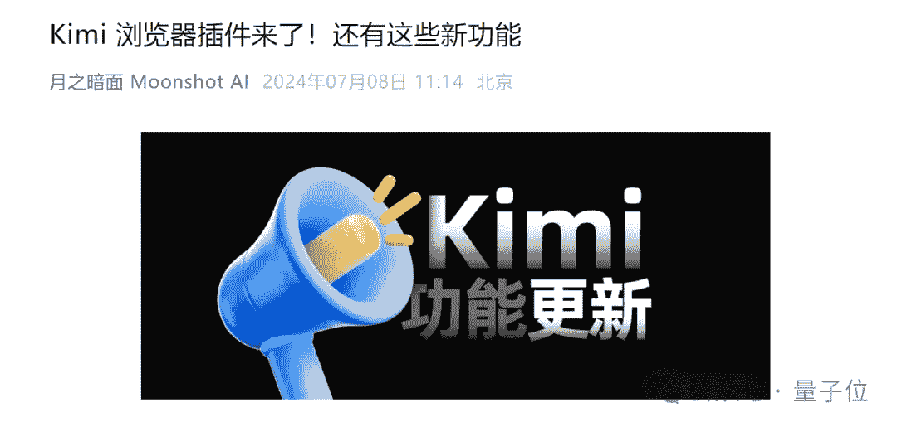

**消息一出，网**友纷纷感叹Kim**i官方**终于下场了，要知道之前网友弄了个 “民间版” 就在谷歌收获了 3w 粉丝。

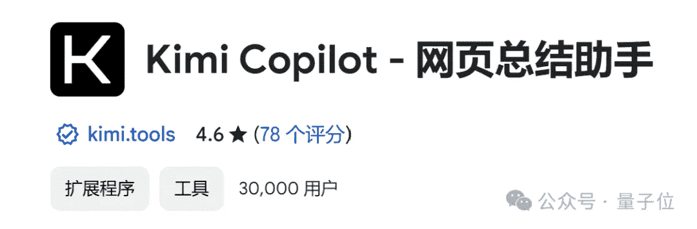

**和Ki**mi不谋而合的是，字节跳动旗下AI助手 豆包 此前也推出了浏览器插件版本，且最新已迭代至1.3.0。

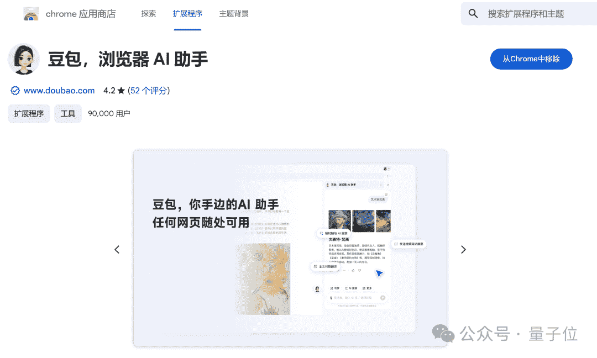

有体验过豆包插件的网友直呼：

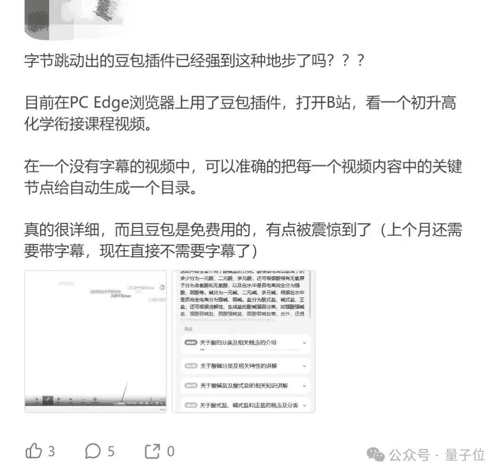

**眼瞅着双方各有**一部分铁杆粉丝，那我们 都要安装试试 ，看看哪个更好。

**截止7月15日 ****，Ch****rom**e商店显示，豆包浏览器插件的下载量已突破了 9万 次，Kimi浏览器插件的下载量刚刚破 2万 。

**而AI产**品榜显示，今年6月，Kimi的用户访问量为豆包的 近4倍 。

**在“硝烟弥漫**”之际，接下来奉上 量子位实测 。

## **Kimi、豆包插件实测**

**众所周知，插件需要解决的最大问**题是—— 减少用户在各个应用间频繁切换 。

在这个基础上，再去说更细层面的用户体验问题。

那么，热门选手Kimi表现如何呢？

**从官方公告来****看，Kim**i插件主打 轻量级搜索 ，目前有“点问笔”和“总结器” 两项功能 。

量子位试用发现，用户划取网页中的文字后，“点问笔”功能会自动出现，对文字进行解释和相关信息补充。

而“总结器”位于页面右下角，会对用户的浏览页面进行全文总结、提炼重点内容，比较适合读论文。

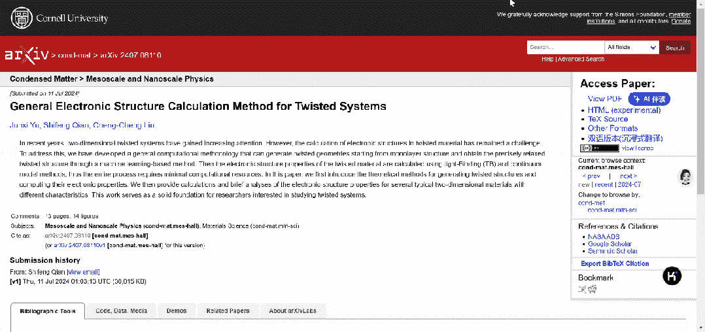

**整体而言 **，Kimi插件就像一些i人朋友，似乎非常不愿意打扰别人。它核心解决了提问和总结两项需求，功能相对聚焦。

而且这种“不愿打扰”的性格也体现在了其他细节，比如Kimi插件的侧边栏模式。

**这一点还**是在和豆包的对比中发现的，同样是 新用户 ，豆包只需点击右上角插件图标就能展开侧边栏。

而Kimi插件需要设置一下，相当于先告诉kimi“我需要侧边栏”，然后才能从默认的浮窗切换过去。

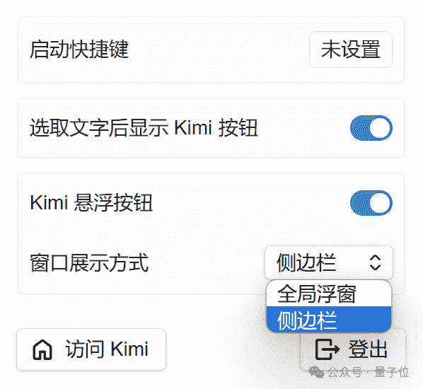

**除了Kim**i，我们也火速上手了 豆包插件 ，体验完头脑中只剩下一个感受：

> 明明只装了一个插件，其他什么也没干，突然AI就到处都是了，常用网站、使用场景它都做了适配。

首先是 **搜索 **，刚尝试搜了个量子位，没想到豆包插件就化身“田螺姑娘”默默出现了。

几乎是同时，豆包插件立马 **自动整理了搜索结果页 **，并附了跳转链接。

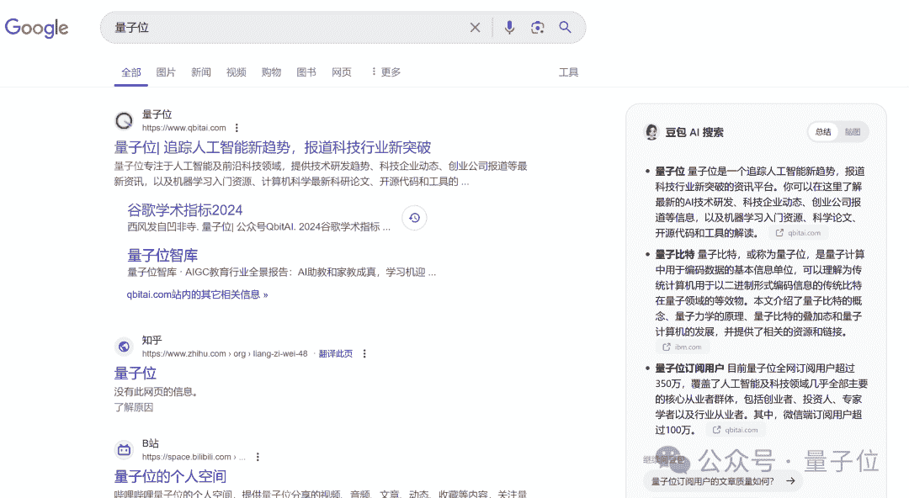

嗯，接下来想看个 **B站视频 **学点东西，结果一看视频有点长就有点怕了。

好在“有人”帮忙看。[doge]

豆包插件刚好有一个 **视频AI时间线 **功能，它会先总结视频内容，然后根据时间线提取视频亮点。

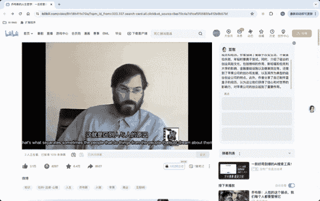

视频的问题解决了，另一个 **“老大难” **也得让豆包插件试试。

作为科技媒体量子位的小编，我们每天会接触大量前沿AI论文，各种让人懵逼的新技术，新名词层出不穷。

这不，入门级论文《Attention Is All You Need》不得先找来读读。

**刚找到论文，**豆包插件就送来了一个小惊喜—— 收藏夹功能 。

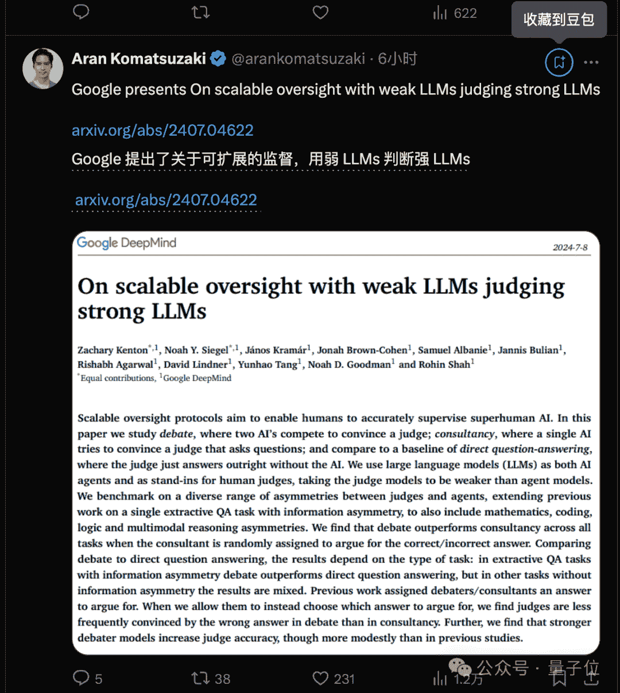

具体用法嘛，比如想收藏这条刚看到的推文，直接右上角收藏即可，虽然并不清楚它是什么时候出现的。

而且平时看到的任何东西（对话、网页、PDF、视频），几乎都可以一键私藏。

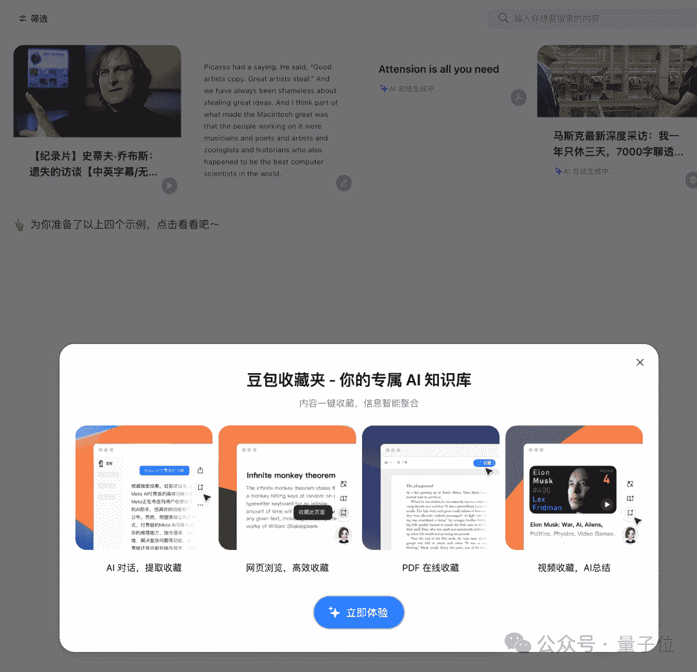

**终于到了读论文**环节，面对头疼的英文文献，突然发现右上角又出现了豆包的 “AI伴读” 。

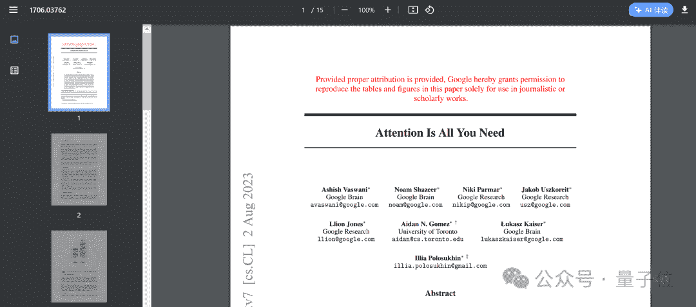

点击后侧边栏直接打开，不仅可以全文翻译，还能针对论文进行提问。

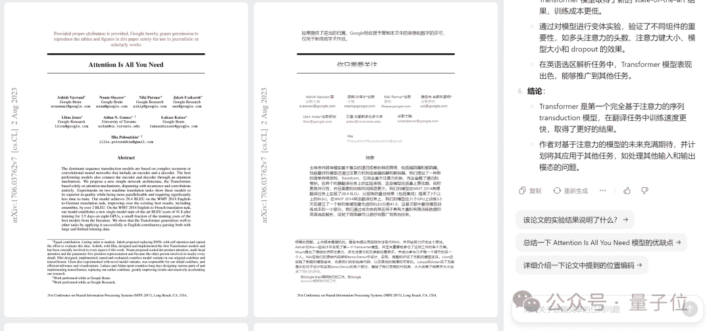

看来读论文已经难不倒我了。[doge]

**顺便一提，与Ki**mi插件无法生成图像不同，豆包插件可以 从文字生成图像 。

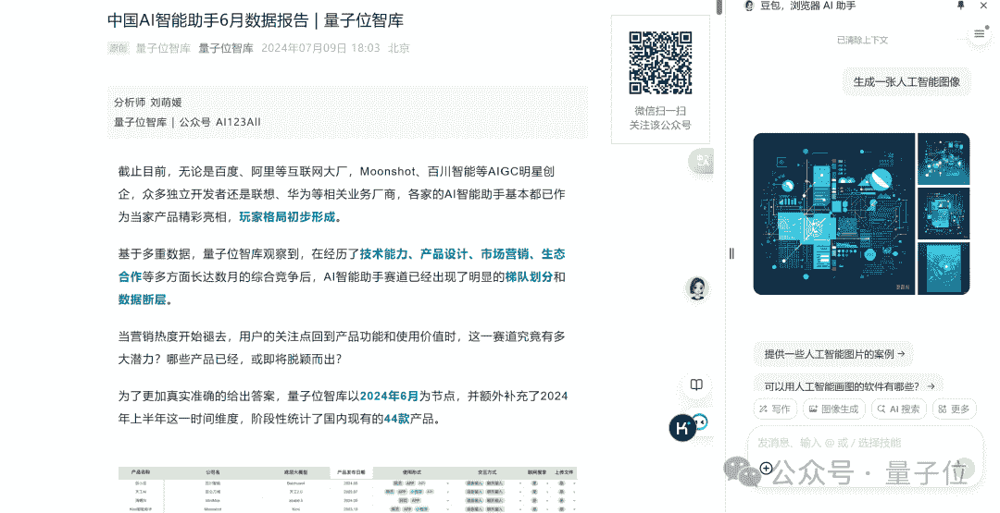

**体验完上述**功能，掰指头一数，豆包插件好像已经把 高频日常 （搜索、视频、论文）都解决了，谁又快乐了？

不过这还没完，随机点点，又发现了豆包插件的一个创新点。

原来豆包插件的 **AI划词工具栏 **还允许用户对外观进行个性化定制，“需要哪个放哪个”。

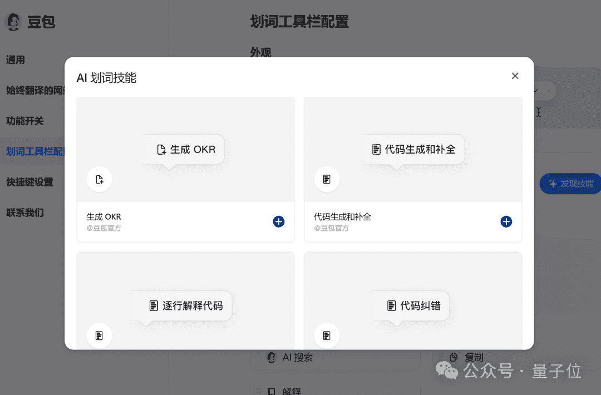

甚至可以 **自定义工具栏技能 **，其实质相当于创建一个GPTs。

比如点亮一个“一键转📕文案”技能：

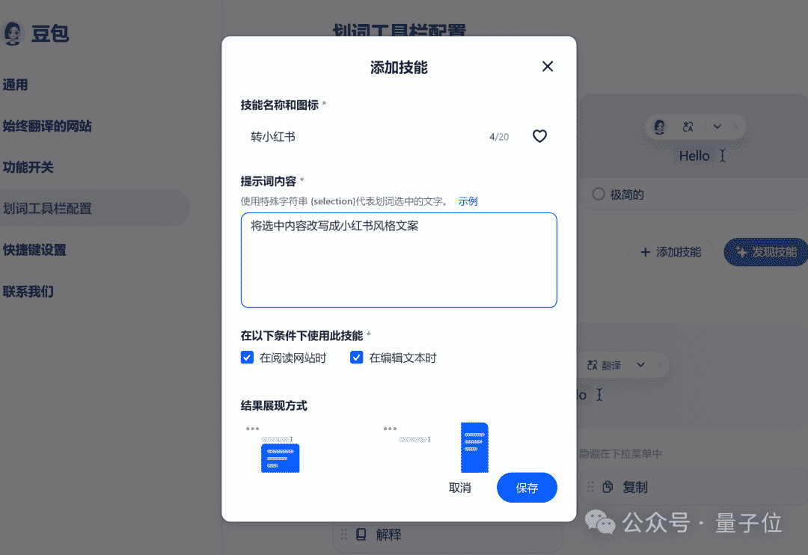

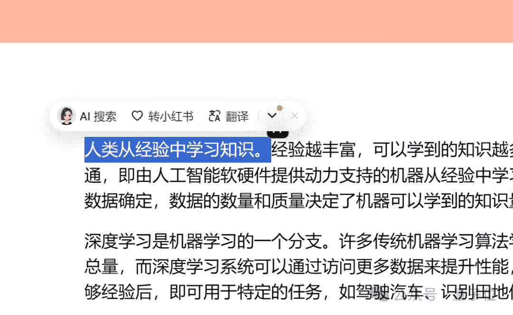

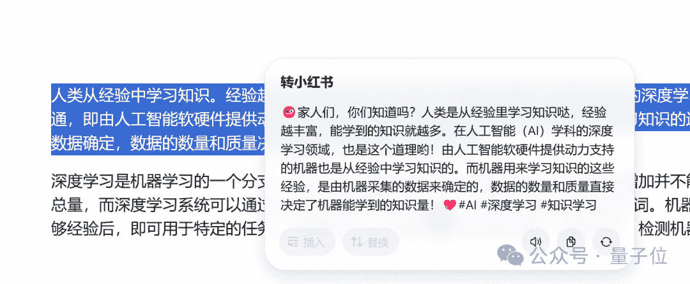

**总结， **相比于“不爱打扰人”的Kimi插件，豆包插件貌似更加风风火火，凡是你需要的，它好像都不缺席。[doge]

**除了以上聚焦国内的两位**玩家，还有 出海玩家Monica 。Monica插件具备写作辅助、搜索增强，生成图像等多种功能，其最大特点是集成了包括ChatGPT在内的许多模型。

Monica创始人肖弘曾公开表示，截至去年12月，该产品在全球用户数已超百万。

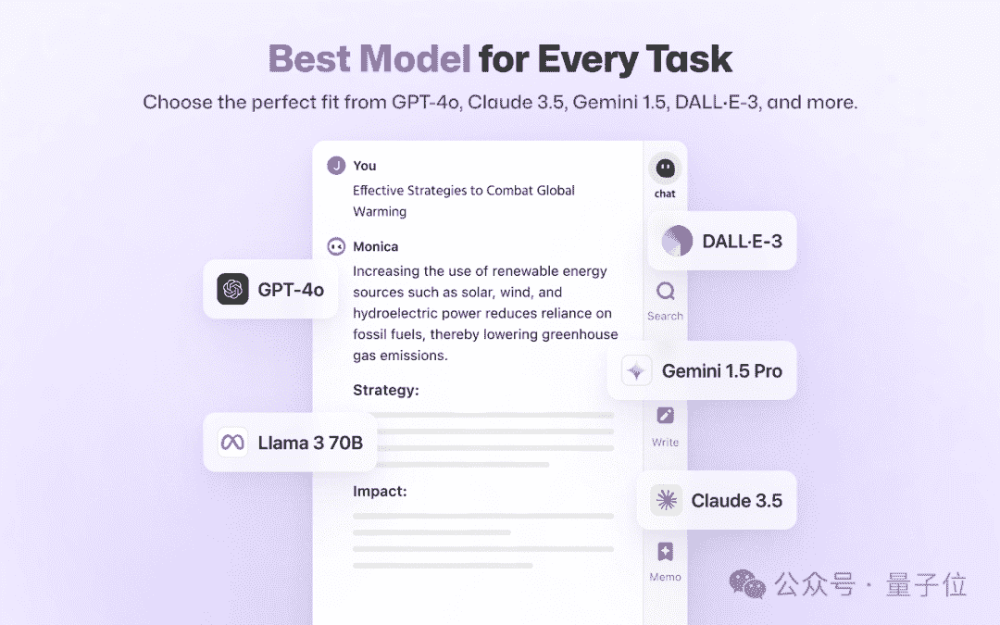

## **AI浏览器插件要比什么？**

**可以看到，**AI浏览器插件已经聚齐了 各类玩家 ：

+   豆包插件背后是字节，代表了大厂巨头

+   Kimi插件背后是月之暗面，代表了大模型独角兽

+   走出海路线的Monica，则代表了AI应用创业

**那么问**题来了，不同类型的玩家在进入新赛道时，各有哪些 优势 呢？

相较于传统的应用开发流程，插件无需开发一整套完整系统，通过接口就能提供服务，且易于修改和更新。

在某种意义上， **插件是AI应用创新的最佳载体 **。

**换句话说，首先**这事儿本身难度就不大，而且各玩家都有自己的 “buff” 。

比如对Kimi插件来说，由于“200K上下文窗口”一炮而红，其网页版已积累了相当一批粉丝基础。

在 **量子位智库6月份 ****的阶段性统计**中，Kimi网页端用户访问量居于榜首，达到 2200万 。

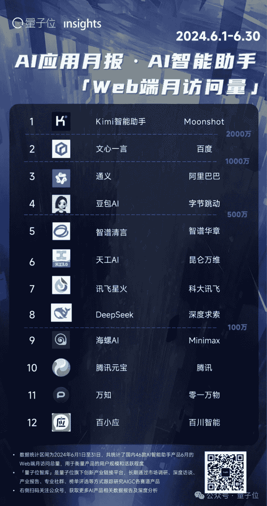

**而对豆包插**件来说，巨头字节最大优势莫过于 破圈能力 。

不仅自身应用场景丰富，还能与其他平台开展合作，打通各个应用和环节。

正如前文展示的用例，豆包插件正是凭借巨头的生态能力，才能无缝集成搜索、B站等应用。

总之，对Kimi、豆包这样的 **国内大模型玩家 **来说，做插件意味着 **进一步放大自身优势 **。

而选择出海创业的Monica插件，更像是“集百家之长”。

由于不受限于背后的模型技术，因此能够为用户提供更多选择。

**整体而言，在浏**览器插件这一领域中的 竞争关键因素 ，一是背后的大模型本身的技术底子够不够厚、生成质量够不够好，二是需要将其轻量化版本进行产品化。

**此处抛开技**术不谈，当插件走向产品化时， 用户体验 的作用逐渐凸显。

有人选择“做多”，让插件的功能尽可能丰富全面；也有人选择“less is more”，在功能上追求简洁。

但不管怎样， **用户的声音 **无疑是真实的。

翻到Kimi和豆包插件的评论区，用户也在表达各自的期待。比如在Kimi官宣新功能的推文底下，热度最高的评论表示“希望插件可以像sider（一款集成了多种AI功能的浏览器扩展程序）一样更加丰富”。

而豆包用户也希望可以完善多语言互译功能，而不是只有英语。

总之，这场 **大模型轻量化落地之战 **，或许才刚刚拉开序幕。

[量子位智库报告（6月份AI智能助手）：

https://m](https://mp.weixin.qq.com/s?__biz=MzUzNDUyNzYzNg==&mid=2247486146&idx=1&sn=a927e36ca80c9a30f1aa7c516aa4d0e3&scene=21#wechat_redirect)p.weixin.qq.com/s/Iiw6AerwSoPGnQrJcv_ErQ

豆包插件地址： https://www.doubao.com/browser-extension/

Kimi插件地址： https://kimi.moonshot.cn/extension/download

Monica插件地址： https://monica.im