# LlamaFactory 一键式LLM训练、微调工具介绍与实践

> 来源：[https://agijuejin.feishu.cn/docx/Zb9HdSfA2odMLqxmOEecguvVnse](https://agijuejin.feishu.cn/docx/Zb9HdSfA2odMLqxmOEecguvVnse)

> 作者：LeonYi

> 原文：https://zhuanlan.zhihu.com/p/697773502

## 一、LlamaFactory介绍

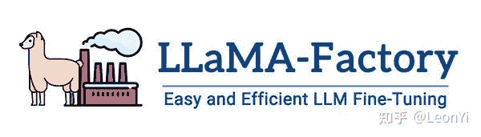

LlamaFactory 是一个封装比较完善的LLM微调工具，它能够帮助用户快速地训练和微调大多数LLM模型。

Github: [https:// github.com/hiy](https://link.zhihu.com/?target=https%3A//github.com/hiyouga/LLaMA-Factory)ouga/LLaM A-Factory

### 1.1 简介

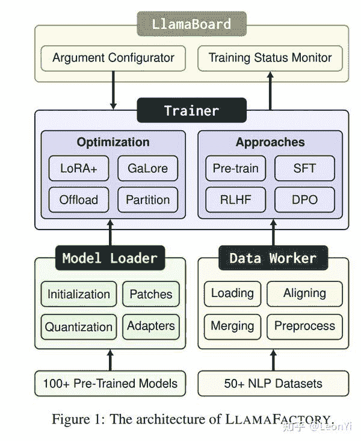

LlamaFactory主要通过Trainer类来实现训练流程，通过设置数据集、模型选型、训练类型、微调超参、模型保存，以及训练状态监控等信息，来开启训练。

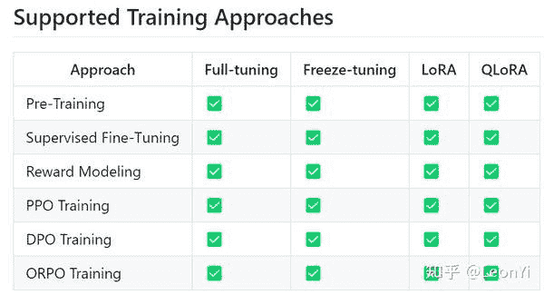

支持的训练方法（这里的Pre-Training指的是增量预训练）

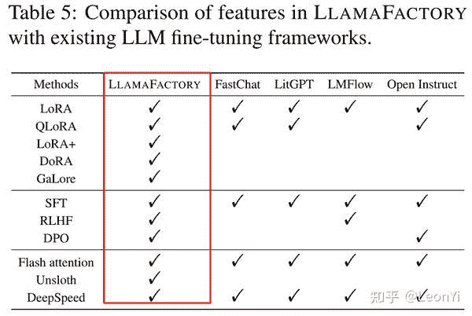

LlamaFactory基于PEFT和TRL进行二次封装，从而可以快速开始SFT和RLHF微调。同时，引入GaLore和Unsloth等方案，能降低训练显存占用。

### 1.2 特性

+   **各种模型 **: LLaMA, LLaVA, Mistral, Mixtral-MoE, Qwen, Yi, Gemma, Baichuan, ChatGLM, Phi, etc.

+   **集成训练方法 **: (Continuous) pre-training, (multimodal) supervised fine-tuning, reward modeling, PPO, DPO and ORPO.

+   Scalable resources : 32-bit full-tuning, 16-bit freeze-tuning, 16-bit LoRA and 2/4/8-bit QLoRA via AQLM/AWQ/GPTQ/LLM.int8.

+   Advanced algorithms : GaLore, BAdam, DoRA, LongLoRA, LLaMA Pro, Mixture-of-Depths, LoRA+, LoftQ and Agent tuning.

+   **实用tricks **: FlashAttention-2, Unsloth, RoPE scaling, NEFTune and rsLoRA.

+   **实验监控 **:LlamaBoard, TensorBoard, Wandb, MLflow, etc.

+   **推理集成 **: OpenAI-style API, Gradio UI and CLI with vLLM worker.

LlamaFactory支持单机单卡，同时整合了accelerate和deepseed的单机多卡、多机多卡分布式训练。

**支持的模型**

| 模型名 | 模型大小 | 默认模块 | Template |
| --- | --- | --- | --- |
| Baichuan2 | 7B/13B | W_pack | baichuan2 |
| BLOOM | 560M/1.1B/1.7B/3B/7.1B/176B | query_key_value | - |
| BLOOMZ | 560M/1.1B/1.7B/3B/7.1B/176B | query_key_value | - |
| ChatGLM3 | 6B | query_key_value | chatglm3 |
| Command-R | 35B/104B | q_proj,v_proj | cohere |
| DeepSeek (MoE) | 7B/16B/67B | q_proj,v_proj | deepseek |
| Falcon | 7B/40B/180B | query_key_value | falcon |
| Gemma/CodeGemma | 2B/7B | q_proj,v_proj | gemma |
| InternLM2 | 7B/20B | wqkv | intern2 |
| LLaMA | 7B/13B/33B/65B | q_proj,v_proj | - |
| LLaMA-2 | 7B/13B/70B | q_proj,v_proj | llama2 |
| Mistral/Mixtral | 7B/8x7B/8x22B | q_proj,v_proj | mistral |
| OLMo | 1B/7B | att_proj | olmo |
| Phi-1.5/2 | 1.3B/2.7B | q_proj,v_proj | - |
| Qwen | 1.8B/7B/14B/72B | c_attn | qwen |
| Qwen1.5 (Code/MoE) | 0.5B/1.8B/4B/7B/14B/32B/72B | q_proj,v_proj | qwen |
| StarCoder2 | 3B/7B/15B | q_proj,v_proj | - |
| XVERSE | 7B/13B/65B | q_proj,v_proj | xverse |
| Yi | 6B/9B/34B | q_proj,v_proj | yi |
| Yuan | 2B/51B/102B | q_proj,v_proj | yuan |

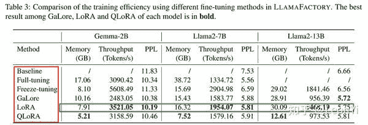

基于LlamaFactory框架进行的各种训练效率比较

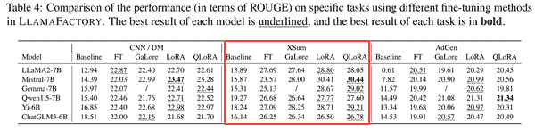

适合进行各种LLM在不同训练方法下，效果评估对比

### 1.3 数据集信息

LlamaFactory配置的数据集格式。

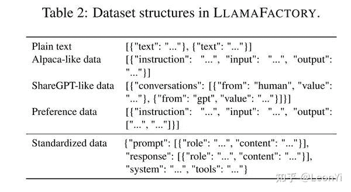

**预训练数据集**

+   [Wiki Demo (en)](https://zhuanlan.zhihu.com/p/697773502/data/wiki_demo.txt)

+   [RefinedWeb (en)](https://link.zhihu.com/?target=https%3A//huggingface.co/datasets/tiiuae/falcon-refinedweb)

+   RedPajama V2 (en)

+   [Wikipedia (en)](https://link.zhihu.com/?target=https%3A//huggingface.co/datasets/olm/olm-wikipedia-20221220)

+   [Wikipedia (zh)](https://link.zhihu.com/?target=https%3A//huggingface.co/datasets/pleisto/wikipedia-cn-20230720-filtered)

+   [Pile (en)](https://link.zhihu.com/?target=https%3A//huggingface.co/datasets/EleutherAI/pile)

+   [SkyPile (zh)](https://link.zhihu.com/?target=https%3A//huggingface.co/datasets/Skywork/SkyPile-150B)

+   [The Stack (en)](https://link.zhihu.com/?target=https%3A//huggingface.co/datasets/bigcode/the-stack)

+   [StarCoder (en)](https://link.zhihu.com/?target=https%3A//huggingface.co/datasets/bigcode/starcoderdata)

**指令微调数据集**

+   Stanford Alpaca (en)

+   Stanford Alpaca (zh)

+   Alpaca GPT4 (en&zh)

+   Self Cognition (zh)

+   Open Assistant (multilingual)

+   [ShareGPT (zh)](https://link.zhihu.com/?target=https%3A//huggingface.co/datasets/QingyiSi/Alpaca-CoT/tree/main/Chinese-instruction-collection)

+   Guanaco Dataset (multilingual)

+   [BELLE 2M (zh)](https://link.zhihu.com/?target=https%3A//huggingface.co/datasets/BelleGroup/train_2M_CN)

+   [BELLE 1M (zh)](https://link.zhihu.com/?target=https%3A//huggingface.co/datasets/BelleGroup/train_1M_CN)

+   [BELLE 0.5M (zh)](https://link.zhihu.com/?target=https%3A//huggingface.co/datasets/BelleGroup/train_0.5M_CN)

+   BELLE Dialogue 0.4M (zh)

+   BELLE School Math 0.25M (zh)

+   BELLE Multiturn Chat 0.8M (zh)

+   [UltraChat (en)](https://link.zhihu.com/?target=https%3A//github.com/thunlp/UltraChat)

+   [LIMA (en)](https://link.zhihu.com/?target=https%3A//huggingface.co/datasets/GAIR/lima)

+   OpenPlatypus (en)

+   CodeAlpaca 20k (en)

+   Alpaca CoT (multilingual)

+   [OpenOrca (en)](https://link.zhihu.com/?target=https%3A//huggingface.co/datasets/Open-Orca/OpenOrca)

+   [SlimOrca (en)](https://link.zhihu.com/?target=https%3A//huggingface.co/datasets/Open-Orca/SlimOrca)

+   MathInstruct (en)

+   Firefly 1.1M (zh)

+   [Wiki QA (en)](https://link.zhihu.com/?target=https%3A//huggingface.co/datasets/wiki_qa)

+   [Web QA (zh)](https://link.zhihu.com/?target=https%3A//huggingface.co/datasets/suolyer/webqa)

+   [WebNovel (zh)](https://link.zhihu.com/?target=https%3A//huggingface.co/datasets/zxbsmk/webnovel_cn)

+   [Nectar (en)](https://link.zhihu.com/?target=https%3A//huggingface.co/datasets/berkeley-nest/Nectar)

+   deepctrl (en&zh)

+   [Ad Gen (zh)](https://link.zhihu.com/?target=https%3A//huggingface.co/datasets/HasturOfficial/adgen)

+   ShareGPT Hyperfiltered (en)

+   ShareGPT4 (en&zh)

+   UltraChat 200k (en)

+   AgentInstruct (en)

+   LMSYS Chat 1M (en)

+   Evol Instruct V2 (en)

+   Glaive Function Calling V2 (en)

+   [Cosmopedia (en)](https://link.zhihu.com/?target=https%3A//huggingface.co/datasets/HuggingFaceTB/cosmopedia)

+   Open Assistant (de)

+   [Dolly 15k (de)](https://link.zhihu.com/?target=https%3A//huggingface.co/datasets/mayflowergmbh/dolly-15k_de)

+   Alpaca GPT4 (de)

+   OpenSchnabeltier (de)

+   Evol Instruct (de)

+   [Dolphin (de)](https://link.zhihu.com/?target=https%3A//huggingface.co/datasets/mayflowergmbh/dolphin_de)

+   [Booksum (de)](https://link.zhihu.com/?target=https%3A//huggingface.co/datasets/mayflowergmbh/booksum_de)

+   [Airoboros (de)](https://link.zhihu.com/?target=https%3A//huggingface.co/datasets/mayflowergmbh/airoboros-3.0_de)

+   [Ultrachat (de)](https://link.zhihu.com/?target=https%3A//huggingface.co/datasets/mayflowergmbh/ultra-chat_de)

**偏好数据集**

+   [HH-RLHF (en)](https://link.zhihu.com/?target=https%3A//huggingface.co/datasets/Anthropic/hh-rlhf)

+   Open Assistant (multilingual)

+   GPT-4 Generated Data (en&zh)

+   [Orca DPO (en)](https://link.zhihu.com/?target=https%3A//huggingface.co/datasets/Intel/orca_dpo_pairs)

+   [Nectar (en)](https://link.zhihu.com/?target=https%3A//huggingface.co/datasets/berkeley-nest/Nectar)

+   [Orca DPO (de)](https://link.zhihu.com/?target=https%3A//huggingface.co/datasets/mayflowergmbh/intel_orca_dpo_pairs_de)

部分数据集的使用需要确认，推荐使用下述命令登录 Hugging Face 账户。

```
pip install --upgrade huggingface_hub
huggingface-cli login
```

### 1.4 软硬件依赖

| 必需项 | 至少 | 推荐 |
| --- | --- | --- |
| python | 3.8 | 3.10 |
| torch | 1.13.1 | 2.2.0 |
| transformers | 4.37.2 | 4.39.3 |
| datasets | 2.14.3 | 2.18.0 |
| accelerate | 0.27.2 | 0.28.0 |
| peft | 0.9.0 | 0.10.0 |
| trl | 0.8.1 | 0.8.1 |

| 可选项 | 至少 | 推荐 |
| --- | --- | --- |
| CUDA | 11.6 | 12.2 |
| deepspeed | 0.10.0 | 0.14.0 |
| bitsandbytes | 0.39.0 | 0.43.0 |
| flash-attn | 2.3.0 | 2.5.6 |

### 1.5 硬件依赖

* 估算值

| 方法 | 精度 | 7B | 13B | 30B | 70B | 8x7B | 8x22B |
| --- | --- | --- | --- | --- | --- | --- | --- |
| Full | AMP | 120GB | 240GB | 600GB | 1200GB | 900GB | 2400GB |
| Full | 16 | 60GB | 120GB | 300GB | 600GB | 400GB | 1200GB |
| Freeze | 16 | 20GB | 40GB | 80GB | 200GB | 160GB | 400GB |
| LoRA/GaLore/BAdam | 16 | 16GB | 32GB | 64GB | 160GB | 120GB | 320GB |
| QLoRA | 8 | 10GB | 20GB | 40GB | 80GB | 60GB | 160GB |
| QLoRA | 4 | 6GB | 12GB | 24GB | 48GB | 30GB | 96GB |
| QLoRA | 2 | 4GB | 8GB | 16GB | 24GB | 18GB | 48GB |

估计的不一定准，取决于输入输出长度、batch_size。建议使用accelerate估计。

## 二、使用LlamaFactory

### 2.1 项目结构

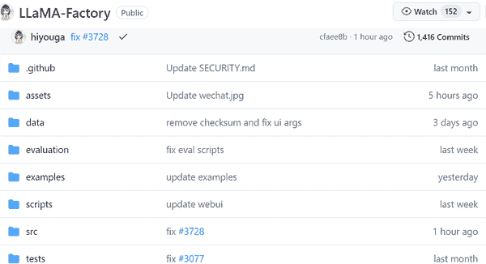

+   examples目录下，存放各种预置的例子

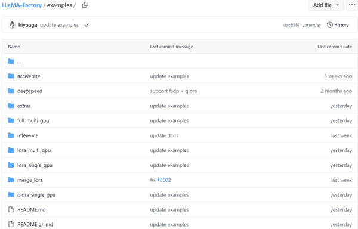

+   src目录的llm-tuner是项目源码

+   data目录下，存放各种预置的数据集，以及数据集配置文件dataset_info.json

可以在 src/llmtuner/data/ template.py 中添加自己的对话模板。

> 为了确保和LLM SFT时一致，确保对话模板格式很关键。

### 2.2 数据准备

关于数据集文件的格式，请参考 data/README_zh.md 的内容。你可以使用 HuggingFace / ModelScope 上的数据集或加载本地数据集。

> 使用自定义数据集时，请更新 data/dataset_info.json 文件，进行数据集名称、数据集字段以及数据集路径的配置。

dataset_info.json 的一些默认配置数据集信息

```
{
  &quot;alpaca_gpt4_zh&quot;: {
    &quot;file_name&quot;: &quot;alpaca_gpt4_data_zh.json&quot;
  },
  &quot;identity&quot;: {
    &quot;file_name&quot;: &quot;identity.json&quot;
  },
  &quot;oaast_sft_zh&quot;: {
    &quot;file_name&quot;: &quot;oaast_sft_zh.json&quot;,
    &quot;columns&quot;: {
      &quot;prompt&quot;: &quot;instruction&quot;,
      &quot;query&quot;: &quot;input&quot;,
      &quot;response&quot;: &quot;output&quot;,
      &quot;history&quot;: &quot;history&quot;
    }
  },
  &quot;lima&quot;: {
    &quot;file_name&quot;: &quot;lima.json&quot;,
    &quot;columns&quot;: {
      &quot;prompt&quot;: &quot;instruction&quot;,
      &quot;query&quot;: &quot;input&quot;,
      &quot;response&quot;: &quot;output&quot;,
      &quot;history&quot;: &quot;history&quot;
    }
  },
  &quot;belle_2m&quot;: {
    &quot;hf_hub_url&quot;: &quot;BelleGroup/train_2M_CN&quot;,
    &quot;ms_hub_url&quot;: &quot;AI-ModelScope/train_2M_CN&quot;
  },
  &quot;firefly&quot;: {
    &quot;hf_hub_url&quot;: &quot;YeungNLP/firefly-train-1.1M&quot;,
    &quot;columns&quot;: {
      &quot;prompt&quot;: &quot;input&quot;,
      &quot;response&quot;: &quot;target&quot;
    }
  },
  &quot;wikiqa&quot;: {
    &quot;hf_hub_url&quot;: &quot;wiki_qa&quot;,
    &quot;columns&quot;: {
      &quot;prompt&quot;: &quot;question&quot;,
      &quot;response&quot;: &quot;answer&quot;
    }
  }
}
```

也可以在 [template.py ](https://zhuanlan.zhihu.com/p/697773502/src/llmtuner/data/template.py)中添加自己的对话模板。

```
from dataclasses import dataclass
from typing import TYPE_CHECKING, Dict, List, Optional, Sequence, Tuple, Union

from ..extras.logging import get_logger
from .formatter import EmptyFormatter, FunctionFormatter, StringFormatter, ToolFormatter
from .utils import Role, infer_max_len


if TYPE_CHECKING:
    from transformers import PreTrainedTokenizer

    from .formatter import SLOTS, Formatter


logger = get_logger(__name__)


@dataclass
class Template:
    format_user: &quot;Formatter&quot;
    format_assistant: &quot;Formatter&quot;
    format_system: &quot;Formatter&quot;
    format_function: &quot;Formatter&quot;
    format_observation: &quot;Formatter&quot;
    format_tools: &quot;Formatter&quot;
    format_separator: &quot;Formatter&quot;
    default_system: str
    stop_words: List[str]
    efficient_eos: bool
    replace_eos: bool
    force_system: bool

    def encode_oneturn(
        self,
        tokenizer: &quot;PreTrainedTokenizer&quot;,
        messages: List[Dict[str, str]],
        system: Optional[str] = None,
        tools: Optional[str] = None,
        cutoff_len: int = 1_000_000,
        reserved_label_len: int = 1,
    ) -&gt; Tuple[List[int], List[int]]:
        r&quot;&quot;&quot;
        Returns a single pair of token ids representing prompt and response respectively.
        &quot;&quot;&quot;
        encoded_pairs = self._encode(tokenizer, messages, system, tools, cutoff_len, reserved_label_len)
        prompt_ids = []
        for query_ids, resp_ids in encoded_pairs[:-1]:
            prompt_ids += query_ids + resp_ids
        prompt_ids = prompt_ids + encoded_pairs[-1][0]
        answer_ids = encoded_pairs[-1][1]
        return prompt_ids, answer_ids

    def encode_multiturn(
        self,
        tokenizer: &quot;PreTrainedTokenizer&quot;,
        messages: List[Dict[str, str]],
        system: Optional[str] = None,
        tools: Optional[str] = None,
        cutoff_len: int = 1_000_000,
        reserved_label_len: int = 1,
    ) -&gt; Sequence[Tuple[List[int], List[int]]]:
        r&quot;&quot;&quot;
        Returns multiple pairs of token ids representing prompts and responses respectively.
        &quot;&quot;&quot;
        return self._encode(tokenizer, messages, system, tools, cutoff_len, reserved_label_len)

    def _encode(
        self,
        tokenizer: &quot;PreTrainedTokenizer&quot;,
        messages: List[Dict[str, str]],
        system: str,
        tools: str,
        cutoff_len: int,
        reserved_label_len: int,
    ) -&gt; Sequence[Tuple[List[int], List[int]]]:
        r&quot;&quot;&quot;
        Encodes formatted inputs to pairs of token ids.
        Turn 0: system + query        resp
        Turn t: sep + query           resp
        &quot;&quot;&quot;
        system = system or self.default_system
        encoded_messages = []
        for i, message in enumerate(messages):
            elements = []
            if i == 0 and (system or tools or self.force_system):
                tool_text = self.format_tools.apply(content=tools)[0] if tools else &quot;&quot;
                elements += self.format_system.apply(content=(system + tool_text))
            elif i &gt; 0 and i % 2 == 0:
                elements += self.format_separator.apply()

            if message[&quot;role&quot;] == Role.USER.value:
                elements += self.format_user.apply(content=message[&quot;content&quot;], idx=str(i // 2))
            elif message[&quot;role&quot;] == Role.ASSISTANT.value:
                elements += self.format_assistant.apply(content=message[&quot;content&quot;])
            elif message[&quot;role&quot;] == Role.OBSERVATION.value:
                elements += self.format_observation.apply(content=message[&quot;content&quot;])
            elif message[&quot;role&quot;] == Role.FUNCTION.value:
                elements += self.format_function.apply(content=message[&quot;content&quot;])
            else:
                raise NotImplementedError(&quot;Unexpected role: {}&quot;.format(message[&quot;role&quot;]))

            encoded_messages.append(self._convert_elements_to_ids(tokenizer, elements))

        return self._make_pairs(encoded_messages, cutoff_len, reserved_label_len)

    def _convert_elements_to_ids(
        self, tokenizer: &quot;PreTrainedTokenizer&quot;, elements: List[Union[str, Dict[str, str]]]
    ) -&gt; List[int]:
        r&quot;&quot;&quot;
        Converts elements to token ids.
        &quot;&quot;&quot;
        token_ids = []
        for elem in elements:
            if isinstance(elem, str):
                if len(elem) != 0:
                    token_ids += tokenizer.encode(elem, add_special_tokens=False)
            elif isinstance(elem, dict):
                token_ids += [tokenizer.convert_tokens_to_ids(elem.get(&quot;token&quot;))]
            elif isinstance(elem, set):
                if &quot;bos_token&quot; in elem and tokenizer.bos_token_id is not None:
                    token_ids += [tokenizer.bos_token_id]
                elif &quot;eos_token&quot; in elem and tokenizer.eos_token_id is not None:
                    token_ids += [tokenizer.eos_token_id]
            else:
                raise ValueError(&quot;Input must be string, set[str] or dict[str, str], got {}&quot;.format(type(elem)))

        return token_ids

    def _make_pairs(
        self,
        encoded_messages: Sequence[List[int]],
        cutoff_len: int,
        reserved_label_len: int,
    ) -&gt; Sequence[Tuple[List[int], List[int]]]:
        encoded_pairs = []
        total_length = 0
        for i in range(0, len(encoded_messages), 2):
            if total_length &gt;= cutoff_len:
                break

            max_source_len, max_target_len = infer_max_len(
                source_len=len(encoded_messages[i]),
                target_len=len(encoded_messages[i + 1]),
                max_len=(cutoff_len - total_length),
                reserved_label_len=reserved_label_len,
            )
            source_ids = encoded_messages[i][:max_source_len]
            target_ids = encoded_messages[i + 1][:max_target_len]
            total_length += len(source_ids) + len(target_ids)
            encoded_pairs.append((source_ids, target_ids))

        return encoded_pairs


@dataclass
class Llama2Template(Template):
    def _encode(
        self,
        tokenizer: &quot;PreTrainedTokenizer&quot;,
        messages: List[Dict[str, str]],
        system: str,
        tools: str,
        cutoff_len: int,
        reserved_label_len: int,
    ) -&gt; Sequence[Tuple[List[int], List[int]]]:
        r&quot;&quot;&quot;
        Encodes formatted inputs to pairs of token ids.
        Turn 0: system + query        resp
        Turn t: sep + query           resp
        &quot;&quot;&quot;
        system = system or self.default_system
        encoded_messages = []
        for i, message in enumerate(messages):
            elements = []
            system_text = &quot;&quot;
            if i == 0 and (system or tools or self.force_system):
                tool_text = self.format_tools.apply(content=tools)[0] if tools else &quot;&quot;
                system_text = self.format_system.apply(content=(system + tool_text))[0]
            elif i &gt; 0 and i % 2 == 0:
                elements += self.format_separator.apply()

            if message[&quot;role&quot;] == Role.USER.value:
                elements += self.format_user.apply(content=system_text + message[&quot;content&quot;])
            elif message[&quot;role&quot;] == Role.ASSISTANT.value:
                elements += self.format_assistant.apply(content=message[&quot;content&quot;])
            elif message[&quot;role&quot;] == Role.OBSERVATION.value:
                elements += self.format_observation.apply(content=message[&quot;content&quot;])
            elif message[&quot;role&quot;] == Role.FUNCTION.value:
                elements += self.format_function.apply(content=message[&quot;content&quot;])
            else:
                raise NotImplementedError(&quot;Unexpected role: {}&quot;.format(message[&quot;role&quot;]))

            encoded_messages.append(self._convert_elements_to_ids(tokenizer, elements))

        return self._make_pairs(encoded_messages, cutoff_len, reserved_label_len)


templates: Dict[str, Template] = {}


def _register_template(
    name: str,
    format_user: Optional[&quot;Formatter&quot;] = None,
    format_assistant: Optional[&quot;Formatter&quot;] = None,
    format_system: Optional[&quot;Formatter&quot;] = None,
    format_function: Optional[&quot;Formatter&quot;] = None,
    format_observation: Optional[&quot;Formatter&quot;] = None,
    format_tools: Optional[&quot;Formatter&quot;] = None,
    format_separator: Optional[&quot;Formatter&quot;] = None,
    default_system: str = &quot;&quot;,
    stop_words: List[str] = [],
    efficient_eos: bool = False,
    replace_eos: bool = False,
    force_system: bool = False,
) -&gt; None:
    r&quot;&quot;&quot;
    Registers a chat template.
    To add the following chat template:
    ```
    [HUMAN]:
    user prompt here
    [AI]:
    model response here
    [HUMAN]:
    user prompt here
    [AI]:
    model response here
    ```
    The corresponding code should be:
    ```
    _register_template(
        name=&quot;custom&quot;,
        format_user=StringFormatter(slots=[&quot;[HUMAN]:\n{{content}}\n[AI]:\n&quot;]),
        format_separator=EmptyFormatter(slots=[&quot;\n\n&quot;]),
        efficient_eos=True,
    )
    ```
    &quot;&quot;&quot;
    eos_slots = [] if efficient_eos else [{&quot;eos_token&quot;}]
    template_class = Llama2Template if name.startswith(&quot;llama2&quot;) else Template
    default_user_formatter = StringFormatter(slots=[&quot;{{content}}&quot;])
    default_assistant_formatter = StringFormatter(slots=[&quot;{{content}}&quot;] + eos_slots)
    default_function_formatter = FunctionFormatter(slots=[&quot;Action: {{name}}\nAction Input: {{arguments}}&quot;] + eos_slots)
    default_tool_formatter = ToolFormatter(tool_format=&quot;default&quot;)
    default_separator_formatter = EmptyFormatter()
    templates[name] = template_class(
        format_user=format_user or default_user_formatter,
        format_assistant=format_assistant or default_assistant_formatter,
        format_system=format_system or default_user_formatter,
        format_function=format_function or default_function_formatter,
        format_observation=format_observation or format_user or default_user_formatter,
        format_tools=format_tools or default_tool_formatter,
        format_separator=format_separator or default_separator_formatter,
        default_system=default_system,
        stop_words=stop_words,
        efficient_eos=efficient_eos,
        replace_eos=replace_eos,
        force_system=force_system,
    )
```

典型的几个模板

```
_register_template(
    name=&quot;alpaca&quot;,
    format_user=StringFormatter(slots=[&quot;### Instruction:\n{{content}}\n\n### Response:\n&quot;]),
    format_separator=EmptyFormatter(slots=[&quot;\n\n&quot;]),
    default_system=(
        &quot;Below is an instruction that describes a task. &quot;
        &quot;Write a response that appropriately completes the request.\n\n&quot;
    ),
)

_register_template(
    name=&quot;qwen&quot;,
    format_user=StringFormatter(slots=[&quot;&lt;|im_start|&gt;user\n{{content}}&lt;|im_end|&gt;\n&lt;|im_start|&gt;assistant\n&quot;]),
    format_system=StringFormatter(slots=[&quot;&lt;|im_start|&gt;system\n{{content}}&lt;|im_end|&gt;\n&quot;]),
    format_observation=StringFormatter(slots=[&quot;&lt;|im_start|&gt;tool\n{{content}}&lt;|im_end|&gt;\n&lt;|im_start|&gt;assistant\n&quot;]),
    format_separator=EmptyFormatter(slots=[&quot;\n&quot;]),
    default_system=&quot;You are a helpful assistant.&quot;,
    stop_words=[&quot;&lt;|im_end|&gt;&quot;],
    replace_eos=True,
)

_register_template(
    name=&quot;chatml&quot;,
    format_user=StringFormatter(slots=[&quot;&lt;|im_start|&gt;user\n{{content}}&lt;|im_end|&gt;\n&lt;|im_start|&gt;assistant\n&quot;]),
    format_system=StringFormatter(slots=[&quot;&lt;|im_start|&gt;system\n{{content}}&lt;|im_end|&gt;\n&quot;]),
    format_observation=StringFormatter(slots=[&quot;&lt;|im_start|&gt;tool\n{{content}}&lt;|im_end|&gt;\n&lt;|im_start|&gt;assistant\n&quot;]),
    format_separator=EmptyFormatter(slots=[&quot;\n&quot;]),
    stop_words=[&quot;&lt;|im_end|&gt;&quot;, &quot;&lt;|im_start|&gt;&quot;],
    replace_eos=True,
)

_register_template(
    name=&quot;deepseek&quot;,
    format_user=StringFormatter(slots=[&quot;User: {{content}}\n\nAssistant:&quot;]),
    format_system=StringFormatter(slots=[{&quot;bos_token&quot;}, &quot;{{content}}&quot;]),
    force_system=True,
)

_register_template(
    name=&quot;default&quot;,
    format_user=StringFormatter(slots=[&quot;Human: {{content}}\nAssistant: &quot;]),
    format_system=StringFormatter(slots=[&quot;{{content}}\n&quot;]),
    format_separator=EmptyFormatter(slots=[&quot;\n&quot;]),
)

_register_template(
    name=&quot;llama2&quot;,
    format_user=StringFormatter(slots=[{&quot;bos_token&quot;}, &quot;[INST] {{content}} [/INST]&quot;]),
    format_system=StringFormatter(slots=[&quot;&lt;&lt;SYS&gt;&gt;\n{{content}}\n&lt;&lt;/SYS&gt;&gt;\n\n&quot;]),
    default_system=(
        &quot;You are a helpful, respectful and honest assistant. &quot;
        &quot;Always answer as helpfully as possible, while being safe. &quot;
        &quot;Your answers should not include any harmful, unethical, &quot;
        &quot;racist, sexist, toxic, dangerous, or illegal content. &quot;
        &quot;Please ensure that your responses are socially unbiased and positive in nature.\n\n&quot;
        &quot;If a question does not make any sense, or is not factually coherent, &quot;
        &quot;explain why instead of answering something not correct. &quot;
        &quot;If you don&#x27;t know the answer to a question, please don&#x27;t share false information.&quot;
    ),
)

_register_template(
    name=&quot;llama2_zh&quot;,
    format_user=StringFormatter(slots=[{&quot;bos_token&quot;}, &quot;[INST] {{content}} [/INST]&quot;]),
    format_system=StringFormatter(slots=[&quot;&lt;&lt;SYS&gt;&gt;\n{{content}}\n&lt;&lt;/SYS&gt;&gt;\n\n&quot;]),
    default_system=&quot;You are a helpful assistant. 你是一个乐于助人的助手。&quot;,
)

_register_template(
    name=&quot;llama3&quot;,
    format_user=StringFormatter(
        slots=[
            (
                &quot;&lt;|start_header_id|&gt;user&lt;|end_header_id|&gt;\n\n{{content}}&lt;|eot_id|&gt;&quot;
                &quot;&lt;|start_header_id|&gt;assistant&lt;|end_header_id|&gt;\n\n&quot;
            )
        ]
    ),
    format_system=StringFormatter(
        slots=[{&quot;bos_token&quot;}, &quot;&lt;|start_header_id|&gt;system&lt;|end_header_id|&gt;\n\n{{content}}&lt;|eot_id|&gt;&quot;]
    ),
    format_observation=StringFormatter(
        slots=[
            (
                &quot;&lt;|start_header_id|&gt;tool&lt;|end_header_id|&gt;\n\n{{content}}&lt;|eot_id|&gt;&quot;
                &quot;&lt;|start_header_id|&gt;assistant&lt;|end_header_id|&gt;\n\n&quot;
            )
        ]
    ),
    default_system=&quot;You are a helpful assistant.&quot;,
    stop_words=[&quot;&lt;|eot_id|&gt;&quot;],
    replace_eos=True,
)
```

### 2.3 安装依赖

在一个干净的虚拟环境，安装如下依赖

```
git clone https://github.com/hiyouga/LLaMA-Factory.git
conda create -n llama_factory python=3.10
conda activate llama_factory
cd LLaMA-Factory
pip install -e .[metrics]
```

可选的额外依赖项：deepspeed、metrics、unsloth、galore、badam、vllm、bitsandbytes、gptq、awq、aqlm、qwen、modelscope、quality

### 2.4 WEB-UI 训练

[Ll](https://link.zhihu.com/?target=https%3A//colab.research.google.com/drive/1eRTPn37ltBbYsISy9Aw2NuI2Aq5CQrD9%3Fusp%3Dsharing)amaFactory Colab Demo脚本: https:// colab.research.google.com /drive/1eRTPn37ltBbYsISy9Aw2NuI2Aq5CQrD9?usp=sharing

ui界面目前只支持单卡训练

**模型选择**

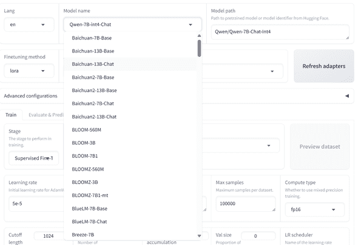

数据集选择配置

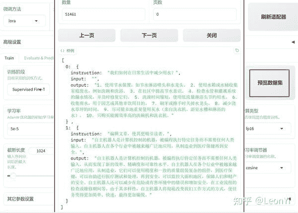

**训练方式选择**

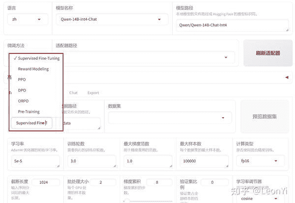

**训练参数配置**

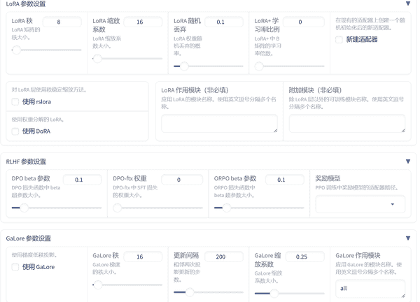

**预览训练命令**

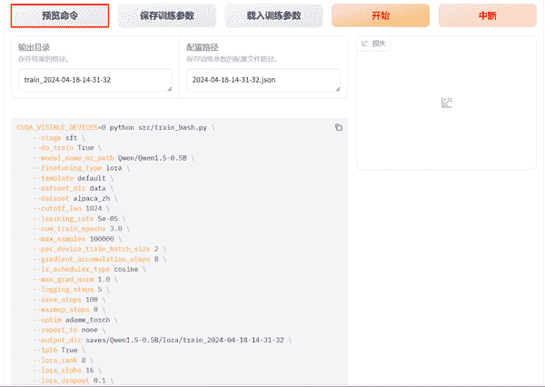

**日志展示**

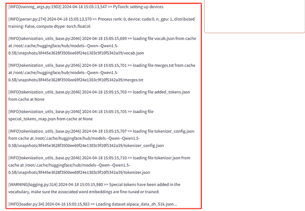

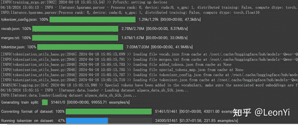

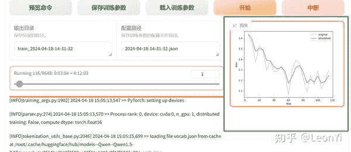

### 2.5 命令脚本训练

目前，最新版本绝大多数examples已改成yaml配置文件，而不是shell命令用parser读取参数了.

当然，本质上就是把训练参数传到train.py中

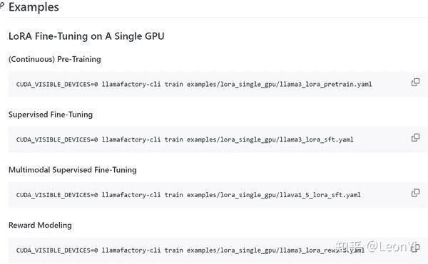

examples下的lora_single_gpu/llama3_lora_sft.yaml

```
# model
model_name_or_path: meta-llama/Meta-Llama-3-8B-Instruct

# method
stage: sft
do_train: true
finetuning_type: lora
lora_target: q_proj,v_proj

# dataset
dataset: identity,alpaca_gpt4_en
template: llama3
cutoff_len: 1024
max_samples: 1000
overwrite_cache: true
preprocessing_num_workers: 16

# output
output_dir: saves/llama3-8b/lora/sft
logging_steps: 10
save_steps: 500
plot_loss: true
overwrite_output_dir: true

# train
per_device_train_batch_size: 1
gradient_accumulation_steps: 8
learning_rate: 0.0001
num_train_epochs: 3.0
lr_scheduler_type: cosine
warmup_steps: 0.1
fp16: true

# eval
val_size: 0.1
per_device_eval_batch_size: 1
evaluation_strategy: steps
eval_steps: 500
```

脚本 examples/lora_mul**t**i_gpu/multi_node.s h

```
#!/bin/bash
# also launch it on slave machine using slave_config.yaml

CUDA_VISIBLE_DEVICES=0,1,2,3 accelerate launch \
    --config_file examples/accelerate/master_config.yaml \
    src/train.py examples/lora_multi_gpu/llama3_lora_sft.yaml
```

之前一个训练日志：

配置了几个数据集，进行单机多卡 llama3_8b_instruct进行中文数据集sft训练

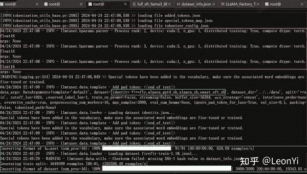

llama3_8b_instruct进行增量预训练还是中文数据SFT都不过是倒腾数据集和配置脚本的事情，当然这只是踏出训练的第一步。

毕竟搞出一个baseline和能训练好还是两码事（需要自己调参摸索，更需要学习开源的经验）。

## 总结

LlamaFactory适合快速进行全参数、LoRA等高效微调，适合增量预训练、指令微调和强化学习微调。

它具备可视化界面，同时集成了多种比较前沿的训练Trick，用的人多。

但是呢，由于集成地太好，隐藏了很多细节，一方面不利于学习和定制化。另一方面，在使用的时候，也需要详细了解参数配置。

LlamaFactory适合快速上手，毕竟它已经集成好的框架将分散的包组合到一起，能够省时省力，但用好需花一点精力。