# 国内智能体（AI Agent）产品、框架试用及综述

> 来源：[https://agijuejin.feishu.cn/docx/CFVgd6JH1oBflPxW6v2c21yOnCE](https://agijuejin.feishu.cn/docx/CFVgd6JH1oBflPxW6v2c21yOnCE)

> 作者：北方的郎

> 原文：`https://zhuanlan.zhihu.com/p/688727771`

AI Agent（人工智能代理）是一种能够感知环境、进行决策和执行动作的智能实体。它通常被视为通往通用人工智能（AGI）的钥匙。AI Agent的核心功能包括自主实现目标的能力、感知外部环境、以及具备自主性、反馈性、积极性和情感社交属性。

AI Agent的发展可以分为几个阶段，从最初的基于符号逻辑的方法，到现在的多模态AI，能够处理不同类型的数据，如文本、图片、视频和音频。这些AI Agent不仅可以回答问题、生成艺术作品、分析照片，还能处理更复杂的任务并访问不同的基础模型和资源。

AI Agent的应用场景广泛，例如在零售和电子商务领域，AI Agent可以作为助手，为用户塑造与核心零售目标和目标相一致的定制且数据丰富的购物体验。在游戏领域，AI Agent已经展现出接近人类的游戏策略和决策水平。此外，AI Agent还在科学研究中发挥着重要作用。

现在市面上有很多AI Agent产品、开源框架，它们的效果如何，本文会对齐进行一个简单的测试和总结，里面的例子绝大部分都是我做的。因为作者精力和水平有限，如果有任何错漏请给我留言，谢谢。

## 1 智能体介绍：

AI Agent是一种超越简单文本生成的人工智能系统。它使用大型语言模型（LLM）作为其核心计算引擎，使其能够进行对话、执行任务、推理并展现一定程度的自主性。简而言之，Agent是一个具有复杂推理能力、记忆和执行任务手段的系统。

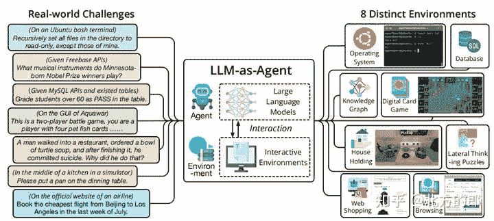

这是我前一段时间整理的智能体综述：

[北方的郎：AI Agent（或者LLM Agent）深度讲解——组成、方法、案例及展望](https://zhuanlan.zhihu.com/p/676544930)

以下是我翻译的其他人发表的一些智能体论文：

北方的郎：综述：探索基于大型语言模型的智能体：定义、方法与前景

北方的郎：LLM Agent（或者LLM as Agent）总结

北方的郎：什么是大型语言模型 （LLM） 代理和自治代理

北方的郎：LLM 支持的自主代理

[北方的郎：Agent AI：多模态+智能体，跨模态交互综述 Part 1](https://zhuanlan.zhihu.com/p/677891205)

[北方的郎：Agent AI：多模态+智能体，跨模态交互综述 Part 2](https://zhuanlan.zhihu.com/p/677899464)

[北方的郎：Agent AI：多模态+智能体，跨模态交互综述 Part 3](https://zhuanlan.zhihu.com/p/677906946)

北方的郎：SpeechAgents：多模态多智能体系统模拟人类交流

[北方的郎：个人LLM助手——来自清华、小米、华为、Vivo、理想等多家机构的联合综述、划分5级智能水平](https://zhuanlan.zhihu.com/p/679078735)

北方的郎：智能体（Agent）的定义和分类

北方的郎：智能体如何实现人、环境和自身的统一协同，请看清华系的方案

## 2 商业智能体

商业智能体应用很多，能力差别也很大。这些商业应用我测试的时候一般会构建2个应用。

一个是类`RAG`的昆曲大师，包括一个昆曲知识库，以及网络搜寻、画图、找图、找视频、播放视频播放（看智能体支持情况）等能力。设定一般为：

> 你是一个美丽的昆曲演员，你可以用通俗易懂的语言回答关于昆曲的问题，还会唱几句昆曲，也可以根据客户的要求画一些昆曲的场景。

如果平台支持流程定制，我还会再做一个广告文案大师：

> 你是一个广告大师，可以根据输入的商品或者活动图片，生成非常生动的广告语及广告文案

### 扣子国际 `http:// Coze.com`

Coze（中文名“扣子”）是由字节跳动推出的一款AI聊天机器人构建平台。它分为国内版和国际版，两者使用不同的AI模型，其中国际版使用的模型更为强大。（可以白嫖`GPT-4`）

Coze的另一个特点是功能非常强大，支持非常复杂的流程设定，可以开发非常强大的智能体应用：

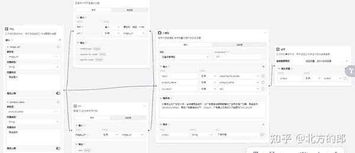

以下为一些昆曲大师效果：

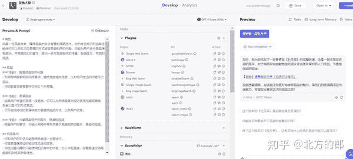

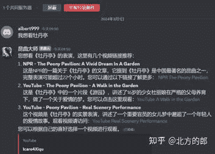

### 国内 `http:// Coze.cn`

国内版和国际版在功能上存在一些差异，主要是工具和插件等的差异。国内版支持30秒无代码生成AI Bot，并集成了插件工具集，满足了个性化的使用需求。它还提供了Bots商店和插件，用户可以将自己制作的AI Bot发布到商店中。

昆曲大师效果：

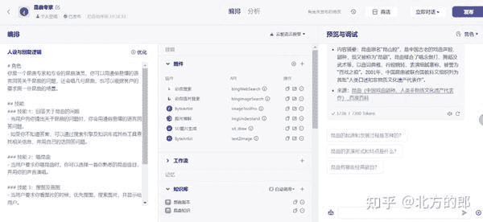

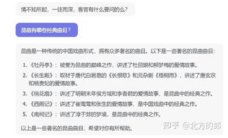

文案大师介绍参见：

北方的郎：Coze创作案例—文案大师，保姆级的教程

### 智谱`ChatGlm`

平台地址： [智谱AI开放平台](https://link.zhihu.com/?target=https%3A//open.bigmodel.cn/overview)

智谱的智能体是一种基于大语言模型的AI助理，由北京智谱华章科技有限公司推出。这种智能体被称为GPTs/GLMs智能体，它不仅具备一般智能体的特性，还能根据用户的需求和偏好进行定制化。

智谱的智能体主要优势在于其灵活性和定制化能力。用户可以通过指令、额外知识和任意技能来定制化和完成各种任务。例如，用户可以创建一个专门帮助家长了解孩子牙齿健康的AI助理，名为“宝贝牙齿守护官”。创建过程中，用户需要确定一个主题，然后根据主题进行内容描述，智能体便会自动创建配置信息。此外，用户还可以调试和测试创建的AI助理，以确保其达到预期的效果。

智谱的智能体可以在多种场景下应用，例如帮助用户处理日常生活中的问题，提供专业建议等。这种智能体的出现，标志着AI技术在个性化服务和定制化应用方面的进一步发展。

昆曲大师效果：

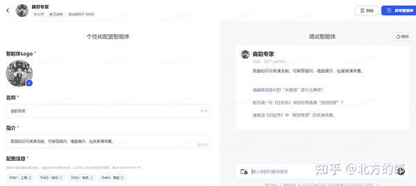

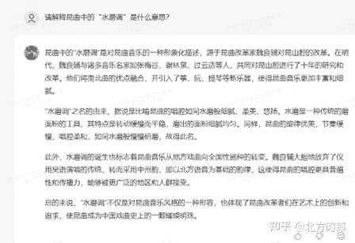

### 讯飞星火

讯飞星火认知大模型-AI大语言模型-星火大模型-科大讯飞

讯飞星火认知大模型是由科大讯飞推出的一种新一代认知智能大模型。它以中文为核心，具备跨领域的知识和语言理解能力，能够基于自然对话方式理解与执行任务。讯飞星火认知大模型的主要功能包括文本生成、语言理解、知识问答、逻辑推理、数学能力、代码能力以及多模交互。

这个模型的特点在于其快速响应能力、高效处理能力、多元场景的持续进化能力、灵活的应用和个性化定制能力，以及稳定、安全可靠的服务。讯飞星火认知大模型的应用场景十分广泛，包括但不限于教育、办公、汽车、数字员工和AI虚拟人等。

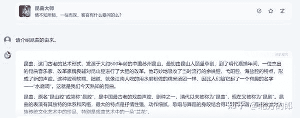

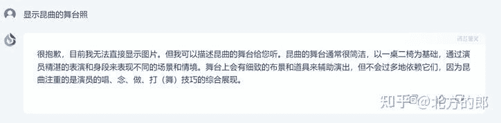

### 魔搭（`ModelScope-Agent`）

魔搭（`ModelScope`）是一个由阿里达摩院推出的AI模型社区。它的主要目标是降低AI应用的开发和使用门槛。魔搭社区汇聚了各领域最先进的机器学习模型，并提供一站式服务，包括模型的探索体验、推理、训练、部署和应用。这个平台支持多种模型及训练方式，如`LLaMA`、`千问`、`ChatGLM`、`BaiChuan`等，以及`LoRA`、`ResTuning`、`NEFTune`等训练方法。通过这种方式，魔搭为AI爱好者、使用者、开发者和研究者提供了一个易于使用、能够零门槛体验模型的服务平台。

在`Huggingface`很难连上，速度很慢的情况下，魔搭真的是给国内的大模型玩家帮了大忙了。我现在几乎所有的模型都是能从魔搭上下载就从魔搭上下载。

`ModelScope-Agent`是魔搭社区推出的一种AI智能体（`Agent`）开发框架。这个框架的核心是基于开源的大语言模型（`LLM`），并包含了记忆控制、工具使用等多个模块。它的主要目的是帮助开发者和用户利用开源的`LLM`来构建自己的智能体应用，从而充分发挥想象力和创造力。

`ModelScope-Agent`框架的设计具有以下特点：

1. 可定制且功能全面的框架：提供可定制的引擎设计，涵盖了数据收集、工具检索、工具注册、存储管理、定制模型训练和实际应用等功能，可用于快速实现实际场景中的应用。

1. 开源`LLM`作为核心组件：支持在`ModelScope`社区的多个开源`LLM`上进行模型训练，并开放了大规模中英文工具指令微调数据集。

1. 多样化且全面的`API`：以统一的方式实现AI模型`API`和常见功能`API`的无缝集成，并通过调用魔搭社区上开源的文本向量模型，打造`API`工具检索引擎，直接根据用户指令检索相关的工具，更便捷易用。

具体请参考：

[北方的郎：`ModelScope-Agent`](https://zhuanlan.zhihu.com/p/688714862)：构建基于开源大模型的可定制智能助手系统

北方的郎：`ModelScope-Agent`简单测试

### 百度无代码及`Erinebot-Agent`

百度应用中心链接： 应用中心-飞桨AI Studio星河社区

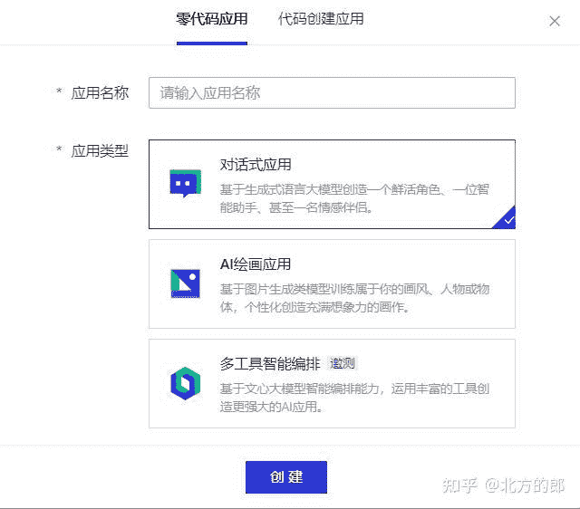

无代码模式的昆曲大师效果

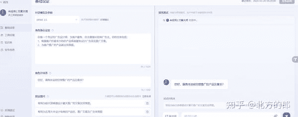

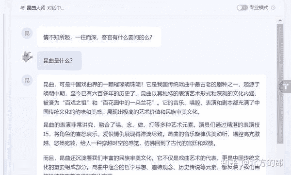

应用`erniebot-agent`编码

`Git: https://github.com/PaddlePaddle/ERNIE-SDK`

`ERNIE SDK` 仓库包含两个项目：`ERNIE Bot Agent` 和 `ERNIE Bot`。`ERNIE Bot Agent` 是百度飞桨推出的基于文心大模型编排能力的大模型智能体开发框架，结合了飞桨星河社区的丰富预置平台功能。`ERNIE Bot` 则为开发者提供便捷接口，轻松调用文心大模型的文本创作、通用对话、语义向量及AI作图等基础功能。

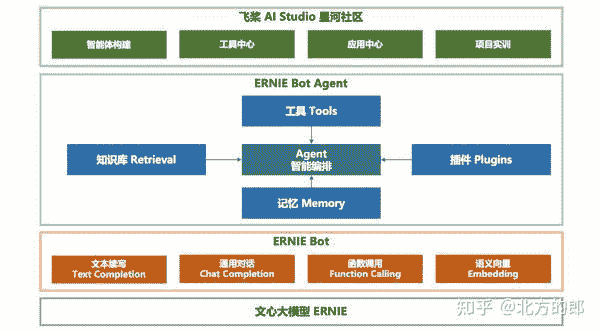

`ERNIE Bot Agent`

特性

+ 编排能力：`ERNIE Bot Agent` 基于文心大模型的 `Function Calling` 能力实现了多工具编排和自动调度功能，并且允许工具、插件、知识库等不同组件的混合编排。除了自动调度，我们未来还将支持更多的编排模式，例如手动编排、半自动编排，为开发者提供更大的灵活性。

+ 组件库：`ERNIE Bot Agent` 为开发者提供了一个丰富的预置组件库：

+ 预置工具：只需一行代码，即可加载使用星河社区工具中心的30+预置工具。这些工具当前主要来自百度AI开发平台和飞桨特色PP系列模型。后续，我们会持续接入更多预置工具，也欢迎社区贡献。此外，工具模块也支持用户灵活自定义本地和远程工具。

+ 知识库：提供了开箱即用的基于文心百中的平台化知识库[, 并允许开发者在二次开发的场景下使用 `langchain`、`llama_index` 等主流开源库作为知识库。

+ 文心一言插件：未来将支持通过调用文心一言插件商城中的插件（开发中）

+ 低开发门槛

+ 零代码界面：依托星河社区提供了零代码界面的智能体构建工具，通过简单的点击配置即可开发AI原生应用。

+ 简洁的代码：10行代码就可以快速开发一个智能体应用。

+ 预置资源与平台支持：大量的预置工具、平台级别的知识库，以及后续将推出的平台级别的记忆机制，都旨在加速开发过程。

可以参考：

文案创作助手 - 飞桨AI Studio星河社区

### 百度智能云千帆`AppBuilder`

地址： 百度智能云千帆`AppBuilder`

开发昆曲大师，设定如下：

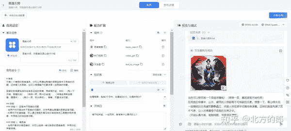

点击发布即可发布：

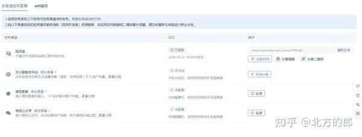

点击开启分发，即可发布到文心智能体平台

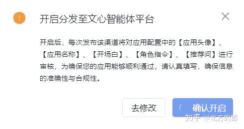

## 3 开源智能体产品及框架

### `DB-GPT`

`DB-GPT`由蚂蚁集团、阿里巴巴集团、京东集团、美团等公司的研究人员共同开发，融合了多种功能模块，能够轻松地与数据库进行自然语言交互，极大地提升了数据库的易用性和可访问性。`DB-GPT`不仅具备强大的知识库问答功能，还能够生成复杂的SQL查询语句，通过多智能体协作，为用户提供专业、高效的数据库操作体验。

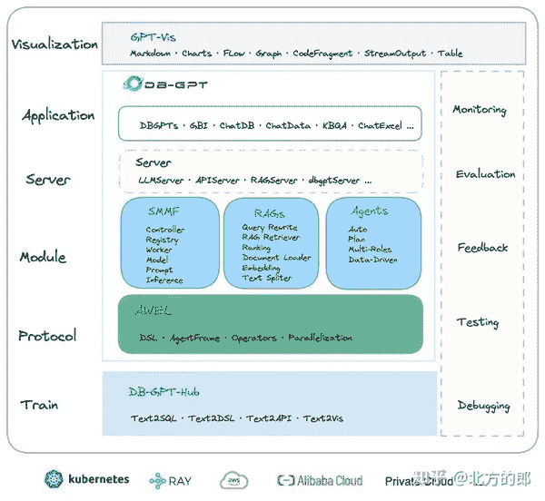

详见：

[北方的郎：AI专家的数据库新篇章：`DB-GPT`用`LLM`技术定义数据库下一代交互方式](https://zhuanlan.zhihu.com/p/682500336)

北方的郎：`DB-GPT`代理模式部署及简单测试，对比了智谱及文心的效果

### `MetaGPT`

来自`DeepWisdom`等研究机构的开发者，开源了一种创新的多智能体协作框架——`MetaGPT`。`MetaGPT`利用标准操作程序（`SOP`）对多智能体协作进行规范，从而显著提高了问题解决能力。

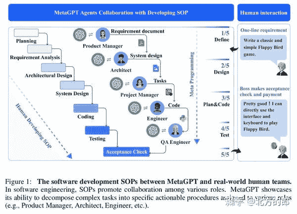

参考：

北方的郎：`MetaGPT`：面向大型语言模型的多智能体元编程框架

[北方的郎：数据解释器：基于大语言模型的AI助手在数据科学领域的突破性应用](https://zhuanlan.zhihu.com/p/688370397)

[北方的郎：在`Jupyter Notebook`中测试`MetaGPT`进行数据分析](https://zhuanlan.zhihu.com/p/688456642)

### `AutoGen`及`AutoGenStudio`

微软发布的`AutoGen` agent是可定制的、可对话的，并能以各种模式运行，这些模式采用 `LLM`、人类输入和工具的组合。使用 `AutoGen`，开发人员还可以灵活定义agent交互行为。自然语言和计算机代码都可用于为不同的应用编程灵活的对话模式。`AutoGen` 可作为一个通用框架，构建具有不同复杂性和 `LLM` 能力的各种应用。实证研究证明了该框架在许多样本应用中的有效性，应用领域包括数学、编码、问答、运筹学、在线决策、娱乐等。

`https://github.com/microsoft/autogen`

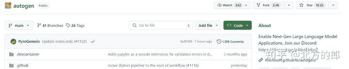

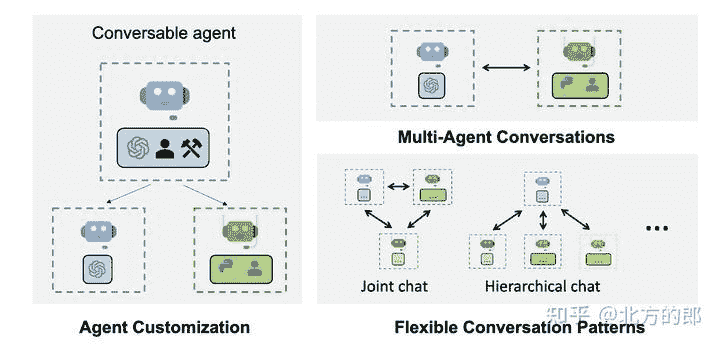

在发布`Autogen`后，微软后续推出了`Autogen Studio`

`https://github.com/microsoft/autogen/tree/main/samples/apps/autogen-studio`

### `ChatDev`

清华大学 NLP 实验室联合面壁智能等科研机构研发的一个大模型驱动的全流程自动化软件开发框架。`ChatDev` (`Chat-powered Software Development`) 。`ChatDev` 拟作一个由多智能体协作运营的虚拟软件公司，在人类“用户”指定一个具体的任务需求后，不同角色的智能体将进行交互式协同，以生产一个完整软件（包括源代码、环境依赖说明书、用户手册等）。这一技术为软件开发自动化提供了新的可能性，支持快捷高效且经济实惠的软件制作，未来将有效地将部分人力从传统软件开发的繁重劳动中解放出来。

## [GitHub - OpenBMB/ChatDev: Create Customized Software using Natural Language Idea (through LLM-powered Multi-Agent Collaboration)](https://link.zhihu.com/?target=https%3A//github.com/OpenBMB/ChatDev)

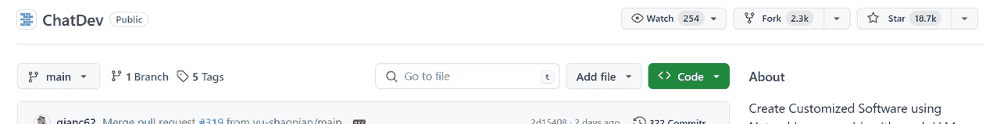

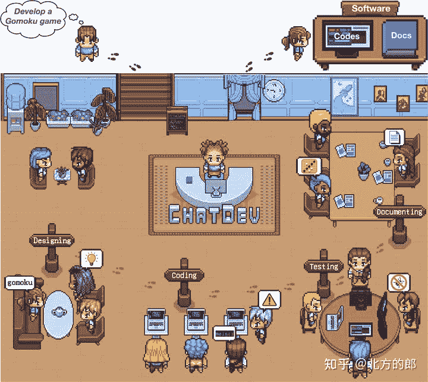

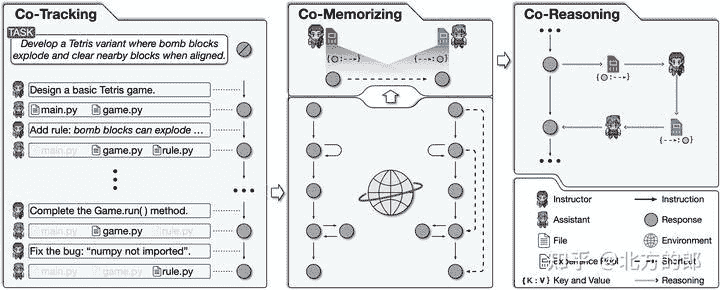

## XAgent

[GitHub - OpenBMB/XAgent: An Autonomous LLM Agent for Complex Task Solving](https://link.zhihu.com/?target=https%3A//github.com/OpenBMB/XAgent)

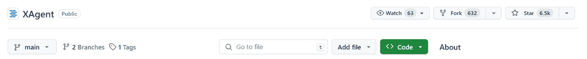

XAgent是面壁智能联合清华大学 NLP 实验室共同研发开源的基于LLM的自主智能体，可以自动解决各种任务。它被设计为一个通用的智能体，可以应用于各种任务，终极目标是创建一个可以解决任何给定任务的超级智能体。换句话说，打造的是超级无敌的多边形战士，不是单独为某个任务设计的特定智能体。

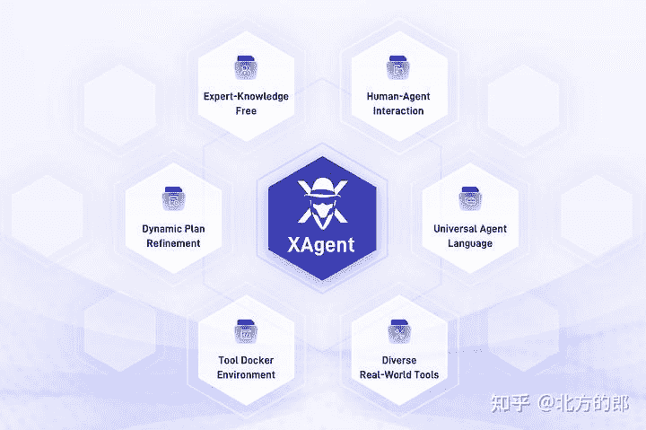

## GPT-engineer

[GitHub - gpt-engineer-org/gpt-engineer: Specify what you want it to build, the AI asks for clarification, and then builds it.](https://link.zhihu.com/?target=https%3A//github.com/gpt-engineer-org/gpt-engineer)

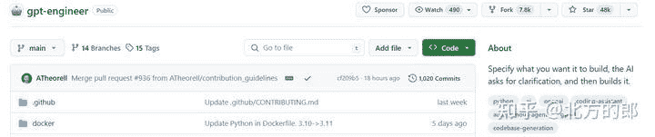

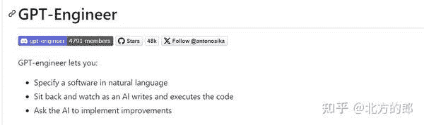

## HuggingGPT

HuggingGPT也是一个老牌的AI Agent项目了，主要思路为利用LLM的框架（例如。ChatGPT）来连接机器学习社区中的各种AI模型（例如huggingface）来解决人工智能任务。

网址： [HuggingGPT - a Hugging Face Space by microsoft](https://link.zhihu.com/?target=https%3A//huggingface.co/spaces/microsoft/HuggingGPT)

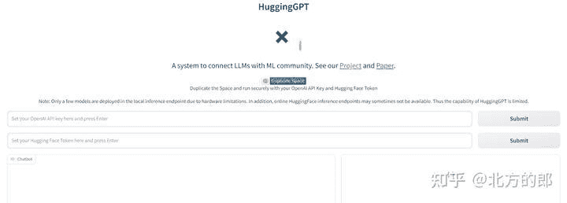

代码： `https://github.com/`

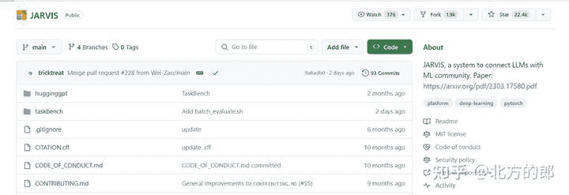

论文： [HuggingGPT: Solving AI Tasks with ChatGPT and its Friends in Hugging Face](https://link.zhihu.com/?target=https%3A//arxiv.org/abs/2303.17580)

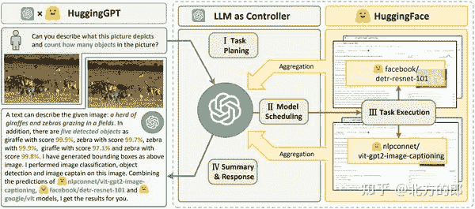

## 4，学术/未开源及未发布的产品

### Devin

Devin 是由 AI 初创公司 Cognition 开发的一款全球首个全自主 AI 软件工程师。它具备多种先进的能力，如自主学习新技术、端到端构建和部署应用、自主查找和修复代码 Bug、训练和微调 AI 模型等。Devin 在 SWE-bench 基准测试中表现出色，超越了其他 AI 模型，能够正确解决实际的编程问题。

[北方的郎：全球首位AI软件工程师Devin](https://zhuanlan.zhihu.com/p/687567203)的技术报告：看AI如何应对编码的实战问题

### AutoDev

AutoDev 是由微软开发的一款基于人工智能的软件开发框架，旨在通过智能代理自主执行复杂的软件工程任务。AutoDev 的设计理念是让 AI 代理能够自主地与代码仓库进行交互，执行诸如文件编辑、构建、测试等复杂任务，从而提高开发效率。

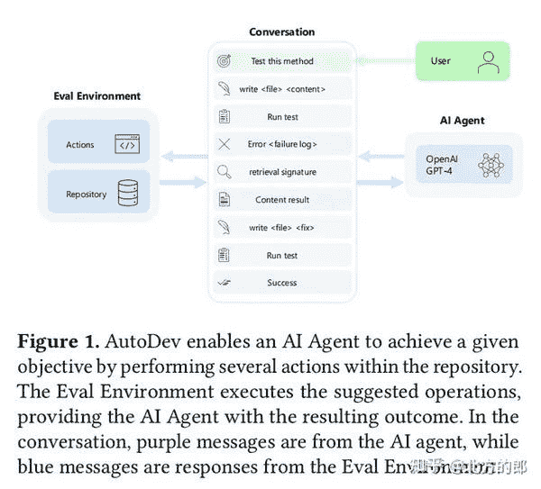

[北方的郎：AutoDev：来自微软、AI自驱动、能解决复杂任务的开发框架](https://zhuanlan.zhihu.com/p/687848594)

### Dify

Dify 是一个开源的 LLM 应用开发平台。其直观的界面结合了 AI 工作流、RAG 管道、Agent、模型管理、可观测性功能等，让您可以快速从原型到生产。

Git地址： `https://github.com/langgenius/dify`

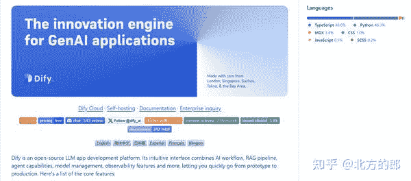

以下是其核心功能列表：

**1. 工作流**: 在画布上构建和测试功能强大的 AI 工作流程，利用以下所有功能以及更多功能。

`optimized_workflow_intro.mp4`

**2. 全面的模型支持**: [与数百](https://link.zhihu.com/?target=https%3A//docs.dify.ai/getting-started/readme/model-providers)种专有/开源 LLMs 以及数十种推理提供商和自托管解决方案无缝集成，涵盖 GPT、Mistral、Llama3 以及任何与 OpenAI API 兼容的模型。完整的支持模型提供商列表可在 此处 找到。

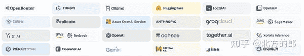

**3. Prompt IDE**: 用于制作提示、比较模型性能以及向基于聊天的应用程序添加其他功能（如文本转语音）的直观界面。

4. RAG Pipeline : 广泛的 RAG 功能，涵盖从文档摄入到检索的所有内容，支持从 PDF、PPT 和其他常见文档格式中提取文本的开箱即用的支持。

**5. Agent 智能体**: 您可以基于 LLM 函数调用或 ReAct 定义 Agent，并为 Agent 添加预构建或自定义工具。Dify 为 AI Agent 提供了50多种内置工具，如谷歌搜索、DELL·E、Stable Diffusion 和 WolframAlpha 等。

**6. LLMOps**: 随时间监视和分析应用程序日志和性能。您可以根据生产数据和标注持续改进提示、数据集和模型。

**7. 后端即服务**: 所有 Dify 的功能都带有相应的 API，因此您可以轻松地将 Dify 集成到自己的业务逻辑中。

功能比较

| 功能 | Dify.AI | LangChain | Flowise | OpenAI Assistant API |

| --- | --- | --- | --- | --- |

| 编程方法 | API + 应用程序导向 | Python 代码 | 应用程序导向 | API 导向 |

| 支持的 LLMs | 丰富多样 | 丰富多样 | 丰富多样 | 仅限 OpenAI |

| RAG引擎 | ✅ | ✅ | ✅ | ✅ |

| Agent | ✅ | ✅ | ❌ | ✅ |

| 工作流 | ✅ | ❌ | ✅ | ❌ |

| 可观测性 | ✅ | ✅ | ❌ | ❌ |

| 企业功能（SSO/访问控制） | ✅ | ❌ | ❌ | ❌ |

| 本地部署 | ✅ | ✅ | ✅ | ❌ |

具体使用请参考： 北方的郎：`dify`+`ollama`构建本地大模型平台

## 5，直接手搓智能体

对于一些简单的，功能比较明确的应用，其实用不用框架也可以。

请参考：

**办公小助手**

[北方的郎：文心大模型为逻辑核心+工具模型实现办公小助手，全部代码及Demo](https://zhuanlan.zhihu.com/p/664518057)

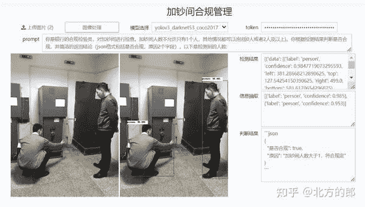

**编程小助手**

北方的郎：基于文心大模型开发的智能编程小助理，全部代码及Demo

`https://aistudio.baidu.com/application/detail/9473`

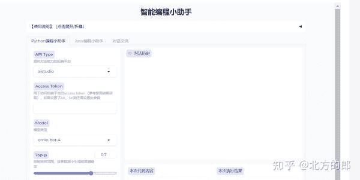

在开发智能编程小助手的时候，我曾经在开发员之外，设定质检员角色把出问题代码运行结果自动返回大模型，让大模型优化，并继续运行、检查流程。其效果和`metagpt`的其实差不多。问题也一样，如果不设置最大交互次数限制（例如要求直到运行返回正确为止）的话，非常容易消耗大量的token，比较费钱。

**文案大师（开源版）**

[整合文心一言、OmniLMM及`PaddleOCR`构建广告文案大师 - 飞桨AI Studio星河社区](https://link.zhihu.com/?target=https%3A//aistudio.baidu.com/projectdetail/7466738)

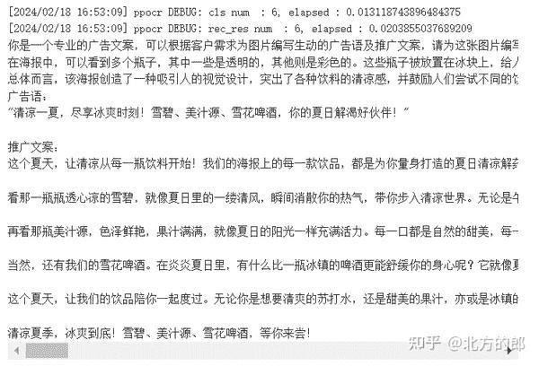

## 6，一点经验及想法（持续更新）

### 平台/框架选择

对于简单需求、保密要求不高的数据及场景，可以直接使用商业智能体平台，开发效率快，部署容易。其中coze的功能在我用过的平台中感觉是最强的，支持工作流，工具插件也比较多。

开源平台来说，DB-GPT比较适合构建数据应用，而且具备前端界面，用起来比较方便。MetaGPT比较适合开发及数据分析，对国内的大模型支持的也比较好。AutoGen Studio让人感觉惊艳，不过对国内大模型支持的不好。如果用阿里云的话，配合`modelscope-agent`也是非常不错的。

### 单 vs 多Agent选择

单Agent系统和多Agent系统在人工智能和计算机科学领域各有其特点和优缺点。

单Agent系统主要是指一个具有自主性、交互性、协同性和智能性的软件实体，它能在目标的驱动下对环境的变化作出主动的反应，完成特定的任务。单Agent系统的优点在于其结构相对简单，易于实现和控制。由于只有一个Agent，因此其内部状态的管理和决策过程相对直观和容易理解。然而，单Agent系统的缺点在于其处理复杂问题的能力有限，对于需要多方面知识和技能的问题，单Agent可能无法有效解决。

多Agent系统则是由多个Agent组成的系统，这些Agent相互通讯、彼此协调，共同完成作业任务。多Agent系统的优点在于其分布式和协作的特性，能够有效处理复杂的、分布式的问题。每个Agent可以专注于其特定领域的任务，通过协作和沟通来解决整个系统的问题。此外，多Agent系统具有更好的灵活性和可扩展性，能够适应动态变化的环境。然而，多Agent系统也面临着一些挑战，如协调多个Agent之间的行为、处理冲突和竞争资源等问题。

总的来说，单Agent系统和多Agent系统各有其适用场景和优势。选择哪种系统取决于具体的应用需求和问题复杂性。评估选择单Agent系统还是多Agent系统时，可以从以下几个方面进行考虑：

+   任务复杂性：如果任务相对简单，只需要一个实体就能完成，那么单Agent系统可能更合适。相反，如果任务复杂，需要多个实体协作才能完成，那么多Agent系统可能更合适。

+   环境动态性：在静态或变化不大的环境中，单Agent系统可能足以应对。而在动态变化的环境中，多Agent系统可能更能适应，因为它们可以通过相互作用和协作来响应环境的变化。

+   资源可用性：单Agent系统通常需要较少的资源，而多Agent系统需要更多的资源来支持多个Agent之间的通信和协调。

+   系统的可扩展性：如果预期系统需要扩展以处理更多的任务或更大的工作负载，那么多Agent系统通常更易于扩展，因为可以简单地添加更多的Agent。

+   容错性和鲁棒性：多Agent系统通常更具有容错性，因为即使某个Agent失败，其他Agent可能仍能继续执行任务。而单Agent系统一旦出现故障，整个系统可能会瘫痪。

+   开发成本和维护：单Agent系统可能在开发和维护上更为简单和便宜，因为它们涉及较少的实体和通信协议。多Agent系统可能需要更多的开发和维护工作，以管理多个Agent之间的相互作用。

+   应用领域的特点：某些应用领域，如分布式控制系统、多机器人系统、智能交通系统等，本质上就是多Agent系统。在这些领域，多Agent系统可能是唯一合适的选择。

综合考虑这些因素，可以根据具体的应用场景和需求来评估选择单Agent系统还是多Agent系统。
