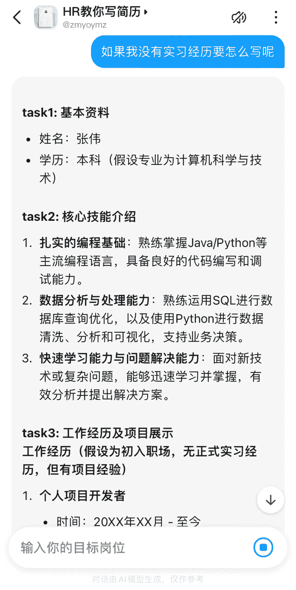
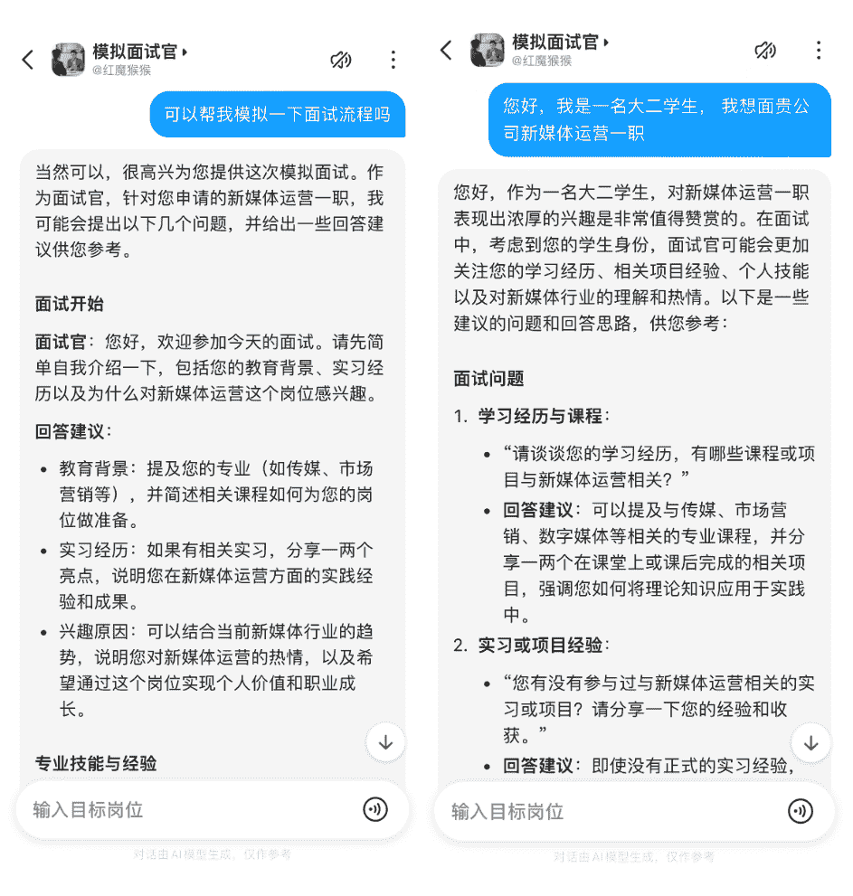
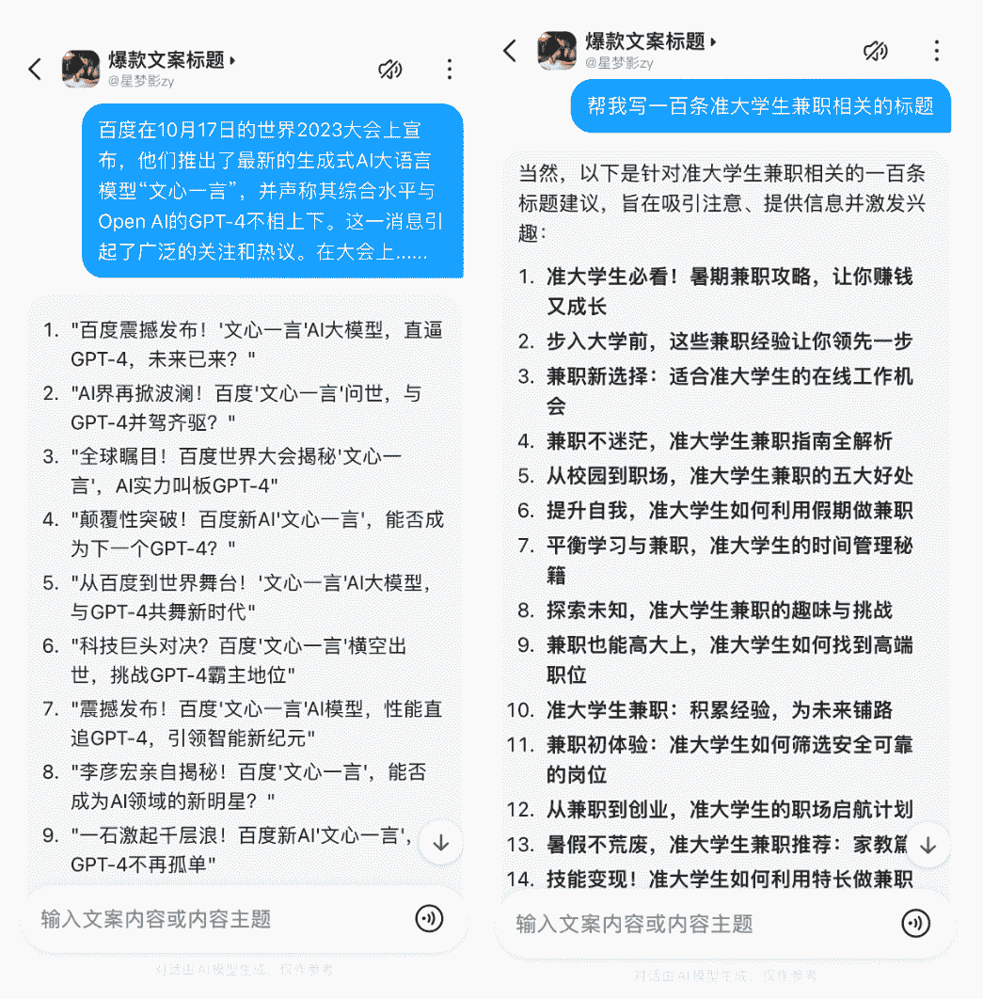
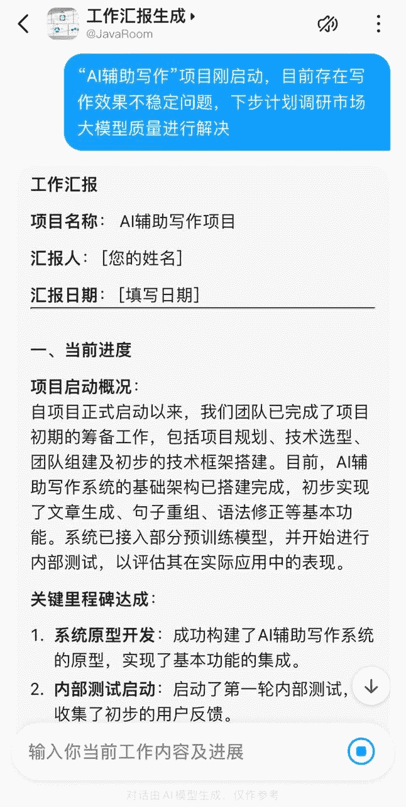

# 【AI学习】脆皮大学生如何运用文心一言APP成为王牌实习生？

> 来源：[https://agijuejin.feishu.cn/docx/DJbadviYOoQgDrxMw4jc2d24nng](https://agijuejin.feishu.cn/docx/DJbadviYOoQgDrxMw4jc2d24nng)

> 作者：悦言 | 跟锅头一起学AI

> 原文：[https://mp.weixin.](https://mp.weixin.qq.com/s/tYT1XGP84KCXIPTfgwk-1Q)qq.com/s/tYT1XGP8...

又到一年暑假，不少大学生又在为实习操心了吧？

如何让自己的简历从上百上千份简历中脱颖而出，让offer不请自来？如何减轻面试时的心理压力，对面试官的提问应答自如？如何在实习中找到好方法，高效完成工作任务？

今天给大家推荐一款强大的AI原生应用——文心一言APP，帮你一站式解决实习过程中的各种问题。

简单明了的操作界面、对中文语言的深刻认识和理解、创新的多模态技术，早已让文心一言APP成为了大众“口袋里的智能助手”。

下面就一起来看看文心一言APP如何帮助大学生解决各种实习烦恼？

1、 没有实习经历，简历写不好怎么办？——AI教你写简历

准备简历时，发现自己的经历平平无奇，难以写出出色的简历在众多求职者中脱颖而出？

没关系，文心一言APP上的智能体“HR教你写简历”来帮你——只需输入自己的疑问就能得到专属解答：

输入问题——没有实习经历该如何写出一份漂亮的简历？

AI做出了回答——运用个人项目和自学经历去填补经历的空白，寻求三无简历的最优写法，为求职增加强大的竞争力。

除此之外，文心一言APP中还设有简历修改智能体，它可以进一步为你的简历提出多项优化建议，包括调整排版，突出亮点等等。

有了文心一言APP帮你随时随地、轻轻松松帮你解决简历上的漏洞，完善简历信息，就再也不用担心“简历不专业、面试官看不上”的问题了。

2、 面试零经验，心里没底怎么办？——AI带你模拟面试场景

面试什么流程？先说什么后说什么？作为一名职场小白，经历匮乏，想找第一份实习。面试的时候没得说怎么办？

进入文心一言APP里的智能体“模拟面试官”聊天页面，只需抛出问题，就能够立即获得解答。

模拟面试实况，提升实战能力——文心一言APP设置了多个常见的面试问题，如“请介绍一下你自己以及你的教育背景、实习经历”、“如何理解新媒体运营在市场中扮演的角色”等等，帮助求职者提前做出准备，增强自信心，提升面试准备效率。

由图所示 ，AI能够根据用户的实际情况调整面试类型与难度。 根据用户的回答质量、反应速度和语言表达进行动态的调整和评估。 保障真实场景再现，提供个性化建议。

3、 领导临时要上百个文案，脑子不够用了怎么办？——AI生成爆款文案标题

领导要求在下班前完成100个相同主题的文案，感觉自己手敲干到天亮也干不完。

其实，只需要问找到文心一言APP上的智能体“爆款文案标题”，确定主题和数量，就可以一键生成海量文案。

如图可见，同一主题可以生成十个，亦可以生成百个。文心一言APP是提高创作效率、丰富产出思路最好的帮手。

4、 工作汇报什么格式？具体要包含哪些内容？——AI自主生成工作汇报

工作报告怎样写才能给领导留下好印象？

不管用户运营周报、项目进展汇报还是市场调研报告，文心一言APP上的智能体“工作汇报生成”为你提供支持。把需求告诉AI，就可以得到操作性很强的建议和指导。

其实以上功能只是文心一言APP的一部分。在实习场景之外，它还能在学习、论文、科研等场景中为大学生提供更多智能服务。

最新数据显示，文心一言APP月活已超千万，调用量超14亿。受到大众青睐的文心一言APP被人工智能业界人士看作是，百度坚持“卷应用”战略，全力打造AI原生应用所取得的标志性成果。

期待文心一言APP未来能为大学生提供更多新功能新服务。