# 一泽Eze：用 Coze 打造 AI 精读专家智能体，复刻 10 万粉公众号的创作生产力

> 来源：[https://agijuejin.feishu.cn/docx/Xt49dHeJHoFDKrxtrtNcoVv8nBe](https://agijuejin.feishu.cn/docx/Xt49dHeJHoFDKrxtrtNcoVv8nBe)


> 可能是全网最好的 Coze 教程（之一），带你一次性入门 Coze 工作流。

> 即使是非技术出身的爱好者，也能上手跟学，一站式学会 AI Agent 从设计到落地的全流程方法论。

---

# 阅读指南

> 长文预警，请视情况收藏保存

**核心看点：**

+   通过实际案例逐步演示，用 Coze 工作流构建一个能够稳定按照模板要求，生成结构化内容的 AI Agent

+   开源 AI Agent 的设计到落地的全过程思路

+   10+ 项常用的 Coze 工作流的配置细节、常见问题与解决方法

**适合人群：**

+   任何玩过 AI 对话产品的一般用户（如果没用过，可以先找个国内大模型耍耍）

+   希望深入学习 AI 应用开发平台（如 Coze、Dify），对 AI Agent 工作流配置感兴趣的爱好者

注：本**文不单独讲解**案例所涉及 Prompt 的撰写方法。文末 「拓展阅读」 中，附有相关 Prompt 通用入门教程、 Coze 其他使用技巧 等内容，以供前置 or 拓展学习。

---

# 引言

AI 行业的终极目标是实现 AGI（通用人工智能），期望仅凭简单指令就能用媲美或超越人类的智力执行任何任务。然而，当前的大模型在处理多步骤复杂任务时仍存在明显局限。

以“数据分析图表、剧情游戏”或“本文结构化外文精读”等需要多个子步骤协调完成的任务为例，即便是最先进的 ChatGPT-4o 和 Claude 3.5 sonnet，仅依靠单一 Prompt 指令也难以实现稳定执行。

现阶段的 AI Agent 更像缺乏独立解决问题能力的职场新人，需要遵循 mentor 的指引，按照给定的 SOP 流程才能完成特定任务。

本文将帮助你了解如何将一个复杂任务从需求雏形逐步落地，构筑为一个 AI Agent，为你后续手捏 Agent 提供思路指引。

---

# Step 0：梳理手捏  AI Agent 的思路

在上篇文章 [Prompt 工程｜样例驱动的渐进式引导法：利](https://mp.weixin.qq.com/s/3pFG_Tx7gcnnjOyqgM1P_w)用 AI 高效设计提示词 ，生成预期内容 中，我已经提到过 Prompt 工程的必备能力：通过逻辑思考，从知识经验（KnowHow）中抽象表达出关键方法与要求。

这一理念同样适用在 Coze 中创建 AI Agent 。

本文主要讨论工作流驱动的 Agent，搭建工作流驱动的 Agent ，简单情况可分为 3 个步骤：

1.  **规划：**制定任务的关键方法

+   总结任务目标与执行形式

+   将任务分解为可管理的子任务，确立逻辑顺序和依赖关系

+   设计每个子任务的执行方法

1.  **实施：**分步构建和测试 Agent 功能

+   在 Coze 上搭建工作流框架，设定每个节点的逻辑关系

+   详细配置子任务节点，并验证每个子任务的可用性

1.  **完善：**全面评估并优化 Agent 效果

+   整体试运行 Agent，识别功能和性能的卡点

+   通过反复测试和迭代，优化至达到预期水平

接下来，我们从制定关键方法与流程，梳理「结构化外文精读专家」Agent 的任务目标。

---

# Step 1：制定任务的关键方法

## 1.1 总结任务目标与执行形式

在开始设计和开发任何 AI Agent 之前，最关键的第一步是明确定义你期望 AI 最终输出的结果。这包括：

1.  详细描述期望获得的输出内容

1.  是文本、图像、音频还是其他形式的数据？

1.  输出的具体格式和结构是什么？

1.  确定输出内容的质量标准

1.  预估任务的可行性

1.  确定任务的执行形式

[以 LearnAndRe](https://mp.weixin.qq.com/s/6R-Wph0yVmtwqPpAahFbDA)cord 的一篇文章《全球多地遭遇微软蓝屏》为例，拆解其结构可以分为如下框架：

这种结构设计非常适合外语学习者，从小作业到全文精读，再到重点单词盘点，很符合外语学习者的精读需求。

基**于 Le**arnAndRecord 的框架，假设我是 CET-4 英语学习者，对架构进行了微调后，优化后的精读结构如下（使用 Markdown 语法表示）：

```
# 中文标题

&gt; 中文导语 // 根据全文表达的主要内容，用中文输出能够引起读者注意力的摘要导语

## 阅读理解小作业 // 基于全文内容，精心策划 3 道符合 CET-4 难度的阅读理解题目，每道题均提供 A、B、C、D 四个选项，题目和选项均以英文呈现

1）[题目问题]
A. [选项A]
B. [选项B]
C. [选项C]
D. [选项D]

## 阅读导图 // 根据全文完整内容，生成结构化的英文要点大纲，并用思维导图的形式表达

### 英文音频 // 依据英文原文，运用 TTS 技术生成阅读音频

### 英文标题

### 英文原文

### 全文对照精读 // 针对全文内容，分段输出每段英文原文+对应段落中文翻译+对应段落中符合 CET-4 难度及以上的所有词汇释义，具体格式如下：

【一段英文原文】
【一段中文翻译】
- 【原词汇 1】
    - 音标：【给出对应的音标】
    - 中文释义：【中文释义】
    - 英文例句：【英文例句】
    - 例句翻译：【例句翻译】

### 待学词汇盘点

- 待学词汇：音标 中文释义
- 待学词汇：音标 中文释义

## 参考答案 // 给出阅读理解作业中 3 道题目的准确答案
```

值得注意的是，Coze 支持 Markdown 格式输出 AI 生成的内容。Markdown 作为轻量级文本标记语言，能够有效展示文本、图片、URL 链接和表格等多种内容形式。

参照精读结构，评估任务的可行性，我们的生成结果包括三类输出格式：文字、图片（思维导图）、音频（原文音频）

前**两者可直接用 Mar**kdown 输出/嵌入，音频则需通过 URL 链接跳转外部网页收听。总体而言，通过稍加变通，基本可以实现所需功能。

最后结合使用习惯，我期望在我输入一篇英文原文时，AI Agent 能够按模板要求，直接输出精读结果。

**所以，大致预期的执行形式如下：**

```
@user: {{英文原文}}

@AI: {{精读结果}}
```

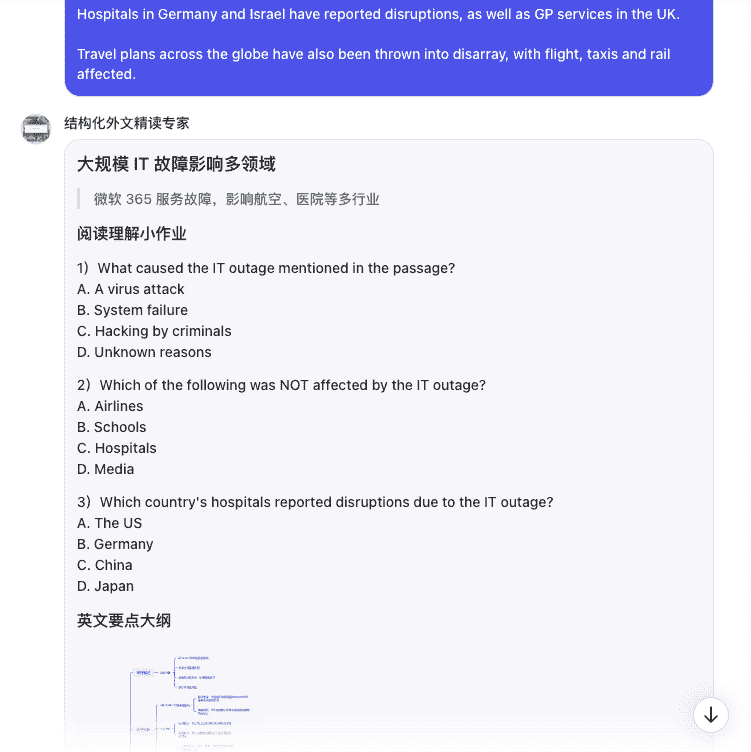

---

## 1.2 分解子任务，确立逻辑顺序和依赖关系

从精读结构来看，整个模板是由多个子模块共同组成的。由于每个模块的格式、用途不尽相同，即可理解为一一项不同的子任务。

对于 LLM-based 的 AI Agent 工程而言，在一轮对话中一次性执行多种子任务，非常考验作为大脑的 LLM 大模型的智力水平。（即便是最先进的 ChatGPT-4o 和 Claude 3.5 sonnet，仅依靠单一 Prompt 指令也难以稳定执行需要多个子步骤协调完成的任务）

> 在实操过程中，我其实是先写了单段 Prompt，在 Claude 和 ChatGPT 中对文本生成部分进行了简单测试，生成内容基本能达到预期，但输出格式的稳定性欠佳。

> 拓展阅读：如何判断自己的任务/Prompt 是否需要拆解为工作流？——答案见文末「常见问题」

于是，我将任务分解为可管理的子任务，确立逻辑顺序和依赖关系如下：

每个子任务分布执行，成果完全独立。接下来就是设计每个子任务的执行方法（要求）。

---

## 1.3 设计每个子任务的执行方法

根据项目实际需求，详细规划每个内容模块的输出要求。

在规划过程中，可以想象自己正在面对面教一位新人工作，这样有助于更清晰地制定任务指南。

本案例中， 子任务的各个内容模块，详细要求如下：

| 中文标题 | 根据全文大意，翻译英文标题，输出 20 字以内的中文标题。 |
| --- | --- |
| 中文导语 | 根据全文表达的主要内容，用中文输出能够引起读者注意力的摘要导语。要求简洁明了，限制在 1-3 句话内。 |
| 英文标题 | 如实输出原文的英文标题，不需要任何修改 |
| 阅读大纲 | 因为阅读大纲最终需要被转换为思维导图，所以需要按照思维导图的输入要求，严格限定大纲格式 |
| 阅读导图 | 根据阅读大纲，生成完全对应的思维导图 |
| 阅读理解小作业 | 基于英文原文，精心策划 3 道符合 CET-4 难度的阅读理解题目。每道题均提供 A、B、C、D 四个选项，正确答案所在选项顺序随机，题目和选项均以英文呈现。 |
| 参考答案 | 针对 3 道题目，生成题目答案。 |
| 英文音频 | 根据原文，利用 TTS 技术朗读全文 |
| 全文对照精读 | 根据原文，按照以下格式，分段完成全文精读结果的输出： |
| 待学词汇盘点 | 把全文对照精读模块中的全部待学词汇汇总，按以下列表格式输出： |

+   [要点 1]

+   [子要点 1.1]

+   [子要点 1.2]

+   [要点 2]

+   [子要点 2.1]

+   [子要点 2.2]

+   音标：[音标]

+   中文释义：[中文释义]

+   英文例句：[生成一句包含本条待学词汇的英文例句]

+   例句翻译：[用中文翻译英文例句]

---

# Step 2**：**分步构建和测试 Agent 功能

## 2.1 在 Coze 上搭建工作流框架，设定每个节点的逻辑关系

首先进入 Coze，点击「个人空间-工作流-创建工作流」，打开创建工作流的弹窗。

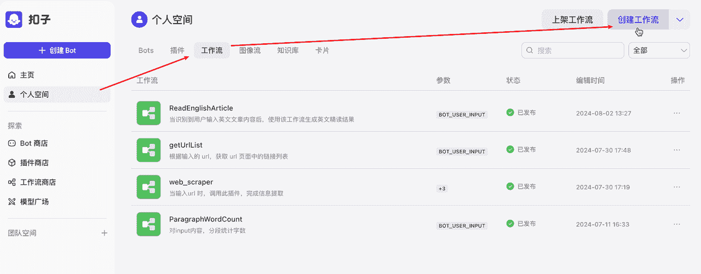

根据弹窗要求，自定义工作流信息。

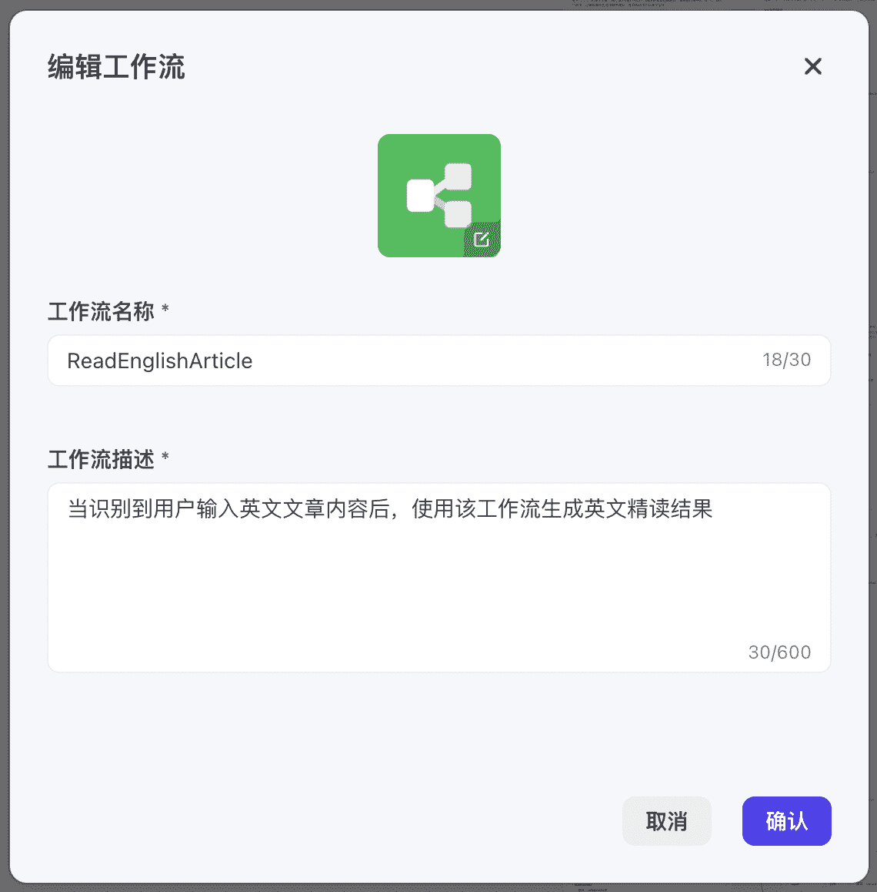

点击确认后完成工作流的新建，可以看到整个编辑视图与功能如下：

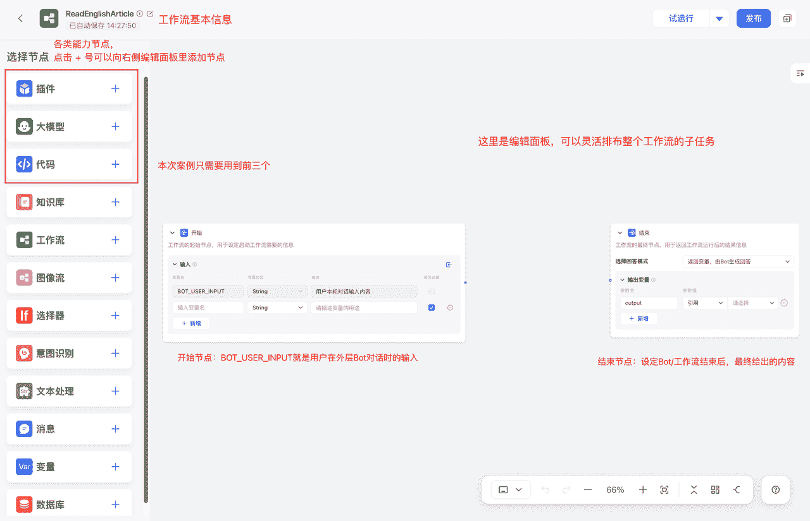

其中，左侧「选择节点」模块中，根据我们的子任务需要，实际用上的有：

1.  插件：提供一系列能力工具，拓展  Agent 的能力边界。本案例涉及的思维导图、英文音频，因为无法通过 LLM 生成，就需要依赖插件来实现。

1.  大模型：调用 LLM，实现各项文本内容的生成。本案例的中文翻译、英文大纲、单词注释等都依赖大模型节点。

1.  代码：支持编写简单的 Python、 JS 脚本，对数据进行处理。

而编辑面板中的开始节点、结束节点，则分别对应 1.2 分解子任务 流程图中的原文输入和结果输出环节。

接下来，按照流程图，在编辑面板中拖入对应的 LLM 大模型、插件、代码节点，即可完成工作流框架的搭建。

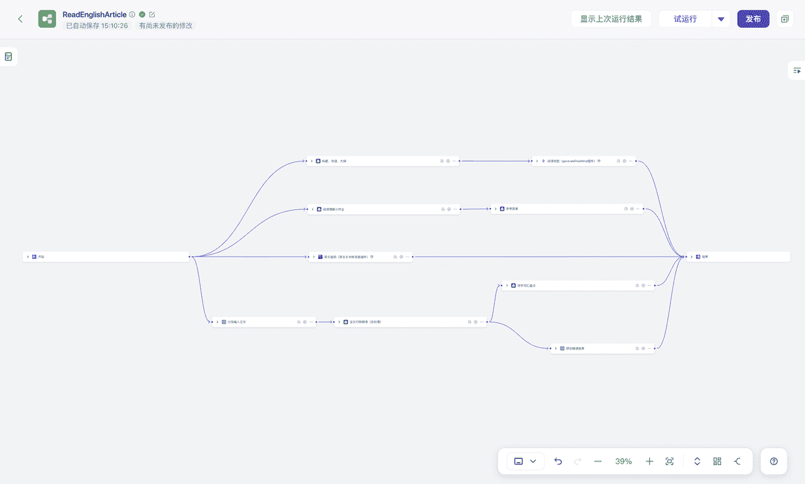

---

### 附 1：关于「分段」、「拼合」代码节点设计的补充解释

实际测试表明，由于 LLM 的上下文长度有限，通常情况下，一次性输入输出的文本越长，生成时间越长，结果稳定性越低。特别是当对生成结果的格式要求较高时，这个问题更为突出。

考虑到对照精读环节，本身就是逐段生成的，非常适合批处理的形式。所以需要用「分段输入正文」，把正文分割后，用 LLM 节点批处理每一段的对照精读，最终「拼合精读结果」，就能输出完整的文本结果。

Tips**：**如果觉得编写代码脚本繁琐，且仅进行文本处理，也可以考虑使用 LLM 节点，配合适当的 prompt 来临时验证整个工作流。

### 附 2：如何在插件中心，确定需要的插件？

先用关键词进行尝试性搜索，根据插件名称、插件介绍页、描述、参数、示例，判断是否可能满足需求。有多个插件同时可选时，一般优选官方/高收藏/高成功率的插件，提升使用效果。如果实际试用效果不行，则换用其他插件，或自己编写上架插件。

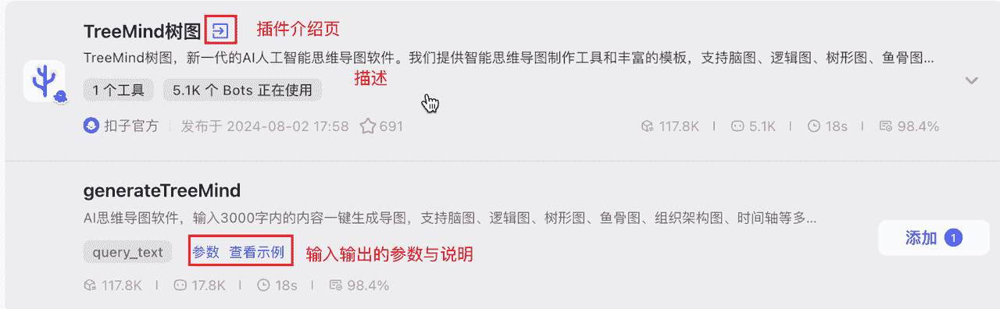

附本文插件的搜索过程：

1.  TTS 文字转语音插件：搜索“语音”、“文字转语音”、“TTS”等相关关键词，看到“英文文本转语音”插件，阅读描述后，应该和我们需求相符，遂添加。

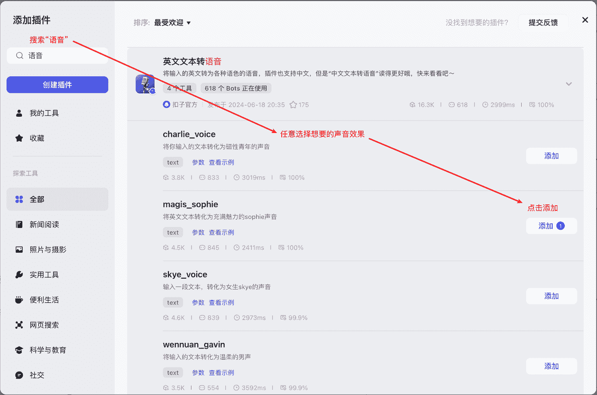

1.  思维导图插件：搜索“脑图”、“树图”、“导图”、“mindmap”等关键词，看到“TreeMind 树图”插件，阅读描述后，应该和我们需求相符，遂添加。

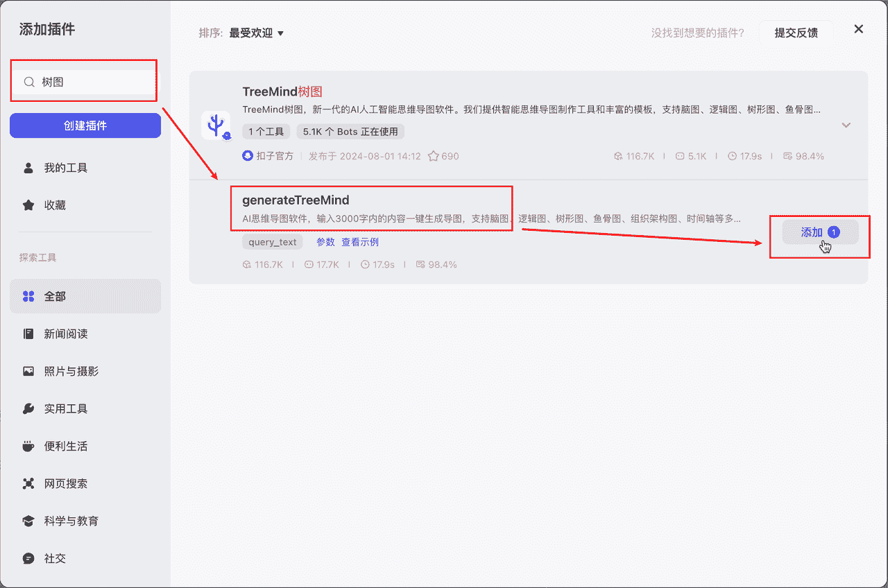

---

## 2.2 详细配置子任务节点，并验证每个子任务的可用性

在确定工作流框架后，即可按照流程步骤，逐个完成子任务节点的详细配置。

我将快速介绍每个节点的必要配置技巧，并完全开源每个节点的 prompt、代码、I/O 信息，以供参照学习。

### 0. 开始节点

想象一下，工作流就像一条生产线。

开始节点就是这条生产线的入口，它的工作是定义启动工作流需要的输入参数，收集需要的原材料（也就是用户的输入）。在这里，可以给每种"原材料"取个名字（这就是变量名），还能说明每种"原材料"是什么类型的，以便后续的分类识别与加工。

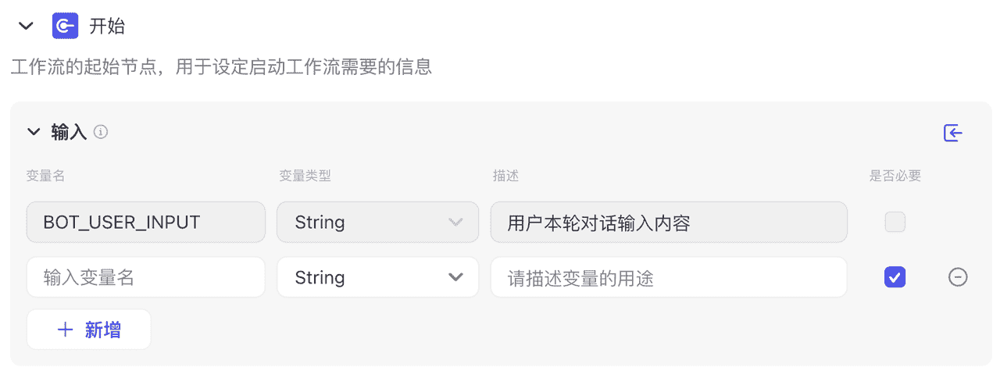

其中，{{BOT_USER_INPUT}}是默认变量，用来接收用户在外层 Bot 中的输入文本。工作流模式下的工作流，应只保留 BOT_USER_INPUT 节点。

在本案例中，我们不需要在开始节点配置额外变量。用户初始输入的英文原文，将通过{{BOT_USER_INPUT}}直接传入工作流，启动后续环节。

所以，删掉那条空变量，我们这步就算完成了。

---

### 标题、导语、大纲（含大模型节点的配置思路）

#### 配置环节

在生成标题、导语、大纲时，因为只涉及文本理解与文本创作，很明显这是 LLM 节点的工作，所以我们需要对 LLM 节点进行配置。

可能你在 1.2 分解子任务 那个章节就想问：为什么不把“标题、导语、大纲”拆得更细，比如分成生成标题、生成导语和生成大纲 3 个子任务？

——因为 LLM 是按输入/输出的字符数量来消耗 token，在满足预期的情况下，更少的大模型处理环节，能有效减少 token 消耗，在实际投产时节省模型调度费用。

经过实测，豆包·function call 32k 模型，已经能在一轮对话中稳定地生成这三项内容了。

每个大模型节点的配置项很丰富，对于入门用户来说，主要关注：

```
# 处理形式
单次/批处理

# 模型
可以选择该节点执行任务时调用的大模型，比如选豆包，就是豆包来处理回复。

# 输入
用于设置输入到该模型节点的字段信息，信息只能来自串联连接的前置节点。

# 提示词
分为“用户提示词”和“人设与回复逻辑”

如果子任务不复杂，只设置“用户提示词”足够了。

#输出
用于设置该模型节点输出的字段信息，可以选择文本、Markdown、json 三种格式。

一般选择 json 即可（因为 json 格式下也可以输出纯文本/带 Markdown 标记的纯文本，而且能一次性能结构化的输出不同字段信息）
```

在“标题、导语、大纲”节点中，我们希望 LLM 能够从开始节点，接收到原文信息，经过处理后，一次性把我们需要的中文标题、中文导语、英文标题、英文阅读大纲生成输出。所以设置如下：

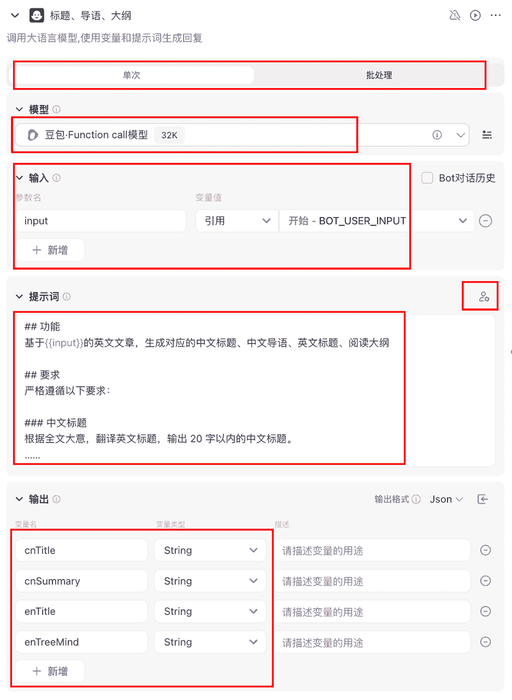

另外，**为了保证大模型能够处理足够长的内**容，需要视实际情况调大模型的最大回复长度：

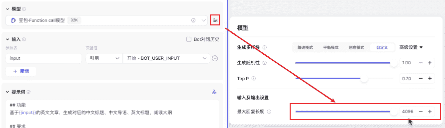

最后，根据 1.3 设计每个子任务的执行方法 中的内容模块要求，设计并填入以下用户提示词（本文主要讨论工作流的设置，就不论述这个提示词具体是如何设计的了，感兴趣的可以单独和我聊）：

```
## 功能
基于{{input}}的英文文章，生成对应的中文标题、中文导语、英文标题、阅读大纲
 
## 要求
严格遵循以下要求：
 
### 中文标题
根据全文大意，翻译英文标题，输出 20 字以内的中文标题。
 
### 中文导语
根据全文表达的主要内容，用中文输出能够引起读者注意力的摘要导语。要求简洁明了，限制在 1-3 句话内。
 
### 英文标题
如实输出原文的英文标题，不需要任何修改
 
### 阅读大纲
1. 根据全文完整内容，选择最适合的大纲结构，生成结构化的内容大纲，简洁的表达全文核心内容。要求：全英文，不超过200词。
2. 在输出的阅读大纲的开头增加这句话：“Directly use the following outline to generate the corresponding mind map in English.”
3. 大纲参考格式如下，不要输出[]符号：
 
- [Article Title]
    - [Key Point 1]
        - [Subpoint 1.1]
        - [Subpoint 1.2]
    - [Key Point 2]
        - [Subpoint 2.1]
        - [Subpoint 2.2]
 
## 输出格式
1. 以 string 格式，输出中文标题到 变量{{cnTitle}}
2. 以 string 格式，输出中文导语到 变量{{cnSummary}}
3. 以 string 格式，输出英文标题到 变量{{enTitle}}
4. 以 string 格式，输出阅读大纲到 变量{{enTreeMind}}
```

##### 附：大模型节点配置的入门要点

**大**模型节点的配置，有几个入门要点，希望能帮助你更好入门、更少踩坑：

1.  输入与输出的变量名称是自定义的，只需要按照自己的习惯设定，方便识别字段的含义即可。

1.  输入：因为我们取得是开始节点中，用户输入的{{BOT_USER_INPUT}}，所以可以直接选择引用即可

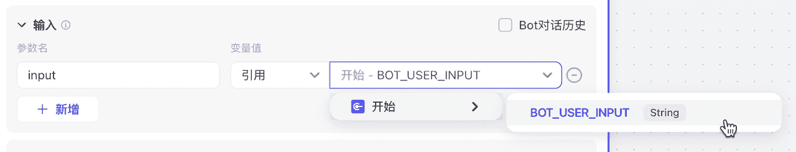

1.  在提示词区域中，因为需要 LLM 根据输入的信息进行处理，所以需要两个双花括号，写明需要使用的输入项参数名，如{{input}}

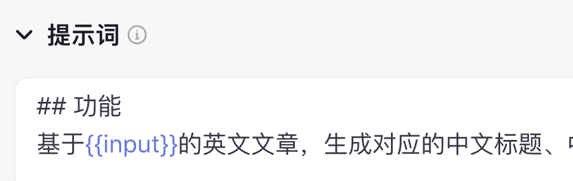

1.  输出：有几项子内容需要生成，就设置几项：

1.  为了能够让大模型理解最终输出的形式要求，需要在用户提示词最后，添加 ## 输出格式 段落，描述每个变量名称、输出内容、输出格式。

1.  请务必注意，变量名称、对应的输出内容、输出格式一定要前后完全一致，不然就会输出失败！这一点非常容易踩坑

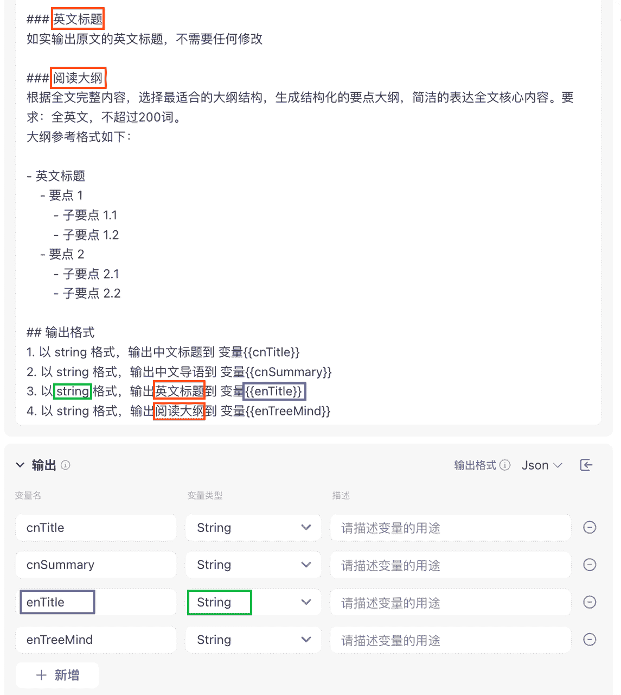

1.  关于模型选择：

1.  没有强制必须用某个模型的说法。而是根据自己的习惯、实测的响应速度、生成质量、调用费用，进行综合选择。比如 Doubao Function Call 模型，对于插件调用、Coze 内 json 格式输出比较擅长；MiniMax 处理文字速度很快；GLM 对于用户提示词的理解比较好。每个模型都有自己擅长的特点，而且每家模型都在不断的迭代。所以模型的选用，需要根据实测情况综合调整。

1.  我一般选择豆包·function call 32k。“function call”代表有着更好的 Coze 的工具调用能力，“32k”代表模型的上下文窗口大小，即模型在处理文本时能够考虑的单词或标记的数量。如果输出和输入的类型不是纯文本时，比如是 array 、object 结构，请根据实测情况，考虑替换上豆包 function call 版本，其他的 LLM 可能会输出格式比较混乱。

#### 测试环节

> 为了节省文章篇幅，后文不再重复说明

完成任何一个节点的配置后，我们都需要进行试运行测试，验证节点的运行效果，步骤如下：

**步骤一：点击「测试该节点」**

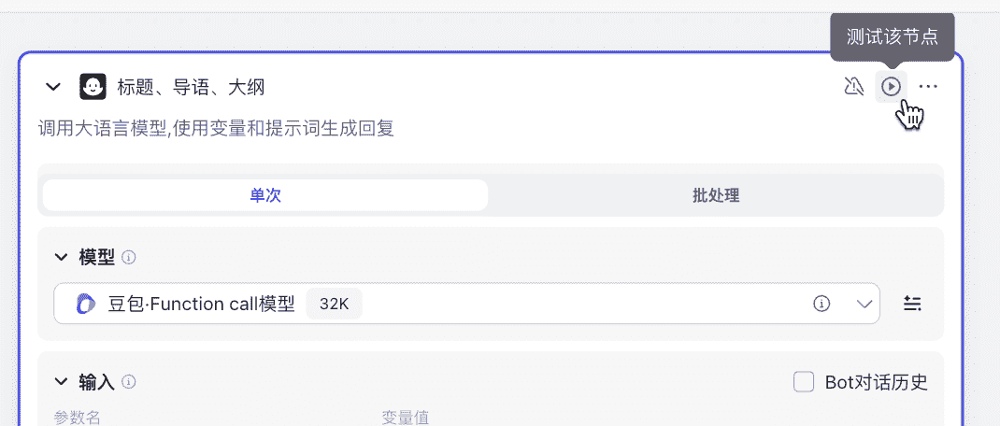

步骤二：按格式要求，输入待测试的输入内容

如果是 array 等其他格式 ，请自行对话 AI 或搜索网络，确认格式要求

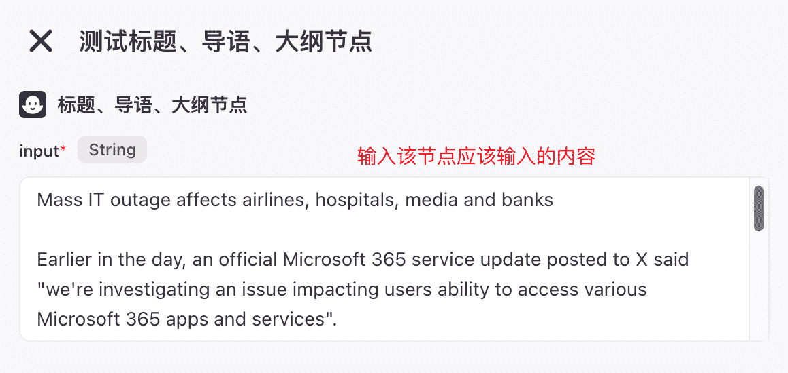

步骤三：点击「展开运行结果」，检查输入、输出项是否有误。

如果有误，请依次检查“测试输入内容”、“节点配置”是否有误，以及优化“提示词”，以提升对生成内容的约束力。

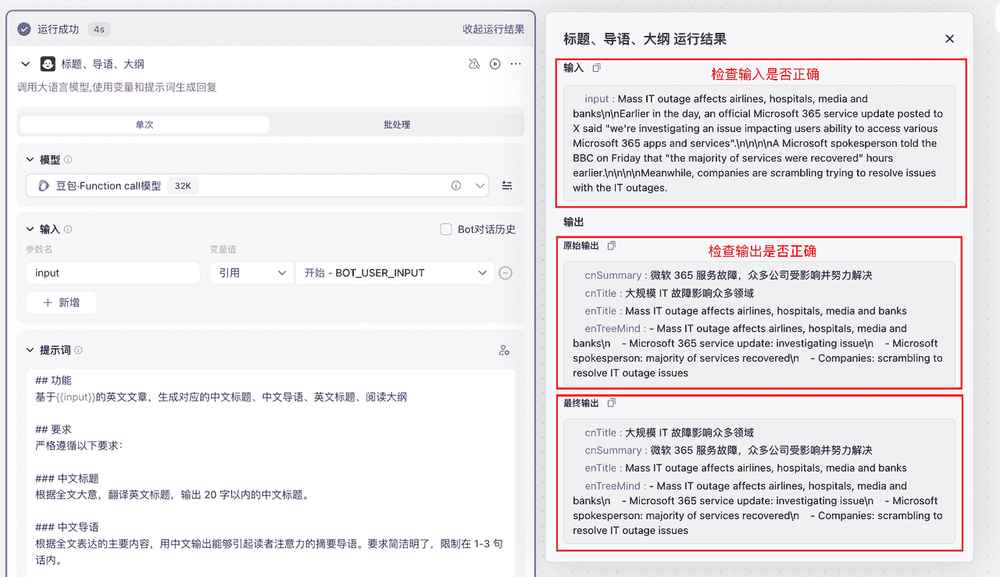

当多次测试时，输入与输出都符合预期时，恭喜，你可以进入下一个子任务的配置啦 🎉

---

### 阅读导图（含插件节点的配置思路）

在上一步中，我们已经生成了英文阅读大纲{{enTreeMind}}，接下来就是用<generateTreeMind>插件节点，接收思维导图的原材料文本，自动生成我们所需的思维导图。

**1）确定处理方式：**由于我们一次精读任务，仅需生成一张思维导图，所以处理方式选择“单次”。

**2**）**确定输入：**

在输入区，该插件仅需设置{{query_text}}变量，格式是 string 字符串。

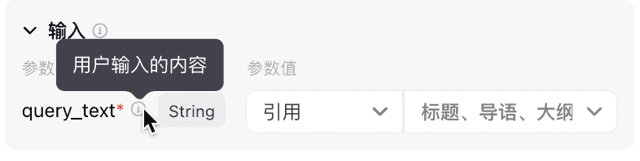

所以只需要引用“标题、导语、大纲”节点的{{enTreeMind}}变量即可。

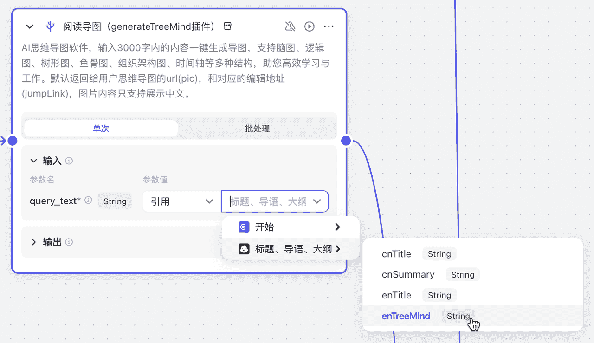

**3）确定输出：**

观察输出区，能看到有很多的输出字段。为了确定插件生成的导图的对应字段，可以根据字段名称、「查看示例」中的示例说明，或者试运行后定位所需的字段。

我们所需的是图片格式的思维导图，所以确定pic就是需要的输出。

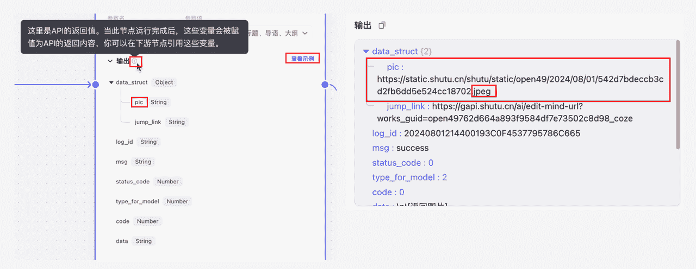

至此，第一个子任务流程分支已集齐了预期的输出字段：

```
中文标题：{{cnTitle}}
中文导语：{{cnSummary}}
英文标题：{{enTitle}}
阅读导图：{{enTreeMind}} -&gt; {{pic}}
```

附：为什么能提前在前一个节点确认思维导图的所需输入格式？

如果插件上架的时候，说明写的比较规范，可以看插件的示例说明。这个插件说的是 AI 思维导图软件，但是请求体写的很简单，其实没法确定如何稳定生成预期结果。

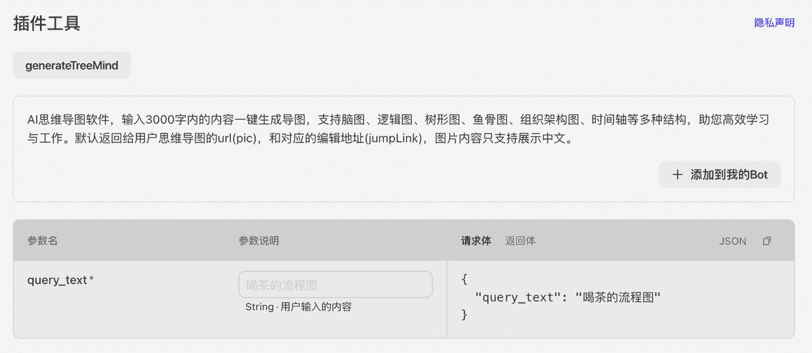

但既然是 AI 思维导图软件，所以猜测通过类似 prompt 的指令就能控制输出结果。所以尝试沿用大部分思维导图软件在转换为大纲时的常见格式，方便大模型理解。

```
直接使用以下英文大纲，用英文生成对应思维导图
- [英文标题]
    - [要点 1]
        - [子要点 1.1]
        - [子要点 1.2]
```

实际单节点测试下来，输出结构确实是 ok 的。

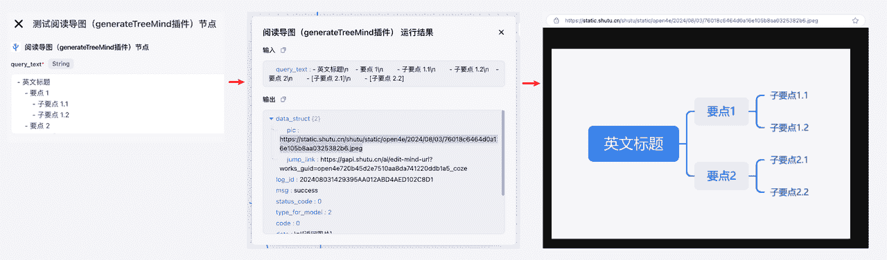

---

### 阅读理解小作业

在这个分支流程，目标是根据全文信息，生成 3 道符合 CET-4 难度的阅读理解题目，并根据题目和原文，输出参考答案。

故同样在输入中引入{{BOT_USER_INPUT}}，并设置输出变量{{question}}，节点配置如下：

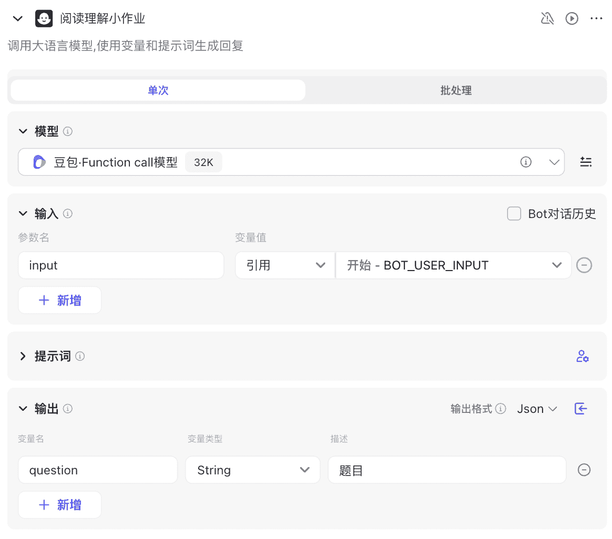

用户提示词：

```
## 功能
基于{{input}}的英文文章，精心策划3道符合CET-4难度的阅读理解题目。每道题均提供A、B、C、D四个选项，正确答案所在选项顺序随机，题目和选项均以英文呈现。
 
## 阅读理解题目
## 格式
每个题目必须包含以下元素，严格遵守格式如下：
 
1）[题目问题]
A. [选项A]
B. [选项B]
C. [选项C]
D. [选项D]
 
### 正向示例
以下符合阅读理解题目的模板要求，输出的一个正向示例：
 
1. What was the main reason for Biden&#x27;s decision to abandon his re-election bid?
    A. His health concerns
    B. Pressure from his allies
    C. Concerns about his age and ability to defeat Trump
    D. His desire to focus on his current presidential duties
 
## 注意事项
1. 题目序号必须使用中文括号，如1）、2）、3）
2. 严格遵守以上格式，不要添加任何额外的文字或解释
3. 请你在输出结果时，检查输出的格式，确保输出符合格式要求
```

---

### 参考答案

此处需要输入根据题目和原文，输出参考答案。（ ps：每个节点的输入信息，都是要单独引用的，不可省略）

节点配置如下：

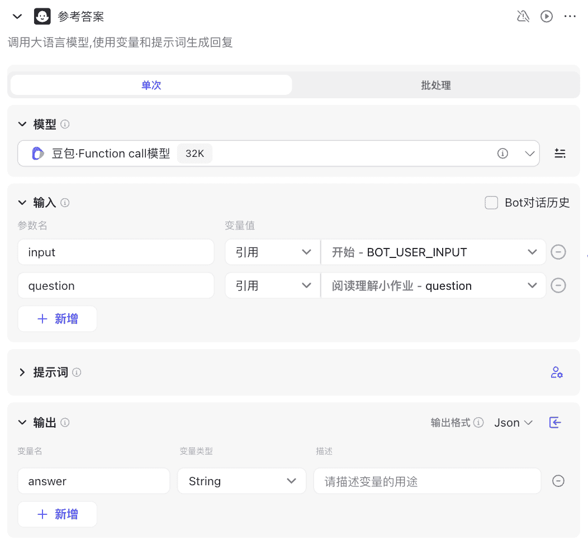

用户提示词如下：

```
## 功能
理解{{input}}的英文文章内容，针对{{question}}的 3 道题目，生成题目答案。
 
## 题目答案
### 格式
每个答案必须包含以下元素，严格遵守格式如下：
 
1）[题目问题]
答案：[X] [正确选项内容]
 
2）[题目问题]
答案：[X] [正确选项内容]
 
3）[题目问题]
答案：[X] [正确选项内容]
 
### 正向示例
以下符合题目答案的模板要求，输出的一个正向示例：
 
1. What was the main reason for Biden&#x27;s decision to abandon his re-election bid?
答案：C. Concerns about his age and ability to defeat Trump
 
## 注意事项
1. 题目序号必须使用中文括号，如1）、2）、3）
2. 必须重复完整的题目问题中的问句（不用输出题目选项）
3. 正确答案用方括号[X]表示，X为正确选项的字母
4. 严格遵守以上格式，不要添加任何额外的文字或解释
5. 请你在输出结果时，检查输出的格式，确保输出符合格式要求
6. 再三检查你回答的答案，确保正确
```

---

### 英文音频

音频生成很简单，直接把原文输入到插件

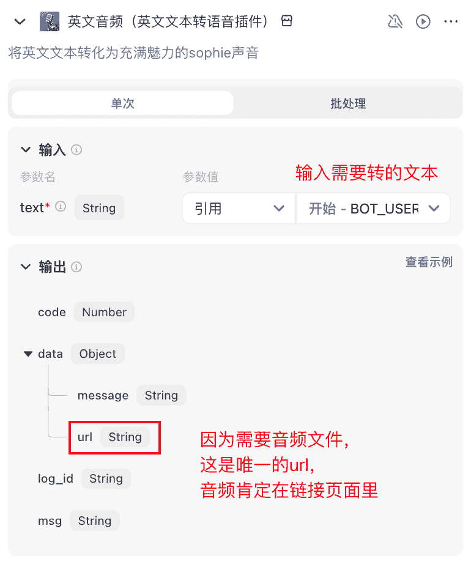

打开试运行结果里的 url，跳转后确实就是一段 mp3 音频，成功～


---

### 分段输入正文（含使用 Coze 自动生成代码脚本的技巧，非技术同学必看）

> 考虑到对照精读环节，本身就是逐段生成的，非常适合批处理的形式。

> 所以需要用「分段输入正文」，把正文分割后，用 LLM 节点批处理每一段的对照精读，最终「拼合精读结果」，就能输出完整的文本结果。

用户输入的原文，格式一般是：

```
原文标题    // 需要去掉
原文段落 1  // 分段输出
原文段落 2  // 分段输出
……
```

为了确保正确区分标题句和段落内容，我这边用了一个简易的方法——直接在 AI 对话窗口中，通过开场白提示用户按格式输入文章，用#符直接标记标题句：

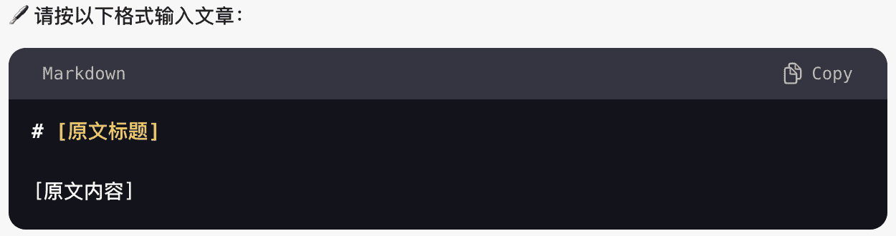

然后用 Python 脚本，去掉标题句，并把剩下内容按照段落的换行，逐段输出为 Array<String>格式：

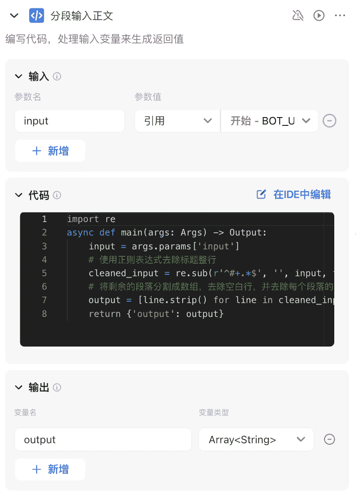

附上 Python 代码：

```
import re
async def main(args: Args) -&gt; Output:
    input = args.params[&#x27;input&#x27;]
    # 使用正则表达式去除标题整行
    cleaned_input = re.sub(r&#x27;^#+.*$&#x27;, &#x27;&#x27;, input, flags=re.MULTILINE)
    # 将剩余的段落分割成数组，去除空白行，并去除每个段落的前后空格
    output = [line.strip() for line in cleaned_input.splitlines() if line.strip()]
    return {&#x27;output&#x27;: output}
```

试运行后，就可以发现，节点已按照预期运作，分次输出了每一段原文。

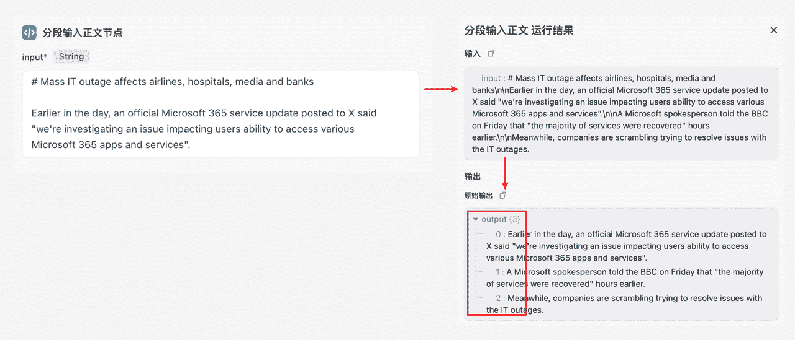

---

#### 附 1：如何用 Coze 自动生成代码节点的代码？

这段代码也是用 Coze 代码节点自带 IDE 里的 AI 功能生成的，使用技巧如下（我试了很多次，请务必参考图中的小技巧，不然大概率失败）：

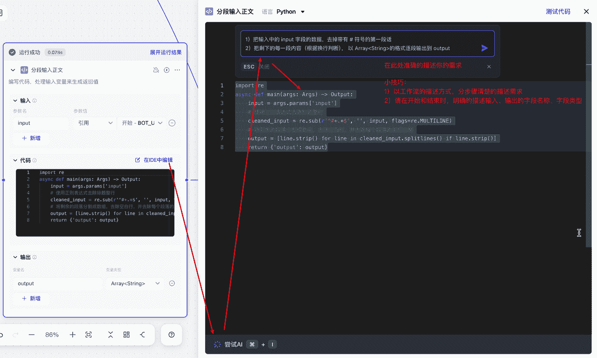

代码生成后，除了直接在节点的试运行功能测试外，也可用「测试代码」功能，进行测试：

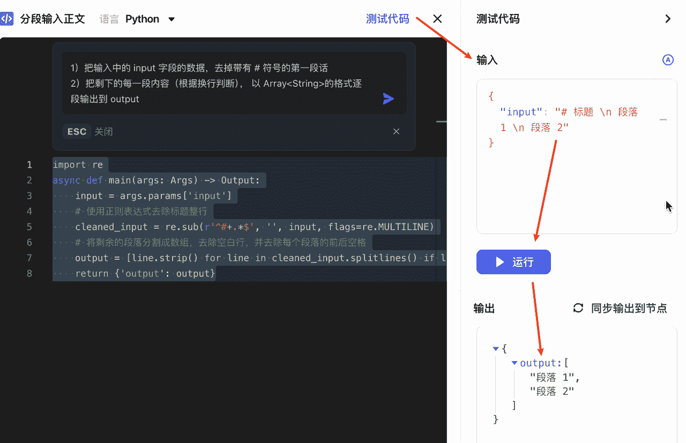

#### 附 2：能不能不写代码，快速实现这个子任务？

可以，因为是纯文本处理工作，所以只要有合适的 prompt 也可以用 LLM 节点实现，只不过在 token 消耗、响应速度上不如代码节点。在快速搭建工作流的开发阶段，不会代码的话，可以考虑用 LLM 节点。

比如，我一开始用的：

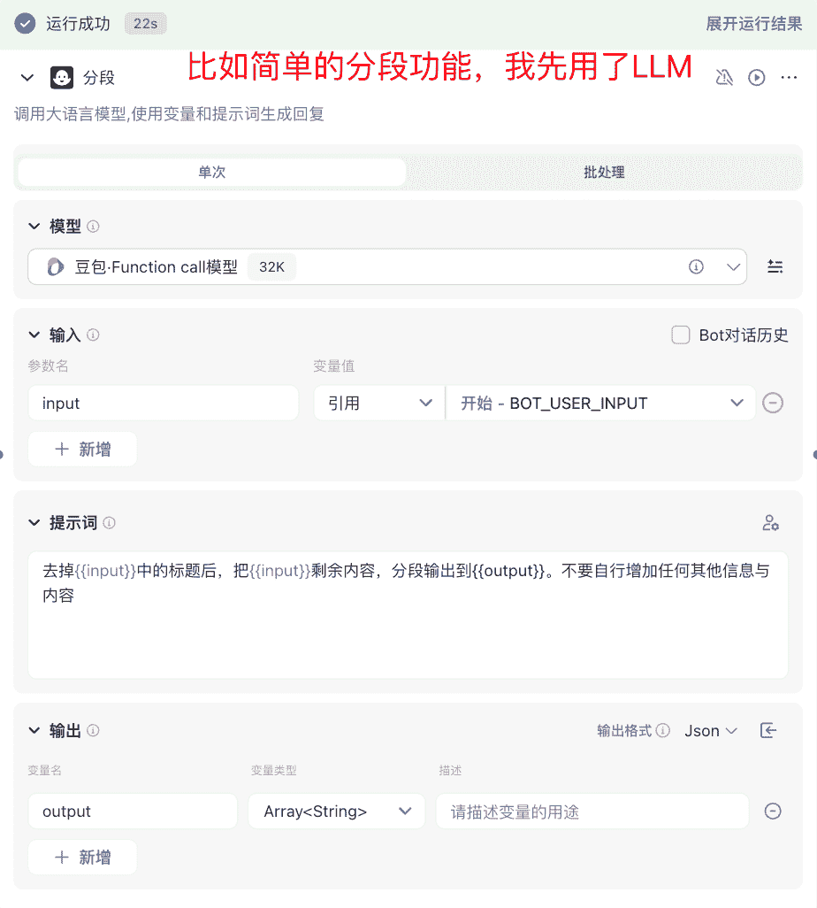

但工作流走通后，强烈需要用代码节点替代回来，提升工作流效率、降低成本。（同样的功能，LLM 节点运行了 22s，代码节点只需要 0.1s）

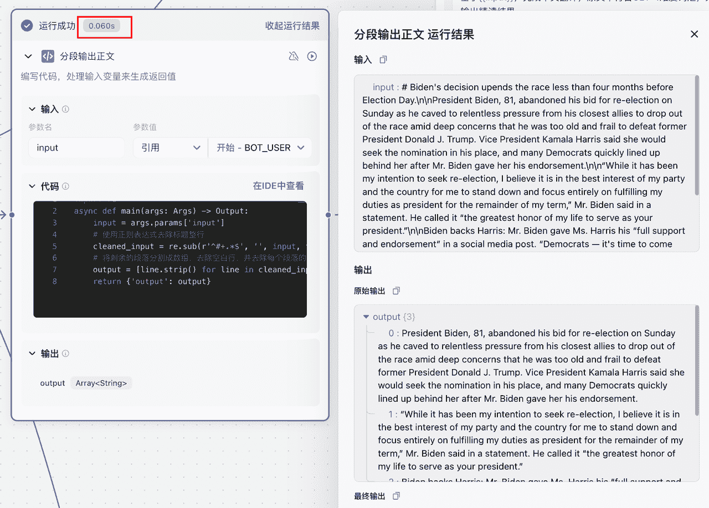

---

### 全文对照精读（含批处理的输入输出设置技巧）

拿到分段的原文段落后，就是生成我们整个任务中最精华部分——带注释的全文对照精读！

此处我们选择的是用大模型节点，批处理每一段的原文。批处理的好处很多，现在 Coze 的一个大模型节点，能够同时并行 10 项任务，极大加速内容的生成。且因为每一段都是单独处理，所以输出长度显著降低，提升了稳定性。

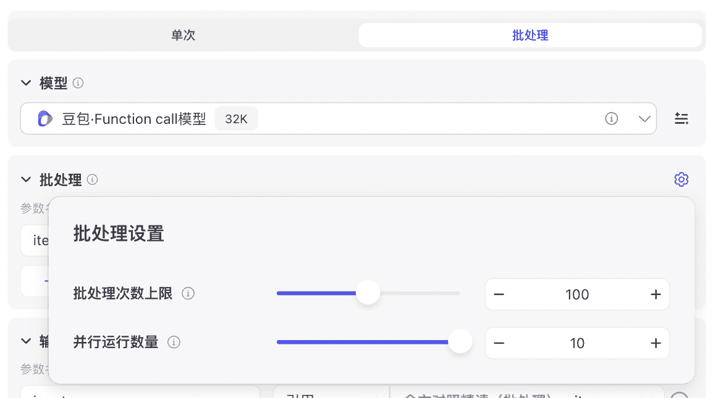

这里请务必注意批处理、输入的选择！！！

1.  批处理区域，引用上个节点的 output 数组，批处理会按顺序逐个输出数组中的每一段原文。

1.  输入区域，选择批处理区域中需要被取用的参数。（千万不要引用上个节点的 output 数组……我一开始设置错了，导致一直生成失败，还找不到错误原因）

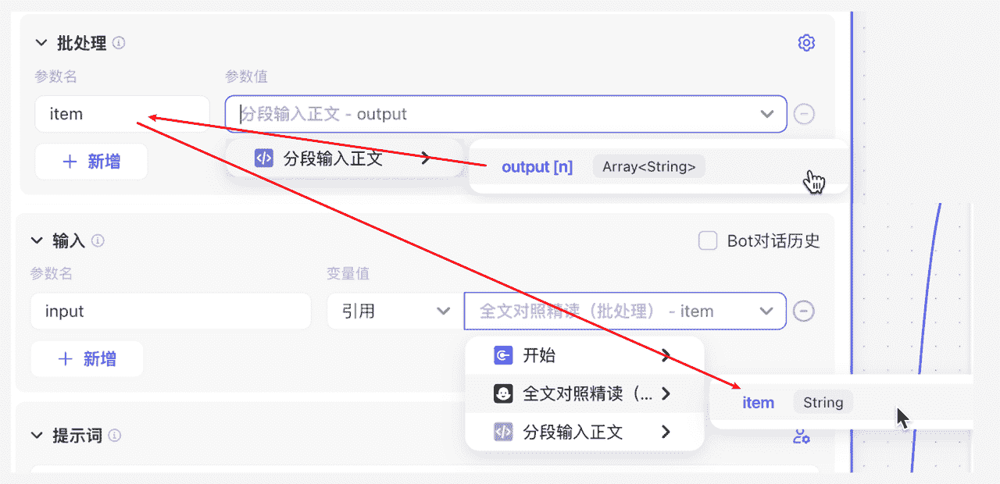

随后，根据 1.3 设计每个子任务的执行方法 中的全文对照精读的输出要求，设计用户提示词如下：

```
## 功能
基于{{input}}，完成中文翻译，原文中符合CET-4难度词汇，为&quot;待学词汇&quot;。
输出精读结果

## 精读结果
请根据以下模板输出：

英文原文

中文翻译

- 待学词汇
    - 音标：音标
    - 中文释义：中文释义
    - 英文例句：生成一句包含本条待学词汇的英文例句
    - 例句翻译：用中文翻译英文例句

## 正向示例
以下符合精读结果的模板要求，输出的一个正向格式示例：

President Biden, 81, abandoned his bid for re-election on Sunday as he caved to relentless pressure from his closest allies to drop out of the race amid deep concerns that he was too old and frail to defeat former President Donald J. Trump. Vice President Kamala Harris said she would seek the nomination in his place, and many Democrats quickly lined up behind her after Mr. Biden gave her his endorsement.

81岁的拜登总统在周日宣布放弃连任竞选。这一决定是在他最亲密的盟友持续施压下做出的，因为人们普遍担心他年事已高，体力不支，无法击败前总统唐纳德·J·特朗普。副总统卡玛拉·哈里斯表示，她将取而代之寻求党内提名。在拜登表态支持后，许多民主党人迅速站到了哈里斯一边。

- abandoned
    - 音标：/əˈbændənd/
    - 中文释义：放弃，抛弃
    - 英文例句：The team abandoned their original plan due to unforeseen circumstances.
    - 例句翻译：由于突发情况，团队放弃了原定计划。
- relentless
    - 音标：/rɪˈlentləs/
    - 中文释义：持续的，不懈的，无情的
    - 英文例句：The detective&#x27;s relentless pursuit of the truth finally led to a breakthrough in the case.
    - 例句翻译：侦探对真相的不懈追查最终使案件取得了突破

## 注意
请你在输出结果时，检查输出的格式，确保输出符合格式要求
```

最终，整个节点配置如下：

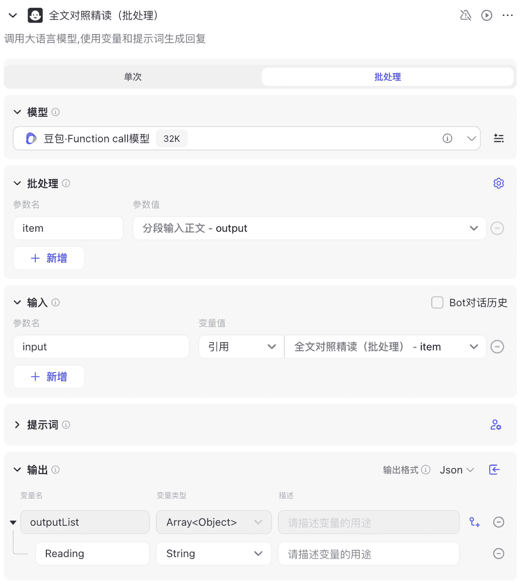

---

### 待学词汇盘点

这一步比较简单，就是把精读环节的“待学词汇”全部提取出来，并按照我们需要的格式整理为一份词汇盘点列表。

也就是输出一系列数组数据，输出一段文本结果。所以，我们这一步不需要用到批处理，直接大模型单次处理即可。

为了把上个环节的数组数据一次性输入到节点中，我们可以考虑两种方式：

1.  先拼合数组数据为一整段文本内容，再进行处理

1.  直接把数组数据进行处理

观察「全文对照精读」的 outputList 的 json 数据结果（如下），可见即使是批处理输出，但 json 数据中也包含了全部段落的精读内容。所以可以直接采用第 2 种方式。（你当然也可以调整子任务的流程，先拼合再处理）

```
{
  &quot;input&quot;: [
    {
      &quot;Reading&quot;: &quot;第 1 段精读结果&quot;
    },
    {
      &quot;Reading&quot;: &quot;第 2 段精读结果&quot;
    }
  ]
}
```

节点配置如下：（采用 MiniMax 6.5 245k 的原因：这个文本处理基本没什么难度，且输入输出都是按纯文本直接理解和生成的，也不需要模型对工作流配置有独特的优化。而 MiniMax 的特点是运行很“快”，所以选择了它。如果节点试运行报错的话，建议换回 Doubao，相对来说 Coze 对自家模型的兼容性更好更稳定。）

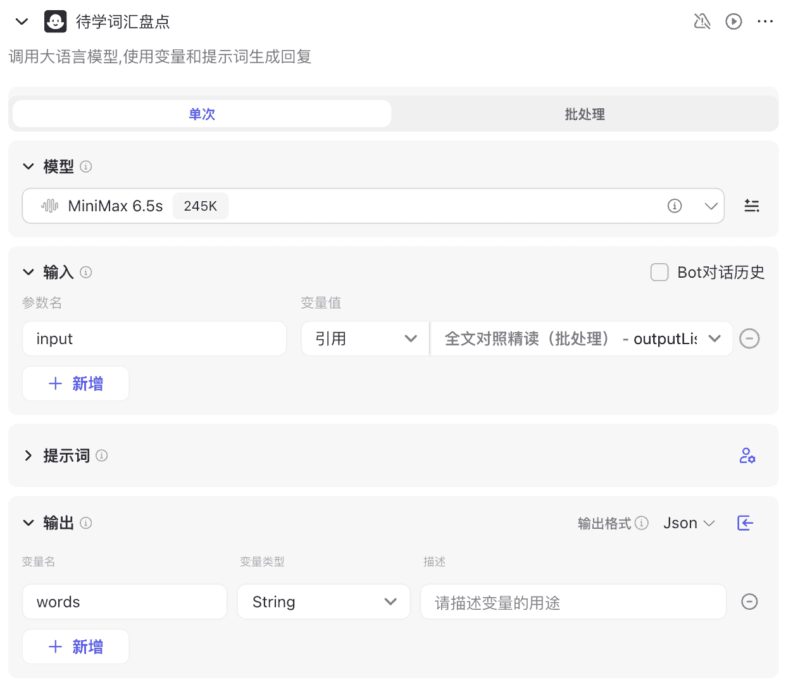

附上用户提示词：

```
## 功能
识别{{input}}中的待学词汇，并输出待学词汇汇总列表
 
待学词汇在 input 的结构是这样的，你可以这样去找到待学词汇：
 
[英文原文]
 
[中文翻译]
 
- [待学词汇]
    - 音标：[音标]
    - 中文释义：[中文释义]
    - 英文例句：[英文例句]
    - 例句翻译：[例句翻译]
 
## 待学词汇汇总列表
以下是需要输出的待学词汇汇总列表的格式：
- [待学词汇]：[音标] [中文释义]
- [待学词汇]：[音标] [中文释义]
 
## 正向示例
以下符合待学词汇汇总列表的模板要求，输出的一个正向示例：
- frail：/freɪl/ 虚弱的，脆弱的
- nomination：/ˌnɒmɪˈneɪʃn/ 提名，任命
- intention：/ɪnˈtenʃn/ 意图，目的
- remainder：/rɪˈmeɪndə(r)/ 剩余部分，余数
 
## 注意
- 不要遗漏任何的待学词汇
- 请你在输出结果时，检查输出的格式，确保输出符合格式要求
```

试运行效果也很不错：

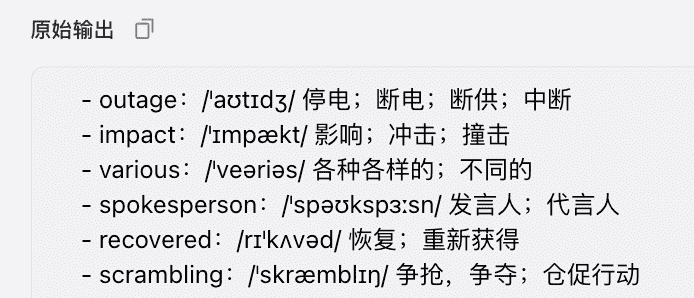

---

### 拼合精读结果

由于「全文对照精读」节点输出的是一条条的数组数据，并不是我们最终想输出的精读结果样式。所以需要把每一段精读内容再拼合成一篇文章。

配置代码节点如下：

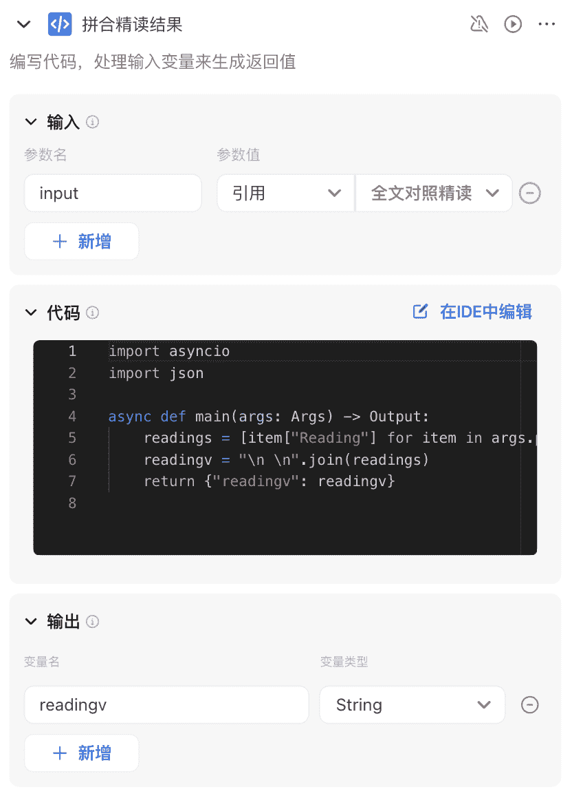

附上代码：

```
import asyncio
import json

async def main(args: Args) -&gt; Output:
    readings = [item[&quot;Reading&quot;] for item in args.params[&quot;input&quot;]]
    readingv = &quot;\n \n&quot;.join(readings)
    return {&quot;readingv&quot;: readingv}
```

---

### 输出节点

好了，恭喜，到这一步，每个子任务的节点都已经配置验证完毕，现在我们只需要把这些内容像“乐高”一样拼装起来。

1.  因为我们需要按照固定的格式，直接生成结构化的长文，而不仅仅是返回字段数据，所以需要选择回答模式为“使用设定的内容直接回答”

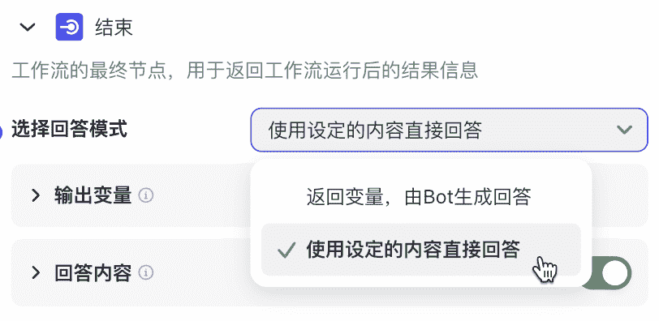

1.  由于最终输出结果的呈现是在外层 bot 中，以对话的形式给出。我们的精读结果往往很长，“流式输出”能够像码字一样，逐步展示内容，有更好的使用体验。


1.  整理回答中需要使用的变量，在「输出变量」区域中全部引用

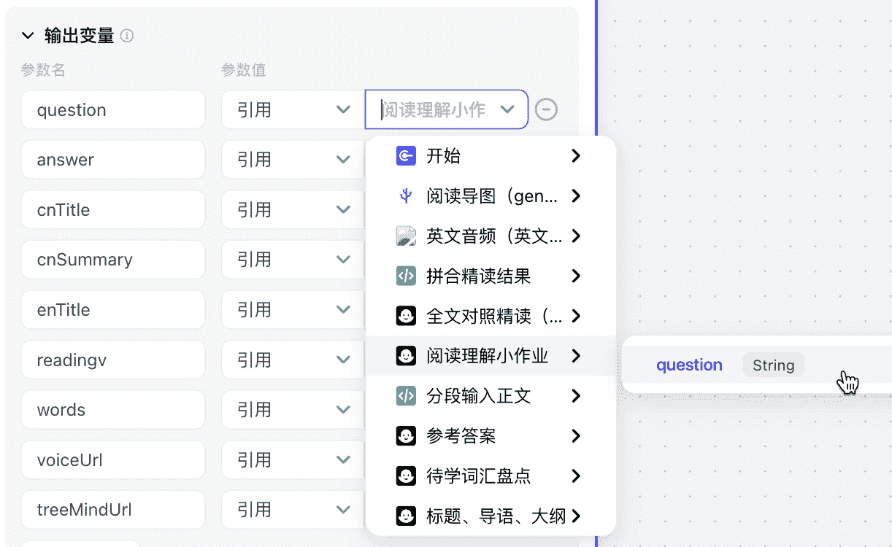

1.  根据最终输出预期，按照 Markdown 格式的写法，引用「输出变量」区域的参数名，在「回答内容」中输入回答内容模板：

```
# {{cnTitle}}
 
&gt; {{cnSummary}}
 
## 阅读理解小作业
{{question}}
 
## 阅读大纲

 
## 原文音频
[]({{voiceUrl}})

---

# 全文对照精读
## {{enTitle}}
 
{{readingv}}
 
### 待学词汇汇总
{{words}}
 
---
 
## 参考答案
{{answer}}
```

最终，我们就能获得这样的回答内容：

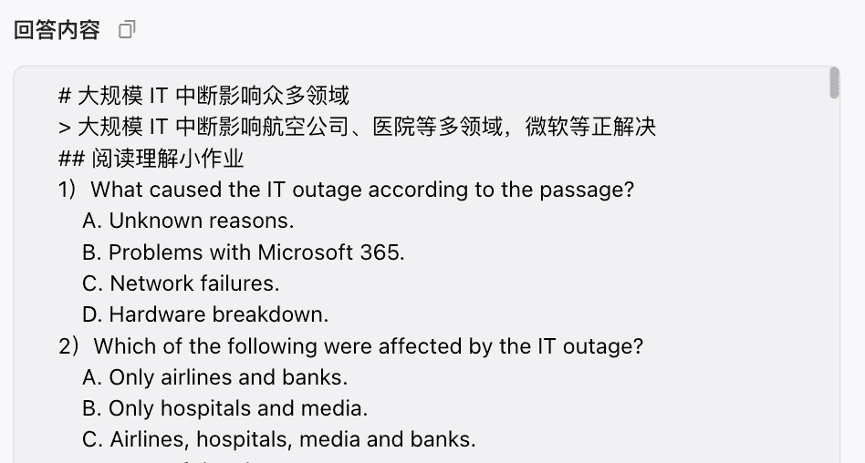

这些文本，在外层 bot 中，就会以 Markdown 格式完成渲染，分别区分显示标题、引用、正文、列表、图片、链接等格式。

现在，整个工作流 Agent 的核心功能，均已经被实现验证，干的漂亮！

---

# Step 3：全面评估并优化 Agent 效果

在获得了整个搭建好的工作流后，为了验证 Agent 的效果，一般需要进行如下操作：

+   整体试运行 Agent，识别功能和性能的卡点

+   通过反复测试和迭代，优化至达到预期水平

如果你还不是很了解 Coze 的操作，可以按照如下步骤教学，完成 Agent 最后的测试与封装：

1.  试运行整个工作流，验证整体运行效果（包括响应速度、生成质量）

1.  迭代优化工作流，提升性能

1.  在外层 bot 中封装工作流

1.  外层 bot 调试

1.  万事大吉，可以发布你的 bot 啦

### 试运行整个工作流，验证整体运行效果

点击「试运行」，把待精读文章输入「开始节点」的{{BOT_USER_INPUT}}，发现整个流程在 1 分钟内运行完成，最终输出的“回答内容”也符合我们的预期。

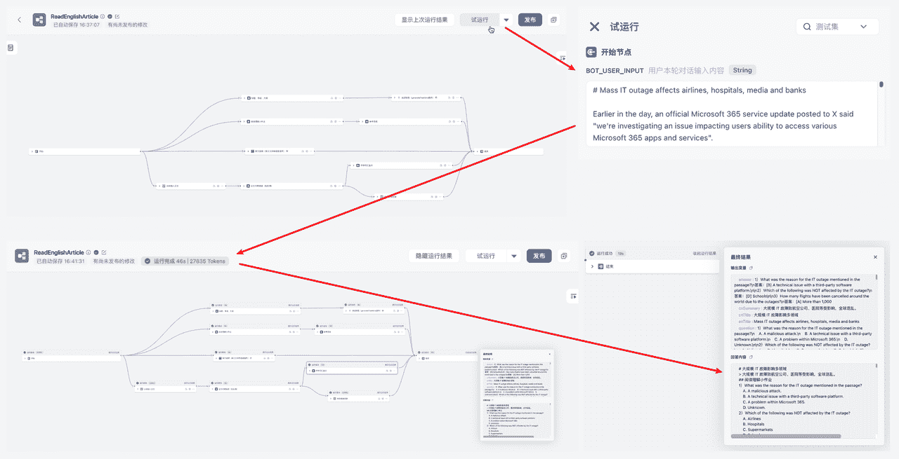

### 迭代优化工作流，提升性能

此步骤不展开，有需要可以自行按照上文的配置思路，再进行细致优化（因为文章的配置方法，其实我已经优化过几次，效果比刚拼搭完的时候好多了～）

### 在外层 bot 中封装工作流

在点击「发布」，发布工作流后，我们就需要创建一个 bot，进行最终的工作流封装。

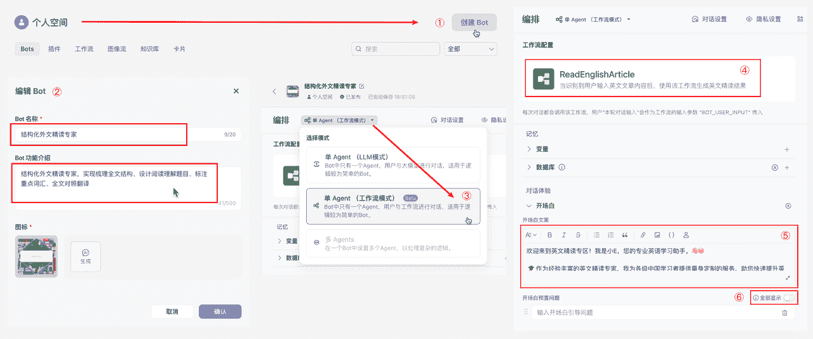

**封装过程如下：**

1.  **创建 Bot**

1.  **填写 Bot 介绍**

1.  切换 Bot 模式为“单 Agent（工作流模式）”：因为这个 Agent，我们只需要每次输入英文文章的时候，返回精读结果，所以不需要用外层 bot 对输入进行其他任务理解，直接调用工作流即可。

1.  把我们刚才配置好的工作流，添加到 Bot 中

1.  **填写开场白，引导用户使用：**附开场白文案 ⬇️

```
欢迎来到英文精读专区！我是小E，您的专业英语学习助手。👋😊

🎓 作为经验丰富的英文精读专家，我为各级中国学习者提供量身定制的服务，助您快速提升英语水平。

📚 我的服务包括：

&gt; 🌟 中英双语文章概述
&gt; 🧠 定制阅读理解题
&gt; 📖 全文详细解析
&gt; 🔍 重点词汇学习
&gt; 🗝️ 参考答案解析
 
🖋️ 请按以下格式输入文章：

```Markdown 
# [原文标题]

[原文内容]
```

让我们一起开启精彩的英语学习之旅吧！🚀
```

1.  **关闭开场白预置问题：**因为使用流程里用不到，所以直接关掉。

### 外层 bot 调试

完成封装后，即可在「预览与调试」区进行最终体验与调试：

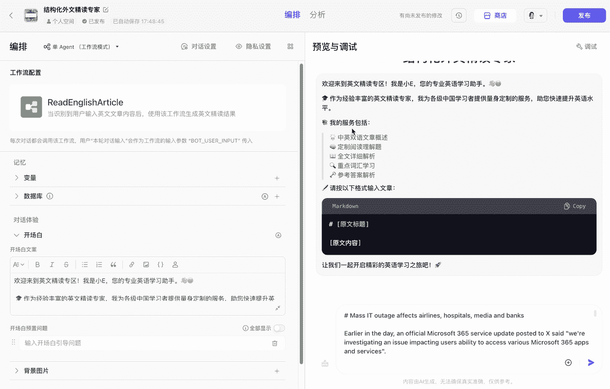

——如果一切正常，你就能获得这样的成功结果，yes～


> **Btw：**在笔者发布文章时，外层 bot 仍存在一定的未知 bug，同一段 USER_INPUT，在工作流编辑面板中试运行完全 ok ，但到了外层 bot 进行运行时，就容易出现报错。暂时无法确定原因，猜测可能是外层 bot 的并发做的不够稳定，不如直接在工作流编辑面板中获取精度结果。

> 如果自行实验时，发现多次报错且无法定位问题原因，就不要急着怪自己啦🤣。

> 笔者也已经把相关 bug 提交给了 Coze 团队，希望能加紧优化吧。

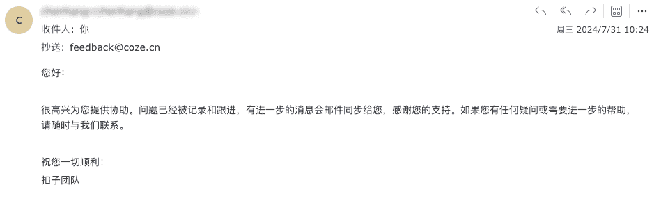

### 万事大吉，可以发布你的 bot 啦

最后，点击「发布」，按照页面引导，一路确认，把你的 Bot 发布上架吧～

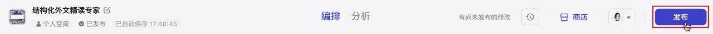

**至此，你已经完成了一个工作流 Agent 的**全流程配置！恭喜，你真是太棒了！！！🥳

---

# 总结

让我们回顾整个过程，构建 AI Agent 可以类比为培养一位职场新人：

1.  **规划阶段：明确目标**

确定AI Agent的具体任务（如结构化外文精读），将其拆解为可管理的子任务，并设计每个任务的执行方法。

1.  **实施阶段：实战指导**

搭建工作流程，为每个子任务设置清晰的操作指南。像指导新员工一样，手把手引导 AI 完成任务，并及时验证其输出质量。

1.  **优化阶段：持续改进**

通过反复测试和调整，不断优化 AI Agent 的性能。调整工作流程和 Prompt 配置，直到 AI 能稳定输出高质量的结果。

如果你已经完全了解本次教程内容，不妨自己设定一个任务目标，动手构建一个专属于自己的 AI Agent 吧😉～

---

# 其他问题

1.  如何判断自己的任务/Prompt 是否需要拆解为工作流？

构建稳定可用的 AI Agent 是一个需要不断调试和迭代的过程。Agent 工程的终极目标是打造出流程尽量简洁、Prompt 尽量精炼、生成结果最稳定的智能体。

我们通常从当前性能最强的 LLM（如 ChatGPT-4 和 Claude 3.5 sonnet）着手，先用单条 Prompt 或 Prompt Chain（可以简单理解为与 LLM 连续对话，引导 LLM 逐步完成复杂的任务）来测试任务的执行质量和稳定性。然后，根据实际执行情况、最终投产使用的 LLM，逐步拆解子任务，降低 LLM 执行单任务的难度，直到达成工程目标。

一般而言，对于类似文中这种场景多样、结构复杂、对输出格式要求严格的内容，我们基本可以预见到需要将其拆解为工作流。

此外，鉴于 LLM 只能处理文本输入输出的特性，如果涉及生成多媒体内容或从网络自主获取额外信息等能力，必然需要通过工作流来调用相应的插件。

1.  只用了一段 Prompt 的 Agent，还算 AI Agent 吗？

算。详见[关于 LLM、Prompt、Agent 的概念理解](https://zkv549gmz8.feishu.cn/wiki/KhXkwqngAitUufkHNUUcPP57nDb?from=from_copylink)

---