# Reise：手捏信息降噪器——利用扣子对 RSS 信息进行降噪与提炼

> 来源：[https://agijuejin.feishu.cn/docx/F8tjdXfb9oFDplxr9tRcg0qanb8](https://agijuejin.feishu.cn/docx/F8tjdXfb9oFDplxr9tRcg0qanb8)


### 长话短说

基础需要：

+   付费版扣子（成本 1 元）

+   一小时的时间投入

可以收获：按照心仪 rss 地址获取指定话题的资讯摘要

---

【正文 3200 字，阅读时间 8 分钟，感谢观看】

不知道多少人像我一样存在信息焦虑，加了几十个🛰️群、关注了几十个👸号，存了上百个书签页。

每天都扎在看不完的信息堆里翻来翻去。生怕万一漏看，就刚好错过你至关重要的信息点。

> 就像是在嘈杂的商场内，努力去听：355 号请就餐，355 号在不在～

哈，所以打算手捏一个**信息降噪器**，去除无效的信息噪音，让外部信息获取更加科学高效。

毕竟科技应该带给我们更高的工作效率与更好的生活体验不是么。

### 本文逻辑：

+   一、扣子专业版介绍

+   二、RSS 订阅

+   三、V1.0 工作流拆解

+   四、常见问题解答

### 一、扣子专业版介绍

扣子（Coze）是一款基于自然语言处理和人工智能技术的智能助手平台。它提供了丰富的插件生态，可以帮助用户快速实现个性化的智能应用，而无需编写复杂的代码。

看到这应该会有人说，扣子都收费了，为啥还用它来搞。

确实扣子开始收费了，但是我们本身做的信息降噪是有一定技术成本。

那张图怎么说的来着：

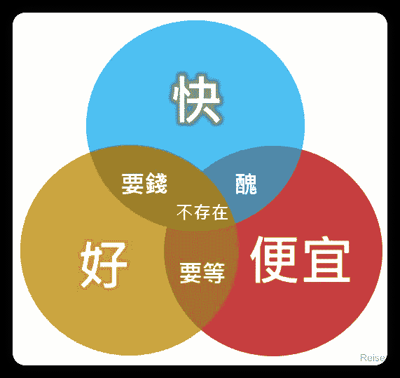

> 软件项目管理的金三角：时间、成本、质量

+   快和便宜的交集（Speed ∩ Cost）:项目可以快速且低成本完成，但可能质量不高。

+   便宜和质量的交集（Cost ∩ Quality）:项目可以低成本且高质量完成，但可能需要更长时间。

+   快和质量的交集（Speed ∩ Quality）:目可以快速且高质量完成，但成本可能较高。

+   快、便宜和质量的交集（Speed ∩ Cost ∩ Quality）:理想情况，即项目可以快速、低成本且高质量完成。这种情况通常较难实现。

如果你的诉求是：在一定预算下，低（无）代码，减少折腾成本去完成一件比较好玩有意思的事情。

扣子专业版目前看还是比较划算滴。经过了一年多的用户打磨，整个扣子的插件生态、分发渠道对于个人用户来讲很是够用，上手难度也不高。而且信息获取的插件较为丰富。

扣子推出了专业版服务，主要特性包括：

1.  企业级 SLA 保障。

1.  高级特性支持如批量处理、私有数据等。

1.  更优惠的计费项：

+   Bot 调用：一次有效对话请求计为一次。

+   方舟模型服务费：Token 使用量计费，豆包大模型 pro-32k 版推理输入价格 0.0008 元/千 Tokens，相当于一元钱能买到 125 万 Tokens。

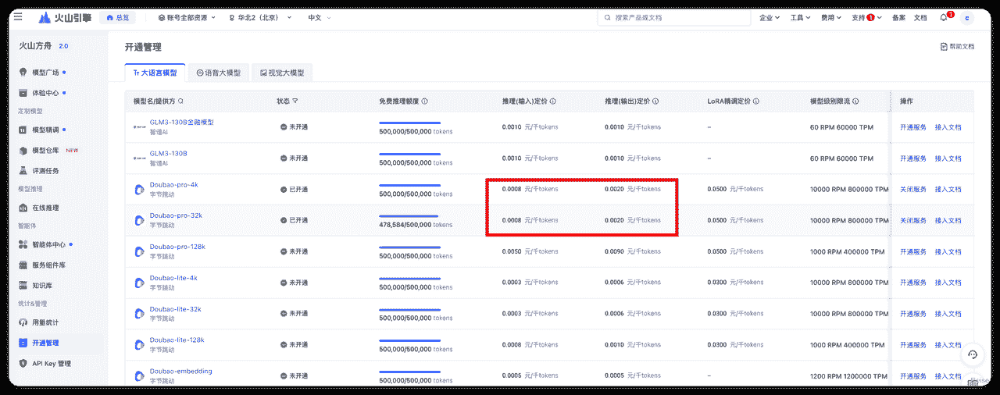

+   插件调用：限时免费。

另外看蓝衣兄的这篇文章：

扣子要收费了？别急，赶紧来白嫖扣子资源包

不要 998，只要 1 元，bot 调用资源包带回家！

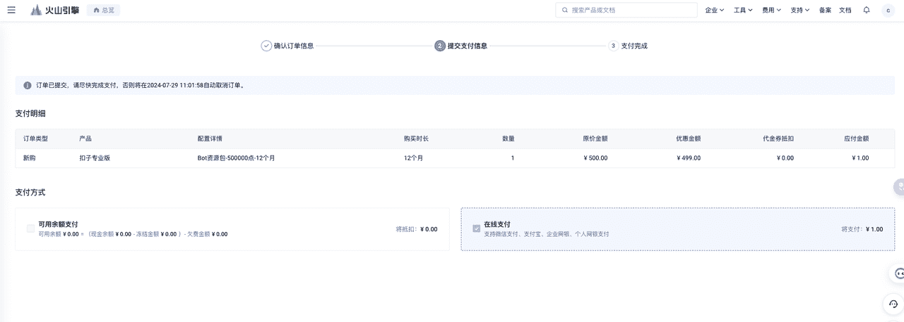

专业版团队空间这里在创建的时候跟普通版有些区别，需要在火山引擎管理后台进行，创建子用户后就可以分享给小伙伴使用啦。

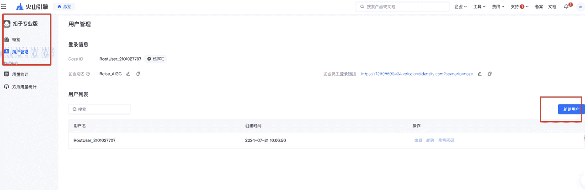

### 二、RSS 订阅

RSS 是一个很传统，甚至现在看有些复古的阅读方式。

画了一张简单的 RSS 发展卡片：

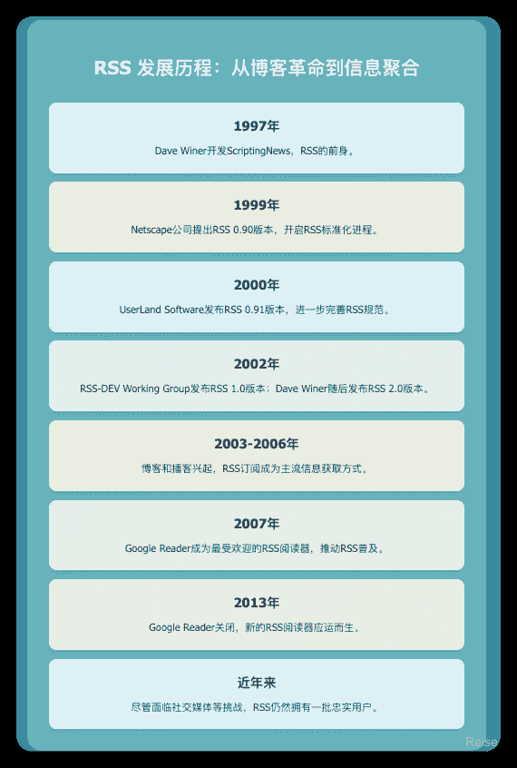

想象一下，你很喜欢一家权威的杂志社，然后开始了每一期的订阅，浏览它们定期发布新的文章、新闻。

RSS 阅读器可以将所有你喜欢的杂志都集中在一起，打开就是你所有心仪杂志的最新更新内容。

> 它让你自己决定要看什么内容，而不是被动地接受算法推送给你的东西。

大家也[不用担心订阅源的](https://rsshub.app/)问题，现在 RSS 订阅虽然没有达到之前的巅峰时期那么普遍，但是主流的传统媒体、新兴媒体、学术领域、技术博客、开源项目、编程语言社区等都提供 RSS 订阅。另外也有各种开源方案去进行个性化信息源的 RSS 制作，这个本次先不涉及。感兴趣的小伙伴可以了解下 rsshub 这个开源项目。

### 三、V1.0 工作流拆解

本次其实捏的是一个很基础的 RSS 订阅工作流，主要思路如下：

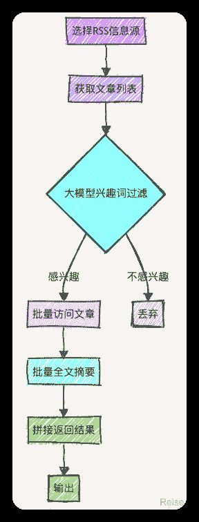

下面来分享下整个工作流的节点搭建。

##### 选择一个你喜欢的 RSS 信息源

RSS 信息来源其实有很多，官方提供的一般都是在顶部或底部。

找到你喜欢的信息源：这里以 36kr 为例

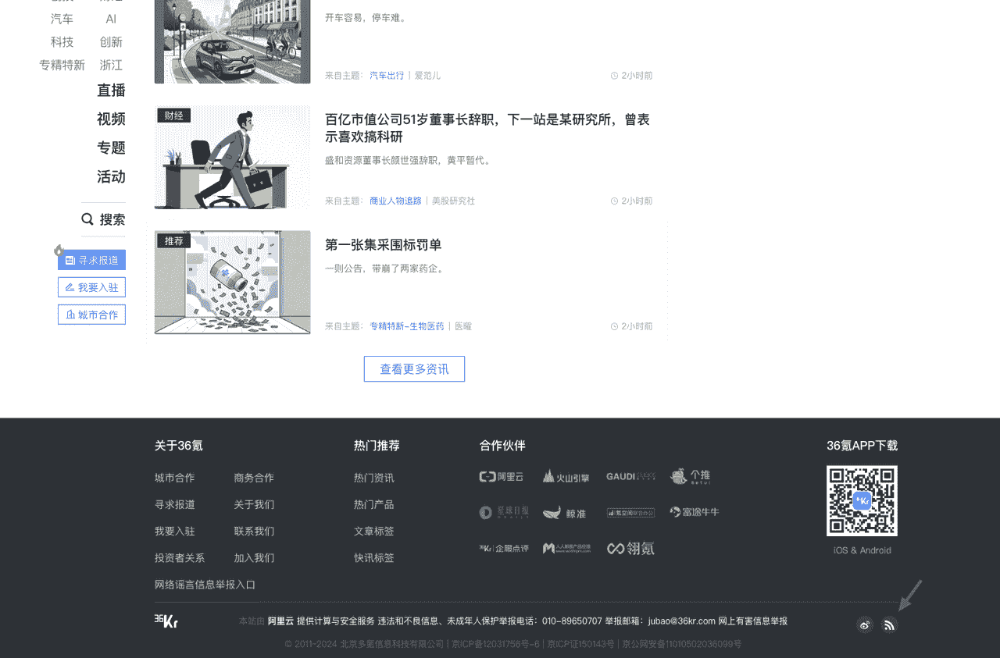

点击即可获取官方的 RSS 订阅地址

```
综合资讯
复制链接到您的RSS浏览器，订阅地址：https://36kr.com/feed

文章资讯
复制链接到您的RSS浏览器，订阅地址：https://36kr.com/feed-article

最新快讯
复制链接到您的RSS浏览器，订阅地址：https://36kr.com/feed-newsflash

动态内容
复制链接到您的RSS浏览器，订阅地址：https://36kr.com/feed-moment
```

##### **获取当前订阅下所有文章列表**

这时候就要提及到 coze 整个插件生态的便利性了，插件内搜索 RSS 可以看到有很多可以直接拿来使用的。

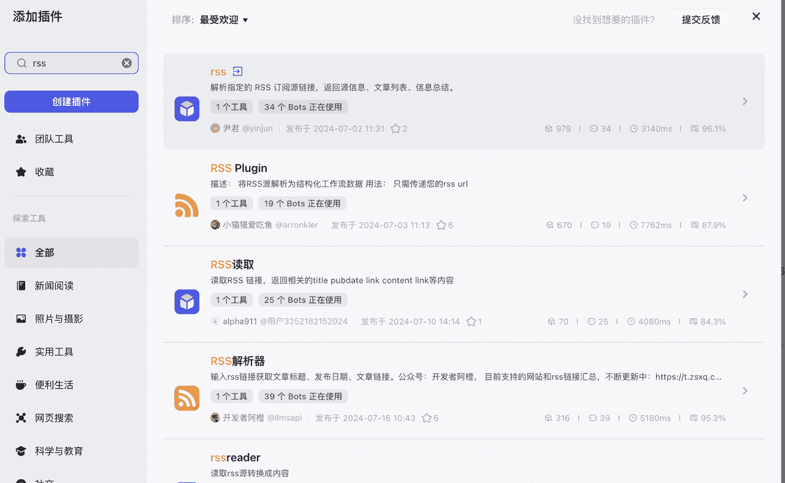

我们选择 rss_reader 这个插件，参数值选择输入+上一步的 RSS 对应的 URL。

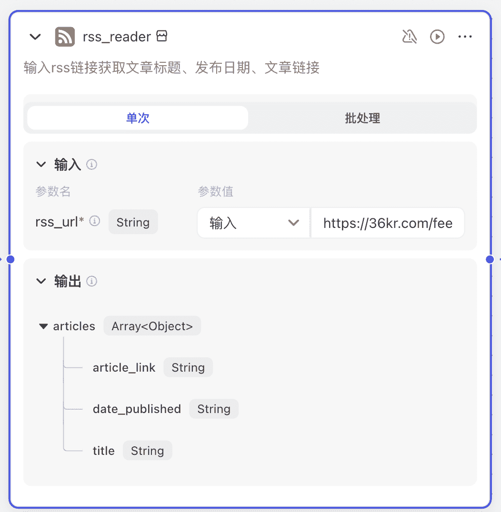

插件对应输出文章数组：

+   文章链接

+   发布时间

+   文章标题

> Array Object （数组对象），批处理格式要求

> 简介

+   JS 内置对象，用于存储和操作有序数据集合

+   提供简单高效的数组管理方式

> 优点

+   易于理解和使用

+   动态调整大小

+   支持多种数据类型存储

+   丰富的内置方法

36kr 的返回结果类似这样：

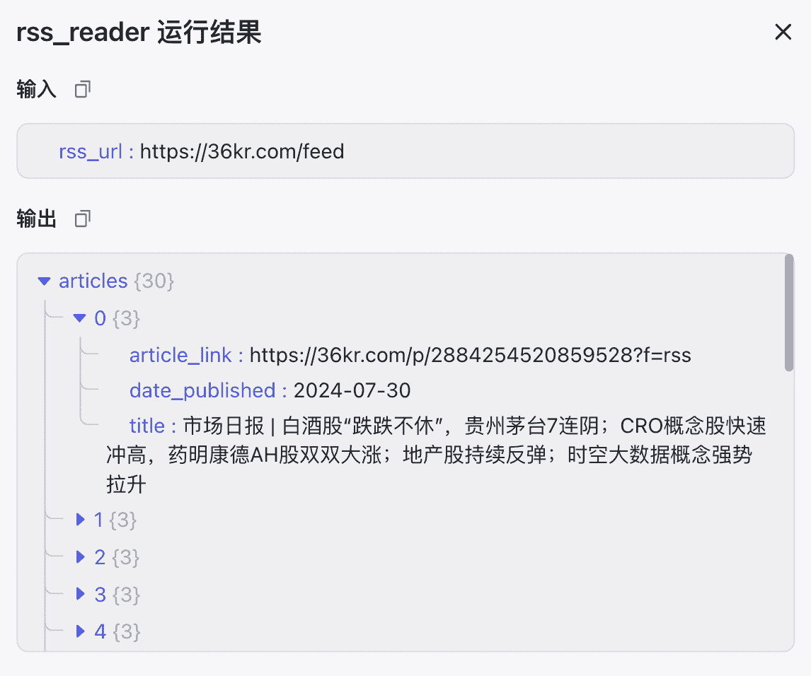

可以看到返回了 30 篇最新文章，如果一篇一篇看也还是压力挺大。

##### **兴趣话题文章选取**

拿到 30 篇文章后，接下来就要通过大模型进行兴趣词过滤，只留下我们当前最感兴趣的文章列表。

+   输入引用 rss_header 内的 articles、BOT_USER_INPUT。

+   设置大模型（专业版只能选择豆包模型）这里选择 pro-32k，模式为更精准。

+   简单提示词编写，主要为几块：

- 简单角色设定。

- 任务描述，使用 BOT_USER_INPUT 变量方便个性化。

- articles，格式化表述待过滤文章。

- 输出格式描述。

+   输出格式选择 json。

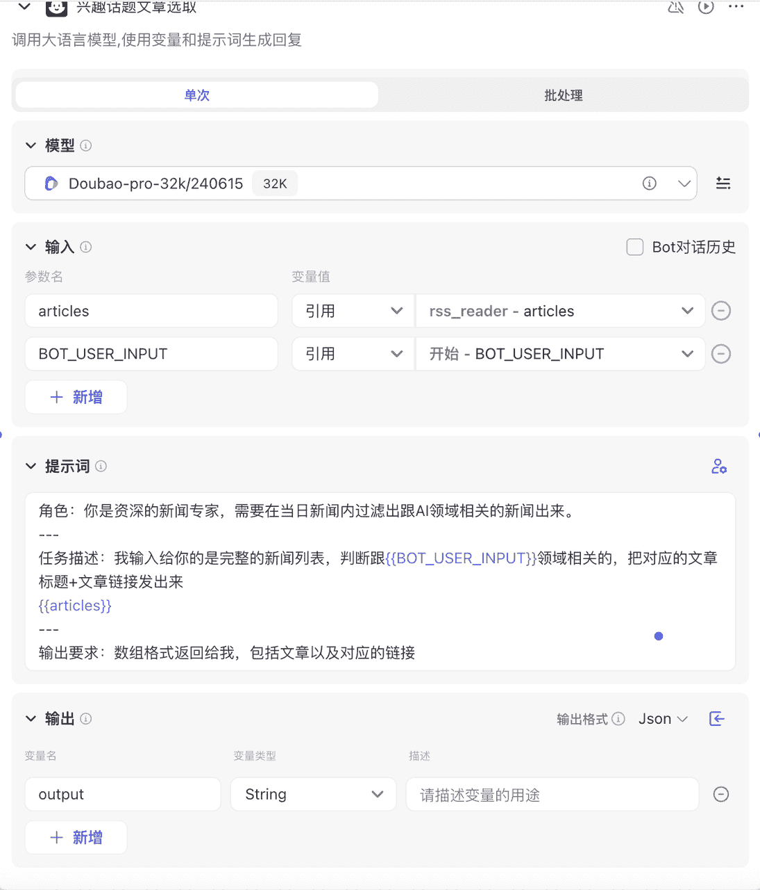

这块提示词没有做过多工程，大家感兴趣可以根据自身实际需求进行更详细的提示词设计。

##### **批量进行文章访问**

这一步骤的目的是将大模型返回的 JSON 格式文章链接，批量访问获取全文，以便后续处理。这是整个工作流较为复杂的一步，因为扣子内批处理只支持 Array 格式，所以需要对上一步骤的数据进行预处理。

在这里，我们需要引入一个重要的概念——批处理（Batch Processing）。扣子的批处理允许我们将一系列任务打包，然后交给系统去连续执行，而不需要人工干预。

> 批处理是一种处理大规模数据和重复任务的实用方式。从编程角度看，它就是一个有限循环的过程。其核心思想是将大量任务分成一个个小的任务批次，每个批次包含一定数量的数据和对数据的操作指令。这些批次会按顺序送入系统处理，每个批次的处理结果会在下一批次开始前返回。

在我们的 RSS 信息处理工作流中，批处理的思想被多次应用，贯穿了整个流程：

1.  **获取文章列表**： 我们通过扣子的 RSS 读取插件，一次性获取了 RSS 源的最新 30 篇文章。

1.  **兴趣话题筛选**： 我们将 30 篇文章打包成 JSON 数组，交给扣子的 AI 模型批量处理，快速筛选出感兴趣的文章。

1.  **获取文章全文**： 我们将筛选出的文章链接打包成数组，利用扣子的网页访问插件批量获取文章全文。

1.  **文章摘要生成**： 在最后一步，我们再次应用批处理，将所有文章的标题和内容打包，一次性交给 AI 模型生成摘要。

可见，批处理贯穿了 RSS 信息处理的整个工作流。它帮助我们将一个大任务分解成多个可并行处理的小任务，大幅提升了处理效率。通过在关键步骤应用批处理，我们大大减少了重复的人工操作，让整个工作流变得更加高效和自动化。

**数据格式化**

这里需要使用扣子的代码模块，我们下一步想要的输入是一个 link 的列表，所以需要使用 javascript 对大模型输出的 json 进行格式转换。

具体代码如下：

```
async function main({ params }) {
    // 解析输入的JSON字符串
    const articles = JSON.parse(params.input);

    // 创建返回对象
    const ret = {
        &quot;key&quot;: [
            {
                &quot;link&quot;: articles.map(article =&gt; article.article_link || &quot;&quot;).filter(link =&gt; link !== &quot;&quot;)
            }
        ]
    };

    return ret;
}
```

代码解释：

+   使用 JSON.parse（） 将输入的 JSON 字符串解析为 JavaScript 对象数组 articles。

+   创建一个返回对象 ret，其中包含一个名为 "key" 的数组。

+   使用 map（） 方法提取 articles 数组中每个对象的 article_link 属性，如果属性不存在则使用空字符串 ""。

+   使用 filter（） 方法过滤掉空字符串，只保留有效的链接。

+   将提取并过滤后的链接数组作为 "key" 数组的第一个元素。

+   返回创建的对象 ret。

这里有个小技巧，找一个可以读图的大模型，将设定好的输出格式截图给它并进行简单描述，大模型就可以很好的编写对应的解析代码啦。

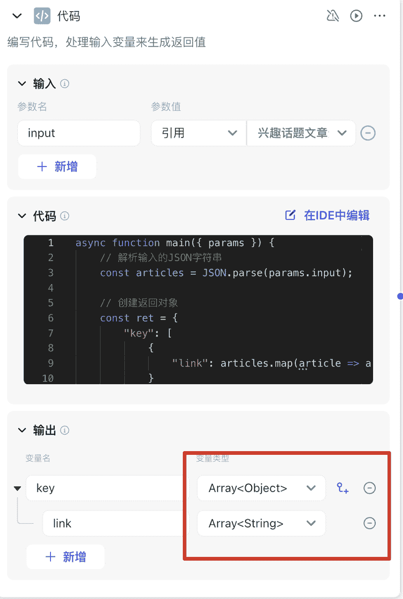

特别注意输出字段格式。

**文章读取批处理**

文章读取这里我们依旧是选择一个网页浏览的插件，然后进行批处理设置。

+   引用代码格式化之后的数组

+   url 字段直接使用上步骤定义好的 link

+   输出为插件定义好的格式

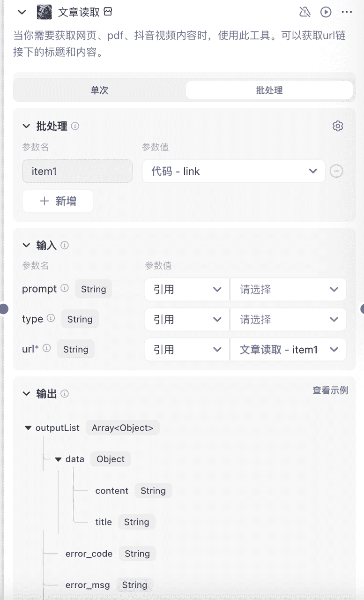

执行测试输出是这样的，一步一步终于要成型啦：

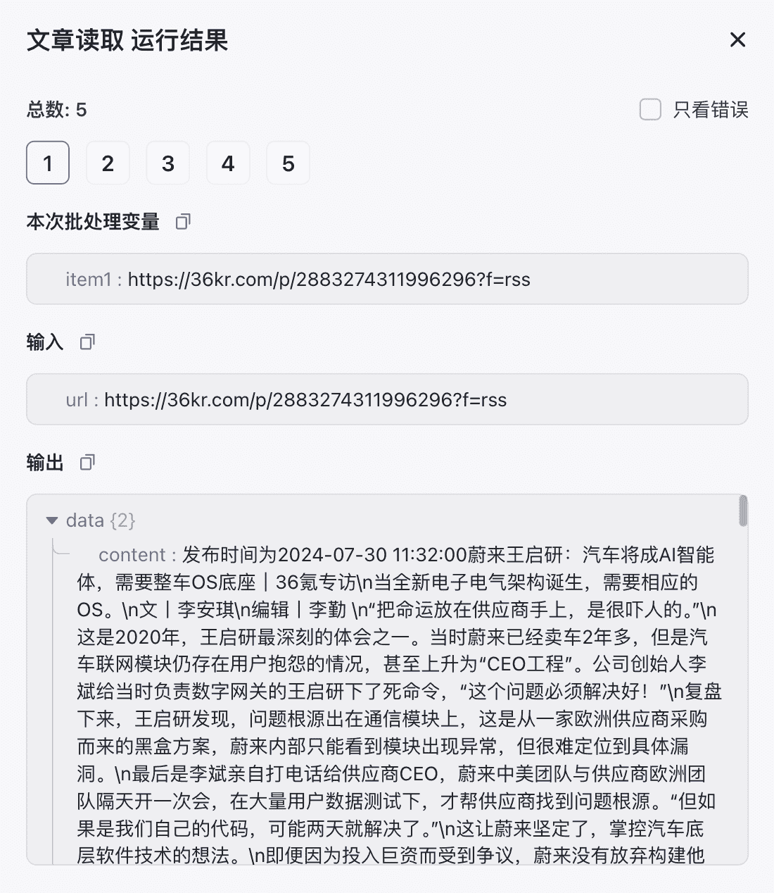

**批量进行文章全文摘要**

拿到文章后进行一下全文核心观点摘要，这里也是批量进行。

批处理跟之前是一样的，不过因为上一步文章读取格式本身符合要求就不需要我们自行转换啦。

+   引用文章读取的 outputlist。

+   输入 title、contencontent 两个字段

+   设置大模型（专业版只能选择豆包模型）这里选择 pro-32k，模式为更精准。

+   简单提示词编写，主要为几块：

- 简单角色设定。

- 任务描述，content 填充。

- 输出格式描述：json 格式。

+   输出格式选择 json，并定义输出字段。

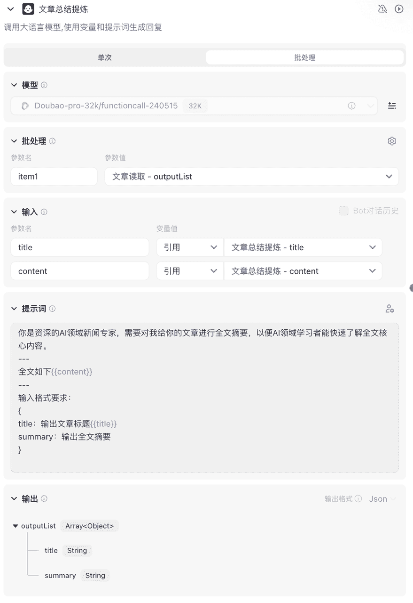

执行结果如下：

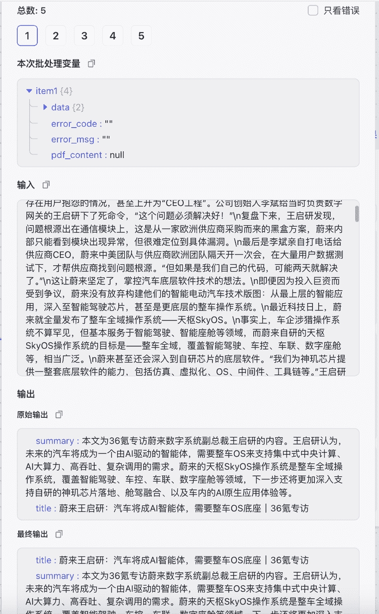

大家也是可以根据自己实际的诉求进行提示词设计，找到最符合自己的输出。

##### 依次拼接所有的返回

马上就要结束啦，这里我们需要用文本处理插件将我们上步骤批量处理的结果进行拼接。

方便整体的后续输出，这里直接引用即可。

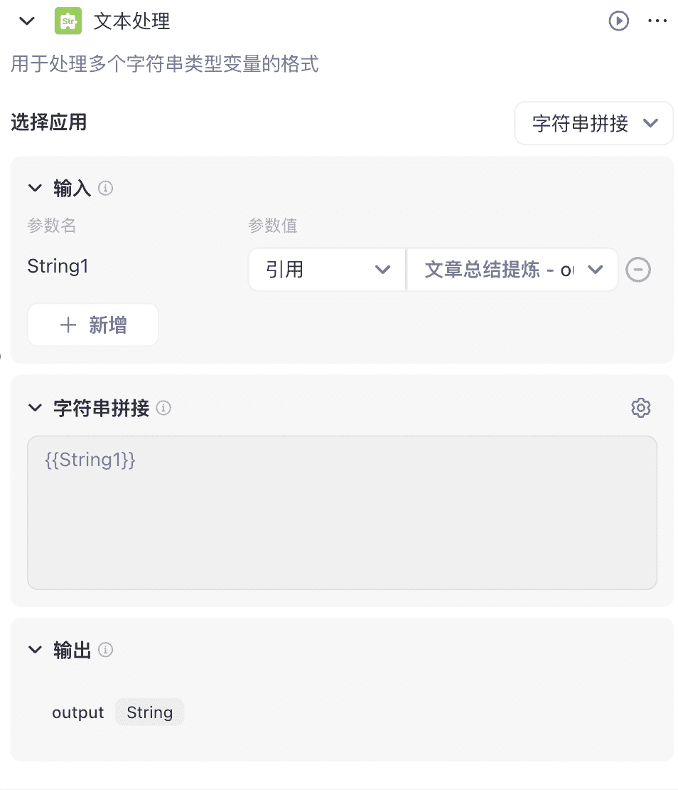

##### 输出

看下最终的输出结果吧！

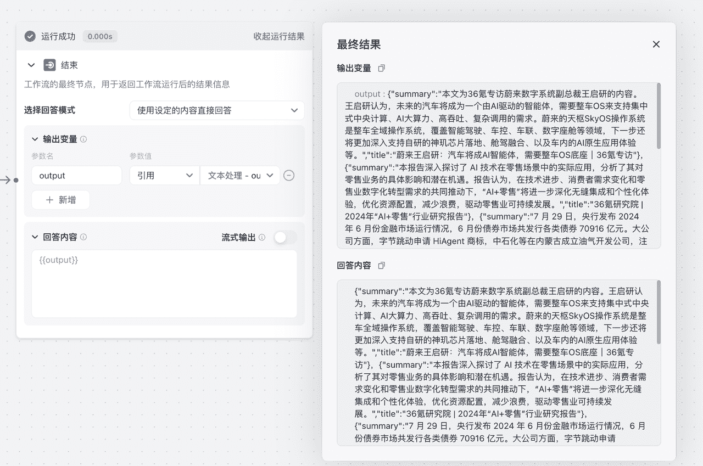

整个工作流完成了针对单个 RSS 订阅的个性化主题词文章过滤以及批量总结输出。对于经常需要浏览大量信息源的朋友们还是挺有帮助。

大家快去动手捏一个试试吧～

### 四、常见问题解答

Q：如何找到更多高质量的 RSS 订阅源？

A：除了文中提到的一些主流媒体和网站，你还可以在一些 RSS 订阅源聚合平台上进行搜索和订阅，比如：

+   [RSSHub](https://docs.rsshub.app/program-update.html)

+   [RSS Source](https://rss-source.com/)

+   [PolitePol](https://politepol.com/en/)

---

Q：如何进一步提高文章过滤和摘要的质量？

A：可以从以下几方面着手：

+   优化话题关键词的设置，选择更精准的词语。

+   调整 prompt 提示词，引导模型生成更符合需求的结果。

+   必要时可以使用更大的语言模型以提升处理效果，如 GPT-3、文心一言等。

---

Q：每次手动触发工作流太麻烦，能否自动化？

A：后续会接入 bot，进行自动化的处理。

---

Q：除了 Coze，还有哪些类似的工具可供选择？

A：类似的工具还有：

+   [Notion AI](https://www.notion.so/product/ai)

+   [Dify](https://cloud.dify.ai/apps)

+   Slack Workflow Builder

它们都提供了可视化的工作流构建功能，集成了丰富的服务和 API，非常适合用于自动化信息处理。

---

Q：处理完的信息摘要如何进行保存和管理呢？

A：可以考虑将输出结果整理为 Markdown 文档，后续接入飞书文档进行存储。

希望这篇文章能给大家带来一些思路和启发。欢迎私信交流分享你的看法和实践经验！