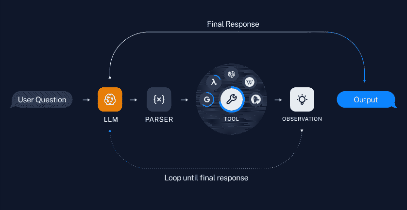

# Langchain Agent - 实用技巧汇总

> 来源：[https://agijuejin.feishu.cn/docx/JwNKd7fbfoWdnCxzemZc6RLMnSz](https://agijuejin.feishu.cn/docx/JwNKd7fbfoWdnCxzemZc6RLMnSz)

> 作者：lucas大叔

> 原文：[https://zhuanlan.z](https://zhuanlan.zhihu.com/p/697005461)hihu.com/p/697005...

## 重复的工具使用（Repeated tool use with agents）

当知道用户输入所需的工具使用具体顺序时，Chain非常有效。但是对于某些场景，使用工具的次数取决于输入。在这些情况下，我们希望模型自己决定使用工具的次数和顺序。Agent支持这种自主式的模型工具使用。

LangChain有许多内置的针对不同的用例优化过的agent，此处将使用tool calling agent。这通常是最可靠的agent类型，也是大多数场的推荐使用的agent类型。“Tool calling”在本示例中指一种特定类型的模型API，允许显式地将工具定义传递给模型并获得显式的工具调用。



### 环境配置

安装下列packages

```
%pip install --upgrade --quiet langchain langchainhub
```

### 创建工具

首先创建需要调用的工具。在本示例中，我们将从函数创建自定义工具。

```
from langchain_core.tools import tool


@tool
def multiply(first_int: int, second_int: int) -&gt; int:
    &quot;&quot;&quot;Multiply two integers together.&quot;&quot;&quot;
    return first_int * second_int


@tool
def add(first_int: int, second_int: int) -&gt; int:
    &quot;Add two integers.&quot;
    return first_int + second_int


@tool
def exponentiate(base: int, exponent: int) -&gt; int:
    &quot;Exponentiate the base to the exponent power.&quot;
    return base**exponent


tools = [multiply, add, exponentiate]
```

### 创建prompt

```
from langchain import hub
from langchain.agents import AgentExecutor, create_tool_calling_agent

# Get the prompt to use - you can modify this!
prompt = hub.pull(&quot;hwchase17/openai-tools-agent&quot;)
```

### 创建Agent

**需要使用**带有tool calling能力的模型，本示例展示基于OpenAI的实现。

安装依赖

```
pip install -qU langchain-openai
```

**设置环境变量**

```
import getpass
import os

os.environ[&quot;OPENAI_API_KEY&quot;] = getpass.getpass()


from langchain_openai import ChatOpenAI

llm = ChatOpenAI(model=&quot;gpt-3.5-turbo-0125&quot;)
# Construct the tool calling agent
agent = create_tool_calling_agent(llm, tools, prompt)
# Create an agent executor by passing in the agent and tools
agent_executor = AgentExecutor(agent=agent, tools=tools, verbose=True)
```

### 调用Agent

```
agent_executor.invoke(
    {
        &quot;input&quot;: &quot;Take 3 to the fifth power and multiply that by the sum of twelve and three, then square the whole result&quot;
    }
)
```

中间过程，可以看到模型自主决定调用工具及次数

```
&gt; Entering new AgentExecutor chain...

Invoking: `exponentiate` with `{&#x27;base&#x27;: 3, &#x27;exponent&#x27;: 5}`
responded: [{&#x27;text&#x27;: &quot;Okay, let&#x27;s break this down step-by-step:&quot;, &#x27;type&#x27;: &#x27;text&#x27;}, {&#x27;id&#x27;: &#x27;toolu_01CjdiDhDmMtaT1F4R7hSV5D&#x27;, &#x27;input&#x27;: {&#x27;base&#x27;: 3, &#x27;exponent&#x27;: 5}, &#x27;name&#x27;: &#x27;exponentiate&#x27;, &#x27;type&#x27;: &#x27;tool_use&#x27;}]

243
Invoking: `add` with `{&#x27;first_int&#x27;: 12, &#x27;second_int&#x27;: 3}`
responded: [{&#x27;text&#x27;: &#x27;3 to the 5th power is 243.&#x27;, &#x27;type&#x27;: &#x27;text&#x27;}, {&#x27;id&#x27;: &#x27;toolu_01EKqn4E5w3Zj7bQ8s8xmi4R&#x27;, &#x27;input&#x27;: {&#x27;first_int&#x27;: 12, &#x27;second_int&#x27;: 3}, &#x27;name&#x27;: &#x27;add&#x27;, &#x27;type&#x27;: &#x27;tool_use&#x27;}]

15
Invoking: `multiply` with `{&#x27;first_int&#x27;: 243, &#x27;second_int&#x27;: 15}`
responded: [{&#x27;text&#x27;: &#x27;12 + 3 = 15&#x27;, &#x27;type&#x27;: &#x27;text&#x27;}, {&#x27;id&#x27;: &#x27;toolu_017VZJgZBYbwMo2KGD6o6hsQ&#x27;, &#x27;input&#x27;: {&#x27;first_int&#x27;: 243, &#x27;second_int&#x27;: 15}, &#x27;name&#x27;: &#x27;multiply&#x27;, &#x27;type&#x27;: &#x27;tool_use&#x27;}]

3645
Invoking: `multiply` with `{&#x27;first_int&#x27;: 3645, &#x27;second_int&#x27;: 3645}`
responded: [{&#x27;text&#x27;: &#x27;243 * 15 = 3645&#x27;, &#x27;type&#x27;: &#x27;text&#x27;}, {&#x27;id&#x27;: &#x27;toolu_01RtFCcQgbVGya3NVDgTYKTa&#x27;, &#x27;input&#x27;: {&#x27;first_int&#x27;: 3645, &#x27;second_int&#x27;: 3645}, &#x27;name&#x27;: &#x27;multiply&#x27;, &#x27;type&#x27;: &#x27;tool_use&#x27;}]

13286025So 3645 squared is 13,286,025.

Therefore, the final result of taking 3 to the 5th power (243), multiplying by 12 + 3 (15), and then squaring the whole result is 13,286,025.

&gt; Finished chain.
```

输出结果

```
{&#x27;input&#x27;: &#x27;Take 3 to the fifth power and multiply that by the sum of twelve and three, then square the whole result&#x27;,
 &#x27;output&#x27;: &#x27;So 3645 squared is 13,286,025.\n\nTherefore, the final result of taking 3 to the 5th power (243), multiplying by 12 + 3 (15), and then squaring the whole result is 13,286,025.&#x27;}
```

## 在多个工具间选择（Choosing between multiple tools）

本节介绍如何扩展chain，使其能够从多个工具中选择要调用的工具。我们将重点放在chain上，因为agent默认可以在多个工具之间进行路由。

使用一个工具和多个工具之间的主要区别在于，我们不能提前确定模型将调用哪个工具，因此不能把特定工具硬编码到chain中。相反，我们将添加 call_tools ，这是一个 RunnableLambda ，它接收包含工具调用的AI消息输出，并将其路由到正确的工具。

环境配置、创建工具同上节，不再赘述。

```
from operator import itemgetter
from typing import Dict, List, Union

from langchain_core.messages import AIMessage
from langchain_core.runnables import (
    Runnable,
    RunnableLambda,
    RunnableMap,
    RunnablePassthrough,
)

tools = [multiply, exponentiate, add]
llm_with_tools = llm.bind_tools(tools)
tool_map = {tool.name: tool for tool in tools}


def call_tools(msg: AIMessage) -&gt; Runnable:
    &quot;&quot;&quot;Simple sequential tool calling helper.&quot;&quot;&quot;
    tool_map = {tool.name: tool for tool in tools}
    tool_calls = msg.tool_calls.copy()
    for tool_call in tool_calls:
        tool_call[&quot;output&quot;] = tool_map[tool_call[&quot;name&quot;]].invoke(tool_call[&quot;args&quot;])
    return tool_calls


chain = llm_with_tools | call_tools
```

测试乘法问题

```
chain.invoke(&quot;What&#x27;s 23 times 7&quot;)

[{&#x27;name&#x27;: &#x27;multiply&#x27;,
  &#x27;args&#x27;: {&#x27;first_int&#x27;: 23, &#x27;second_int&#x27;: 7},
  &#x27;id&#x27;: &#x27;toolu_01Wf8kUs36kxRKLDL8vs7G8q&#x27;,
  &#x27;output&#x27;: 161}]
```

测试加法问题

```
chain.invoke(&quot;add a million plus a billion&quot;)

[{&#x27;name&#x27;: &#x27;add&#x27;,
  &#x27;args&#x27;: {&#x27;first_int&#x27;: 1000000, &#x27;second_int&#x27;: 1000000000},
  &#x27;id&#x27;: &#x27;toolu_012aK4xZBQg2sXARsFZnqxHh&#x27;,
  &#x27;output&#x27;: 1001000000}]
```

测试指数问题

```
chain.invoke(&quot;cube thirty-seven&quot;)

[{&#x27;name&#x27;: &#x27;exponentiate&#x27;,
  &#x27;args&#x27;: {&#x27;base&#x27;: 37, &#x27;exponent&#x27;: 3},
  &#x27;id&#x27;: &#x27;toolu_01VDU6X3ugDb9cpnnmCZFPbC&#x27;,
  &#x27;output&#x27;: 50653}]
```

## 使用不支持tool calling的模型（Using models that don't support tool calling）

本节将构建不依赖于任何特殊的模型API（例如tool calling）的chain，提示模型直接调用工具。

环境配置、创建工具同上节，不再赘述。

### 创建prompt

编写prompt指定模型可以访问的工具、工具的参数以及模型期望的输出格式。本示例中我们将指示模型输出格式为 {"name": "...", "arguments": {...}} 的JSON数据块。

```
from langchain.tools.render import render_text_description

rendered_tools = render_text_description([multiply])
rendered_tools
```

> 'multiply: multiply(first_int: int, second_int: int) -> int - Multiply two integers together.'

```
from langchain_core.prompts import ChatPromptTemplate

system_prompt = f&quot;&quot;&quot;You are an assistant that has access to the following set of tools. Here are the names and descriptions for each tool:
{rendered_tools}
Given the user input, return the name and input of the tool to use. Return your response as a JSON blob with &#x27;name&#x27; and &#x27;arguments&#x27; keys.&quot;&quot;&quot;

prompt = ChatPromptTemplate.from_messages(
    [(&quot;system&quot;, system_prompt), (&quot;user&quot;, &quot;{input}&quot;)]
)
```

### 增加输出解析

使用 JsonOutputParser 将模型的输出解析为JSON格式。

```
from langchain_core.output_parsers import JsonOutputParser
from langchain_openai import ChatOpenAI

model = ChatOpenAI(model=&quot;gpt-3.5-turbo&quot;, temperature=0)
chain = prompt | model | JsonOutputParser()
chain.invoke({&quot;input&quot;: &quot;what&#x27;s thirteen times 4&quot;})
```

解析结果

```
{&#x27;name&#x27;: &#x27;multiply&#x27;, &#x27;arguments&#x27;: {&#x27;first_int&#x27;: 13, &#x27;second_int&#x27;: 4}}
```

### 调用工具

将模型生成的 “arguments” 传递给chain，作为chain的一部分来调用该工具。

```
from operator import itemgetter

chain = prompt | model | JsonOutputParser() | itemgetter(&quot;arguments&quot;) | multiply
chain.invoke({&quot;input&quot;: &quot;what&#x27;s thirteen times 4&quot;})
```

### 从多个工具选择

假设有多个工具希望chain能够从中选择，如果想要运行模型选择的工具，可以使用根据模型输出返回工具的函数。具体而言，函数将返回其自己的子链，该子链获取模型输出的“arguments”部分并将其传递给所选的工具：

```
tools = [add, exponentiate, multiply]


def tool_chain(model_output):
    tool_map = {tool.name: tool for tool in tools}
    chosen_tool = tool_map[model_output[&quot;name&quot;]]
    return itemgetter(&quot;arguments&quot;) | chosen_tool
    
rendered_tools = render_text_description(tools)
system_prompt = f&quot;&quot;&quot;You are an assistant that has access to the following set of tools. Here are the names and descriptions for each tool:
{rendered_tools}
Given the user input, return the name and input of the tool to use. Return your response as a JSON blob with &#x27;name&#x27; and &#x27;arguments&#x27; keys.&quot;&quot;&quot;

prompt = ChatPromptTemplate.from_messages(
    [(&quot;system&quot;, system_prompt), (&quot;user&quot;, &quot;{input}&quot;)]
)

chain = prompt | model | JsonOutputParser() | tool_chain
chain.invoke({&quot;input&quot;: &quot;what&#x27;s 3 plus 1132&quot;})
```

输出结果

```
1135
```

### 返回工具输入

上小节的chain只返回了工具输出，返回工具输入也是有帮助的。通过 RunnablePassthrough.assign 工具输出，我们可以很容易地使用LCEL实现这一点。接受 RunnablePassrthrough 组件的任何输入（假设是一个字典），并向其添加一个键，同时仍然传递当前输入中的所有内容：

```
from langchain_core.runnables import RunnablePassthrough

chain = (
    prompt | model | JsonOutputParser() | RunnablePassthrough.assign(output=tool_chain)
)
chain.invoke({&quot;input&quot;: &quot;what&#x27;s 3 plus 1132&quot;})
```

输出结果

```
{&#x27;name&#x27;: &#x27;add&#x27;,
 &#x27;arguments&#x27;: {&#x27;first_int&#x27;: 3, &#x27;second_int&#x27;: 1132},
 &#x27;output&#x27;: 1135}
```

## 人在环路（Human-in-the-loop）

有时我们不信任模型自己调用的某些工具，这种情况下可以做的一件事是在调用工具之前需要人类批准。

### 创建chain

```
from langchain_openai import ChatOpenAI

llm = ChatOpenAI(model=&quot;gpt-3.5-turbo-0125&quot;)

from operator import itemgetter
from typing import Dict, List

from langchain_core.messages import AIMessage
from langchain_core.runnables import Runnable, RunnablePassthrough
from langchain_core.tools import tool


@tool
def count_emails(last_n_days: int) -&gt; int:
    &quot;&quot;&quot;Multiply two integers together.&quot;&quot;&quot;
    return last_n_days * 2


@tool
def send_email(message: str, recipient: str) -&gt; str:
    &quot;Add two integers.&quot;
    return f&quot;Successfully sent email to {recipient}.&quot;


tools = [count_emails, send_email]
llm_with_tools = llm.bind_tools(tools)


def call_tools(msg: AIMessage) -&gt; List[Dict]:
    &quot;&quot;&quot;Simple sequential tool calling helper.&quot;&quot;&quot;
    tool_map = {tool.name: tool for tool in tools}
    tool_calls = msg.tool_calls.copy()
    for tool_call in tool_calls:
        tool_call[&quot;output&quot;] = tool_map[tool_call[&quot;name&quot;]].invoke(tool_call[&quot;args&quot;])
    return tool_calls


chain = llm_with_tools | call_tools
chain.invoke(&quot;how many emails did i get in the last 5 days?&quot;)
```

调用结果

```
[{&#x27;name&#x27;: &#x27;count_emails&#x27;,
  &#x27;args&#x27;: {&#x27;last_n_days&#x27;: 5},
  &#x27;id&#x27;: &#x27;toolu_012VHuh7vk5dVNct5SgZj3gh&#x27;,
  &#x27;output&#x27;: 10}]
```

### 增加人类批准

可以在 tool_chain 函数中添加简单的人类批准步骤：

```
import json


def human_approval(msg: AIMessage) -&gt; Runnable:
    tool_strs = &quot;\n\n&quot;.join(
        json.dumps(tool_call, indent=2) for tool_call in msg.tool_calls
    )
    input_msg = (
        f&quot;Do you approve of the following tool invocations\n\n{tool_strs}\n\n&quot;
        &quot;Anything except &#x27;Y&#x27;/&#x27;Yes&#x27; (case-insensitive) will be treated as a no.&quot;
    )
    resp = input(input_msg)
    if resp.lower() not in (&quot;yes&quot;, &quot;y&quot;):
        raise ValueError(f&quot;Tool invocations not approved:\n\n{tool_strs}&quot;)
    return msg
    
chain = llm_with_tools | human_approval | call_tools
chain.invoke(&quot;how many emails did i get in the last 5 days?&quot;)
```

人工干预

```
Do you approve of the following tool invocations

{
  &quot;name&quot;: &quot;count_emails&quot;,
  &quot;args&quot;: {
    &quot;last_n_days&quot;: 5
  },
  &quot;id&quot;: &quot;toolu_01LCpjpFxrRspygDscnHYyPm&quot;
}

Anything except &#x27;Y&#x27;/&#x27;Yes&#x27; (case-insensitive) will be treated as a no. yes
```

返回结果

```
[{&#x27;name&#x27;: &#x27;count_emails&#x27;,
  &#x27;args&#x27;: {&#x27;last_n_days&#x27;: 5},
  &#x27;id&#x27;: &#x27;toolu_01LCpjpFxrRspygDscnHYyPm&#x27;,
  &#x27;output&#x27;: 10}]
```

测试人工拒绝情况

```
chain.invoke(&quot;Send sally@gmail.com an email saying &#x27;What&#x27;s up homie&#x27;&quot;)
```

人工干预，拒绝工具调用

```
Do you approve of the following tool invocations

{
  &quot;name&quot;: &quot;send_email&quot;,
  &quot;args&quot;: {
    &quot;message&quot;: &quot;What&#x27;s up homie&quot;,
    &quot;recipient&quot;: &quot;sally@gmail.com&quot;
  },
  &quot;id&quot;: &quot;toolu_0158qJVd1AL32Y1xxYUAtNEy&quot;
}

Anything except &#x27;Y&#x27;/&#x27;Yes&#x27; (case-insensitive) will be treated as a no. no
```

返回结果

```
ValueError: Tool invocations not approved:

{
  &quot;name&quot;: &quot;send_email&quot;,
  &quot;args&quot;: {
    &quot;message&quot;: &quot;What&#x27;s up homie&quot;,
    &quot;recipient&quot;: &quot;sally@gmail.com&quot;
  },
  &quot;id&quot;: &quot;toolu_0158qJVd1AL32Y1xxYUAtNEy&quot;
}
```

## 参考文档

[h](https://link.zhihu.com/?target=https%3A//python.langchain.com/docs/use_cases/tool_use/agents/)ttps:// python.langchain.com/do cs/use_cases/tool_use/agents/