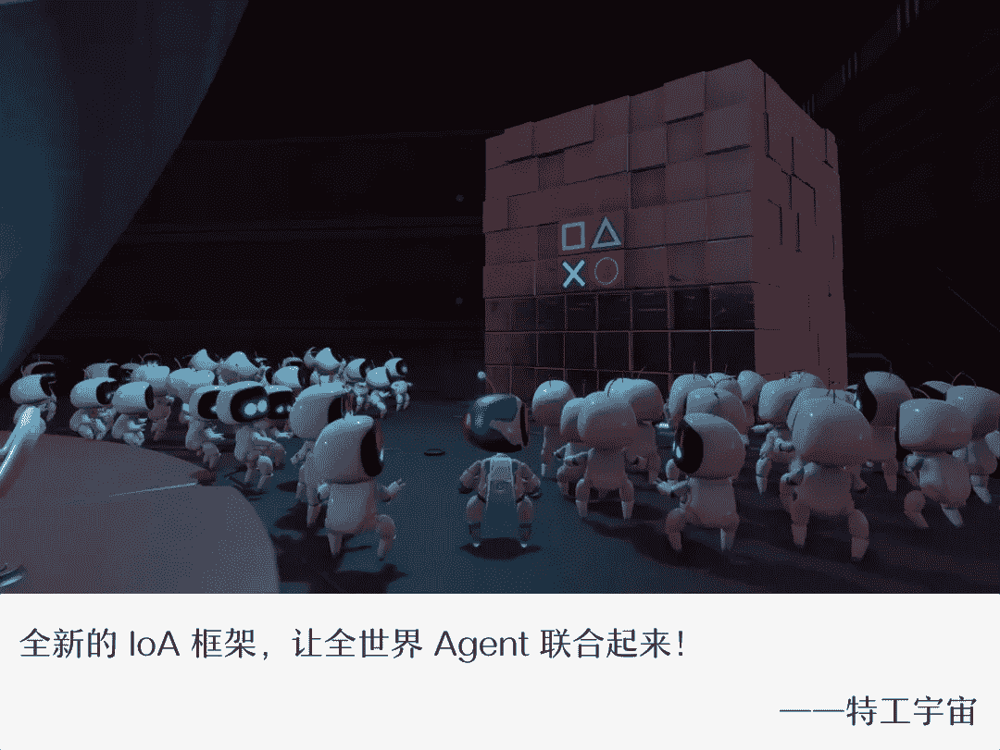
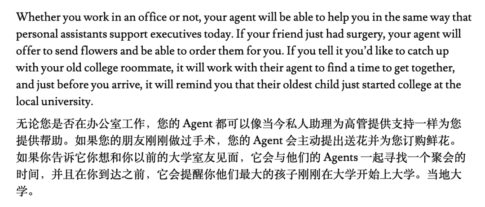
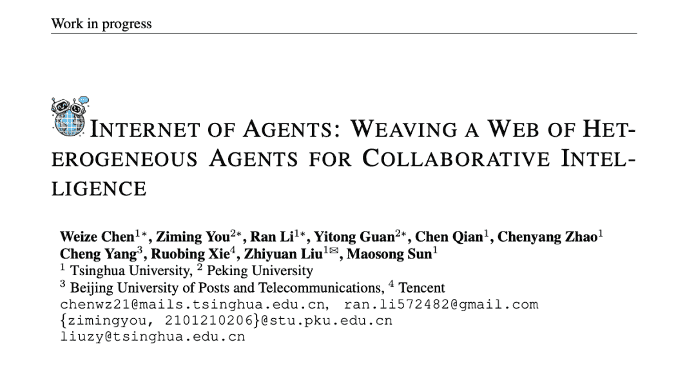
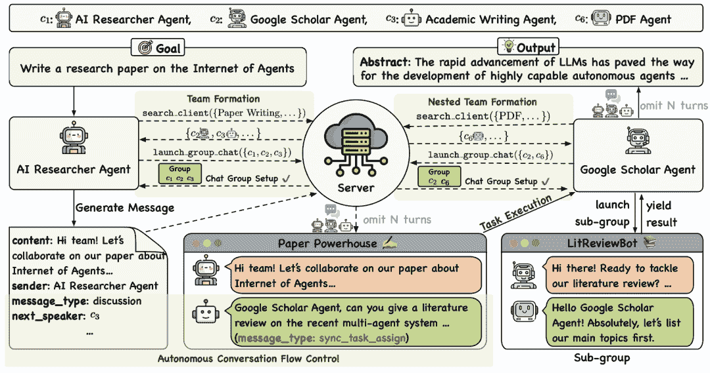
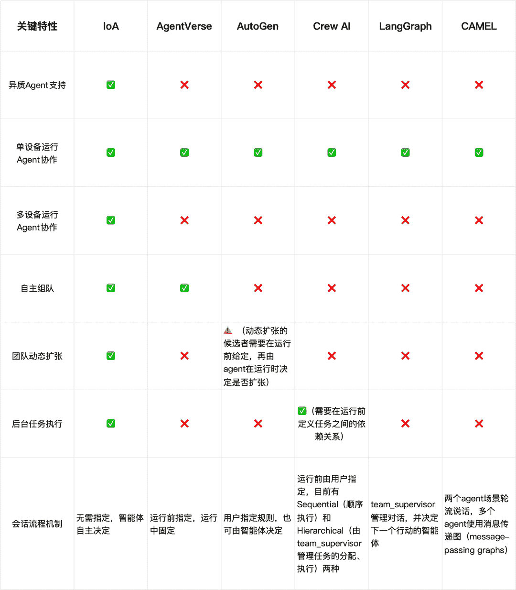
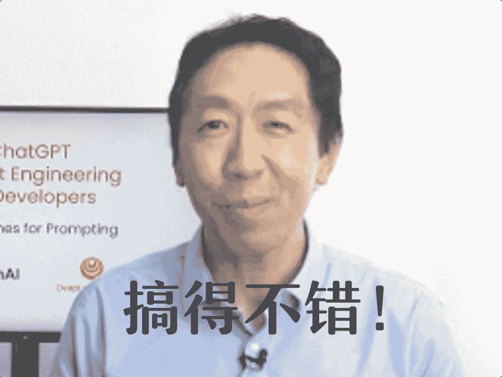
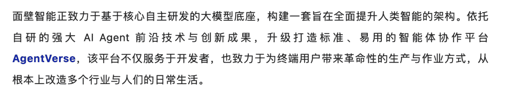

# 全新的 IoA 框架，让全世界 Agent 联合起来！

> 来源：[https://agijuejin.feishu.cn/docx/HfoNd8jqLopkiGxgQsIcp8o7nwg](https://agijuejin.feishu.cn/docx/HfoNd8jqLopkiGxgQsIcp8o7nwg)

> 作者：特工小天

> 编辑：特工少女 | 特工宇宙

> 原文：[https://mp.weixin.](https://mp.weixin.qq.com/s/dD4JxaLm2FpA0Sq97bfXzg)qq.com/s/dD4JxaLm...

自去年 Lilian Weng 的那篇关于 Agent 的博客发布以来，Agent 的概念就没熄火过。

各路英雄都在追赶着，拿下 Agent 这颗大模型界的“明珠”。

比尔盖茨预测五年内 Agent 将彻底改变人们的生活，吴恩达教授也在研究推崇 Agent ，Altman 也表示 Agent 将是 AI 的杀手级应用，而李彦宏带领百度押宝 Agent...

内容来自比尔盖茨笔记 AI is about to completely change how you use computers

翻译 by 特工宇宙自研翻译 Agent 工具

**在未来，每个人都有自己的智能体，他们会彼此协同、交流，服务**于人类，甚至是帮你工作、购物、相亲...

在昨天，它可能还是一个美好的憧憬。

而看到 IoA 之后，我想这一天应该不远了。

听起来好像很牛逼，那 IoA 是个啥呢？

别急，我们娓娓道来。

话说啊，人类的发展是一个漫长而复杂的过程，从早期的个体生存到形成了群体，文明的曙光才逐渐显现。 个体之间的相互合作与交流，逐渐形成了复杂的社会结构和丰富的文化结晶 。

再者说啊，上世纪计算机刚发明出来是不联网的，不仅笨重，提效也没那么多。 后来随着网络技术的发展，计算机开始连接到一个庞大的网络中，互联网就诞生了 。互联网的出现极大地促进了信息的流通和共享，改变了人们的工作、学习和生活方式，推动了全球化的进程。

重要的要来了，如今的很多智能体啊，在一些任务上接近了人类表现。但是彼此身在“孤岛”之中。 你说有没有可能把散落在世界各地的 Agent 联合起来，彼此沟通协作，发挥出智能体的更大能量呢 ？

而这，就是 IoA 在做的事情，即 Internet of Agents，智能体互联网 。

好家伙，让全世界的 Agent 联合起来，这不“特工宇宙”嘛？

从万物互联迈向“万物智联”，智能体不再受限于固定的协作架构，跨设备互相连接、自由沟通、高效协作，而这，都得益于最新的一个研究项目——“l oA，为协作智能编织异构智能体连接网络 ”。

之前，多智能体协作“工作流”已经出现并流行，尽管已展现出巨大的应用潜力， 但仍然存在一些关键的限制性不足，比如👇

1. **智能体接入限制 **：传统框架仅支持那些在系统内部预定义的智能体。

2. **设备与位置的局限 **：目前，许多多智能体系统仍旧在一个单一设备上模拟多个智能体的行为。

3. **沟通机制的僵化 **：现有的大多数多智能体系统在沟通机制上较为单一，往往需要用户进行预先的指定。

为了跨过这些障碍， IoA 创建了一个可以自由注册、互相发现的 Agent 协作平台， 做到了三点突破。

1. Agent 互联载体，从单设备到多设备

大多数多智能体系统，只能在一个设备上模拟多个智能体，这与现实场景相悖。IoA 支持分布在多个设备和位置的智能体通过网络进行协作。

2. 在开放性上，从限定框架的“局域网”到自由身份注册的“互联网”

大多数多智能体系统只允许接入框架内部定义的智能体，而 IoA 允许开发者通过为现有智能体实现一个 Adapter 接入到 IoA 的客户端中并注册到 IoA 服务端，扩展系统内智能体的能力多样性。

3. 沟通、协作、组队上，从固定计划到灵活高效

IoA 将沟通阶段抽象为 5 个阶段：讨论、同步任务分配、异步任务分配、暂停等待任务完成、总结，通过有限状态自动机实现了自主会话流程控制机制，允许智能体根据任务需求和进展自适应调整协作策略。

总之，IoA 对原来 Agent 协作工作流（Workflow）进行三个方向扩容，从而在更高维度上形成智能体互联网 Internet of Agents.

听起来有点复杂，可以看看下面这个图，将 IoA 与其他 Agent 框架做了一个对比。

感兴趣的宝子可以去深入了解一下。

🔗 IoA 论文地址：https://arxiv.org/abs/2407.07061

🔗 IoA 开源地址：https://github.com/OpenBMB/IoA

到底是谁，如此技艺精湛，高瞻远瞩？

好家伙，原来是 面壁智能联合清华大学 NLP 实验室 搞的！

没错，就是之前搞了 ChatDev 开源项目，还被吴恩达点名表扬了的那家。

粗心的我细心地查阅了下相关资料，好家伙，原来早在去年就这么有远见。

面壁智能之前要规划做大模型驱动下的 Al Agent “三驾马车”，全面覆盖单体智能、群体智能和智能体应用框架领域。

这简直和我们创立“特工宇宙”的初衷不谋而合！

我们认为，未来一定会诞生更多，能达到甚至超过人类水平的 Agent，而我们，要打造 Agent 时代下的全新平台。

看到了 IoA，更加坚定了我们的信念， 也 更加让我们相信，在不远的将来，彼此协作的 Agent 网络，会让我们的生活更便捷、更智慧。

感觉一个巨大的“特工宇宙”正在加速到来哇！

试想一下，在未来，分布于不同设备的 Agent，都能统一听从你的调度，甚至主动去完成工作，来找你聊天。

试想一下， 在未来，那些枯燥而繁琐的工作，那些处理不完又时常忘记的消息，都有一个或者好几个 Agent 来辅助你，提醒你。

试想一下， 在未来，人与机器的关系更加平等共生，实现了真正的万物智联。

而这一切伟大，都起源于今天的 IoA.

