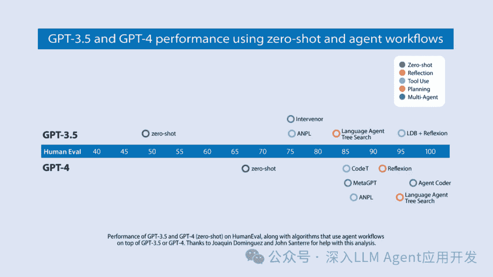
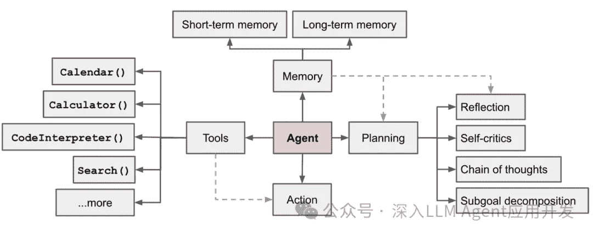

# 提升大语言模型LLM的性能利器Agents work flow

> 来源：[https://agijuejin.feishu.cn/docx/LxzIdcbl5oD1IvxZbKBc04XVnGd](https://agijuejin.feishu.cn/docx/LxzIdcbl5oD1IvxZbKBc04XVnGd)

> 作者：还就可 | 深入LLM Agent应用开发

> 原文： [https://mp.weixin.](https://mp.weixin.qq.com/s/PVndueLalARqL65lhipV3g)qq.com/s/PVndueLa...

巧妙设计的Prompt，结合思维链、React和反思等技巧构建的大语言模型LLM Agents，将是AI领域中一个关键的趋势，并且有可能在今年推动大规模的人工智能进步，甚至能够让GPT-5提前到来。

## 1. Agent工作 流

最近吴恩达教授 Andrew.Ng 在 deeplearning.ai 来信 中表示大语言模型 Agents工作流将是AI领域中一个关键的趋势，并且有可能在今年推动大规模的人工智能进步——甚至可能比下一代基础模型更甚。

> I think AI agent workflows will drive massive AI progress this year — perhaps even more than the next generation of foundation models. This is an important trend, and I urge everyone who works in AI to pay attention to it. -- Andrew.Ng

我们通常在ChatGPT中希望一次输入就能获得期望的结果，然而结果通常并不理想。我们会根据响应一次一次的提示ChatGPT修正答案，最终获得期望的输出。问题来了，我们是否可以将这种流程规范化呢？

业界有人提出了Agents workflow，在一个工作流中，我们可以要求LLM多次迭代文档，最终输出高质量的答案。它通过模仿人类解决问题的迭代方法，使得人工智能生成的输出更加精确和细致。这种方法不仅利用了大型语言模型的优势，还通过引入反馈循环来弥补其不足，从而实现持续改进。通过规划、行动、审查和调整的循环过程，人工智能可以产生更高质量的结果。吴教授的团队在Human Eval这个数据集上对此进行了测试，并获得了如下的图表。Human Eval论文《 Evaluating Large Language Models Trained on Code 》中提到一个代码评测标准。

从上图中我们可以看出，GPT-3.5和GPT-4在zero-shot中分别获得了48%和67%左右的正确率，而通过使用Agent work flow，有些Agent在GPT-3.5上甚至达到了95%的准确率。可见通过迭代Agent work flow实现的性能提升远远超过了从GPT-3.5到GPT-4的改进。这一发现强调了Agent work flow在提高人工智能性能方面的重要性。甚至能让GPT-5提前到来。吴教授总结了当前的业界研究，提出了四种工作流设计模式。

+   反思 Reflection: LLM反思自己的工作并提出改进的方法。

+   工具使用 Tool use: 给LLM提供工具，如网络搜索、代码执行或任何其他功能，以帮助它收集信息、采取行动或处理数据。

+   规划 Planning: LLM制定并执行一个多步骤计划来实现目标（例如，为文章编写大纲，然后进行在线研究，然后写草稿，等等）。

+   多Agent协作 Multi-agent collaboration: 多个Agent协作，分配任务并讨论辩论想法以此提出比单个Agent更好的解决方案。

## 2. Agent系统概述

此外，Open AI的应用主管Liliang Weng在2023年6.23撰写的一篇博客《 LLM Powered Autonomous Agents 》也提出了如下自动化Agent架构。这篇博客非常值得一读，系统的描述了一个Agent工作流类似AutoGPT，BabyAGI等利用LLM作为大脑自动完成任务的流程和核心组件。

2.1 概述

+   LLM作为Agent系统的大脑，负责规划、反思、记忆和工具使用等关键功能。

+   规划包括任务分解和自我反思，使代理能够高效处理复杂任务。

+   记忆分为短期记忆和长期记忆，短期记忆涉及上下文学习，长期记忆则利用外部向量存储和快速检索。

+   工具使用，涉及调用外部API来获取缺失的信息或执行特定任务。

### 2.2 规划

+   任务分解：使用链式思考（Chain of Thought, CoT）和思维树（Tree of Thoughts, ToT）等技术，将复杂任务分解为更小、更易管理的子任务。

+   自我反思：通过ReAct和Reflexion等框架，Agent能够进行自我批评和反思，从而改进未来的行动。

### 2.3 记忆

+   介绍了人类大脑中的不同类型的记忆，并将它们与Agent系统中的记忆机制相映射。

+   讨论了最大内积搜索（Maximum Inner Product Search, MIPS）和相关的算法，如局部敏感哈希（LSH）、近似最近邻（ANNOY）、层次导航小世界（HNSW）和Facebook AI相似性搜索（FAISS）等，用于优化外部记忆的检索速度。

### 2.4 工具使用

+   讨论了人类使用工具的特点，并探讨了如何将这一特性应用到LLM中，以扩展模型的能力。

+   提到了MRKL（模块化推理、知识和语言）架构，它结合了专家模块和通用LLM作为路由器。

+   介绍了TALM（工具增强的语言模型）和Toolformer，这些是微调LM以学习使用外部工具API的方法。

+   举例了ChatGPT插件和OpenAI API调用，展示了实际中增强工具使用能力的例子。

### 3. 下一步

下一篇我们将深入Agent work flow的Reflection，并结合之前搭建的Llama.cpp来测试验证。动动小手，加个关注，收藏评论哦，及时获取最新的更新。