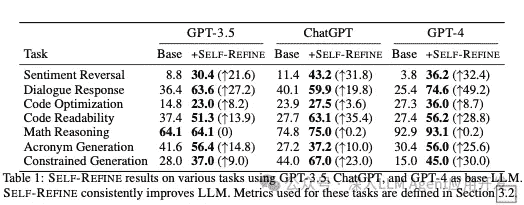
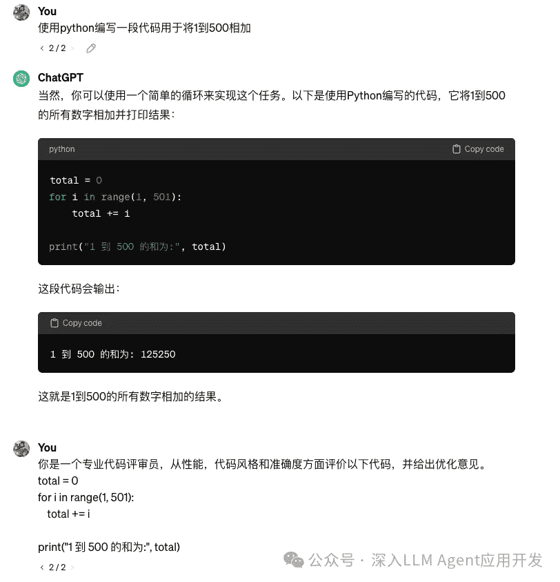
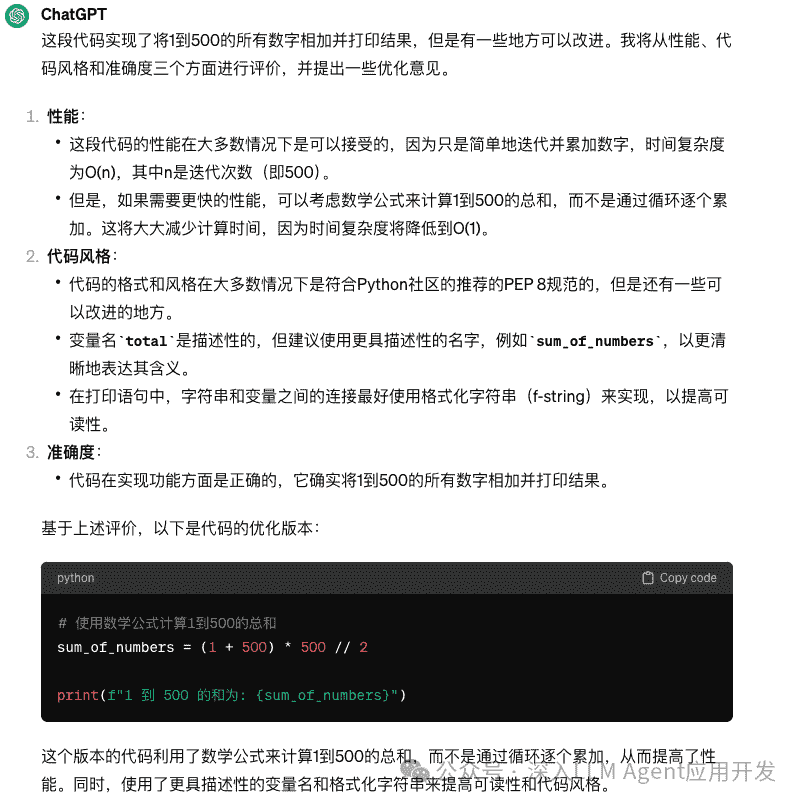
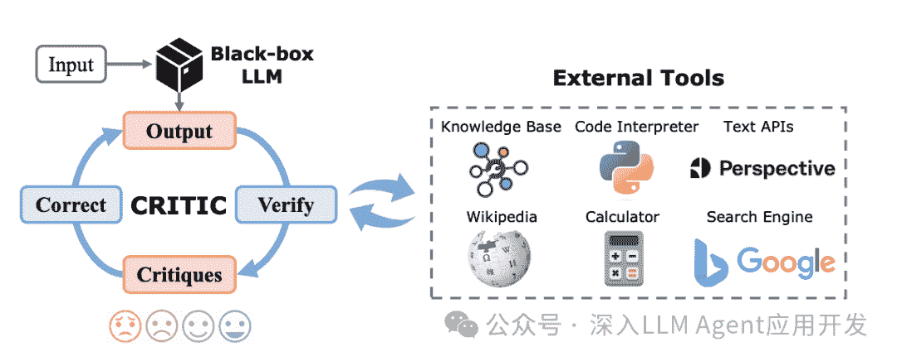
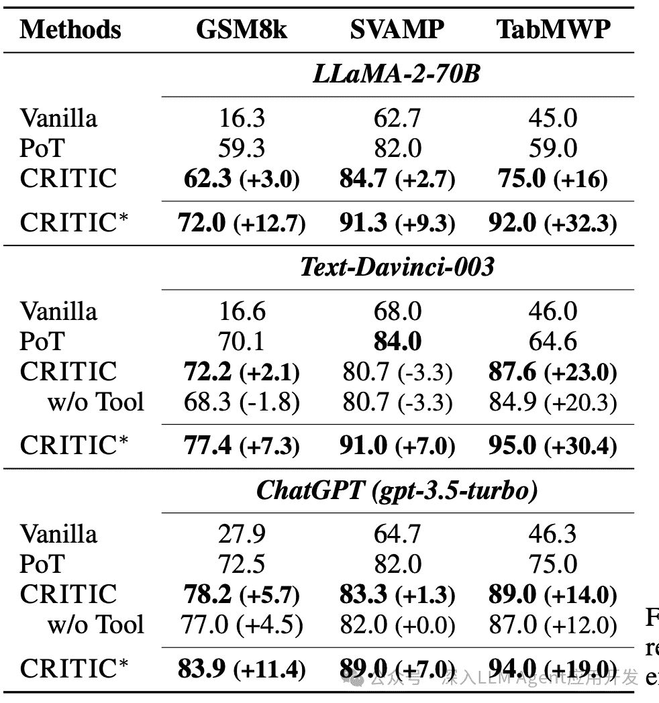
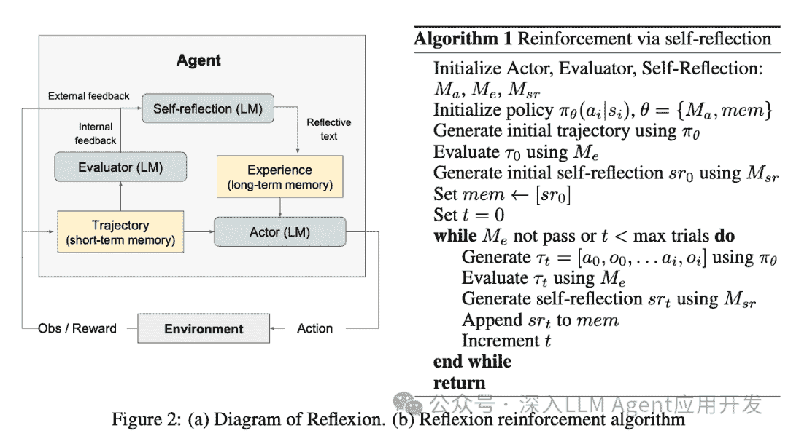
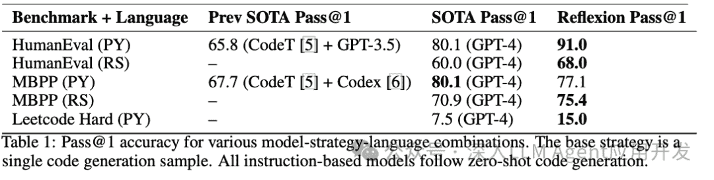

# LLM Agent提效进阶：反思工作流—91%精度大超GPT-4 24%

> 来源：[https://agijuejin.feishu.cn/docx/SlEbdSV9xowNMNxfjVrcJ3qSnLf](https://agijuejin.feishu.cn/docx/SlEbdSV9xowNMNxfjVrcJ3qSnLf)

> 作者：还就可 | 深入LLM Agent应用开发

> 原文： [https://mp.weixin.](https://mp.weixin.qq.com/s/_o013lG7EiFAHghLwCOPzA)qq.com/s/_o013lG7...

在我们之前的文章 提升**LLM性能利器Agents **wo**rkflow 中，我们深入探讨了提升LLM性能的重要工**具：Agents workflow，其中包含了四种精妙设计的Agent工作流模式：反思、工具使用、规划和多智能体协作。这些工作模式对于AI系统的设计至关重要， Andrew.Ng [1] 在 Agentic Design Patterns Part 2: Reflection [2] 中对此也有简单描述。让我们深入研究一下Reflection这一引人注目的Agent工作流设计模式。

## ** 1. 相关研究**

反思依赖于LLM对自己之前提出的工作进行反思并提出改进的方法，有三篇典型论文详细描述了这种模式，我们先来看一下。

+   **S**elf-Refine: Iterative Refinement with Self-Feedback [3]

+   **CRITIC: Large Language Models Can Self-Corr**ect with Tool-Interactive Critiquing [4]

+   **R**eflexion: Language Agents with Verbal Reinforcement Learning [5]

## ** 2. Self-Refine**

顾名思义，它是一种自我精炼的LLM优化技术，使用单一的LLM作为生成器、改进器和反馈器。该方法通过迭代过程生成初始输出，然后让同一LLM为其提供反馈，并使用这些反馈进一步改进输出。论文展示了SELF-REFINE在多个任务上的有效性，包括对话响应生成、数学推理、代码生成等，使用最先进的LLM（如GPT-3.5和GPT-4）进行评估。Self-Refine在所有评估任务上都优于使用相同LLM进行传统一步生成的方法，平均提高了约20%的任务性能。

以ChatGPT编写Python来举个例子

## ** 3. CRITIC**

作者提出一个名为CRITIC的框架，允许大型语言模型（LLMs）通过**与外部工具的交互来验证**和改进自己的输出，类似于人类与工具的互动，该框架已经开源 critic [6] 。

+   CRITIC通过与搜索引擎、代码解释器等工具的交互，评估初始输出的某些方面，并根据验证过程中获得的反馈来修正输出。

+   该过程可以重复进行，以确保持续的输出改进。

+   通过在自由形式问答、数学程序合成和毒性降低等任务上的全面评估，证明了CRITIC能够一致地提高LLMs的性能。

在数学评估的各个数据集上获得了最高的评分。

我会在后续的文章中尝试分析一下这个框架CRITIC，我们看看它是怎么进行调用工具验证，评估，纠正输出，再循环的。

## ** 4. Reflexion**

作者指出最近的一些工作诸如ReAct、SayCan、Toolformer、HuggingGPT以及WebGPT证明了使用基于LLM构建的自动化决策Agent是可行的，但是这些**方法大多依赖于在当前**情**景中的例子(in-c**ontext example)来指导LLM生成内容，因为用梯度下降的强化学习需要很多计算和时间。简单说，就是他们依赖的只是短期记忆。所以作者提出一种新的叫做 Reflexion 的框架，它通过使用语言强化学习（verb reinforcement）来帮助Agent从之前的失败中学习。 Reflexion 会把环境的二进制或量化的反馈转换成文字描述，作为下次迭代中的额外信息。这种自我反思式的反馈就像是个语意上的梯度信号来提供给Agent具体的优化方向，让Agent知道怎样改正错误，这样就能更好地完成任务了。就像人类通过反复练习和反思来快速掌握复杂技能一样。具体的工作流程如下图， Reflexion的源码 [7] 已经开源，我们在下一篇文章中安装该框架进行分析。

从上图看出Reflexion框架利用三个不同的模型：执行者（Actor）、评估者（Evaluator）和自我反思模型（Self-Reflection)。

+   执行者Actor基于状态观察生成文本和动作；

+   评估者对执行者产生的输出计算奖励分数；

+   自我反思模型生成口头自我反思提示以协助执行者自我改进。

+   该过程使用短期和长期记忆，其中轨迹历史作为短期记忆，而自我反思模型的输出存储在长期记忆中。

Reflexion在AlfWorld任务上提高了22%的决策制定能力，在HotPotQA推理问题上提高了20%，在HumanEval编程任务上提高了11%。比如HumanEval(PY)上比GPT-4的80.1高初10个点，到达91.0。

## ** 总结**

本文深入探讨了LLM（大语言模型）的反思工作流，通过介绍Self-Refine、CRITIC和Reflexion三种典型的优化技术，展示了LLM在自我反馈、工具交互和语言强化学习中的显著性能提升。这些方法不仅展示了AI系统在复杂任务中自我改进的潜力，还强调了自我反思在机器学习中的重要性。反思工作流的核心在于通过迭代反馈和自我修正，使模型能够不断优化其输出，就像人类通过经验和反思不断进步一样。

## **参考资料**

[1]Andrew official: http://andrew.ng/

[2]deeplearning.ai letters: https://www.deeplearning.ai/the-batch/agentic-design-patterns-part-2-reflection/

[3]self refine: https://arxiv.org/abs/2303.17651

[4]critic: https://arxiv.org/abs/2305.11738

[5]reflexion: https://arxiv.org/abs/2303.11366

[6]critic的github: https://github.com/microsoft/ProphetNet/tree/master/CRITIC

[7]reflexion github: https://github.com/noahshinn/reflexion