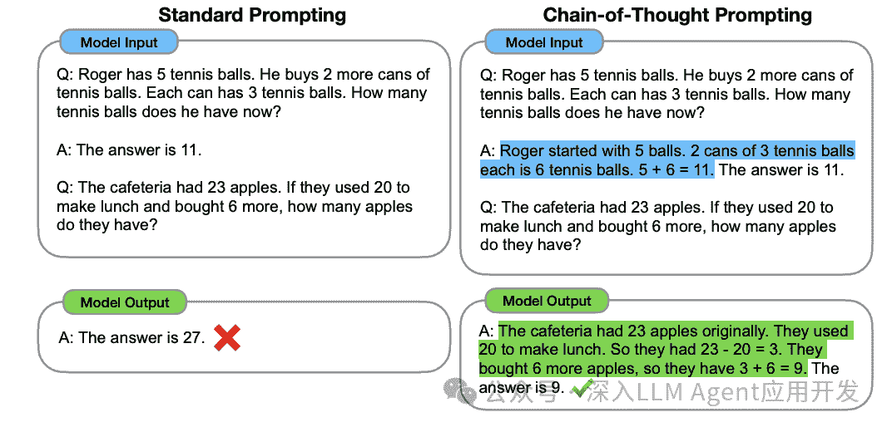
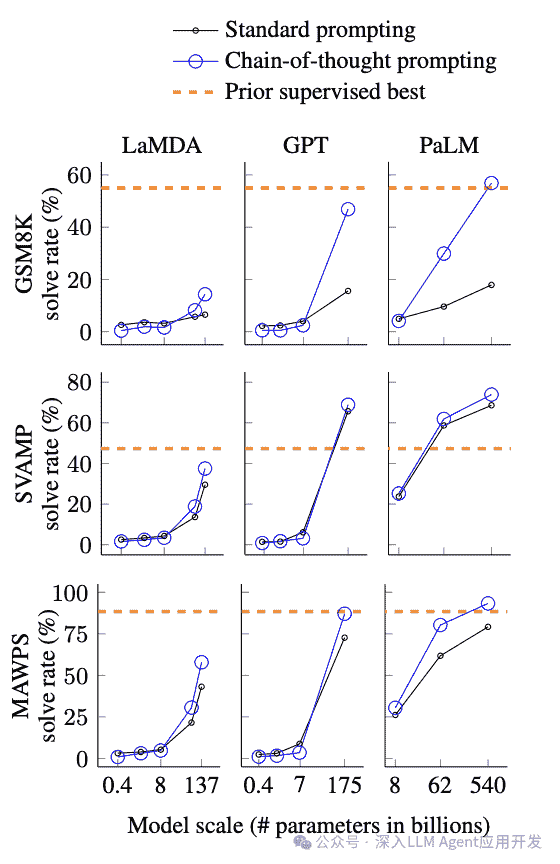
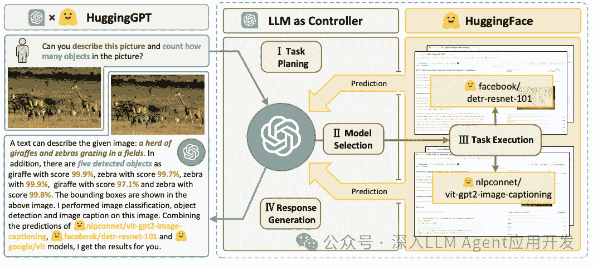
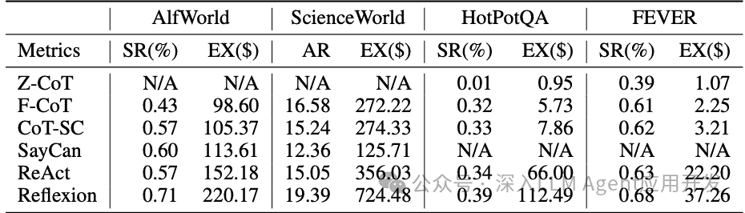

# LLM Agent提效进阶：规划工作流深度剖析

> 来源：[https://agijuejin.feishu.cn/docx/YPsfdRk3Joa3ONxo30Tc0bYlnwf](https://agijuejin.feishu.cn/docx/YPsfdRk3Joa3ONxo30Tc0bYlnwf)

> 作者：还就可 | 深入LLM Agent应用开发

> 原文： [https://mp.weixin.](https://mp.weixin.qq.com/s/OXLwj92F912JCqlXae17ag)qq.com/s/OXLwj92F...

我们在文章 提升LLM性能利器Agents workflow 我们提到Age[nt的](http://mp.weixin.qq.com/s?__biz=MzI0OTAzNTEwMw==&mid=2247483722&idx=1&sn=71c9dcd3579e5cf7bce3319e3d7b8fed&chksm=e996e17adee1686cb17bfc8da85fd70e54b292247f3a5b06acf3acbe3fdd873b91d16d88815c&scene=21#wechat_redirect)四种[工作流：反](http://mp.weixin.qq.com/s?__biz=MzI0OTAzNTEwMw==&mid=2247483758&idx=1&sn=bbad1dd2dd0dcc91069964b164148afa&chksm=e996e15edee168481dd1032fae637c164d9ee8ef8cf9f1a6e382767bb5956e463004cde12949&scene=21#wechat_redirect)思、工具使用、推理和多智能体协作。在此之前，我们已经从论文和代码层面分别讲解了大语言模型LLM中Agent的 反思 、 工具使用 工作流，今天我们将深入Agentic design pattern第三部分规划工作流。规划使用大语言模型自主决策如何拆分任务来完成更大或者更复杂的任务。

> Planning is a key agentic AI design pattern [1] in which we use a large language model (LLM) to autonomously decide on what sequence of steps to execute to accomplish a larger task.

许多复杂的任务，无法通过单个指令或者单个工具调用就能解决，但Agent可以自主决定如何拆分任务为更小的子任务。举个例子，输入的图像中是否有刘亦菲？LLM可能考虑的步骤是

+   检测是否存在人脸

+   扣出人脸

+   调用人脸匹配库

+   输出

规划是一种非常强大的能力，但由于LLM自主决策也会导致难以预测的结果。Andrew.Ng提到反射和使用工具这两种Agent设计模式是可以可靠的工作，并能够提高应用程序的性能，而规划是一种不太成熟的技术，很难预测。

> On o**ne hand, Planni**ng i**s a very powe**rful capability; on the other, it leads to less predictable results. In my experience, while I can get the agentic design patterns of Reflection [2] and Tool Use [3] to work reliably and improve my applications’ performance, Planning is a less mature technology, and I find it hard to predict in advance what it will do. But the field continues to evolve rapidly, and I'm confident that Planning abilities will improve quickly.

如果对规划感兴趣，可以阅读以下三篇论文。

+   **Chain-of-Thought Prompting Elicit**s Reasoning in Large Language Models [4]

+   **HuggingGPT: Solving AI Tasks with Cha**tGPT and its Friends in Hugging Face [5]

+   **U**nderstanding the planning of LLM agents: A survey [6]

##  1. Chain of Thought Prompting



该论文主要探讨了通过“思维链提示”（Chain-of-Thought Prompting，CoT）来引导大型语言模型（LLM）进行推理。研究表明，通过在提示中明确展示逐步推理过程，可以显著提高语言模型在复杂推理任务上的表现。

+   传统的提示通常直接提供问题和答案，而思维链提示则在问题和答案之间插入多个中间推理步骤。这样做不仅帮助模型理解问题的结构，还能引导其逐步推导出正确答案。

+   实验涵盖了数学问题、常识推理和代码生成等多种任务。

+   思维链提示在各类推理任务中均显著提升了模型的表现。例如，在解决数学题时，思维链提示比传统提示方法提高了模型的准确率。

+   模型规模越大，思维链提示的效果越显著，这表明大型模型具有更强的推理和理解能力，下图表明模型在至少要在8B以上才上才会有明显的提升。



以论文对于推理数学问题的Prompt举个例子。

```
Here&#x27;s examples when you are answer.
Q: There are 15 trees in the grove. Grove workers will plant trees in the grove today. After they are done, there
will be 21 trees. How many trees did the grove workers plant today?
A: There are 15 trees originally. Then there were 21 trees after some more were planted. So there must have
been 21 - 15 = 6. The answer is 6.
...
Q: Olivia has $23. She bought five bagels for $3 each. How much money does she have left?
A: Olivia had 23 dollars. 5 bagels for 3 dollars each will be 5 x 3 = 15 dollars. So she has 23 - 15 dollars left. 23
\- 15 is 8. The answer is 8.
Q: Tracy used a piece of wire 4 feet long to support tomato plants in the garden. The wire was cut into pieces 6 inches long. How many pieces did she obtain?
A:
```

如果你复制完整的实例，ChatGPT会按照以上推理步骤回复。

```
Tracy used a piece of wire 4 feet long. There are 12 inches in a foot, so the wire was 4 * 12 = 48 inches long. The wire was cut into pieces 6 inches long. To find the number of pieces, we divide the total length of the wire by the length of each piece: 48 / 6 = 8. The answer is 8.
```

这里通过对指定类型的问题，给出Chain-of-Thoughts的拆解过程Example，从而提示LLM如何思考分布并得出答案。

## ** 2. HuggingGPT**



这篇论文主要介绍了一种名为HuggingGPT的系统，该系统结合了ChatGPT和Hugging Face平台上的各种专家模型，以解决复杂的AI任务。

HuggingGPT的工作流程主要分为以下几个步骤：

+   任务规划：使用ChatGPT分析用户的请求，理解他们的意图，并将其分解为可能可解决的任务。

+   模型选择：为了完成规划的任务，ChatGPT根据模型的描述选择托管在Hugging Face上的专家模型。

+   任务执行：调用并执行每个选定的模型，然后将结果返回给ChatGPT。

+   响应生成：最后，使用ChatGPT整合所有模型的预测结果，并生成响应。

HuggingGPT支持24种不同的AI任务，涵盖语言处理、视觉处理、语音识别等领域。为了评估系统的任务规划能力，研究人员采用了GPT-4作为评估者，通过特定的评分标准来判断任务规划的准确性和合理性。

这项研究展示了如何结合不同领域的模型来解决复杂的AI任务，提高了AI系统的灵活性和实用性。论文代码：http**s://github.com/microsoft/JARVIS**/tree/main/hugginggpt 和Demo： HuggingGPT - a Hugging Face Space by microsoft [7] 。

在任务规划阶段，Prompt设计如下。

```
The AI assistant performs task parsing on user input, generating a list of tasks with the following format: [{&quot;task&quot;: task, &quot;id&quot;, task_id, &quot;dep&quot;: dependency_task_ids,
&quot;args&quot;: {&quot;text&quot;: text, &quot;image&quot;: URL, &quot;audio&quot;: URL, &quot;video&quot;: URL}}]. 
The &quot;dep&quot; field denotes the id of the previous task which generates a new resource upon which the current task
relies. 
The tag &quot;&lt;resource&gt;-task_id&quot; represents the generated text, image, audio, or video from
the dependency task with the corresponding task_id. 
The task must be selected from the following options: {{ Available Task List }}. 
Please note that there exists a logical connections and order
between the tasks. In case the user input cannot be parsed, an empty JSON response should be
provided. 
Here are several cases for your reference: {{ Demonstrations }}. 
To assist with task planning, the chat history is available as {{ Chat Logs }}, where you can trace the user-mentioned
resources and incorporate them into the task planning stage.
```

我们详细看一下这个Prompt设计，这能帮助我们设计自己的Prompt。

1.  描述这个任务的输入和输出，它要求根据用户输入生成一个特任务列表 [{"task": task, "id", task_id, "dep": dependency_task_ids, "args": {"text": text, "image": URL, "audio": URL, "video": URL}}] 。

1.  描述输出的各个字段，包括task、dep和tag等，以及可选task列表。

1.  描述Corner Case，说明输出在某些情况下也可以是空JSON。

1.  给出Examples。

1.  最后将聊天历史纪录附着上去，协助任务规划。

## ** 3. ****U**nderstanding the planning of LLM agents: A survey [8]

这篇综述系统地探讨了如何利用大型语言模型（LLMs）提升自主代理的规划能力，这是人工智能研究中的一个新兴且重要领域，总结了现有工作，并对如何改善LLMs在规划任务中的表现进行分类分析，同时也指出了未来研究面临的挑战。论文认为当前LLM代理规划主要分为以下几类：

+   任务分解：通过“分而治之”的策略，将复杂任务拆解为多个子任务，分别进行规划。代表作：CoT、ReAct和HuggingGPT。

+   多计划选择：生成多个备选计划，并使用搜索算法（如树搜索）从中选择最优方案。代表作：ToT、GoT、CoT-SC。

+   外部模块辅助规划：结合外部规划器，提升规划效率和可行性，同时利用LLM进行任务形式化。代表作：LLM+P、LLM+PDDL。

+   反思与精炼：通过自我反思和总结失败经验，提升错误纠正能力，避免“思维循环”。代表作：Reflexion、CRITIC、Self-Refine。

+   记忆增强规划：引入额外的记忆模块，存储常识、过往经验等，辅助规划过程。代表作：REMEMBER、MemoryBank。

在之前的研究中，我们已经深入探讨了基于Reflexion、CRITIC和Self-Refine的代理（Agent）反思机制。“思维链”（Chain-of-Thoughts, CoT）作为一种任务分解策略，其核心思想在于通过逐步推理来解决问题。为了评估不同Agent框架的性能，我们对四个数据集进行了实验，比较了包括Z-CoT（零样本思维链）、F-CoT（少样本思维链）、CoT-SC（自洽思维链）、SayCan、ReAct以及Reflexion等代表性模型在成功率（SR）、平均奖励（AR）和成本（EX）上的表现。



实验结果表明，Reflexion框架在所有数据集中均展现出最高的成功率，但与此同时，其成本也相对较高。这是因为Reflexion框架在ReAct或CoT的基础上，增加了多轮反思迭代，从而提高了解决问题的深度和准确性，但相应的资源消耗也随之增加。相比之下，CoT-SC在成本和成功率之间取得了较好的平衡。其成功率与ReAct相近，但成本明显较低，这使得CoT-SC成为一个在成本效益和性能之间做出折衷选择的优选方案。然而，对于自建的大型语言模型（LLM）且对实时性要求不高的应用场景，Reflexion框架仍然是一个更为理想的选择。它通过增加迭代次数，虽然提高了成本，但也显著提升了问题解决的质量和深度。

## ** 4. 总结**

综上所述，选择合适的Agent框架需要根据具体的应用需求、成本预算以及对实时性的要求来综合考量。在资源充足且对性能有较高要求的情况下，Reflexion框架的优势更为明显；而在成本敏感或实时性要求较高的应用中，CoT-SC等平衡性更好的框架可能更为合适。后续，我们会深入代码分析Reflexion框架中基于CoT的反思设计和HuggingGPT。

如果您意犹未尽，想要参与LangChain实战课程，可以点击原文链接查看购买，亲历LLM应用开发之旅。

点赞关注收藏不迷路，获取及时更新。

## **参考资料**

[1]agentic AI design pattern: https://www.deeplearning.ai/the-batch/how-agents-can-improve-llm-performance/

[2]Reflection: https://www.deeplearning.ai/the-batch/agentic-design-patterns-part-2-reflection

[3]Tool Use: http://www.deeplearning.ai/the-batch/agentic-design-patterns-part-3-tool-use/

[4]Chain-of-Thought Prompting Elicits Reasoning in Large Language Models: https://arxiv.org/abs/2201.11903

[5]HuggingGPT: Solving AI Tasks with ChatGPT and its Friends in Hugging Face: https://arxiv.org/abs/2303.17580

[6]Understanding the planning of LLM agents: A survey: https://arxiv.org/pdf/2402.02716.pdf

[7]HuggingGPT - a Hugging Face Space by microsoft: https://huggingface.co/spaces/microsoft/HuggingGPT

[8]Understanding the planning of LLM agents: A survey: https://arxiv.org/pdf/2402.02716.pdf