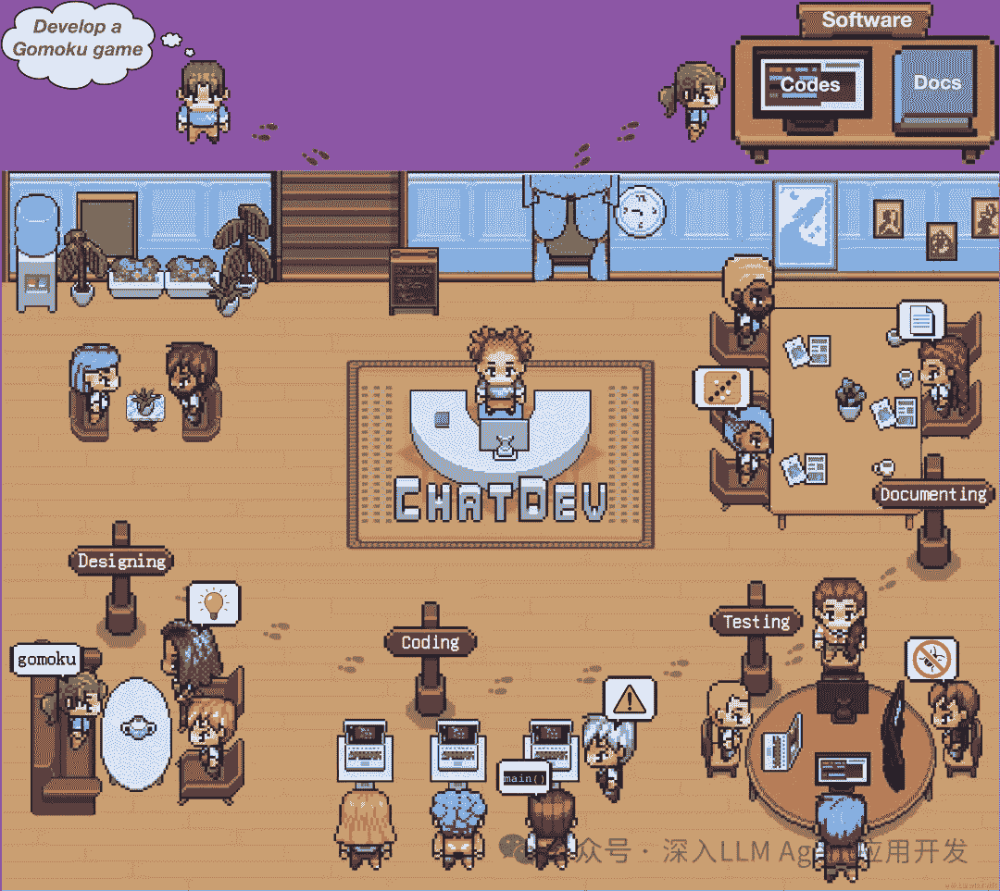
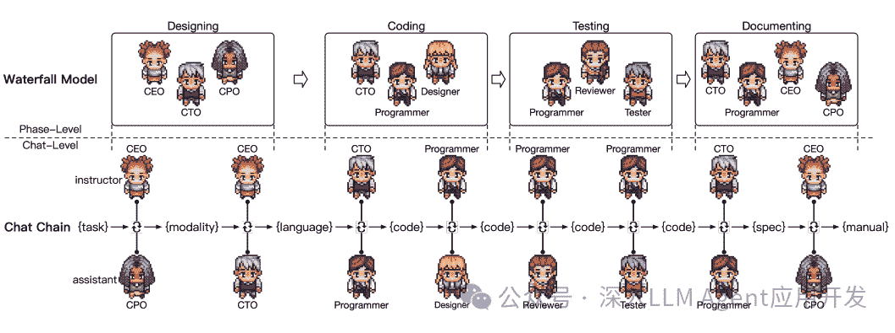
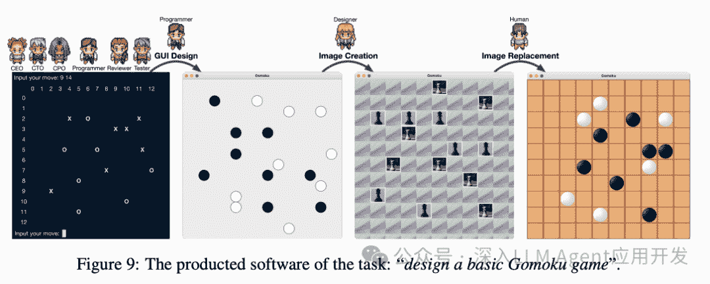
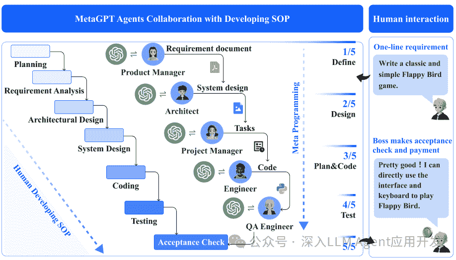
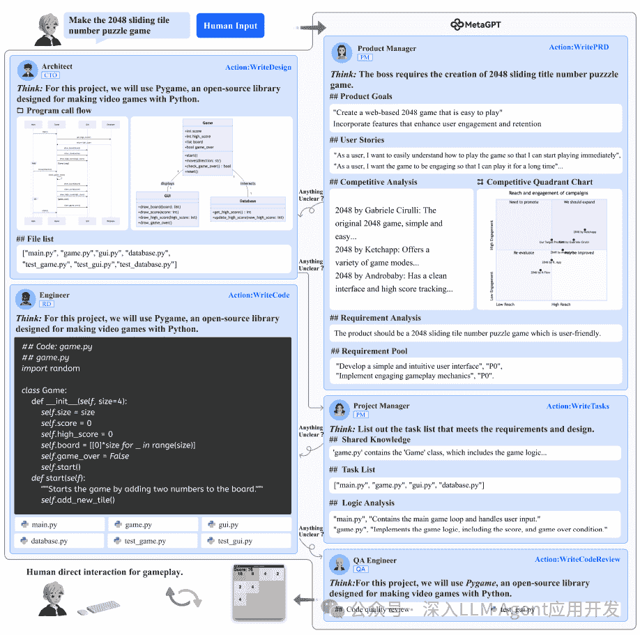
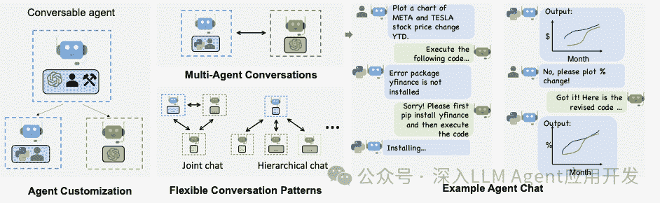
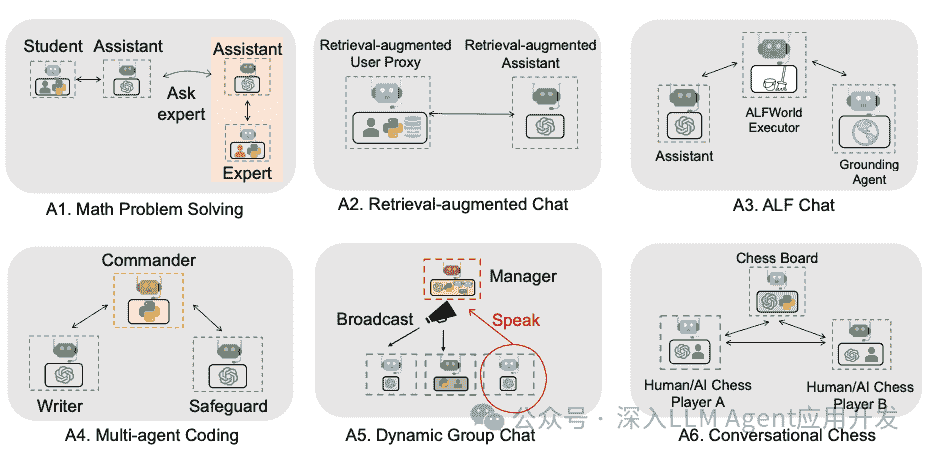

# LLM Agent提效揭秘：多智能体协作工作流深度剖析

> 来源：[https://agijuejin.feishu.cn/docx/AHtNdqAtQopylzxhhP1cUr3yntd](https://agijuejin.feishu.cn/docx/AHtNdqAtQopylzxhhP1cUr3yntd)

> 作者：还就可 | 深入LLM Agent应用开发

> 原文： [https://mp.weixin.](https://mp.weixin.qq.com/s/9MnZB3_4MuqnfbyKfCdxGQ)qq.com/s/9MnZB3_4...

在此之前，[我们已](http://mp.weixin.qq.com/s?__biz=MzI0OTAzNTEwMw==&mid=2247483722&idx=1&sn=71c9dcd3579e5cf7bce3319e3d7b8fed&chksm=e996e17adee1686cb17bfc8da85fd70e54b292247f3a5b06acf3acbe3fdd873b91d16d88815c&scene=21#wechat_redirect)经从[论文到代码](http://mp.weixin.qq.com/s?__biz=MzI0OTAzNTEwMw==&mid=2247483758&idx=1&sn=bbad1dd2dd0dcc91069964b164148afa&chksm=e996e15edee168481dd1032fae637c164d9ee8ef8cf9f1a6e382767bb5956e463004cde12949&scene=21#wechat_redirect)深度[解读了](http://mp.weixin.qq.com/s?__biz=MzI0OTAzNTEwMw==&mid=2247483767&idx=1&sn=5a6ed92f8f3fe4d4a940d4ae8f02c784&chksm=e996e147dee168514b9bf5771ed9ef0ed90fb4bdd5686cee3a19ab0db9609dd5cf5e21526d66&scene=21#wechat_redirect) 大语言模型4种Agent 工作流 的三种： 反思 、 工具使用 和 规划 。今天我们将深入最后一种Agent工作流：多智能体协作工作流。

想象一个未来，不是单一的机器在孤岛般运算，而是众多智能体如同交响乐团成员，各司其职，共谱技术乐章。这正是多智能体协作工作的魅力所在：它将复杂的任务解构，分配给专精的代理，再以自然语言为桥梁，缝合各部分，成就整体的高效执行。

> 合作使我们能够知道比我们自己所能知道的更多。它赋予我们不同的思维方式，让我们接触到原本无法获得的信息，并在我们共同努力实现共同目标的过程中将想法结合起来。-- Paul Solarz

在人类社会中，合作是智慧的放大器，它聚合了个体的独到见解，催化出超越个体边界的集体智慧。而在人工智能的疆域内，这一原理亦被赋予了新的生命——通过多智能体协作工作流，大型语言模型（LLMs）正解锁前所未有的协同潜能。本文将带您深入这一前沿领域，剖析三篇重量级论文，透视多智能体如何在LLM中编织出新的效率与创造力网络。

相信你一定听说过Devin AI，全球第一个AI工程师，号称 只需一句指令，它可端到端地处理整个开发项目 ，它曾一度爆火全球。清华大学开发的ChatDev更是受到吴恩达点赞。ChatDev模拟一家虚拟软件公司，它通过扮演不同角色的各种智能代理运作，包括首席执行官、首席产品官、首席技术官、程序员、审核员、测试员、美术设计师。这些代理形成了一个多代理组织结构，并以“通过编程革新数字世界”的使命团结在一起。ChatDev 内的代理通过参加专门的功能研讨会进行协作，包括设计、编码、测试和文档编写等任务。

在技术圈里，我们经常听到“分工合作”这个词，它就像是高效协作的黄金法则。那么，当这个概念应用到大型语言模型（LLM）上，又会产生怎样的火花呢？你可能会好奇，既然用的是同一个LLM，为什么还要把它拆分成不同的Agent来协作呢？这不是多此一举吗？

其实不然。想象一下，如果把一个团队里的角色混为一谈，比如让一个程序员同时担任产品经理的角色，那他们可能在项目初期就会陷入无尽的争论。同样，在LLM的世界里，给一个Agent同时设定多个角色，也会导致混乱。毕竟，一个精准的Prompt需要明确Agent的角色和任务，如果角色模糊不清，LLM也难以准确捕捉到你的意图。

在Prompt Engineering的世界里，我们强调Prompt需要精确、详尽，最好还能配上示例。试想一下，如果把两个可能会“打架”的角色放在一起，LLM又怎能清晰理解并执行任务呢？尤其是当你给LLM加上了记忆库，如果角色不明确，LLM只会在混乱中迷失方向。

因此，将LLM拆分成多个Agent，让每个Agent专注于自己的细分领域，不仅理论上可以提高性能，实际上也确实能够带来显著的效果。每个Agent都有自己的专长，像一个精密的齿轮，只有当它们各司其职，整个系统才能高效运转。这样的协作方式，就像是一支训练有素的团队，每个人都清楚自己的职责，共同推动项目向前发展。

本文我们从吴恩达教授推荐的三篇论文入手。

+   **Communicative Agents for Softw**are Development [1] ChatDev的论文

+   **AutoGen: Enabling Next-Gen LLM Appli**cations via Multi-Agent Conversation [2]

+   **M**etaGPT: Meta Programming for A Multi-Agent Collaborative Framework [3]

## ** 1. ChatDev**

这篇论文介绍了一个名为ChatDev的虚拟聊天驱动的软件开发公司，该公司利用大型语言模型（LLMs）来推动整个软件开发过程。ChatDev模仿了传统的瀑布模型，将开发过程细分为设计、编码、测试和文档编制四个不同的阶段。每个阶段都涉及一组“软件代理”，包括程序员、代码审查员和测试工程师，他们通过协作对话促进无缝工作流程。

image-20240527154514170

从上图可见，流程和常规的软件开发流程基本一致，从设计、编码、测试到文本（上线）。角色分配细化到专业，不仅有编码工程师，还有代码审查员，还引入了我们之前讨论的 反思Reflection 工作流 来进一步提升决策的准确性。实验分析了ChatDev响应70个用户需求产生的所有软件，平均生成17.04个文件/软件，平均软件生产时间为409.84秒，制造成本仅仅0.2967美元。审查员和程序员之间的讨论导致了近二十种代码漏洞的识别和修改，而测试员和程序员之间的讨论则识别和解决了十多种潜在的错误。有意思的是，他们用ChatDev编写了一个五子棋游戏。

image-20240527155552003

## ** 2. MetaGPT**

[MetaGP](http://mp.weixin.qq.com/s?__biz=MzI0OTAzNTEwMw==&mid=2247483755&idx=1&sn=a08248c209bf35045584b9597cdebcb8&chksm=e996e15bdee1684d4980986833d641484bad065c3249c2df440510562c1ebd53aa750d4d3702&scene=21#wechat_redirect)T，[这是一个基于先前验证](http://mp.weixin.qq.com/s?__biz=MzI0OTAzNTEwMw==&mid=2247483757&idx=1&sn=c60b2fc88240e0ee675b3cbde9f0a331&chksm=e996e15ddee1684beb1f6e7afd87750532af3168e1b869044750b360e109e35b5c227fbc8b73&scene=21#wechat_redirect)过的推理和行动计划框架，如 ReAct 和 Reflexion ，进一步升级的元编程框架。它不仅继承了前者的优点，更是在处理复杂软件工程任务方面，展现出了令人瞩目的能力。MetaGPT的核心在于它创新性地引入了结构化的工作流程和专门化的角色分配。这就像是在工厂中，每个工人都有自己特定的任务，大家协同作业，以流水线的方式高效完成生产。MetaGPT正是借鉴了这一理念，通过将代理分配到特定角色，并采用类似装配线模式的任务分配，极大地提升了任务分解和执行的效率。而且，MetaGPT还整合了类似于人类的标准操作程序（SOPs），这就像是给了每个角色一本操作手册，确保了工作流程的简化、错误的减少，以及解决方案的连贯性。这一点在软件工程中尤为重要，因为它直接关系到代码的质量和项目的成功率。（MetaGPT的架构中Engineer是一个黑人，到底是干苦力的，哈哈哈😂）

image-20240527160730617

从上图中也可以看出， **角色中还引入了架构师，并且PM还会出PRD，架构**师还出流程图、API接口设计、ER图等 ，更为细分，更加专业了。经过HumanEval和MBPP基准的验证，MetaGPT在代码生成任务上交出了高分答卷。与AutoGPT、LangChain、AgentVerse和ChatDev等其他框架相比，MetaGPT在处理复杂软件项目时更是出类拔萃，不仅达到了100%的任务完成率，还显著提升了时间和令牌成本的效率。

更值得一提的是，消融研究进一步证实了专门化角色的重要性。多样化的角色引入，不仅让代码质量得到了显著提升，执行效果也更加出色。就像是一支篮球队，每个队员都有自己擅长的位置和技能，当他们协同作战时，整个团队的表现自然能够达到最佳状态。与ChatDev类似，MetaGPT也以设计游戏为例，这次设计的游戏是2048。

image-20240527161910897

## ** 3. AutoGen**

本文介绍了AutoGen，这是一个开源框架，旨在通过多代理对话来构建大语言模型（LLM）应用程序。AutoGen代理是可定制的、可对话的，结合LLM、人类输入和工具，可在多种模式下操作。框架的核心在于简化复杂任务，甚至于自动编程来解决任务，从而能够通过多代理协作来高效的解决问题。

+   多代理对话框架：AutoGen使用多代理对话来协调代理之间的合作，代理可以基于LLM、人类输入和工具进行操作。

+   可定制的代理：开发者可以轻松创建具有不同角色和功能的代理，通过选择和配置内置功能，使其适应多代理对话。

+   对话编程：采用对话编程范式，通过定义具有特定能力和角色的代理，以及编程代理之间的交互行为，简化了复杂应用的开发。

image-20240527181223783

不同于ChatDev和MetaGPT两者专注于软件开发领域，AuoGen的目标是构建一个通用的多代理对话框架，每个Agent可以是编程的，可以是利用的工具的，可以是人类无缝接入，也支持编排不同的Agent，即不同Agent如何沟通。如下图所示，它可以自动编程去解决数学问题，也可以结合私有知识库实现RAG来解决大语言模型的幻觉问题，甚至能完成小组聊天式的对话应用。我们甚至能够想象，如何用AutoGen开发一款狼人杀的游戏（当然，接下来我会开始探索尝试这方面的应用），我甚至想探索一下如何设计一个人类加多个Agent玩剧本杀的游戏应用。

image-20240527181918001

## ** 4. 总结**

通过本文对ChatDev、MetaGPT和AutoGen三篇论文的详细分析，我们深入了解了多智能体协作工作流在大语言模型（LLM）中的应用。这些多智能体的框架，简直是反思、工具使用和规划的集合体，尤其是多角色的设计，Prompt如何设计，反思如何设计，工具如何调用。另外，从工程角度来看，角色之间的对话沟通是如何设计，是采用直接通信还是广播，都是很有意思的事情。这些框架通过分工合作、角色专精和对话编程，大大提升了复杂任务的解决效率和效果。下一篇文章将深入分析AutoGen的框架，以进一步探讨多智能体协作在实际应用中的实现和优化。

如果您意犹未尽，想要参与LangChain实战课程，可以点击原文链接查看购买，亲历LLM应用开发之旅。点赞关注收藏不迷路，获取及时更新。

## **参考资料**

[1]Communicative Agents for Software Development: https://arxiv.org/abs/2307.07924

[2]AutoGen: Enabling Next-Gen LLM Applications via Multi-Agent Conversation: https://arxiv.org/abs/2308.08155

[3]MetaGPT: Meta Programming for A Multi-Agent Collaborative Framework: https://arxiv.org/abs/2308.00352