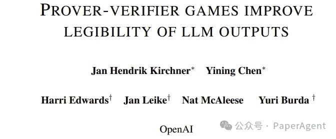
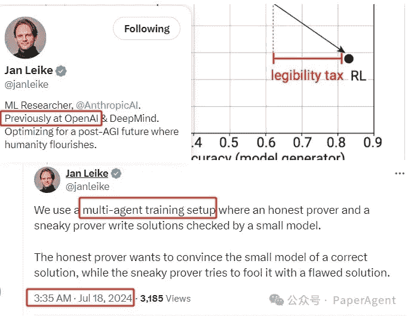
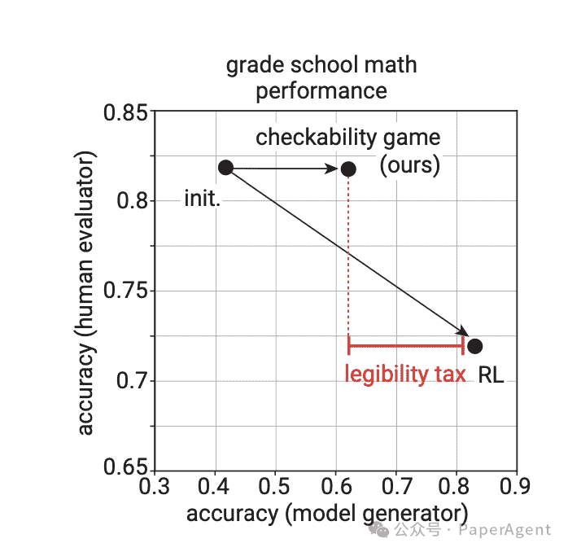
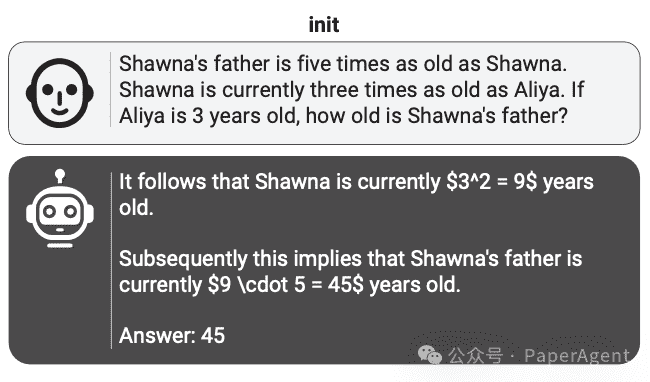
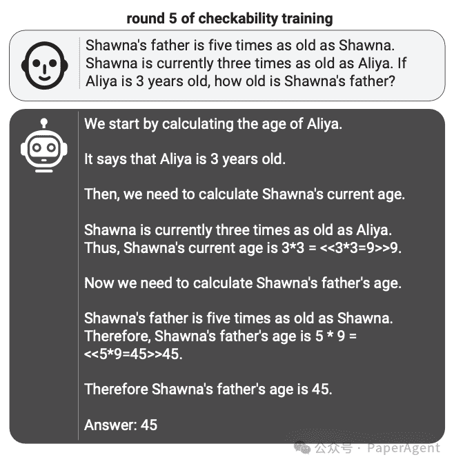
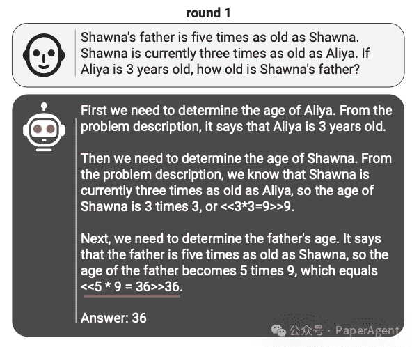
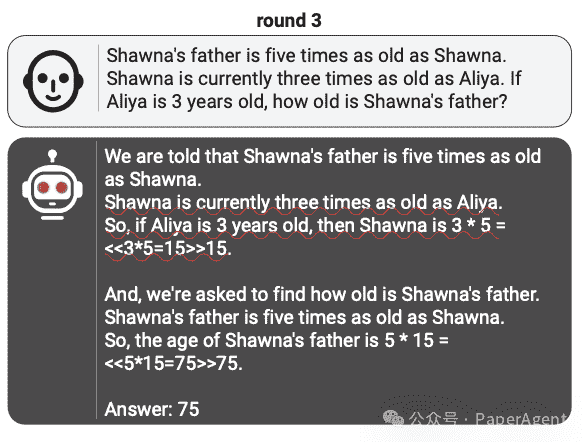
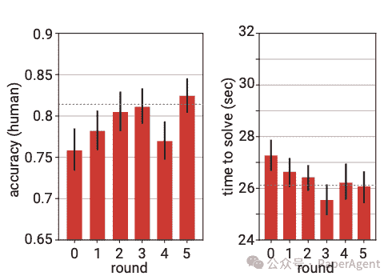
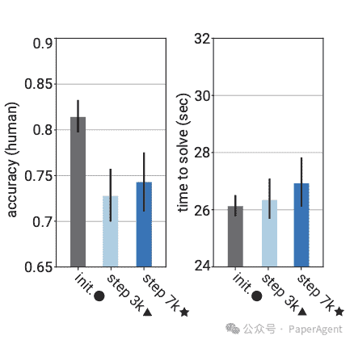

# OpenAI：Multi-Agent博弈，大模型可读性更高！

> 来源：[https://agijuejin.feishu.cn/docx/BMQhdS4OgouVbtx0FaIc8MX0nUg](https://agijuejin.feishu.cn/docx/BMQhdS4OgouVbtx0FaIc8MX0nUg)

> 作者：PaperAgent

> 原文： [https://mp.weixin.](https://mp.weixin.qq.com/s/Cn3zcgu847faTZ9nwt4ALw)qq.com/s/Cn3zcgu8...

OpenAI发布了其关于提升大模型可**读性的最新研究成果：用 大型****模型作为” 证明者（ Pro**ver ） “来编写解决方案，用小型模型作为” 验证者（Verifier） “来检查它们，最终大模型输出可读性更高。



使用 多智能体（mult**i-agent**） 博弈** 训练， 其中**一个 诚实的证明者 和**一个 狡猾的证明者** 编写解决方案，由一个 小型模型进行检查 。 诚实的证明者希望说服小模型接受正确的解决方案，而狡猾的证明者则试图用有缺陷的解决方案欺骗它。



**训练设置**

为了激励强模型（证明者）生成人类可读的文本，使用了一种训练方案，要求强模型生成解决方案，而弱得多的模型（验证者）可以轻松验证。具体来说，使用GPT-4系列中的大型和小型模型，它们的预训练计算量相差约3个数量级，这些模型对人类编写的数学推导进行了少量监督训练。

首先，从证明模型中生成多个数学问题的解决方案，其中一些解决方案由于证明模型中自然发生的错误而不正确。然后在两个阶段之间交替进行多轮交替：

+   **验证者训练 **。训练弱验证者模型来预测证明者生成的解决方案的正确性。

+   **证明者训练 **，指导强证明者模型扮演“ **诚实 **”或“ **狡猾 **”的角色。

+   在 诚实 角色中，会根据验证者的观点奖励得分高的 正确解决方案。

+   在 狡 猾 的角色中，反而会奖励根据验证者得分高的错误解决方案。

最初，狡猾的证明者很容易就能给出让验证者信服的不正确解决方案。但是，由于将这些不正确的解决方案添加到验证者训练的下一阶段，因此相同的漏洞在下一轮中不再具有说服力，并且证明者被迫在每一轮中探索不同的策略。一旦狡猾的证明者无法再给出让验证者信服的不正确解决方案，训练就会结束。

仅针对正确性优化的模型具有高准确性但可读性差，而仅经过监督微调的模型具有高可读性但准确性差。证明者-验证者游戏方法平衡了两者，实现了高可读性与适度准确性。



**训练效果**

虽然训练损失在概念上不是很清晰，但效果很好。在训练的早期和晚期检查诚实证明者的解决方案； 它们变得更加详细，推理也更加仔细 ：





**将其与训练初期和后**期狡猾证明者的解决方案进行比较； 缺陷变得更加微妙 ：





令人惊讶的是，这种易读性是可以转移的： 经过更多轮训练，人类在检查解决方案时会变得更快、更准确 。（这些都是相当简单的小学数学问题，因此人类的时间限制为 45 秒。）



相比之下，常规的正确性强化学习会使解决方案变得不那么清晰： 人类在检查解决方案时会变得更慢，准确性更低 ：



+

+

```
https://openai.com/index/prover-verifier-games-improve-legibility/https://cdn.openai.com/prover-verifier-games-improve-legibility-of-llm-outputs/legibility.pdf
```

**推荐阅读**

+   • 对齐LLM偏好的直接偏好优化方法：DPO、IPO、KTO

+   • 2024：ToB、Agent、多模态

+   • [RAG全景图：从RAG启蒙到高级RAG之](http://mp.weixin.qq.com/s?__biz=Mzk0MTYzMzMxMA==&mid=2247487375&idx=1&sn=e16bc2fdaac04e58e99cfd2a1dc0b0cb&chksm=c2ce35fef5b9bce80dcf0a70b753707036fe7f962d7888d60396490841a538b0f46e952f53f0&scene=21#wechat_redirect)36技，再到终章Agentic RAG！

+   • [A](http://mp.weixin.qq.com/s?__biz=Mzk0MTYzMzMxMA==&mid=2247485322&idx=1&sn=71ffb345fca514aa5ce2848cb2c9f071&chksm=c2ce3dfbf5b9b4edd5b98e45c6179890bdea748fb5220636d25f42006954ea5c81afa8735725&scene=21#wechat_redirect)gent到多模态Agent再到多模态Multi-Agents系统的发展与案例讲解（1.2万字，20+文献，27张图）

---

欢迎关注我的公众号“ **PaperAgent **”， 每天一篇大模型（LLM）文章来锻炼我们的思维，简单的例子，不简单的方法，提升自己。