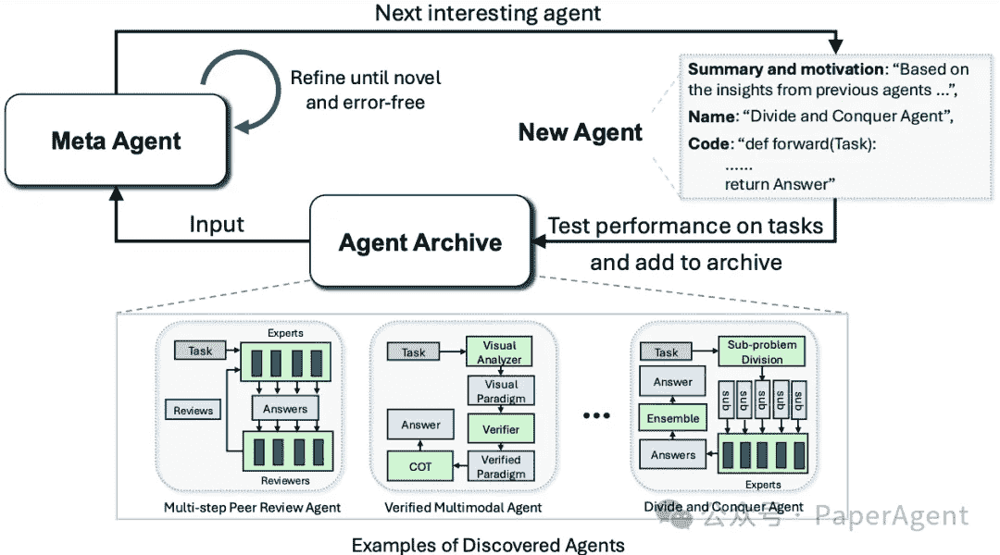
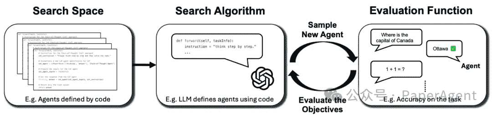
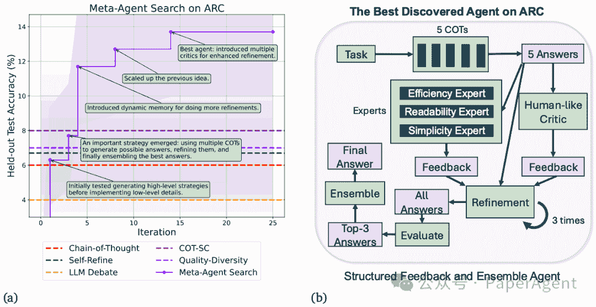
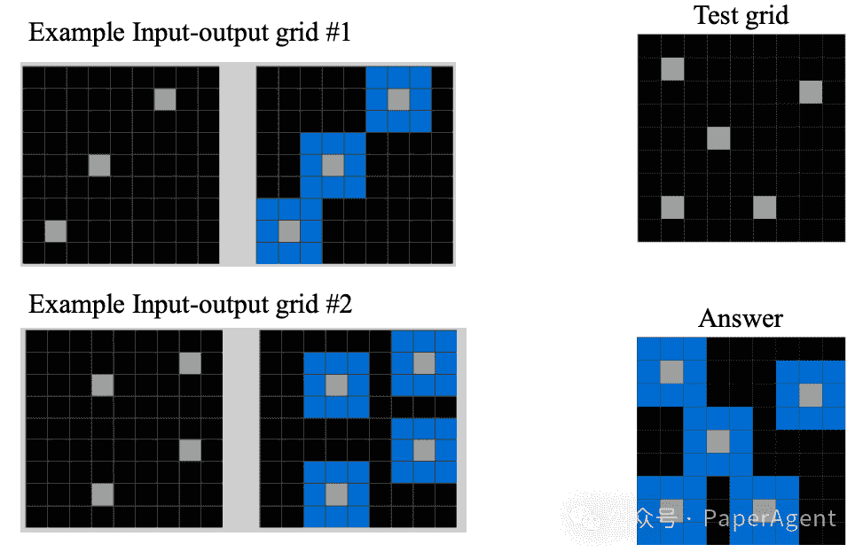
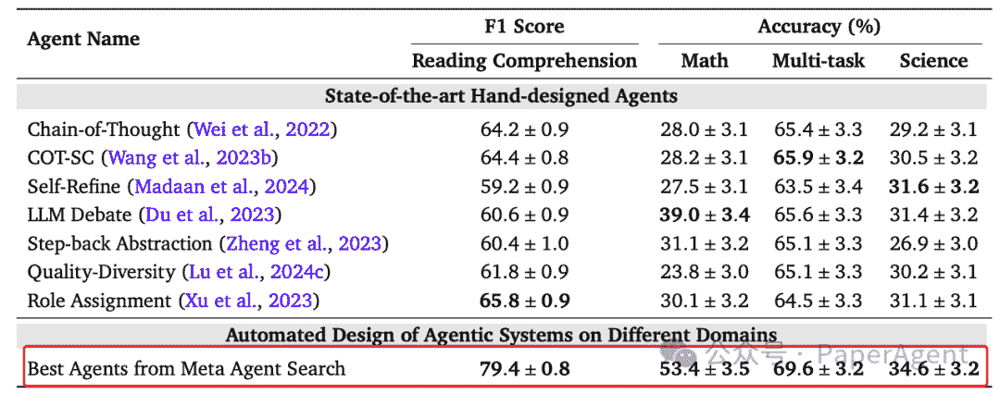
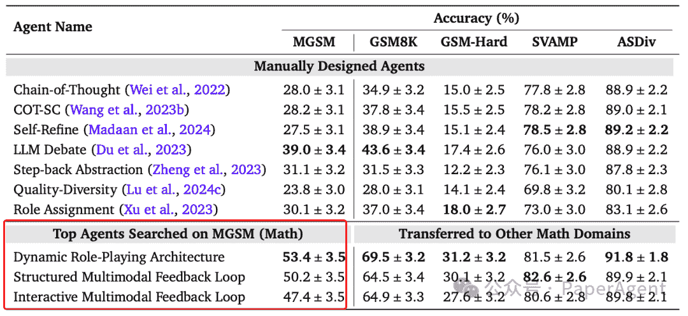

# 极限套娃，Agent自动设计Agentic系统！

> 来源：[https://agijuejin.feishu.cn/docx/F8qkd3Ph1oGPJmxyrbpc1loVnwe](https://agijuejin.feishu.cn/docx/F8qkd3Ph1oGPJmxyrbpc1loVnwe)

> 作者：PaperAgent

> 原文链接： [https://mp.weixin.](https://mp.weixin.qq.com/s/wb9VYJaQ3uViyRUGdnAMtA)qq.com/s/wb9VYJaQ...

**Agent **智能体系统正在作为通用工具被广泛研究和应用，** 解决复杂问题通****常需要由多个组件组**成的 复合智能体系统 ，而 手工设计的解决方案最终会被学习到的 更高效的解决方案 所取代。

为**此，提**出了自动化设计智能体系统（ADAS：Automated Design of Agentic Systems，已 开源 ）的新研究领域，目标是自动创建强大的智能体系统设计。

**通过代码定义整**个智能体系统，并由一个“ 元Agent ”自动发现新的智能体，理论上允许ADAS算法发现任何可能的构建块和智能体系统。

**元Agent搜索 **的概述以及发现的Agent示例 。指导元Agent迭代地编程新代理，测试它们在任务上的性能，将它们添加到已发现Agent的存档中，并使用这个存档来通知后续迭代中的元Agent。展示了三次运行中的三个示例Agent，所有名称都由元Agent生成。



**自动化设计智能体系统（Automated Design o**f Agentic Systems）：

### **ADAS的定义和目标**

+   ADAS旨在自动发明新的构建块，并设计功能强大的智能体系统。智能体系统涉及使用基础模型（Foundation Models，简称FMs）作为模块，通过规划、使用工具和执行多步骤的迭代处理来完成任务。

### **ADAS的三个关键组成部分**

**自动化智能****体系统设计****（ADAS**）的三个关键组成部分。 搜索空间 决定了ADAS中可以表示哪些Agent系统。 搜索算法 指定了ADAS方法如何探索搜索空间。 评估函数 定义了如何根据目标目标（如性能）评估候选Agent。



1.  搜索空间（Search Space） ：定义了ADAS中可以表示哪些智能体系统。例如，一些研究只变异智能体的文本提示，而其他组件（如控制流）保持不变。

1.  搜索算法（Search Algorithm） ：指定了ADAS方法如何探索搜索空间。由于搜索空间通常非常大甚至无界，需要考虑探索与利用的权衡。

1.  评估函数（Evaluation Function） ：根据ADAS算法的应用，可能考虑不同的目标来优化，如性能、成本、延迟或智能体的安全性。评估函数定义了如何在这些目标上评估候选智能体。

通过在编码、科学和数学等多个领域的**广泛实验，展示了该**算法能够逐步发明具有** 新颖设计的智能体 **，这些智能体的性能 大大超过了手工设计 的最先进智能体。

元智能体搜索在ARC挑战上的结果 。(a) 元智能体搜索基于不断增长的先前发现的存档，逐步发现高性能智能体。通过五次评估智能体，在保留的测试集上报告中位数准确度和95%的自举置信区间。(b) 元智能体搜索在ARC挑战上发现的最佳智能体的可视化。



**来自ARC挑战的一个示例任务 **。给定输入-输出网格示例，人工智能系统被要求学习转换规则，然后将这些学到的规则应用于测试网格，以预测最终答案。



**Meta Agent Search与多个领域**内最先进的手工设计智能体之间的性能比较 。Meta Agent Search在每个领域中发现的智能体都优于基线。报告了在保留的测试集上的测试准确度和95%自举置信区间。每个领域的搜索是独立进行的。



将MGSM中的顶级智能体转移到其他数学领域时的性能 。元智能体搜索发现的智能体在不同数学领域中始终优于基线。我们报告了测试准确度和95%自举置信区间。顶级智能体的名称由元智能体搜索生成。



# **附录**

Meta Agent系统Prompt

```
You are a helpful assistant. Make sure to return in a WELL-FORMED JSON object.
```

使用以下提示来指导元智能体基于先前发现的智能体存档来设计新智能体。

Meta Agent核心Prompt

```
You are an expert machine learning researcher testing various agentic systems. Your objective is to design
building blocks such as prompts and control flows within these systems to solve complex tasks. Your aim
is to design an optimal agent performing well on [Brief Description of the Domain].
[Framework Code]
[Output Instructions and Examples]
[Discovered Agent Archive] (initialized with baselines, updated at every iteration)
# Your task
You are deeply familiar with prompting techniques and the agent works from the literature. Your goal is
to maximize the specified performance metrics by proposing interestingly new agents.
Observe the discovered agents carefully and think about what insights, lessons, or stepping stones can be
learned from them.
Be creative when thinking about the next interesting agent to try. You are encouraged to draw inspiration
from related agent papers or academic papers from other research areas.
Use the knowledge from the archive and inspiration from academic literature to propose the next
interesting agentic system design.
THINK OUTSIDE THE BOX.
```

使用以下提示来指导和格式化元智能体的输出。在这里，收集并呈现了元智能体在提示中可能犯的一些常见错误，这在提高生成代码的质量方面是有效的。

**输出指令和示例 **

+

+

+

+

+

+

+

+

+

+

+

+

+

+

+

+

```
# Output Instruction and Example:
The first key should be (“thought”), and it should capture your thought process for designing the
next function. In the “thought” section, first reason about what the next interesting agent to try
should be, then describe your reasoning and the overall concept behind the agent design, and
finally detail the implementation steps. The second key (“name”) corresponds to the name of
your next agent architecture. Finally, the last key (“code”) corresponds to the exact “forward()”
function in Python code that you would like to try. You must write COMPLETE CODE in “code”:
Your code will be part of the entire project, so please implement complete, reliable, reusable code snippets.
Here is an example of the output format for the next agent:
{“thought”: “**Insights:** Your insights on what should be the next interesting agent. **Overall Idea:**
your reasoning and the overall concept behind the agent design. **Implementation:** describe the
implementation step by step.”,
“name”: “Name of your proposed agent”,
“code”: “def forward(self, taskInfo): # Your code here”}
## WRONG Implementation examples:
[Examples of potential mistakes the meta agent may make in implementation]
```

在元智能体的第一次响应之后，进行两轮自我反思，以使生成的智能体新颖且无错误。

**自我反思第一轮的提示**

```
[Generated Agent from Previous Iteration]
Carefully review the proposed new architecture and reflect on the following points:
1. **Interestingness**: Assess whether your proposed architecture is interesting or innovative compared
to existing methods in the archive. If you determine that the proposed architecture is not interesting,
suggest a new architecture that addresses these shortcomings.
- Make sure to check the difference between the proposed architecture and previous attempts.
- Compare the proposal and the architectures in the archive CAREFULLY, including their actual differences
in the implementation.
- Decide whether the current architecture is innovative.
- USE CRITICAL THINKING!
2. **Implementation Mistakes**: Identify any mistakes you may have made in the implementation.
Review the code carefully, debug any issues you find, and provide a corrected version. REMEMBER
checking &quot;## WRONG Implementation examples&quot; in the prompt.
3. **Improvement**: Based on the proposed architecture, suggest improvements in the detailed
implementation that could increase its performance or effectiveness. In this step, focus on refining and
optimizing the existing implementation without altering the overall design framework, except if you
want to propose a different architecture if the current is not interesting.
- Observe carefully about whether the implementation is actually doing what it is supposed to do.
- Check if there is redundant code or unnecessary steps in the implementation. Replace them with
effective implementation.
- Try to avoid the implementation being too similar to the previous agent.
And then, you need to improve or revise the implementation, or implement the new proposed architecture
based on the reflection.
Your response should be organized as follows:
&quot;reflection&quot;: Provide your thoughts on the interestingness of the architecture, identify any mistakes in the
implementation, and suggest improvements.
&quot;thought&quot;: Revise your previous proposal or propose a new architecture if necessary, using the same
format as the example response.
&quot;name&quot;: Provide a name for the revised or new architecture. (Don’t put words like &quot;new&quot; or &quot;improved&quot;
in the name.)
&quot;code&quot;: Provide the corrected code or an improved implementation. Make sure you actually implement
your fix and improvement in this code.
```

**自我反思第二轮的提示 **

```
Using the tips in “## WRONG Implementation examples” section, further revise the code.
Your response should be organized as follows:
Include your updated reflections in the “reflection”. Repeat the previous “thought” and “name”. Update
the corrected version of the code in the “code” section.
```

当在执行生成的代码期间遇到错误时，会进行反思并重新运行代码。如果错误持续存在，这个过程会重复进行，最多五次。以下是用于自我反思任何运行时错误的提示：

运行时错误发生时的自我反思提示

```
Error during evaluation:
[Runtime errors]
Carefully consider where you went wrong in your latest implementation. Using insights from previous
attempts, try to debug the current code to implement the same thought. Repeat your previous thought in
“thought”, and put your thinking for debugging in “debug_thought”.
```

```
https://arxiv.org/pdf/2408.08435
Automated Design of Agentic Systems
https://github.com/ShengranHu/ADAS
```

**推荐阅读**

+   对齐LLM偏好的直接偏好优化方法：DPO、IPO、KTO

+   一篇搭建AI大模型应用平台架构的全面指南

+   [RAG全景图：从RAG启蒙到高级RAG之](http://mp.weixin.qq.com/s?__biz=Mzk0MTYzMzMxMA==&mid=2247487375&idx=1&sn=e16bc2fdaac04e58e99cfd2a1dc0b0cb&chksm=c2ce35fef5b9bce80dcf0a70b753707036fe7f962d7888d60396490841a538b0f46e952f53f0&scene=21#wechat_redirect)36技，再到终章Agentic RAG！

+   [A](http://mp.weixin.qq.com/s?__biz=Mzk0MTYzMzMxMA==&mid=2247485322&idx=1&sn=71ffb345fca514aa5ce2848cb2c9f071&chksm=c2ce3dfbf5b9b4edd5b98e45c6179890bdea748fb5220636d25f42006954ea5c81afa8735725&scene=21#wechat_redirect)gent到多模态Agent再到多模态Multi-Agents系统的发展与案例讲解（1.2万字，20+文献，27张图）

---

欢迎关注我的公众号“ **PaperAgent **”， 每天一篇大模型（LLM）文章来锻炼我们的思维，简单的例子，不简单的方法，提升自己。