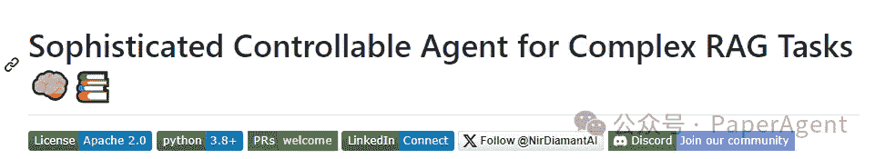
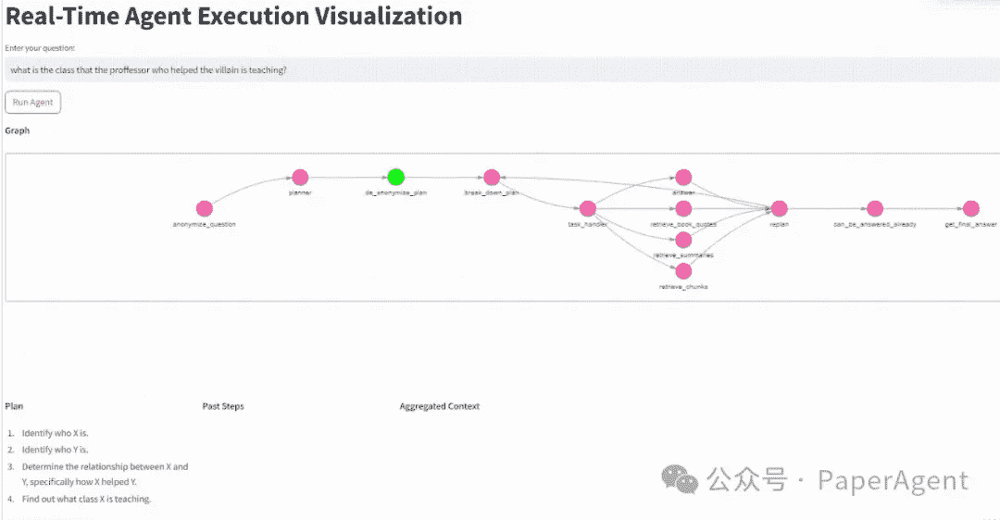
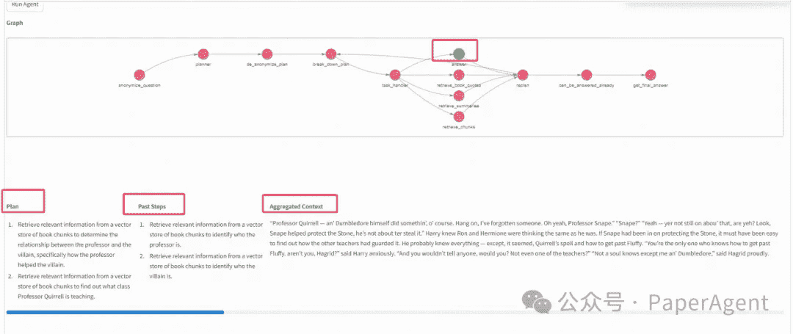
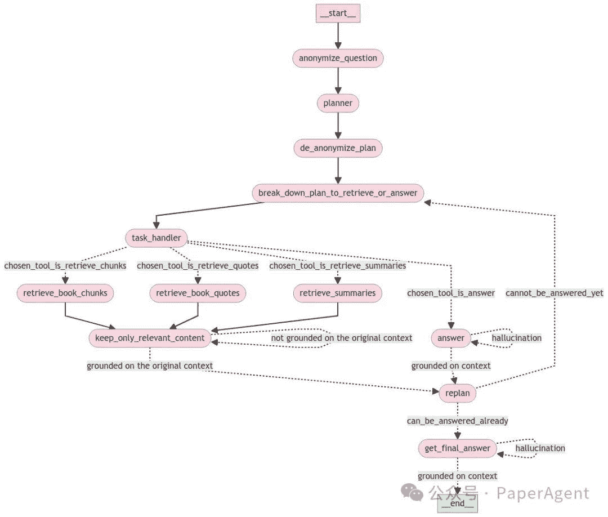

# 用于复杂RAG任务的先进可控Agent

> 来源：[https://agijuejin.feishu.cn/docx/OnqudrOF3oma13xqEubccvoyn8b](https://agijuejin.feishu.cn/docx/OnqudrOF3oma13xqEubccvoyn8b)

> 作者：PaperAgent

> 原文： [https://mp.weixin.](https://mp.weixin.qq.com/s/SDTE5LZLegXyIi3DxSRuvg)qq.com/s/SDTE5LZL...

一种先进的检索增强型生成（ **RAG ****）开源解决**方案，旨在解决简单的基于语义相似性的检索无法解决的 复杂问题 。



**展示了一个复**杂的确**定性图**，作为高度可控的自主 Agent 的“ 大脑 ”，能够回答来自私域数据的复杂问题。





**关键特性**

+   **复杂的确定性图 **：作为Agent的“大脑”，使复杂推理成为可能。

+   **可控自主Agent **：能够回答自定义数据集中的复杂问题。

+   **幻觉预防 **：确保答案仅基于提供的数据，避免AI幻觉。

+   **多步骤推理 **：将复杂查询分解为可管理的子任务。

+   **适应性规划 **：基于新信息不断更新其计划。

+   **性能评估 **：使用Ragas指标进行全面质量评估。

**工作流程**



+   **PDF加载和处理 **：加载PDF文档并将其拆分为章节。

+   **文本预处理 **：清洗和预处理文本，以获得更好的摘要和编码。

+   **摘要 **：使用大型语言模型为每个章节生成广泛的摘要。

+   **书籍引用数据库创建 **：为需要访问书籍引用的特定问题创建数据库。

+   **向量存储编码 **：将书籍内容和章节摘要编码为向量存储，以便高效检索。

+   **问题处理 **：

+   通过将命名实体替换为变量来匿名化问题。

+   为匿名化的问题生成高层次的计划。

+   去匿名化计划并将其分解为可检索或可回答的任务。

+   **任务执行 **：

+   对于每个任务，根据上下文决定是检索信息还是回答问题。

+   如果是检索，从向量存储中获取相关信息并提炼它。

+   如果是回答，使用思维链推理生成响应。

+   **验证和重新规划 **：

+   验证生成的内容是否基于原始上下文。

+   根据新信息重新规划剩余步骤。

+   **最终答案生成： **使用累积的上下文和思维链推理生成最终答案。

**使用案例：哈利·波特书籍分析**

该算法使用第一本哈利·波特书籍进行了测试，允许监控模型对检索信息与预训练知识依赖度的对比。这种选择使我们能够验证模型是在使用其预训练的知识，还是严格依赖从向量存储中检索到的信息。

示例问题 问：主人公是如何打败反派的助手的？

为了解决这个问题，需要执行以下步骤：

1.  确定情节中的主角。

1.  确定反派角色。

1.  确定反派的助手。

1.  搜索主角与反派之间的对抗或互动。

1.  推断导致主角打败助手的原因。Agent能够分解并解决这样复杂的查询，展示了其复杂的推理能力。

```
https://github.com/NirDiamant/Controllable-RAG-Agent
```

**推荐阅读**

+   对齐LLM偏好的直接偏好优化方法：DPO、IPO、KTO

+   2024：ToB、Agent、多模态

+   [RAG全景图：从RAG启蒙到高级RAG之](http://mp.weixin.qq.com/s?__biz=Mzk0MTYzMzMxMA==&mid=2247487375&idx=1&sn=e16bc2fdaac04e58e99cfd2a1dc0b0cb&chksm=c2ce35fef5b9bce80dcf0a70b753707036fe7f962d7888d60396490841a538b0f46e952f53f0&scene=21#wechat_redirect)36技，再到终章Agentic RAG！

+   [A](http://mp.weixin.qq.com/s?__biz=Mzk0MTYzMzMxMA==&mid=2247485322&idx=1&sn=71ffb345fca514aa5ce2848cb2c9f071&chksm=c2ce3dfbf5b9b4edd5b98e45c6179890bdea748fb5220636d25f42006954ea5c81afa8735725&scene=21#wechat_redirect)gent到多模态Agent再到多模态Multi-Agents系统的发展与案例讲解（1.2万字，20+文献，27张图）

---

欢迎关注我的👸号“ **PaperAgent **”， 每天一篇大模型（LLM）文章来锻炼我们的思维，简单的例子，不简单的方法，提升自己。