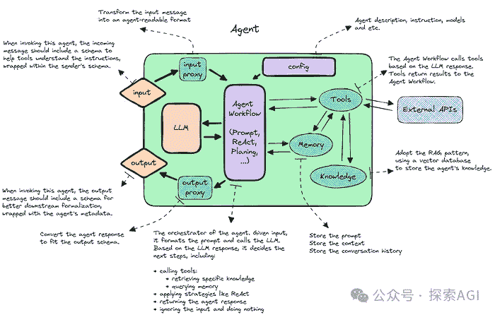

# Agent并不神秘！从0构建一个Agent应用

> 来源：[https://agijuejin.feishu.cn/docx/CEh1dNCtXodmgrxwZ8RcWcjTnFb](https://agijuejin.feishu.cn/docx/CEh1dNCtXodmgrxwZ8RcWcjTnFb)

> 作者：猕猴桃 | 探索AGI、

> 原文：[https://mp.weixin.](https://mp.weixin.qq.com/s/yM4dOLD9bi-WhSeBMPmm9w)qq.com/s/yM4dOLD9...

嘿，大家好！这里是一个专注于AI智能体的频道！

今天接着来聊—基于大模型（LLM）的智能体（Agent）。简单来说，智能体就是AI界的瑞士军刀，能干各种活儿。它有输入输出接口，还有大脑（LLM），能做决策。还有工作流程来指挥数据流动，配置文件来描述自己。更高级的智能体还有输入输出子智能体、工具箱、记忆和知识库，这些都是让智能体更聪明的法宝。



简单细数一些这些小模块。

+   输入和输出Agent：这些组件处理与主要系统之间的输入和输出模式的转换。它们确保agent接收和发送的数据采用正确的格式，并添加必要的元数据。

+   工具：一些可以与外部 API 交互、执行 SQL 查询、从数据库检索知识等的东西。

+   记忆：存储对话的提示词、上下文和历史记录。它允许智能体在交互过程中保持连续性和连贯性。

+   知识：一个向量数据库，用于存储从交互和外部源中提取的信息。

市面上有几个智能体框架，比如LangChain、AutoGen、CrewAI和PhiData。每个都有自己的特色：

+   LangChain：擅长语言理解和生成，适合对话AI和内容生成。

+   AutoGen：强调自动化和易用性，快速搭建智能体，适合原型开发。

+   CrewAI：为多Agent协同工作设计，注重协作和通信。

+   PhiData：有高级记忆和知识管理，适合需要深度上下文理解和长期学习的应用。

本文最后提供一个示例如何用PhiData做个新闻智能体。

1.  安装

```
pip install phidata openai duckduckgo-search
```

1.  定义智能体

```
from phi.llm.base import LLM

class PiNewsLetterConfig:
    def __init__(
            self,
            name: str,
            description: str, 
            instructions: list[str], 
            llm: LLM) -&gt; None:
        self.name = name
        self.description = description
        self.instructions = instructions
        self.llm = llm
        
from phi.assistant import Assistant

class PiNewsLetterAgent:
    def __init__(
            self,
            config: PiNewsLetterConfig,
            tools: list
        ):
        self.config = config
        self.tools = tools

    @property
    def agent(self):
        return Assistant(
            llm = self.config.llm,
            tools = self.tools,
            description = self.config.description,
            instructions = self.config.instructions
        )
```

1.  编写可执行的代码

```
from phi.assistant import Assistant
from phi.llm.openai import OpenAIChat
from phi.llm.base import LLM
from phi.tools.duckduckgo import DuckDuckGo

class PiNewsLetterConfig:
    def __init__(
            self,
            name: str,
            description: str, 
            instructions: list[str], 
            llm: LLM) -&gt; None:
        self.name = name
        self.description = description
        self.instructions = instructions
        self.llm = llm

class PiNewsLetterAgent:
    def __init__(
            self,
            config: PiNewsLetterConfig,
            tools: list
        ):
        self.config = config
        self.tools = tools

    @property
    def agent(self):
        return Assistant(
            llm = self.config.llm,
            tools = self.tools,
            description = self.config.description,
            instructions = self.config.instructions
        )

config = PiNewsLetterConfig(
    name = &quot;pi weekly newsletter&quot;,
    description = &quot;&quot;&quot;你的任务是提供与树莓派相关的最新且相关的每周新闻简报。这包括任何新硬件的发布、软件更新、社区项目、教育资源，以及在论坛或社交媒体上的重要讨论。该摘要应捕捉对树莓派爱好者和开发者有价值的重要信息和见解。
    &quot;&quot;&quot;,
    instructions = [
        &quot;从过去的一周中找出与树莓派相关的最重要新闻。&quot;
        &quot;总结每条新闻，重点关注关键进展及其影响。&quot;
        &quot;确保总结清晰、简洁，避免使用专业术语。&quot;
        &quot;为每条新闻提供背景信息，以帮助理解其相关性和影响。&quot;
        &quot;突出显示任何资源或链接，让读者可以找到更详细的信息。&quot;
    ],
    llm = OpenAIChat(
        api_key=&quot;&lt;your open ai api key&gt;&quot;
    )
)

agent = PiNewsLetterAgent(config, [DuckDuckGo()])
agent.agent.print_response(&quot;总结树莓派上周的新闻&quot;, markdown=True)
```

1.  运行3的脚本即可得到上周的新闻。

智能体的设计模式，确保了它们的可扩展性、自主性和自包含性。专注于特定任务的设计，可以精确满足业务需求，减少错误，提高效率。对于开发者来说，这种设计简化了调试，改善了版本控制。特别是在多智能体系统中，性能和协调至关重要，小错误可能会在整个通信链中放大。

未来，我们会继续探索智能体和多智能体系统的能力和结构。

好了，这就是我今天想分享的内容。如果你对构建AI智能体感兴趣，别忘了点赞、关注噢~