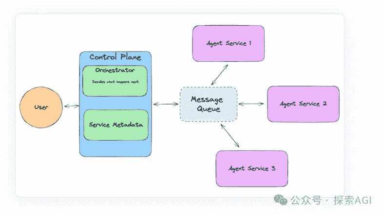
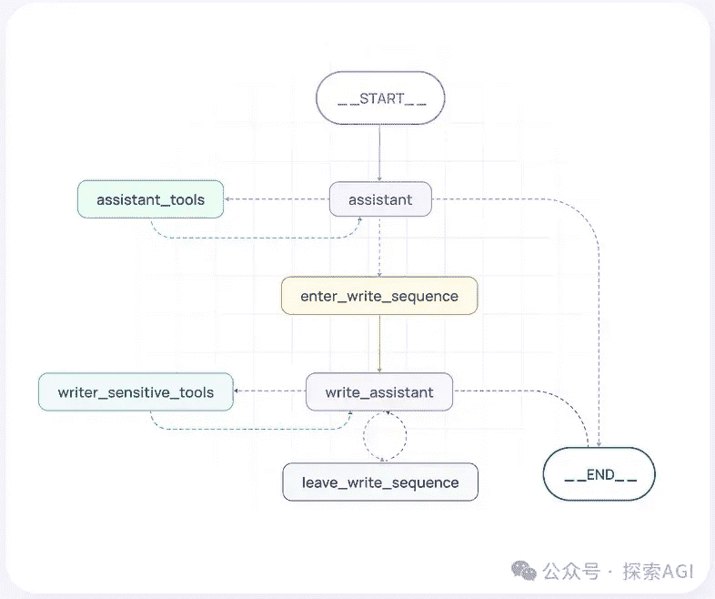

# Agent框架大比拼，llama agents vs langgraph

> 来源：[https://agijuejin.feishu.cn/docx/InAQdynX7oLtTXx6T8wcpX4hnUb](https://agijuejin.feishu.cn/docx/InAQdynX7oLtTXx6T8wcpX4hnUb)

> 作者：猕猴桃 | 探索AGI

> 原文：[https://mp.weixin.](https://mp.weixin.qq.com/s/YcBiAHCQOjTs_vkagbk2VA)qq.com/s/YcBiAHCQ...

嘿，大家好！这里是一个专注于AI智能体的频道！

Llama Agents 和 LangGraph ，这两个框架分别由llamaIndex团队 和 langchain团队开源，都是人工智能领域的热门框架。

首先看Llama Agents的流程图如下：

在Llama Agents中，用户可以直接与control plane交互，控制平面由一个协调器和一系列服务元数据组成。协调器负责决定下一步会发生什么，显示出动态决策的能力。服务元数据则负责维护服务的元信息，确保信息的适当管理和检索。

Llama Agents还有一个消息队列，作为控制平面和代理服务之间的通信渠道。这里可以调用多个代理服务，显示出它的模块化和可扩展性。

接下来是LangGraph的流程图如下：

这个框架的流程非常清晰，就像一条直线，从开始到结束，每个步骤都井然有序。它有一个起点，一个助手节点，然后是一系列专为助手设计的工具，比如写作敏感工具，这些都帮助助手更好地处理写作任务。写作助手是这个框架的核心，负责处理写作过程中的各种需求。最后，流程会在一个结束节点结束。

LangGraph的流程控制非常严格，每个步骤都有明确的入口和出口，非常适合需要严格控制流程的写作任务。

和LangGraph相比，Llama Agents的流程更加动态，协调器会根据当前状态和消息队列的交互做出实时决策。

总结一下，如果你的任务需要一个严格定义和控制的流程，LangGraph 会是一个很好的选择，特别是在写作序列方面。而如果你需要灵活性和可扩展性，Llama Agents 无疑是更理想的选择，它适用于动态和模块化的代理基础操作。

好了，这就是我今天想分享的内容。如果你对构建AI智能体感兴趣，别忘了点赞、关注噢~