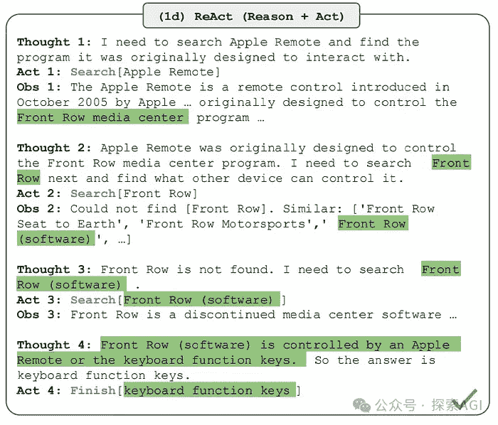
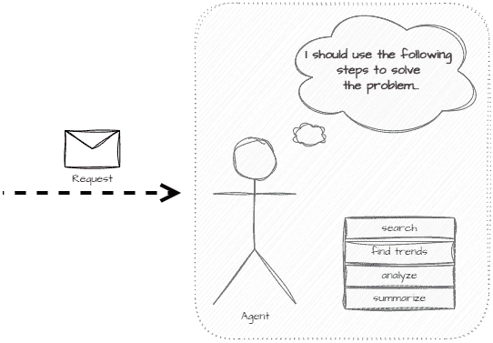
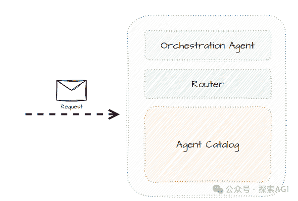

# Agent智能体的3种设计模式，你知道吗

> 来源：[https://agijuejin.feishu.cn/docx/XActdJFMPo6fY0xEqxZc2oyonJh](https://agijuejin.feishu.cn/docx/XActdJFMPo6fY0xEqxZc2oyonJh)

> 作者：猕猴桃 | 探索AGI

> 原文： [https://mp.weixin.](https://mp.weixin.qq.com/s/T3QEiwNAbi4rkMzABNC9Fg)qq.com/s/T3QEiwNA...

嘿，大家好！这里是一个专注于AI智能体的频道！

今天，我们来简单聊聊三种不同的智能体设计模式：FSM Agent（Finite State Machine Agent）、任务规划Agent（Task-Planner Agent）和Multi-Agent（Orchestration Agent）。每种模式都有它的特点和设计复杂性。

FSM Agent就像是给Agent的行为定义了可预测的状态。你可以把ReAct提示当作状态，每个状态都代表不同的属性。这种Agent的好处是可预测性强，任务隔离，容易排查问题，而且新增状态也很简单。但问题也不少，比如容易陷入循环，或者偏离原始请求。

Task-Planner Agent则是定义了一个具体的计划，然后一步步执行。这种Agent的好处是工作是提前计划好的，而不是像状态机那样持续进行。但问题在于，如果计划一开始就出错，可能会导致整个任务链出错，需要回溯和生成新任务。

Multi-Agent则采用了一种类似委托的模式。我们不是让一个Agent做所有事情，而是定义专门解决特定问题的Agent，它们可能有不同的实现。这种Agent的好处是可以动态组合不同的实现，即使它们有相同的底层模型。但这种系统的复杂性并不总是合理的，设计一个更简单的本地编排Agent，将工作委托给有限数量的Agent，会更容易排查和维护。

最后，自主可控的智能体是AI领域一个非常激动人心的发展方向。随着LLMs的不断进步，我们将能够构建更多有用的自主系统。

好了，这就是我今天想分享的内容。如果你对构建AI智能体感兴趣，别忘了点赞、关注噢~