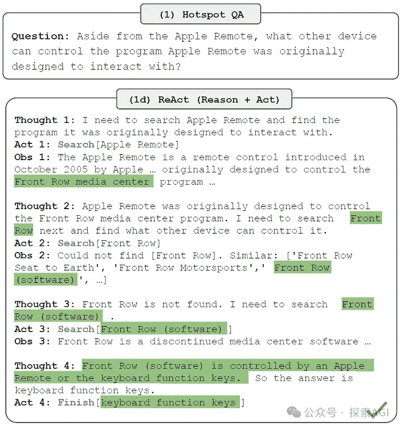
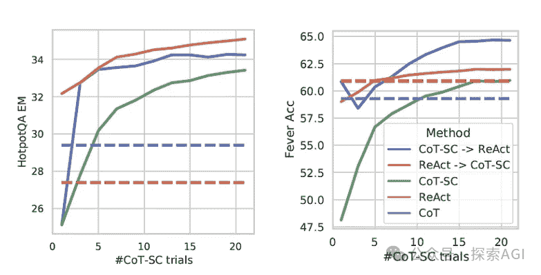
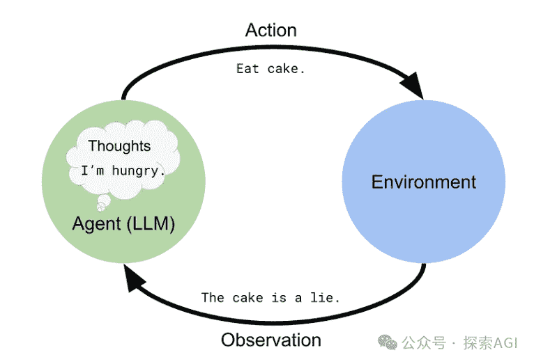

# 大模型Agent，必须得会的ReAct技术！

> 来源：[https://agijuejin.feishu.cn/docx/A6RZdJkDPoiRt4xZVJ3cHnoKnSd](https://agijuejin.feishu.cn/docx/A6RZdJkDPoiRt4xZVJ3cHnoKnSd)

> 作者：猕猴桃 | 探索AGI

> 原文： [https://mp.weixin.](https://mp.weixin.qq.com/s/6Uf8v11-hVb0Aist_VZVCw)qq.com/s/6Uf8v11-...

嘿，大家好！这里是一个专注于AI智能体的频道！

今天，介绍一下ReAct这个技术。想象一下，如果AI能像人一样思考和行动，那会是怎样的体验？ReAct就是这样一种技术，它让AI在模拟环境中表现得更像人类。

**LLMs的痛点 **首先，得说说LLMs。这些模型经过大量文本数据训练，能预测下一个词。但问题来了，它们容易“幻觉”，也就是编造事实，或者在简单计算上出错。

Prompt Engineering 的魔法 你有没有遇到过问AI一个问题，它答不出来，但换个问法，它就懂了？这就是提示词工程的魔力。通过调整输入，让LLMs给出你想要的答案。这就是所谓的“上下文学习”，包括零样本学习和少样本学习。

**ReAct **ReAct是一种提示词工程技术，它不仅模仿人类思考问题的方式，还允许AI通过文本动作与环境互动。就像人类用语言表达来帮助自己策划和记忆，但也能通过行动获取更多信息，实现目标。ReAct正是基于这个理念。

**实验结果：ReAct大显身手 **研究人员用ReAct在知识密集型推理任务和决策任务上测试了一番。结果发现，虽然ReAct在某些方面还有待提高，但它在克服幻觉问题上表现出色，并且在决策任务上超越了其他方法。

**ReAct的意义 **ReAct虽然不完美，但它是迈向通用人工智能（AGI）的重要一步。想象一下，如果机器人能够基于熟悉的特征建模陌生环境，并使用该模型创建提示，那它们就能在各种领域自主行动了。

好了，这就是我今天想分享的内容。如果你对构建AI智能体感兴趣，别忘了点赞、关注噢~