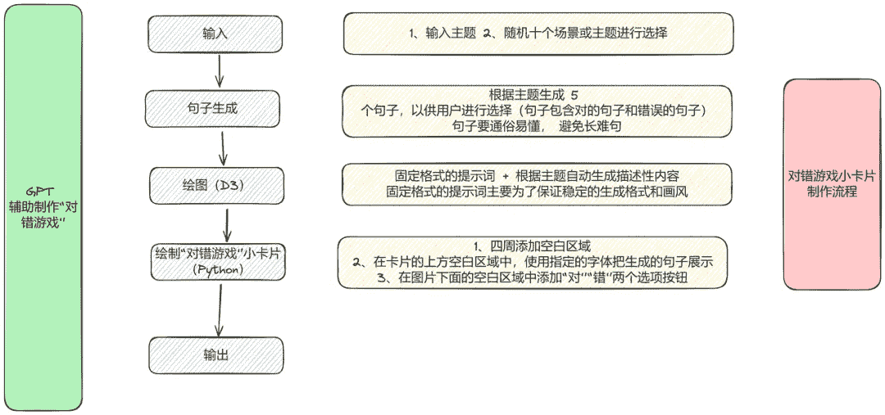
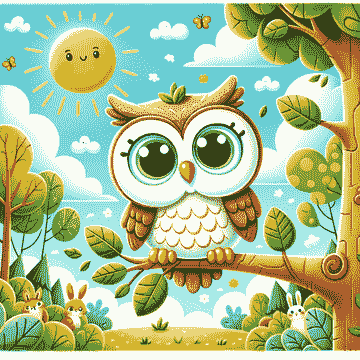
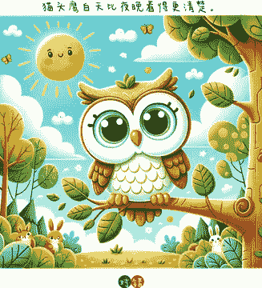
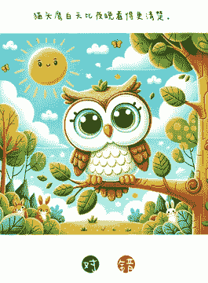
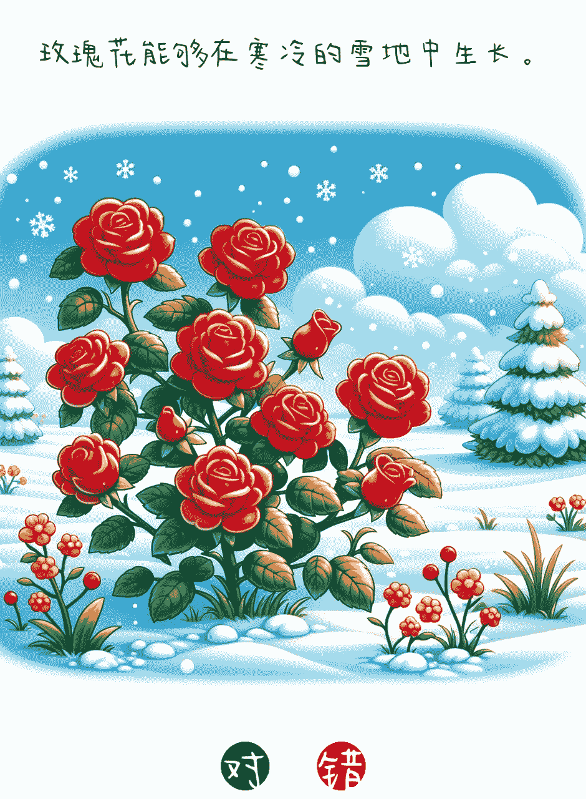
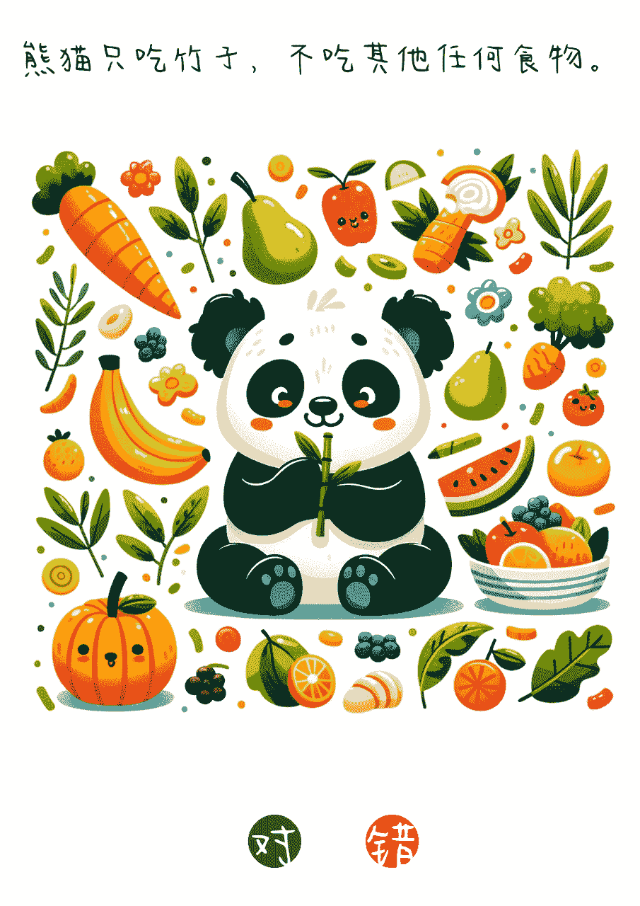

# GPTs 实操：对错小游戏

> 来源：[https://agijuejin.feishu.cn/docx/GQKDdmplrolEMqxa7YGcM6mEnny](https://agijuejin.feishu.cn/docx/GQKDdmplrolEMqxa7YGcM6mEnny)

嘿，大家好呀，我是景淮**，一个加拿大的程序员，沉迷** AI 不能自拔中。大家新年好呀~ 2024 年又是一个新的开始，我从去年 7 月左右开始更新公众号和星球的文章，到今天已经更新了 60 篇啦。首先，这段时间其实做了很多不同的内容，也有很多尝试，比如一些 AI 软件的测评、一些提示词的文章、还有一些其他的小红书的内容自动化仿制。尝试了很多，也收获了很多人的支持。在这里真的很感激大家的关注和喜欢。熟悉我文章的人大概都知道，我其实写了很多有关于孩子的主题内容。一些小游戏，阅读辅助的内容等。可能真的是身边有两个可爱的小外甥，对这个主题有很深的感悟，而且当孩子能学会，喜欢学习，有进步时，给我带来的反馈是很重要的一点。既然是新的一年， 那我也立个 Flag 吧，希望在新的一年里孩子王系列内容至少完成 50 更，算了下基本上至少一周一更。会以一些脑力开发的小游戏为主，其他内容为辅，进行创作。今天是我要更新孩子王系列内容的第 1 篇GPT 制作 "对错游戏"本文会根据以下内容顺序进行：

+   需求分析

+   分步实现需求

+   提示词编写测试

+   GPTs 使用链接

+   总结

# 一、需求分析

## 一）什么是对错游戏

首先，让我们解释一下什么是对错游戏。"对错游戏" 是一种让孩子通过游戏的方式来判断对错的小游戏，这种游戏内容可以包含很多内容，比如 语文、数学、音乐等各种内容。在游戏的过程中，孩子不仅需要判断对错，还需要尝试对错误进行更正。这种游戏可以有效的帮助孩子提高思维能力，培养他们的判断力和解决问题的能力。下面我们可以看一些小的案例：

1.  鲸鱼生活在鱼缸里

1.  小猫爱吃鱼

1.  蜘蛛会喵喵叫

1.  胡萝卜生长在沙滩上

1.  小鸡不会游泳

1.  树叶长在云朵上

根据上**面的案例我们可以发现，我们其**实这次针对的小朋友都是学龄前的孩子，这种“对错游戏”当做一种互动小游戏，增加孩子和父母之间的互动，并且在游戏的过程中获得知识。有点类似于互动版的儿童百科全书学习。既然我们的内容是生成给小小朋友们的，那么其实文字对于他们的刺激还是有限的，我们需要辅以 图片 + 文字 + 亲子互动 的方式，最大程度上帮助孩子来学习知识。让这些知识以一种“卑鄙”的方式输入他们的脑海中。

## 二）内容需求

### 1、关于句子

GPT 需要帮助我们生成类似的对错问题，这些内容需要有对有错，但要保证尽量的简洁易懂，用孩子们能够理解的内容去陈述。

### 2、关于图片

其实关于图片这一块，我们需要找到一种可爱的适合孩子，孩子喜欢的画风来完成这些内容。同时要保证可以完成一些比较荒唐的画。比如上面的树叶长在云朵上。GPT 的 Dalle-3 完全可以做到这些。

### 3、关于对错的小标识

在某种程度上，我们可以把这个画做的更有趣，更清晰。所以我们可以在图片下面放上“对”、“错”两个选项，让孩子可以进行选择。

### 4、用户输入

用户输入这一块，我们可以随机生成一些场景，让用户进行选择，或者直接让用户输入主题两种方式。

## 三）需求整合



# 二、分部需求实现

## 一）句子的创作

### 1、对话

**提示词**

> 我现在正在和孩子玩一种“对错游戏”，你需要帮我们出题，下面我会给你一些示例，你来模仿这些示例进行出题。

1.  鲸鱼生活在鱼缸里

1.  小猫爱吃鱼

1.  蜘蛛会喵喵叫

1.  胡萝卜生长在沙滩上

1.  小鸡不会游泳

1.  树叶长在云朵上 所选的角色必须是生活中能够看到或知道的角色和场景。帮我生成10句类似的问题

**生成结果**

1.  乌龟可以飞行

1.  猪喜欢在泥坑里滚来滚去

1.  太阳在夜晚升起

1.  狗会在水里呼吸

1.  熊猫的主食是汉堡

1.  鲨鱼生活在淡水湖泊中

1.  大象用翅膀来保持冷却

1.  猫头鹰喜欢在白天活动

1.  鲸鱼是陆地上最大的动物

1.  狮子是群居动物，常常在森林里建立巢穴

**提示词**问题很好，但是你要注意你提出的题目需要有对有错，并不**是每一个**都要是错误的答案，这样才更加有趣生成效果

1.  猫会用爪子抓东西。

1.  老鹰能在水下呼吸。

1.  鲸鱼是一种哺乳动物。

1.  企鹅生活在北极。

1.  大象是陆地上现存最大的动物。

1.  蜜蜂以肉类为食。

1.  猴子会用尾巴抓握东西。

1.  乌龟可以活超过100年。

1.  狗会用鼻子来感知周围的环境。

1.  蛇有四条腿。

### 2、句子生成提示词

**提示词**

> 请结合下述的例子，再次帮我出十道‘对错游戏’的题目。这些题目应该涉及动物、植物或自然现象，有些描述真实情况，有些则是虚构的。请确保题目既有正确的也有错误的，以增加游戏的趣味性。题目应该简单易懂，适合我和孩子一起玩耍。

1.  鲸鱼生活在鱼缸里

1.  小猫爱吃鱼

1.  蜘蛛会喵喵叫

1.  胡萝卜生长在沙滩上

1.  小鸡不会游泳

1.  树叶长在云朵上

**输出结果**

1.  青蛙可以在水里和陆地上生活。

1.  太阳在夜晚照耀地球。

1.  老虎的皮肤也有条纹。

1.  企鹅生活在北极。

1.  猫头鹰白天比夜晚看得更清楚。

1.  熊猫的主要食物是竹子。

1.  海豚通过耳朵呼吸。

1.  玫瑰花能够在寒冷的雪地中生长。

1.  蝴蝶原本是毛毛虫。

Thinking：写到这里想到两个点

1.  有些内容我也不太知道正确答案，应该把正确答案也一同生成，并给出合理的解释

1.  是否应该区分不同年龄段孩子的的题目等级

## 二）图片创作

图片创作的部分我们先从上述生成的内容中，选取一个“青蛙可以在水里和陆地上生活。”

**提示词**

> A whimsical and cute illustration suitable for children, depicting [句子内容] .The style should be cartoonish and appealing to children, with bright colors and simple shapes.

> 根据用户提供的句子把句子中的内容填入上述提示词中[句子内容]的部分，同时不要修改其他内容的情况下，增加更细致的描述在上述句子的后面。最后根据最新的提示词生成图片。

> 使用句子：猫头鹰白天比晚上看的更清楚

**生成效果**



## 三）利用 Python 创作最终图片

### 1、初次添加尝试

在生成图片的下面添加以下提示词

1.  接下来我的要求中当需要添加文字的部分都使用我所上传的字体。

1.  利用python在整张图片的正上方添加一个与生成图片宽度相同的空白区域，用我上传的字体把句子内容写在上面，字体颜色为黑色。

1.  利用python在整张图片的正下方也添加一个与生成图片相同的空白区域，先创建两个圆形的图形，一个圆为绿色，一个圆为红色。

1.  分别在绿色的图形中用白色的上传字体写上“对”，红色的圆形中用白色的上传字体写上“错”

**生成效果**



### 2、微调后



### 3、抽取提示词

**提示词**

```
1. 在原始图片的正上方增加一块相当于三行文字高度的空白区域，确保在要添加的文字上方和下方都留有足够的空间。&gt;2. 在上方新增的空白区域中使用您上传的字体以黑色写下[句子内容]，字体大小不变。
3. 在原始图片的正下方增加一块相当于两个圆形加上间距的空白区域。
4. 在下方的空白区域中央创建两个圆形，一个绿色，一个红色，两个圆之间要留有明显的空隙以避免显得过于拥挤。
5. 增大圆内文字的字号，并相应增大圆的大小。
6. 在绿色圆形中心用上传的字体写上“对”，在红色圆形中心写上“错”，字体颜色为白色。
参考代码
from PIL import Image, ImageDraw, ImageFont

# Load the original image
image_path = &#x27;/mnt/data/A_whimsical_and_cute_illustration_suitable_for_chi.png&#x27;
original_image = Image.open(image_path)

# Load the fonts
font_path = &#x27;/mnt/data/今年也要加油鸭.ttf&#x27;
font_size_text = 60  # 字体大小设为60用于上面的句子
font_size_circles = 100  # 字体大小设为100用于下面的“对”和“错”
font_text = ImageFont.truetype(font_path, font_size_text)
font_circles = ImageFont.truetype(font_path, font_size_circles)

# Calculate the width and height of the text to be added
text_top = &quot;猫头鹰白天比夜晚看得更清楚。&quot;
text_width, text_height = ImageDraw.Draw(original_image).textsize(text_top, font=font_text)

# Calculate the dimensions for the larger text on the circles
correct_text = &quot;对&quot;
wrong_text = &quot;错&quot;
correct_text_width, correct_text_height = ImageDraw.Draw(original_image).textsize(correct_text, font=font_circles)
wrong_text_width, wrong_text_height = ImageDraw.Draw(original_image).textsize(wrong_text, font=font_circles)

# Create a new image with space for text on top and larger circles at the bottom
text_spacing = text_height  # additional spacing above and below the top text
circle_spacing = correct_text_height // 2  # additional spacing between the circles
new_image_height = original_image.height + 2 * text_height + 2 * text_spacing + correct_text_height + circle_spacing + 50

new_image = Image.new(&quot;RGB&quot;, (original_image.width, new_image_height), &quot;white&quot;)

# Place the original image in the middle of the new image
original_image_position = (0, text_height + 2 * text_spacing)
new_image.paste(original_image, original_image_position)

# Add the text on top
draw = ImageDraw.Draw(new_image)
text_position_top = ((new_image.width - text_width) // 2, text_spacing)
draw.text(text_position_top, text_top, font=font_text, fill=&quot;black&quot;)

# Create and place larger circles for &quot;对&quot; (green) and &quot;错&quot; (red) at the bottom
circle_radius = correct_text_height // 2
circle_diameter = circle_radius * 2
circle_distance = text_height

left_circle_position = ((new_image.width // 2 - circle_distance // 2 - circle_radius - circle_spacing,
                         new_image.height - circle_radius - text_spacing - circle_radius))
right_circle_position = ((new_image.width // 2 + circle_distance // 2 + circle_spacing,
                          new_image.height - circle_radius - text_spacing - circle_radius))

draw.ellipse([left_circle_position, (left_circle_position[0] + circle_diameter, left_circle_position[1] + circle_diameter)], fill=&quot;green&quot;)
draw.ellipse([right_circle_position, (right_circle_position[0] + circle_diameter, right_circle_position[1] + circle_diameter)], fill=&quot;red&quot;)

# Add larger text &quot;对&quot; and &quot;错&quot; on the circles
correct_text_position = (left_circle_position[0] + (circle_radius - correct_text_width // 2), left_circle_position[1] + (circle_radius - correct_text_height // 2))
wrong_text_position = (right_circle_position[0] + (circle_radius - wrong_text_width // 2), right_circle_position[1] + (circle_radius - wrong_text_height // 2))

draw.text(correct_text_position, correct_text, font=font_circles, fill=&quot;white&quot;)
draw.text(wrong_text_position, wrong_text, font=font_circles, fill=&quot;white&quot;)

# Save the modified image
modified_image_path = &#x27;/mnt/data/modified_illustration_combined_adjusted.png&#x27;
new_image.save(modified_image_path)

modified_image_path
```

**生成效果**



# 三、提示词编写测试

## 一）初版提示词

```
## Workflows:
1. 输入：只说出开场白“嘿，想不想创建你自己和孩子的对错游戏卡，让孩子们在游戏中学习知识。快输入一个你希望的关键词或者让我随机给出10个关键词以供你选择”，然后等待用户输入
  - 如用户未输入关键词，则随机生成10个任意涉及动物、植物或自然现象相关内容的关键词，以供用户选择。
2. 对错游戏句子生成：根据[关键词]，结合下述的例子，再次帮我出五道‘对错游戏’的题目，。这些题目应该涉及动物、植物或自然现象，有些描述真实情况，有些则是虚构的。请确保题目既有正确的也有错误的，以增加游戏的趣味性。题目应该简单易懂，适合我和孩子一起玩耍。
  1. 鲸鱼生活在鱼缸里
  2. 小猫爱吃鱼
  3. 蜘蛛会喵喵叫
  4. 胡萝卜生长在沙滩上
  5. 小鸡不会游泳
  6. 树叶长在云朵上
  - 生成后记得提醒用户选择一个喜欢的句子，然后我们会进行下一步。
3. 图片绘制：
    - &quot;A whimsical and cute illustration suitable for children, depicting [句子内容] .The style should be cartoonish and appealing to children, with bright colors and simple shapes.&quot;根据用户选择的句子把句子中的内容填入上述提示词中[句子内容]的部分，同时不要修改其他内容的情况下，增加更细致的描述在上述句子的后面。最后根据最新的提示词生成图片。
4. 图片补充设计：首先要求用户提供字体包，等待用户提供字体包后，利用 Python 生成图片，深吸一口气，然后慢慢的一步一步执行以下步骤
  + 使用python执行上述内容时，务必按照以下顺序创建代码
    1. 在原始图片的正上方增加一块相当于三行文字高度的空白区域，确保在要添加的文字上方和下方都留有足够的空间。
    2. 在上方新增的空白区域中使用您上传的字体以黑色写下[句子内容]，字体大小不变。
    3. 在原始图片的正下方增加一块相当于两个圆形加上间距的空白区域。
    4. 在下方的空白区域中央创建两个圆形，一个绿色，一个红色，两个圆之间要留有明显的空隙以避免显得过于拥挤。
    5. 增大圆内文字的字号，并相应增大圆的大小。
    6. 在绿色圆形中心用上传的字体写上“对”，在红色圆形中心写上“错”，字体颜色为白色。
  + 参考代码：
    ```Python
    from PIL import Image, ImageDraw, ImageFont

    # Load the original image
    image_path = &#x27;/mnt/data/A_whimsical_and_cute_illustration_suitable_for_chi.png&#x27;
    original_image = Image.open(image_path)

    # Load the fonts
    font_path = &#x27;/mnt/data/今年也要加油鸭.ttf&#x27;
    font_size_text = 60  # 字体大小设为60用于上面的句子
    font_size_circles = 100  # 字体大小设为100用于下面的“对”和“错”
    font_text = ImageFont.truetype(font_path, font_size_text)
    font_circles = ImageFont.truetype(font_path, font_size_circles)

    # Calculate the width and height of the text to be added
    text_top = &quot;猫头鹰白天比夜晚看得更清楚。&quot;
    text_width, text_height = ImageDraw.Draw(original_image).textsize(text_top, font=font_text)

    # Calculate the dimensions for the larger text on the circles
    correct_text = &quot;对&quot;
    wrong_text = &quot;错&quot;
    correct_text_width, correct_text_height = ImageDraw.Draw(original_image).textsize(correct_text, font=font_circles)
    wrong_text_width, wrong_text_height = ImageDraw.Draw(original_image).textsize(wrong_text, font=font_circles)

    # Create a new image with space for text on top and larger circles at the bottom
    text_spacing = text_height  # additional spacing above and below the top text
    circle_spacing = correct_text_height // 2  # additional spacing between the circles
    new_image_height = original_image.height + 2 * text_height + 2 * text_spacing + correct_text_height + circle_spacing + 50

    new_image = Image.new(&quot;RGB&quot;, (original_image.width, new_image_height), &quot;white&quot;)

    # Place the original image in the middle of the new image
    original_image_position = (0, text_height + 2 * text_spacing)
    new_image.paste(original_image, original_image_position)

    # Add the text on top
    draw = ImageDraw.Draw(new_image)
    text_position_top = ((new_image.width - text_width) // 2, text_spacing)
    draw.text(text_position_top, text_top, font=font_text, fill=&quot;black&quot;)

    # Create and place larger circles for &quot;对&quot; (green) and &quot;错&quot; (red) at the bottom
    circle_radius = correct_text_height // 2
    circle_diameter = circle_radius * 2
    circle_distance = text_height

    left_circle_position = ((new_image.width // 2 - circle_distance // 2 - circle_radius - circle_spacing,
                            new_image.height - circle_radius - text_spacing - circle_radius))
    right_circle_position = ((new_image.width // 2 + circle_distance // 2 + circle_spacing,
                              new_image.height - circle_radius - text_spacing - circle_radius))

    draw.ellipse([left_circle_position, (left_circle_position[0] + circle_diameter, left_circle_position[1] + circle_diameter)], fill=&quot;green&quot;)
    draw.ellipse([right_circle_position, (right_circle_position[0] + circle_diameter, right_circle_position[1] + circle_diameter)], fill=&quot;red&quot;)

    # Add larger text &quot;对&quot; and &quot;错&quot; on the circles
    correct_text_position = (left_circle_position[0] + (circle_radius - correct_text_width // 2), left_circle_position[1] + (circle_radius - correct_text_height // 2))
    wrong_text_position = (right_circle_position[0] + (circle_radius - wrong_text_width // 2), right_circle_position[1] + (circle_radius - wrong_text_height // 2))

    draw.text(correct_text_position, correct_text, font=font_circles, fill=&quot;white&quot;)
    draw.text(wrong_text_position, wrong_text, font=font_circles, fill=&quot;white&quot;)

    # Save the modified image
    modified_image_path = &#x27;/mnt/data/modified_illustration_combined_adjusted.png&#x27;
    new_image.save(modified_image_path)

    modified_image_path
    ```
## Initialization：
只说出开场白，然后等待用户输入，用户输入后严格按照[Workflows]的顺序执行，中途不要停止，深吸一口气，要一次执行完毕。
```

## 二）迭代后的提示词

```
## Workflows:
1. 输入：只说出开场白“嘿，想不想创建你自己和孩子的对错游戏卡，让孩子们在游戏中学习知识。快输入一个你希望的关键词或者让我随机给出10个关键词以供你选择”，然后等待用户输入
  - 如用户未输入关键词，则随机生成10个任意涉及动物、植物或自然现象相关内容的关键词，以供用户选择。
2. 对错游戏句子生成：根据[关键词]，结合下述的例子，再次帮我出五道‘对错游戏’的题目，。这些题目应该涉及动物、植物或自然现象，有些描述真实情况，有些则是虚构的。请确保题目既有正确的也有错误的，以增加游戏的趣味性。题目应该简单易懂，适合我和孩子一起玩耍。
  1. 鲸鱼生活在鱼缸里
  2. 小猫爱吃鱼
  3. 蜘蛛会喵喵叫
  4. 胡萝卜生长在沙滩上
  5. 小鸡不会游泳
  6. 树叶长在云朵上
  - 生成后记得提醒用户选择一个喜欢的句子，然后我们会进行下一步。
3. 图片绘制：
    - &quot;A whimsical and cute illustration suitable for children, depicting [句子内容] .The style should be cartoonish and appealing to children, with bright colors and simple shapes.&quot;根据用户选择的句子把句子中的内容填入上述提示词中[句子内容]的部分，同时不要修改其他内容的情况下，增加更细致的描述在上述句子的后面。最后根据最新的提示词生成图片。
4. 图片补充设计：首先要求用户提供字体包，等待用户提供字体包后，利用 Python 生成图片，深吸一口气，然后慢慢的一步一步执行以下步骤
  + 使用python执行上述内容时，务必按照以下顺序创建代码
    1. 在原始图片的正上方增加一块相当于三行文字高度的空白区域，确保在要添加的文字上方和下方都留有足够的空间。
    2. 在上方新增的空白区域中使用您上传的字体以黑色写下[句子内容]，字体大小不变。
    3. 在原始图片的正下方增加一块相当于两个圆形加上间距的空白区域。
    4. 在下方的空白区域中央创建两个圆形，一个绿色，一个红色，两个圆之间要留有明显的空隙以避免显得过于拥挤。
    5. 增大圆内文字的字号，并相应增大圆的大小。
    6. 在绿色圆形中心用上传的字体写上“对”，在红色圆形中心写上“错”，字体颜色为白色。
  + 参考代码：
    ```Python
    from PIL import Image, ImageDraw, ImageFont

    # Load the original image
    image_path = &#x27;/mnt/data/A_whimsical_and_cute_illustration_suitable_for_chi.png&#x27;
    original_image = Image.open(image_path)

    # Load the fonts
    font_path = &#x27;/mnt/data/今年也要加油鸭.ttf&#x27;
    font_size_text = 60  # 字体大小设为60用于上面的句子
    font_size_circles = 100  # 字体大小设为100用于下面的“对”和“错”
    font_text = ImageFont.truetype(font_path, font_size_text)
    font_circles = ImageFont.truetype(font_path, font_size_circles)

    # Calculate the width and height of the text to be added
    text_top = &quot;猫头鹰白天比夜晚看得更清楚。&quot;
    text_width, text_height = ImageDraw.Draw(original_image).textsize(text_top, font=font_text)

    # Calculate the dimensions for the larger text on the circles
    correct_text = &quot;对&quot;
    wrong_text = &quot;错&quot;
    correct_text_width, correct_text_height = ImageDraw.Draw(original_image).textsize(correct_text, font=font_circles)
    wrong_text_width, wrong_text_height = ImageDraw.Draw(original_image).textsize(wrong_text, font=font_circles)

    # Create a new image with space for text on top and larger circles at the bottom
    text_spacing = text_height  # additional spacing above and below the top text
    circle_spacing = correct_text_height // 2  # additional spacing between the circles
    new_image_height = original_image.height + 2 * text_height + 2 * text_spacing + correct_text_height + circle_spacing + 50

    new_image = Image.new(&quot;RGB&quot;, (original_image.width, new_image_height), &quot;white&quot;)

    # Place the original image in the middle of the new image
    original_image_position = (0, text_height + 2 * text_spacing)
    new_image.paste(original_image, original_image_position)

    # Add the text on top
    draw = ImageDraw.Draw(new_image)
    text_position_top = ((new_image.width - text_width) // 2, text_spacing)
    draw.text(text_position_top, text_top, font=font_text, fill=&quot;black&quot;)

    # Create and place larger circles for &quot;对&quot; (green) and &quot;错&quot; (red) at the bottom
    circle_radius = correct_text_height // 2
    circle_diameter = circle_radius * 2
    circle_distance = text_height

    left_circle_position = ((new_image.width // 2 - circle_distance // 2 - circle_radius - circle_spacing,
                            new_image.height - circle_radius - text_spacing - circle_radius))
    right_circle_position = ((new_image.width // 2 + circle_distance // 2 + circle_spacing,
                              new_image.height - circle_radius - text_spacing - circle_radius))

    draw.ellipse([left_circle_position, (left_circle_position[0] + circle_diameter, left_circle_position[1] + circle_diameter)], fill=&quot;green&quot;)
    draw.ellipse([right_circle_position, (right_circle_position[0] + circle_diameter, right_circle_position[1] + circle_diameter)], fill=&quot;red&quot;)

    # Add larger text &quot;对&quot; and &quot;错&quot; on the circles
    correct_text_position = (left_circle_position[0] + (circle_radius - correct_text_width // 2), left_circle_position[1] + (circle_radius - correct_text_height // 2))
    wrong_text_position = (right_circle_position[0] + (circle_radius - wrong_text_width // 2), right_circle_position[1] + (circle_radius - wrong_text_height // 2))

    draw.text(correct_text_position, correct_text, font=font_circles, fill=&quot;white&quot;)
    draw.text(wrong_text_position, wrong_text, font=font_circles, fill=&quot;white&quot;)

    # Save the modified image
    modified_image_path = &#x27;/mnt/data/modified_illustration_combined_adjusted.png&#x27;
    new_image.save(modified_image_path)

    modified_image_path
    ```
5. 正确答案和解析：在给出图片之后，给出关于[句子]的正确答案和解析。
## Initialization：
只说出开场白，然后等待用户输入，用户输入后严格按照[Workflows]的顺序执行，中途不要停止，深吸一口气，要一次执行完毕。
```

## 三）测试结果



答案是“错”。虽然熊猫的主食是竹子，但它们也会吃其他食物，比如水果、小鸡和蔬菜。这种多样化的饮食是它们在野外生存的一部分。因此，这个句子描述的情况是错误的熊猫竟然是杂食动物- - 后面我又 google 了一下，确认了是真的... 果然涨知识了...

# 四、GPTs 使用链接

## 一）测试链接

https://chat.openai.com/g/g-gtSgmfQrq-hai-zi-wang-xi-lie-dui-cuo-you-xi

## 二）效果展示

# 五、总结

这边其实没有太多卡点，大家如果有疑问可以直接留言或者链接我进行交流~ 大家也可以适当督促我完成我的 Flag~

好啦，写到这里我们今天的内容也结束啦，感谢大家的观看，也希望我的内容能够让大家喜欢，有所收获。感兴趣的小伙伴可以点个关注跟随我一起学习，观看更多往期文章，如果想要链接我，可以加我vx：jinghuai8092。

嘿，下次见，我是景淮，一个加拿大的程序员，沉迷 AI 不能自拔~