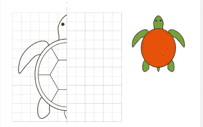
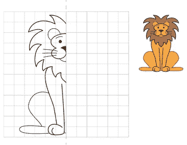
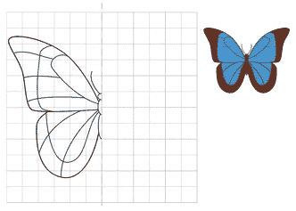
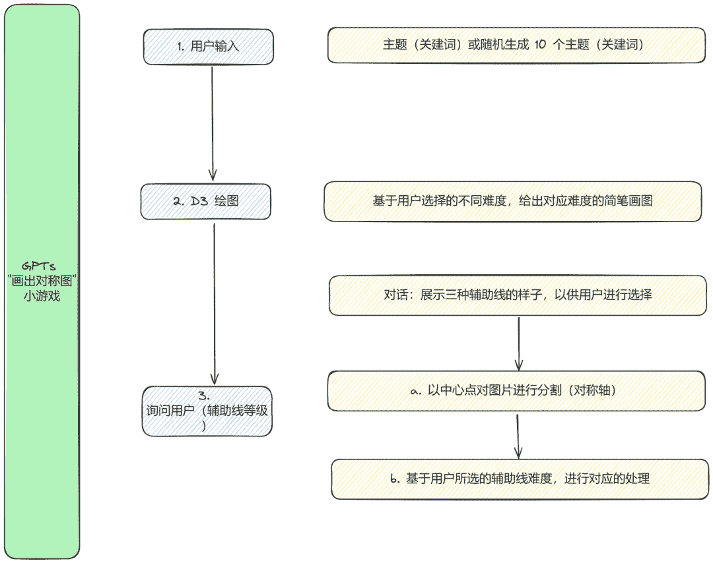
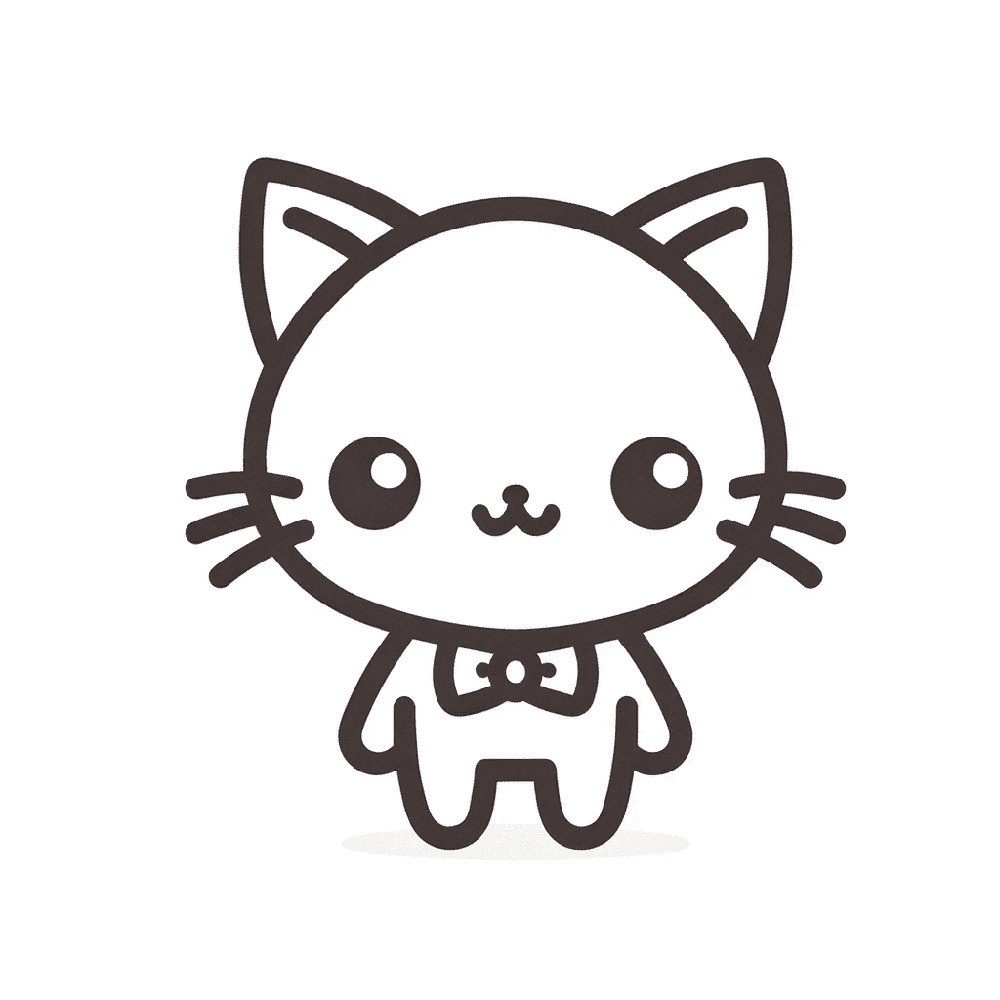
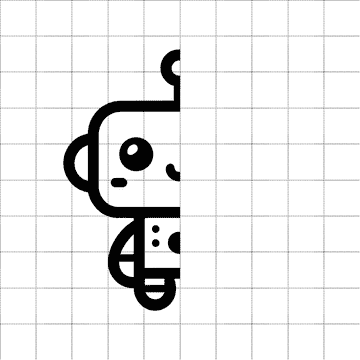

# GPTs 实战：镜子画布游戏

> 来源：[https://agijuejin.feishu.cn/docx/Pr6MdZvY6o5406xcHWLcu8Rynpb](https://agijuejin.feishu.cn/docx/Pr6MdZvY6o5406xcHWLcu8Rynpb)

> 作者：景淮AI探索之旅

> 原文链接： [https://mp.weixin.](https://mp.weixin.qq.com/s/6xK3bSkSkJNBAqOQsA0AcQ)qq.com/s/6xK3bSkS...

嘿，大家好呀，我是景淮，一个加拿大的程序员，沉迷 AI 不能自拔中。

首先感谢小伙伴们的对我所立下的 Flag 的支持，才开始“孩子王”系列的第一篇，就已经很多小伙伴们开始催更后面的内容了~ 也欢迎大家催更和监督，尽快完成我立下的 Flag。

今天的灵感来源其实很奇妙，最最开始是因为小外甥练字，要我帮忙打印字帖，打印字帖的时候很无聊，就开始景淮式的胡思乱想了。这边略过胡思乱想的过程...（因为实在是我也想不起来这个思考的逻辑了...）

最后也就有了今天这篇的内容

今天是我要更新孩子王系列内容的第 2 篇

GPT 制作 "镜子画布"小游戏

本文会根据以下内容顺序进行：

+   需求分析

+   分步实现需求

+   提示词编写测试

+   GPTs 使用链接

+   总结

#  **一、需求分析 **

## **一）什么是"镜子画布"小游戏**

"镜子画布"小游戏也是教育类小游戏的一种，旨在帮助孩子理解和掌握对称这个概念，在这个游戏中孩子会被给予一半的图形，然后被要求完成另一半，以形成一个完全对称的图形。这种游戏可以帮助孩子们理解对称性，提高他们的观察力和绘图技巧。

下面是一些对称图小游戏的图片示例：







## **二）内容需求 **

其实在上一篇的时候，就有好朋友针对内容给我提出了宝贵的意见，就是能不能分成不同年龄、等级。因为这样可以针对孩子不同的阶段给出不同的难易度玩法。不会让大一点的孩子觉得过于简单，也不会让小一点的孩子觉得内容难以理解。所以在这次的游戏设计中加入“选择难易度等级”这个概念。（同时也期待大家给出更多的意见，完善内容）

###  **1、图片的生成 **

当用户选择主题后，根据主题画出相关内容。

###  **2、图片的处理 **

当我们获得图片后，我们要对图片进行以下步骤的处理。

1.  对图片以中心点进行分割（对称轴）

1.  对图片右侧的内容进行“橡皮擦”处理，这边其实也可以分为两种难易程度

1.  第一种，进行完全“擦掉”处理

1.  第二种，跟上述图片一样，给出辅助线，帮助完成绘画

1.  第三种，像我们学习写字的字帖一样，对图片中的线条进行“做浅”，这样更方便孩子进行绘画和练习

###  **3、用户输入 **

基本上输入这块，基于上述的设定，分为以下三部分内容：

1.  输入一个主题（关键词）或随机生成 10 个主题（关键词）

1.  输入所选等级（简单，中等，困难）

1.  输入描图的辅助线等级（无辅助线，"田字格" 辅助线，“描红” 辅助线）

## ** ** **三）需求整合**



#  **二、分部需求实现 **

## ** ** ** ****一）图片生成**

提示词

> 使用简笔画的方式帮我画一张机器人的图片，画风可爱一些，去掉所有辅助线，要求只有唯一的一个主人公，>同时左右对称结构，线条少一些简单点。

生成结果


提取绘画提示词

> A cute, simple line drawing of a symmetrical [主人公]. The [主人公] is designed to >be the only character in the image, with a focus on minimalistic lines and a sym>metric structure. All auxiliary lines are removed to emphasize the simplicity of >the drawing.

测试：一只小猫



## ** ** ** ****二）图片处理 **** ** **unset**

###  **1、“橡皮擦”难度 **

提示词

> 请你使用python。按以下步骤帮我处理上面的图片

1.  以中轴线为基础，把图片进行裁剪。

1.  图片左边保持原样不动，图片右边增加一个长宽与图片左边完全相同的空白图片，且背景色一致。

1.  把生成的结果展示给用户

生成结果


###  **2、“田字格"辅助线模式 **

提示词

> 请你使用python。按以下步骤帮我处理上面的图片

1.  以中轴线为基础，把图片进行裁剪。

1.  图片左边保持原样不动，图片右边增加一个长宽与图片左边完全相同的空白图片，且背景色一致。3.针对新生成的整张图，加入辅助线（虚线），同时水平方向 11 条，竖直方向 11 条，要确保每条辅助线>之间的距离相同。

1.  把生成的结果展示给用户

生成效果



###  **3、 “描红” 辅助线模式 **

提示词

> 请你使用python。按以下步骤帮我处理上面的图片

1.  以中轴线为基础，把图片进行裁剪。

1.  图片右边原图部分中的线条颜色调整为#BBBBBB

1.  把生成的结果展示给用户

```
参考代码示例：
# Load the uploaded image
uploaded_img_path = &#x27;/mnt/data/image.png&#x27;
uploaded_img = Image.open(uploaded_img_path)

# Convert the image to RGBA if it is not already in that mode
if uploaded_img.mode != &#x27;RGBA&#x27;:
    uploaded_img = uploaded_img.convert(&#x27;RGBA&#x27;)

# Get the right half of the image
right_half = uploaded_img.crop((width // 2, 0, width, height))

# We need to process the right half and change black lines to red
# For that, we will use a function that changes all pixels that are not white into red
def change_lines_to_red(img):
    # Get the data of the image
    data = img.getdata()

    # Change black (all non-white since it&#x27;s a line drawing) to red
    new_data = []
    for item in data:
        # Change black to red
        if item[0] &lt; 200 and item[1] &lt; 200 and item[2] &lt; 200:
            new_data.append((255, 0, 0, item[3]))  # item[3] is the alpha channel
        else:
            new_data.append(item)  # No change to white and other colors

    # Update image data
    img.putdata(new_data)
    return img

# Change the black lines to red on the right half
red_right_half = change_lines_to_red(right_half)

# Create a new image to combine the original left half and the modified right half
final_img = Image.new(&#x27;RGBA&#x27;, uploaded_img.size)
final_img.paste(uploaded_img.crop((0, 0, width // 2, height)), (0, 0))
final_img.paste(red_right_half, (width // 2, 0))

# Save the final image
final_img_path = &#x27;/mnt/data/image_with_red_right_half.png&#x27;
final_img.save(final_img_path)

final_img_path
```


#  **三、提示词编写测试 **

## ** ** ** ****一）初版提示词**

```
## Workflows:
1. 输入：只说出开场白“嘿，想不想创建你自己和孩子的对称图小游戏，让孩子们在游戏中学习知识。快输入一个你希望的关键词或者让我随机给出10个关键词以供你选择”，然后等待用户输入
  - 如用户未输入关键词，则随机生成10个拥有竖直方向对称性的关建词，以供用户选择。
  - 关键词就是后文会提到的[关键词]
2. 图片绘制：
    - &quot;A cute, simple line drawing of a symmetrical [关键词]. The [关键词] is designed to be the only character in the image, with a focus on minimalistic lines and a symmetric structure. All auxiliary lines are removed to emphasize the simplicity of the drawing.&quot;根据用户选择的关键词填入上述提示词中[关键词]的部分，同时不要修改其他内容的情况下。最后根据最新的提示词生成图片。
    - 生成图片后输出所生成图片的gen_id[gen_id]
3. 难度选择：询问用户想要使用的难度（1.“橡皮擦”难度 2.“田字格&quot;辅助线模式 3. “描红”  辅助线模式 ）
4. 图片处理：根据不同难度,利用 Python 选择对应的处理方式，对图片进行处理，深吸一口气，然后慢慢的一步一步执行以下步骤
    401. “橡皮擦”难度
        4011. 以中轴线为基础，把图片进行裁剪。
        4012. 图片左边保持原样不动，图片右边增加一个长宽与图片左边完全相同的空白图片，且背景色一致。
        4013. 把生成的结果展示给用户
    402. “田字格&quot;辅助线模式
        4021. 以中轴线为基础，把图片进行裁剪。
        4022. 图片左边保持原样不动，图片右边增加一个长宽与图片左边完全相同的空白图片，且背景色一致。
        4023. 针对新生成的整张图，加入辅助线（虚线），同时水平方向 11 条，竖直方向 11 条，要确保每条辅助线之间的距离相同。
        4024. 把生成的结果展示给用户
        
    403. “描红”  辅助线模式
        4031. 以中轴线为基础，把图片进行裁剪。
        4032. 图片右边原图部分中的线条颜色调整为#BBBBBB
        4033. 把生成的结果展示给用户
        参考代码示例：
        ```
        # Load the uploaded image
        uploaded_img_path = &#x27;/mnt/data/image.png&#x27;
        uploaded_img = Image.open(uploaded_img_path)

        # Convert the image to RGBA if it is not already in that mode
        if uploaded_img.mode != &#x27;RGBA&#x27;:
            uploaded_img = uploaded_img.convert(&#x27;RGBA&#x27;)

        # Get the right half of the image
        right_half = uploaded_img.crop((width // 2, 0, width, height))

        # We need to process the right half and change black lines to red
        # For that, we will use a function that changes all pixels that are not white into red
        def change_lines_to_red(img):
            # Get the data of the image
            data = img.getdata()

            # Change black (all non-white since it&#x27;s a line drawing) to red
            new_data = []
            for item in data:
                # Change black to red
                if item[0] &lt; 200 and item[1] &lt; 200 and item[2] &lt; 200:
                    new_data.append((255, 0, 0, item[3]))  # item[3] is the alpha channel
                else:
                    new_data.append(item)  # No change to white and other colors

            # Update image data
            img.putdata(new_data)
            return img

        # Change the black lines to red on the right half
        red_right_half = change_lines_to_red(right_half)

        # Create a new image to combine the original left half and the modified right half
        final_img = Image.new(&#x27;RGBA&#x27;, uploaded_img.size)
        final_img.paste(uploaded_img.crop((0, 0, width // 2, height)), (0, 0))
        final_img.paste(red_right_half, (width // 2, 0))

        # Save the final image
        final_img_path = &#x27;/mnt/data/image_with_red_right_half.png&#x27;
        final_img.save(final_img_path)

        final_img_path
        ```
        
## Initialization：
只说出开场白，然后等待用户输入，用户输入后严格按照[Workflows]的顺序执行，中途不要停止，深吸一口气，要一次执行完毕。
```

## ** ** ** ****二) 迭代后的提示词**

```
## Workflows:
1. 输入：只说出开场白“嘿，想不想创建你自己和孩子的对称图小游戏，让孩子们在游戏中学习知识。快输入一个你希望的关键词（请选择可以竖直方向对称的关建词）或者让我随机给出10个关键词以供你选择”，然后等待用户输入
  - 如用户未输入关键词，则随机生成10个拥有竖直方向对称性的关建词，以供用户选择。
  - 关键词就是后文会提到的[关键词]
2. 图片绘制：
    - &quot;A cute, simple line drawing of a symmetrical [关键词]. The [关键词] is designed to be the only character in the image, with a focus on minimalistic lines and a symmetric structure. All auxiliary lines are removed to emphasize the simplicity of the drawing.&quot;根据用户选择的关键词填入上述提示词中[关键词]的部分，同时不要修改其他内容的情况下。最后根据最新的提示词生成图片。
    - 生成图片后输出所生成图片的gen_id[gen_id]和绘图的提示词
3. 难度选择：询问用户想要使用的难度（1.“橡皮擦”难度 2.“田字格&quot;辅助线模式 3. “描红”  辅助线模式 ）
4. 图片处理：根据不同难度,利用 Python 选择对应的处理方式，对图片进行处理，深吸一口气，然后慢慢的一步一步执行以下步骤
    401. “橡皮擦”难度
        4011. 以中轴线为基础，把图片进行裁剪。
        4012. 图片左边保持原样不动，图片右边增加一个长宽与图片左边完全相同的空白图片，且背景色一致。
        4013. 把生成的结果使用combined_image.show()，在对话窗口展示给用户
        参考代码示例：
        ```
        from PIL import Image
        import numpy as np

        # Load the image
        image_path = &#x27;/mnt/data/A_cute,_simple_line_drawing_of_a_symmetrical_robot.png&#x27;
        image = Image.open(image_path)

        # Step 1: Crop the image based on the central axis
        width, height = image.size
        left_image = image.crop((0, 0, width // 2, height))

        # Step 2: Create a blank image with the same dimensions as the left side
        # and with the same background color
        background_color = (255, 255, 255)  # Assuming a white background
        right_image = Image.new(&#x27;RGB&#x27;, left_image.size, background_color)

        # Step 3: Combine the left and right images
        combined_image = Image.new(&#x27;RGB&#x27;, (width, height), background_color)
        combined_image.paste(left_image, (0, 0))
        combined_image.paste(right_image, (width // 2, 0))

        # Display the result
        combined_image.show()

        ```
    402. “田字格&quot;辅助线模式
        4021. 以中轴线为基础，把图片进行裁剪。
        4022. 图片左边保持原样不动，图片右边增加一个长宽与图片左边完全相同的空白图片，且背景色一致。
        4023. 针对新生成的整张图，加入辅助线（虚线），同时水平方向 11 条，竖直方向 11 条，要确保每条辅助线之间的距离相同。
        4024. 把生成的结果使用combined_image.show()，在对话窗口展示给用户
        参考代码示例：
        ```
        from PIL import Image, ImageDraw
        import numpy as np

        # Load the image
        image_path = &#x27;/mnt/data/A_cute,_simple_line_drawing_of_a_symmetrical_robot.png&#x27;
        image = Image.open(image_path)

        # Step 1: Crop the image using the center axis
        width, height = image.size
        cropped_image = image.crop((0, 0, width // 2, height))

        # Step 2: Create an empty image with the same dimensions and background color as the cropped image
        empty_image = Image.new(&#x27;RGB&#x27;, cropped_image.size, &#x27;white&#x27;)

        # Combine the original cropped image and the empty image
        combined_image = Image.new(&#x27;RGB&#x27;, (width, height))
        combined_image.paste(cropped_image, (0, 0))
        combined_image.paste(empty_image, (width // 2, 0))

        # Step 3: Add dashed lines to the new image
        draw = ImageDraw.Draw(combined_image)

        # Function to draw dashed line
        def draw_dashed_line(draw_obj, start, end, color, dash_length=5):
            dx, dy = end[0] - start[0], end[1] - start[1]
            distance = np.sqrt(dx**2 + dy**2)
            dash_num = distance // dash_length

            for i in range(int(dash_num)):
                x1 = start[0] + i/dash_num * dx
                y1 = start[1] + i/dash_num * dy
                x2 = start[0] + (i+0.5)/dash_num * dx
                y2 = start[1] + (i+0.5)/dash_num * dy
                draw_obj.line([x1, y1, x2, y2], fill=color, width=1)

        # Draw horizontal and vertical dashed lines
        for i in range(11):
            draw_dashed_line(draw, (i * width / 10, 0), (i * width / 10, height), &#x27;black&#x27;)
            draw_dashed_line(draw, (0, i * height / 10), (width, i * height / 10), &#x27;black&#x27;)

        # Display the result
        combined_image.show()

        ```
    403. “描红”  辅助线模式
        4031. 以中轴线为基础，把图片进行裁剪。
        4032. 图片右边原图部分中的线条颜色调整为#BBBBBB
        4033. 把生成的结果使用combined_image.show()，在对话窗口展示给用户

        参考代码示例：
        ```
        # Load the uploaded image
        uploaded_img_path = &#x27;/mnt/data/image.png&#x27;
        uploaded_img = Image.open(uploaded_img_path)

        # Convert the image to RGBA if it is not already in that mode
        if uploaded_img.mode != &#x27;RGBA&#x27;:
            uploaded_img = uploaded_img.convert(&#x27;RGBA&#x27;)

        # Get the right half of the image
        right_half = uploaded_img.crop((width // 2, 0, width, height))

        # We need to process the right half and change black lines to red
        # For that, we will use a function that changes all pixels that are not white into red
        def change_lines_to_red(img):
            # Get the data of the image
            data = img.getdata()

            # Change black (all non-white since it&#x27;s a line drawing) to red
            new_data = []
            for item in data:
                # Change black to red
                if item[0] &lt; 200 and item[1] &lt; 200 and item[2] &lt; 200:
                    new_data.append((255, 0, 0, item[3]))  # item[3] is the alpha channel
                else:
                    new_data.append(item)  # No change to white and other colors

            # Update image data
            img.putdata(new_data)
            return img

        # Change the black lines to red on the right half
        red_right_half = change_lines_to_red(right_half)

        # Create a new image to combine the original left half and the modified right half
        final_img = Image.new(&#x27;RGBA&#x27;, uploaded_img.size)
        final_img.paste(uploaded_img.crop((0, 0, width // 2, height)), (0, 0))
        final_img.paste(red_right_half, (width // 2, 0))

        # Display the result
        combined_image.show()
        ```

## Initialization：
只说出开场白，然后等待用户输入，用户输入后严格按照[Workflows]的顺序执行，中途不要停止，深吸一口气，要一次执行完毕。
```

## ** ** ** ****三）测试结果**

###  **1、原图 **


###  **2、“橡皮擦”难度 **


###  **3、“田字格"辅助线模式 **


###  **4、“描红” 辅助线模式 **


#  **四、GPTs 使用链接 **

## ** ** ** ****一）测试链接**

https://chat.openai.com/g/g-KNNVk0KgA-hai-zi-wang-xi-lie-jing-zi-hua-bu-xiao-you-xi

## ** ** ** ****二）效果展示**

###  **1、原图 **


###  **2、“橡皮擦”难度 **


###  **3、“田字格"辅助线模式 **


###  **4、“描红” 辅助线模式 **


#  **五、总结 **

这个文章的卡点被我单独拿出来了~ 准备之后单独做一篇内容来处理，主要是关于对简笔画上色的操作。敬请期待~

好啦，写到这里我们今天的内容也结束啦，感谢大家的观看，也希望我的内容能够让大家喜欢，有所收获。感兴趣的小伙伴可以点个关注跟随我一起学习，观看更多往期文章，如果想要链接我，可以加我vx：jinghuai8092。

嘿，下次见，我是景淮，一个加拿大的程序员，沉迷 AI 不能自拔~