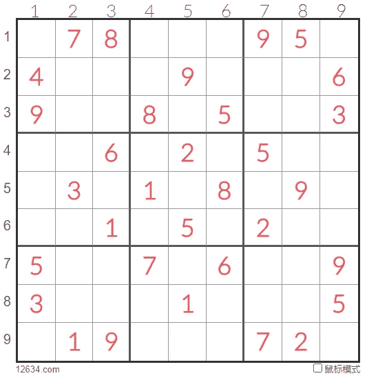
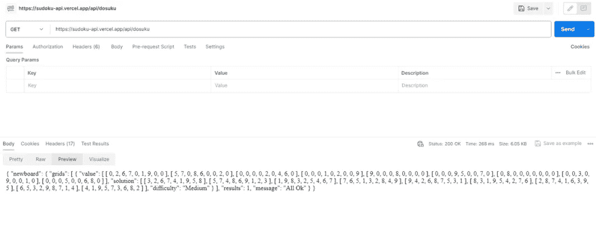
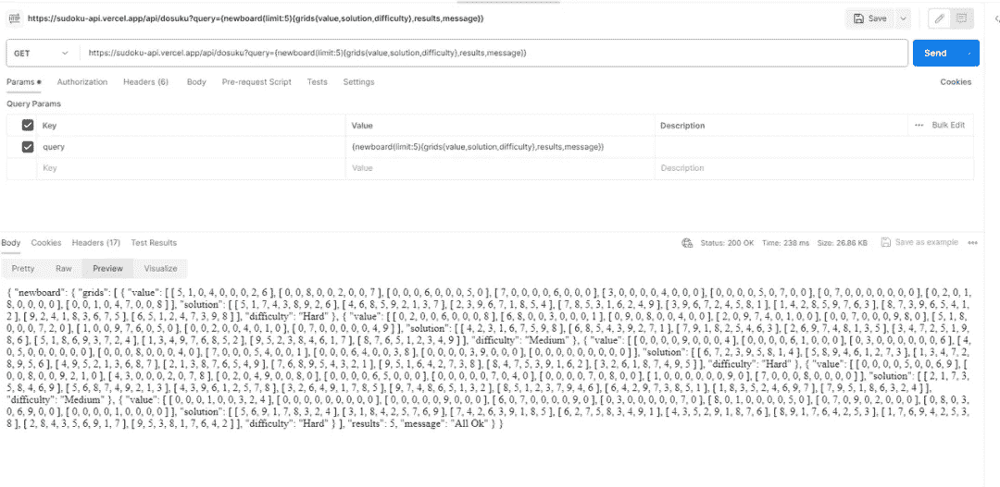
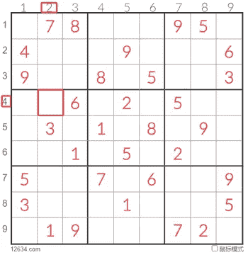
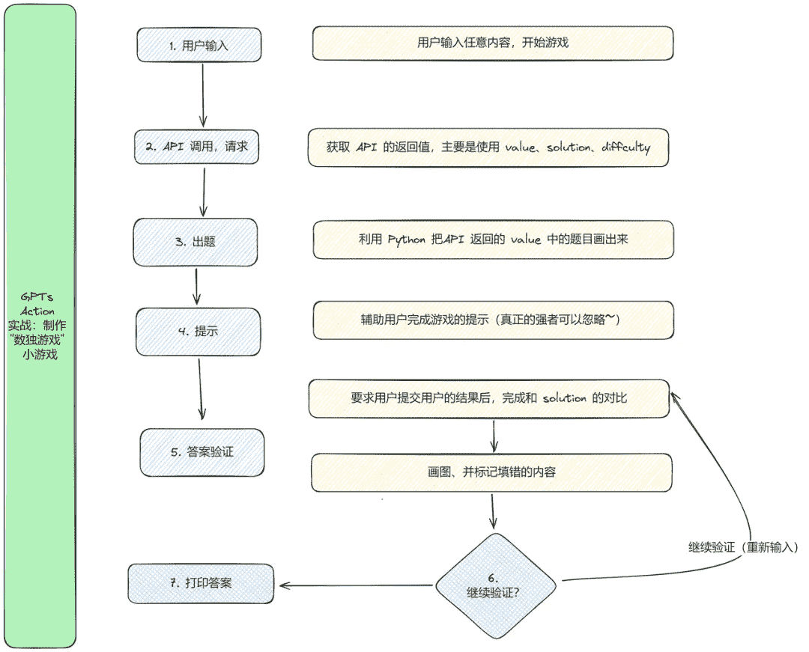
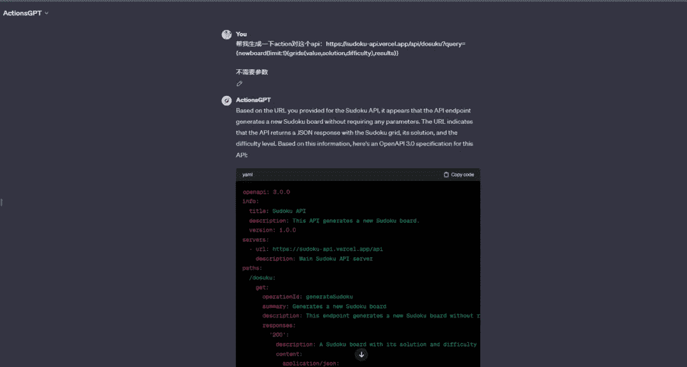
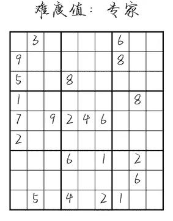
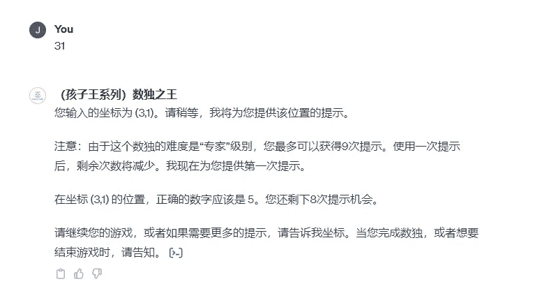
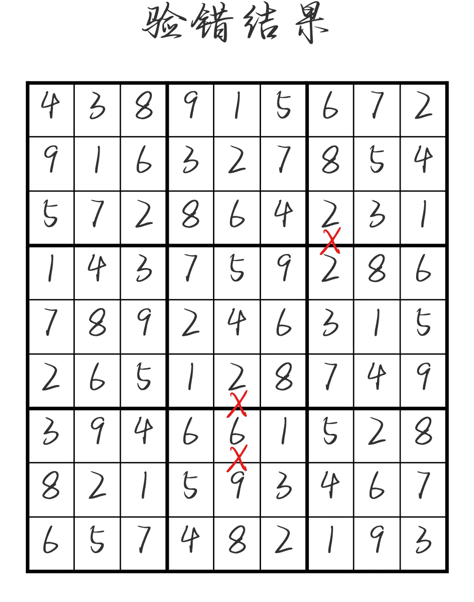
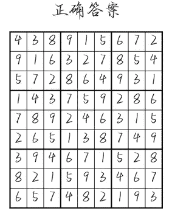

# GPTs Action 实战：制作 "数独游戏" 小游戏

> 来源：[https://agijuejin.feishu.cn/docx/E3pSddGwgoHgWvxcwTXcAIgHnXf](https://agijuejin.feishu.cn/docx/E3pSddGwgoHgWvxcwTXcAIgHnXf)

> 作者：景淮AI探索之旅

> 原文链接：https://mp.weixin.qq.com/s/hKR7fkQGRIpgpqGaSAHMwQ

嘿，大家好呀，我是景淮，一个加拿大的程序员，沉迷 AI 不能自拔中。

今天的灵感来自于，凯翔分享的一个 Action 网站，突然看到了一个数独游戏 API ，所以就想拿来玩玩，如果可以的话做个 GPTs 。然后经过一轮的关注等操作（好讨厌这样的复杂操作...）并没有拿到数独游戏的验证密钥（Key），但又有点不甘心，就在网上搜索了一圈有关数独游戏的 API 。

今天的文章和平时有点不一样，因为是先完成的 GPTs 再写的文章，所以可能和平时的流程有些出入。

今天是我要更新孩子王系列内容的第 4 篇

GPT 制作 "数独游戏" 小游戏

本文会根据以下内容顺序进行：

+   API 测试分析

+   游戏设计

+   Action 的快捷对接

+   提示词编写测试

+   GPTs 使用链接

+   总结

#  **一、API 测试分析 **

##  **一）什么是 "数独" 游戏 **

###   **1、 数独游戏的定义 **

数独是一种逻辑游戏，起源于18世纪的瑞士，主要通过纸笔进行演算。玩家需要根据9×9盘面上的已知数字，推理出所有剩余空格的数字，并满足每一行、每一列、每一个3×3的粗线宫内的数字均含1-9，且不重复。

###   **2、游戏规则 **

数独游戏的基本规则是在9×9的网格中填入数字，使得每一行、每一列以及每一个3×3的宫格中的数字都不重复，包含1到9。游戏开始时，部分数字会被预先填入，玩家需要通过逻辑推理来填写剩余的空格，如图所示



###   **3、能够锻炼孩子什么能力 **

+   数学能力：通过不断的计算、推理和分析来加强

+   逻辑思维能力：需要观察、分析、推理，把数字放在合适的位置

+   专注力：孩子在玩数独时，专注力会持续更长的时间

+   手眼脑协调性：通过游戏过程中的操作来锻炼

+   决策思维：数独需要猜测和验证，在模糊条件下做出决策尝试

+   细心和耐心：关注细节，提升对数字的敏感性

##  **二）API 测试 **

网站链接：https://sudoku-api.vercel.app/

首先，我是用 PostMan 进行的 API 测试。测试了好几个，但是都不太好用，最后选用了这个，使用起来也比较简单。但有一说一这个手册写的是真的挺烂的...（找了半天难度设定，最后发现看了代码发现是随机生成的难度...）





其实这个返回值还是挺清楚的，主要参数有 Value、Solution、 Difficulty、Result、Message。

+   Value: 也就是我们要玩的数独游戏

+   Solution：是我们玩的数独游戏的正确答案

+   Diffculty: 是游戏的难度（但我看了后台代码，这个难度是根据 Value 生成数字的总和进行设定的，其实也就是生成的数字越多，难度越低。但因为是封装好的内容，我不好操作啦，就没有更改）

+   Result: 是 API 的请求返回了几组数独游戏。

+   newboard（limit：5）: 还有个参数在前面 limit 后的数字为需要返回几组数独游戏。

其实这个 API 还是挺清晰的，但也有些小问题，比如我们不能直接给定参数难度来设计游戏、还有API带的参数结构有点复杂等。

#  **二、游戏设计 **

说起这个结构，和我们平时设计 prompt 时有些区别的点是，这种 GPTs 比较依赖于 API 的效果，所以也比较容易受限制。

当然在受限制的同时因为 API 的调用，也保证了一定程度上效果的稳定性。

##  **一）出题 **

首先，既然是玩游戏，那么第一步一定是让通过互通来出题，但又因为我们游戏不能设置难度，所以就默认为输入任意值来开始游戏了，当然为了方便用户来玩，我这边加入了一个 “点我开始游戏” 的按钮。

出题部分比较容易，主要就是通过请求 API 然后把返回值中的 Value 制作成一张图片就可以啦，这个让 GPT 利用Python 就比较容易实现了，比较简单。

##  **二）提示 **

既然是数独游戏，很多时候其实会有特别多的卡点，所以用户在玩的同时，可能也需要一些辅助，也就是我们的提示功能。

这边提示功能的设计，就是让用户直接输入想要查询数字的坐标。



如图中的内容，我们就可以让用户输入（2,4）坐标进行查询。

当 GPTs 拿到用户的输入后，他首先需要整合之前请求时拿到的 solution 的结果，然后再从整合后 9 * 9 的矩阵中拿到图片上（2,4）坐标的结果，把结果展示给用户。

然后，提示这种功能如果要是可以无限次使用，其实就比较无聊了~ 那么我们可以做的就是根据返回的难度，把游戏的提示次数进行限制

+   新手（easy）：3 次

+   高手（medium）：6 次

+   专家（hard）：9 次

##  **三）答案验证 **

为了给用户一个调整修改的体验，所以增加了这个答案验证的步骤。

这个步骤中主要是用户把自己填写的内容以 9 * 9 矩阵的形式输给 GPTs。当 GPTs 获取后需要利用 Python 来和 solution 的矩阵进行对比，如果出错就留下一个红色 "X" 的标记，来提醒用户出错的位置。方便用户对照修改。

这个步骤设置为重复性的，因为很多朋友可能玩数独时候很喜欢，一直自己改到对，那是一共别样的快乐~ 不能剥夺朋友的快乐不是~（如果直接做对，会表示恭喜等~）

##  **四）答案 **

如果用户想要直接把答案打印出来，就可以提出要求，直接绘制一张答案页。

##  **五）为什么要做成图片 **

因为做成图片更容易让用户和玩家理解，甚至因为 GPTs 暂时没有像游戏一样的互动按钮等，所以做成图片，其实也方便用户打印。

Emmm 其实确实像宇龙说的，好像真的玩我的提示词，可能需要配备一台打印机。（在线带货打印机？？？）

##  **六）游戏流程图 **



#  **三、Action 的快捷对接 **

关于 Action 的快捷对接，其实可以直接使用官方的 GPTs ActionsGPT

https://chat.openai.com/g/g-TYEliDU6A-actionsgpt

借助这个 GPTs 可以通过简单描述内容后，生成我们可使用的 Action，如图所示。（实在不懂代码直接粘贴到 Action 中就可以了），当然如果有参数的，也需要进行告知。



#  **四、提示词编写测试 **

##  **一）提示词 **

提示词这边的编写就比较容易啦，也不需要任何结构化的东西，其实 GPTs 参与的就是把 API 返回的内容展示给观众，所以这些内容不太需要 GPT 来参与。所以可以发现我的描述更多集中在流程和图片设计上。

```
1. 当用户输入任意值时，请求 API 开始游戏。
2. 当获取成功时，利用Python根据返回值中的[value]中的参数绘制一个数独游戏
     - 注意整体是一个9*9的格子，参数中每一个括号中的内容应该占据一个3*3的格子，从左至右，从上到下的方法把所有数字填入格子中。
     - 注意格子应该占据整张图片的全部大小，格子距离图片边缘需要留10px的空白区域
     - 每个3*3格子的边框加粗4px。
     - 数字的字体大小设置为45px
     - 绘制数独游戏结束后，在整张图的最上方（居中，字体大小55px，top和bottom距离设置成20px）加上返回之中[difficulty]的难度值：例如：难度值：[中文]
           + Medium：高手；Easy：新手；Hard：专家
     - 代码可以阅读Knowledge中的[代码示例.txt]文件来编写 python代码
3. 询问用户是否需要提示，如需提示则按要求输入坐标（横坐标：1-9，纵坐标1-9）例如：（2,8）或按照示例要求输入用户答案(必须展示[示例]给用户看,这样用户才知道如何进行答案录入)
         + 当输入值为：坐标 时
              * 根据用户的提示需求，想整理返回值中[solution] 的内容，与[value]的整理方法相同，先制作成[9*9]的矩阵数组。然后第一个数字的坐标为(1,1)，给出用户需要的坐标提示。
               * 注意：提示次数是有限制的，高手(Medium) 只能给出6次提示，新手（Easy）只能获得3次提示，专家（Hard）只能获得9次提示，每次使用提示后，可使用次数减 1，并展示剩余可用提示次数给用户。
         + 当输入值为：答题结束、结束时，说明用户已经答题结束了。要求用户以[示例]的格式输入他的答案。我将利用python对其结果进行检查验证（对照返回值中[solution]的结果），记录其错误位置的坐标，然后根据用户输入的内容把其用步骤2中的方法论绘制出来，并在错误的坐标位置格子中，用红色的笔画一个“X”，并修改“难度值：[中文]”为&quot;验错结果&quot;。如果核对结果，都为正确，则对用户表示崇拜，告知游戏结束~
              * 示例：
                              123456789
                              123456789
                              123456789
                              123456789
                              123456789
                              123456789
                              123456789
                              123456789
                              123456789
4. 询问用户是否还需要核对，或是直接给出正确答案。
    -  如果用户要求再次进行核对，则重复运行步骤3中的方法。直到给出核对图片
    - 如果用户要求给出答案，则利用Python根据返回值中的[solution]中的参数绘制数独游戏（绘制方法与步骤二相同,并修改“难度值：[中文]”为&quot;正确答案&quot;
```

然后为了好看，我把 Python 的示例代码放在 knowledge 中了，之后上传了一个字体。

##  **二）测试结果展示 **

###   **1、 出题 **



###   **2、提示 **



###   **3、验错结果 **



###   **4、答案 **



#  **五、GPTs 使用链接 **

https://chat.openai.com/g/g-ULWK2vCpL-hai-zi-wang-xi-lie-shu-du-zhi-wang

#  **六、总结 **

其实这次算是一次突发奇想，本来是在做关于汉字的内容，但是卡的太厉害了，所以想看看其他的内容。刚好看到了，就直接做了这个 GPTs 。 整体感受就是，毕竟使用 Actions，在一定程度上算是借用代码能力，其实跟我平时在提示词里掺入代码是类似的行为，主要就是保证了稳定性，节省了很多时间。

当然这个游戏主要就是依赖于 API 本身，没有做太多的扩展~ 大家如果有好的想法也可以联系我~ 我来继续迭代~

好啦，写到这里我们今天的内容也结束啦，感谢大家的观看，也希望我的内容能够让大家喜欢，有所收获。感兴趣的小伙伴可以点个关注跟随我一起学习，观看更多往期文章，如果想要链接我，可以加我vx: jinghuai8092

福，下次见，我是景淮，一个加拿大的程序员，沉迷 AI不能自拔~