# GPTs Action 实战：彩色汉字小游戏

> 来源：[https://agijuejin.feishu.cn/docx/MdrkdYIHhofkKPxKLCpcwUX5nvh](https://agijuejin.feishu.cn/docx/MdrkdYIHhofkKPxKLCpcwUX5nvh)

> 作者：景淮AI探索之旅

> 原文链接： https://mp.weixin.qq.com/s/62gizq2etl06D6o0vXv1pw

嘿，大家好呀，我是景淮，一个加拿大的程序员，沉迷 AI 不能自拔中。

春节时期不打烊~ 持续输出新的内容给大家~

这篇内容算是压箱底的货啦，春节时候写的~才发出来，因为上周还是情感波动比较大，所以发了两篇与提示词内容不大，但与自己思考息息相关的内容。感谢大家的支持和赞赏~🫶

好啦，现在让我们聊聊我们今天的主题。今天是我要更新孩子王系列内容的第 6 篇

**GPT 制作彩色汉字小游戏**

本文会根据以下内容顺序进行：

+   需求分析

+   分步实现需求

+   提示词编写测试

+   GPTs 使用链接

+   总结

#  **一、需求分析 **

##  **一）什么是彩色汉字小游戏 **

游戏如图所示：

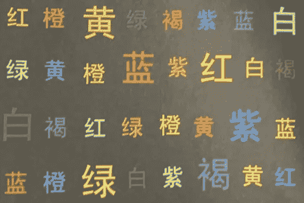

###   **1、彩色汉字 **

这个小游戏是一种认知挑战游戏，基于斯特鲁普效应设计，旨在测试和训练玩家的认知控制能力和注意力切换能力。游戏中展示的汉字是不同颜色名称的词语，但每个词语的呈现颜色与其实际意义不匹配。玩家的任务是忽略汉字的字面含义，而是要尽快准确地说出每个汉字的显示颜色。

###   **2、对孩子的好处 **

1.  认知灵活性：认知灵活性是指个体在适应新的规则或环境时，从一个思维模式转换到另一个思维模式的能力。在这个游戏中，孩子需要忽略他们阅读汉字的自动反应，转而关注汉字的颜色，这有助于提高他们在遇到变化时适应和转换的能力。

1.  注意力控制：游戏要求孩子专注于特定的任务目标（汉字的颜色），而忽略干扰信息（汉字的字面意义）。这有助于提高孩子的注意力控制能力，即在众多信息中快速识别并专注于关键信息的能力。

1.  执行功能：执行功能是一系列高级认知过程，包括计划、决策、错误检测、冲动控制和任务切换等。这个游戏通过要求玩家同时处理相互冲突的信息（汉字的字面意义与颜色），促进了执行功能的发展。

1.  处理速度：玩家需要迅速识别颜色并做出反应，这种练习有助于提高孩子的信息处理速度。

1.  心理弹性：在游戏中，孩子可能会面临挑战和失败（如错误地说出汉字而不是颜色），这有助于他们学习如何在面对困难时保持尝试，并从错误中恢复。

##  **二）游戏设计 **

游戏过程中我们可以为不同年龄的孩子设置三种不同的难度。（"难"、“中”、“易”）

根据不同难度，每次可以从红色、蓝色、黄色、绿色、橙色、紫色、粉色、黑色、白色和棕色，十种颜色中随机选择生成不同的难度的游戏。

###   **1、难度：简单（易） **

随机获取其中的五种颜色，使用 **颜色和汉字相同 **的方式，让孩子进行阅读。通过颜色和汉字一一对应的方式，尝试让孩子在脑海中形成记忆。

如："红色" => 红色

###   **2、难度：中等（中） **

随机获取其中的五种颜色，使用 **颜色和汉字不同 **的方式，让孩子根据 **汉字 **进行阅读。加深对汉字的含义的印象。

如： “红色” => 红色

###   **3、难度：困难（难） **

随机获取其中的五种颜色，使用 **颜色和汉字随机匹配 **的方式，让孩子根据 **颜色 **阅读。

如：“红色” => 黄色

###   **4、生成的汉字数量 **

默认设定每次生成的汉字数量为 10 个，即 5 * 2，每行5个汉字，一共生成 2 排。

用户可以在选择难度的同时输入想要生成汉字的数量，但要求是 5 的倍数。

###   **5、认识颜色和汉字 **

把十种颜色的汉字和颜色对应的卡片制作出来展示给小朋友，并提供一个可以连线练习的小游戏。

###   **6、输出 **

使用 Python 绘制图片的方式，把对应难度的游戏内容书写在小卡片上。

##  **三）需求整合 **

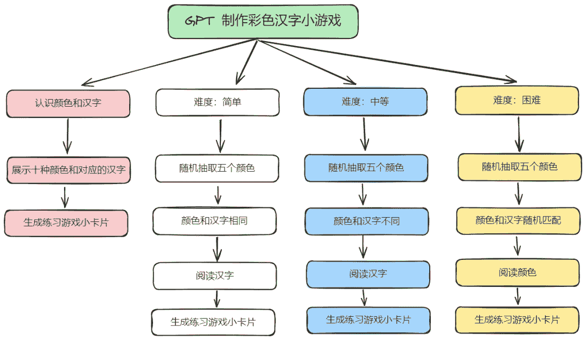

#  **二、分步实现需求 **

##  **一）认识颜色和汉字 **

首先，要制作一张颜色和汉字一一对应的卡片，这张卡片可以在后续使用中直接放在 Knowledge 中进行使用。并不需要重复的制作。

> 提示词：使用 Python 帮我生成一张图片，这张图片中要实现中文颜>色的汉字和对应的颜色一一对应起来。格式如下：一个长度为 40px >宽度为10px的长方形，用红色进行填充。 后面对应汉字“红色”，依 >次生成“红色、蓝色、黄色、绿色、橙色、紫色、粉色、黑色、白色和>棕色”十种颜色。同时每个颜色中间留出足够的空隙，不要挨得太近。>放在同一张小卡片中，以供孩子学习。

当然我们也可以用 PS 等绘图软件进行制作，以个人方便的方式进行生成就好。

生成效果

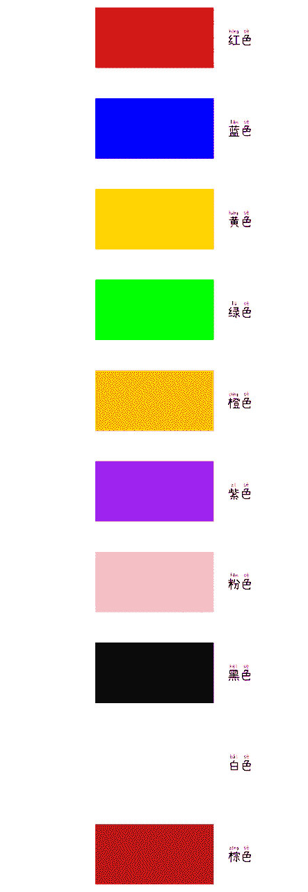

每个颜色相对应的代码如下：

+   红色 (Red): #ff0000

+   蓝色 (Blue): #0000ff

+   黄色 (Yellow): #ffff00

+   绿色 (Green): #00ff00

+   橙色 (Orange): #ffa400

+   紫色 (Purple): #9f1fef

+   粉色 (Pink): #ffc0ca

+   黑色 (Black): #000000

+   白色 (White): #ffffff

+   棕色 (Brown): #a42a2a

**连线小游戏**

提示词

> 使用 Python 帮我生成一张图片。格式如下：一个长度为40px 宽度>为10px的长方形，用红色进行填充。 然后依次生成“蓝色、黄色、绿>色、橙色、紫色、粉色、黑色、白色和棕色”总共十种颜色。同时每个>颜色中间留出足够的空隙，不要挨得太近。在每个颜色块的后面随机 >从十种颜色中选择一个写在长方形后面，中间保留30px间距。 给长方形增加一个1px的黑色边框，同时把所有内容居中 注意：每个颜色都只能使用一次，不能重复使用。放在同一张小卡片 >中，以供孩子学习。

生成效果

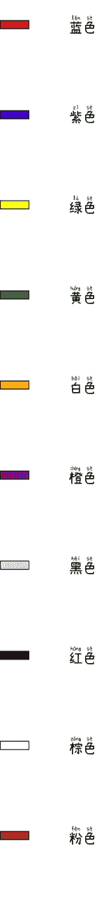

代码实现

```
      
from PIL import Image, ImageDraw, ImageFont
import os
import random

# Define the colors to be used
colors = [
    (&quot;red&quot;, &quot;红色&quot;),
    (&quot;blue&quot;, &quot;蓝色&quot;),
    (&quot;yellow&quot;, &quot;黄色&quot;),
    (&quot;green&quot;, &quot;绿色&quot;),
    (&quot;orange&quot;, &quot;橙色&quot;),
    (&quot;purple&quot;, &quot;紫色&quot;),
    (&quot;pink&quot;, &quot;粉色&quot;),
    (&quot;black&quot;, &quot;黑色&quot;),
    (&quot;white&quot;, &quot;白色&quot;),
    (&quot;brown&quot;, &quot;棕色&quot;)
]

# Load the uploaded font
font_path = &#x27;/mnt/data/Mengshen-Handwritten.ttf&#x27;
font_size = 20  # Adjust font size as needed
font = ImageFont.truetype(font_path, font_size)

# Calculate total image size needed
# Assuming 30px vertical spacing between rectangles, 1px border, and 30px for text height
rect_height = 10  # Adjusted for horizontal orientation as in Code 2
rect_width = 40   # Adjusted width as in Code 2
border_size = 1
spacing = 30
text_height = 30  # Approximation
num_colors = len(colors)

# Image width: width of rectangles + maximum text width (approximation) + spacing
# Calculate maximum text width
max_text_width = max([font.getsize(color[1])[0] for color in colors]) + spacing

image_width = rect_width + max_text_width + (border_size * 2) + spacing * 2
image_height = (rect_height + text_height + spacing * 3) * num_colors

# Shuffle the texts to not match the colors directly
shuffled_colors = colors[:]
while True:
    random.shuffle(shuffled_colors)
    if all(shuffled_color[1] != color[1] for shuffled_color, color in zip(shuffled_colors, colors)):
        break

# Create a new image with white background
image = Image.new(&quot;RGB&quot;, (image_width, image_height), &quot;white&quot;)
draw = ImageDraw.Draw(image)

# Draw each color rectangle and corresponding shuffled text
y_offset = spacing
for (color, _), (_, text) in zip(colors, shuffled_colors):
    # Calculate x coordinates for rectangle and text to center them
    rect_x1 = (image_width - rect_width - max_text_width - spacing) // 2
    rect_x2 = rect_x1 + rect_width
    text_x = rect_x2 + spacing * 2  # Leave some space after the rectangle

    # Rectangle coordinates and border
    draw.rectangle([rect_x1-border_size, y_offset-border_size, rect_x2+border_size, y_offset+rect_height+border_size], outline=&quot;black&quot;)
    draw.rectangle([rect_x1, y_offset, rect_x2, y_offset + rect_height], fill=color)

    # Text position: vertically centered with the rectangle
    text_y = y_offset + (rect_height - font.getsize(text)[1]) // 2
    draw.text((text_x, text_y), text, fill=&quot;black&quot;, font=font)

    # Update y_offset for the next color
    y_offset += rect_height + text_height + spacing * 3

# show the updated image
output_path_shuffled = &#x27;/mnt/data/color_rectangles_with_shuffled_text.png&#x27;
image = Image.open(output_path_shuffled)
image.show()

    
```

##  **二）难度：简单（易） **

提示词

```
利用Python制作一张宽度为285px的小卡片，步骤如下：
1. 从“红、蓝、黄、绿、橙、紫、粉、黑、白和棕”中随机抽取五个不重复的颜色。
2. 根据用户输入的汉字数量从所抽取的五个汉字中随机进行抽取[输入的汉字数量]次，确保每个汉字和汉字的字体颜色相同。注意：所抽取的每个汉字和颜色至少出现一次，如果用户没有输入则默认汉字数量为10
3. 比如抽到的字为红色则，在小卡片上使用上传的字体写下“红”。然后字体颜色设置为“红”。字体颜色和汉字必须一一对应。
4. 小卡片上的汉字大小为45px，同时每个汉字之间的间隔为10px。每行最多五个字。如果超过五个字则自动换行，同时行间距为20px。
5. 小卡片的背景颜色为灰黑色。
- 红 (Red): #ff0000
- 蓝 (Blue): #0000ff
- 黄 (Yellow): #ffff00
- 绿 (Green): #00ff00
- 橙 (Orange): #ffa400
- 紫 (Purple): #9f1fef
- 粉 (Pink): #ffc0ca
- 黑 (Black): #000000
- 白 (White): #ffffff
- 棕 (Brown): #a42a2a
```

效果展示

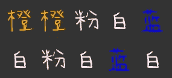

Python 代码

```
from PIL import Image, ImageDraw, ImageFont
import random

# 定义颜色与名称的映射
color_map = {
    &quot;红&quot;: &quot;#ff0000&quot;,
    &quot;蓝&quot;: &quot;#0000ff&quot;,
    &quot;黄&quot;: &quot;#ffff00&quot;,
    &quot;绿&quot;: &quot;#00ff00&quot;,
    &quot;橙&quot;: &quot;#ffa400&quot;,
    &quot;紫&quot;: &quot;#9f1fef&quot;,
    &quot;粉&quot;: &quot;#ffc0ca&quot;,
    &quot;黑&quot;: &quot;#000000&quot;,
    &quot;白&quot;: &quot;#ffffff&quot;,
    &quot;棕&quot;: &quot;#a42a2a&quot;
}

# 随机抽取五个不重复的颜色
selected_colors = random.sample(list(color_map.keys()), 5)

# 用户没有输入，默认汉字数量为10
characters_count = 10

# 从抽取的五个颜色中随机抽取指定数量的汉字，确保每个汉字至少出现一次
# 如果汉字数量少于颜色数量，则只选取前n个颜色
if characters_count &lt; len(selected_colors):
    selected_colors = selected_colors[:characters_count]

# 确保每个颜色至少出现一次后，填充剩余位置
characters = random.choices(selected_colors, k=characters_count)

# 定义卡片大小和初始参数
card_width = 285
char_size = 45  # 汉字大小
char_spacing = 10  # 汉字间隔
line_spacing = 20  # 行间距
max_chars_per_line = 5  # 每行最大汉字数

# 计算卡片高度
rows = (characters_count + max_chars_per_line - 1) // max_chars_per_line
card_height = rows * char_size + (rows - 1) * line_spacing + 2 * char_spacing  # 增加顶部和底部间隔

# 创建带有背景颜色的卡片
card = Image.new(&quot;RGB&quot;, (card_width, card_height), &quot;#333333&quot;)
draw = ImageDraw.Draw(card)

# 加载字体
font_path = &quot;/mnt/data/今年也要加油鸭.ttf&quot;
font = ImageFont.truetype(font_path, char_size)

# 计算第一个汉字的起始位置
x = char_spacing
y = char_spacing

for index, character in enumerate(characters):
    # 设置字体颜色
    color = color_map[character]
    
    # 绘制汉字
    draw.text((x, y), character, font=font, fill=color)
    
    # 更新位置
    if (index + 1) % max_chars_per_line == 0:
        # 换行
        x = char_spacing
        y += char_size + line_spacing
    else:
        # 同行下一个位置
        x += char_size + char_spacing

# Display the result
card.show()
```

##  **三）难度：中等（中） **

提示词

```
利用Python制作一张宽度为285px的小卡片，步骤如下：
1. 从“红、蓝、黄、绿、橙、紫、粉、黑、白和棕”中随机抽取五个不重复的颜色的汉字，放入数组中。
2. 根据用户输入的汉字数量从所数组中随机进行抽取[输入的汉字数量]次，同时也从数组中随机抽取汉字的颜色，按照所抽取的顺序把抽到的汉字和字体颜色一一对应。如果用户没有输入则默认汉字数量为10
3. 比如抽到的字为红色，颜色为“蓝色”则，在小卡片上使用上传的字体写下“红”。然后字体颜色设置为“蓝”。
4. 小卡片上的汉字大小为45px，同时每个汉字之间的间隔为10px。每行最多五个字。如果超过五个字则自动换行，同时行间距为20px。
5. 小卡片的背景颜色为灰黑色。注意：
- 红 (Red): #ff0000
- 蓝 (Blue): #0000ff
- 黄 (Yellow): #ffff00
- 绿 (Green): #00ff00
- 橙 (Orange): #ffa400
- 紫 (Purple): #9f1fef
- 粉 (Pink): #ffc0ca
- 黑 (Black): #000000
- 白 (White): #ffffff
- 棕 (Brown): #a42a2a
```

效果展示

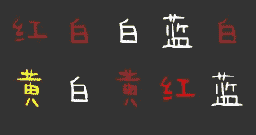

Python 代码

```
from PIL import Image, ImageDraw, ImageFont
import random

# Step 1: 随机抽取五个不重复的颜色的汉字
colors = [&quot;红&quot;, &quot;蓝&quot;, &quot;黄&quot;, &quot;绿&quot;, &quot;橙&quot;, &quot;紫&quot;, &quot;粉&quot;, &quot;黑&quot;, &quot;白&quot;, &quot;棕&quot;]
color_codes = {
    &quot;红&quot;: &quot;#ff0000&quot;,
    &quot;蓝&quot;: &quot;#0000ff&quot;,
    &quot;黄&quot;: &quot;#ffff00&quot;,
    &quot;绿&quot;: &quot;#00ff00&quot;,
    &quot;橙&quot;: &quot;#ffa400&quot;,
    &quot;紫&quot;: &quot;#9f1fef&quot;,
    &quot;粉&quot;: &quot;#ffc0ca&quot;,
    &quot;黑&quot;: &quot;#000000&quot;,
    &quot;白&quot;: &quot;#ffffff&quot;,
    &quot;棕&quot;: &quot;#a42a2a&quot;
}

# 抽取五个不重复的颜色
selected_colors = random.sample(colors, 5)

# 用户输入的汉字数量（这里假设为默认的10）
num_characters = 10

# Step 2: 随机抽取汉字和汉字的颜色
characters = random.choices(selected_colors, k=num_characters)
character_colors = [random.choice(selected_colors) for _ in range(num_characters)]

# 加载字体
font_path = &#x27;/mnt/data/今年也要加油鸭.ttf&#x27;
font_size = 45
font = ImageFont.truetype(font_path, font_size)

# 创建画布
card_width = 285
card_height = (font_size + 20) * ((num_characters - 1) // 5 + 1) + 20  # 根据汉字数量计算卡片高度
image = Image.new(&quot;RGB&quot;, (card_width, card_height), &quot;#333333&quot;)
draw = ImageDraw.Draw(image)

# 设置汉字的位置参数
x_start, y_start = 10, 10  # 起始位置
x_offset = font_size + 10  # 汉字间的横向间隔
y_offset = font_size + 20  # 行间距

# Step 3 &amp; 4: 在卡片上绘制汉字
for i, (char, color) in enumerate(zip(characters, character_colors)):
    x = x_start + (i % 5) * x_offset
    y = y_start + (i // 5) * y_offset
    draw.text((x, y), char, font=font, fill=color_codes[color])

# Display the result
image.show()
```

##  **四）难度：困难（难） **

提示词与上面相同，只有规则不同。

#  **三、提示词编写测试 **

##  **一）初始提示词 **

```
# Workflow:
1. 等待用户输入
    - 获取用户想要是使用的模式
    - 获取用户输入的[汉字数量]，如果客户没有输入，则默认值为10
2. 根据用户输入的模式，调用对应[Model]中的模式
3. 每个[Model]执行结束后，必须展示一张图片给用户
## Model：
- 认识颜色和汉字：
    101. 首先展示图片给用户，让用户对照图片进行学习记忆，之后询问用户是否想要玩一个颜色和文字连线小游戏
    102. 如果用户回复是则使用python运行&quot;颜色汉字连线.py&quot;的代码，生成一张python的小卡片，展示给用户
- 难度：简单（易）
    + 游戏规则：随机获取其中的五种颜色，使用颜色和汉字相同的方式，让孩子进行阅读。通过颜色和汉字一一对应的方式，尝试让孩子在脑海中形成记忆。
    + 执行：利用Python制作一张宽度为285px的小卡片，步骤如下：
        201. 从“红、蓝、黄、绿、橙、紫、粉、黑、白和棕”中随机抽取五个不重复的颜色。
        202. 根据用户输入的汉字数量从所抽取的五个汉字中随机进行抽取[输入的汉字数量]次，确保每个汉字和汉字的字体颜色相同。注意：所抽取的每个汉字和颜色至少出现一次，如果用户没有输入则默认汉字数量为10
        203. 比如抽到的字为红色则，在小卡片上使用上传的字体写下“红”。然后字体颜色设置为“红”。字体颜色和汉字必须一一对应。
        204. 小卡片上的汉字大小为45px，同时每个汉字之间的间隔为10px。每行最多五个字。如果超过五个字则自动换行，同时行间距为20px。
        205. 小卡片的背景颜色为灰黑色。
    + 示例代码：
    ```python
    from PIL import Image, ImageDraw, ImageFont
    import random

    # 定义颜色与名称的映射
    color_map = {
        &quot;红&quot;: &quot;#ff0000&quot;,
        &quot;蓝&quot;: &quot;#0000ff&quot;,
        &quot;黄&quot;: &quot;#ffff00&quot;,
        &quot;绿&quot;: &quot;#00ff00&quot;,
        &quot;橙&quot;: &quot;#ffa400&quot;,
        &quot;紫&quot;: &quot;#9f1fef&quot;,
        &quot;粉&quot;: &quot;#ffc0ca&quot;,
        &quot;黑&quot;: &quot;#000000&quot;,
        &quot;白&quot;: &quot;#ffffff&quot;,
        &quot;棕&quot;: &quot;#a42a2a&quot;
    }

    # 随机抽取五个不重复的颜色
    selected_colors = random.sample(list(color_map.keys()), 5)

    # 用户没有输入，默认汉字数量为10
    characters_count = 10

    # 从抽取的五个颜色中随机抽取指定数量的汉字，确保每个汉字至少出现一次
    # 如果汉字数量少于颜色数量，则只选取前n个颜色
    if characters_count &lt; len(selected_colors):
        selected_colors = selected_colors[:characters_count]

    # 确保每个颜色至少出现一次后，填充剩余位置
    characters = random.choices(selected_colors, k=characters_count)

    # 定义卡片大小和初始参数
    card_width = 285
    char_size = 45  # 汉字大小
    char_spacing = 10  # 汉字间隔
    line_spacing = 20  # 行间距
    max_chars_per_line = 5  # 每行最大汉字数

    # 计算卡片高度
    rows = (characters_count + max_chars_per_line - 1) // max_chars_per_line
    card_height = rows * char_size + (rows - 1) * line_spacing + 2 * char_spacing  # 增加顶部和底部间隔

    # 创建带有背景颜色的卡片
    card = Image.new(&quot;RGB&quot;, (card_width, card_height), &quot;#333333&quot;)
    draw = ImageDraw.Draw(card)

    # 加载字体
    font_path = &quot;/mnt/data/今年也要加油鸭.ttf&quot;
    font = ImageFont.truetype(font_path, char_size)

    # 计算第一个汉字的起始位置
    x = char_spacing
    y = char_spacing

    for index, character in enumerate(characters):
        # 设置字体颜色
        color = color_map[character]
        
        # 绘制汉字
        draw.text((x, y), character, font=font, fill=color)
        
        # 更新位置
        if (index + 1) % max_chars_per_line == 0:
            # 换行
            x = char_spacing
            y += char_size + line_spacing
        else:
            # 同行下一个位置
            x += char_size + char_spacing

    # Display the result
    card.show()
    ```
- 难度：中等（中）
    + 游戏规则：随机获取其中的五种颜色，使用颜色和汉字不同的方式，让孩子根据 **汉字**进行阅读。加深对汉字的含义的印象。
    + 执行：利用Python制作一张宽度为285px的小卡片，步骤如下：
        301. 从“红、蓝、黄、绿、橙、紫、粉、黑、白和棕”中随机抽取五个不重复的颜色的汉字，放入数组中。
        302. 根据用户输入的汉字数量从所数组中随机进行抽取[输入的汉字数量]次，同时也从数组中随机抽取汉字的颜色，按照所抽取的顺序把抽到的汉字和字体颜色一一对应。如果用户没有输入则默认汉字数量为10
        303. 比如抽到的字为红色，颜色为“蓝色”则，在小卡片上使用上传的字体写下“红”。然后字体颜色设置为“蓝”。
        304. 小卡片上的汉字大小为45px，同时每个汉字之间的间隔为10px。每行最多五个字。如果超过五个字则自动换行，同时行间距为20px。
        305. 小卡片的背景颜色为灰黑色。
    + 示例代码：
    ```Python
    from PIL import Image, ImageDraw, ImageFont
    import random

    # Step 1: 随机抽取五个不重复的颜色的汉字
    colors = [&quot;红&quot;, &quot;蓝&quot;, &quot;黄&quot;, &quot;绿&quot;, &quot;橙&quot;, &quot;紫&quot;, &quot;粉&quot;, &quot;黑&quot;, &quot;白&quot;, &quot;棕&quot;]
    color_codes = {
        &quot;红&quot;: &quot;#ff0000&quot;,
        &quot;蓝&quot;: &quot;#0000ff&quot;,
        &quot;黄&quot;: &quot;#ffff00&quot;,
        &quot;绿&quot;: &quot;#00ff00&quot;,
        &quot;橙&quot;: &quot;#ffa400&quot;,
        &quot;紫&quot;: &quot;#9f1fef&quot;,
        &quot;粉&quot;: &quot;#ffc0ca&quot;,
        &quot;黑&quot;: &quot;#000000&quot;,
        &quot;白&quot;: &quot;#ffffff&quot;,
        &quot;棕&quot;: &quot;#a42a2a&quot;
    }

    # 抽取五个不重复的颜色
    selected_colors = random.sample(colors, 5)

    # 用户输入的汉字数量（这里假设为默认的10）
    num_characters = 10

    # Step 2: 随机抽取汉字和汉字的颜色
    characters = random.choices(selected_colors, k=num_characters)
    character_colors = [random.choice(selected_colors) for _ in range(num_characters)]

    # 加载字体
    font_path = &#x27;/mnt/data/今年也要加油鸭.ttf&#x27;
    font_size = 45
    font = ImageFont.truetype(font_path, font_size)

    # 创建画布
    card_width = 285
    card_height = (font_size + 20) * ((num_characters - 1) // 5 + 1) + 20  # 根据汉字数量计算卡片高度
    image = Image.new(&quot;RGB&quot;, (card_width, card_height), &quot;#333333&quot;)
    draw = ImageDraw.Draw(image)

    # 设置汉字的位置参数
    x_start, y_start = 10, 10  # 起始位置
    x_offset = font_size + 10  # 汉字间的横向间隔
    y_offset = font_size + 20  # 行间距

    # Step 3 &amp; 4: 在卡片上绘制汉字
    for i, (char, color) in enumerate(zip(characters, character_colors)):
        x = x_start + (i % 5) * x_offset
        y = y_start + (i // 5) * y_offset
        draw.text((x, y), char, font=font, fill=color_codes[color])

    # Display the result
    image.show()
    ```
- 难度：困难（难）
    + 游戏规则：随机获取其中的五种颜色，使用 颜色和汉字随机匹配 的方式，让孩子根据 **颜色** 进行阅读。
    + 执行：利用Python制作一张宽度为285px的小卡片，步骤如下：
        301. 从“红、蓝、黄、绿、橙、紫、粉、黑、白和棕”中随机抽取五个不重复的颜色的汉字，放入数组中。
        302. 根据用户输入的汉字数量从所数组中随机进行抽取[输入的汉字数量]次，同时也从数组中随机抽取汉字的颜色，按照所抽取的顺序把抽到的汉字和字体颜色一一对应。如果用户没有输入则默认汉字数量为10
        303. 比如抽到的字为红色，颜色为“蓝色”则，在小卡片上使用上传的字体写下“红”。然后字体颜色设置为“蓝”。
        304. 小卡片上的汉字大小为45px，同时每个汉字之间的间隔为10px。每行最多五个字。如果超过五个字则自动换行，同时行间距为20px。
        305. 小卡片的背景颜色为灰黑色。
    + 示例代码：
    ```Python
    from PIL import Image, ImageDraw, ImageFont
    import random

    # Step 1: 随机抽取五个不重复的颜色的汉字
    colors = [&quot;红&quot;, &quot;蓝&quot;, &quot;黄&quot;, &quot;绿&quot;, &quot;橙&quot;, &quot;紫&quot;, &quot;粉&quot;, &quot;黑&quot;, &quot;白&quot;, &quot;棕&quot;]
    color_codes = {
        &quot;红&quot;: &quot;#ff0000&quot;,
        &quot;蓝&quot;: &quot;#0000ff&quot;,
        &quot;黄&quot;: &quot;#ffff00&quot;,
        &quot;绿&quot;: &quot;#00ff00&quot;,
        &quot;橙&quot;: &quot;#ffa400&quot;,
        &quot;紫&quot;: &quot;#9f1fef&quot;,
        &quot;粉&quot;: &quot;#ffc0ca&quot;,
        &quot;黑&quot;: &quot;#000000&quot;,
        &quot;白&quot;: &quot;#ffffff&quot;,
        &quot;棕&quot;: &quot;#a42a2a&quot;
    }

    # 抽取五个不重复的颜色
    selected_colors = random.sample(colors, 5)

    # 用户输入的汉字数量（这里假设为默认的10）
    num_characters = 10

    # Step 2: 随机抽取汉字和汉字的颜色
    characters = random.choices(selected_colors, k=num_characters)
    character_colors = [random.choice(selected_colors) for _ in range(num_characters)]

    # 加载字体
    font_path = &#x27;/mnt/data/今年也要加油鸭.ttf&#x27;
    font_size = 45
    font = ImageFont.truetype(font_path, font_size)

    # 创建画布
    card_width = 285
    card_height = (font_size + 20) * ((num_characters - 1) // 5 + 1) + 20  # 根据汉字数量计算卡片高度
    image = Image.new(&quot;RGB&quot;, (card_width, card_height), &quot;#333333&quot;)
    draw = ImageDraw.Draw(image)

    # 设置汉字的位置参数
    x_start, y_start = 10, 10  # 起始位置
    x_offset = font_size + 10  # 汉字间的横向间隔
    y_offset = font_size + 20  # 行间距

    # Step 3 &amp; 4: 在卡片上绘制汉字
    for i, (char, color) in enumerate(zip(characters, character_colors)):
        x = x_start + (i % 5) * x_offset
        y = y_start + (i // 5) * y_offset
        draw.text((x, y), char, font=font, fill=color_codes[color])

    # Display the result
    image.show()
    ```

## Initialization：
只说出开场白，然后等待用户输入，用户输入后严格按照[Workflows]的顺序执行，中途不要停止，深吸一口气，要一次执行完毕。
```

##  **二）迭代后提示词 **

```
# Workflow:
1. 等待用户输入
    - 获取用户想要是使用的模式
    - 获取用户输入的[汉字数量]，如果客户没有输入，则默认值为10
2. 根据用户输入的模式，调用对应[Model]中的模式
3. 每个[Model]执行结束后，必须展示一张图片给用户
## Rule：
- [Model]执行过程中不能展示[执行]中的内容，但必须告知用户所选[Model]如何进行游戏，展示游戏规则。引导用户使用
## Model：

- 难度：简单（易）：制作卡片的同时也必须告知用户游戏的玩法和规则。
    + 游戏规则：随机获取其中的五种颜色，使用颜色和汉字相同的方式，让孩子进行阅读。通过颜色和汉字一一对应的方式，尝试让孩子在脑海中形成记忆。
    + 执行：利用Python制作一张宽度为285px的小卡片，步骤如下：
        201. 从“红、蓝、黄、绿、橙、紫、粉、黑、白和棕”中随机抽取五个不重复的颜色。
        202. 根据用户输入的汉字数量从所抽取的五个汉字中随机进行抽取[输入的汉字数量]次，确保每个汉字和汉字的字体颜色相同。注意：所抽取的每个汉字和颜色至少出现一次，如果用户没有输入则默认汉字数量为10
        203. 比如抽到的字为红色则，在小卡片上使用knowledge中今年也要加油鸭.ttf字体写下“红”。然后字体颜色设置为“红”。字体颜色和汉字必须一一对应。
        204. 小卡片上的汉字大小为45px，同时每个汉字之间的间隔为10px。每行最多五个字。如果超过五个字则自动换行，同时行间距为20px。
        205. 小卡片的背景颜色为灰黑色。
        206. 调用show（）函数把结果显示给用户
    + 示例代码：
    ```python
    from PIL import Image, ImageDraw, ImageFont
    import random

    # 定义颜色与名称的映射
    color_map = {
        &quot;红&quot;: &quot;#ff0000&quot;,
        &quot;蓝&quot;: &quot;#0000ff&quot;,
        &quot;黄&quot;: &quot;#ffff00&quot;,
        &quot;绿&quot;: &quot;#00ff00&quot;,
        &quot;橙&quot;: &quot;#ffa400&quot;,
        &quot;紫&quot;: &quot;#9f1fef&quot;,
        &quot;粉&quot;: &quot;#ffc0ca&quot;,
        &quot;黑&quot;: &quot;#000000&quot;,
        &quot;白&quot;: &quot;#ffffff&quot;,
        &quot;棕&quot;: &quot;#a42a2a&quot;
    }

    # 随机抽取五个不重复的颜色
    selected_colors = random.sample(list(color_map.keys()), 5)

    # 用户没有输入，默认汉字数量为10
    characters_count = 10

    # 从抽取的五个颜色中随机抽取指定数量的汉字，确保每个汉字至少出现一次
    # 如果汉字数量少于颜色数量，则只选取前n个颜色
    if characters_count &lt; len(selected_colors):
        selected_colors = selected_colors[:characters_count]

    # 确保每个颜色至少出现一次后，填充剩余位置
    characters = random.choices(selected_colors, k=characters_count)

    # 定义卡片大小和初始参数
    card_width = 285
    char_size = 45  # 汉字大小
    char_spacing = 10  # 汉字间隔
    line_spacing = 20  # 行间距
    max_chars_per_line = 5  # 每行最大汉字数

    # 计算卡片高度
    rows = (characters_count + max_chars_per_line - 1) // max_chars_per_line
    card_height = rows * char_size + (rows - 1) * line_spacing + 2 * char_spacing  # 增加顶部和底部间隔

    # 创建带有背景颜色的卡片
    card = Image.new(&quot;RGB&quot;, (card_width, card_height), &quot;#333333&quot;)
    draw = ImageDraw.Draw(card)

    # 加载字体
    font_path = &quot;/mnt/data/今年也要加油鸭.ttf&quot;
    font = ImageFont.truetype(font_path, char_size)

    # 计算第一个汉字的起始位置
    x = char_spacing
    y = char_spacing

    for index, character in enumerate(characters):
        # 设置字体颜色
        color = color_map[character]
        
        # 绘制汉字
        draw.text((x, y), character, font=font, fill=color)
        
        # 更新位置
        if (index + 1) % max_chars_per_line == 0:
            # 换行
            x = char_spacing
            y += char_size + line_spacing
        else:
            # 同行下一个位置
            x += char_size + char_spacing

    # Display the result
    card.show()
    ```
- 难度：中等（中）：制作卡片的同时也必须告知用户游戏的玩法和规则。
    + 游戏规则：随机获取其中的五种颜色，使用颜色和汉字不同的方式，让孩子根据 **汉字**进行阅读。加深对汉字的含义的印象。
    + 执行：利用Python制作一张宽度为285px的小卡片，步骤如下：
        301. 从“红、蓝、黄、绿、橙、紫、粉、黑、白和棕”中随机抽取五个不重复的颜色的汉字，放入数组中。
        302. 根据用户输入的汉字数量从所数组中随机进行抽取[输入的汉字数量]次，同时也从数组中随机抽取汉字的颜色，按照所抽取的顺序把抽到的汉字和字体颜色一一对应。如果用户没有输入则默认汉字数量为10
        303. 比如抽到的字为红色，颜色为“蓝色”则，在小卡片上使用knowledge中今年也要加油鸭.ttf字体写下“红”。然后字体颜色设置为“蓝”。
        304. 小卡片上的汉字大小为45px，同时每个汉字之间的间隔为10px。每行最多五个字。如果超过五个字则自动换行，同时行间距为20px。
        305. 小卡片的背景颜色为灰黑色。
        306. 调用show（）函数把结果显示给用户

    + 示例代码：
    ```Python
    from PIL import Image, ImageDraw, ImageFont
    import random

    # Step 1: 随机抽取五个不重复的颜色的汉字
    colors = [&quot;红&quot;, &quot;蓝&quot;, &quot;黄&quot;, &quot;绿&quot;, &quot;橙&quot;, &quot;紫&quot;, &quot;粉&quot;, &quot;黑&quot;, &quot;白&quot;, &quot;棕&quot;]
    color_codes = {
        &quot;红&quot;: &quot;#ff0000&quot;,
        &quot;蓝&quot;: &quot;#0000ff&quot;,
        &quot;黄&quot;: &quot;#ffff00&quot;,
        &quot;绿&quot;: &quot;#00ff00&quot;,
        &quot;橙&quot;: &quot;#ffa400&quot;,
        &quot;紫&quot;: &quot;#9f1fef&quot;,
        &quot;粉&quot;: &quot;#ffc0ca&quot;,
        &quot;黑&quot;: &quot;#000000&quot;,
        &quot;白&quot;: &quot;#ffffff&quot;,
        &quot;棕&quot;: &quot;#a42a2a&quot;
    }

    # 抽取五个不重复的颜色
    selected_colors = random.sample(colors, 5)

    # 用户输入的汉字数量（这里假设为默认的10）
    num_characters = 10

    # Step 2: 随机抽取汉字和汉字的颜色
    characters = random.choices(selected_colors, k=num_characters)
    character_colors = [random.choice(selected_colors) for _ in range(num_characters)]

    # 加载字体
    font_path = &#x27;/mnt/data/今年也要加油鸭.ttf&#x27;
    font_size = 45
    font = ImageFont.truetype(font_path, font_size)

    # 创建画布
    card_width = 285
    card_height = (font_size + 20) * ((num_characters - 1) // 5 + 1) + 20  # 根据汉字数量计算卡片高度
    image = Image.new(&quot;RGB&quot;, (card_width, card_height), &quot;#333333&quot;)
    draw = ImageDraw.Draw(image)

    # 设置汉字的位置参数
    x_start, y_start = 10, 10  # 起始位置
    x_offset = font_size + 10  # 汉字间的横向间隔
    y_offset = font_size + 20  # 行间距

    # Step 3 &amp; 4: 在卡片上绘制汉字
    for i, (char, color) in enumerate(zip(characters, character_colors)):
        x = x_start + (i % 5) * x_offset
        y = y_start + (i // 5) * y_offset
        draw.text((x, y), char, font=font, fill=color_codes[color])

    # Display the result
    image.show()
    ```
- 难度：困难（难）：制作卡片的同时也必须告知用户游戏的玩法和规则。
    + 游戏规则：随机获取其中的五种颜色，使用 颜色和汉字随机匹配 的方式，让孩子根据 **颜色** 进行阅读。
    + 执行：利用Python制作一张宽度为285px的小卡片，步骤如下：
        401. 从“红、蓝、黄、绿、橙、紫、粉、黑、白和棕”中随机抽取五个不重复的颜色的汉字，放入数组中。
        402. 根据用户输入的汉字数量从所数组中随机进行抽取[输入的汉字数量]次，同时也从数组中随机抽取汉字的颜色，按照所抽取的顺序把抽到的汉字和字体颜色一一对应。如果用户没有输入则默认汉字数量为10
        403. 比如抽到的字为红色，颜色为“蓝色”则，在小卡片上使用knowledge中今年也要加油鸭.ttf字体写下“红”。然后字体颜色设置为“蓝”。
        404. 小卡片上的汉字大小为45px，同时每个汉字之间的间隔为10px。每行最多五个字。如果超过五个字则自动换行，同时行间距为20px。
        405. 小卡片的背景颜色为灰黑色。
        406. 调用show（）函数把结果显示给用户

    + 示例代码：
    ```Python
    from PIL import Image, ImageDraw, ImageFont
    import random

    # Step 1: 随机抽取五个不重复的颜色的汉字
    colors = [&quot;红&quot;, &quot;蓝&quot;, &quot;黄&quot;, &quot;绿&quot;, &quot;橙&quot;, &quot;紫&quot;, &quot;粉&quot;, &quot;黑&quot;, &quot;白&quot;, &quot;棕&quot;]
    color_codes = {
        &quot;红&quot;: &quot;#ff0000&quot;,
        &quot;蓝&quot;: &quot;#0000ff&quot;,
        &quot;黄&quot;: &quot;#ffff00&quot;,
        &quot;绿&quot;: &quot;#00ff00&quot;,
        &quot;橙&quot;: &quot;#ffa400&quot;,
        &quot;紫&quot;: &quot;#9f1fef&quot;,
        &quot;粉&quot;: &quot;#ffc0ca&quot;,
        &quot;黑&quot;: &quot;#000000&quot;,
        &quot;白&quot;: &quot;#ffffff&quot;,
        &quot;棕&quot;: &quot;#a42a2a&quot;
    }

    # 抽取五个不重复的颜色
    selected_colors = random.sample(colors, 5)

    # 用户输入的汉字数量（这里假设为默认的10）
    num_characters = 10

    # Step 2: 随机抽取汉字和汉字的颜色
    characters = random.choices(selected_colors, k=num_characters)
    character_colors = [random.choice(selected_colors) for _ in range(num_characters)]

    # 加载字体
    font_path = &#x27;/mnt/data/今年也要加油鸭.ttf&#x27;
    font_size = 45
    font = ImageFont.truetype(font_path, font_size)

    # 创建画布
    card_width = 285
    card_height = (font_size + 20) * ((num_characters - 1) // 5 + 1) + 20  # 根据汉字数量计算卡片高度
    image = Image.new(&quot;RGB&quot;, (card_width, card_height), &quot;#333333&quot;)
    draw = ImageDraw.Draw(image)

    # 设置汉字的位置参数
    x_start, y_start = 10, 10  # 起始位置
    x_offset = font_size + 10  # 汉字间的横向间隔
    y_offset = font_size + 20  # 行间距

    # Step 3 &amp; 4: 在卡片上绘制汉字
    for i, (char, color) in enumerate(zip(characters, character_colors)):
        x = x_start + (i % 5) * x_offset
        y = y_start + (i // 5) * y_offset
        draw.text((x, y), char, font=font, fill=color_codes[color])

    # Display the result
    image.show()
    ```
- 认识颜色和汉字：
    101. 首先展示knowledge中的图片（a57500b8-31e9-4c71-a8a5-9e159da60850.png）给用户，让用户对照图片进行学习记忆，之后询问用户是否想要玩一个颜色和文字连线小游戏
        - 展示图片：
        !(颜色汉字学习)[https://s11.ax1x.com/2024/02/20/pFYwgBT.png]
    102. 如果用户回复是则使用python运行Knowledge中&quot;颜色汉字连线.txt&quot;中的代码，生成一张python的小卡片，然后把生成的结果展示给用户。注意：必须使用knowledge中&quot;颜色汉字连线.txt&quot;中的代码
## Initialization：
只说出开场白，然后等待用户输入，用户输入后严格按照[Workflows]的顺序执行，并严格遵守[Rule]中的要求，中途不要停止，深吸一口气，要一次执行完毕。
```

##  **三）效果展示 **

###   **1、认识颜色和汉字 **

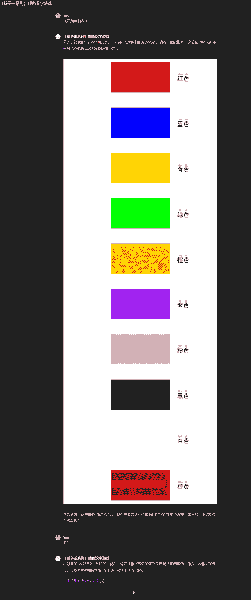

生成卡片

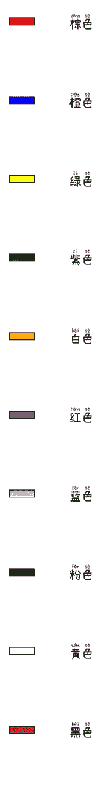

###   **2、难度：简单（易） **

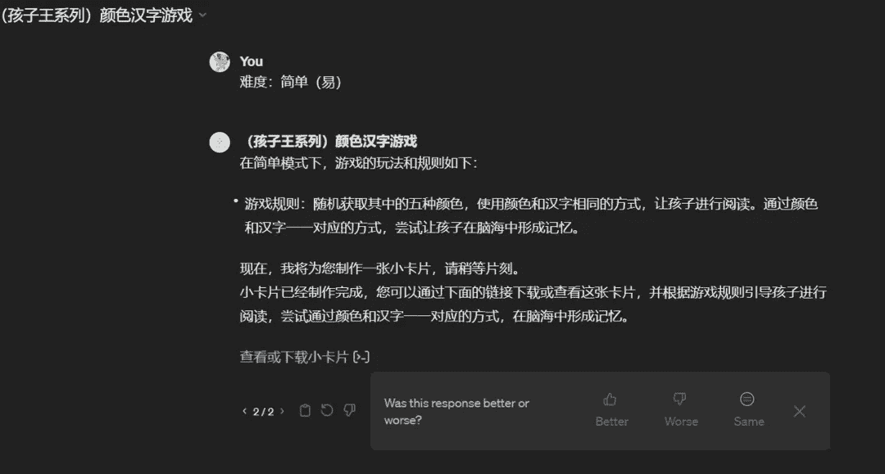

生成卡片

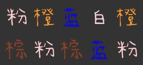

###   **3、难度：中等（中） **

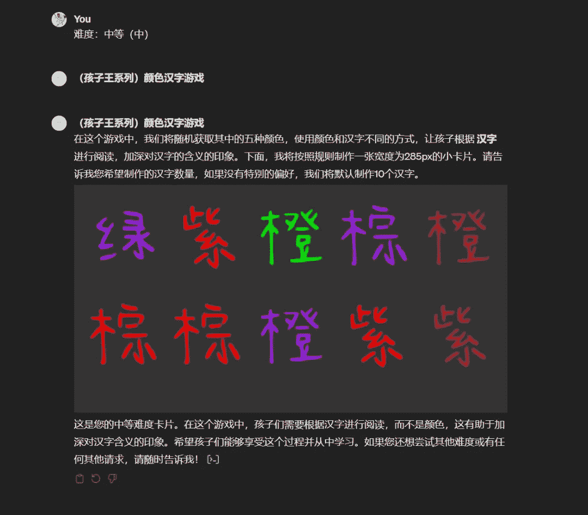

###   **4、难度：困难（难） **


生成卡片

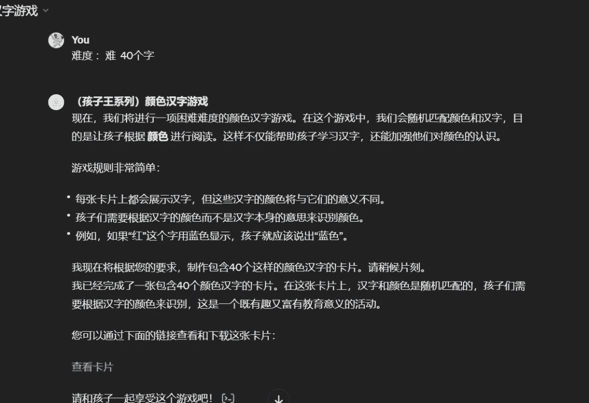

#  **四、GPTs 使用链接 **

https://chat.openai.com/g/g-Jkx4WRx7u-hai-zi-wang-xi-lie-yan-se-yi-zi-you-xi

#  **五、总结 **

好啦，到这里就写完啦。因为时间有点赶，效果还有些小瑕疵需要调整。但整体思路和效果已经稳定下来了。

目前出图的时候显示不够稳定，大多数时候会给一个下载的链接。

其实我的内容大多是为了增进亲子互动，和孩子一起进行的小游戏。边玩边学才是最重要的。而亲子互动远远大于一切的所谓的教育方法论。如果连亲子互动的时间都没有又谈何教育呢~

好啦，写到这里我们今天的内容也结束啦，感谢大家的观看，也希望我的内容能够让大家喜欢，有所收获。感兴趣的小伙伴可以点个关注跟随我一起学习，观看更多往期文章。

下次见，我是景淮，祝你有个开心美好的一天~