# GPTs Action 实战：制作个人日历

> 来源：[https://agijuejin.feishu.cn/docx/Q7bQd03U2oJGngxwJ3Bctgmjnxd](https://agijuejin.feishu.cn/docx/Q7bQd03U2oJGngxwJ3Bctgmjnxd)

> 作者：景淮AI探索之旅

> 原文链接： https://mp.weixin.qq.com/s/FegbaDNk68dSJrAR3Pfzzw

嘿，大家好呀，我是景淮，一个加拿大的程序员，沉迷 AI 不能自拔中。

今天的内容是有关于一个我鸽了很久的主题，一方面是因为当时确实没想到很好的思路。另一方面，那时候写圣诞和元旦的贺卡，确实调的有点神志不清了...

Emmm 对哒！今天的主题就是我鸽了快三个月，被橘橘催了无数次的日历系列。她说我再不写就可以直接做明年的了，真实...

所以今天让我们聊聊我们今天的主题。

**GPT 制作个人日历**

本文会根据以下内容顺序进行：

+   需求分析

+   分步实现需求

+   提示词编写测试

+   GPTs 使用链接

+   总结

#  **一、需求分析 **

首先，我想制作三种不同的日历，以供大家选择。

##  **一）横版日历 **

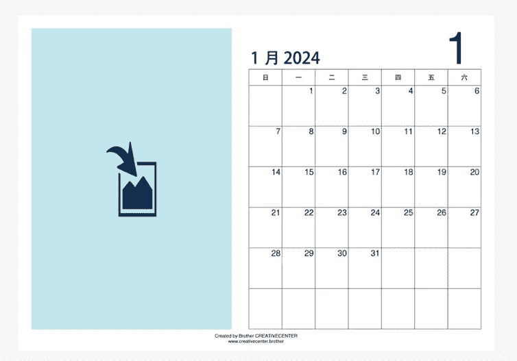

**图片分析**

其实可以分为两部分组成。

一部分是左边的图片，这部分可以考虑由 Dalle-3 生成，或者由用户上传一个好看的图片（MJ 画出来的图等等）。

右边呢，从整体来看首先是一个 7*7 的表格，其中最上面的一格比较窄一些，其他表格就是相同的大小。

然后，我们来思考日历的变化。其实每**次变化的内容就是所有的阿拉**伯数字。包括 月份、年份、表格中的数字。

不变的量就是 汉字“月”，7*7 的表格，表格最上一格写的星期

既然内容不变我们就可以考虑把不变的内容优先做出来，之后在表格的基础上增加不同的数字，来完成日历的部分。

##  **二）竖版日历 **

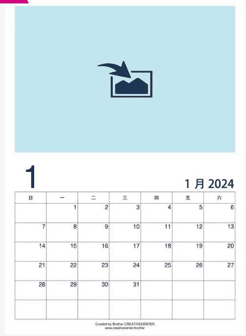

其实内容和横版日历类似，只是把左右分布变成了上下分布。

##  **三）镶嵌日历 **

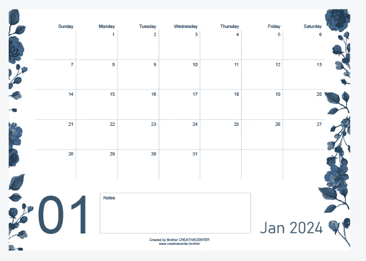

这种日历呢，我们会发现图片会和日历融合在一起的感觉，这也是为什么我会叫他 “镶嵌” 日历。

我们把这种日历的图片也分成两部分。

第一部分做为图片的底层。又 GPT 来生成，制作一张比较大的带图案花纹的图片，做为整张图片的底。

第二部分跟上面的内容相同也是制作这种类似的格式的日历图片。暂时我可以先把日历设计成一样的布局。能一定程度减少 token，并且这样也更方便我们使用。

##  **四）需求整合 **

需求整合的时候，我们不难发现我们每种不同的日历，有一些相同点，所以我们可以先把这些共同点提前，在前面做好，然后最后再进行差异性制作日历。如下图。

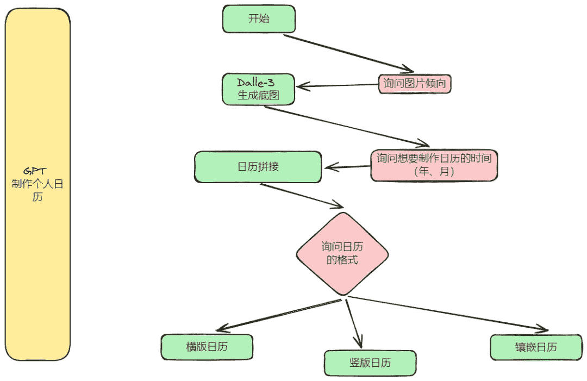

#  **二、分步实现需求 **

其实根据上面的内容可知，不管是哪种方式，我们都需要先完成两部分内容。

1.  生成一张适合的图片

1.  制作一个基本的日历

然后我们再根据不同的要求把图片拼接在一起。

##  **一）Dalle-3 做图 **

关于这个图片的风格，其实大家选择自己喜欢的风格就好。

我这边设定的画风是极简风格插画画风。

**提示词**

> 请你以示例中的绘画提示词，进行简单的修改，做为用户输入主题的>绘画提示词，然后再进行绘画。 ··· 示例： “ A children's illustration featuring a cute and simp>le style. The image should evoke a sense of joy and >wonder, suitable for a young audience. The artwork >should be colorful, with playful elements that enga>ge the imagination. The scene can include friendly >animals, whimsical trees, or magical objects, all d>esigned with soft, rounded shapes for a gentle and >inviting appearance. The overall composition should >be easy for children to understand and appreciate, >making them feel happy and curious to explore more. ” ··· 现在我的主题是：礼品盒

**生成图片**


##  **二）基本日历制作 **

我这边使用 GPT 来生成图片，是因为通过这种方式方便我后面来定位对应数字的坐标和位置。

###   **1、创建表格 **

> 帮我使用python画一个7*7的日历表格。其中第一行为70px，其他行>都为100px，每个方格的宽度统一为100px。

> 在日历表格的四周边距分别为：top 180px，left 100px，right >100px，bottom 50px。背景颜色统一为白色。表格的外边框为 3p>x，内边框为1px。表格边框的颜色为浅蓝色

帮我重新调整下

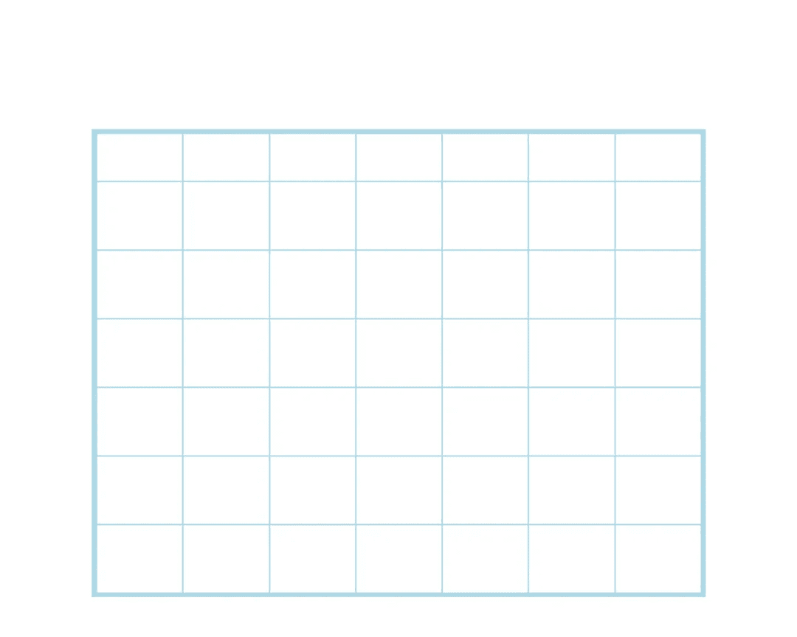

###   **2、增加星期的文字 **

> 在表格的第一行的七个格子中，分别用我上传的字体写上“一、二、>三、四、五、六、日”，要求在每个格子中垂直居中，水平居中

**记得同时上传一个字体**

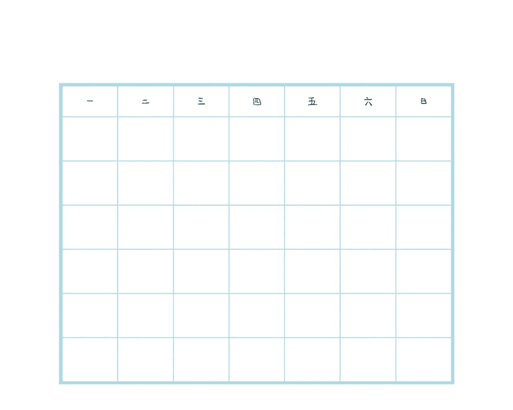

###   3、增加标题 && 4、计算日历中每天位置的坐标，单位为px

这边图片坐标用画图工具重新取了一下，发现保存之后和画出来的大小不太一样。

```
1. 帮我在表格的正上方用我上传的字体写上 “ 2024 年 12 月 ”同时保证这几个字的字体大小为60px，距离整张图片的最上方100px，同时确保文字水平居中

2.帮我在表格中添加数字。首先使用 python 计算 2024年12月1日 是星期几。已知 2024年3月4日为星期一。注意：需要确定对应月份的天数。如一月有31天，二月如果为闰年则为29天。

如果对应的结果为星期一则填入坐标为(342, 382)的一行的右上角
如果结果为星期日则填入坐标为(1386, 382)的一行
···
星期一：第1列；二：第2列；三：第3列；四：第4列；五：第5列；六：第6列；日：第7列
···

同时确保这个月的所有天数依次写入表格中。每行写完则换到下一行继续写，直到完全写完。

表格中需要填入的数字对应坐标如下（坐标中心（0,0）为图片的右上角，单位为px，填入数字的字体大小为20px）
```

(332, 382)，(506, 382)，(680, 382)，(854, 382)，(1024, 382)，(1196, 382)，(1376, 382)； (332, 519)，(506, 519)，(680, 519)，(854, 519)，(1024, 519)，(1196, 519)，(1376, 519)； (332, 656)，(506, 656)，(680, 656)，(854, 656)，(1024, 656)，(1196, 656)，(1376, 656)； (332, 792)，(506, 792)，(680, 792)，(854, 792)，(1024, 792)，(1196, 792)，(1376, 792)； (332, 930)，(506, 930)，(680, 930)，(854, 930)，(1024, 930)，(1196, 930)，(1376, 930)； (332, 1064)，(506, 1064)，(680, 1064)，(854, 1064)，(1024, 1064)，(1196, 1064)，(1376, 1064)； ···

代码示例：

```
import matplotlib.pyplot as plt
import matplotlib.font_manager as fm
from PIL import Image
import numpy as np

# Load the custom font
font_path = &#x27;/mnt/data/今年也要加油鸭.ttf&#x27;
prop = fm.FontProperties(fname=font_path)

# Open the uploaded calendar image
img = Image.open(&#x27;/mnt/data/download.png&#x27;)
# Convert the image to a numpy array to use with matplotlib
img_array = np.array(img)

# Initialize matplotlib figure and axes
fig, ax = plt.subplots(figsize=(img_array.shape[1] / 100, img_array.shape[0] / 100), dpi=100)
# Hide axes
ax.axis(&#x27;off&#x27;)

# Display the calendar image
ax.imshow(img_array)

# Title text properties
title_text = &quot;2024 年 12 月&quot;
title_font_size = 60
title_y_position = 100  # pixels from the top of the image

# Add title text to the image
plt.text(img_array.shape[1] / 2, title_y_position, title_text, fontproperties=prop, fontsize=title_font_size,
         verticalalignment=&#x27;center&#x27;, horizontalalignment=&#x27;center&#x27;)

# Calculate the number of days in December 2024 (leap year)
dec_days = 31

# Starting position for the first day of the month in the calendar (Sunday is the first day of December 2024)
# (x, y) coordinates for the first Sunday in the calendar
start_x_position = 1366
start_y_position = 382

# Day text properties
day_font_size = 20

# Coordinates for each cell in the calendar where dates will be placed
# Each tuple represents the (x, y) position for the top-right corner of each cell
day_positions = [
(332, 382)，(506, 382)，(680, 382)，(854, 382)，(1024, 382)，(1196, 382)，(1376, 382)，
(332, 519)，(506, 519)，(680, 519)，(854, 519)，(1024, 519)，(1196, 519)，(1376, 519)，
(332, 656)，(506, 656)，(680, 656)，(854, 656)，(1024, 656)，(1196, 656)，(1376, 656)，
(332, 792)，(506, 792)，(680, 792)，(854, 792)，(1024, 792)，(1196, 792)，(1376, 792)，
(332, 930)，(506, 930)，(680, 930)，(854, 930)，(1024, 930)，(1196, 930)，(1376, 930)，
(332, 1064)，(506, 1064)，(680, 1064)，(854, 1064)，(1024, 1064)，(1196, 1064)，(1376, 1064)
]

# Add the days to the calendar, starting from the correct position for the first day of December 2024
for i in range(dec_days):
    # Calculate the position for the current day
    position = day_positions[i]
    # Add the day number to the calendar
    plt.text(position[0], position[1], str(i + 1), fontproperties=prop, fontsize=day_font_size,
             verticalalignment=&#x27;top&#x27;, horizontalalignment=&#x27;right&#x27;)

# Save the modified calendar image
output_path = &#x27;/mnt/data/updated_calendar.png&#x27;
plt.savefig(output_path, bbox_inches=&#x27;tight&#x27;, pad_inches=0)

output_path

```

效果展示

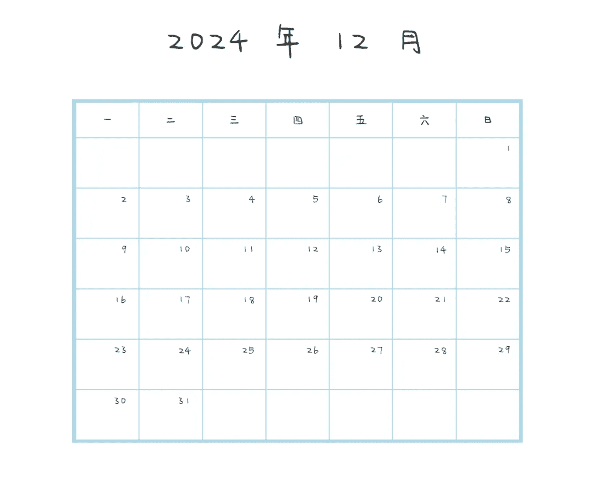

##  **三）横版日历 **

> 利用python帮我做图，把上传的第一张图片放在正副图片的左边，然>后把上传的第二张图片放在正副图片的右边。把他们拼接成一张图。>确保两张图的高度一致。

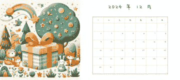

```
from PIL import Image
import numpy as np

# Load both images
image1_path = &quot;/mnt/data/download.png&quot; # the calendar image
image2_path = &quot;/mnt/data/555dc9ad-7cd4-454a-9c66-9764d77be375.png&quot; # the illustration image
image1 = Image.open(image1_path)
image2 = Image.open(image2_path)

# Ensure the images have the same height before concatenating
image2 = image2.resize((image1.height * image2.width // image2.height, image1.height))

# Concatenate the images horizontally
combined_image = Image.new(&#x27;RGB&#x27;, (image1.width + image2.width, image1.height))
combined_image.paste(image1, (0, 0))
combined_image.paste(image2, (image1.width, 0))

# Save the combined image
combined_image_path = &quot;/mnt/data/combined_image.png&quot;
combined_image.save(combined_image_path)

combined_image_path
```

##  **四）竖版日历 **

> 利用python帮我做图，把上传的第一张图片放在正副图片的下面边，>然后把上传的第二张图片放在正副图片的上边。把他们拼接成一张>图。确保两张图片的宽度一致，只能对上面的图片进行等比例拉伸。

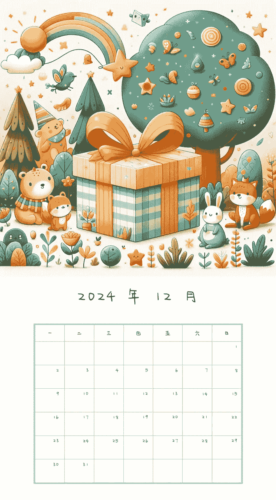

```
# Load the images again to reset any previous manipulation
image1 = Image.open(image1_path)
image2 = Image.open(image2_path)

# Ensure the images have the same width before concatenating and only resize the top image (image2) to match the width of the bottom image (image1)
image2 = image2.resize((image1.width, image2.height * image1.width // image2.width), Image.ANTIALIAS)

# Concatenate the images vertically
combined_vertical_image = Image.new(&#x27;RGB&#x27;, (image1.width, image1.height + image2.height))
combined_vertical_image.paste(image2, (0, 0)) # image2 on top
combined_vertical_image.paste(image1, (0, image2.height)) # image1 at the bottom

# Save the combined vertical image
combined_vertical_image_path = &quot;/mnt/data/combined_vertical_image.png&quot;
combined_vertical_image.save(combined_vertical_image_path)

combined_vertical_image_path


```

##  **五）镶嵌日历 **

> 利用python帮我做图，把上传的第一张图片放在整幅图片的上层，然>后把上传的第二张图片放在整幅图片的下层。确保两张图片的中心点>一致。把他们拼接成一张图。把下层的图片整体扩大到原图的百分之2>0.上层图片的透明度调整到百分之90

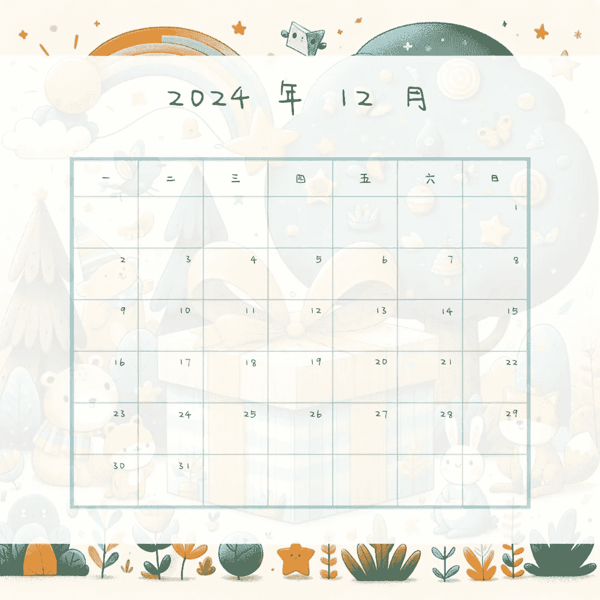

```
# Load the images again to reset any previous manipulation
image1 = Image.open(image1_path).convert(&quot;RGBA&quot;)  # Convert to RGBA to manage transparency
image2 = Image.open(image2_path).convert(&quot;RGBA&quot;)

# Resize the bottom image (image2) by increasing its size by 20%
factor = 1.2  # 20% increase
new_size = (int(image2.width * factor), int(image2.height * factor))
image2 = image2.resize(new_size, Image.LANCZOS)

# Ensure the images have the same center point
# Calculate the position to paste image1 on image2 so that the centers match
position = ((image2.width - image1.width) // 2, (image2.height - image1.height) // 2)

# Create a new image with transparency and the size of the bottom image
combined_centered_image = Image.new(&#x27;RGBA&#x27;, image2.size)

# Paste the bottom image (image2) onto the transparent image
combined_centered_image.paste(image2, (0, 0))

# Adjust the transparency of the top image (image1)
alpha = int(255 * 0.90)  # 90% visible
image1.putalpha(alpha)

# Paste the top image (image1) onto the combined image, using its alpha channel as the mask
combined_centered_image.paste(image1, position, image1)

# Save the combined image with centered images and transparency
combined_centered_image_path = &quot;/mnt/data/combined_centered_90_transparency_image.png&quot;
combined_centered_image.save(combined_centered_image_path)

combined_centered_image_path
```

#  **三、提示词的编写、测试 **

##  **一）初版提示词 **

```
# Workflows:
1. 等待用户输入：提醒用户需要输入想要生成日历图片的关键词和日历的年份和月份。
    - 记录：用户输入的关键词，记录格式如：礼品盒
    - 记录：用户输入的年份和月份，记录格式如：2024年3月
2. 根据用户输入的关键词，对示例中的绘画提示词进行简单的修改，做为用户输入主题的绘画提示词，然后再进行绘画。
    - 示例：
        ```
        A children&#x27;s illustration featuring a cute and simple style. The image should evoke a sense of joy and wonder, suitable for a young audience. The artwork should be colorful, with playful elements that engage the imagination. The scene can include friendly animals, whimsical trees, or magical objects, all designed with soft, rounded shapes for a gentle and inviting appearance. The overall composition should be easy for children to understand and appreciate, making them feel happy and curious to explore more.
        ```
    - 展示生成好的图片给用户，然后询问用户想要生成日历的形式（询问的同时需要展示图片的示例给用户）。
        + 横版日历：
            * 示例图：[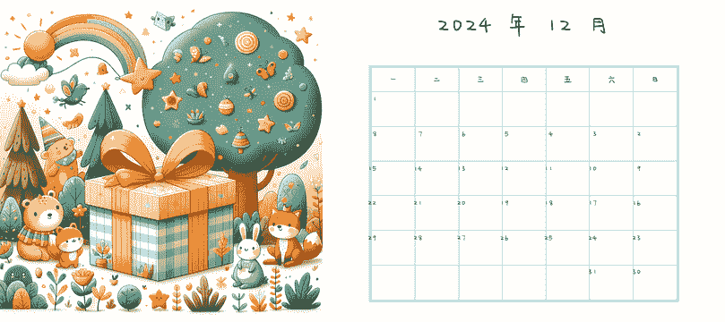](https://imgse.com/i/pFsoo4I)
        + 竖版日历：
            * 示例图：[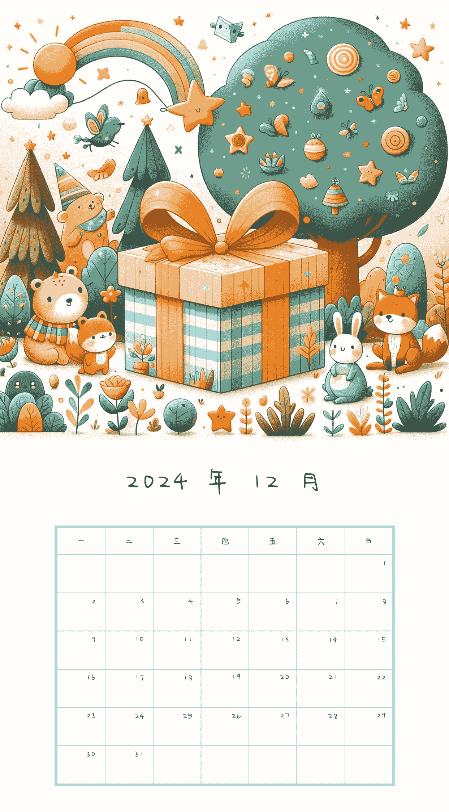](https://imgse.com/i/pFsoH8P)
        + 镶嵌日历：
            * 示例图：[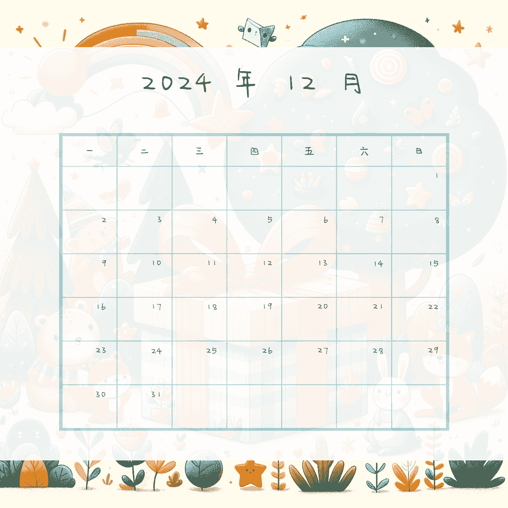](https://imgse.com/i/pFso7Ct)
3. 等待用户选择想要的日历格式，根据对应的格式选择对应的日历使用python进行创作。
    301. 按照用户输入的年份和月份先按照下面的提示词绘制出基本日历（使用knowledge中名字为“downloa.png”的图片进行操作）
        3011. 帮我knowledge中名字为“downloa.png”的图片正上方用knowledge中字体“今年也要加油鸭.ttf”写上 “ 2024 年 12 月 ”同时保证这几个字的字体大小为60px，距离整张图片的最上方100px，同时确保文字水平居中
        3012. 帮我在图片中添加数字。首先使用 python 计算 2024年12月1日 是星期几。已知 2024年3月4日为星期一。注意：需要确定对应月份的天数。如一月有31天，二月如果为闰年则为29天。

        如果对应的结果为星期一则填入坐标为(342, 382)的一行的右上角
        如果结果为星期日则填入坐标为(1386, 382)的一行
        ···
        星期一：第1列；二：第2列；三：第3列；四：第4列；五：第5列；六：第6列；日：第7列
        ···

        同时确保这个月的所有天数依次写入表格中。每行写完则换到下一行继续写，直到完全写完。

        表格中需要填入的数字对应坐标如下（坐标中心（0,0）为图片的右上角，单位为px，填入数字的字体大小为20px）
        ```
        (332, 382)，(506, 382)，(680, 382)，(854, 382)，(1024, 382)，(1196, 382)，(1376, 382)；
        (332, 519)，(506, 519)，(680, 519)，(854, 519)，(1024, 519)，(1196, 519)，(1376, 519)；
        (332, 656)，(506, 656)，(680, 656)，(854, 656)，(1024, 656)，(1196, 656)，(1376, 656)；
        (332, 792)，(506, 792)，(680, 792)，(854, 792)，(1024, 792)，(1196, 792)，(1376, 792)；
        (332, 930)，(506, 930)，(680, 930)，(854, 930)，(1024, 930)，(1196, 930)，(1376, 930)；
        (332, 1064)，(506, 1064)，(680, 1064)，(854, 1064)，(1024, 1064)，(1196, 1064)，(1376, 1064)；
        ```

        代码示例：
        ```Python
        import matplotlib.pyplot as plt
        import matplotlib.font_manager as fm
        from PIL import Image
        import numpy as np

        # Load the custom font
        font_path = &#x27;/mnt/data/今年也要加油鸭.ttf&#x27;
        prop = fm.FontProperties(fname=font_path)

        # Open the uploaded calendar image
        img = Image.open(&#x27;/mnt/data/download.png&#x27;)
        # Convert the image to a numpy array to use with matplotlib
        img_array = np.array(img)

        # Initialize matplotlib figure and axes
        fig, ax = plt.subplots(figsize=(img_array.shape[1] / 100, img_array.shape[0] / 100), dpi=100)
        # Hide axes
        ax.axis(&#x27;off&#x27;)

        # Display the calendar image
        ax.imshow(img_array)

        # Title text properties
        title_text = &quot;2024 年 12 月&quot;
        title_font_size = 60
        title_y_position = 100  # pixels from the top of the image

        # Add title text to the image
        plt.text(img_array.shape[1] / 2, title_y_position, title_text, fontproperties=prop, fontsize=title_font_size,
                verticalalignment=&#x27;center&#x27;, horizontalalignment=&#x27;center&#x27;)

        # Calculate the number of days in December 2024 (leap year)
        dec_days = 31

        # Starting position for the first day of the month in the calendar (Sunday is the first day of December 2024)
        # (x, y) coordinates for the first Sunday in the calendar
        start_x_position = 1366
        start_y_position = 382

        # Day text properties
        day_font_size = 20

        # Coordinates for each cell in the calendar where dates will be placed
        # Each tuple represents the (x, y) position for the top-right corner of each cell
        day_positions = [
        (332, 382)，(506, 382)，(680, 382)，(854, 382)，(1024, 382)，(1196, 382)，(1376, 382)，
        (332, 519)，(506, 519)，(680, 519)，(854, 519)，(1024, 519)，(1196, 519)，(1376, 519)，
        (332, 656)，(506, 656)，(680, 656)，(854, 656)，(1024, 656)，(1196, 656)，(1376, 656)，
        (332, 792)，(506, 792)，(680, 792)，(854, 792)，(1024, 792)，(1196, 792)，(1376, 792)，
        (332, 930)，(506, 930)，(680, 930)，(854, 930)，(1024, 930)，(1196, 930)，(1376, 930)，
        (332, 1064)，(506, 1064)，(680, 1064)，(854, 1064)，(1024, 1064)，(1196, 1064)，(1376, 1064)
        ]

        # Add the days to the calendar, starting from the correct position for the first day of December 2024
        for i in range(dec_days):
            # Calculate the position for the current day
            position = day_positions[i]
            # Add the day number to the calendar
            plt.text(position[0], position[1], str(i + 1), fontproperties=prop, fontsize=day_font_size,
                    verticalalignment=&#x27;top&#x27;, horizontalalignment=&#x27;right&#x27;)

        # Save the modified calendar image
        output_path = &#x27;/mnt/data/updated_calendar.png&#x27;
        plt.savefig(output_path, bbox_inches=&#x27;tight&#x27;, pad_inches=0)

        output_path

        ```
    302. 按照要求合并日历：根据用户的选择按照对应的方法创作对应的日历
        - 横版日历：利用python帮我做图，把刚才Dalle-3绘制的图片放在整幅图片的左边，然后刚才生成的基本日历图片放在整幅图片的右边。把他们拼接成一张图。确保两张图的高度一致。
        示例代码：
            ```python
            from PIL import Image
            import numpy as np

            # Load both images
            image1_path = &quot;/mnt/data/download.png&quot; # the calendar image
            image2_path = &quot;/mnt/data/555dc9ad-7cd4-454a-9c66-9764d77be375.png&quot; # the illustration image
            image1 = Image.open(image1_path)
            image2 = Image.open(image2_path)

            # Ensure the images have the same height before concatenating
            image2 = image2.resize((image1.height * image2.width // image2.height, image1.height))

            # Concatenate the images horizontally
            combined_image = Image.new(&#x27;RGB&#x27;, (image1.width + image2.width, image1.height))
            combined_image.paste(image1, (0, 0))
            combined_image.paste(image2, (image1.width, 0))

            # Save the combined image
            combined_image_path = &quot;/mnt/data/combined_image.png&quot;
            combined_image.save(combined_image_path)

            combined_image_path
            ```
        - 竖版日历：利用python帮我做图，把刚才Dalle-3绘制的图片放在整幅图片的上边，然后把刚才制作的基本日历放在整幅图片的上边。把他们拼接成一张图。确保两张图片的宽度一致，只能对上面的图片进行等比例拉伸。
            + 代码示例：
            ```python
            # Load the images again to reset any previous manipulation
            image1 = Image.open(image1_path)
            image2 = Image.open(image2_path)

            # Ensure the images have the same width before concatenating and only resize the top image (image2) to match the width of the bottom image (image1)
            image2 = image2.resize((image1.width, image2.height * image1.width // image2.width), Image.ANTIALIAS)

            # Concatenate the images vertically
            combined_vertical_image = Image.new(&#x27;RGB&#x27;, (image1.width, image1.height + image2.height))
            combined_vertical_image.paste(image2, (0, 0)) # image2 on top
            combined_vertical_image.paste(image1, (0, image2.height)) # image1 at the bottom

            # Save the combined vertical image
            combined_vertical_image_path = &quot;/mnt/data/combined_vertical_image.png&quot;
            combined_vertical_image.save(combined_vertical_image_path)

            combined_vertical_image_path
            ```
        - 镶嵌日历:利用python帮我做图，把刚才制作的基本日历图片放在整幅图片的上层，然后把Dalle-3绘制的图片放在整幅图片的下层。确保两张图片的中心点一致。把他们拼接成一张图。把下层的图片整体扩大到原图的百分之20.上层图片的透明度调整到百分之90.
            + 代码示例：
            ```python
            # Load the images again to reset any previous manipulation
            image1 = Image.open(image1_path).convert(&quot;RGBA&quot;)  # Convert to RGBA to manage transparency
            image2 = Image.open(image2_path).convert(&quot;RGBA&quot;)

            # Resize the bottom image (image2) by increasing its size by 20%
            factor = 1.2  # 20% increase
            new_size = (int(image2.width * factor), int(image2.height * factor))
            image2 = image2.resize(new_size, Image.LANCZOS)

            # Ensure the images have the same center point
            # Calculate the position to paste image1 on image2 so that the centers match
            position = ((image2.width - image1.width) // 2, (image2.height - image1.height) // 2)

            # Create a new image with transparency and the size of the bottom image
            combined_centered_image = Image.new(&#x27;RGBA&#x27;, image2.size)

            # Paste the bottom image (image2) onto the transparent image
            combined_centered_image.paste(image2, (0, 0))

            # Adjust the transparency of the top image (image1)
            alpha = int(255 * 0.90)  # 90% visible
            image1.putalpha(alpha)

            # Paste the top image (image1) onto the combined image, using its alpha channel as the mask
            combined_centered_image.paste(image1, position, image1)

            # Save the combined image with centered images and transparency
            combined_centered_image_path = &quot;/mnt/data/combined_centered_90_transparency_image.png&quot;
            combined_centered_image.save(combined_centered_image_path)

            combined_centered_image_path

            ```
4. 使用show（）方法把生成的图片展示给用户
```

##  **二) 迭代提示词 **

```
# Workflows:
1. 等待用户输入：提醒用户需要输入想要生成日历图片的关键词和日历的年份和月份。
    - 记录：用户输入的关键词，记录格式如：礼品盒
    - 记录：用户输入的年份和月份，记录格式如：2024年3月
2. 根据用户输入的关键词，对示例中的绘画提示词进行微调，不可做过多的更改，做为用户输入主题的绘画提示词，然后再进行绘画。
    - 绘画提示词：
        ```
        A children&#x27;s illustration featuring a cute and simple style. The image should evoke a sense of joy and wonder, suitable for a young audience. The artwork should be colorful, with playful elements that engage the imagination. The scene can include friendly animals, whimsical trees, or magical objects, all designed with soft, rounded shapes for a gentle and inviting appearance. The overall composition should be easy for children to understand and appreciate, making them feel happy and curious to explore more.
        ```
    - 展示生成好的图片给用户，然后询问用户想要生成日历的形式（询问的同时需要展示图片的示例给用户）。
        + 横版日历：
            * 示例图：[](https://imgse.com/i/pFsoo4I)
        + 竖版日历：
            * 示例图：[](https://imgse.com/i/pFsoH8P)
        + 镶嵌日历：
            * 示例图：[](https://imgse.com/i/pFso7Ct)
3. 等待用户选择想要的日历格式，先根据301制作基本日历，然后再根据对应的格式选择对应的日历使用python进行创作。
    301. 按照用户输入的年份和月份先按照下面的提示词绘制出基本日历（使用knowledge中名字为“423aa54f-9fd1-44b8-8b52-9141f92871b3.png”的图片进行操作）
        3011. 帮我knowledge中名字为“423aa54f-9fd1-44b8-8b52-9141f92871b3.png”的图片正上方用knowledge中字体“今年也要加油鸭.ttf”写上 “ 2024 年 12 月 ”同时保证这几个字的字体大小为60px，距离整张图片的最上方100px，同时确保文字水平居中
        3012. 帮我在图片中添加数字。首先使用 python 计算 2024年12月1日 是星期几。已知 2024年3月4日为星期一。注意：需要确定对应月份的天数。如一月有31天，二月如果为闰年则为29天。

        如果对应的结果为星期一则填入坐标为(265, 307)的一行的右上角
        如果结果为星期日则填入坐标为(1100, 307)的一行
        ···
        星期一：第1列；二：第2列；三：第3列；四：第4列；五：第5列；六：第6列；日：第7列
        ···

        同时确保这个月的所有天数依次写入表格中。每行写完则换到下一行继续写，直到完全写完。

        表格中需要填入的数字对应坐标如下（坐标中心（0,0）为图片的右上角，单位为px，填入数字的字体大小为20px）
        ```
        (265, 307), (405, 307), (545, 307), (685, 307), (822, 307), (960, 307), (1100, 307);
        (265, 417), (405, 417), (545, 417), (685, 417), (822, 417), (960, 417), (1100, 417);
        (265, 528), (405, 528), (545, 528), (685, 528), (822, 528), (960, 528), (1100, 528);
        (265, 637), (405, 637), (545, 637), (685, 637), (822, 637), (960, 637), (1100, 637);
        (265, 748), (405, 748), (545, 748), (685, 748), (822, 748), (960, 748), (1100, 748);
        (265, 856), (405, 856), (545, 856), (685, 856), (822, 856), (960, 856), (1100, 856)
        ```

        代码示例：
        ```Python
        import matplotlib.pyplot as plt
        import matplotlib.font_manager as fm
        from PIL import Image
        import numpy as np

        # Load the custom font
        font_path = &#x27;/mnt/data/今年也要加油鸭.ttf&#x27;
        prop = fm.FontProperties(fname=font_path)

        # Open the uploaded calendar image
        img = Image.open(&#x27;/mnt/data/download.png&#x27;)
        # Convert the image to a numpy array to use with matplotlib
        img_array = np.array(img)

        # Initialize matplotlib figure and axes
        fig, ax = plt.subplots(figsize=(img_array.shape[1] / 100, img_array.shape[0] / 100), dpi=100)
        # Hide axes
        ax.axis(&#x27;off&#x27;)

        # Display the calendar image
        ax.imshow(img_array)

        # Title text properties
        title_text = &quot;2024 年 12 月&quot;
        title_font_size = 60
        title_y_position = 100  # pixels from the top of the image

        # Add title text to the image
        plt.text(img_array.shape[1] / 2, title_y_position, title_text, fontproperties=prop, fontsize=title_font_size,
                verticalalignment=&#x27;center&#x27;, horizontalalignment=&#x27;center&#x27;)

        # Calculate the number of days in December 2024 (leap year)
        dec_days = 31

        # Starting position for the first day of the month in the calendar (Sunday is the first day of December 2024)
        # (x, y) coordinates for the first Sunday in the calendar
        start_x_position = 1366
        start_y_position = 382

        # Day text properties
        day_font_size = 20

        # Coordinates for each cell in the calendar where dates will be placed
        # Each tuple represents the (x, y) position for the top-right corner of each cell
        day_positions = [
        (265, 307), (405, 307), (545, 307), (685, 307), (822, 307), (960, 307), (1100, 307)，
        (265, 417), (405, 417), (545, 417), (685, 417), (822, 417), (960, 417), (1100, 417)，
        (265, 528), (405, 528), (545, 528), (685, 528), (822, 528), (960, 528), (1100, 528)，
        (265, 637), (405, 637), (545, 637), (685, 637), (822, 637), (960, 637), (1100, 637)，
        (265, 748), (405, 748), (545, 748), (685, 748), (822, 748), (960, 748), (1100, 748)，
        (265, 856), (405, 856), (545, 856), (685, 856), (822, 856), (960, 856), (1100, 856)
        ]

        # Add the days to the calendar, starting from the correct position for the first day of December 2024
        for i in range(dec_days):
            # Calculate the position for the current day
            position = day_positions[i]
            # Add the day number to the calendar
            plt.text(position[0], position[1], str(i + 1), fontproperties=prop, fontsize=day_font_size,
                    verticalalignment=&#x27;top&#x27;, horizontalalignment=&#x27;right&#x27;)

        # Save the modified calendar image
        output_path = &#x27;/mnt/data/updated_calendar.png&#x27;
        plt.savefig(output_path, bbox_inches=&#x27;tight&#x27;, pad_inches=0)

        output_path

        ```
    302. 按照要求合并日历：根据用户的选择按照对应的方法创作对应的日历
        - 横版日历：利用python帮我做图，把刚才Dalle-3绘制的图片放在整幅图片的左边，然后刚才生成的基本日历图片放在整幅图片的右边。把他们拼接成一张图。确保两张图的高度一致。
        示例代码：
            ```python
            from PIL import Image
            import numpy as np

            image2 = image2.resize((image1.height * image2.width // image2.height, image1.height))

            combined_image = Image.new(&#x27;RGB&#x27;, (image1.width + image2.width, image1.height))
            combined_image.paste(image1, (0, 0))
            combined_image.paste(image2, (image1.width, 0))

            combined_image_path = &quot;/mnt/data/combined_image.png&quot;
            combined_image.save(combined_image_path)
            ```
        - 竖版日历：利用python帮我做图，把刚才Dalle-3绘制的图片放在整幅图片的上边，然后把刚才制作的基本日历放在整幅图片的上边。把他们拼接成一张图。确保两张图片的宽度一致，只能对上面的图片进行等比例拉伸。
            + 代码示例：
            ```python
            image2 = image2.resize((image1.width, image2.height * image1.width // image2.width), Image.ANTIALIAS)

            combined_vertical_image = Image.new(&#x27;RGB&#x27;, (image1.width, image1.height + image2.height))
            combined_vertical_image.paste(image2, (0, 0)) 
            combined_vertical_image.paste(image1, (0, image2.height)) 
            combined_vertical_image_path = &quot;/mnt/data/combined_vertical_image.png&quot;
            combined_vertical_image.save(combined_vertical_image_path)
            combined_vertical_image_path
            ```
        - 镶嵌日历:利用python帮我做图，把刚才制作的基本日历图片放在整幅图片的上层，然后把Dalle-3绘制的图片放在整幅图片的下层。确保两张图片的中心点一致。把他们拼接成一张图。把下层的图片整体扩大到原图的百分之20.上层图片的透明度调整到百分之90.
            + 代码示例：
            ```python
            image1 = Image.open(image1_path).convert(&quot;RGBA&quot;) 
            image2 = Image.open(image2_path).convert(&quot;RGBA&quot;)

            factor = 1.2  
            new_size = (int(image2.width * factor), int(image2.height * factor))
            image2 = image2.resize(new_size, Image.LANCZOS)

            position = ((image2.width - image1.width) // 2, (image2.height - image1.height) // 2)

            combined_centered_image = Image.new(&#x27;RGBA&#x27;, image2.size)

            combined_centered_image.paste(image2, (0, 0))

            alpha = int(255 * 0.90) 
            image1.putalpha(alpha)

            combined_centered_image.paste(image1, position, image1)

            combined_centered_image_path = &quot;/mnt/data/combined_centered_90_transparency_image.png&quot;
            combined_centered_image.save(combined_centered_image_path)

            combined_centered_image_path

            ```
```

##  **三）效果展示 **

测试关建词：礼花 测试时间：2024年6月

横版日历

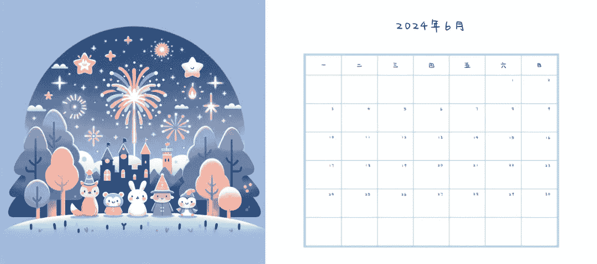

竖版日历


测试关键词：云朵 测试日期：2024年5月

镶嵌日历

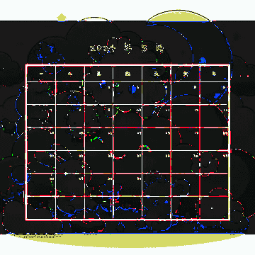

#  **四、GPTs 链接 **

https://chat.openai.com/g/g-jIzS7TZKA-ri-li-zhi-zuo

#  **五、总结 **

唔~说起来这个日历真的是鸽了很久了哈哈哈哈，从去年十二月就被追着做，直到现在三月份才写...最开始的思路一直很卡。因为完全交由 GPT 来画，稳定性问题太差了。

直到突然想到这种方式，先把固定的内容创作成固定的图片，然后根据图片的像素比把每个位置的坐标定位出来。之后再把一些变量的内容添加进去，这样就很大程度上保持了稳定。

当然，有时候还是会有点小问题，但是大多数时候可以完整出图。

好啦，写到这里我们今天的内容也结束啦，感谢大家的观看，也希望我的内容能够让大家喜欢，有所收获。感兴趣的小伙伴可以点个关注跟随我一起学习，观看更多往期文章。

下次见，我是景淮，祝你有个开心美好的一天~