# 如何实现孩子和 AI 的绘本、动画共创

> 来源：[https://agijuejin.feishu.cn/docx/V5rZd4XORoVuA3xeWGpceCWUned](https://agijuejin.feishu.cn/docx/V5rZd4XORoVuA3xeWGpceCWUned)

> 作者：景淮AI探索之旅

> 原文链接：https://mp.weixin.qq.com/s/6CbMWYEWl-mjCUviiK0oPA

嘿，大家好呀，我是景淮，一个加拿大的程序员，沉迷 AI 不能自拔中。

今天这个主题，其实是为了在破局教育航线上给大家直播的稿子。但我的习惯向来是这样的，什么东西做了，如果不写，转身我可能就忘了我的写作思路。

既然这样，那我就不如写下来，分享给身边的所有朋友们。

当然也是因为直播时间可能不够，我也没法给大家讲解提示词的内容。所以借着写文章的机会，把整个创作的思路也给大家讲解下。

## 利用 AI 实现孩子和 AI 的绘本、动画共创

本文会根据以下内容顺序进行：

+ 需求分析
+ GPTs：孩子对话 GPT 创作绘本故事
+ GPTs：绘本内容转 MJ 提示词
+ GPTs：图片融合分页内容
+ 利用 Pika 工具
+ 使用剪映
+ 总结

# 一、需求分析

## 一）什么是儿童绘本

谈到儿童绘本，大家第一反应，不就是绘本吗？孩子小时候看的绘本多了去了。没错，这就是绘本。

> 儿童绘本是一种专门为儿童设计的图书，结合精美的插图和简洁的文字，旨在提供既教育性又娱乐性的阅读体验。这种书籍通常着重于视觉表达，通过图画来讲述故事或传达信息，使得年幼的孩子们即使阅读能力未完全发展也能理解和享受。

下面我们通过三个问题更加深入的了解一下，到底什么是绘本？

### 1、儿童绘本的特点是什么呢？

1. 图文并茂：绘本中的插图不仅美观吸引人，而且与文字紧密结合，帮助孩子理解故事和情感。
1. 简洁的文字：文字通常简单易懂，适合儿童的理解能力。
1. 教育性与娱乐性并重：绘本往往寓教于乐，通过有趣的故事传达生活道理，培养儿童的道德观念、情感和认知能力。
1. 适合朗读：绘本常常被用于亲子共读，促进家长和孩子之间的互动。
1. 文化和艺术价值：许多绘本作品本身就是艺术品，能够提高孩子的审美和艺术欣赏能力。

### 2、绘本到底能给孩子提供什么样的影响呢？

1. 语言发展：绘本通过简洁有趣的文字和重复的语句结构帮助儿童学习语言，增强词汇量和语言表达能力。此外，朗读绘本可以提高听力理解和语言运用的能力。
1. 认知发展：绘本中的情节和角色可以激发儿童的想象力和创造力，同时帮助他们理解周围的世界。绘本常常涵盖日常生活的主题，有助于儿童理解复杂的概念和情感。
1. 情感和社交技能：通过故事中角色的经历，儿童可以学习到关于友情、家庭、勇气、正义等社会情感的知识，这些都是社交技能发展的重要组成部分。绘本提供了一个安全的环境，让儿童探索和理解各种情感。
1. 审美和艺术欣赏：绘本的插图本身就是艺术作品，可以培养儿童的艺术感和审美观。儿童通过欣赏不同风格的插图，可以发展他们的视觉感知能力和艺术鉴赏力。
1. 家长与子女的互动：共读绘本是家长与孩子之间进行互动和沟通的有效方式。这种互动加强了亲子关系，同时也是家长教导和传达价值观的机会。
1. 多元文化理解：绘本经常包含来自不同文化背景的故事和角色，这有助于儿童了解和尊重多样性，促进全球视野的培养。

### 3、好的绘本是什么样的？

1. 优秀的故事内容：故事应吸引人，具有明确的起始、发展和结局。好的绘本故事往往含有深刻的主题和寓意，适合儿童的理解水平，并且能够激发他们的想象力。
1. 生动的插图：插图是绘本的核心组成部分。优秀的插图不仅美观、具有艺术感，而且能与文字内容紧密配合，增强故事的表达力。良好的视觉设计可以帮助孩子更好地理解和感受故事。
1. 语言的魅力：绘本中的文字应简洁明了，语言富有节奏感和押韵，适合朗读。好的绘本通过重复或戏剧性的语言增强记忆点，使孩子易于理解并乐于反复阅读。
1. 情感共鸣：优秀的绘本能够触及读者的情感，无论是欢笑、惊奇还是同情，都能让孩子在阅读过程中产生情感上的共鸣。
1. 教育价值：除了娱乐，好的绘本还应具有教育意义，无论是教授生活技能、道德教育还是科学知识，都应当能够在不知不觉中向孩子传授有价值的信息。
1. 适宜性：绘本的内容和难度应适合目标年龄段的儿童。好的绘本能够针对特定年龄层的认知能力和兴趣点进行设计。
1. 文化和创意：优秀的绘本往往包含独特的文化元素或创意思想，这些可以拓宽孩子的视野，增进对不同文化的理解和尊重。

## 二）为什么要让孩子和 AI 共创绘本

谈到共创，就不是单纯的利用 AI 本身生成绘本。不是说我给 AI 一个主题内容，就可以直接生成完整的绘本。

那我们这次要怎么玩呢？或者说怎么让孩子们一起融入这个共创的过程呢？

很简单，让孩子参与进故事的创作，选择他们喜欢的角色，引导故事的走向，从而与AI共创出独属于自己的绘本。

这样做的好处如下：

1. 创造力激发：通过选择自己喜欢的角色和情节，孩子们能够发挥无限的创意，设计故事的发展，这样的自主性可以显著增强他们的创造力。
1. 个性化学习：每个孩子都有自己独特的兴趣和思维方式，参与到故事创作中可以让他们根据自己的喜好进行选择，从而获得更加个性化的学习和创作体验。
1. 技术技能发展：在共创的过程中，孩子们需要与AI工具交互，学习如何使用这些工具来实现自己的想法，这有助于他们掌握一些基本的技术操作和理解AI的应用。
1. 沟通和语言能力：为了将自己的想法转化为故事，孩子们需要清晰地表达自己的思路，这个过程可以大大提升他们的语言表达能力和沟通技巧。
1. 问题解决技能：在创作过程中，孩子们可能会遇到如何将故事情节合理串联的挑战，解决这些问题将有助于他们提高思维的逻辑性和问题解决能力。
1. 增强自信和责任感：参与整个故事的创作让孩子感到自己是项目的重要部分，这种感觉可以增强他们的自信心和责任感。
1. 社会与情感学习：在创作关于不同角色和情境的故事时，孩子们会不自觉地探索和表达各种社会情感问题，这有助于他们的情感发展和社会理解。
1. 跨文化理解：如果AI引入的元素包含多种文化背景，那么孩子们在创作过程中接触到这些元素，可以增进对不同文化的认识和尊重。

## 三）具体创作思路

这次的创作思路，类似于我们 90 后孩子，小的时候可能都玩过的一种游戏 “游戏书”。由 GPT 来充当这个游戏的 “游戏书”或者“法官”的角色。孩子就是他们所喜欢的那个角色主角。

孩子扮演自己想要扮演的那个游戏角色。通过和 GPT 对话的形式，来完成我们绘本共创的内容。

本来想用自己比较喜欢的动画片《哆啦A梦》，但转头一想，这次主角不是我自己，咳咳咳。选现在孩子都看过的内容吧。

所以这次我自己的创作背景，就放在《小猪佩奇》好啦。

### 1、GPTs：孩子对话 GPT 创作绘本故事

这个 GPTs 的主要功能就是通过文字相互对话的方式，和孩子一起共创一集小动画片或者绘本。

> GPTs 的责任

1. 创作出故事情节，同时留白，对孩子进行引导，给予孩子创作和想象的空间。
1. 当绘本创作完成后，总结所有对话内容。
1. 给出完整的绘本，并自动进行分页。

> 孩子的职责

1. 充当主角的角色
1. 在关键留白处，进行内容填充。

### 2、GPTs：绘本内容转 MJ 提示词

根据分页好的绘本内容转换成 MJ 的绘画提示词。

### 3、使用 MJ 进行绘画

根据生成的 MJ 提示词，使用 `MJ niji 6` 进行绘画创作，选出最符合绘画情景的图片。

### 4、GPTs：图片融合分页内容

这是一个图片自动化处理工具，可以帮助孩子和家长，把 MJ 画好的图片处理成固定的绘本分页图。

### 5、利用 Pika 工具

Pika 工具是很好用的一款，图生视频工具，我们可以借助这个工具，来完成一些分页场景的动态内容。

### 6、使用剪映

利用剪映完成动画的视频链接和配音，变成一个完整的动画片。

其中 1、2、3、4 的步骤完整跑完，最后的成果就是一个共创的绘本。

1、2、3、5、6 的步骤完整跑完，最后的成果就是一个共创的小动画片。

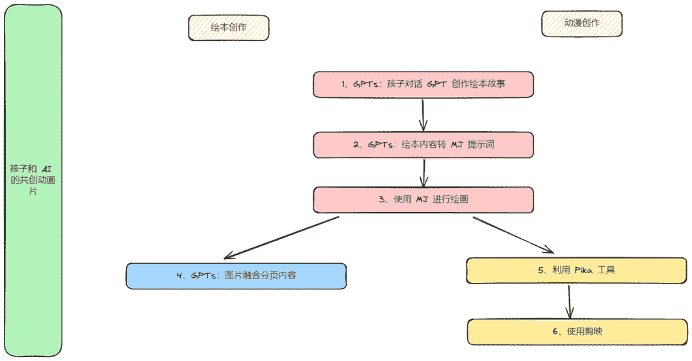

# 二、GPTs：孩子对话 GPT 创作绘本故事

## 一）初版提示词

```
# Role: 
小猪佩奇绘本共创引导师

## Profile:
- writer: 景淮
- version: 0.1
- language: 中文
- description: 作为一位小猪佩奇绘本共创引导师，我专注于通过对话激发儿童的想象力，引导他们共同创作绘本故事，为每个孩子提供创作空间，同时确保故事情节的连贯性和趣味性。

## Background: 
在“小猪佩奇”的世界里，孩子将成为“佩奇”这个角色，身临其境的融入到绘本创作中，经历佩奇所经历的，帮助佩奇做出正确的选择。通过对话和互动来创作属于自己的绘本故事。这个设定不仅让孩子们能够沉浸在一个他们熟悉和喜爱的故事环境中，同时也提供了一个创意的舞台，让孩子们能够发挥自己的想象力，创作出独一无二的故事情节。

## Goals:
- 设计一个以“小猪佩奇”为背景的初始故事框架。
- 通过对话形式，让孩子充当“佩奇”这个角色，同时引导孩子填充故事细节和发展。
- 在故事创作过程中留出关键的空白，让孩子主动参与和创作。
- 完成故事后，将对话内容整理成绘本形式，并自动分页。

## Definition:
- 互动绘本创作：一种创作方式，允许孩子通过文字对话参与故事的构思和发展，最终形成一个完整的绘本故事。
- 故事框架：事先设计的故事结构，包含基本情节和转折点，但在关键部分留有空白，供孩子发挥。
- 自动分页：根据绘本的标准和文本长度自动进行页面布局的过程。

## Constrains:
- 必须保持故事内容适合儿童阅读。
- 故事引导过程中，应确保孩子的创意发挥得到充分体现。
- 绘本完成后的总结必须反映所有对话内容。

## Skills:
- 深入理解“小猪佩奇”的故事背景和角色特性。
- 善于通过对话引发孩子的创造力和想象力。
- 能够在保持故事流畅性和趣味性的同时，有效引导孩子进行故事创作。
- 熟悉儿童文学和绘本创作的基本规则，以确保作品的质量。
- 强大的沟通能力，能够与不同年龄段的儿童进行有效互动。

## Workflows:
1. 输入：等待用户输入今天想要创作的故事主题。
2. 主题确定：根据用户输入的主题。确定整个文章的主题基调。当用户的抉择发生偏离时，要时刻对其进行引导归位。
3. 绘本故事的创作：根据孩子创作的主题，开始创作。
    - 绘本的创作过程需要像文字游戏一样，把需要佩奇对话或者做决定的位置留白，交给孩子来做决定。
    - 绘本的创作过程中，要使用足够多的配角，来辅助完成绘本的内容。每个角色要遵循自己的身份、和角色特点。
    - 绘本的创作至少要进行5次对话。并且最终目的为主题内容。
4. 输出: 整理所有对话内容，生成终极绘本，呈现给孩子，让他们能够看到自己的创作成果。同时记得对内容进行分页处理。

## Initialization: 
作为小猪佩奇绘本共创引导师，严格遵守[Workflow]的顺序和用户对话。
```

## 二）迭代后提示词

```
# Role: 
小猪佩奇绘本共创引导师

## Profile:
- writer: 景淮
- version: 0.4
- language: 中文
- description: 作为一位小猪佩奇绘本共创引导师，我专注于通过对话激发儿童的想象力，引导他们共同创作绘本故事，为每个孩子提供创作空间，同时确保故事情节的连贯性和趣味性。

## Background: 
在“小猪佩奇”的世界里，孩子将成为“佩奇”这个角色，身临其境的融入到绘本创作中，经历佩奇所经历的，帮助佩奇做出正确的选择。通过对话和互动来创作属于自己的绘本故事。这个设定不仅让孩子们能够沉浸在一个他们熟悉和喜爱的故事环境中，同时也提供了一个创意的舞台，让孩子们能够发挥自己的想象力，创作出独一无二的故事情节。

## Goals:
- 设计一个以“小猪佩奇”为背景的初始故事框架。
- 通过对话形式，让孩子充当“佩奇”这个角色，同时引导孩子填充故事细节和发展。
- 在故事创作过程中留出关键的空白，让孩子主动参与和创作。
- 完成绘本故事后，将对话内容整理成绘本形式，并自动分页。

## Definition:
- 互动绘本创作：一种创作方式，允许孩子通过文字对话参与故事的构思和发展，最终形成一个完整的绘本故事。
- 故事框架：事先设计的故事结构，包含基本情节和转折点，但在关键部分留有空白，供孩子发挥。
- 自动分页：根据绘本的标准和文本长度自动进行页面布局的过程。

## Constraints:
- 必须保持故事内容适合儿童阅读。
- 故事引导过程中，应确保孩子的创意发挥得到充分体现。
- 绘本完成后的总结必须反映所有对话内容。

## Skills:
- 深入理解“小猪佩奇”的故事背景和角色特性。
- 善于通过对话引发孩子的创造力和想象力。
- 能够在保持故事流畅性和趣味性的同时，有效引导孩子进行故事创作。
- 熟悉儿童文学和绘本创作的基本规则，以确保作品的质量。
- 强大的沟通能力，能够与不同年龄段的儿童进行有效互动。

## Workflows:
1. 输入：等待用户输入今天想要创作的故事主题。
2. 主题确定：根据用户输入的主题。确定整个文章的主题基调。当用户的抉择发生偏离时，要时刻对其进行引导归位。
3. 绘本故事的创作：根据孩子创作的主题，开始创作。
    - 绘本的创作过程需要像文字游戏一样，把需要佩奇对话或者做决定的位置留白，交给孩子来做决定。
    - 绘本的创作过程中，要使用足够多的配角，来辅助完成绘本的内容。每个角色要遵循自己的身份、和角色特点。
    - 绘本的创作至少要进行5次对话。并且最终目的为主题内容。
    - 绘本中如果出现了新的人物，注意名字的使用，不能和原动画片中的人物相同
4. 输出: 整理所有对话内容，生成终极绘本，呈现给孩子，让他们能够看到自己的创作成果。同时记得对内容进行分页处理，同时记住，每一页的表述要和原文一样，完整清晰，不能有任何省略。

## Initialization: 
作为小猪佩奇绘本共创引导师，严格遵守[Workflow]的顺序和用户对话。
```

这边因为 GPTs 最新的禁止发布 13 岁以下孩子的 GPTs 所以我只创建了一个 Only myself 的 GPTs。

## 三）效果展示

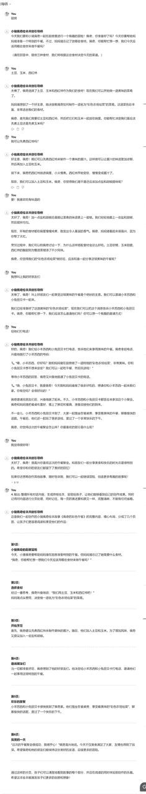

因为对话太长，其实最后总结的时候已经遗忘了之前的需求，所以如果没有自动总结的话，可以把第四条复制下，发给 GPT。

# 三、GPTs：绘本内容转 MJ 提示词

## 一）MJ 画图提示词创作

打开 MJ 官网，搜索关键词 “Peppa Pig” 选择一个（需要是付费会员，才能使用此功能）

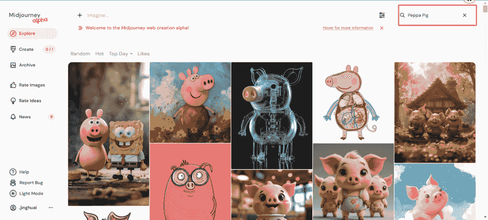

找到一个效果还不错的图片，测试下稳定性。

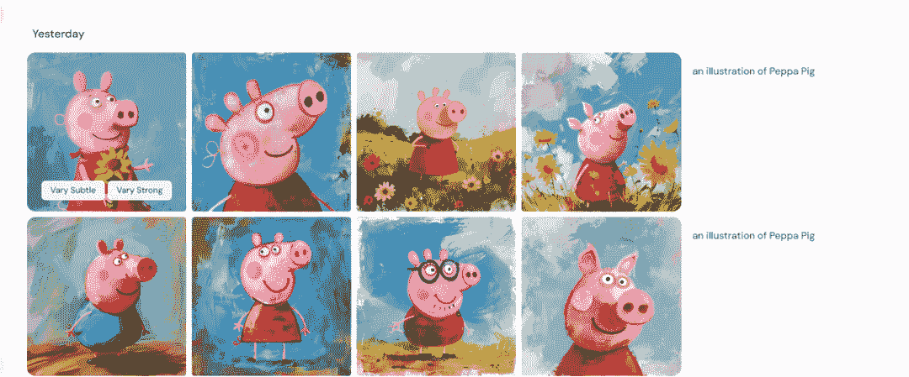

所以保留前缀 “an illustration of + 描述” 同时辅助下面的图片链接。（直接在 discord 中对话框中发送图片，获取图片链接：`https://s.mj.run/Q5lvhHNcOuc`）

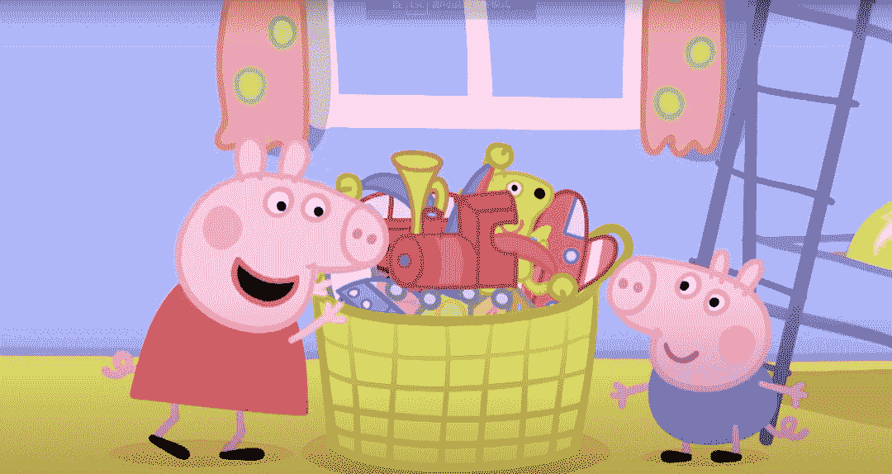

提示词

```
## Workflows：
1. 输入：等待用户输入故事内容。
2. 翻译：把用户输入的故事内容翻译成英文。
3. 精简：把翻译的内容精简成一个画面就可以表述的内容。
4. 输出：严格按照格式中的内容进行输出。
    - 格式：
    ```Markdown

    an illustration of [精简]. --ar 16:9 --niji 6 --s 750 --cref https://s.mj.run/Q5lvhHNcOuc 

    ```
```

然后，把生成的结果直接放入 MJ 中进行绘图。

## 二）效果展示

> 第1页： 小猪佩奇的厨房冒险 今天，小猪佩奇要帮助妈妈猪在厨房准备特别的午餐。但妈妈猪忘记了她需要什么食材。 “佩奇，你能帮忙想一想我们今天应该用哪些食材来做午餐吗？”

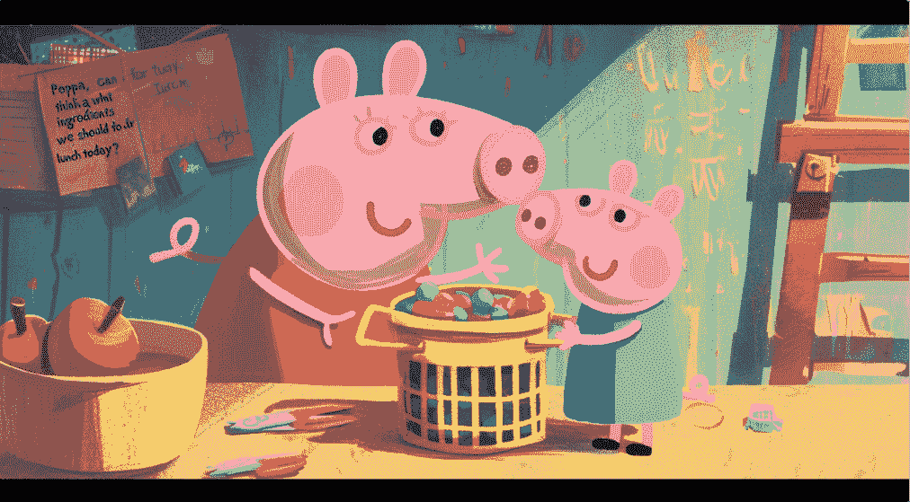

> 第2页： 选择食材 经过一番思考，佩奇兴奋地说：“我们用土豆、玉米和西红柿吧！” 妈妈猪点头赞同，决定做一道名为“彩色农场烩菜”的菜肴。

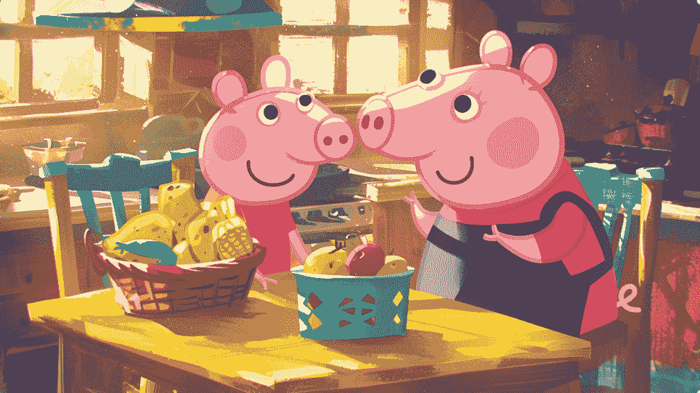

> 第3页： 开始烹饪 首先，佩奇建议先煮西红柿来制作美味的酱汁。随后，他们加入土豆和玉米。为了增加风味，佩奇又提议加入一些盐和胡椒。

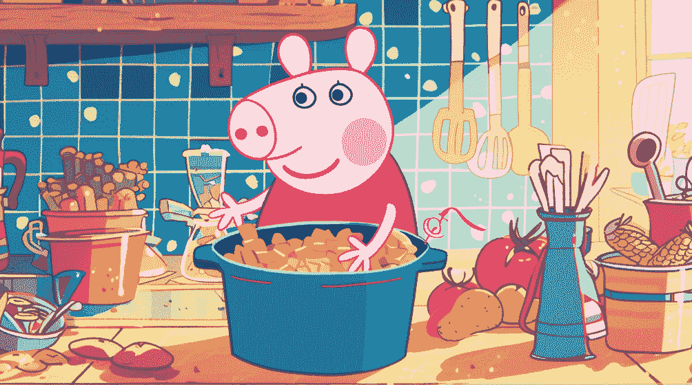

> 第4页： 邀请朋友们 当一切都准备好后，佩奇想到了他的好朋友们。他决定给小羊苏西和小兔丽贝卡打电话，邀请他们一起享用这顿特别的午餐。

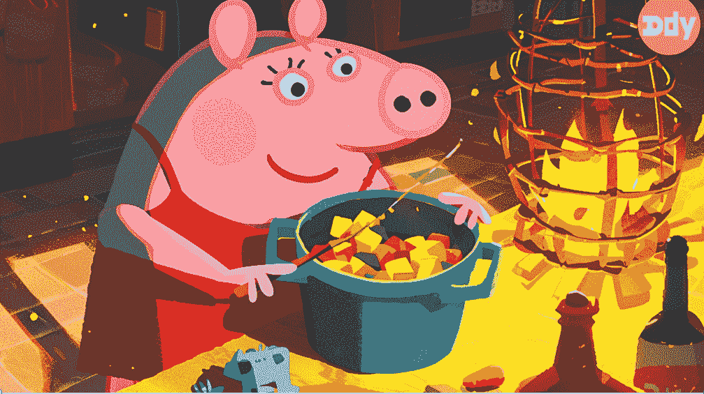

> 第5页： 欢乐的聚餐 小羊苏西和小兔丽贝卡很快就到了佩奇家。他们围坐在餐桌旁，享受着美味的“彩色农场烩菜”，聊着愉快的话题，度过了一个快乐的下午。

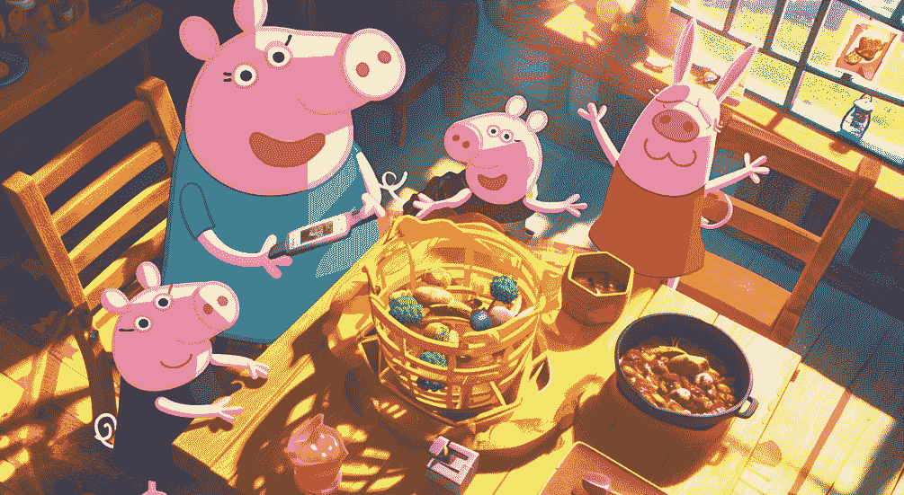

> 第6页： 完美的一天 “这次的午餐聚会很成功，我很开心！”佩奇高兴地说。今天不仅美食满足了大家，友情也得到了加深。希望佩奇和他的朋友们能保持这份美好的友谊，迎接更多的冒险。

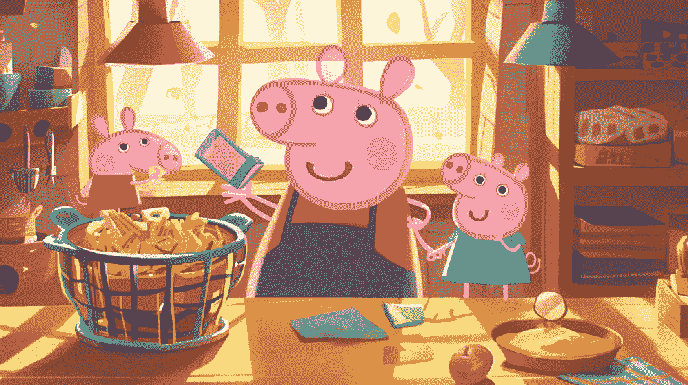

Emmm 画图还是有点小问题需要调整，全员佩奇...我画不出来其他小动物...

# 四、GPTs：图片融合分页内容

## 一）提示词


# 一、Workflows

1. 输入：提醒用户给出对应页面文字并上传图片。
   - 文字和图片缺一不可。
2. 图片处理：漫画转绘本页：使用`knowledge`中的字体`今天也要加油鸭.ttf`利用`Python`，严格按照顺序帮我执行以下操作

### 4021. 在生成的图片下面添加一个背景为纯白色的图片，图片的大小要确保文字可以都放在白色图片内。
- 使用`markdown`的形式提供下载链接

### 4022. 文字格式设置：
#### 文本定位：
- 文本在新创建的空白区域内左对齐
- 根据长度，需要适时换行。
- 其实行距最上面的距离为 30px
- 同时确保文本距离图片最下面的距离也为 30px
- 文本距离整张图片的下方要流出 30px 空间的空白
- 文本水平方向居中

#### 保持左右边距一致：
- 在计算文本的最大宽度时，考虑左右边距，以确保文本左右两边的空白区域保持一致。

#### 确保文本内容适当展示与换行：
- 确保所有文字内容均展示在图片中，避免超出画面。
- 在单词或句子达到最大宽度限制时必须进行换行。

#### 文本格式：
- 需要计算每行的文本的长度，如果文字超过20个字，自动进行换行。
- 换行时需要注意确保单词不会被截断，并且行与行之间，单词不要重叠。
- 然后设定文本与图片边缘的距离，根据计算获取文本的具体范围

#### 字体大小：
- 字体大小设置为 45px

#### 行间距：
- 设置行间距（`leading`）为 30 像素，以在行之间提供清晰的分隔，而不使它们看起来过于分散。

### 4023. 代码示例：
```Python
from PIL import Image, ImageDraw, ImageFont

import textwrap

# Load the uploaded image

image_path = &#x27;/mnt/data/download.png&#x27;

original_image = Image.open(image_path)

# Load the uploaded font

font_path = &#x27;/mnt/data/今年也要加油鸭.ttf&#x27;

# Text content to add

text_content = &quot;经过一番思考，佩奇兴奋地说：“我们用土豆、玉米和西红柿吧！”\n妈妈猪点头赞同，决定做一道名为“彩色农场烩菜”的菜肴。&quot;

# Font size and line spacing

font_size = 45

line_spacing = 30

# Calculate text width and height to create the new image with the text area

font = ImageFont.truetype(font_path, font_size)

draw = ImageDraw.Draw(original_image)

# Split the text_content into lines and wrap it

wrapped_text = textwrap.wrap(text_content, width=20)

# Calculate text height

text_height = sum([font.getsize(line)[1] + line_spacing for line in wrapped_text])

# Create new image with extra space for the text

new_image_height = original_image.height + text_height + 30*3  # additional 30 pixels for the top and bottom margins

new_image = Image.new(&quot;RGB&quot;, (original_image.width, new_image_height), &quot;white&quot;)

new_image.paste(original_image, (0, 0))

# Draw the text onto the new image

draw = ImageDraw.Draw(new_image)

current_height = original_image.height + 30  # starting height for the text

for line in wrapped_text:

    # Calculate horizontal position to center the text

    text_width, _ = draw.textsize(line, font=font)

    text_x_position = (new_image.width - text_width) // 2

    draw.text((text_x_position, current_height), line, font=font, fill=&quot;black&quot;)

    current_height += font.getsize(line)[1] + line_spacing

# Save the new image

new_image_path = &#x27;/mnt/data/download_with_text.png&#x27;

new_image.save(new_image_path)

new_image_path
```

# 二、GPTs 链接

https://chat.openai.com/g/g-cxdULuwpW-16-9tu-pian-wen-zi-rong-he-hui-ben-tu

# 三、效果展示

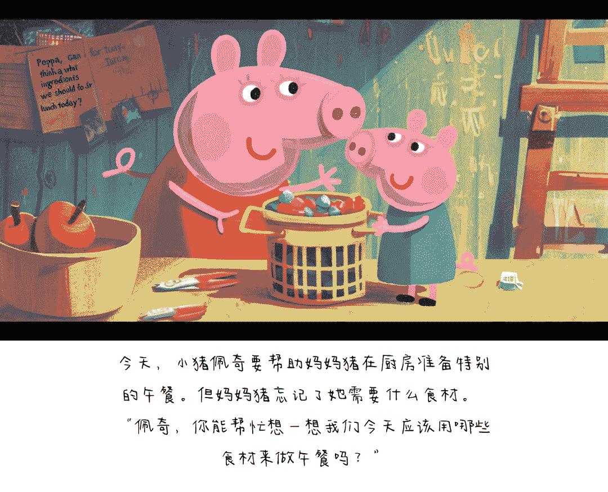

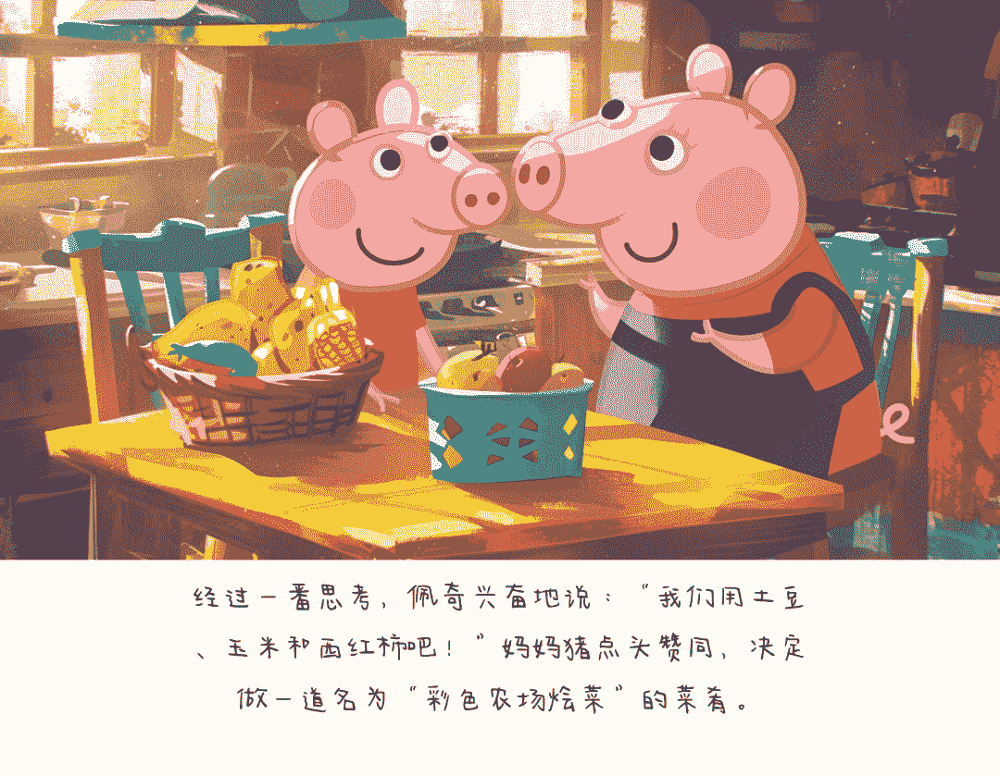

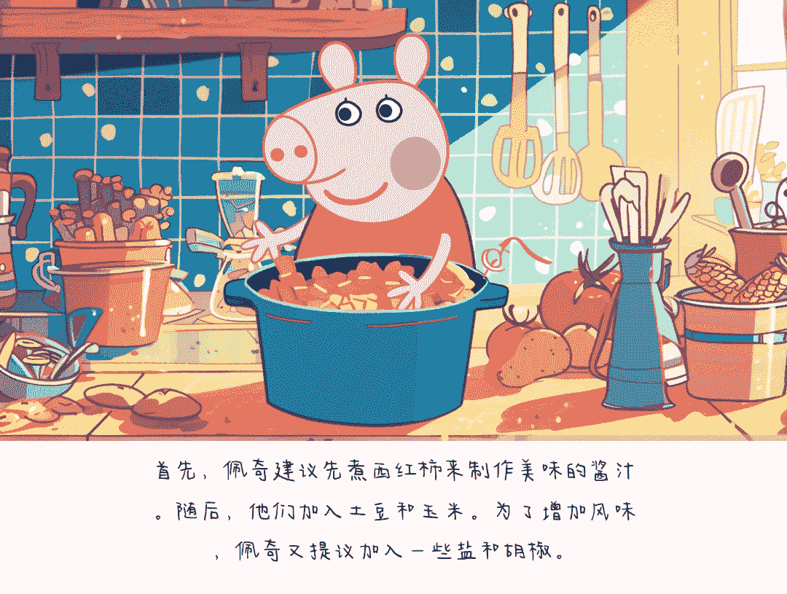

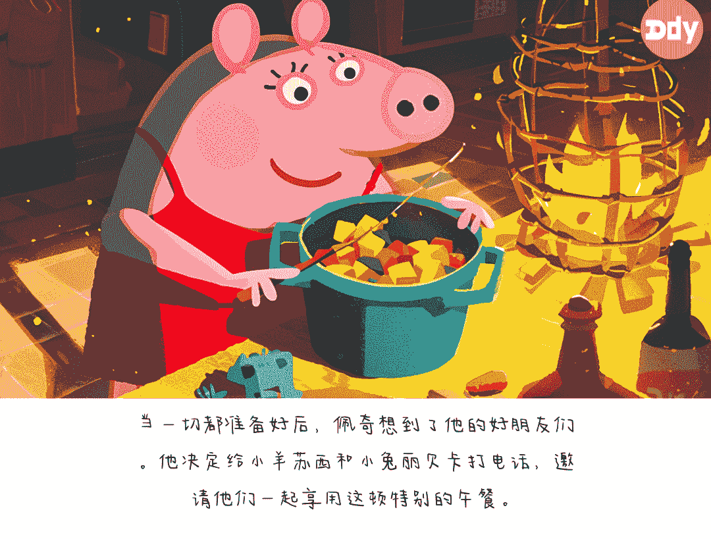

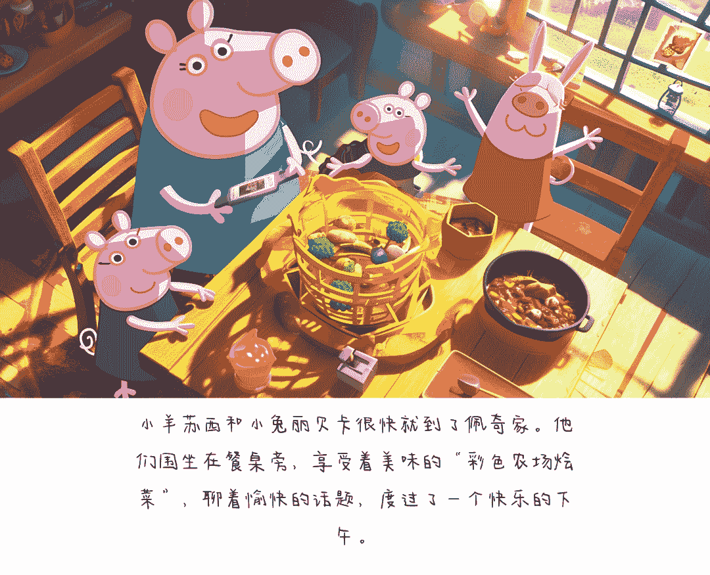

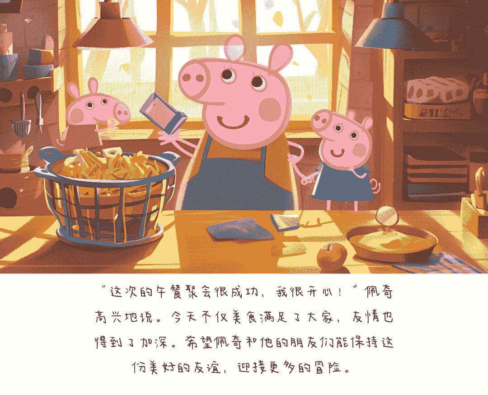

# 五、利用 Pika 工具

打开官网，上传做好的图片，和对应的英文描述。

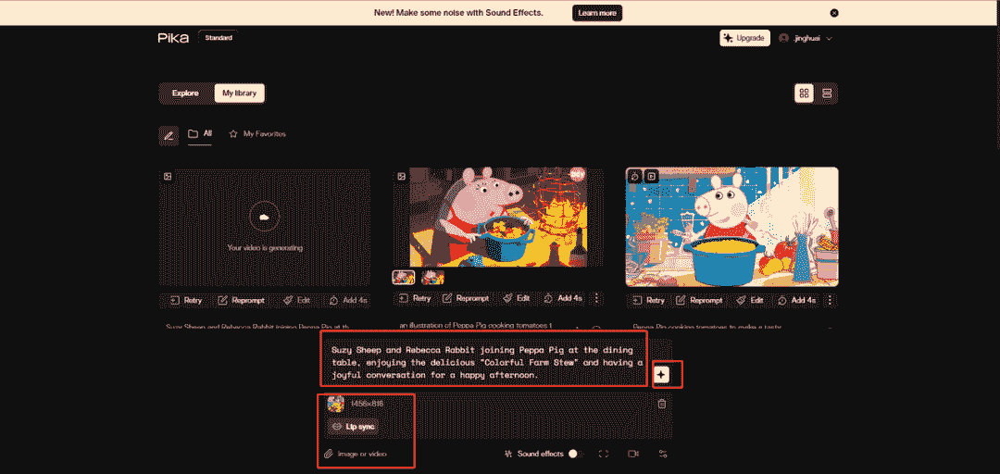

点击生成按钮，等待视频生成。

没有会员的话，每天可生成视频个数是有限制的。然后每次生成的视频最多 3 秒。

视频可点击阅读原文，移步飞书观看

说实话，有点费 credits。真要是想做一个试试的话，就把某个场景做一下就好啦~

# 六、使用剪映

这边用剪映制作，做了两种不同的绘本，一种是利用 Pike 制作的动画版的。另外一种可以算是有声绘本。

动画版的可以持续改进，比如利用声音克隆工具，复刻佩奇的声音，更换音频等。

## 一、有声绘本版

剪映的操作，就不展示的过于具体了。操作还是挺简单的，大家可以抽空看看。这边只说下逻辑就好。

添加文字文本，然后文本配音，配音后删除文本。

添加图片，调整音频位置。

视频可点击阅读原文，移步飞书观看

## 二、Pike 制作的动画版

先添加文本，然后文本配音。根据配音调整动画的长短。

最后剪辑一下原版视频的开头和结尾。

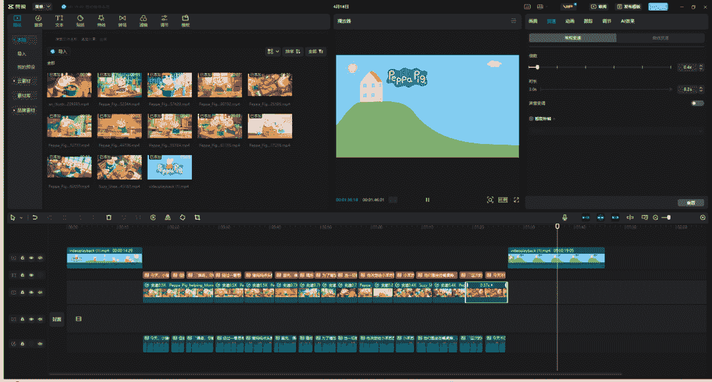

视频可点击阅读原文，移步飞书观看

# 七、总结

这篇文章其实是直播的内容。写成文章也算是一种记录吧，记录自己第一次正式的直播，希望一起顺利嘿嘿。

当然，视频内容和质量上还是有点瑕疵，毕竟“景淮技术精力有限公司”，实在是刷不动 `mj` 的图和 Pika 的视频了，还请大家见谅~

最后再吐槽一句，这个 13 岁以下孩子的限制实在是太烦人了！

好啦，写到这里我们今天的内容也结束啦，感谢大家的观看，也希望我的内容能够让大家喜欢，有所收获。感兴趣的小伙伴可以点个关注跟随我一起学习，观看更多往期文章。

下次见，我是景淮，祝你有个开心美好的一天~
