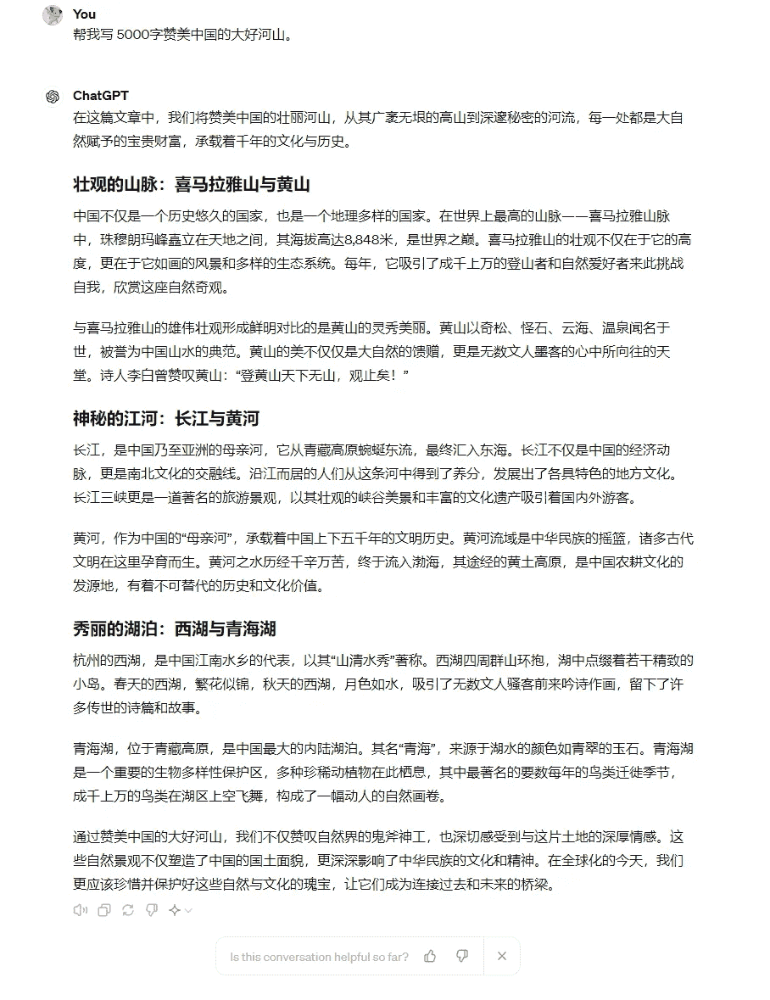
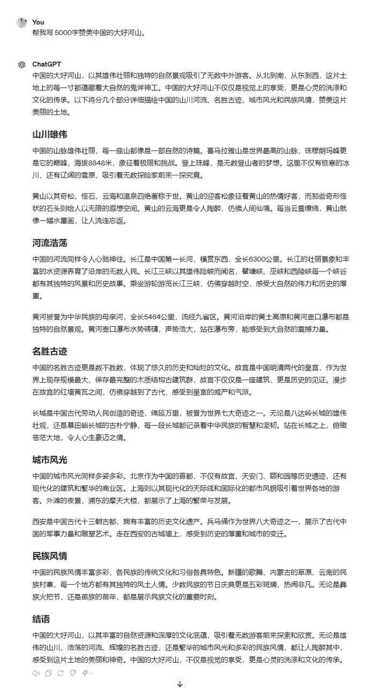
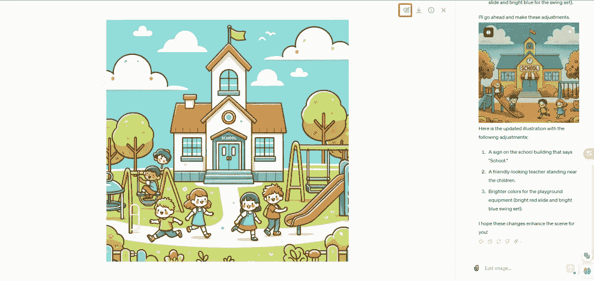
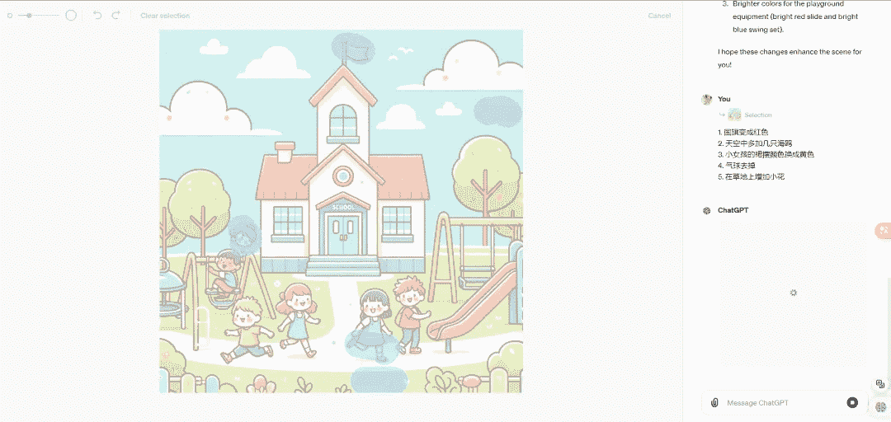

# GPTs 实战：大家来找茬

> 来源：[https://agijuejin.feishu.cn/docx/AGXRd6dxOoPiW1xH9IxcMBbhneg](https://agijuejin.feishu.cn/docx/AGXRd6dxOoPiW1xH9IxcMBbhneg)

> 作者：景淮AI探索之旅

> 原文链接： https://mp.weixin.qq.com/s/zp-Q7DXSI2YDkHw7Rxt2nw

嘿，大家好呀，我是景淮，一个加拿大的程序员，沉迷 AI 不能自拔中。

今天 OpenAI 的发布会更新了新的 GPT-4o, 看了直播的视频，还有官方发布出来的效果，确实惊艳。感觉又是搞死一大堆公司的节奏。

然后坐等更新，终于在所有人都差不多更新完之际。我的号更新了，上手试了试，其他功能玩起来没有视频上那么惊艳。

输出的长度有所提升。在同样自然语言的情况下，之前用 GPT 4.0 要求写 5000 字的文章，只能做到 866 个字，中间还断了一次（点了 “继续”）

然后，使用 GPT 4o 输出了 1182 个字，一气呵成。

下图第一张图为 GPT 4.0 ，第二场图为 GPT 4o，大家可以对比感受下。





但这个输出速度，真的是不便秘了，甚至可以说是一泻千里！快，真的快。

上面的视频没有做过任何加速处理，大家可以比较下生成速度。真的惊艳到我了。

可能对不常用 GPT 的人来说，不就是输出长点，快点嘛？算什么提升。但对于熟悉 GPT 经常被其烦恼的人来说。这个改变是翻天覆地的。

比如，在官方发布的视频中，真实的帮助一位英语用户和另一位西班牙语用户，进行了实时的翻译。取代了一个翻译官的角色，准确清晰的表述了用户想要表达的内容。（第 N 次听说翻译官要失业了，手动狗头）

帮助盲人通过摄像头捕捉到了现实世界的情况，用语音和文字的方式，描述了盲人所到的场景，还有实时监控到了打到的出租车到达。

这是怎么做到的呢？没错，就是依托于他近乎惊人的反应速度。像真人一样的反应时间。

有一句已经被说烂的话，恐怕 OpenAI 真的要改变世界了。这次的内容说实话，比上次发布会公布的 Sore 更让我吃惊。

当人工智能能够做到 “视，听，说” 这五感官中的三种感官，离颠覆世界还远吗？

好啦，人工智能都能够区分出视觉看到内容的区别，那么我们对孩子的教育就一定要加强了。

谈到观察力，对于孩子来说就有一个又好玩，又有趣的小游戏，那就是“大家来找茬”。

没错，今天我们的孩子王系列内容主题如下

**GPT 大家来找茬**

本文会根据以下内容顺序进行：

+   需求分析

+   分步实现需求

+   提示词编写测试

+   GPTs 使用链接

+   总结

#  **一、需求分析 **

谈到大家来找茬，这游戏大家太熟悉了。小的时候，最开始接触的游戏可能就是这类游戏。比如 4399 各种书籍上的娱乐板块，都会有。


其实自从 MJ 和 D3 出了修改功能后，就很容易能够通过手动的方式创作这样两幅图。

##  **一）用户输入 **

用户输入一个主题，或一段话，由 GPT 补全或完善其余内容。

##  **二）D3 绘图 **

根据用户输入的提示词完善后的内容，使用儿童风格来绘制第一张图。

##  **三）图片重绘微调 **

基于上一张图的本身，利用好

##  **四）利用 Python 合成 **

利用 Python 把上述两张图结合在一起，中间增加一条黑色的分割线，然后对左右两幅图找差异。

#  **二、分步实现需求 **

##  一）利用根据主题 D3 绘制图片

快乐的用上 4o 并且测试一下效果好啦~

**提示词**

```
根据用户输入的内容完善这个画面的描述。

根据用户的描述利用 Dalle-3 使用儿童插画风格进行绘制。
    - 画面中的元素尽量少一些，不要太过于复杂。
```

**效果展示**


**提取绘图提示词**

> A simple, colorful children's illustration of a school scene. The style should be child-friendly, with bold outlines and bright colors, avoiding too much complexity.

##  **二）根据图片提出修改细节 **

**提示词**

```
我正在设计“大家来找茬”的小游戏，你来帮我微调图片。根据上述的图片已有的内容，准确给出 5 个可以做微调整的细节描述。以数列的方式展示给我
```

**输出**

1.  在天空中添加一只飞翔的小鸟。

1.  给其中一个孩子加上一顶红色的帽子。

1.  在学校建筑的钟楼上添加一个时钟。

1.  在一棵树上加上几片黄色的树叶。

1.  在滑梯旁边添加一个蓝色的足球。

##  **三）图片重绘微调 **

选择 “选择工具”



从图片上选择，几个细节进行重绘调整。



生成图


> Emmmm 它有修改我提出内容中的四个细节，但有两个改的效果没有按照我的要求。还有一个没有修改。

> 如果可以的话，建议每次少改两个，这样他能更清晰的针对修改需求进行针对性修改。我的这个可能是同时处理了太多模块导致的（描述不够准确）。

> 多次测试后，我发现比如我要求增加飞鸟，怎么样都不画 = =

> 所以，也别太纠结... 不行咱家换个细节...

最后的图片


大家能看出来哪里修改了吗？ 这样可能不够清晰，那我们再用 Python 处理下图片。

##  **四）利用 Python 合成 **

**提示词**

```
帮我处理我上传的两张图片。确保两张图片的高度、宽度完全相同。如果有所区别，进行缩放以完成我的要求。然后要把两张图整齐的排列在水平方向上，中间增加一条5px的黑色实线。用来区分两张图片。

最后把处理好的图片展示给用户。
```

然后我发现，如果我一次性上传两张图，效果不太好。（估计得带上图片的名字）

那我尝试一个一个上传的方式。

**提示词**

```
我会分两次上传图片，每次上传一张，第一张上传的图片你可以标记为图片1，第二张上传的图片标记为图片2。
当我上传结束后帮我处理我上传的两张图片。确保两张图片的高度、宽度完全相同。如果有所区别，进行缩放以完成我的要求。然后要把两张图整齐的排列在水平方向上，中间增加一条5px的黑色实线。用来区分两张图片。
    - 其中图片1在左边，图片2在右边

最后把处理好的图片展示给用户。
```

测试结果一样，还是用的同一个图片。看了下代码，应该是因为我图片是直接复制粘贴过去的导致图片的名字都是“image.png”，在储存空间中被替换了。

测试了下，让其直接修改名字，但感觉有点浪费次数。所以还是手动上传，不要复制粘贴啦~

**确保上传的图片名字不同哦~**


#  **三、提示词编写测试 **

绘图的过程其实用分布实现需求中的提示词就好，包括微调的步骤。

合成的部分，为了保证稳定性可以借助代码辅助下。

提示词相同，只是增加了代码给GPT做参考。

（当然这部分用很多软件都可以实现。）

**提示词**

```
## Constraints :
- 不用着急，深吸一口气慢慢来，严格按照[Workflows]中的顺序一步一步的执行。
- 永远使用中文和我进行对话。
## Workflows:
1. 上传：用户会上传两张图片，第一张上传的图片你可以标记为图片1，第二张上传的图片标记为图片2。（永远使用中文和用户进行对话）
 - 确保用户上传的两张图片，命名不同，如果相同则提示词用户，先修改命名再重新上传。
 - 确保用户上传了两张，如果没有上传或者只上传了一张要提醒用户。

2. 处理：当用户上传结束后帮用户处理用户上传的两张图片。确保两张图片的高度、宽度完全相同。如果有所区别，进行缩放以完成用户的要求。然后要把两张图整齐的排列在水平方向上，中间增加一条5px的黑色实线。用来区分两张图片。
    - 其中图片1在左边，图片2在右边
    - 代码示例可以参考 knowledge 中的 “代码.txt”中的内容
3. 使用下面的方法展示图片在聊天框中。
    - 方法：
    ```python
    # Display the image directly
    from IPython.display import display
    display(image)
    ```
 4. 给出图片的下载链接
```

#  **四、GPTs 使用链接 **

https://chatgpt.com/g/g-Ov0fWTxIF-da-jia-lai-zhao-chi-he-cheng-qi

#  **五、总结 **

这个内容其实不难，主要是需要手动操作多一些。但内容其实不难，关键的也不是提示词的内容可能。

但不管怎么说，这个 4o 用起来爽！这个回复速度实在太舒服了！期待功能的完善！

好啦，写到这里我们今天的内容也结束啦，感谢大家的观看，也希望我的内容能够让大家喜欢，有所收获。感兴趣的小伙伴可以点个关注跟随我一起学习，观看更多往期文章。

下次见，我是景淮，祝你有个开心美好的一天~