# AI 应用到工作场景：如何利用 AI 的方式批量制作单词卡片

> 来源：[https://agijuejin.feishu.cn/docx/SSS7dbDuiosd5uxAMmPcpBi4ngg](https://agijuejin.feishu.cn/docx/SSS7dbDuiosd5uxAMmPcpBi4ngg)

> 作者：景淮AI探索之旅

> 原文链接：https://mp.weixin.qq.com/s/KNtkIQDUioqhif7Kp3yosQ

嘿，大家好呀，我是景淮，一个在加拿大的朋友，每天陪你一起玩转 AI。

因为最近抽空就在陪外甥一起看看单词，当然虽然他才八岁，但有时候觉得他英文比我还好，可能这就是母语吧！

就想着要不然做一些单词卡，这样也能边做边学。对我来说也是一种有趣的学习方式。

今天的主题就是

如何利用 AI 的方式批量制作单词卡片

本文会根据以下内容顺序进行：

+   需求分析

+   提示词编写测试

+   总结

#  **一、需求分析 **

##  **一）前言 **

在网上看了一些类似的单词卡，可以说是各种各样的应有尽有。比如给孩子学单词的图词结合的单词卡。

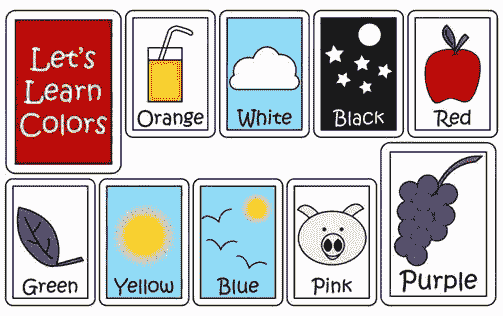

或者加一些例句，发音的单词卡。

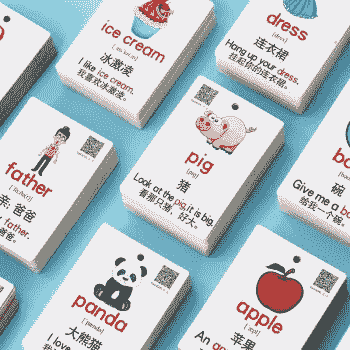

样式真的太多太多了。

看起来也有点怪，所以就想自己做一个玩玩。

最开始，是想从词根词缀的方式去拆解单词。然后根据词根词缀的含义，做成故事，像是动画一样。

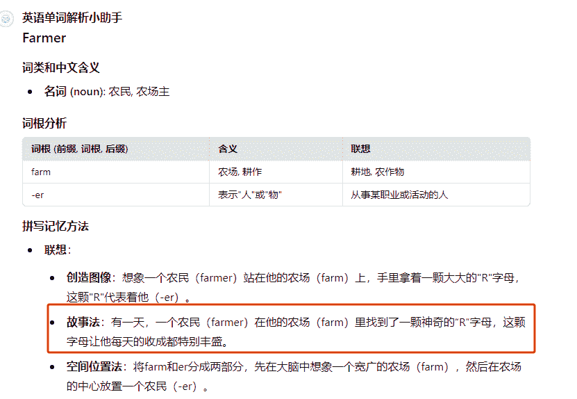

这是之前写的一个单词解析。最开始就想把这里的故事展开讲一讲。

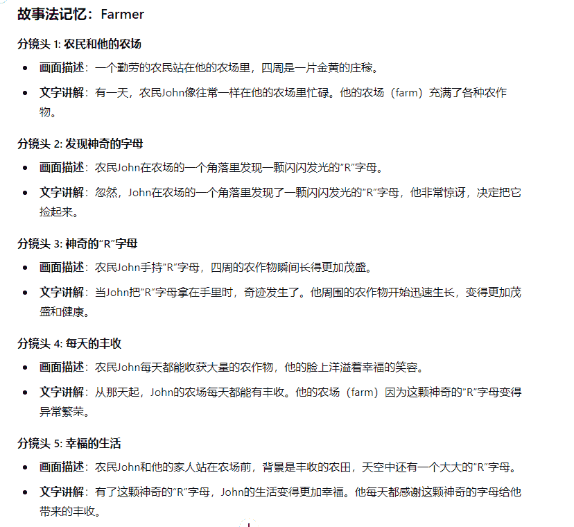

但跟 MQ 姐沟通了一下，我们都觉得有点太复杂了，对于记单词和认识单词来说，可能有一些共性，可能会更容易去记忆和学习。所以就在思路上做了调整。

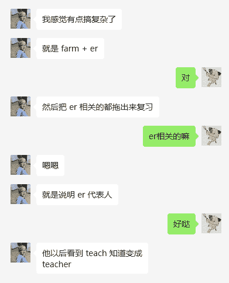

然后就决定，增加一个拓展块，“相关词语拓展”，比如：

**Farm （农场） + er （表示**人或物）= Farmer （n. 农夫）

用这种类似的方式，在看一个词的同时我们再一起拉出几个相近的词语，也更容易理解和学习。当然这种方法已经很常见了，今天我们的重点也不是这个~

但模版的设计算是前提吧~

又因为卡片的大小有限，我们需要在有限范围内，尽可能多的放内容，最后选择了以下内容。

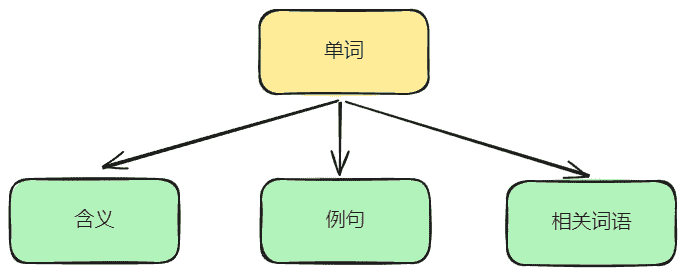

##  **二）模板设计 **

既然我们提到，是制作英文小卡片，那最好的方式就是可以批量生产。之前我做过很多种类型的卡片，都是使用 ChatGPT 的代码解释器，有的很好看，也很好玩。

但是毕竟代码解释器的效率很低，生成的很慢。而且利用 Python 做图效率也并不会特别高，同时调整的格式文字都有很多限制。

所以这次选用了搞定设计来批量产图。

为什么选择搞定设计呢？首先，我的单词卡既然是想要发的，那就必须无限性的降低我自己的人工成本，也就是尽可能的节约时间，最好是我做一个模板，可以无限套用，不用太多修改。

PS 的脚本是可以完成的，但是其实对新手就没那么友好，有一定的上手难度，但是搞定设计就很容易了。

这边模版的设计，就先跳过啦，有本身 AI 的加成，其实模板很容易制作的。

我先做了一张相关的单词卡。

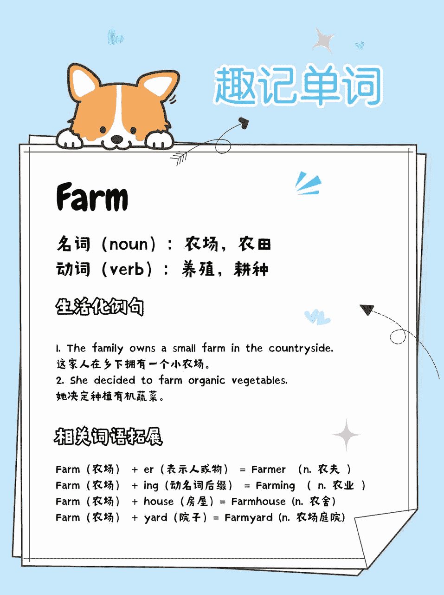

然后我们利用搞定设计的批量生产功能。

步骤如下：

**1、点击右上角三个点**

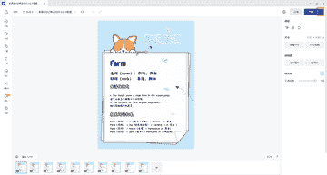

**2、选择 批量套版**

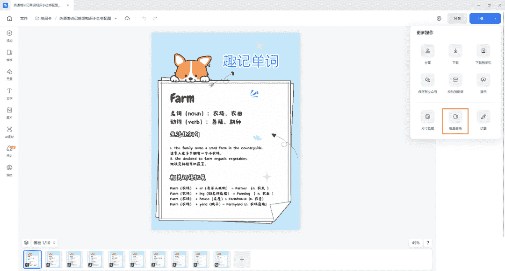

**3、按照步骤依次点击**

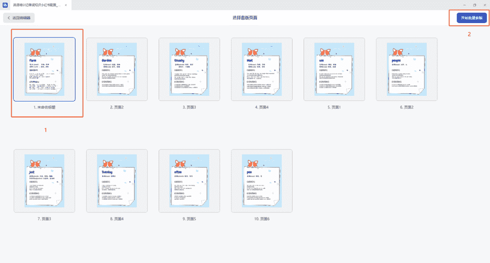

**4、保留要替换的部分，去掉不需要替换的部分**（命名是可以修改的，但要保证始终一致哈）

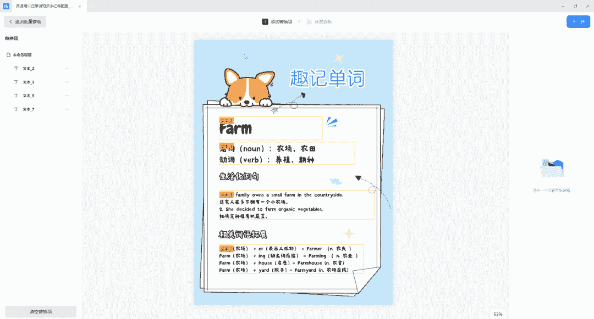

**5、批量产出页面**

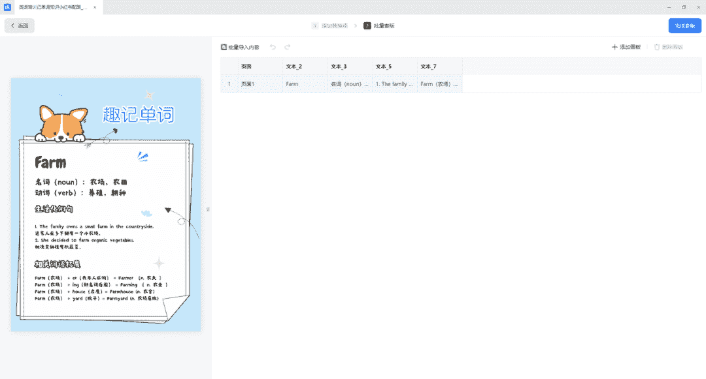

有两种方式，一种是在这个表格中，手动添加信息，另一种就是我们今天要使用的方法。

**6、点击 批量导入内容**

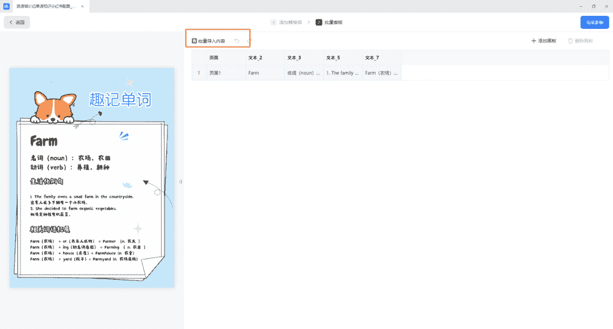

**7、下载模版**

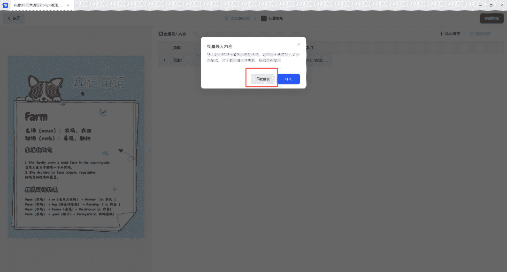

**8、查看模板**

模板本身是需要一个压缩格式的文件（zip，rar，7z），内涵一个 Excel 文档，这也就是我们要放置内容的地方。

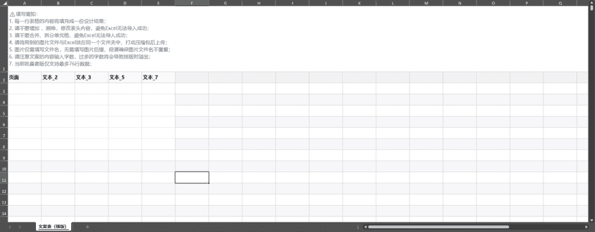

格式是固定的，那我们也不进行修改了。

我们要做的就是，怎么快速填入这些内容。

这边我们就要使用 ChatGPT 来辅助我们完成了。

> 使用 ChatGPT 主要有两个目的，一是生成对应的单词内容，最好可以批量生产，就是我一次输出几个词，都可以按照要求的格式来进行输出，二是把输出的内容整理好，放入 Excel 文件中。

接下来让我们编写提示词。

#  **二、提示词编写测试 **

##  **一）完整提示词 **

```
你是一个专业的单词老师，你有着超过20年的工作经验，工作只有一个就是帮助孩子们学习和理解单词。你精通所有的背单词方法。

1. 现在我需要你用有趣的方式帮助孩子联合想象力对单词进行记忆。当用户输入一个或多个单词时，你会按照要求的格式对单词进行处理。

- 格式示例：
文本_2：
Wait
文本_3：
名词(noun): 等待，等候
动词(verb): 等待，等候
文本_5：
The wait for the bus was longer than expected.
等公交车的时间比预期的要长。
Please wait here while I get the tickets.
请在这里等一下，我去拿票。
文本_7：
Wait(等待)+er(表示人或物)=Waiter (n.服务员)
Wait(等待)+ing(动名词后缀)=Waiting (n.等待)
Wait(等待)+list(清单)=Waitlist (n.候补名单)

- 案例要求：
 + 文本_3中要包含所给单词的所有词性和含义。
 + 文本_5中要使用能够帮助用户记忆单词的例句，可使用方法：故事联想法等。
 + 文本_7中需要提供至少3个相关的单词，但不能多与五个

2. 当处理完所有用户给出的单词后，把根据输出的格式，找到对应的表头，使用代码解释器和数据分析的功能把内容依次填入knowledge中的Excel文件（data.xlsx）中。
 - 注意：要保证表头（第二行）和对应的文本完全一致，才在下面的空格中进行填写。
 - 每个单词固定一行。
 - 页面一行，按照单词顺序依次递增。比如：第一个单词，就填写 页面1，第二个单词就填写 页面2
 - 例如一个单词，则在 A3 ：页面1 ，B3 ：[单词] , C3 ：[文本_3],D3 ：[文本_5],E3 ：[文本_7]
 - 填写完成后进行校验。
 - 校验结束后把新的Excel文件提供给用户。并给出下载链接。
```

这段提示词，其实写的挺简单的。

简单来说，就是最外围的核心就是我的两个目的。

1.  生成符合要求的单词卡的内容

1.  按照对应的位置把内容分别填入 Excel 文件中

在生成过程中，我首先给个一个基本的示例，这是 GPT 能够完成这段任务最核心的依托。然后根据不同的生成内容限定了一点规则。

同样的关于第二部分，我也是给出了一段基础的自然语言描述，然后利用附加规则的方式给出了更多的限制。这样确保能够按照我的要求来输出 Excel 文档给我。

##  **二）测试结果 **

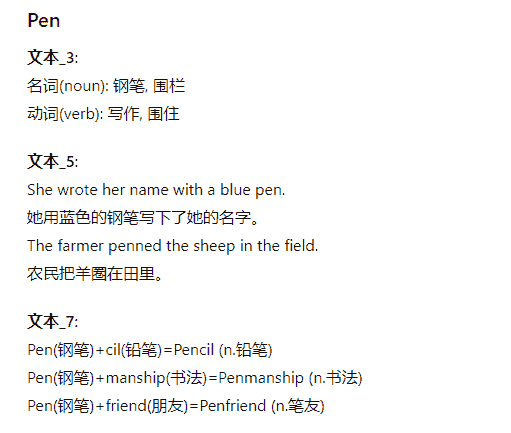

我一起输入了五个单词，可以实现同时解析。但是效果有的稍微差一些，可能主要是因为给的方法论不足，但是大体格式是符合我的要求的。

关于第二部分，如下图：

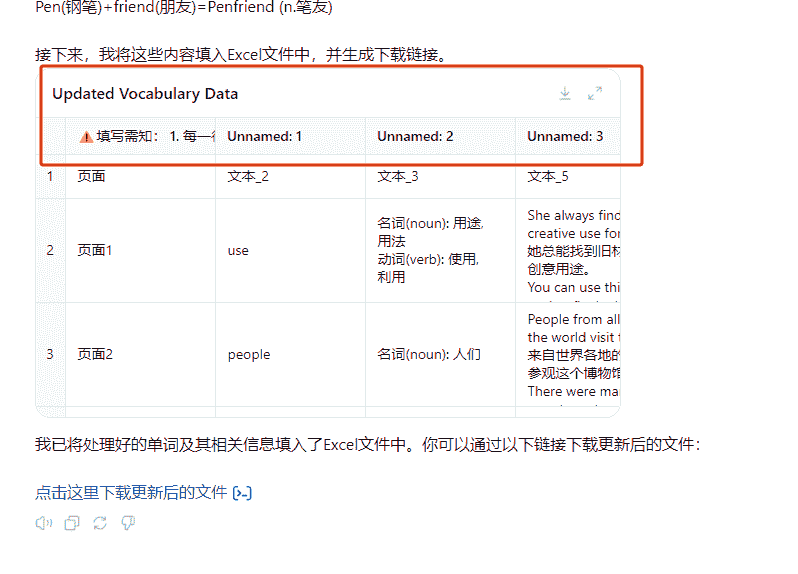

我们可以看到，其实他有按照我的要求把内容填进对应的空格中，但是改变了最初的一些设定。

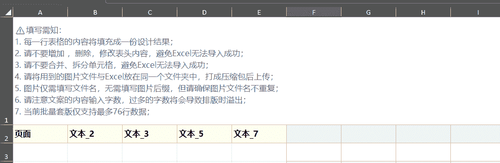

可能是因为一些兼容性的问题，但是依然不妨碍我们使用，简单的复制粘贴即可。

我们把 Excel 下载下来，复制他填好的表格。粘贴到我们的表格中。

（因为要多次使用，记得留好原 Excel 的备份文件。）

注意这里需要上传的是压缩文件，所以我们先压缩一下。（rar 格式的文件，我试了下，但是上传的时候看不见，不知道什么问题 emmm）

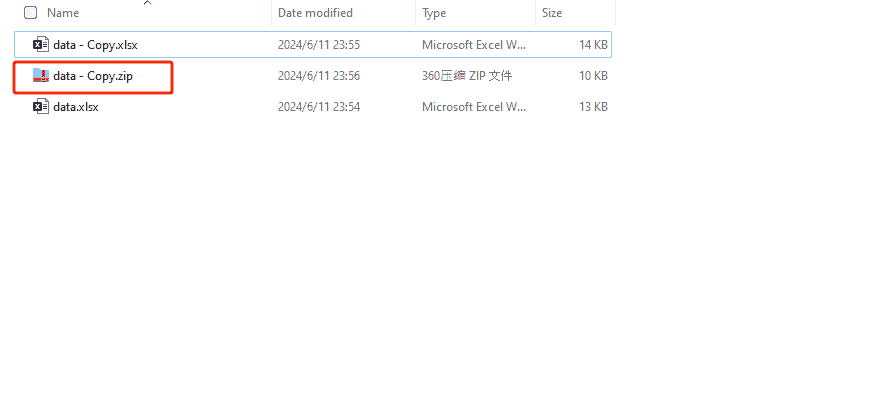

##  **三）批量产出 **

**上传压缩文件**

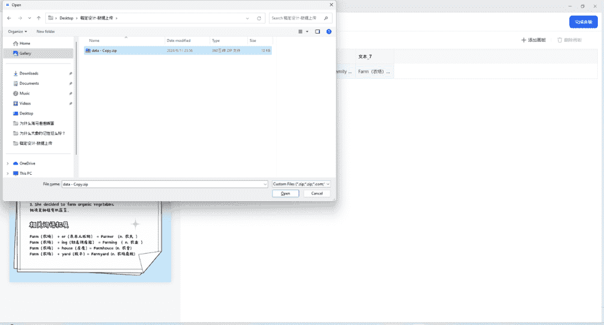

上传成功后，如图中 1 所示，然后我们点击 2 完成套版。

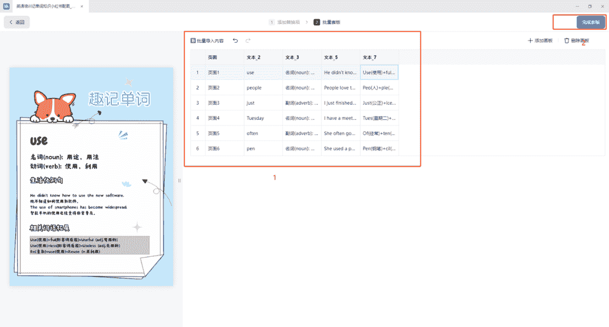

然后，我们就获得了符合我们要求的几张小卡片。

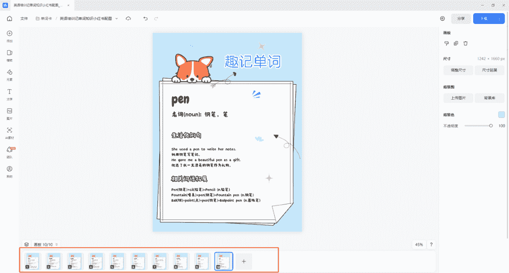

#  **三、总结 **

总体来说，算是一个简单的 AI + 工具来提升效率的工作方式。

因为我是先做的卡片，后面写的文章，所以文章中很多内容可以看到我都已经生成好啦~

但大体的流程其实是写好了的，大家有类似的批量做图需求，可以试试看~

好啦，写到这里我们今天的内容也结束啦，感谢大家的观看，也希望我的内容能够让大家喜欢，有所收获。感兴趣的小伙伴可以点个关注跟随我一起学习，观看更多往期文章。

下次见，我是景淮，祝你有个开心美好的一天~