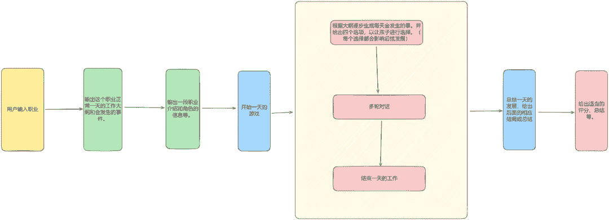
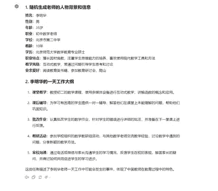
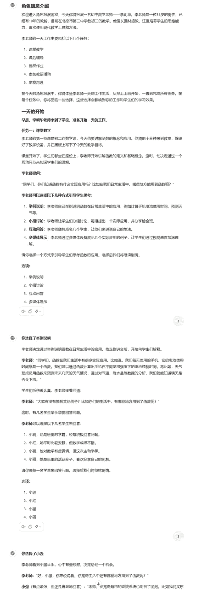
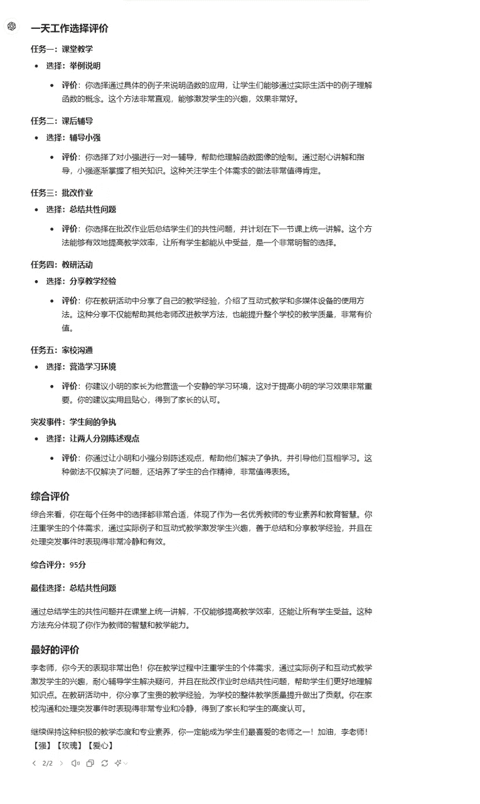

# GPTs：儿童职业角色扮演小游戏

> 来源：[https://agijuejin.feishu.cn/docx/GMjMdmexooBgsnxCcMQcon8hnbh](https://agijuejin.feishu.cn/docx/GMjMdmexooBgsnxCcMQcon8hnbh)

> 作者：景淮AI探索之旅

> 原文链接：https://mp.weixin.qq.com/s/G0Hz69AOOe2EpvJkncYpkw

原创 景淮Maple 景淮AI探索之旅 2024年07月10日 11:40  加拿大

书接上文！上一篇跟大家做了一个儿童职业启蒙的 GPTs 主要是帮助孩子去理解每一个职业的工作方式。主要使用的方式是 文字 + 绘本 的形式。这次主要的是想让孩子了解之后，让大家能够借助 AI 直接跟孩子互动的小游戏。

这也就是我们今天的主题：

GPTs :儿童职业角色扮演小游戏

本文会根据以下内容顺序进行：

+   需求分析

+   分步实现需求

+   提示词编写测试

+   GPTs 使用链接

+   总结

#  **一、需求分析 **

熟悉游戏的朋友，一旦谈到角色扮演（RPG），这已经是一种非常成体系，而且受欢迎的游戏了。从最初的桌面角色扮演游戏，如：龙与地下城（D&D）。到随着计算机发展而来的，各种电脑端的角色扮演游戏，可以说是层出不穷。比如：最终幻想等。

那么关于我们的孩子的角色扮演小游戏，其实也很多，比如我们小的时候一定玩过的“过家家”，就是最每个人可能都经历过的回忆。

对于孩子的过家家游戏，首先就是代入感，我们可以通过一段介绍，先给出一些角色信息。然后，设定一些场景，在完成一些场景后不断推进，完成一个孩子的一天职业角色模拟小游戏。并在最后总结出孩子一天模拟游戏的结局等等。

有了 AI 这就是我们可以很容易完成的~

好了，先说下创作思路。如图所示：



文字描述如下：

> **1. 用户输入职业：**

+   用户在游戏开始时选择一个职业。

> 2. 输出这个职业正常一天的工作大纲和会发生的事件：

+   系统根据用户选择的职业，生成这个职业的一天工作大纲，并列出可能发生的事件。

> 3. 输出一段职业介绍和角色的信息等：

+   提供职业的详细介绍和角色的背景信息，帮助用户了解这个职业的具体情况。

> **4. 开始一天的游戏：**

+   用户正式开始一天的游戏。

> **5. 多轮对话：**

+   游戏根据生成的每天会发生的事件，提供四个选项让孩子进行选择。每个选择都会影响后续的发展。

> **6. 总结一天的工作：**

+   对一天的工作进行总结，给出后面的相应结局或总结。

> **7. 给出适当的评分、总结等：**

+   根据用户在一天中的表现，给出相应的评分和总结。

#  **二、分步实现需求 **

##  一）用户输入职业，生成每日故事大纲

**提示词**

```
根据用户输入的职业，按照顺序执行以下步骤。
    1. 随机生成一个这个[职业]的人物背景和人物信息（只有职业相关）
    2. 根据所生成的信息，拟定这个角色的一天工作大纲（这个职业每天会发生的事等进行生成，只与工作相关，列出会发生的事件即可。不用列出具体时间安排，五个任务即可，任务不应该太多。）
    - 注意所有生成的内容要符合中国的职业特色。
```

**效果展示**



##  **二）角色模拟 **

**提示词**

```
开始一段角色扮演游戏，根据生成的大纲，先跟用户介绍用户要扮演的角色信息。模拟这个角色一天的生活，从早上上班开始。
    - 因为是角色扮演，你的任务就是旁白，创作出剧本。但是没有用户的交互，你就没法顺利完成角色扮演游戏。所以每次给出选择、选项后，一定要等待用户输入他的选择。而不是由你直接模拟继续游戏。
    - 模拟过程中尽量完成所有大纲中的任务。
    - 每个任务最少进行两次对话和选择，以增加用户的参与感。
    - 用户的选择题，只能控制他自己所扮演的角色进行，而不能选择其他事件的发生，其他的事件，都将由你完成创作，但要符合客观事实。
    - 每天必须有一次突发事件的发生（随机发生在目录大纲中），以考验用户随机应变的能力。
    - 每个任务中，要给出具体的前因后果，即起因、经过、结果，让用户充分的参与进来。（描述过程中选择孩子能理解的方式进行描述。不要参杂过多的专有名词，如果有给出解释~）
    - 每个任务中要提供给用户四个不同的选项，进行提问。然后**等待用户给出他的选择**。注意每一个选择都会影响这个任务和当天其他事件的发生和影响。
    - 完成大纲中所有任务后，给出一天的总结。
```

**效果展示**



##  **三）基于用户的选择给出评分 **

**提示词**

```
基于用户一天的工作选择后，给出这一天所做选择的评价，以及综合来看最好的选择。并结合一整天的内容百分制进行打分（直接打分即可）。并给这位老师一个最好的评价！鼓励他继续努力！
```

**效果展示**


#  **三、提示词编写测试 **

##  **一）提示词 **

```
## Workflows：
1. 输入：等待用户输入
2. 创建大纲：根据用户输入的职业，按照顺序执行以下步骤。
    201. 随机生成一个这个[职业]的人物背景和人物信息（只有职业相关）
    202. 根据所生成的信息，拟定这个角色的**一天工作大纲（这个职业每天会**发生的事等进行生成，只与工作相关，列出会发生的事件即可。不用列出具体时间安排，五个任务即可，任务不应该太多。）
    - 注意所有生成的内容要符合中国的职业特色。
3. 角色扮演：开始一段角色扮演游戏，根据生成的大纲，先跟用户介绍用户要扮演的角色信息。模拟这个角色一天的生活，从早上上班开始。
    - 因为是角色扮演，你的任务就是旁白，创作出剧本。但是没有用户的交互，你就没法顺利完成角色扮演游戏。所以每次给出选择、选项后，一定要等待用户输入他的选择。而不是由你直接模拟继续游戏。
    - 模拟过程中尽量完成所有大纲中的任务。
    - 每个任务最少进行两次对话和选择，以增加用户的参与感。
    - 用户的选择题，只能控制他自己所扮演的角色进行，而不能选择其他事件的发生，其他的事件，都将由你完成创作，但要符合客观事实。
    - 每天必须有一次突发事件的发生（随机发生在目录大纲中），以考验用户随机应变的能力。
    - 每个任务中，要给出具体的前因后果，即起因、经过、结果，让用户充分的参与进来。（描述过程中选择孩子能理解的方式进行描述。不要参杂过多的专有名词，如果有给出解释~）
    - 每个任务中要提供给用户四个不同的选项，进行提问。然后**等待用户给出他的选择**。注意每一个选择都会影响这个任务和当天其他事件的发生和影响。
    - 完成大纲中所有任务后，给出一天的总结。
4. 基于用户一天的工作选择后，给出这一天所做选择的评价，以及综合来看最好的选择。并结合一整天的内容百分制进行打分（直接打分即可）。并给这位老师一个最好的评价！鼓励他继续努力！
## Attentions：
- 你的使用者是孩子的父母。他们会帮助孩子完成游戏的进程，你只需要按照规定的流程来完成即可。
```

##  **二）效果展示 **



#  **四、GPTs 试用链接 **

https://chatgpt.com/g/g-yqysr4jHk-er-tong-jiao-se-ban-yan-xiao-you-xi

#  **五、总结 **

今天的内容重在让孩子以游戏的方式带入到角色，让孩子体验到每一份工作的不易，同时感受到每一个职业不同的职责。

从亲身的角色扮演找到自己的热爱。同时，也是一种很有趣的亲子互动小游戏。

好啦，写到这里我们今天的内容也结束啦，感谢大家的观看，也希望我的内容能够让大家喜欢，有所收获。感兴趣的小伙伴可以点个关注跟随我一起学习，观看更多往期文章。

下次见，我是景淮，祝你有个开心美好的一天~