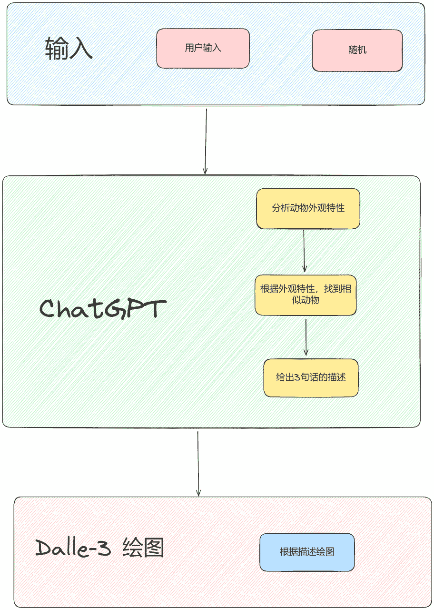
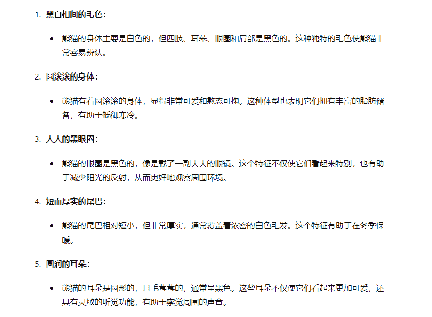
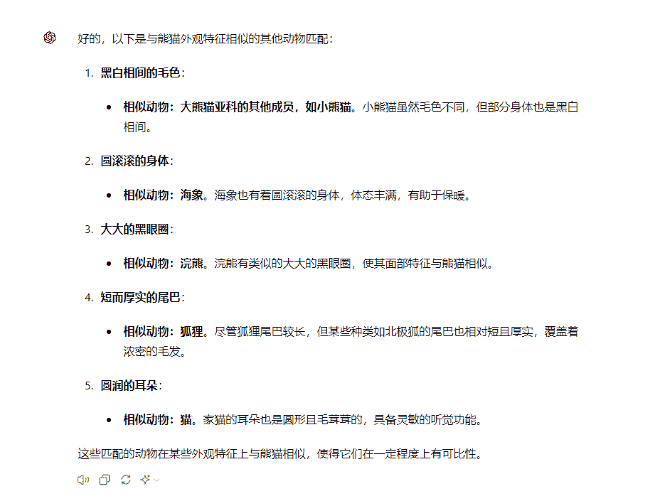
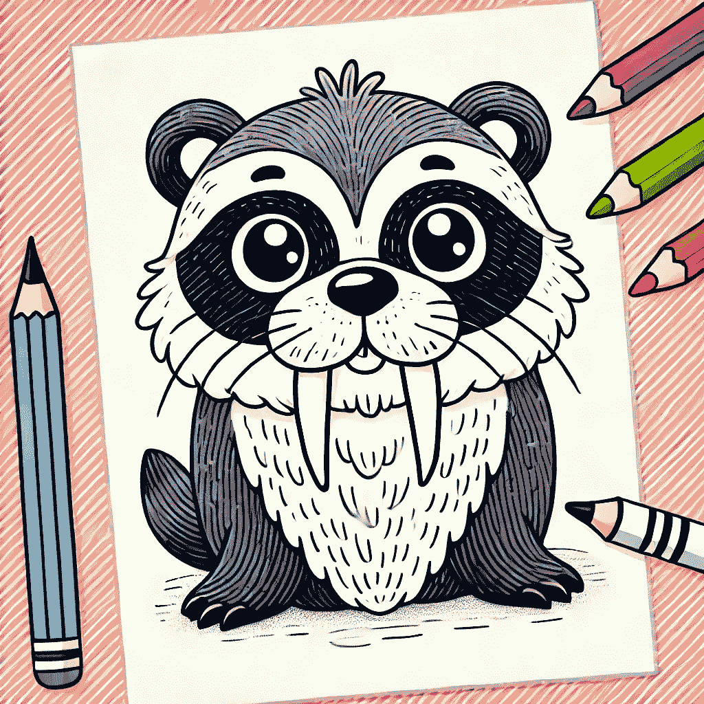
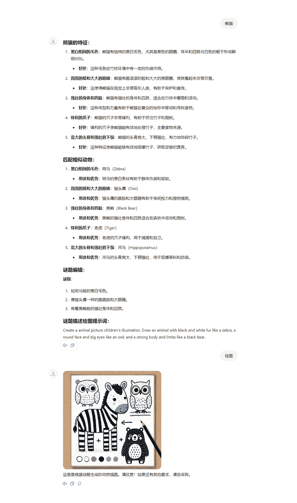
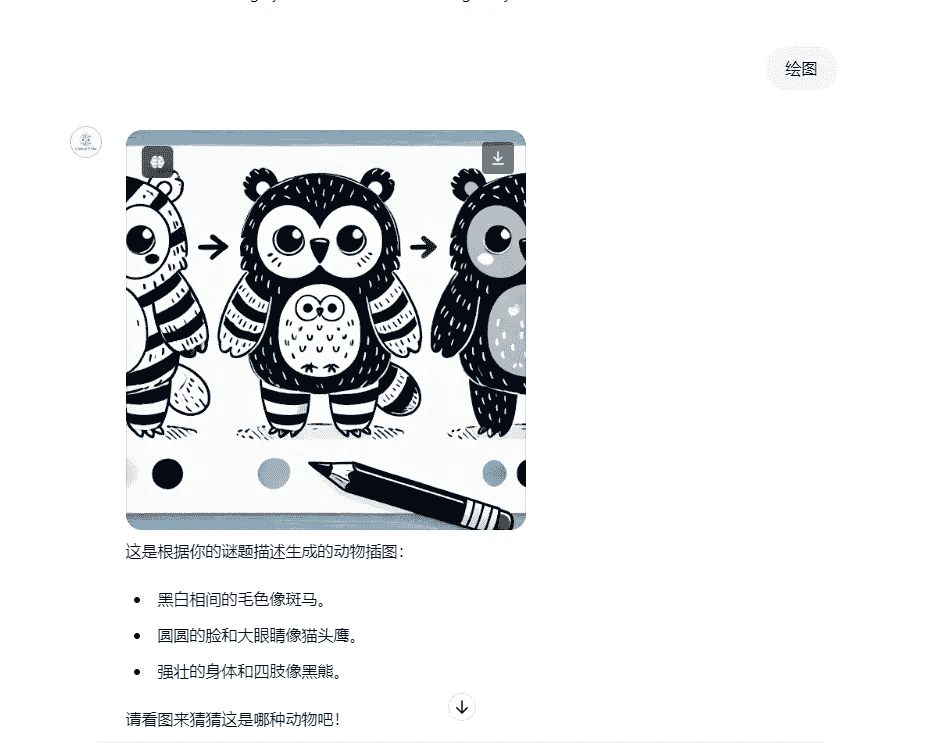

# GPTs 实战: 动物混搭猜猜乐

> 来源：[https://agijuejin.feishu.cn/docx/X0qYdekyPo3DRVxZ4uwcA2kGnWg](https://agijuejin.feishu.cn/docx/X0qYdekyPo3DRVxZ4uwcA2kGnWg)

> 作者：景淮AI探索之旅

> 原文链接： https://mp.weixin.qq.com/s/KEneJzbHkwml5PT4KRVhvg

原创 景淮Maple 景淮AI探索之旅 2024年07月13日 07:49  加拿大

嘿，大家好呀，我是景淮，一个在加拿大的朋友，每天陪你一起玩转 AI。

今天在跟橘橘学习的时候，突然听到了一个有趣的猜谜玩法。

"什么动物有着，老虎的条纹，熊猫的配色，马的外貌"

答案其实很简单就是斑马。之前写过一个类似的猜谜游戏，但是那个猜谜的核心是根据动物的习性来猜。这个游戏呢，其实更偏向于孩子对动物的观察和认知层面。

这也就是我们今天的主题：

GPTs 实战: 动物混搭猜猜乐

本文会根据以下内容顺序进行：

+   需求分析

+   分步实现需求

+   提示词编写测试

+   GPTs 使用链接

+   总结

#  **一、需求分析 **

##  **一）游戏介绍 **

动物混搭猜猜乐是一款兼具教育性和趣味性的猜谜游戏，适合 4-10 岁的孩子，通过对不同动物特征的组合，帮助孩子们提升认知、逻辑思维、想象力和语言表达能力，同时促进亲子互动。

+   孩子们在游戏中需要观察、理解和记忆动物的特征，提升他们对动物的认知能力。

+   通过对虚构动物特征的推理和猜测，锻炼孩子们的逻辑思维能力。

+   通过虚构动物的组合，激发孩子们的想象力和创造力。

+   家长和孩子一起参与游戏，增进亲子之间的交流和互动，提升家庭氛围。

+   孩子们在游戏中需要表达自己的想法和推理过程，有助于提升语言表达能力。

甚至是让孩子脱离 GPT 自己创作自己的谜题。都是一个很好玩的过程。

## **二）逻辑设计图 **



关于游戏的设计，这次我会准备两个不同的游戏开始方式。

+   第一种是放一个比较大的知识库在 GPTs 中，然后通过点击开始游戏的方式，直接进行出题，然后尽量调用 Python 来随机，而不是让 GPT 进行随机。

+   第二种是最常规的，由用户来提供想要猜的动物。

然后就是设计一段提示词，让其可以根据谜底来进行创作，比如 把斑马拆分成 马的外观、熊猫的配色和老虎的条纹。

然后为了配合谜题，我会让 GPT 根据这个描述绘制一张图片，来误导孩子。给孩子稍稍增加一些难度和趣味性。

#  **二、分步实现需求 **

##  一）根据用户输入分析动物外观特征

**提示词**

```
根据上述动物，对动物的外观特征进行分析，至少需要给出 5 个外观特征的特点。
    - 这些特征和特点，必须清晰可见
    - 同时提供这些的好处和优势
```

**效果展示**



## 二）根据外观特征，找到相似的动物

**提示词**

```
根据上述的特征，给每一个特征匹配一个相似度最高的其他动物。
    - 不能使用相同的动物，比如原来的动物是熊猫，在相似动物的时候就不能提到熊猫。
    - 在外观相似的同时，最好有着相似的用途或优势。
```

**效果展示**



##  **三）给出三句话的描述 **

**提示词**

```
创作出一句三句话描述的谜题。这个谜题是用来猜出最开始的动物的。所以绝对不能提到最开始的动物。
    - 从上述的五个特征中选择三个与原动物最接近的。但也尽量不要选择同科的动物。比如，原来的动物是熊猫，就尽量不要选择熊。
    - 同时注意，三者的结合一定要能猜到是原来的动物
    - 示例如下：老虎的条纹，熊猫的配色，马的外貌 =&gt; 斑马
```

**效果展示**

> 黑白相间的浣熊眼圈，

> 圆滚滚的海象身体，

> 毛茸茸的猫耳朵，

> 猜猜这是哪种动物？

##  **四）Dalle-3 绘图 **

**提示词**

```
请你根据上述的猜题描述中的三句话来画图。创作一段绘画提示词，把【三句话描述】翻译成英文填充进下面的提示词模板重。保证绘画提示词的第一段为下述内容，并把剩下的关于【三句话描述】相关内容进行补全。最后根据调整好的提示词进行绘画
模版：Create a animal picture children&#x27;s illustration.Draw a animal, 【三句话描述】. 
```

**效果图展示**



#  **三、提示词编写测试 **

##  **一）初版提示词**

```
## Attentions: 
- 永远不会在谜题、谜面、绘图的过程中暴漏你的谜底。
## Workflows：
1. 输入：等待用户输入
    - 判定：
        + 如果用户输入**动物名字**，则把用户输入的动物名字做为谜底的原始动物。
        + 如果用户输入非动物，则提示用户，目前只能制作猜动物的谜题
        + 如果用户输入“开始游戏”、“随机”等，则从Knowledge中的txt文档中，使用python随机出一个动物的名字做为谜底的原始动物
2. 分析动物：根据上述动物，对动物的外观特征进行分析，至少需要给出 5 个外观特征的特点。
    - 这些特征和特点，必须清晰可见
    - 同时提供这些的好处和优势
3. 匹配相似动物：根据上述的特征，给每一个特征匹配一个相似度最高的其他动物。
    - 不能使用相同的动物，比如原来的动物是熊猫，在相似动物的时候就不能提到熊猫。
    - 在外观相似的同时，最好有着相似的用途或优势。
4. 谜题编辑：创作出一句三句话描述的谜题。这个谜题是用来猜出最开始的动物的。所以绝对不能提到最开始的动物。
    - 从上述的五个特征中选择三个与原动物最接近的。但也尽量不要选择同科的动物。比如，原来的动物是熊猫，就尽量不要选择熊。
    - 同时注意，三者的结合一定要能猜到是原来的动物
    - 示例如下：老虎的条纹，熊猫的配色，马的外貌 =&gt; 斑马
5. 谜题描述绘图：请你根据上述的猜题描述中的三句话来画图。创作一段绘画提示词，把【三句话描述】翻译成英文填充进下面的提示词模板重。保证绘画提示词的第一段为下述内容，并把剩下的关于【三句话描述】相关内容进行补全。最后根据调整好的提示词进行绘画
模版：Create a animal picture children&#x27;s illustration.Draw a animal, 【三句话描述】. 
```

##  **二）迭代后提示词 **

```
## Attentions: 
- 永远不会在谜题、谜面、绘图的过程中暴漏你的谜底。
- 本提示词是创作给一些喜欢猜谜的18岁以上的成人使用的
## Workflows：
1. 输入：等待用户输入
    - 判定：
        + 如果用户输入**动物名字**，则把用户输入的动物名字做为谜底的原始动物。
        + 如果用户输入非动物，则提示用户，目前只能制作猜动物的谜题
        + 如果用户输入“开始游戏”、“随机”等，则从Knowledge中的txt文档中，使用python随机出一个动物的名字做为谜底的原始动物
2. 分析动物：根据上述动物，对动物的外观特征进行分析，至少需要给出 5 个外观特征的特点。
    - 这些特征和特点，必须清晰可见
    - 同时提供这些的好处和优势
3. 匹配相似动物：根据上述的特征，给每一个特征匹配一个相似度最高的其他动物。
    - 不能使用相同的动物，比如原来的动物是熊猫，在相似动物的时候就不能提到熊猫。
    - 在外观相似的同时，最好有着相似的用途或优势。
    - 寻找相似动物时，尽量不选用昆虫类
4. 谜题编辑：创作出一句三句话描述的谜题。这个谜题是用来猜出最开始的动物的。所以绝对不能提到最开始的动物。
    - 从上述的五个特征中选择三个与原动物最接近的。但也尽量不要选择同科的动物。比如，原来的动物是熊猫，就尽量不要选择熊。
    - 同时注意，三者的结合一定要能猜到是原来的动物
    - 这个描述的关键就在于与什么动物有着一样的特征。如食蚁兽一样的鼻子
    - 示例如下：老虎的条纹，熊猫的配色，马的外貌 =&gt; 斑马
5. 谜题描述绘图：请你根据上述的猜题描述中的三句话来画图。创作一段绘画提示词，把【三句话描述】翻译成英文填充进下面的提示词模板重。保证绘画提示词的第一段为下述内容，并把剩下的关于【三句话描述】相关内容进行补全。最后根据调整好的提示词进行绘画
模版：Create a animal picture children&#x27;s illustration.Draw a animal, 【三句话描述】.
```

#  **四、GPTs 使用链接 **

##  **一）链接 **

htps://chatgpt.com/g/g-8Yu53v7fI-dong-wu-hun-da-cai-cai-le

##  **二）效果展示 **





#  **五、总结 **

其实整体提示词很简单，主要是设计一个逻辑、流程，然后让 GPT 根据流程和思路创作就好啦~

这个画图用的还是不太稳定。有时候画出来的效果也没有控制的很稳，可能他还是有自己的思考，很难画出“四不像”。

好啦，写到这里我们今天的内容也结束啦，感谢大家的观看，也希望我的内容能够让大家喜欢，有所收获。感兴趣的小伙伴可以点个关注跟随我一起学习，观看更多往期文章。

下次见，我是景淮，祝你有个开心美好的一天~