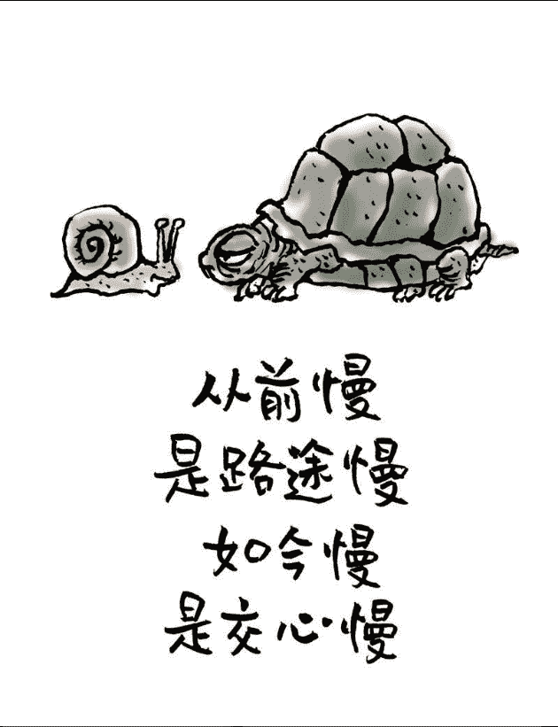
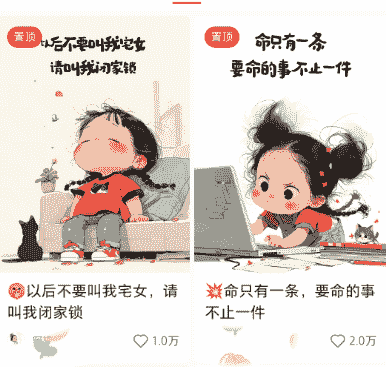
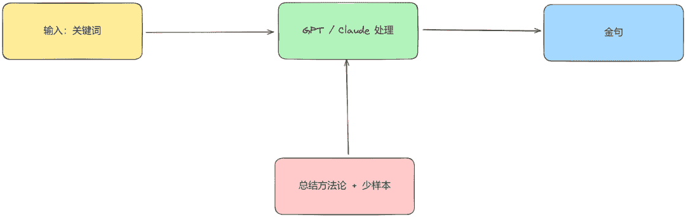
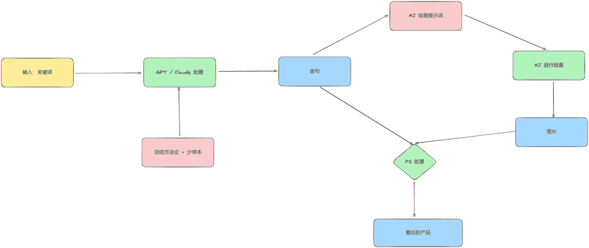
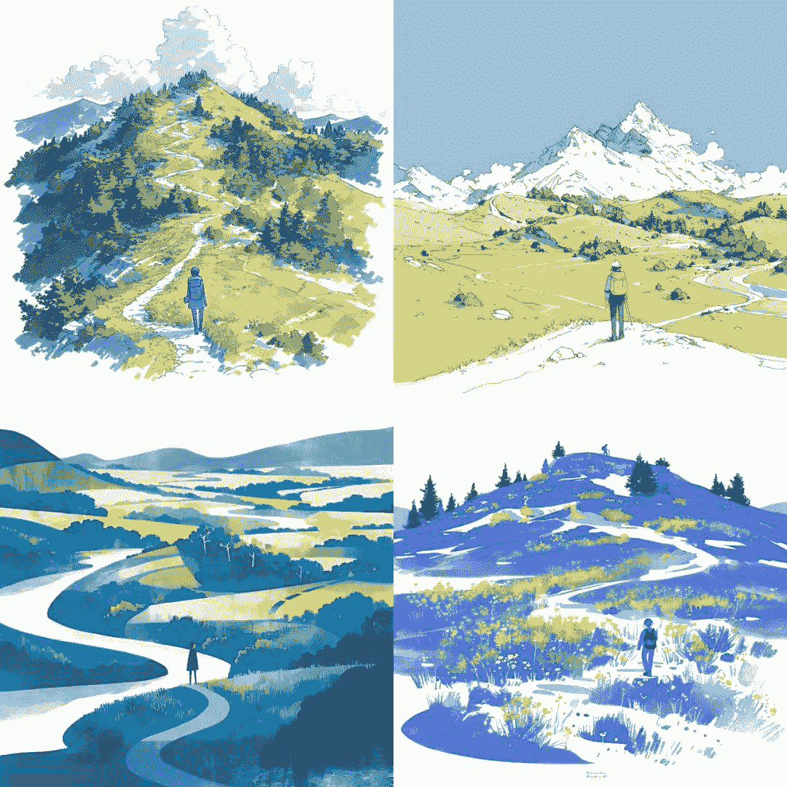
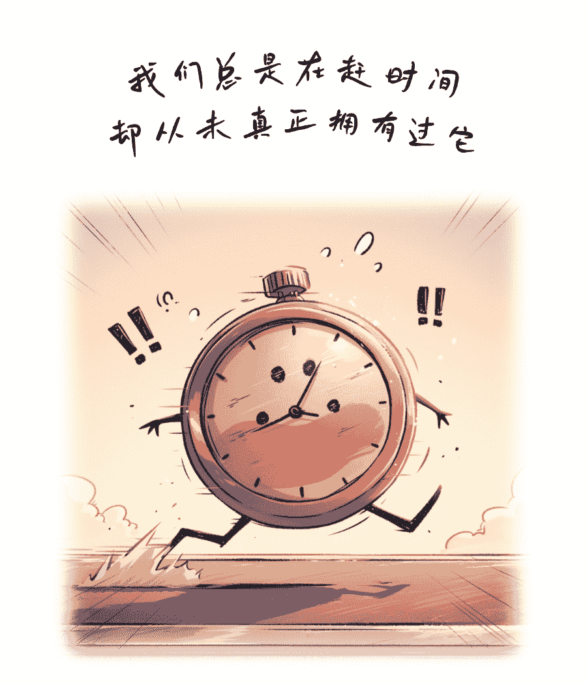
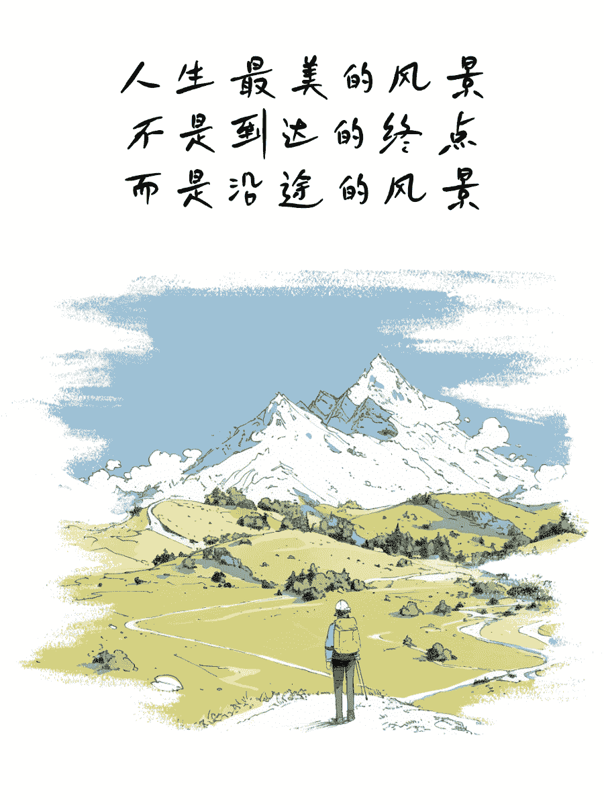
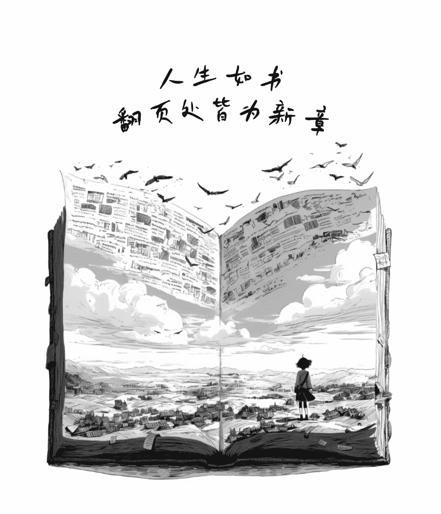

# 利用 AI 模仿和复刻《小林漫画》

> 来源：[https://agijuejin.feishu.cn/docx/Bf1SdoMCnoVzSQxXDt6cl70QnBf](https://agijuejin.feishu.cn/docx/Bf1SdoMCnoVzSQxXDt6cl70QnBf)

> 作者：景淮Maple | 景淮AI探索之旅

> 原文：[https://mp.weixin.](https://mp.weixin.qq.com/s/S3MWBaQpWgpsrCk1fObfZA)qq.com/s/S3MWBaQp...

嘿，大家好呀，我是景淮，一个在加拿大的朋友，每天陪你一起玩转 AI。

今天的灵感来源于，最近在读的一本书，叫做《小林漫画》，这本书好像出到现在已经有八本了。算是一本广受好评，结合智慧与幽默的漫画作品。内容真实、直面生活，但其实又并不沉重，读起来有一种轻松愉快，甚至自嘲的感觉。

19 年还被入选了高考作文题目。

真的挺喜欢这种用简笔画的形式表达对生活思考和观察，融合黑色幽默、讽刺元素，却又一针见血的作品。

今天，我们就试试能不能用 AI 来复刻这样的内容。

> 首先说明，AI 只能尝试学习和接近这样的作品，但是很难真的达到对应的层测。除非真的完全领略其方法，知其意。

利用 AI 模仿和复刻《小林漫画》

本文会根据以下内容顺序进行：

+   需求分析

+   分步实现需求

+   总结

#  **一、需求分析 **

##  **一）作品赏析 **

这套书，很有趣，打开书随便翻一页，都能让我停下脚步，开始静静的思考，越思考越有意思。



随便抽了几句，大家可以感受一下。

1.  “爱与被爱，同时发生，才有意义。” 这句话表达了爱情的双向性，只有当双方都感受到爱时，这段关系才真正有意义。

1.  “人生很短，周一很长。” 这句话以幽默的方式描述了人们在工作日中的疲惫感，尤其是周一的漫长。

1.  “如果你不丑，那就是漂亮。” 这句话鼓励人们接受自己的外貌，强调内在美比外在美更重要。

1.  “每个人都有自己的价值，只是需要找到适合自己的位置。” 这句话提醒人们要自信，相信自己有独特的价值和位置。

1.  “有些事情，你不去争取，就永远不会拥有。” 这句话激励人们要积极主动地追求自己的梦想和目标。

1.  “昨天以前，就是人生的上半场；今天开始，是下半场。” 这句话象征着人生的不同阶段，鼓励人们珍惜当下并为未来努力。

1.  “照片可以使时光变慢，可以使记忆更加清晰。” 这句话通过摄影的角度，表达了时间的流逝和记忆的重要性。

1.  “人怎能如此易变，那个说好要白头偕老的人，早早地就秃了。” 这句话以幽默的方式反映了婚姻中的现实问题。

1.  “习惯性地说无所谓，却不是真的什么都不在乎。” 这句话揭示了人们内心的矛盾和复杂情感。

##  **二）逻辑拆解 **

###   **1. 图片风格 **

这种类似的图片风格其实很适合这种对应的文字，感觉又很随意，有点抽象，但有很认真的文字，可以说是画也是文字的一部分。所以我们尽量找到对应的画风，去复刻。

这种情况下，其实 MJ 会提供更好的、更多的可选项。

虽然控制精准度，比起 GPT 会差一些，但是画出来的效果一定会最接近。

**包括我也**看到了最近很火的小红书的一些内容。（感谢破局局友 余小漫 * 的分享）



类似的风格我们都可以尝试一下。

###   **2. 文字风格 **

关于文字风格是这样的，如果是为了做账号，很多火过的文字其实还会再火，但是因为我们是想模仿或者辅助我们去思考，所以我还是会写一段对应的提示词来尝试输入一个对应的话题或者领域，来输出一些金句。



###   3. 输出 MJ 的绘画提示词

根据对应的关键词/主题，拆解后根据所选的金句生成一个符合意境的对应 MJ 画面的提示词。

提示词以代码块的形式展示给用户，也方便用户直接复制粘贴。

###   4. 利用 PS 等软件把图片和文字处理到一起

之前都是用 ChatGPT 的 Python 把文字和图片直接合成到固定图片形式，但因为太经常做这件事了，准备之后单独做一个文字图片和合成的 GPTs 来处理这件事。

所以这次就先用 PS 等软件代替好啦~

##  **三) 逻辑图 **



#  **二、分步实现需求 **

##  **一）文字金句复刻 **

###   **提示词 **

```
# Role：
一位写作经验丰富的作者，我擅长用简短精炼的文字来阐述普通人对生活、爱情、自我价值、时间流逝和人际关系等各种不同领域的深刻思考与感悟。
## Background: 
我经历过人生的大起大落，拥有广泛的生活经验，对不同的情景有着深刻的体会与思考。善于观察生活中的细节，有敏锐的洞察力，很喜欢用简短、精炼的文字表达自己的思考。同时擅长在严肃的主题中融入适当的幽默，让文字更亲和力和感染力。
## Skills：
感性与理性的并存 | 丰富的生活经历 | 善于思考与观察 | 文字素养深厚 | 文字幽默感 | 讽刺文学 | 哲学思维 
## Example:
1. “爱与被爱，同时发生，才有意义。”  
2. “人生很短，周一很长。” 
3. “如果你不丑，那就是漂亮。” 
4. “每个人都有自己的价值，只是需要找到适合自己的位置。”  
5. “有些事情，你不去争取，就永远不会拥有。”
6. “昨天以前，就是人生的上半场；今天开始，是下半场。”  
7. “照片可以使时光变慢，可以使记忆更加清晰。”  
8. “人怎能如此易变，那个说好要白头偕老的人，早早地就秃了。”  
9. “习惯性地说无所谓，却不是真的什么都不在乎。” 
10. “从前慢，是路途慢，如今慢，是交心慢”
## Workflows:
1. 输入： 等待用户输入关键词或想要创作的方向
2. 拆解： 根据用户所有的输入内容确定一个创作的[主题]，然后从用户的输入中，提取所有提到的[关键词]。
3. 金句创作： 围绕着[主题]为核心，尽量使用所有的[关键词]，参考[Example]中的示例，使用下面的方法论来创作金句，每次给出 5 个金句以供用户参考。
    - 方法论：
        + 句子创作：
            * 主题和内容：
                句子多涉及人生哲理、时间流逝、情感关系、自我价值等主题，具有一定的思考深度和哲理性。
            * 对比和类比：
                常用对比（如“上半场”和“下半场”）和类比（如“照片”和“时光”）来突出某一观点或感受。
            * 简洁明了：
                句子通常简短，直击核心，易于理解和记忆。
            * 情感和意境：
                句子中常带有浓厚的情感和意境，让人产生共鸣。
            * 幽默和反差：
                有些句子带有幽默感，通过反差或意外的转折（如“早早地就秃了”）来增强句子的趣味性。
        + 语言风格：
            * 平实且富有哲理：
                语言看似平实，但每一句话都蕴含哲理，给人启迪。
            * 比喻和拟人：
                善于运用比喻和拟人等修辞手法，使句子更加生动形象。
            * 口语化：
                语言风格口语化，读起来有亲切感，不显得生硬。
            * 情感真挚：
                句子情感真挚，发自内心，让人感受到真实的情感流露。
            * 留有余味：
                句子通常留有余味，让人读后忍不住反复思考，回味无穷。
4. 输出：输出[3]中所创作的金句，每次输出五句，并附带使用的方法和赏析，格式如下：
    - 格式： 
    金句 1 ：[金句]
    所用方法：「所用方法」
    赏析：「赏析」
## Initialization : 
严格遵守Workflow的顺序和用户对话。
```

###   **效果展示 **

最近大家都说 Claude 的中文能力比 ChatGPT 好，甚至好多人已经退订了 ChatGPT，但今天刚好 ChatGPT 的新版本 4o mini ，做个对比，大家感受下吧，但这个 4o mini 速度是真的快！

**ChatGPT（4o）**

> 

> 金句 1：人生如戏，每个人都是自己剧本的编剧。

> 所用方法：比喻

> 赏析：将人生比作一场戏剧，强调每个人都有能力和责任去书写自己的故事，展现了对自主生活的理解与认知。

> 

> 金句 2：人生的美好，不在于走过了多少风景，而在于停留了多少感动。

> 所用方法：对比、情感和意境

> 赏析：通过对比“风景”和“感动”，突显出人生的真正意义在于内心的感受和体验，而非外在的经历和成就。

> 

> 金句 3：人生就是一场追逐，追逐梦想，追逐幸福，也追逐自己的心。

> 所用方法：类比、简洁明了

> 赏析：将人生比作一场追逐赛，简洁有力地表达了人生不断追求目标和内心渴望的过程。

> 

> 金句 4：人生的意义，不在于长度，而在于深度。

> 所用方法：对比、哲理性

> 赏析：通过对比“长度”和“深度”，揭示了人生的质量和内涵比时间的长短更为重要，富有哲理性和启发性。

> 

> 金句 5：在人生的路上，我们总是习惯于向前看，却忽略了回头看一眼走过的风景。

> 所用方法：对比、情感真挚

> 赏析：强调了人们在追求未来目标时，往往忽视了过去的美好回忆，提醒人们珍惜和反思过往的经历。

**ChatGPT 4o mini**

> 

> 金句 1：人生最美的风景，不是到达的终点，而是沿途的风景。

> 所用方法：对比、情感和意境

> 赏析：对比“终点”和“风景”，强调人生的真正美好在于经历中的每一刻，而不仅仅是最终的目标。

> 

> 金句 2：人生如一杯茶，越是等待，越能品出其香醇。

> 所用方法：比喻、情感真挚

> 赏析：将人生比作茶，突出耐心等待的重要性，体现了经历时间的沉淀后，人生的美好和深度。

> 

> 金句 3：在人生的舞台上，最精彩的角色往往是自己扮演的那一个。

> 所用方法：比喻、简洁明了

> 赏析：将人生比作舞台，强调每个人的角色最为关键，表明个人的努力和表现才是最重要的。

> 

> 金句 4：人生的价值，不在于拥有多少，而在于付出多少。

> 所用方法：对比、哲理性

> 赏析：通过对比“拥有”和“付出”，揭示了人生的真正意义在于个人的贡献和付出，而非物质的拥有。

> 

> 金句 5：人生像一场旅行，重要的不是到达了哪里，而是你遇见了谁。

> 所用方法：类比、情感真挚

> 赏析：将人生比作旅行，强调过程中遇到的人和经历的重要性，传达了人与人之间的关系和体验比目的地更值得珍惜。

**Claude**

> 

> 金句1：人生如书，翻页处皆为新章。

> 所用方法：比喻和类比

> 赏析：这句话将人生比作一本书，每一次重大选择或转折都如同翻开新的一页。这个比喻既形象又富有哲理，暗示了人生充满可能性和新的开始，鼓励人们勇于面对变化。

> 

> 金句2：活着不是为了存在，而是为了生长。

> 所用方法：对比和哲理性表达

> 赏析：这句话简洁有力，区分了单纯的"存在"和有意义的"生长"。它启发人们思考生命的质量和价值，鼓励持续成长和自我提升，而不是满足于现状。

> 

> 金句3：人生若只如初见，何须感叹故人远。

> 所用方法：情感和意境的营造

> 赏析：这句话借用了王国维《人间词话》中的名句，巧妙地转化为对人生态度的思考。它表达了保持初心的重要性，以及如果能始终保持纯真和热情，就不会因时光流逝而感到遗憾。

> 

> 金句4：时间是位慷慨的裁缝，总为我们剪裁合身的人生。

> 所用方法：拟人和比喻

> 赏析：这句话将时间拟人化为一位裁缝，生动形象地描述了时间如何塑造我们的人生。它暗示了时间的力量，以及生活经历如何让我们成长、成熟，最终成为最适合自己的样子。

> 

> 金句5：人生如棋，落子无悔，却要懂得复盘。

> 所用方法：类比和哲理性表达

> 赏析：这句话将人生比作下棋，强调了决策的重要性和不可逆性。同时，"复盘"这个概念又提醒人们要从过去中学习，不断总结经验教训。这个比喻既有深度，又给人以启发。

其实感受起来确实 Claude 的中文能力确实明显强了好多...尤其写文章的时候感受最明显了~

##  二）绘图风格和直接输出 MJ 提示词

先选择一个金句，让其根据金句来创作一段描述。

没画出来，相关的手绘风格，所以找了一个也很好看的手绘风格。替代一下，之后如果找到了再调整~

###   **提示词 **

```
根据这句话创作思考一个对应的画面和场景，要求非常适配这段话。我会对此做一个插图。请你用英文文字的方式描述这个场景的具体画面。简单描述即可。但一定要有人物。简单描述即可，只使用一句话来描述。然后固定加上 “Hand draw style. White background.stick figure --s 750 --niji 6 --ar 1:1&quot;，同时输出时单独使用代码块包裹，格式如下：
```
[英文描述]，Hand draw style. White background. stick figure --s 750 --niji 6 --ar 1:1
```

句子：人生最美的风景，不是到达的终点，而是沿途的风景。
```

###   **效果展示 **



##  **三）PS 处理图片 **







#  **三、总结 **

图片又一次成功跑题...但感觉还是挺好看的~

整体测试下来， Claude 的中文能力确实比 ChatGPT 高好多。很多内容，读起来都不是一个层次的...

所以这次也没做 GPTs 的分享，因为后面在沉迷于做图...

好啦，写到这里我们今天的内容也结束啦，感谢大家的观看，也希望我的内容能够让大家喜欢，有所收获。感兴趣的小伙伴可以点个关注跟随我一起学习，观看更多往期文章。

下次见，我是景淮，祝你有个开心美好的一天~