# 原来亲手制作个人奥运头像原来这么简单！

> 来源：[https://agijuejin.feishu.cn/docx/Z9i6dCMxdoLJrRxQAnUcpdoInNb](https://agijuejin.feishu.cn/docx/Z9i6dCMxdoLJrRxQAnUcpdoInNb)

> 作者：景淮Maple | 景淮AI探索之旅

> 原文：[https://mp.weixin.](https://mp.weixin.qq.com/s/sDVGXtDg6fC0pL7wxAJ6fw)qq.com/s/sDVGXtDg...

嘿，大家好呀，我是景淮，一个在加拿大的朋友，每天陪你一起玩转 AI。

巴黎奥运会转眼已经开始了 4 天啦，也是恭喜中国的运动员们目前在金牌榜上排名第一~ 呱唧呱唧

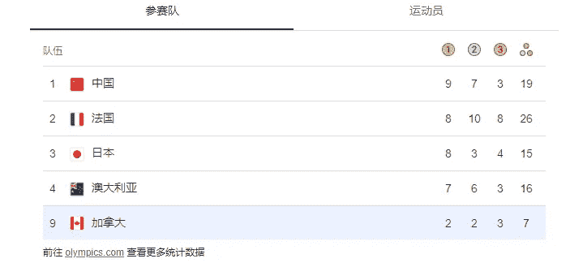

同样的所有参加奥运会，向着奥运会不断前进的运动员们都值得尊敬，也请大家别抓着一些失误，或者一次的失败就否定一个人的努力。

没有运动员不想赢，站在那个位置都是顶着无数的压力，想要为国争光的，没有任何人例外。所以我们能做的就是支持与鼓励~

接着这次的奥运会，给大家设计一款奥运头像给大家玩~ 也希望大家能够多多支持、鼓励运动员们，加油~

原来亲手制作个人奥运头像原来这么简单！

本文会根据以下内容顺序进行：

+   需求分析

+   分步实现需求

+   视频教程

+   总结

#  **一、需求分析 **

我们想要制作的头像，是一种私人定制，何为私人定制呢？简单来说就是，用自己的图片、照片、生成一些漫画形式的以照片人物为主体的运动员头像图。

确认一下，我们想要生成照片的软件，我们这边先选用 MJ 进行生图，虽然有时候没那么听话，但是我自己依然觉得 MJ 生成的图片在目前还是独一档的存在。

因为是使用 MJ 进行生图操作，所以我们可以先生成基础图片，再选择图片对脸部进行重绘。从而达到我们想要的效果。

##  **一）输入 **

输入的部分其实应该尽量做的简单，我们这边先使用 ChatGPT 来完成对应的工作，直接输入一个奥林匹克的项目根据项目的内容生成一段人物的描述。

结合我们一些设定好的提示词，来完成我们的需求。之后再使用重绘、垫图等参数进行调整。

##  **二）ChatGPT 生成描述 **

结合我们找的范例提示词，添加一些中国人、中国运动服和对应的项目场景描述。

来生成我们用来 MJ 画图的提示词

##  **三）MJ 绘图测试 **

主要是针对于 MJ 绘图提示词的稳定性进行测试。是否需要垫图等。

##  **四）局部重绘 **

我们使用 局部重绘,结合 cref 链接我们想要绘制人物的照片 同时可以调整下 cw 参数。

##  **五）处理流程图 **

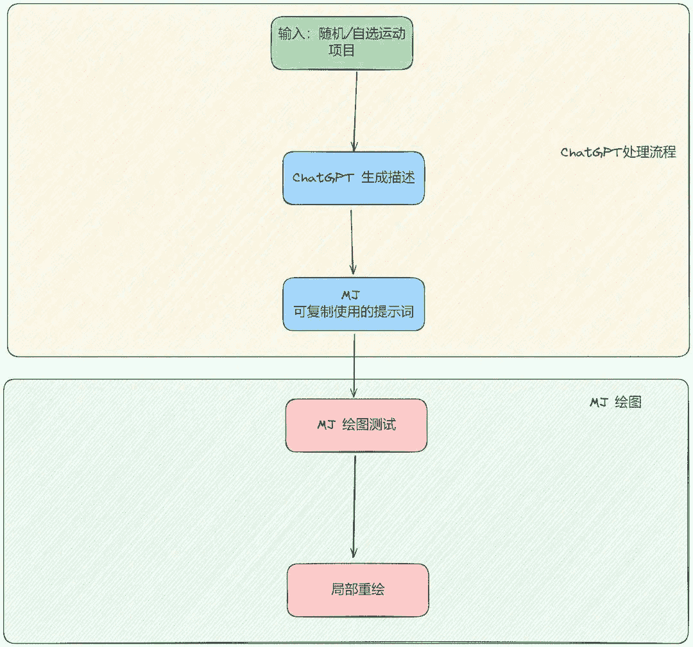

#  **二、分步实现需求 **

##  一）ChatGPT 生成 MJ 提示词

###   **提示词 **

```
## Workflows：
1.输入：要求用户输入一个奥林匹克项目和人物性别，告知用户也可以使用随机一个项目进行生成。
    - 验证：必须为奥林匹克运动会中拥有的项目。
    - 必须输入人物性别。
2. 绘画提示词生成： 保留一些关键词，只根据下面的要求修改图中的人物信息、性别和场景描述，替换[格式]中的绘画提示词中的描述部分。然后用代码块的形式展示给用户
    - 人物信息：中国人、中国红运动服、在背景中有着虚化的中国国旗
    - 人物的动作、道具和场景描述根据用户输入的[奥林匹克项目]进行生成
    - 绘画提示词使用英文进行输出，格式如下
    - 只需要输出最后的代码块结果即可，不需要展示中间过程给用户
```
A dynamic, high-energyof an Olympic athlete mid-action, captured in a moment of intense focus and determination. The athlete is dressed in a sleek, modern Olympic uniform, adorned with the iconic Olympic rings and vibrant national colors. The background features a stadium filled with cheering fans, banners waving, and the Olympic torch burning brightly. The scene exudes excitement, athleticism, and the spirit of competition, with motion lines and dramatic lighting emphasizing the athlete&#x27;s speed and power. --ar 1:1 --s 750 --niji 6 
``` 

输入：110米跨栏，男性
```

###   **效果展示 **

```
A dynamic, high-energy scene of an Olympic athlete mid-action, captured in a moment of intense focus and determination. The athlete, a Chinese male, is dressed in a sleek, modern Olympic uniform in vibrant red, representing China&#x27;s national colors. He is mid-jump, clearing a hurdle with perfect form in the 110-meter hurdles event. The background features a stadium filled with cheering fans, with a blurred Chinese national flag waving and the Olympic torch burning brightly. The scene exudes excitement, athleticism, and the spirit of competition, with motion lines and dramatic lighting emphasizing the athlete&#x27;s speed and power. --ar 1:1 --s 750 --niji 6
```

##  **二）MJ 绘图测试 **

###   **上述提示词效果展示 **

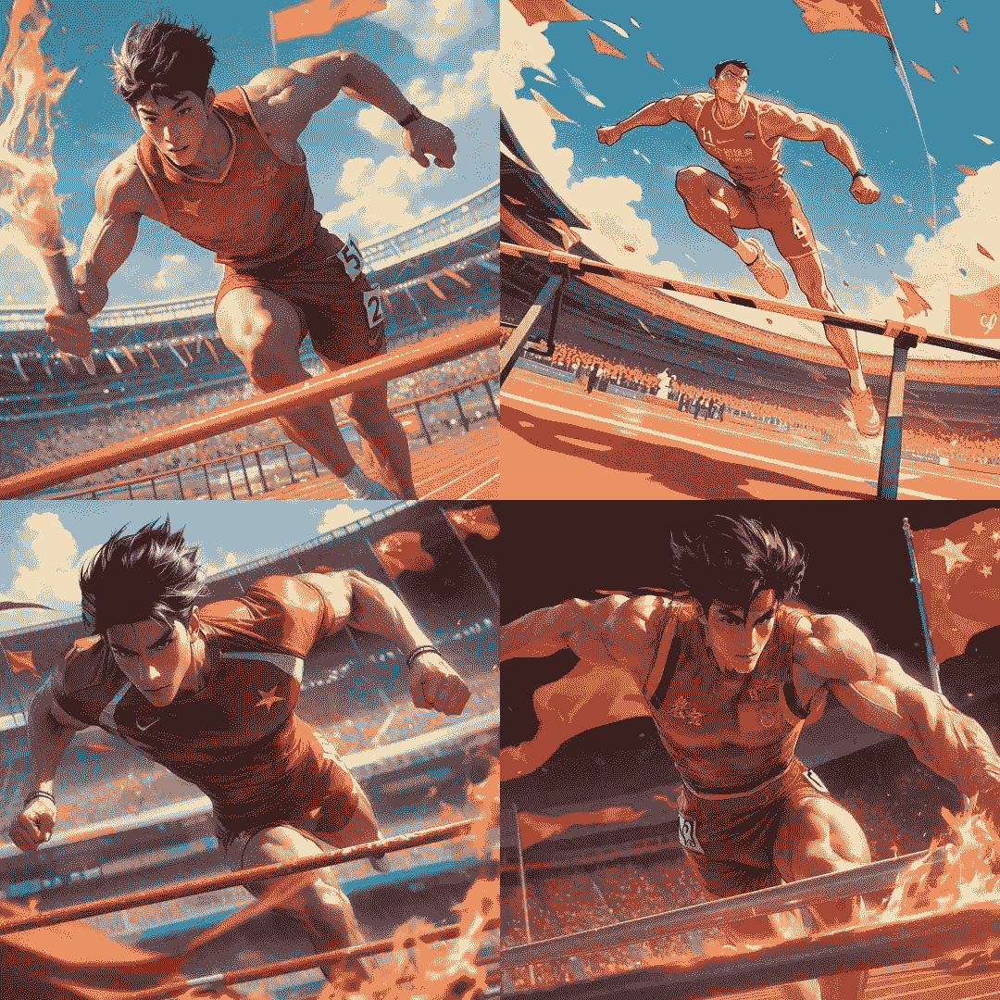

##  **三）局部重绘 **

###   **尽量选择一张脸部是正面的图片 **

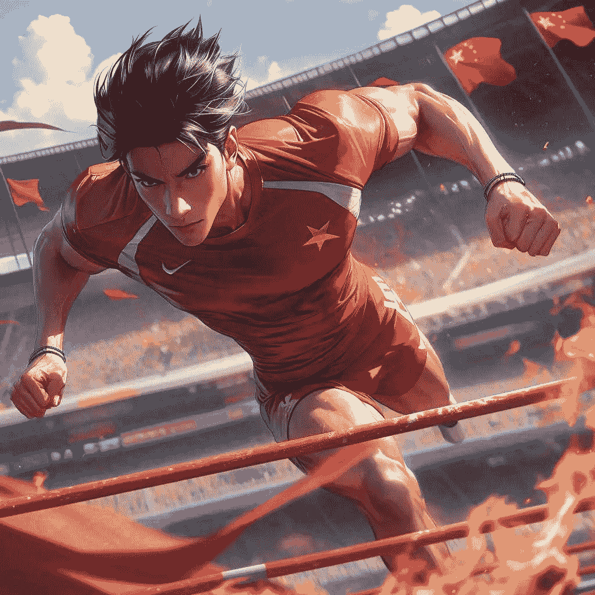

###   上传想要换脸的人物照片（复制到聊天框，回车上传）

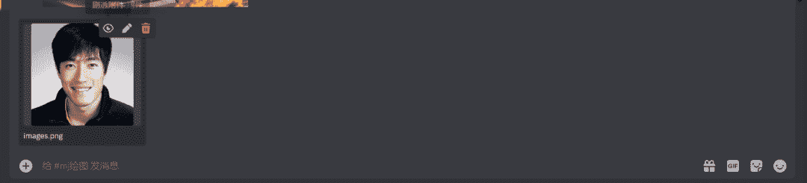

###   **复制链接 **

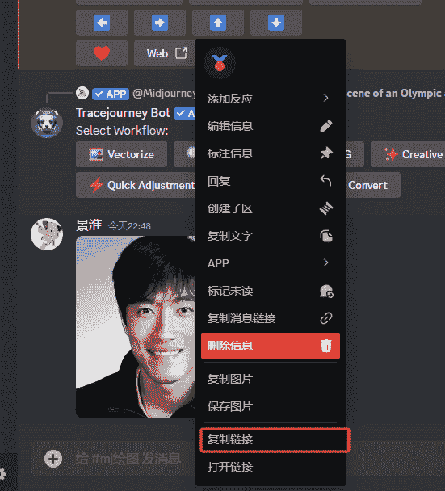

###   找到刚才 MJ 生成的图片，点击 Vary(Region)

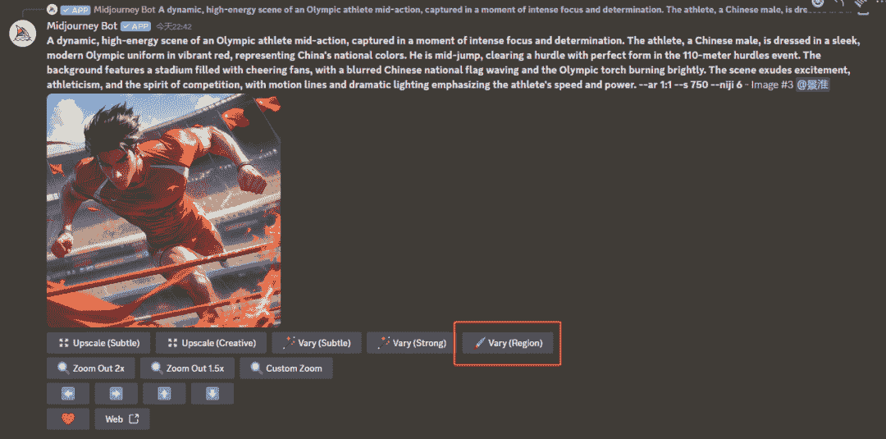

###   **使用选择工具，选中脸部区域 **

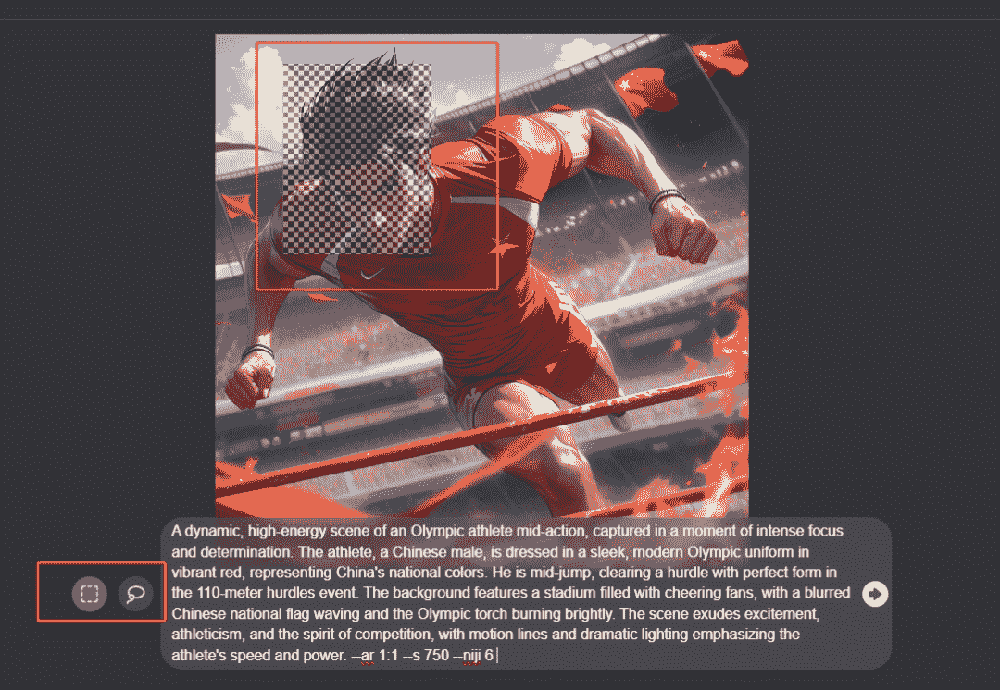

在提示词的最后面添加参数（注意与前面参数之间留个空格）

--cref https://cdn.discordapp.com/attachments/1155887342226247731/1268399808981504061/images.png?ex=66ac48e0&amp;is=66aaf760&amp;hm=aa6b8b8aee64a5165b613e154a556fe7c67c1b35769298ff99f09324d6efdb45&amp; --cw 0

```
```

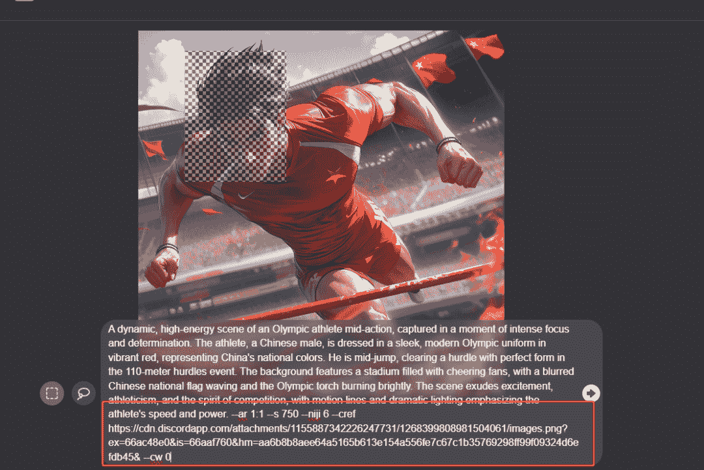

###   **效果展示 **

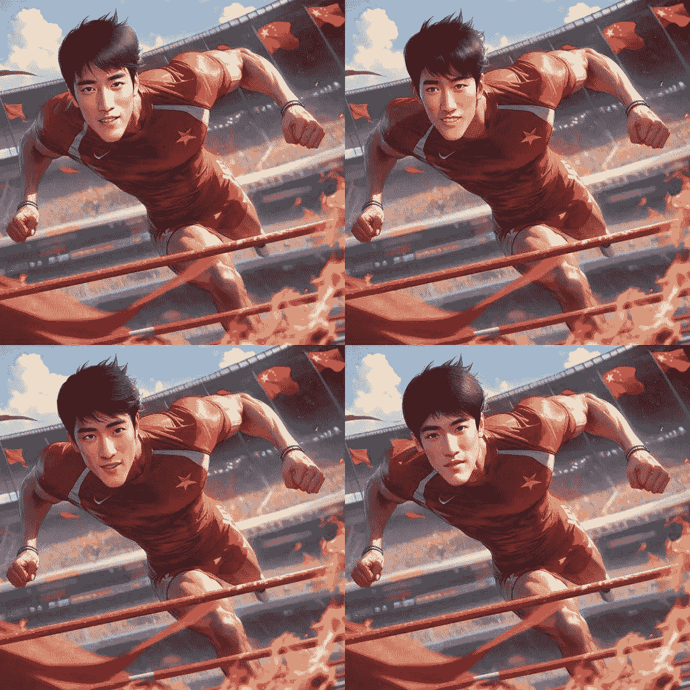

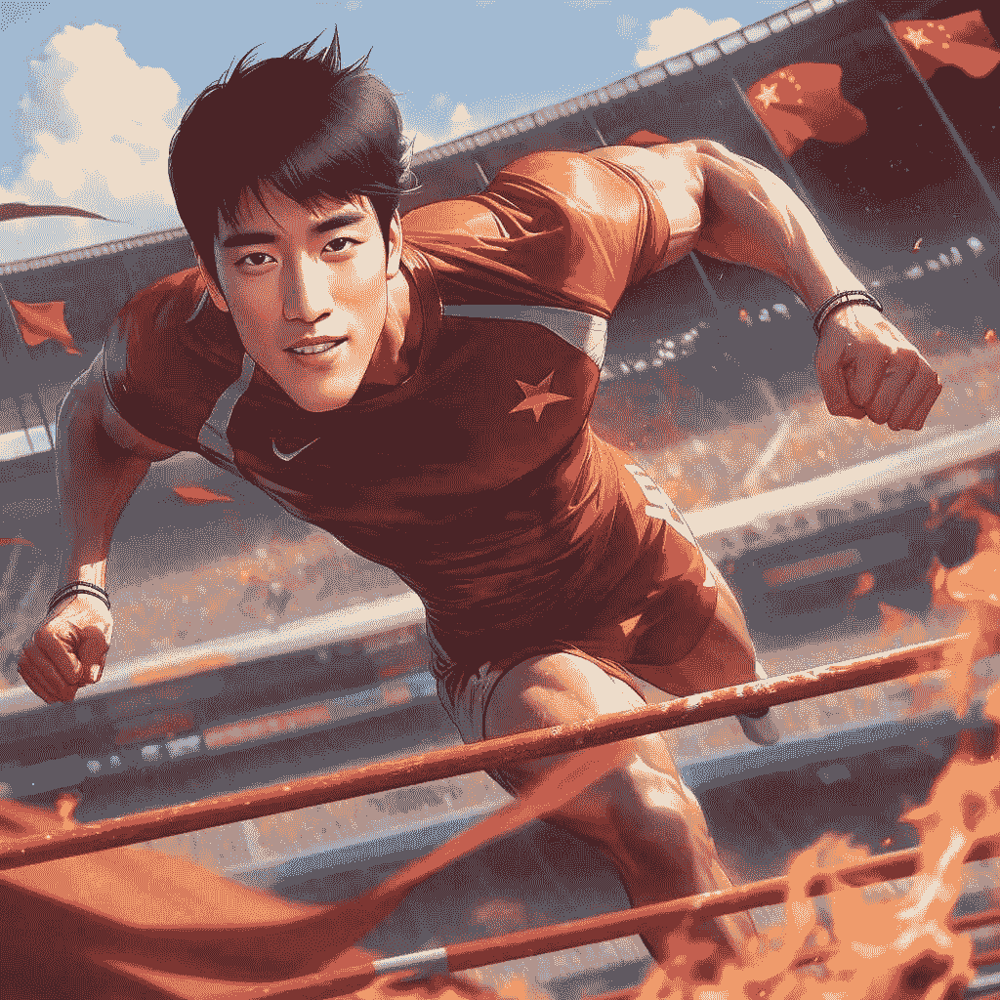

> 如果大家觉得不像，可以多调整几次，包括 cw 的参数值，参数 0 - 100，数字越大，对最后生成的图片影响应该是越大的。

#  **三、视频教程 **

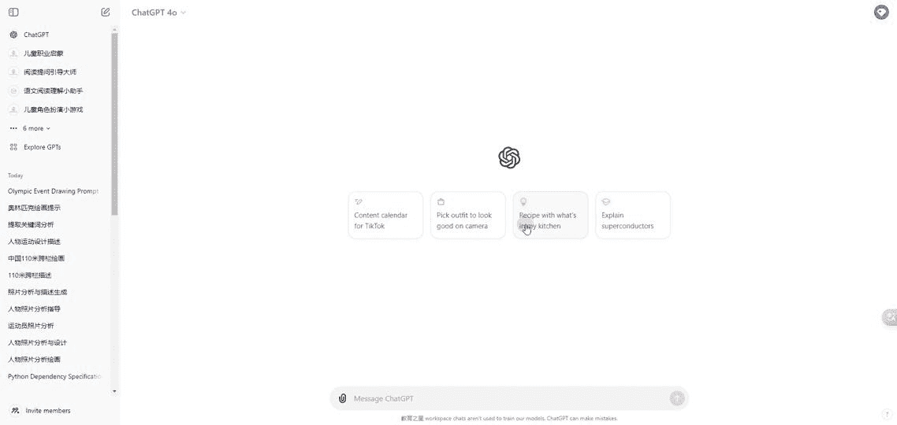

[0bc3biaagaaag4aaefvlmztfacwdamfaaaya.f10002.mp4](https://internal-api-drive-stream.feishu.cn/space/api/box/stream/download/all/B1SsbuzApoImVvx61gBcuywkn7c)

**效果展示 **


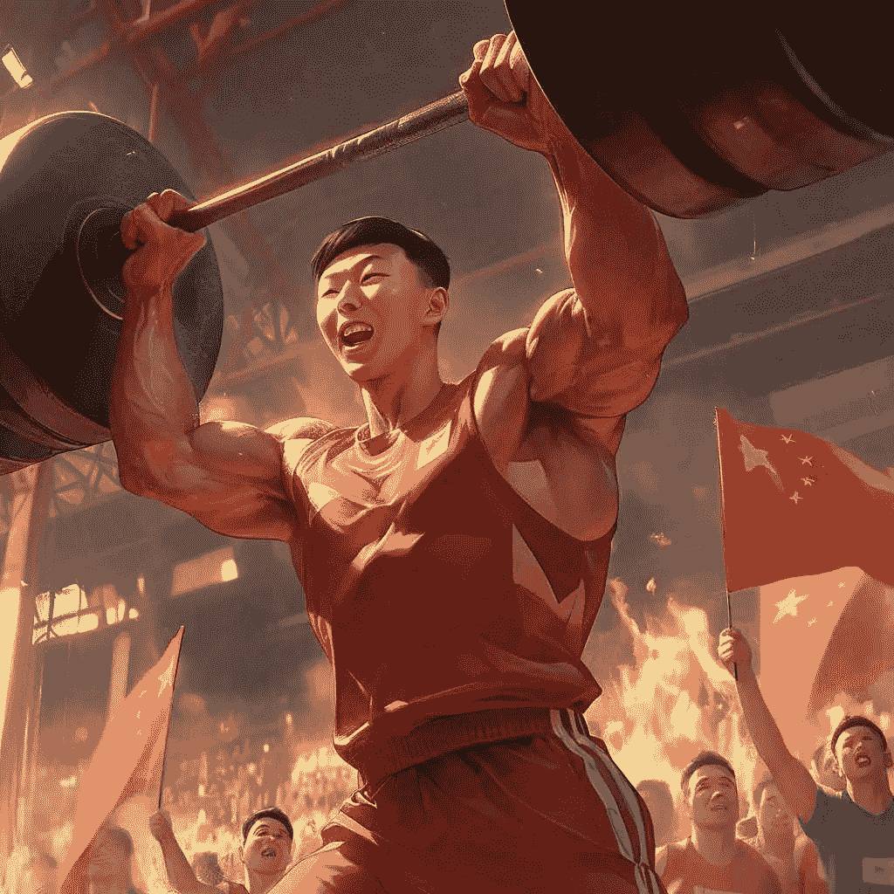

> 调侃归调侃哈~ 可能还有点恨铁不成钢吧~

> 说两句题外话，还是挺喜欢周琦的，毕竟他在我们市的体校练过哈哈哈，算半个老乡。

> 也希望中国篮球能越来越好吧，看到日本队的河村勇辉真的还是很感慨，毕竟现实版的宫城良田。

> 什么时候能看到中国的宫城呢，可能还没进体校就被淘汰了吧... 无奈╮(╯▽╰)╭

#  **四、总结 **

其实之前不怎么做视频的，但是发现好像纯文字版的内容有点太干了。之后的分享能做视频的尽量都会给大家安排。

大家喜欢的话，多帮我点点赞呀~ 这样才有更多的更新动力哈哈哈~

好啦，写到这里我们今天的内容也结束啦，感谢大家的观看，也希望我的内容能够让大家喜欢，有所收获。感兴趣的小伙伴可以点个关注跟随我一起学习，观看更多往期文章。

下次见，我是景淮，祝你有个开心美好的一天~