# 如何在扣子中手搓插件

> 来源：[https://agijuejin.feishu.cn/docx/Oge3dERVJohhqqx05dbcJXqdnxd](https://agijuejin.feishu.cn/docx/Oge3dERVJohhqqx05dbcJXqdnxd)

> 作者：景淮Maple | 景淮AI探索之旅

> 原文：[https://mp.weixin.](https://mp.weixin.qq.com/s/_7EYYGT1rl32TWyJ7pmfWw)qq.com/s/_7EYYGT1...

嘿，大家好呀，我是景淮，一个在加拿大的朋友，每天陪你一起玩转 AI。

因为之前的汉语词典中使用的用做中转的服务器挂了，也一直没有完成修复，所以今天重新修复了一下 ChatGPT 版本已经可以运行了。

之后会一起发给大家玩~ 创建过程大家可以参考下下面的文章。

GPTs Action 实战：儿童汉语词典

GPTs 使用链接： https://chatgpt.com/g/g-JizZEdYq0-yi-yu-ci-dian

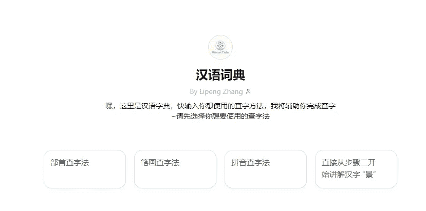

具体修改过程之后会再发一篇文章一起分享给大家。

因为这次想让更多的朋友用起来，所以创建了一个 扣子版。在 Agent 使用的过程中，智能体中的调用 API 其实就是 Agent 工作流中的插件，是有着差不多的运作方式。

所以今天就带着大家一起手搓插件~

**如何在扣子中手搓插件**

本文会根据以下内容顺序进行：

+   API 参数测试

+   扣子手搓插件

+   扣子插件视频

+   总结

#  **一、API 参数测试 **

其实我们想要创作插件，最重要的就是要有一个 API 接口。下面这个是上次中转的 AirCode 服务器挂掉之后，我用自己的服务器重新搭建的一个 API 接口。

**使用方法和参数如下**

服务器是用的我自己的，API 中转也是重新部署的，大家要是感兴趣可以试试哈。

对应的 api 参数我也放在下面了。

```
1. 查询汉字
接口
GET /characters
描述
根据拼音、笔画数或部首查询汉字。
查询参数
- pinyin: (字符串) 汉字的拼音。
- strokes: (数字) 汉字的笔画数。
- radical: (字符串) 汉字的部首。
- rs: (字符串) 部首和笔画数的组合，格式为 部首,笔画数。
示例
GET /characters?pinyin=ma
GET /characters?pinyin=ma3
GET /characters?strokes=16
GET /characters?radical=6
GET  /characters?rs=60,3

2. 获取汉字的笔画顺序
接口
GET /character/:char
描述
获取指定汉字的笔画顺序详情。
路径参数
- char: (字符串) 需要查询笔画顺序的汉字。
示例
GET /character/汉

3. 生成汉字笔画的PNG图片
接口
POST /generate-png
描述
生成指定汉字的每个笔画的PNG图片。
请求体
- text: (字符串, 必填) 需要生成PNG图片的汉字。
注意: 请求体应为JSON格式。
示例请求
POST /generate-png
Content-Type: application/json

{
    &quot;text&quot;: &quot;汉&quot;
}
```

除此之外，我还查了一下有关汉语词典的插件，有一个新华字典的但是已经挂掉了。这边方便大家自己创建，我也找了一个新华字典的 API 接口带着大家一起做一下~

##  **二、扣子手搓插件 **

###   1. 点击 个人空间 ，选择 插件 ，点击 创建插件

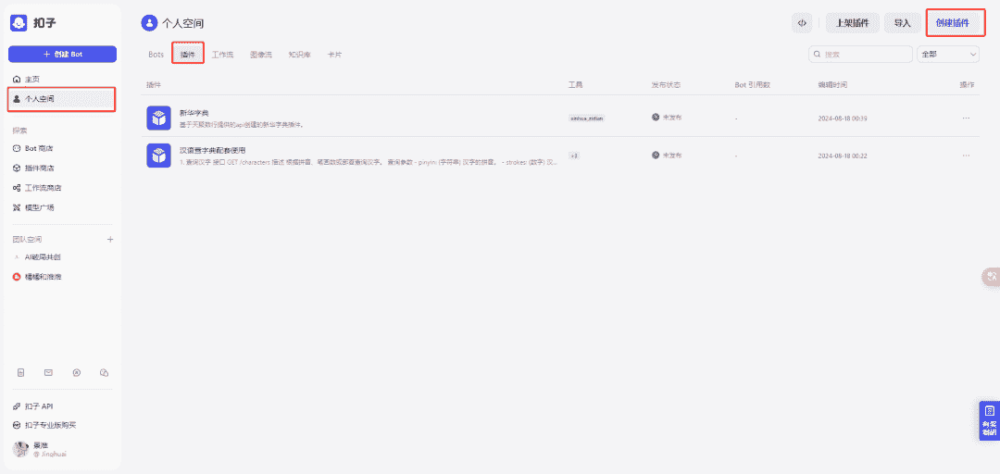

###   **2. 创建插件 **

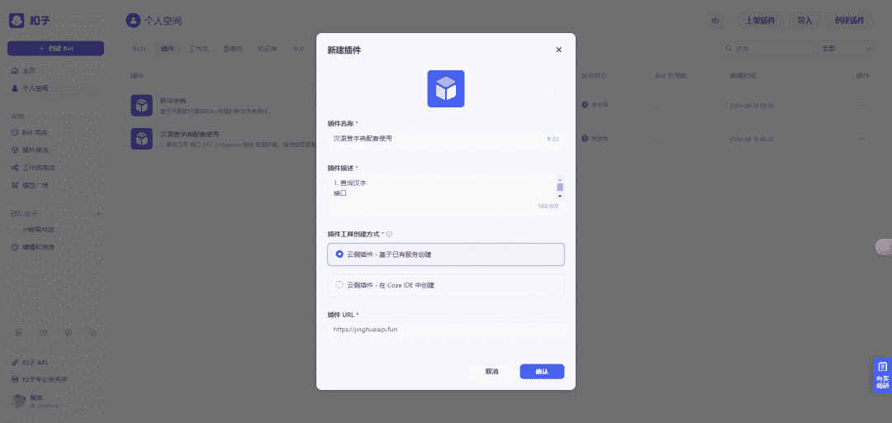

> **插件名称 ****：中文，根****据插件需求起名

> 插**件描述 ：告诉观众，插件是干什么用的，怎么用等。

> 插件工具创建方式 ：

> 云侧插件 - 基于已有服务创建 ： 使用现成的 API 来创建插件

> 云侧插件 - 在 Coze IDE 中创建 ： 使用 Coze 的服务器写代码来直接搭建 API（支持 Python 和 Node.JS）

> 选择基于已有服务创建后，会跳出一个必填项 ：插件 URL 要填入所使用 API 的 URL

###   3. 在新的界面点击 创建工具

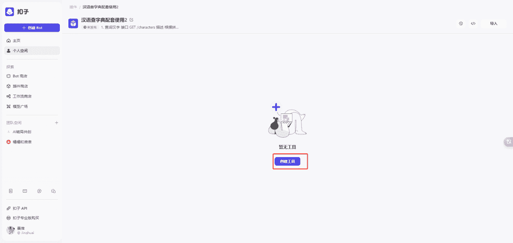

###   4. 填入第一个插件工具的基本信息

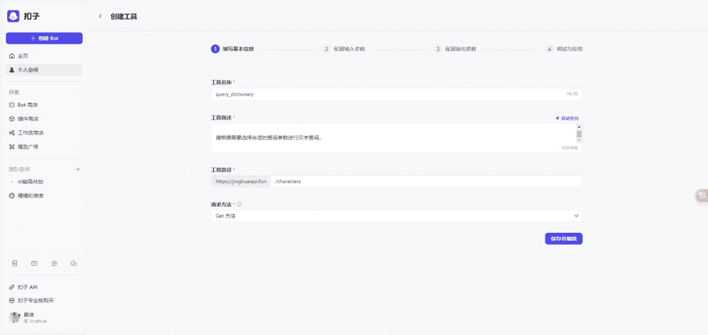

> **工具名称 ****：只能使用****字母、数字****和下划线来**命名

> 工具描述 ：根据工具的使用方法、功能来填写，提醒用户如何使用

> 工具路径 ：填写对应完整的 API 以 / 开始，如果后面使用path的方式传参，则可以使用“{}”包裹的方式把变量包含在其中

> 请求方法 ：根据 API 的调用方式选择对应的请求方法

结束后点击 **保存并继续**

###   **5. 配置输入参数 **

点击新增参数，把所有需要使用的参数填写进工具。

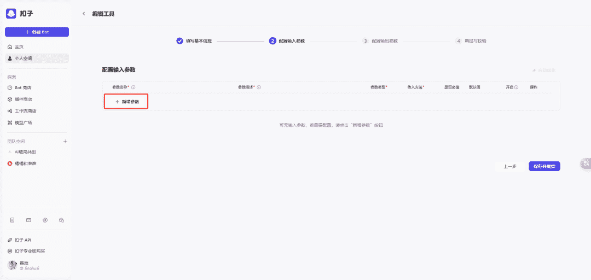

如图所示进行填写后，选择 **保存并继续**

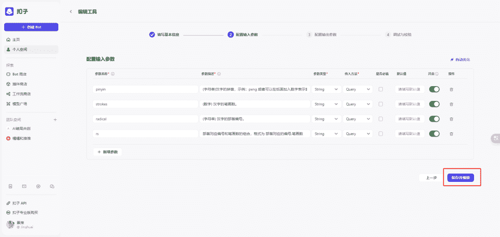

1.  **Body **：用于传递请求的主体部分，可以是JSON、XML或其他类型的数据。在GET方法中，通常不使用Body来传递参数，因为GET方法的URL中已经包含了所有必要的参数。

1.  **Path **：用于定义请求的路径部分，通常以“/”开头，后面跟着一系列的段落（如“/users/{username}”）。在GET方法中，Path可以用来传递参数，但通常会将其编码为URL的一部分，而不是单独传递。

1.  **Query **：用于定义请求的查询部分，通常以“?”开头，后面跟着一系列的键值对（如“?username=admin&password=password”）。在GET方法中，Query是最常用的参数传递方式，它允许用户通过URL中的键值对来传递参数。

1.  **Header **：用于定义HTTP请求的头信息部分，包括各种头部字段，如“Content-Type”、“Authorization”等。在GET方法中，Header通常不会用来传递参数，而是用于定义请求的头部信息。

###   **6. 配置输出参数 **

**如果一切都**填对了没有问题的话，我们可以直接点击 自动解析 ，会自动调用一次 API 给出对应的输出参数

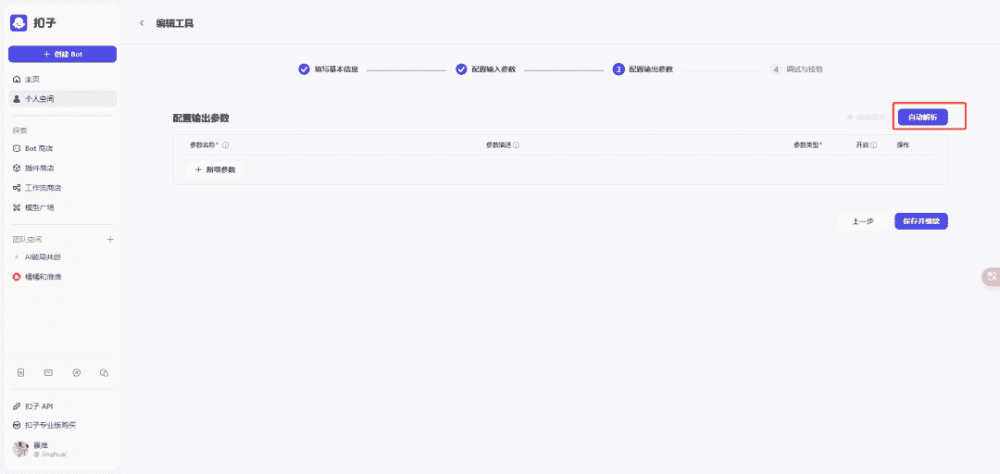

因为我使用的 API 都不是必填**项，所以**我就只填用拼音查字的就好。点击 自动解析

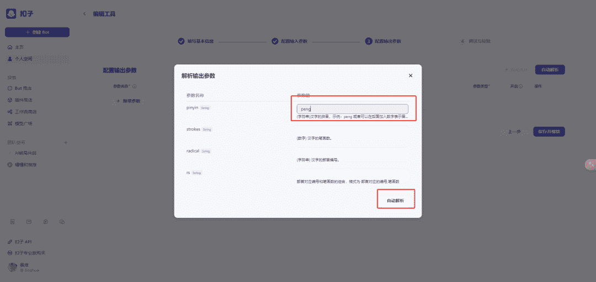

**解析成功后**会显示解析成功，我们可以看到输出参数已经填好。然后我们点击 保存并继续

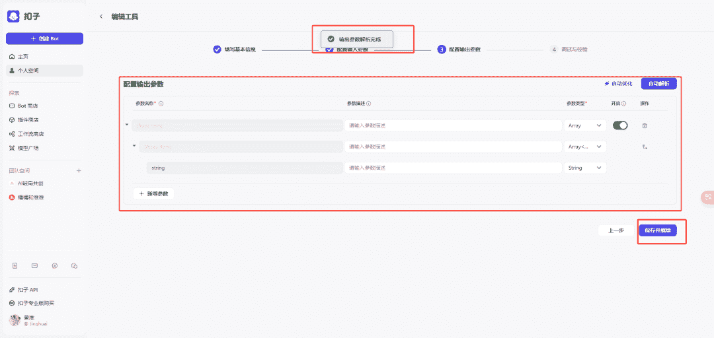

> 参数描述可以根据需求填写。既是提醒用户也是提醒自己，建议填写~

###   **7. 调试与校验 **

测试一下我们的工具，是否能正常运行。

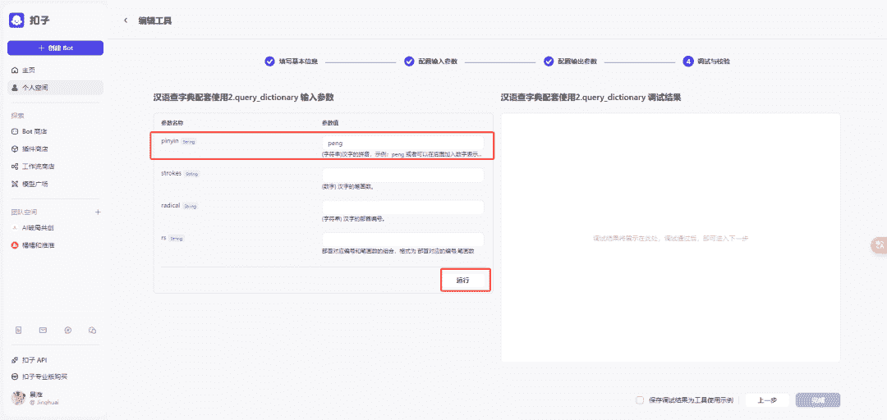

运行后查看输出结果

> Request 为输入的传参 Response 为返回值


点击 Response 就可以看到解析后的参数

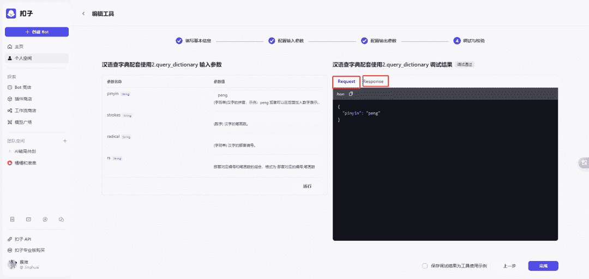

如果报错、解析结果不对，可以点击 Raw Response，会看到报错或者返回值，再根据返回值调整 配置输出参数

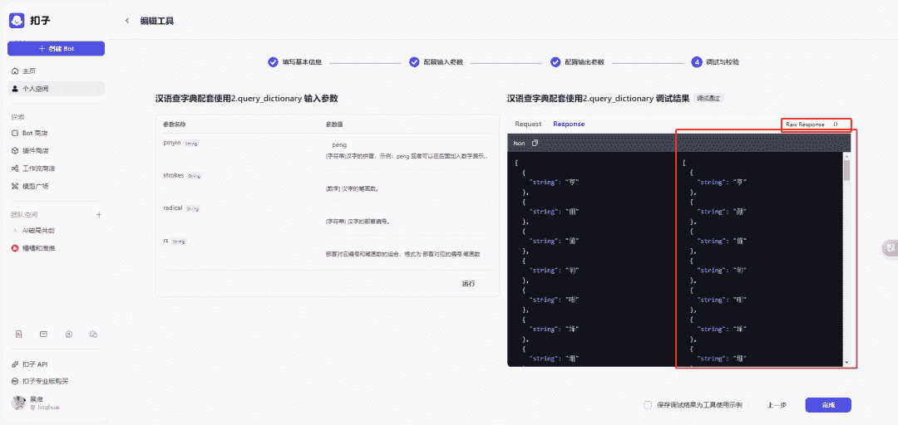

点击 **完成 **，就成功的创建了一个插件

#  **三、扣子插件视频 **

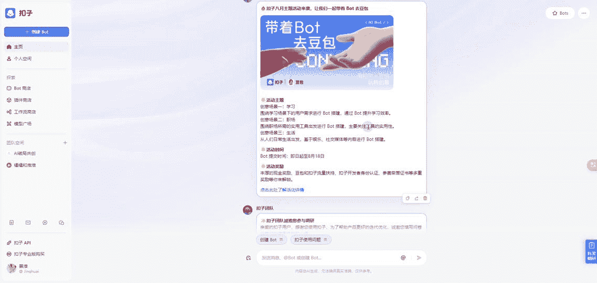

[0bc3daaacaaaoaabcswckvtfaggdaemaaaia.f10002.mp4](https://internal-api-drive-stream.feishu.cn/space/api/box/stream/download/all/M3PEbFmAXoaCgZxFrnycjc9An4a)

#  **四、总结 **

视频插件录制的教程录制的比较全，遇见的情况也比较多一些，大家可以有一个更好的参考。之后其他的参数，我在之后的使用中也会使用，制作成教程分享给大家。

汉语词典的扣子版，正在加班加点的做了！我尽快更新~

好啦，写到这里我们今天的内容也结束啦，感谢大家的观看，也希望我的内容能够让大家喜欢，有所收获。感兴趣的小伙伴可以点个关注跟随我一起学习，观看更多往期文章。

下次见，我是景淮，祝你有个开心美好的一天~