# 如何在扣子调用已有的 API 制作插件

> 来源：[https://agijuejin.feishu.cn/docx/EVCKd6dYXoeD10xPJd7c16KpnEg](https://agijuejin.feishu.cn/docx/EVCKd6dYXoeD10xPJd7c16KpnEg)

> 作者：景淮Maple | 景淮AI探索之旅

> 原文：[https://mp.weixin.](https://mp.weixin.qq.com/s/y6_KA3zyT0XPg6DDSiD_bA)qq.com/s/y6_KA3zy...

嘿，大家好呀，我是景淮，一个在加拿大的朋友，每天陪你一起玩转 AI。

今天继续更新汉语词典插件部分的内容。

如何在扣子调用已有的 API 制作插件

本文会根据以下内容顺序进行：

+   需求分析

+   扣子手搓插件

+   扣子插件视频

+   总结

#  **一、需求分析 **

我们先来看一下我们查字典的功能中，关于查的过程我们已经有了对应的 API 了，现在我们汉字学习的过程中也有一部分是需要使用 API 来解决的。

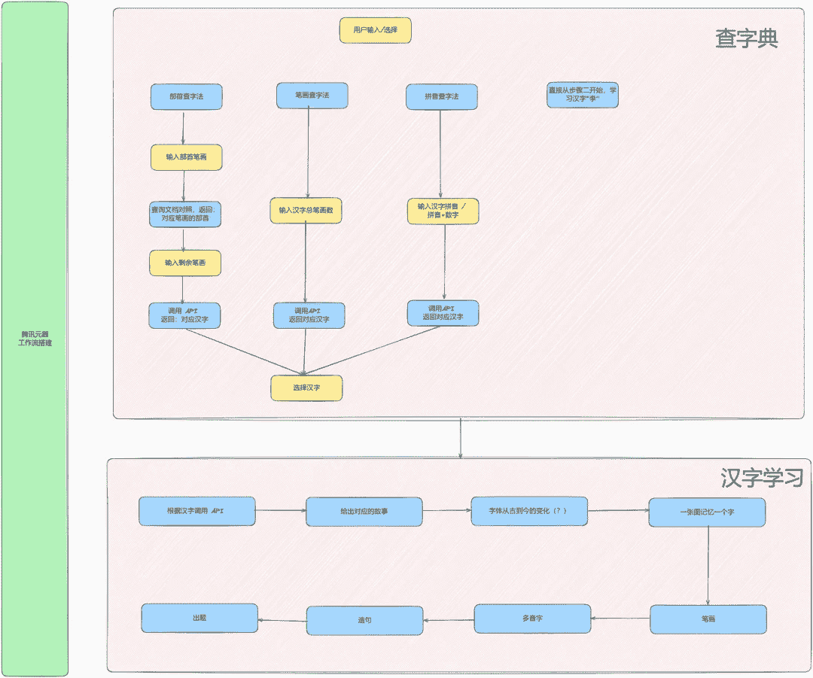

这部分就是古今字体的变化。这种字体的变化，在之前我们 ChatGPT 版本中是使用不同的字体来完成的。这次我们可能还是需要使用相同的办法来解决。

但是我查看了一下扣子的图像流和工作流，都没有对应能够上传使用字体的地方。所以为了完成我们下面的目标效果，只能使用代码和自制插件的方法来完成啦。

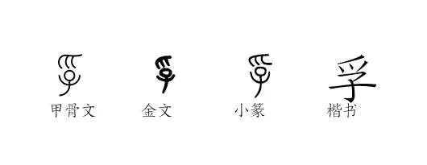

逻辑其实挺简单的，就是利用 Python 的库，创建一个白色的区域，然后在对应的四个位置使用不同的字体分别写上对应的字。比如图中写上了 “孚” 字。

#  **二、扣子手搓插件 **

##  **一）API 的介绍 **

这是一个放在我自己服务器上的 API

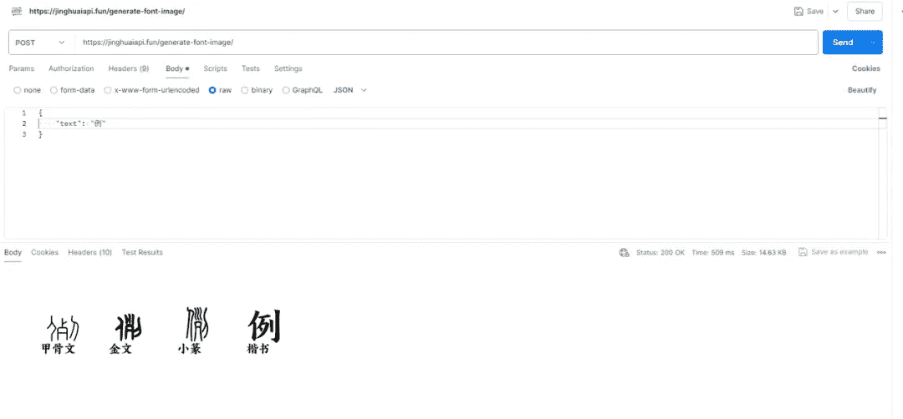

```
API 的 url 地址是：https://jinghuaiapi.fun/

接口
POST /generate-font-image
描述
生成一张从古到今文字进化的图片
请求体
- text: (字符串, 必填) 需要生成PNG图片的汉字。
注意: 请求体应为JSON格式。
示例请求
POST /generate-font-image
Content-Type: application/json

{
    &quot;text&quot;: &quot;例&quot;
}
```

##  **二）扣子插件的搭建 **

> 与上一篇是类似的操作，如果看过昨天的一篇可以略过

###   1. 点击个人空间，选择插件，点击创建插件

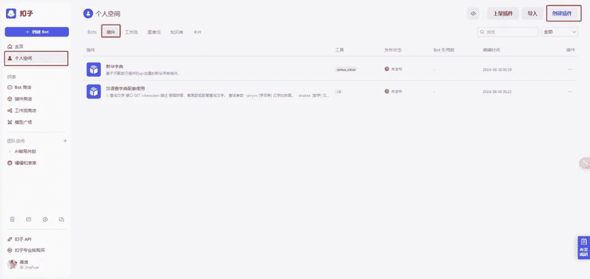

###   **2. 创建插件 **

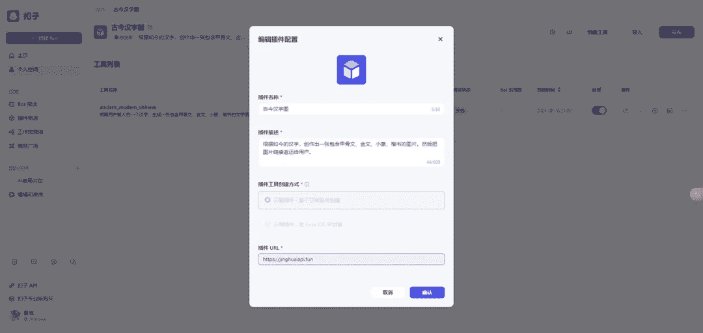

> 插件名称：中文，根据插件需求起名

> 插件描述：告诉观众，插件是干什么用的，怎么用等。

> 插件工具创建方式：

> 云侧插件 - 基于已有服务创建 ： 使用现成的 API 来创建插件 云侧插件 - 在 Coze IDE 中创建 ： 使用 Coze 的服务器写代码来直接搭建 API（支持 Python 和 Node.JS）

> 选择基于已有服务创建后，会跳出一个必填项：插件 URL 要填入所使用 API 的 URL

###   3. 在新的界面点击 创建工具

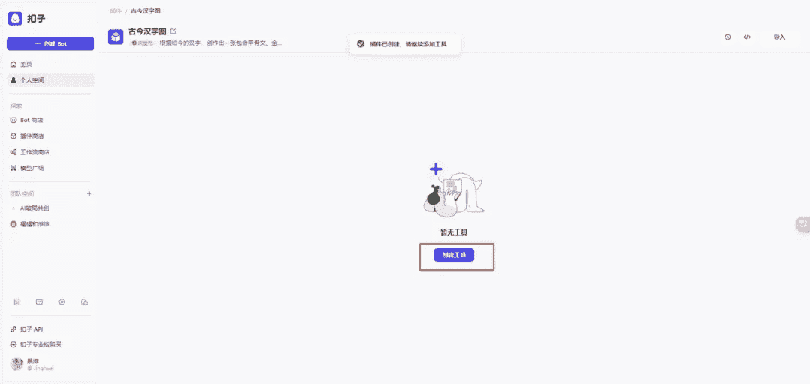

###   4. 填入第一个插件工具的基本信息

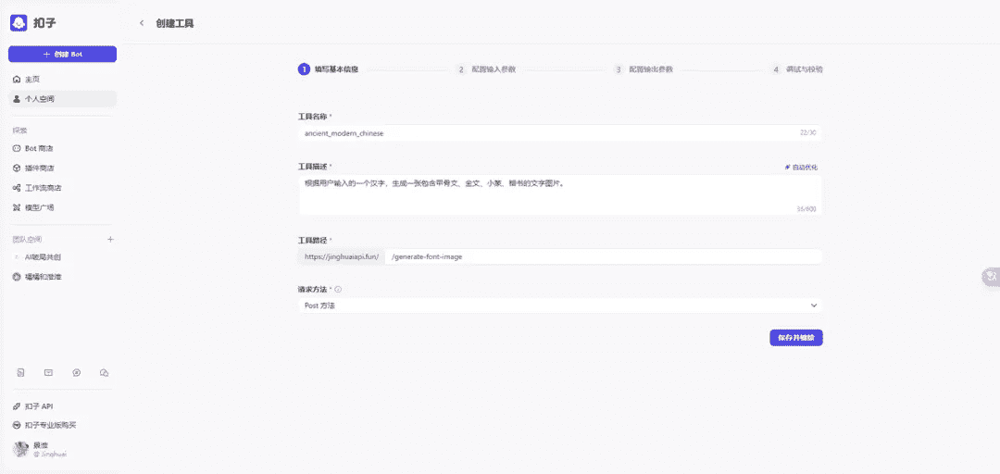

（昨天文字版展示的是get请求，今天是 post 请求）

> 工具名称：只能使用字母、数字和下划线来命名

> 工具描述：根据工具的使用方法、功能来填写，提醒用户如何使用

> 工具路径：填写对应完整的 API 以 / 开始，如果后面使用path的

> 方式传参，则可以使用“{}”包裹的方式把变量包含在其中

> 请求方法：根据 API 的调用方式选择对应的请求方法

结束后点击保存并继续

###   **5. 配置输入参数 **

点击新增参数，把所有需要使用的参数填写进工具。

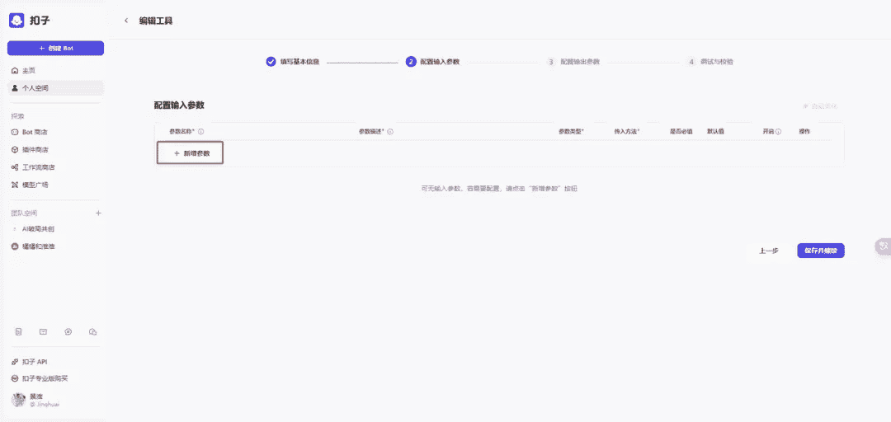

如图所示进行填写后，选择保存并继续

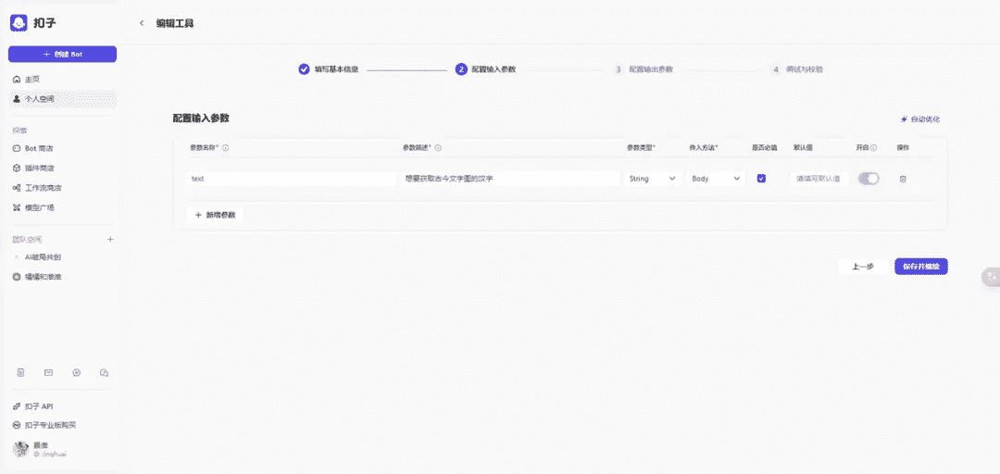

```
1. Body：用于传递请求的主体部分，可以是JSON、XML或其他类型的数据。在GET方法中，通常不使用Body来传递参数，因为GET方法的URL中已经包含了所有必要的参数。
2. Path：用于定义请求的路径部分，通常以“/”开头，后面跟着一系列的段落（如“/users/{username}”）。在GET方法中，Path可以用来传递参数，但通常会将其编码为URL的一部分，而不是单独传递。
3. Query：用于定义请求的查询部分，通常以“?”开头，后面跟着一系列的键值对（如“?username=admin&amp;password=password”）。在GET方法中，Query是最常用的参数传递方式，它允许用户通过URL中的键值对来传递参数。
4. Header：用于定义HTTP请求的头信息部分，包括各种头部字段，如“Content-Type”、“Authorization”等。在GET方法中，Header通常不会用来传递参数，而是用于定义请求的头部信息。
```

###   **6. 配置输出参数 **

如果一切都填对了没有问题的话，我们可以直接点击 自动解析，会自动调用一次 API 给出对应的输出参数

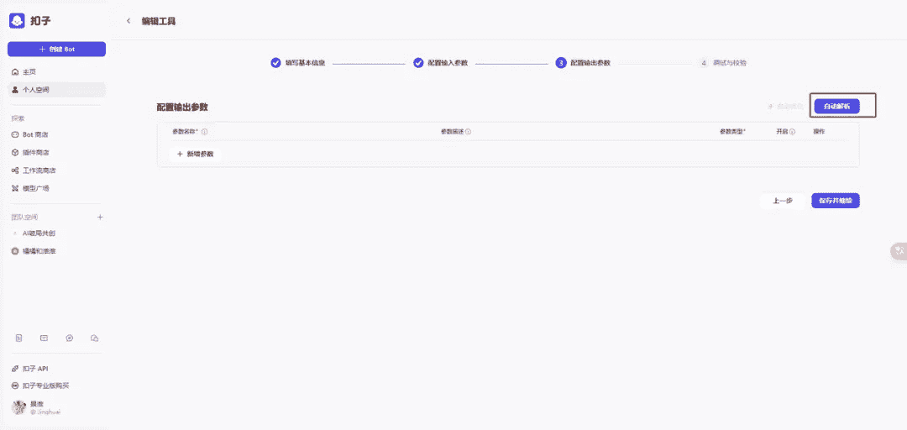

我填入汉字“张”。点击 自动解析

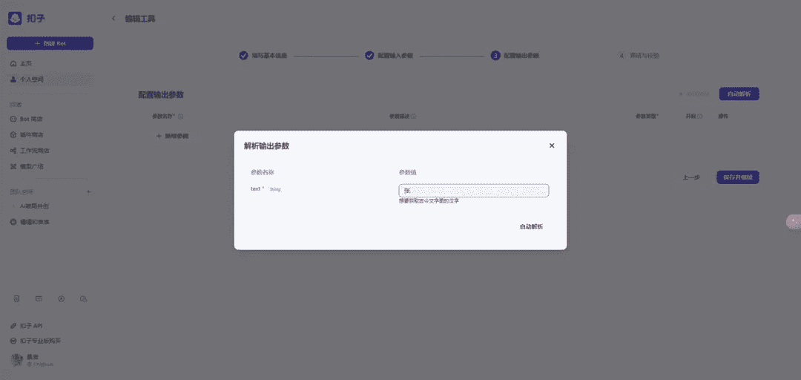

解析成功后会显示解析成功，我们可以看到输出参数已经填好。然后我们点击 保存并继续

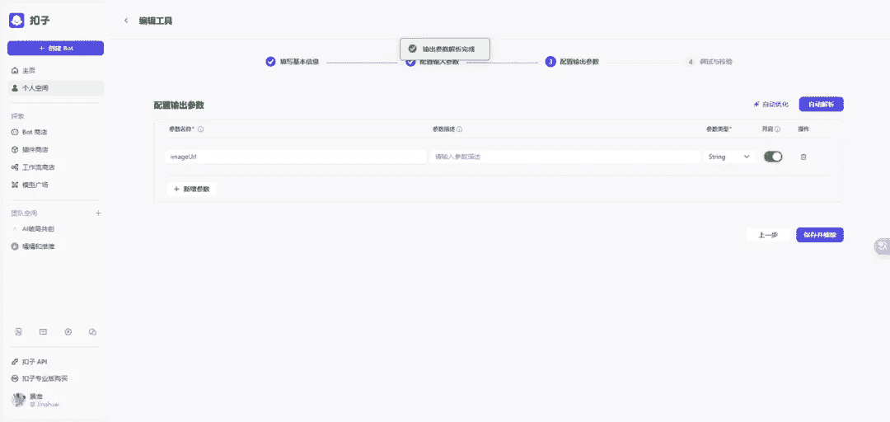

> 参数描述可以根据需求填写。既是提醒用户也是提醒自己，建议填写~

###   **7. 调试与校验 **

测试一下我们的工具，是否能正常运行。

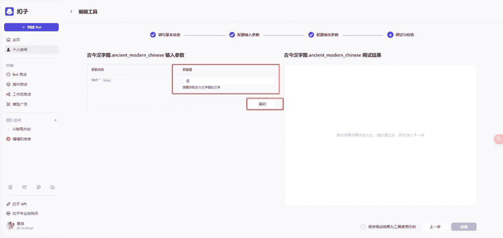

运行后查看输出结果

> Request 为输入的传参

> Response 为返回值

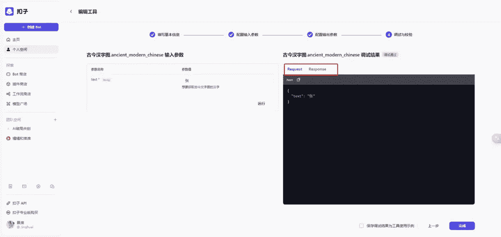

点击 Response 就可以看到解析后的参数


如果报错、解析结果不对，可以点击 Raw Response，会看到报错或者返回值，再根据返回值调整 配置输出参数

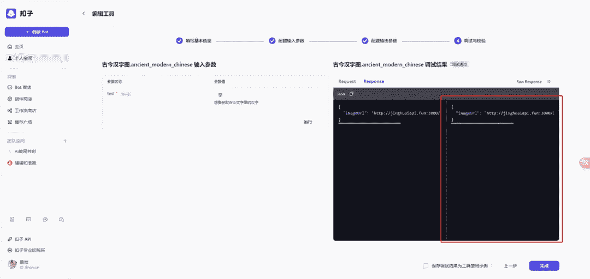

复制对应的链接到浏览器地址栏，打开查看

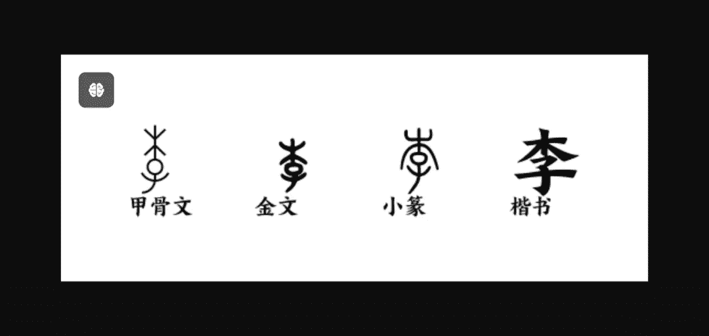

有些文字显示不出来，是因为字体包中没有这个字，所以就会导致显示不出来。这个暂时没什么办法。除非找到更加全面的字体包。

点击 完成，就成功的创建了一个插件

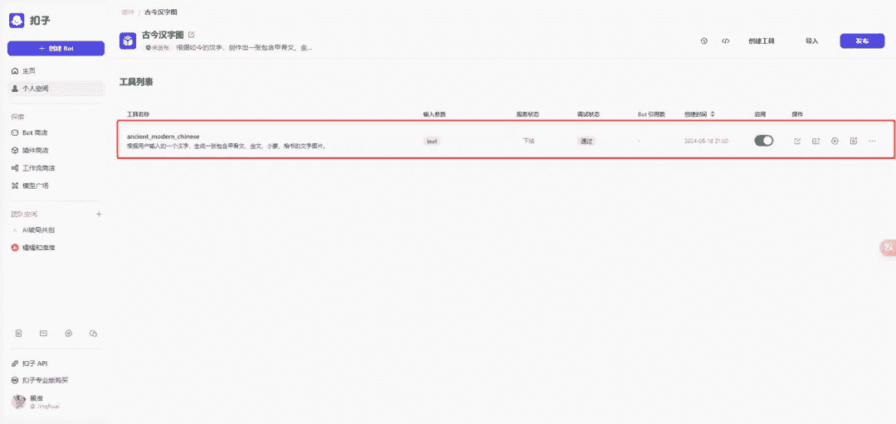

#  **三、扣子插件视频 **

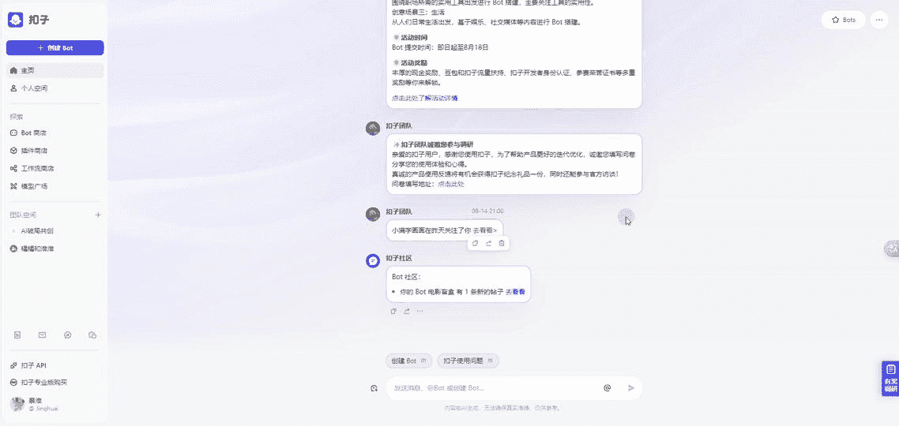

[0bc3jmaaeaaasuanmdgdhztfas6dajfqaaqa.f10002.mp4](https://internal-api-drive-stream.feishu.cn/space/api/box/stream/download/all/S7HWb2UjboLHs8x0iRwcWjbanBb)

#  **四、总结 **

今天的内容其实跟昨天发布的内容是相似且重复的，为什么呢？

其实是自己在创作设计的过程中发生了一些问题，本来是想使用 Coze IDE 来创建这个图片的，但是后面发现 Coze 的 IDE 不同于之前的 AirCode 没法上传 tff 格式的字体文件，也就没法生成我所需要的图片。

所以最后就决定把昨天录过的内容又录了一个细致的版本。希望能讲的更清晰一些。

**离汉语词典又近了一点...**

好啦，写到这里我们今天的内容也结束啦，感谢大家的观看，也希望我的内容能够让大家喜欢，有所收获。感兴趣的小伙伴可以点个关注跟随我一起学习，观看更多往期文章。

下次见，我是景淮，祝你有个开心美好的一天~