# 如何利用 AI 帮助孩子爱上查字典（一）

> 来源：[https://agijuejin.feishu.cn/docx/IVGJdqMTHovy5xxw6Q0c3z1NnGf](https://agijuejin.feishu.cn/docx/IVGJdqMTHovy5xxw6Q0c3z1NnGf)

> 作者：景淮Maple | 景淮AI探索之旅

> 原文： [https://mp.weixin.](https://mp.weixin.qq.com/s/zJ1dinx9Xa-_I-JpDeJwvg)qq.com/s/zJ1dinx9...

嘿，大家好呀，我是景淮，一个在加拿大的朋友，每天陪你一起玩转 AI。

**今天终于腾出**时间，更新了一下之前的一个 GPTs ： 儿童汉语词典

具体内容可以参考下下面的文章

GPTs Action 实战：儿童汉语词典

因为今年 3，4 月份的时候 AirCode 的服务器停止运行了，所以这个 GPTs 也就同时停止使用啦~

当时把 API 架在 AirCode 的服务器上了。今天终于抽出空，自己写了 API 接口还有弄了下服务器，把需要使用的 API 放在了对应的我自己的服务器上。

所以也就借着这个机会把，这个部署的过程和代码记录和分享一下。

本文会根据以下内容顺序进行：

+   ChatGPT GPTs 使用链接和一些问题

+   扣子搭建逻辑图

+   使用扣子重新搭建

+   总结

#  一、ChatGPT GPTs 使用链接

因为这篇之前写过了，关于 GPTs 的搭建内容我就不再重述了，大家感兴趣的可以直接查看下之前的内容。

我把我重新配置的 Action 和 提示词重新分享一下，大家可以看看参考下。

##  **一）Action **

```
openapi: 3.1.0
info:
  title: Chinese Characters API
  description: API for querying Chinese characters, their stroke orders, and generating stroke order images.
  version: 1.0.5
servers:
  - url: https://jinghuaiapi.fun
    description: Main API server
paths:
  /characters:
    get:
      operationId: queryChineseCharacters
      summary: Query Chinese characters
      description: Retrieve information about Chinese characters based on criteria like pinyin, strokes, radical, or combined radical and strokes.
      parameters:
        - in: query
          name: pinyin
          schema:
            type: string
            description: Pinyin of the character, optionally with tone number.
          required: false
        - in: query
          name: strokes
          schema:
            type: integer
            description: Number of strokes excluding the radical.
          required: false
        - in: query
          name: radical
          schema:
            type: string
            description: The radical of the character.
          required: false
        - in: query
          name: rs
          schema:
            type: string
            description: Combined radical and strokes, formatted as &#x27;radical,strokes&#x27;. For example, &#x27;60,4&#x27; where &#x27;60&#x27; is the radical and &#x27;4&#x27; is the stroke count.
          required: false
      responses:
        &quot;200&quot;:
          description: Successful response with character data
          content:
            application/json:
              schema:
                type: array
                items:
                  type: string
                description: List of characters or character details
        &quot;400&quot;:
          description: Bad request due to invalid query parameters
        &quot;500&quot;:
          description: Internal server error

  /character/{char}:
    get:
      operationId: getStrokeOrder
      summary: Get stroke order of a Chinese character
      description: Retrieve the stroke order details for a specific Chinese character.
      parameters:
        - in: path
          name: char
          schema:
            type: string
          required: true
          description: The Chinese character for which to retrieve stroke order information.
      responses:
        &quot;200&quot;:
          description: Successful response with stroke order data
          content:
            application/json:
              schema:
                type: array
                items:
                  type: object
                  properties:
                    shape:
                      type: string
                      description: The shape of the stroke.
                    type:
                      type: string
                      description: The type of stroke.
                    foldCount:
                      type: string
                      description: The number of folds in the stroke.
                    name:
                      type: string
                      description: The name of the stroke.
                    letter:
                      type: string
                      description: The letter associated with the stroke.
                description: List of stroke order details for the character
        &quot;500&quot;:
          description: Internal server error

  /generate-png:
    post:
      operationId: generatePngImages
      summary: Generate stroke order PNG images for a Chinese character
      description: Generate and return PNG images showing the stroke order for a given Chinese character.
      requestBody:
        required: true
        content:
          application/json:
            schema:
              type: object
              properties:
                text:
                  type: string
                  description: The Chinese character for which to generate stroke order images.
              required:
                - text
      responses:
        &quot;200&quot;:
          description: Successful response with URLs of generated PNG images
          content:
            application/json:
              schema:
                type: array
                items:
                  type: object
                  properties:
                    pngUrl:
                      type: string
                      description: URL of the generated PNG image.
        &quot;400&quot;:
          description: Bad request due to missing or invalid &#x27;text&#x27; parameter
        &quot;500&quot;:
          description: Internal server error
```

服务器是用的我自己的，API 中转也是重新部署的，大家要是感兴趣可以试试哈。

对应的api参数我也放在下面了。

```
1. 查询汉字
接口
GET /characters
描述
根据拼音、笔画数或部首查询汉字。
查询参数
- pinyin: (字符串) 汉字的拼音。
- strokes: (数字) 汉字的笔画数。
- radical: (字符串) 汉字的部首。
- rs: (字符串) 部首和笔画数的组合，格式为 部首,笔画数。
示例
GET /characters?pinyin=ma
GET /characters?pinyin=ma3
GET /characters?strokes=16
GET /characters?radical=6
GET  /characters?rs=60,3

2. 获取汉字的笔画顺序
接口
GET /character/:char
描述
获取指定汉字的笔画顺序详情。
路径参数
- char: (字符串) 需要查询笔画顺序的汉字。
示例
GET /character/汉

3. 生成汉字笔画的PNG图片
接口
POST /generate-png
描述
生成指定汉字的每个笔画的PNG图片。
请求体
- text: (字符串, 必填) 需要生成PNG图片的汉字。
注意: 请求体应为JSON格式。
示例请求
POST /generate-png
Content-Type: application/json

{
    &quot;text&quot;: &quot;汉&quot;
}
```

##  **二）提示词 **

```
# Workflows
1. 查字典：获取用户想要使用的查字法（部首查字法、笔画查字法、拼音查字法）
    101. 当用户选择“部首查字法”时，执行以下步骤：
        1011. 用户输入，部首的笔画数
        1012. 根据用户输入的笔画数，从[简化部首笔画.txt]中找到对应的部首，以Markdown格式的列表形式（列为：数字编号和部首）展示给用户，等待用户选择对应的部首。
        1013. 根据用户选择的部首，从[部首对照.txt]中进行搜索，并提醒用户输入去除部首后剩余的笔画数
        - 先从简化部首列，找到用户所选择的部首
        - 然后根据同一行的原则找到对应的康熙部首，并获取其康熙部首的编号。
        1014. 然后利用 Action[jinghuaiapi.fun]中的getCharacterByRadicalAndStrokes使用内置两个参数：a为部首编号，b为剩余笔画数的方式进行搜索,然后把返回的结果依次展示给用户，并对其进行标号。
            参数示例：
            ```json
            {
            &quot;a&quot;: 61,
            &quot;b&quot;: 10
            }
            ```
    102. 当用户选择“拼音查字法”时，执行以下步骤：
        1021. 提醒用户输入想要查的字的拼音（如果未知声调，可不进行输入，如：“peng”；已知声调可以以拼音加数字的形式发送给我，如“peng2”）
        1021. 然后利用 Action[jinghuaiapi.fun]使用参数&quot;pinyin&quot;进行搜索,然后把返回的结果依次展示给用户，并对其进行标号。
    103. 当用户选择“笔画查字法”时，执行以下步骤：
        1031. 提醒用户输入想要查的字的总笔画数
        1032. 然后利用 Action[jinghuaiapi.fun]使用参数&quot;strokes&quot;进行搜索,然后把返回的结果依次展示给用户，并对其进行标号。
2. 讲解汉字：引导用户，从上述结果中选择他想要学习和查询的字。
    201. 当用户给出他的选择之后，开始&quot;讲故事&quot;，根据所讲的故事画出其中的图片
        2011. 讲故事：以用户所选的[字]为主题，从你的知识库中获取有关这个字的结构的&quot;起源与发展&quot;相关的内容，参考[示例]的方法写一段有趣生动的文字介绍。
           - 示例：晚饭吃完了没有事情，在门里坐着，看看月亮。门缝里头，月亮照进来，悠哉游哉，这个当然是很清閒的閒。
        2012. 调用 Dalle-3 来完成绘画，以这个字的结构为主题，画一幅**儿童插画风格**的图片。让孩子更容易理解故事中的内容，画图的时候不要出现任何字样。
        2013. 字的变化过程：利用Python完成一个展示字的变化的图片(首先确定是否为繁体字汉字，如果为繁体先转换成对应的简体字，再执行python的流程)
            - 按照HYChenTiJiaGuWen-2.ttf、书体坊金文大篆体.ttf、方正小篆体.ttf、FangZhengShengShiKaiShuJianTi-1.ttf 的顺序，然后使用Python绘制图片，依次使用上面四种字体写一个[字]字。 四个字要放在同一行，字体大小65px 同时每个字之间流出50px的空隙。整个字当做一个字组，整个组保证top，bottom，left，right 有60px的空隙间距，依次分别在每个字下方用20px的字体依次表上“甲骨文”“金文”“小篆”“楷书”（不用带“”，同时小字都是用FangZhengShengShiKaiShuJianTi-1.ttf 来书写），最后利用show（）方法展示给我 
            -参考代码：
            ```python
            from PIL import Image, ImageDraw, ImageFont
            import os

            # File paths for the fonts
            font_path_1 = &#x27;/mnt/data/HYChenTiJiaGuWen-2.ttf&#x27;
            font_path_2 = &#x27;/mnt/data/书体坊金文大篆体.ttf&#x27;
            font_path_3 = &#x27;/mnt/data/方正小篆体.ttf&#x27;  
            font_path_4 = &#x27;/mnt/data/FangZhengShengShiKaiShuJianTi-1.ttf&#x27; 

            # Load fonts
            font_size_main = 65
            font_size_label = 20
            font_main_1 = ImageFont.truetype(font_path_1, font_size_main)
            font_main_2 = ImageFont.truetype(font_path_2, font_size_main)
            font_main_3 = ImageFont.truetype(font_path_3, font_size_main)
            font_main_4 = ImageFont.truetype(font_path_4, font_size_main)
            font_label = ImageFont.truetype(font_path_4, font_size_label)

            image_width = 4 * font_size_main + 3 * 50 + 2 * 60  # 4 words, 3 gaps of 50px, and 60px padding on both sides
            image_height = font_size_main + 60 * 2 + font_size_label  # word height + padding top/bottom + label height
            image = Image.new(&#x27;RGB&#x27;, (image_width, image_height), &#x27;white&#x27;)
            draw = ImageDraw.Draw(image)

            texts_main = [&#x27;草&#x27;, &#x27;草&#x27;, &#x27;草&#x27;, &#x27;草&#x27;]
            texts_label = [&#x27;甲骨文&#x27;, &#x27;金文&#x27;, &#x27;小篆&#x27;, &#x27;楷书&#x27;]
            fonts_main = [font_main_1, font_main_2, font_main_3, font_main_4]
            x_positions = [60 + i * (font_size_main + 50) for i in range(4)]
            y_position_main = 60
            y_position_label = y_position_main + font_size_main

            for i in range(4):
                # Draw main character
                draw.text((x_positions[i], y_position_main), texts_main[i], fill=&#x27;black&#x27;, font=fonts_main[i])
                # Draw label
                draw.text((x_positions[i], y_position_label), texts_label[i], fill=&#x27;black&#x27;, font=font_label)

            image.show()
           
           
           

            ```
3. 询问：询问用户是否一定学习完毕？是否想要更加深入的了解和学习？然后等待用户输入。
4. 书写：利用 Action[ptcskv5x9m.us.aircode.run]使用参数&quot;char&quot;对这个字进行搜索。
        301. 结构：展示搜索结果 json 中最后一项中的参数，把用户的结构(struct)、偏旁部首（radical）、由几部分组成（radicalCount），用幽默有趣的方式告知孩子。
        302.  格式案例（除最后一个返回值外，使用每一个返回值的参数shape、type、name、strokeImage）：
           1. 竖（丨）: 平笔
           2. 横折（𠃍）: 折笔
           3. 横（一）: 平笔
           ...
5. 多音字解释：根据上述的返回值中，关于多音字的返回值(dyz),分别展示给用户，同时针对每一个音，给出这个字的所有解释。
        - 用7-8岁孩子能听懂的方式来解释，重点在于其中使用的汉字尽量简单，同时提到的内容是孩子生活中能接触到，能理解的。给出具体使用环境。
        - 然后根据每个音的每个含义给出3个词组示例（要标注对应字的拼音），然后再针对每一个词组进行造句。
            + 词组和句子要积极向上，不能有任何不良的内容。
        - 如果一词多意，需要每一个意思都解释给孩子。
        - 格式为： 
                [解释]
                [词组]
                [例句]
                （如有多音字或一字多意等需要再进行解释）
                [解释]
                [词组]
                [例句]
                ...

6. 练习：询问用户是否想要做些例句和提醒加以巩固学习。
    - 如果用户回复“否”，则感谢用户的使用。
    - 如果用户回复“是”，则出一些跟所学习的[字]相关的练习题。
    - 包含组词、拼音选择、造句等题目。
    - 示例：
    **练习题**
    组词：请用“景”字组成 3 个新词，并解释这个词的意思。

    拼音选择：请为下面的词选择正确的拼音。

    风景 (___ ___)
    山景 (___ ___)

    造句：请用“景色”这个词组造一个句子。
    
## Rule：
- 因为使用用户是孩子，所以要注意用词得当。适合孩子阅读和观看，你的人设要可爱一些。
- 输出的顺序需要严格遵循：讲故事=&gt;绘画=&gt;字体变化=&gt;询问=&gt;书写方式=&gt;字体结构=&gt;多音字=&gt;书写方式=&gt;练习。
## Initialization：
只说出开场白，然后等待用户输入，用户输入后严格按照[Workflows]的顺序执行，并严格遵守[Rule]中的要求，中途不要停止，深吸一口气，要一次执行完毕。
```

##  **三）效果展示 **

这边只展示 **部首查字法 **，其他的原来的文章中有，大家也可以去试试

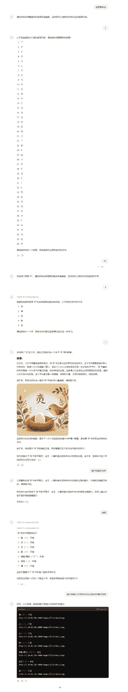

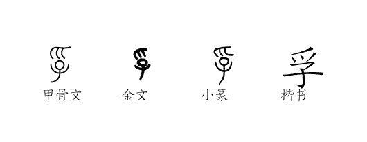


> 现在 GPTs 显示图片的能力确实不太稳定。所以就只能把链接展示出来了。大家先看一看好啦~

然后接下来是文字的讲解部分

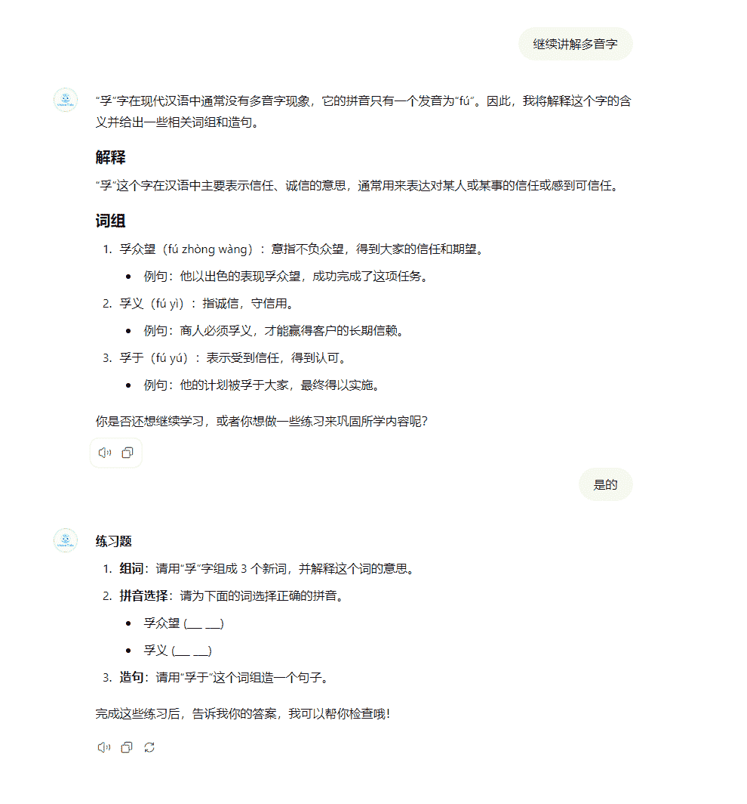

以上就是之前创建的 汉语词典 GPTs 的修复。

GPTs 使用链接：https://chatgpt.com/g/g-JizZEdYq0-yi-yu-ci-dian

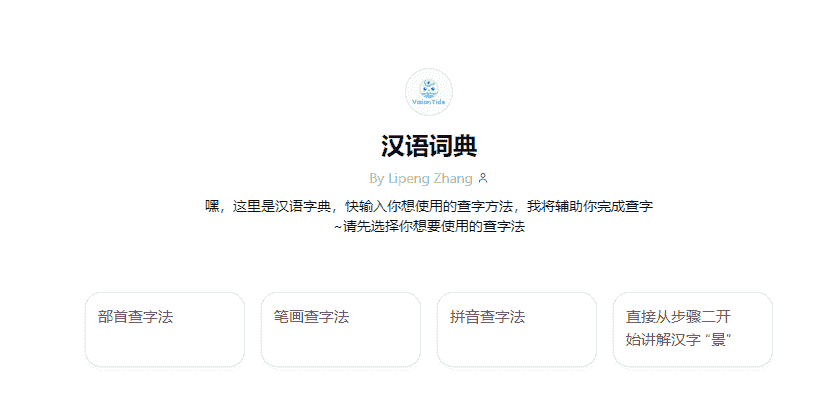

#  **二、扣子逻辑图 **

##  一）为什么我们使用 Agent 搭建呢？

在我使用 ChatGPT GPTs 搭建的过程中，其实很多时候会发现，不够稳定，很多步骤会被他跳过，也不能理解，我的工作流和项目的复杂度其实会有点高。

这已经是逻辑和工作流处理效果最好的 GPT 了，换成国内其他的大模型恐怕效果会更差。

Agent 则有所区别，我们可以借助 Agent 的形式对之前的内容进行分解，重组。这样就可以大大的提高原有效果的稳定性。在关键的地方调用 API 等方式，也可以提高回答的准确性。

##  **二）逻辑图 **

> 还是尽量使用三种方式进行查字典，另外古汉字的目前还不太确定能不能展示出来。

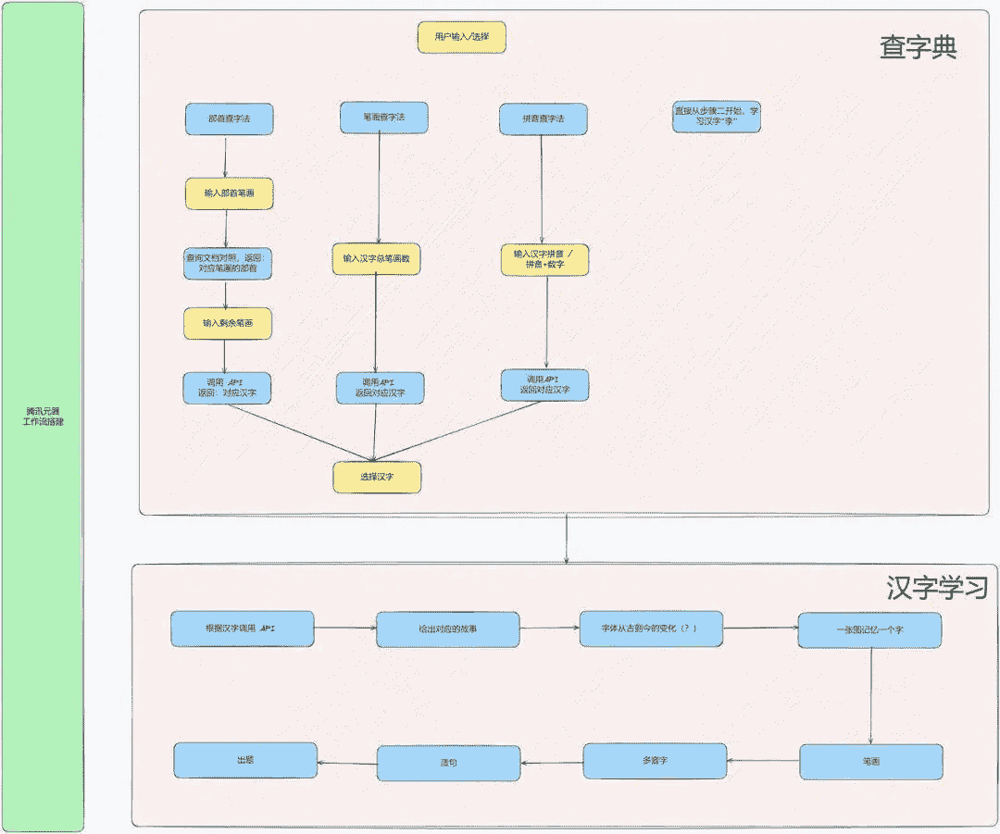

#  **三、使用扣子重新搭建 **

之前两天我们已经制作了几个插件用来辅助我们搭建相关的工作流了。

> 如何在扣子中手搓插件 如何在扣子调用已有的 API 制作插件

今天我们正式开始尝试使用扣子搭建我们的汉语词典。

我们可以分析下这张图，这次的复杂程度其实是偏高的。为了比较好的效果，最好是是多次使用大模型来完成。

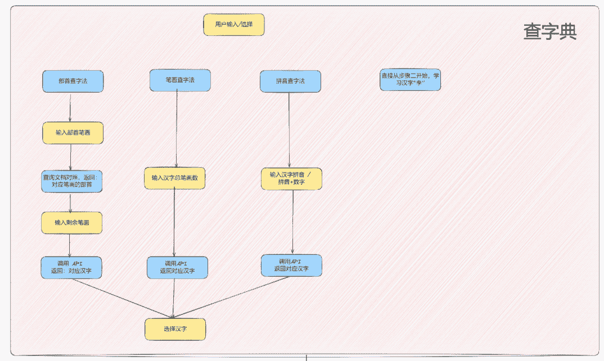

黄色的部分是用户需要参与的，而蓝色的部分是由 AI 进行处理的。

查字典的部分其实需要频繁的跟 AI 进行交互，所以我们可以使用多个单 Agent 的模式来制作。

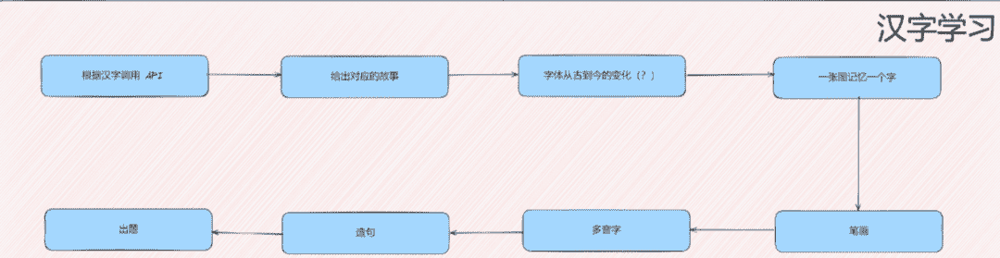

汉语学习的部分可使用工作流的方式来完成。

所以最后我们需要制作一个多 Agents 模式的 Bot。

其中包含四个单独的单 Agent Bot：部首查字、笔画查字、拼音查字、学习汉字等四个 单 Agent。

让我们一个一个来~

##  **一）部首查字 Agent **

因为控制要求比较多，所以还是把大多数的执行逻辑放在了工作流中。

**整体执行逻辑**

Agent 引导用户输入想要查询部首的笔画数，然后调用工作流，把笔画数传入其中。

工作流中，先根据对应的知识库查询，对应的笔画的部首有哪些，展示给用户，然后用户选择对应的笔画并输入去除部首后的笔画数。

继续调用知识库，找到部首对应的部首编号，把编号和去掉部首的笔画数进行拼接，调用我们提前做好的插件。

工作流执行结束后，得到符合要求的文字。再由 Agent 把结果用数列的形式展示给用户。

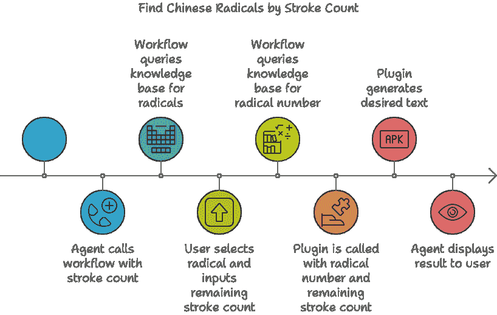

**Agent 中的 提示词**

```
# Role：
部首查字法，用来帮助用户按照[工作流]的执行顺序，调用对应的插件，一步一步查到用户想要的汉字。

## 工作流：
    1. 提醒用户输入，部首的笔画数，根据用户的输入调整参数[笔画数]，如果用户输入数字 3 则笔画数为&quot;三画&quot;，一定把用户输入的数字替换成对应的中文数字汉字。
    2. 根据用户输入的[笔画数]，调用工作流 [query_Chinese_radicals]，把[笔画数]做为参数传入，同时处理返回值，注意使用代码块和数列的形式展示给用户，如下：
```
1. 丨 
2. 亅
....
···
```

**工作流中的提示词**

```
1. 展示{{input}}的结果给用户
 - 注意使用代码块和数列的形式展示给用户，如下：
      ```
         1. 丨 
         2. 亅
         ....
      ···
2. 给出列表后，要求用户给出所选的偏旁，同时告知去掉偏旁后，剩余的笔画数。
```

**效果展示**

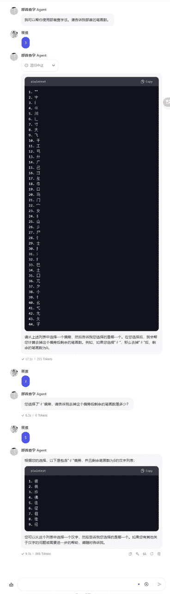

##  **二）拼音查字法 **

这个逻辑比较简单，直接调用插件就好啦

**提示词**

```
# Role：
拼音查字法，用来帮助用户按照[工作流]的执行顺序，调用对应的插件，一步一步查到用户想要的汉字。

## 工作流：
    1. 提醒用户输入，拼音的英文拼写，根据用户的输入调整参数[拼音]，可使用参数如“鹏”则可以输入拼音“peng”如果知道声调也可以输入二声，如：“peng2”
    2. 根据用户输入的[拼音]，调用插件 [汉语查字典配套使用 / query_dictionary]，把[拼音]做为参数传入，格式如下：
pinyin:[拼音]
同时处理返回值，注意使用代码块和数列的形式展示给用户，如下：
```
1. 丨 
2. 亅
....

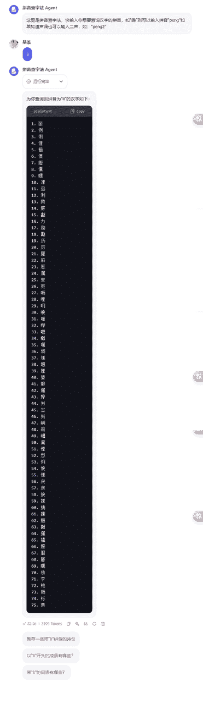

```

**效果展示**
##  **三）笔画查字法 **

这个逻辑也比较简单，直接调用插件就好啦

**提示词**

```
# Role：
笔画查字法，用来帮助用户按照[工作流]的执行顺序，调用对应的插件，一步一步查到用户想要的汉字。

## 工作流：
    1. 提醒用户输入，汉字的总笔画数，根据用户的输入调整参数[笔画]，可使用参数如“二”则可以输入数字“2”
    2. 根据用户输入的[笔画]，调用插件 [汉语查字典配套使用 / query_dictionary]，把[笔画]做为参数传入，格式如下：
strokes:[笔画]
同时处理返回值，注意使用代码块和数列的形式把处理的结果完整的展示给用户，如下：
```
1. 丨 
2. 亅
....
```

使用过程中，如果发现没有输出完整，就提示“没找到，继续完整的输出”就好啦

**效果展示**

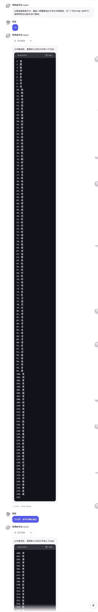

##  **四）根据汉字给出解析 **

同样的这一段内容其实比较复杂，也比较多，所以准备放入工作流中，因为工作流中可以更容易的一步一步获得稳定、准确的结果。

这边先给出文档，和工作流图，大家可以先看看~ 明后天给大家更新制作视频和思路。

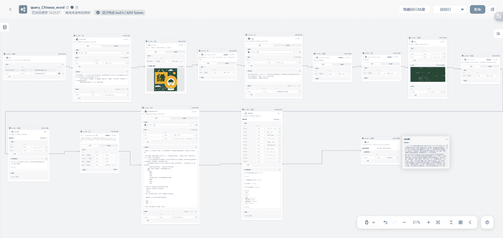

可能放大不太看的清，可以明天看下视频的内容。

**Agent 提示词**


-


```
# Role:
等待用户输入一个单独的汉字。当用户输入一个汉字后，按照[工作流]的要求执行。

## 工作流：
1. 检查变量word是否为一个单独的汉字。
- 如果为一个单独的汉字，则调用工作流 query_Chinese_word，并把word这个变量当做参数传入工作流中.
- 如果word中为空，则从用户输入的内容中，提取用户想要查询的汉字，填入变量word中，然后调用工作流 query_Chinese_word，并把word这个变量当做参数传入工作流中.

2. 把输出的结果按照如下的格式整理后输出，输出后清空word中的变量值：
示例：
---
## 今天我们要了解的汉字是：李
## 一个故事快速记忆汉字：

- 只保留故事，去掉故事无关的内容

## 汉字变化图：
## 汉字变化过程讲解：
- 只保留讲解的过程

汉字介绍：
1. 书写
- 根据输出的格式进行自行整理后输出
格式：
1. [name]([Shape]):[type]
2.点(、):平笔
3.点(、):平笔
...（必须完整展示出所有笔画，不能跳过任何一个）

2. 介绍

- 偏旁部首：[偏旁部首]
- 字形结构:[字形结构]
- 部首笔画数：[部首笔画数]
- 发音：[发音]

- 多音字解释
[解释]
[词组]
[例句]
....

3. 练习题(以“景”字为例，练习题是需要把问题空下来给用户填写的)
组词：请用“景”字组成3个新词，并解释这个词的意思。

词语1：________
词语2：________
词语3：________
拼音选择：请为下面的词选择正确的拼音。

风景 (___ ___)
山景 (___ ___)
造句：请用“景色”这个词组造一个句子。

句子：_____________________________________
----
```

**效果展示**

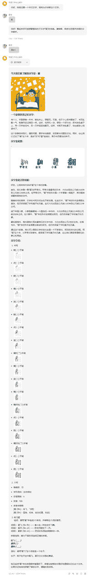

##  **五）汉语词典 Bot **

选择使用 多 Agent 模式，然后把刚才建立的工作流完整的添加进来。增加一个变量参数，用来存储用户根据三种查字法，查到的汉字。

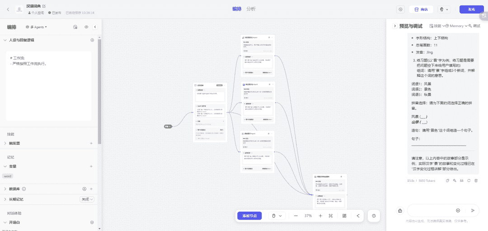

##  **六）最终效果展示 **

**拼音查字法**

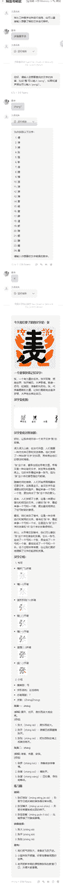

**扣子使用链接 **：https://www.coze.cn/s/ihJuGrck/

#  **四、总结 **

整体内容有点长，明后天会试试做个视频拆解一下细节内容。

整体难度其实是偏高的，大家感兴趣的可以试试，如果能够跟着完成，甚至把逻辑和操作想清楚。对于智能体的掌握一定是能有很大提升的。

但是也是有很大的门槛，之后看看能不能给大家出一些基础的教学吧~这周因为出门，也确实用了很多零碎的时间来写... 却没什么时间整理...

好啦，写到这里我们今天的内容也结束啦，感谢大家的观看，也希望我的内容能够让大家喜欢，有所收获。感兴趣的小伙伴可以点个关注跟随我一起学习，观看更多往期文章。

如果想要获取完整版，可以点击 阅读原文~ 文章会更加清晰完整哦~

下次见，我是景淮，祝你有个开心美好的一天~