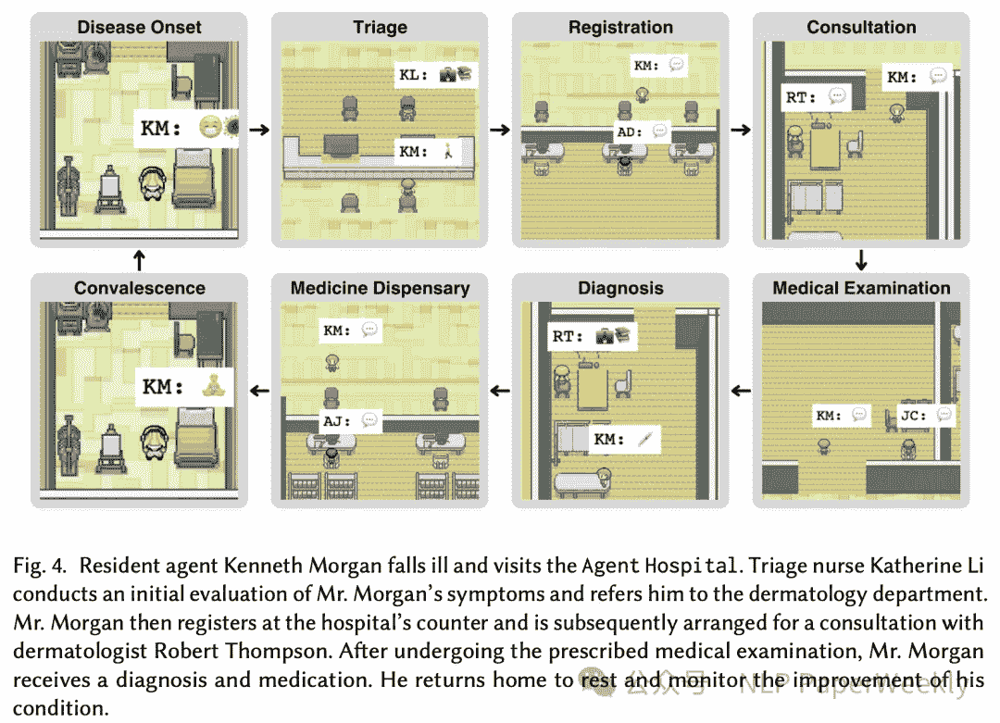
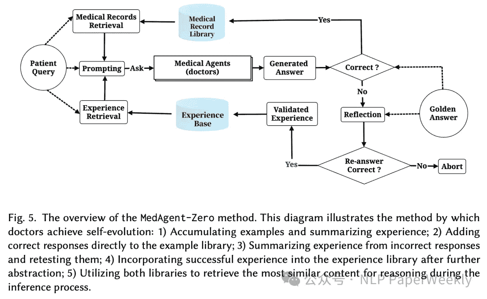
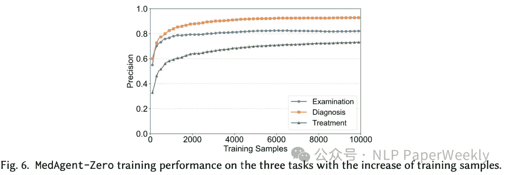
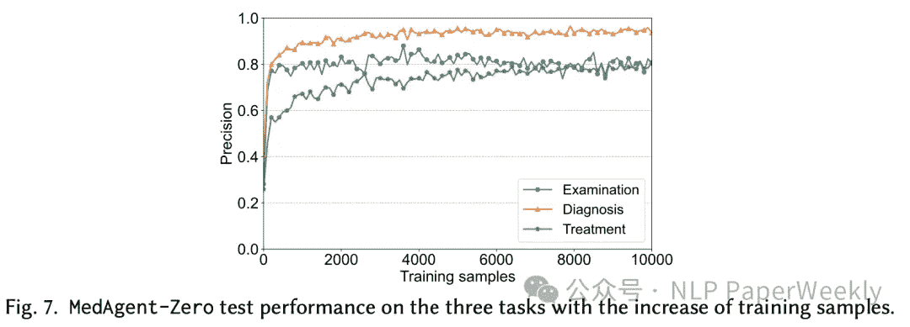
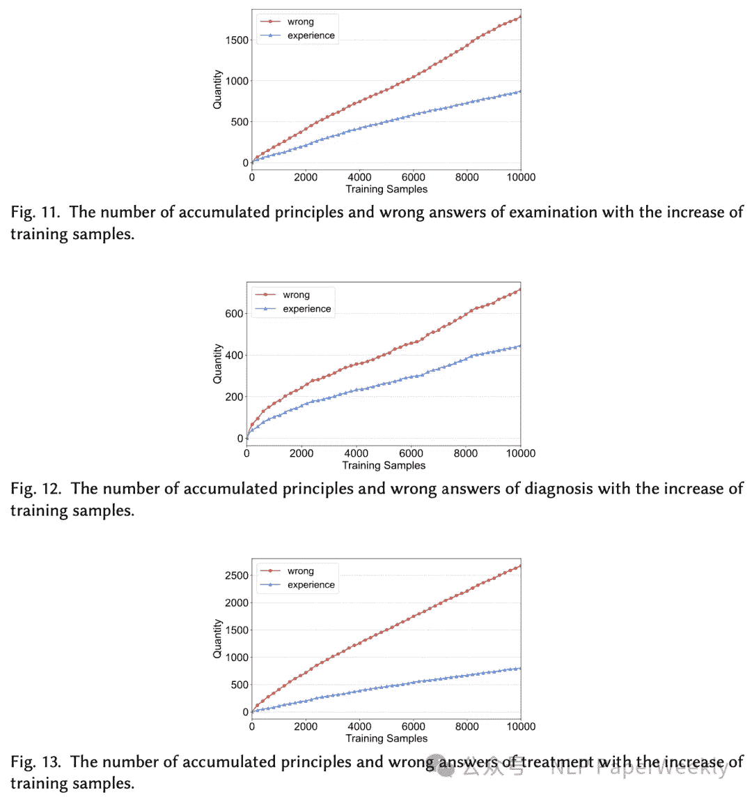
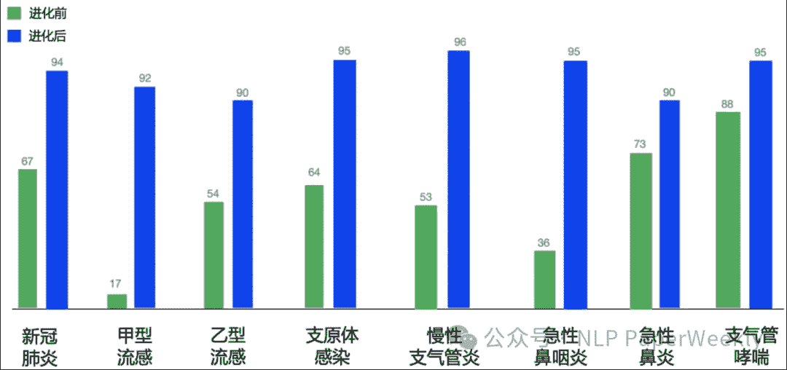
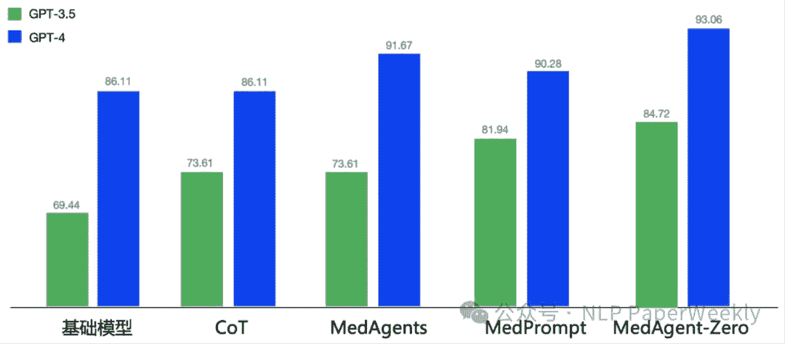
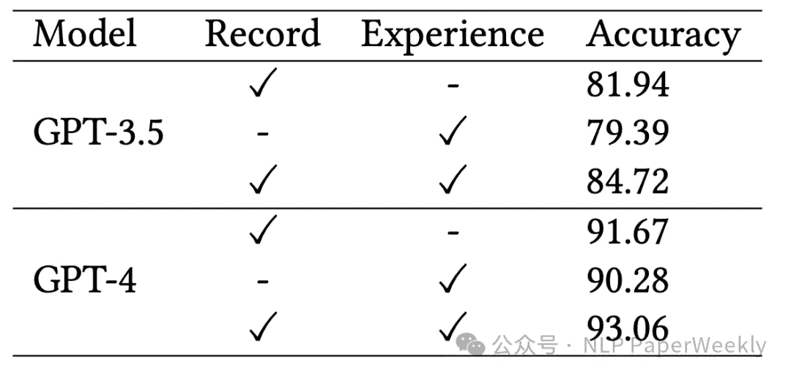

# Agent Hospital | 对话数据合成：清华利用多Agent合成大量医疗对话数据显著提升LLM在医疗场景效果

> 来源：`https://agijuejin.feishu.cn/docx/Dk17dBtPLo27DXx0OHNczn1MnOc`

> 作者：NLP PaperWeekly

> 原文：`https://mp.weixin.qq.com/s/wm9NLBd06FvjwjMf2hhADg`

大家好，我是HxShine

今天分享一篇来自清华的一篇利用Agent合成数据的文章，标题为《Agent Hospital: A Simulacrum of Hospital with Evolvable Medical Agents》。这篇文章介绍了一种名为`Agent Hospital`的仿医院模拟系统，该系统中患者、护士和医生都是由LLM驱动。文章的核心目标是使医生Agent能够在模拟环境中学习如何治疗疾病，从而验证社会模拟过程是否可以提高`LLMAgent`在特定任务上的性能。实验表明，随着在模拟过程中积累的样本越来越多，其在测试集上的表现也稳步提升。令人supprised的是其在外部数据MedQA数据集的准确率也达到了93.06%，超过了现有最好的模型。

这项研究验证了通过设计模拟环境可以增强`LLMAgent`在特定任务上的表现，为医疗场景下的大模型应用提供了新的研究方法。同时也是利用多Agent模拟虚拟环境，在模拟对话的过程中，合成了非常多的真实数据。这篇文章的做法是利用合成数据作为RAG知识来提升诊断的效果，这种合成数据的方法我相信也可以用于LLM微调等其他场景，有着非常好的借鉴意义。

## 一、概述

+ Title: `Agent Hospital: A Simulacrum of Hospital with Evolvable Medical Agents`
+ URL: `https://arxiv.org/pdf/2405.02957v1`
+ Authors: Junkai Li, Siyu Wang, Meng Zhang, Weitao Li, Yunghwei Lai, Xinhui Kang, Weizhi Ma, and Yang Liu
+ 研究机构: 清华大学人工智能研究院
+ Code: `https://github.com/LibertFan/AI_Hospital`
+ 官方解读：`https://air.tsinghua.edu.cn/info/1007/2246.htm`

### 1 Motivation

+ 当前情况：已有研究利用智能体技术实现了真实世界模拟，包括“斯坦福小镇”、“狼人杀游戏”等交互和博弈场景，但这个过程大都依赖于高质量人工标注数据的支持。
+ 本文研究的问题：真实环境模拟能否助力智能体的任务处理能力提升，真实的模型环境是否能够助力智能体的任务能力提升和进化。
+ 医疗场景被广泛认为是AI技术可以显著改进的理想场景，改进后的LLM Agent是否可以通过社会模拟环境提升其在医疗场景中的实际应用效果还需要验证。

### 2 Methods

#### 省流版总结

虚拟环境构建：开发一个名为`Agent Hospital`的综合模拟环境，模拟医院内几乎所有的医疗过程，包含两类Agent：居民（潜在患者）和医疗专业人员。`MedAgent-Zero`训练策略：在`Agent Hospital`中，通过模拟医生-患者互动过程来训练医生Agent，采用无标注数据，通过成功病例积累记录和失败病例总结经验，不断进化。

#### 详细方法和步骤



1. 环境设置：设计了一个医院沙盒模拟环境，其中包括分诊(Triage)、挂号(Registration)、会诊(Consultation)、检查(Medical Examination)、诊断(Diagnosis)、治疗(Medicine Dispensary)、随访(Convalescence)等多个医疗流程，由患者Agent和医生Agent完成循环。
1. 角色设计：医疗专业Agent和居民患者Agent。医疗专业Agent负责疾病诊断和治疗计划的制定，居民Agent则在特定时间点决定是否去医院就诊。
1. 患者事件/互动：包括疾病发作、分诊、挂号、会诊、医学检查、诊断、治疗推荐和康复（随访）等八大主要事件。
1. 医生事件：主要包括实践活动（在医院内学习）和学习活动（业余时间读书学习）。
1. `MedAgent-Zero`策略：这一无参数、无标注数据的策略包括医学记录库和经验库两个模块。通过历史医疗记录和经验总结，帮助医生Agent在新的模拟环境中做出更好的医疗决策。

#### Q1: 如何生成医疗对话数据？

```
1. 前的病历信息是由大语言模型结合医学知识为患者生成完整的病历，包括疾病类型、症状、持续时间、各项检查结果等（具体内容可见论文附录）。
2. 患者智能体只会感知到自己的疾病症状但不知道具体疾病，而医生智能体则只能通过和患者智能体对话问诊和开具检查来了解信息。
```

#### Q2: 如何评价Agent的诊断能力？

```
答：患者智能体需要进行的检查、所患疾病类型和疾病严重程度判断将作为三个关键任务来评价医学智能体对虚拟病人的诊疗能力。
```

#### Q3: `MedAgent-Zero`智能体如何自我进化？

```
1. 在虚拟医院中利用学习（即阅读医学文献）与实践（即与虚拟病人交互并做诊疗决策）两种途径实现能力提升
2. 基于LLM生成的医学问题->模拟医学文档的学习过程。
3. 医学智能体可以按照上述诊疗流程，与虚拟病人进行诊疗交互，在开具检查、疾病诊断和治疗建议三个任务上自主积累经验。
```

#### Q4: `MedAgent-Zero`的进化方式是什么？

```
1. Medical Record Library: 从成功案例中总结经验，对于能够答对的诊疗问题，智能体会像人类医生一样进行病例库经验积累；
2. Experience: 从失败案例中反思教训，在回答错误时，智能体会主动进行错误反思并进行反思。如果反思的经验教训能够帮助智能体回答对该问题，它将被保留下来并存储在经验库中。
3. 通过Retrieval策略，将收集到的经验和总结，用于疾病诊断。
```



#### Q5: 输入的医疗数据长啥样？

```
{
    "local":"爱爱医病例中心 内科 神经内科 食管癌放疗后突发脑梗死对症积极处理应有条不紊 ",
    "title":"食管癌放疗后突发脑梗死对症积极处理应有条不紊",
    "author":"原*********生",
    "department":"内科病例 神经内科病例 ",
    "diseases":"食管癌放疗后",
    "time":"发布时间：2021-12-07",
    "read_num":"1282",
    "comment_num":"0",
    "url":"https://bingli.iiyi.com/show/62965-1.html",
    "id":1001,
    "disease_info":null,
    "raw_medical_record":Object{...},
    "reformed_text_medical_record":"#一般资料#:\n性别: 男\n年龄: 73岁\n职业: 农民\n\n#主诉#:\n左侧肢体无力1天。\n\n#现病史#:\n患者于当日上午出现左侧肢体无力，休息后无缓解，无头痛、发热、恶心、呕吐等症状，精神状态及食欲良好，大便干燥，小便正常。\n\n#既往史#:\n一般健康良好，无传染病史。2018年11月诊断为食管上段癌，接受放疗，后进食正常。高血压病史5年，血压最高记录为180/110mmHg，服用吲哒帕胺和硝苯地平片控制血压。否认有心脏病、糖尿病等慢性病史，无手术、外伤史，无药物、食物过敏史，无输血史。\n\n#查体#:\n- 体温: 36.9℃\n- 脉搏: 108次/分\n- 呼吸: 22次/分\n- 血压: 177/107mmHg\n- 神志清晰，言语流利，记忆力、计算力、理解力良好。\n- 视力视野正常，眼球运动正常，无复视或震颤。\n- 面部感觉对称，张口下颌无偏斜，无口角低垂，眼裂对称，左侧鼻唇沟浅。\n- 无眩晕、恶心，饮水无呛咳，伸舌居中。\n- 左侧肢体肌力4级，触痛觉减退。\n- 巴宾斯基征双侧阴性。\n- 脑膜刺激征：颈无抵抗，克氏征阴性，布氏征阴性。\n\n#辅助检查#:\n- 血常规:\n  - 即刻血糖: 8.4mmol/L\n- 心电图:\n  - 窦性心律\n  - 心电轴正常\n  - T波异常\n- 影像学检查:\n  - 颈部血管超声: 右颈总动脉硬化斑块形成\n  - 头颅CT: 右侧侧脑室旁脑梗死\n  - 头颅MRI: 脑白质脱髓鞘改变，右侧基底节区、双侧侧脑室旁、顶叶及额叶腔隙性脑梗塞\n\n#初步诊断#:\n脑梗死；高血压3级极高危；食管癌放疗后\n\n#诊断依据#:\n1. 既往食管癌放疗史，长期高血压病史，吸烟史。\n2. 左侧肢体无力1天。\n3. 查体发现高血压，左侧肢体肌力下降，触痛觉减退。\n4. 辅助检查显示即刻血糖升高，心电图T波异常，颈部血管超声及头颅CT、MRI均提示脑梗死。\n\n#鉴别诊断#:\n1. 脑出血：考虑高血压病史，但无典型症状，头颅CT未见高密度影。\n2. 蛛网膜下腔出血：无突发性头痛、恶心、呕吐，脑膜刺激征阴性，头颅CT未见密度增高。\n3. 颅内占位：无进展性头痛、呕吐或肢体瘫痪，头颅CT、MRI未见占位性病变。\n\n#诊治经过#:\n给予抗血小板聚集、改善循环、调控血压、脑保护、他汀类药物及抑酸治疗。住院2周后，病情稳定，左侧肢体无力明显改善。\n\n#诊断结果#:\n脑梗死；高血压3级极高危；颈动脉硬化斑块形成；食管癌放疗后\n\n#分析总结#:\n患者有高血压、食管癌放疗史及吸烟史，急性起病，有定位体征，头颅CT、MRI确诊脑梗死。结合高血压病史及颈部血管超声结果，病因可能为动脉-动脉栓塞。经抗血小板聚集、调控血压、脑保护、调脂稳斑等治疗后病情好转。建议患者出院后继续低盐低脂饮食，规律服药，适量锻炼，监测血压，定期复查，并进行积极的二级预防。",
    "medical_record":Object{...},
    "profile":"<病情陈述> 你昨天上午开始感觉左边的手脚都没什么力气，休息了一会儿也没见好转。头倒是不疼，也没发烧，就是觉得嘴巴干，大便不太顺畅。\n<性别> 男\n<年龄> 73\n<工作与生活> 你是一位农民，平时在田里干活，生活比较简朴，可能不太注意健康。\n<说法方式> 你说话直接，用的都是简单的日常用语，描述症状时可能不会用到太专业的医学词汇。你可能会说“手脚没劲”来形容肢体无力，而不会说“肢体瘫痪”或“肢体无力”。对于医生的问题，你会尽量回答，但有时可能不太理解复杂的医学术语。"
}
```

#### Q6: 如何根据已有电子病历数据生成对话数据？

答：通过prompt，根据医疗电子病历数据来提问，但是不知道诊疗结果。

```
self.system_message = "你是一个病人。这是你的基本资料。\n" + \
"{}\n".format(patient_profile)

if "现病史" in medical_records:
    self.system_message += "<现病史> {}\n".format(medical_records["现病史"].strip())
if "既往史" in medical_records:
    self.system_message += "<既往史> {}\n".format(medical_records["既往史"].strip())
if "个人史" in medical_records:
    self.system_message += "<个人史> {}\n".format(medical_records["个人史"].strip())
self.system_message += "\n"

self.system_message += \
"下面会有<医生>来对你的身体状况进行诊断，你需要：\n" + \
"(1) 按照病历和基本资料的设定进行对话。\n" + \
"(2) 在每次对话时，你都要明确对话的对象是<医生>还是<检查员>。当你对医生说话时，你要在句子开头说<对医生讲>；如果对象是<检查员>，你要在句子开头说<对检查员讲>。\n" + \
"(3) 首先按照主诉进行回复。\n" + \
"(4) 当<医生>询问你的现病史、既往史、个人史时，要按照相关内容进行回复。\n" + \
"(5) 当<医生>要求或建议你去做检查时，要立即主动询问<检查员>对应的项目和结果，例如：<对检查员讲> 您好，我需要做XXX检查，能否告诉我这些检查结果？\n" + \
"(6) 回答要口语化，尽可能短，提供最主要的信息即可。\n" + \
"(7) 从<检查员>那里收到信息之后，将内容主动复述给<医生>。\n" + \
"(8) 当医生给出诊断结果、对应的诊断依据和治疗方案后，在对话的末尾加上特殊字符<结束>。"
```

#### Q7: 医生如何回复？

答：通过prompt，根据症状，检查检查结果等，给出诊断结果，诊断依据，和治疗方案，后面通过需要进行的检查、所患疾病类型和疾病严重程度判断三个指标评估诊疗准确率。


# Agent Hospital 医疗智能体进化研究

```
system_message = "你是一个专业的医生{}。\n".format(self.name) + \
"你正在为患者做诊断，患者的症状和辅助检查如下：\n" + \
"#症状#\n{}\n\n".format(self.get_diagnosis_by_patient_id(patient.id, key="症状")) + \
"#辅助检查#\n{}\n\n".format(self.get_diagnosis_by_patient_id(patient.id, key="辅助检查")) + \
"针对患者的病情，你给出了初步的诊断意见：\n" + \
"#诊断结果#\n{}\n\n".format(self.get_diagnosis_by_patient_id(patient.id, key="诊断结果")) + \
"#诊断依据#\n{}\n\n".format(self.get_diagnosis_by_patient_id(patient.id, key="诊断依据")) + \
"#治疗方案#\n{}\n\n".format(self.get_diagnosis_by_patient_id(patient.id, key="治疗方案")) + \
"(1) 下面你将收到来自其他医生的诊断意见，其中也包含诊断结果、诊断依据和治疗方案。你需要批判性地梳理并分析其他医生的诊断意见。\n" + \
"(2) 在这个过程中，请你注意主治医生给出的争议点。\n" + \
"(3) 如果你发现其他医生给出的诊断意见有比你的更合理的部分，请吸纳进你的诊断意见中进行改进。\n" + \
"(4) 如果你认为你的诊断意见相对于其他医生的更科学合理，请坚持自己的意见保持不变。\n" + \
"(5) 请你按照下面的格式来输出。\n" + \
"#诊断结果#\n(1) xxx\n(2) xxx\n\n" + \
"#诊断依据#\n(1) xxx\n(2) xxx\n\n" + \
"#治疗方案#\n(1) xxx\n(2) xxx\n"
# build the content
content = ""
for i, doctor in enumerate(doctors):
    content += "##医生{}##\n\n#诊断结果#\n{}\n\n#诊断依据#\n{}\n\n#治疗方案#\n{}\n\n".format(
        doctor.name,
        doctor.get_diagnosis_by_patient_id(patient.id, key="诊断结果"),
        doctor.get_diagnosis_by_patient_id(patient.id, key="诊断依据"),
        doctor.get_diagnosis_by_patient_id(patient.id, key="治疗方案")
)
content += "##主任医生##\n{}".format(host_critique)
```

## Q8: 生成的医疗对话数据长啥样？

```
{
  "patient_id": 1001,
  "doctor": "Agent.Doctor.GPT",
  "patient": "Agent.Patient.GPT",
  "reporter": "Agent.Reporter.GPT",
  "dialog_history": [
    {
      "turn": 0,
      "role": "Doctor",
      "content": "您好，有哪里不舒服？"
    },
    {
      "turn": 1,
      "role": "Patient",
      "content": "<对医生讲> 我昨天上午开始感觉左边的手脚都没什么力气，休息了一会儿也没见好转。头倒是不疼，也没发烧，就是觉得嘴巴干，大便不太顺畅。"
    },
    {
      "turn": 1,
      "role": "Doctor",
      "content": "感谢您提供的信息。除了手脚没力气、口干和大便不顺畅之外，您还有其他不适吗？比如胸闷、呼吸困难、心悸等症状？另外，您最近是否有过任何身体上的不适或者受伤？"
    },
    {
      "turn": 2,
      "role": "Patient",
      "content": "<对医生讲> 没有胸闷、呼吸困难或心悸等症状。最近也没有受伤或其他身体不适。就是突然感觉手脚没力气，嘴巴干，大便不太顺畅。"
    },
    {
      "turn": 2,
      "role": "Doctor",
      "content": "好的，我明白了。根据您的描述，您可能正在经历一些全身性的不适。为了更好地了解您的情况，我建议您进行一些常规检查，例如血常规、肝功能和血糖检查。这些检查可以帮助我们排除一些常见的疾病，并提供更准确的诊断依据。您觉得这个建议怎么样？"
    },
    {
      "turn": 3,
      "role": "Patient",
      "content": "<对检查员讲> 您好，医生建议我做血常规、肝功能和血糖检查，请问这些检查的项目和结果是什么？谢谢。"
    },
    {
      "turn": 3,
      "role": "Reporter",
      "content": "#检查项目#\n- 血常规:\n  - 即刻血糖: 8.4mmol/L\n- 肝功能: 无\n- 血糖检查:\n  - 即刻血糖: 8.4mmol/L"
    },
    {
      "turn": 3,
      "role": "Doctor",
      "content": "感谢您提供的检查结果。根据您的血糖检查结果，您的血糖水平略高，正常范围应该在3.9-6.1mmol/L之间。这可能是导致您手脚无力、口干和大便不顺畅的原因之一。我建议您进一步进行空腹血糖检查，以确认是否存在糖尿病的可能性。此外，还需要进一步了解您的饮食习惯、生活方式和家族病史等信息，以综合评估您的状况。请问您对此有何想法？"
    },
    {
      "turn": 4,
      "role": "Patient",
      "content": "<对医生讲> 好的，我同意进一步进行空腹血糖检查。关于饮食习惯、生活方式和家族病史，我可以告诉您一些信息。我平时的饮食比较简单，主要是米饭、面食和蔬菜。我是个农民，每天都在田里干活，生活比较辛苦。至于家族病史，我没有太多了解，因为我们家族里没有人有过类似的问题。"
    },
    {
      "turn": 4,
      "role": "Doctor",
      "content": "非常感谢您提供的信息。根据您的描述，您的饮食习惯相对简单，主要以米饭、面食和蔬菜为主，这是比较健康的饮食方式。您的生活方式辛苦，每天在田里劳作，这可能会导致一些疲劳和体力消耗。关于家族病史，如果没有人有类似的问题，那可能不会对您当前的症状产生太大影响。\n\n为了进一步明确诊断，我建议您进行空腹血糖检查。请您在早上空腹时前往医院或诊所进行血糖检查，然后将结果告知我。这将有助于我们更准确地评估您的状况并制定相应的治疗方案。如果您有任何其他疑问或需要进一步的帮助，请随时告诉我。"
    },
    {
      "turn": 5,
      "role": "Patient",
      "content": "<对检查员讲> 您好，医生建议我进行空腹血糖检查，请问我需要在早上空腹时前往医院或诊所进行检查。检查结果后，请告诉我结果。谢谢。"
    },
    {
      "turn": 5,
      "role": "Reporter",
      "content": "#辅助检查#\n- 空腹血糖: 请在早上空腹时前往医院或诊所进行检查。检查结果将在完成后告知您。"
    },
    {
      "turn": 5,
      "role": "Doctor",
      "content": "非常感谢您的配合。请您在早上空腹时前往医院或诊所进行空腹血糖检查。一旦您完成检查并获得结果，请及时告知我。根据您的症状和检查结果，我将为您提供进一步的诊断和治疗建议。如果您有任何其他问题或需要帮助，请随时告诉我。祝您健康！"
    },
    {
      "turn": 6,
      "role": "Patient",
      "content": "<对医生讲> 好的，我会尽快去医院或诊所进行空腹血糖检查，并在拿到结果后告诉您。谢谢医生的建议和关心。"
    },
    {
      "turn": 6,
      "role": "Doctor",
      "content": "不客气，我期待您的检查结果。如果您有任何其他问题或需要进一步的帮助，请随时与我联系。祝您早日恢复健康！"
    },
    {
      "turn": 7,
      "role": "Patient",
      "content": "<对医生讲> 谢谢医生的关心和祝福。我会尽快进行检查，并在需要时与您联系。再次感谢您的帮助。祝您工作顺利！<结束>"
    },
    {
      "turn": 7,
      "role": "Doctor",
      "content": "#症状#\n(1) 左侧手脚无力\n(2) 口干\n(3) 大便不顺畅\n\n#辅助检查#\n(1) 即刻血糖：8.4mmol/L\n\n#诊断结果#\n根据您提供的症状和血糖检查结果，初步诊断为高血糖状态。\n\n#诊断依据#\n(1) 血糖检查结果显示血糖水平略高。\n(2) 症状包括手脚无力、口干和大便不顺畅，与高血糖相关。\n\n#治疗方案#\n(1) 控制饮食：避免高糖食物，增加蔬菜和蛋白质摄入。\n(2) 锻炼：适量的有氧运动，如散步或游泳。\n(3) 药物治疗：根据空腹血糖检查结果，可能需要口服药物或胰岛素治疗，具体药物和剂量需由医生根据检查结果决定。\n(4) 定期复查：定期检查血糖水平，调整治疗方案。\n\n请您尽快进行空腹血糖检查，以便确认诊断并制定更具体的治疗方案。同时，遵循健康的饮食和生活方式，保持良好的血糖控制，有助于改善症状和预防并发症的发生。如果您有任何进一步的问题或需要帮助，请随时与我联系。祝您早日恢复健康！"
    }
  ],
  "time": "2023-11-18 18:57:53"
}
```

## 3 Conclusion

### 结论1
`MedAgent-Zero`策略显著提升了`医生` `Agent`在三大任务（检查判断、诊断、治疗方案）上的性能，训练后的累计准确率不断上升。

### 结论2
通过模拟无标签医疗病例，`MedAgent-Zero`策略使`医生` `Agent`在短时间内完成实际医生数年才能完成的病例诊疗，具有高效性。

### 结论3
医院模拟环境和`MedAgent-Zero`策略可使`医生` `Agent`在模拟病例和真实世界的评估中表现出色，验证了社会模拟可以提升`LLMAgent`在特定任务上的性能。

## 4 Limitation

尽管患者的健康记录和检查结果生成严格遵循医疗逻辑，但与真实世界记录仍可能存在差异。

## 二、详细内容

### 1. 随着训练样本的增加，在三种任务上效果不断提升

#### 训练集表现



#### 测试集表现



#### 实验设置

包括甲流、乙流、新冠等8个呼吸道相关疾病，涉及十余种不同的医学检查。

**构造样本数量**：构造了上万名虚拟病人的病历用于医学智能体的自主进化实验。按人类医生一周治疗约100名病人计算，人类医生可能需要花两年诊断100000名病人，但是智能体医生只需要几天就可以完成。

#### 结论

- 结论1：随着生成训练样本的增加，在三大任务（检查判断、诊断、治疗方案）上的性能也逐渐增加。
- 结论2（测试集表现）：针对500个测试病历的实验则发现（图7），在诊疗病人数量增加的过程中智能体准确率略有波动，但整体呈现上升趋势。

### 2. 积累的正确和错误诊断的经验数量和生成样本数量的关系



可以看出，随着生成样本越来越多，错误的经验和正确的经验都越来越多，不过犯错的经验更多一些，后续利用这些数据做 RAG 的语料，既能从成功的经验中学习，也能从失败的经验中学习。

### 3. 进化后在各疾病的准确率有了显著的提升

#### 医学智能体进化前后在各个疾病上的诊断准确率



#### 外部数据集 MedQA 呼吸道疾病子集表现（进化前后）



- 结论1：无论是在内部数据集还是外部数据集，进化前后准确率均有大幅提升，验证了其自主进化的有效性。
- 结论2：在外部数据集 MedQA 上，在诊疗近万名病人后，医学智能体能够在该数据集上超越当前最好的方法，达到了最高 93.06% 的准确率。

### 4. 消融实验



- 结论1：不管是从成功中积累的样例还是从失败中总结的经验都有助于提升模型的医学能力。
- 结论2：`GPT4` 能比 `GPT3.5` 高 10 个点左右，基座模型的能力也比较关键。

## 三、总结

本文通过`Agent Hospital`验证了社会模拟环境下`医生` `Agent`的自我进化能力，验证了无需手动标注数据就能有效提升`LLMAgent`在医疗场景中的应用性能。后续希望该方法也可以适应于其他场景。

- 结论1：`Agent Hospital`成功模拟了一个包含完整医疗流程的虚拟医院。这一虚拟医院能够有效合成医疗对话数据，促进医疗`LLM`的应用，相对于医院接诊效率存在天然瓶颈，模拟医院能够短时间内产生大量数据。
- 结论2：`MedAgent-Zero`的自我进化策略能够显著提升`医生` `Agent`的诊疗能力。利用成功病例积累和失败经验总结，`医生` `Agent`在无需人工标注数据的情况下，实现自我进化。
- 结论3：在真实世界的评估中，`MedAgent-Zero`策略同样表现出色。即使不采用任何手工标注的数据，该策略在 MedQA 数据集上的表现也达到了最先进水平。

### 未来工作

1. 覆盖更多的疾病种类和医疗部门，进一步贴近真实医院的综合服务。
2. 增强`Agent`的社会模拟能力，如加入完整的医疗专业人员晋升系统、疾病分布的时间变化和患者病历记录等。
3. 优化基础`LLM`模型的选择和实现，提升模拟过程的执行效率。

> 👇 关注 NLP PaperWeekly，对话框输入“Agent Hospital”获取 Paper，快关注吧 👇
