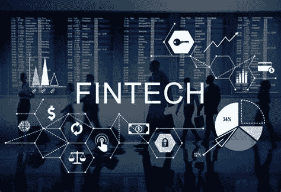
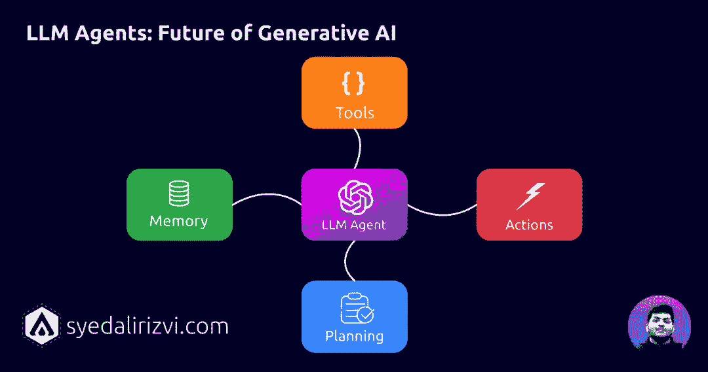
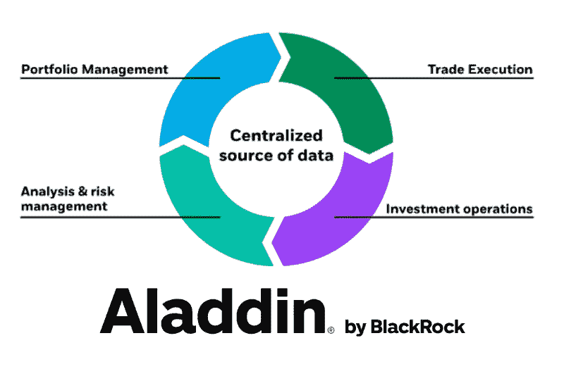
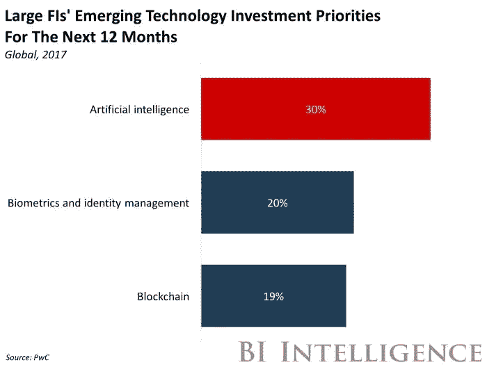
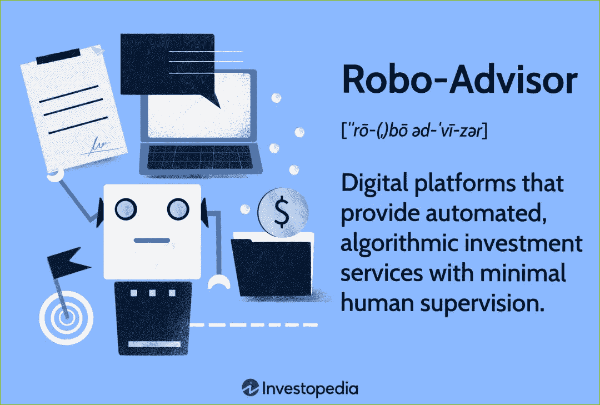
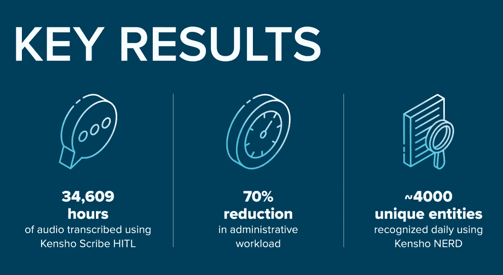

# AI Agent在金融领域的应用场景与落地案例

> 来源：[https://agijuejin.feishu.cn/docx/OboBdQjd7ozkDYxGf3Hc5HNdnxb](https://agijuejin.feishu.cn/docx/OboBdQjd7ozkDYxGf3Hc5HNdnxb)

> 作者：Angela | 神州问学

> 原文：https://mp.weixin.qq.com/s/GGr8iP_XlhW73aOdQfY9kg

> 智能投资与量化交易的前沿探索

# **一. 引言**

在数字化和智能化的双重浪潮下，人工智能（AI）技术正以前所未有的速度向前发展，从医疗健康到制造业，从教育到零售，AI技术的广泛应用正在重塑各行各业的运营模式和业务逻辑，同时也深刻改变着人们的生活方式。AI技术的应用范围日益广泛，无处不在地提供着便利和服务。在这样一个科技日新月异的时代，金融行业作为国民的经济脉络和促进经济发展的重要引擎，自然成为AI技术应用的重点领域之一。金融行业是一个信息密集、数据庞大、业务复杂的领域，对于数据的处理能力和分析精度有着极高的要求。传统的金融服务模式往往依赖于大量人力和经验的积累，效率相对低下且往往难以应对瞬息万变的市场环境。而AI Agent的引入，以其智能化、自动化的特性，将为金融行业带来了全新的解决方案。

# 二. AI Agent在金融行业运用的原因和重要性

在瞬息万变的金融行业，各类专业角色面临的挑战纷至沓来。基金经理如何应对信息爆炸，交易员怎样迅速掌握市场脉动，运营经理又如何捕捉市场先机？传统的人力处理方式和单一的大模型解决方案已难以满足需求。此时，AI Agent 凭借其强大的实时数据处理能力和场景适应性，成为破局的关键。

AI Agent，即人工智能代理，是一种集成了深度学习模型、插件工具与执行流程的智能实体，能够自主分析情境、作出决策并执行任务。它超越了单纯的大模型范畴，通过环境感知与自我反思，展现出更为灵活和高效的任务处理能力。简单来说大模型 + 插件 + 执行流程 = Agent。通过应用 AI Agent，我们就能解决特定场景中的问题。

AI Agent 主要分为四个核心模块：Memory、Tools、Planning 和 Action。

**1. Memory： **AI Agent 的记忆功能分为短期与长期两部分。短期记忆聚焦于即时状态感知，支持即时决策；而长期记忆则通过数据库或专门的记忆系统储存信息，以便后续检索和利用，为后续Action提供信息支撑。

**2. Tools： **Tools 模块用于处理数据、分析数据、推理，和决策。Tools 让模型和外部世界进行互联互通，既能让模型感知世界，也能让模型通过利用工具来改变外部状态。在金融领域，我们主要可以赋予模型感知金融市场实时变化的能力。例如，如果要查一个基金的数据，或在某个用户相关的购买数据，就需要调用相应的查询 API，实现与外部世界的互动。

**3. Planning： **Planning 模块负责根据当前的目标和环境条件制定长期和短期的行动计划。这包括考虑含有不确定因素的计划制定，以及如何有效地达成设定的目标。Planning使 Agent 能够在复杂和动态的环境中进行有条理的行动。例如，如果我要写一个大纲，Planning 会告诉我第一步做什么，第二步做什么等等。或者，在写营销文案时，它会规划出逻辑顺序，确保步骤有条不紊地进行。

**4. Action： **基于规划和当前环境，Action 模块执行具体操作，是AI Agent与外界互动的直接体现。通过调用合适工具，AI Agent能够实现既定目标，展现其解决问题的实际能力。

# **三. 应用场景**

1. 统一数据交互：。Al Agent 的应用的核心是数据和交互。将不同模态和结构的数据进行交互，并通过简单直观的工具调用，以对话式的方式（例如 ChatGPT）呈现给用户，这是 Al Agent 的目标。所以在金融领域的应用场景中，有几个重要的板块：首先是搜索 API。像大家可能熟悉的 new Bing ，这些平台现在都采用实时检索结合大模型的方式。在金融领域，经常需要查询各种基金数据、交易数据或者实时市场行情数据等。

2. 多模态交互：其次是多模态交互。在很多领域，多模态交互是很重要的。比如在视频创作、营销文案、财务报表等场景中，多模态交互可以更直观地呈现复杂数据，提升用户体验。另外，还有 ChatBI 和工具交互，这取决于在每个业务场景中我们需要执行的具体操作以及调用的工具，然后将结果通过用户界面展示出来，进行一个用户界面的交互。

# **四、成功案例分析**

AI Agent的工作原理主要基于大数据分析和模型训练。首先，AI Agent通过收集和分析各种金融数据，构建出丰富的数据模型和知识体系，然后利用机器学习算法对模型进行训练和优化，使其能够自动识别和预测市场趋势、风险事件和客户需求等。最后AI Agent会根据预测结果和用户需求，自动执行相应的交易策略、提供个性化的投资建议或解答客户疑问。成型的AI Agent产品通常包含以下几个关键组件：数据收集与预处理模块，负责获取并清洗原始数据；特征工程，用于提取和构建有意义的数据特征；模型训练，通过监督或无监督学习方法构建预测模型；以及决策引擎，用于基于模型预测结果制定投资策略或交易指令。此外，产品还会配备实时监控和反馈机制，确保模型的持续优化和策略的有效性。AI Agent在未来将会逐渐渗透金融行业的各个板块及领域，以下是一些AI Agent在投资策略和股票分析上的实际应用落地案例：

1. 投资管理：如BlackRock的Aladdin平台

BlackRock，全球首屈一式的资产管理巨头，其Aladdin平台堪称投资管理的全能助手。BlackRock的COO（首席运营官）Robert Goldstein说：“To understand Blackrock, one must understand Alladin.”（要理解BlackRock，就必须理解Aladdin）

Aladdin融合AI与大数据技术，专攻风险评估与投资分析，为投资经理提供决策支持。通过机器学习与自然语言处理技术，Aladdin能从海量市场资讯中提炼价值，包括新闻报道、社交媒体动态及企业财报，助力投资者洞察市场风云。Aladdin利用了一种系统性的投资方法，其中涉及如步态跟踪、信用卡刷卡、电子商务交易和驾驶时间等数据。所有这些数据都被输入到平台上，以识别消费者的消费模式和趋势，预测并相应地响应宏观经济环境中的潜在威胁。

Aladdin监控着2000多种风险因素，包括新兴市场的分析、可持续性、通货膨胀、利率和违约风险等。它也会根据不同的投资理念进行风险分析，例如会考虑到企业规模、股票波动性和个人收入。Aladdin每天会执行超过5000次投资组合压力测试，每周会进行1.8亿次期权调整计算。

Aladdin在2022年为Blackrock带来了14亿美元的技术收入，且三年复合年增长率高达12%。作为最初只是BlackRock内部的风险管理平台，随着结合AI Agent的功能，Alladin现已被1000多家组织用于部分或全部投资流程。可以说，目前的Alladin是BlackRock的核心，也是公司未来的愿景。

2. 交易优化：如J.P. Morgan的LOXM系统

LOXM，J.P. Morgan（摩根大通）旗下基于AI的股票交易引擎致力于优化大额交易策略。该算法凭借机器学习与强化学习，依据市场实况与历史数据，动态调整交易方案，有效减少市场影响与交易成本。LOXM具备自我学习能力，确保交易效率与执行品质。

J.P. Morgan于2017年宣布了LOXM系统，一个AI程序，旨在基于数十亿次历史交易数据，为客户执行交易以实现最高效率和最优价格。LOXM提高了J.P. Morgan交易执行率，解决的客户交易需求，且在2017年Q1的实践运用中，在没有提高风险管理问题的情况下展现出了性能上的优势。

调查显示，交易员们通过使用LOXM，使订单执行效率提高了约15%。这种性能的提升意味着在高频交易竞争激烈的环境中，AI Agent迈出了通往主导地位的重大一步。

3. 个性化服务：如Robo-advisors。

Robo-advisors是机器人咨询顾问的统称，他们运用AI技术，提供自动化投资顾问服务。通过分析个人财务状况、风险承受度及投资目标，器人顾问借助机器学习算法，量身定制投资组合，并持续优化以追求最佳收益。这种模式大幅降低了投资管理成本，推动了个性化理财服务的普及。

全球的器人咨询顾问市场在2023年的规模约为66.1亿美元，并预计从2024年到2030年将以30.5%的复合年增长率增长。器人咨询顾问们通过在线或移动平台提供自动化的财富管理服务。它们以简化的方式提供复杂的财务信息和指导，即使没有财务背景也能轻松理解。金融服务领域中数字技术的日益融合，以及消费者转向器人咨询顾问而不是传统投资服务的趋势，是推动市场增长的关键因素。

**4. 数据分析：如Kensho **Technologies和Numerai

Kensho Technologies: S&P Global旗下的Kensho，专精于金融数据分析与投资决策。Kensho的AI系统实时解析全球金融市场数据，涵盖新闻、财务报告及市场指标，提供精准市场预测与投资建议。其Kensho Analytics深受对冲基金、投行及资产管理公司的青睐，显著提升投资策略成效。

Kensho利用其广泛的数据库资源，通过全球事件数据库不断整合市场数据，再通过知识图谱进行数据重构，以便快速高效地提取信息。公司也提供由机器学习驱动的分析平台，为客户提供数据分析和可视化服务。这两者的结合大大提升了Kensho为客户创造的价值。Kensho还为客户提供其他增值服务。他们的一些高价值客户，包括Goldman Sacks（高盛），均受益于拥有与其定制服务。例如，Goldman Sacks的资产管理部门使Kensho的“cross-correlation engine” （交叉相关引擎），让用户能跟踪其投资组合中资产类别之间的关联性。

通过与S&P Global于2018年的的战略合并，Kensho的数据库得到了进一步的扩充。而在并购后，S&P Global股价在第二年得到了超过了50%的涨幅中得到了体现。

**Numerai: **一家独树一帜的对冲基金，通过 数据科学竞赛吸纳全球智慧，不断优化交易算法。参赛者提交的模型被整合进超级模型，利用机器学习预测市场与决策投资。Numerai的去中心化模式汇聚众智，持续提升AI系统预测精度与投资策略效能。

Numerai的独特经济模型由其基于以太坊的原生加密货币Numeraire (NMR)支撑。该数据科学家网络包括超过5500名参与者，他们在每周的Numerai锦标赛中对其预测模型进行NMR加密货币的投注。该系统模仿了交易员的激励制度。数据科学家有机会通过在Numerai提供的数据集上表现良好的模型来获得代币，如果他们的股票预测表现不佳，则会失去代币。

除了作为技术先锋外，Numerai似乎还超越了传统对冲基金的表现。公司业绩的信息并不公开，但在2月份，Bloomberg（彭博社）报道称，在大多数行业代表苦苦挣扎的金融衰退中期，Numerai为投资者带来了20%的回报率。

5. 量化投资：如Two Sigma

Two Sigma，量化对冲基金领域的佼佼 者，广泛运用AI与机器学习技术剖析市场。其AI系统处理巨量市场数据，如交易记录、新闻事件及社交媒体信息，提炼决策所需洞见。通过迭代优化的机器学习模型，Two Sigma在高频交易与量化投资中屡创佳绩。

Two Sigma在交易中使用AI Agent的一个例子是其选股策略。该公司使用机器学习模型分析大量财务数据，以识别可能优于同行的公司。这些模型考虑了诸如盈利增长、现金流和估值比率等因素，以及利率和GDP增长等宏观经济数据。AI还帮助Two Sigma在其他资产类别中做出投资决策，如商品和货币。该公司使用NLP（自然语言处理算法）分析新闻文章和社交媒体帖子，以识别各种商品（如石油和黄金）周围的趋势和群众对商品的态度。同时，Two Sigma使用机器学习模型分析市场波动性、流动性和其他风险因素的数据，以识别对其投资组合的潜在风险。这使得他们能够调整其投资策略，以最小化风险并最大化回报。

AI Agent在投资领域的广泛应用，标志着金融科技（FinTech）的一个重要里程碑。它不仅提高了投资决策的效率和准确性，降低了交易成本，还使得个性化和定制化的投资服务成为可能。然而，AI Agent的应用也伴随着挑战，如数据安全、算法透明度和监管合规等问题，需要行业和监管机构共同努力解决。未来，随着AI技术的不断成熟，我们有理由期待AI Agent在投资策略和股票分析中扮演更加核心的角色。它们将更深入地融入金融生态，不仅限于交易层面，还将扩展到风险管理、资产配置、财富管理等更广泛的领域。同时，随着量子计算、边缘计算等新兴技术的兴起，AI Agent有望实现更高级别的智能化和自主性，为投资者提供前所未有的洞察力和竞争优势。

# 五、 AI Agent 在金融领域的未来发展

**当前现状**

在各大银行，基金等公司逐渐推出AI Agent来辅助投资分析和客户管理等业务可以看出，AI已经慢慢开始渗透进金融行业的业务中来。尤其是投资决策与股票分析方面，AI Agent 的崛起无疑是一场深刻的革命。面对整个行业或股票指数这样庞大而复杂的数据集，人类分析师往往受限于时间和精力，难以全面、及时地消化所有相关信息。然而，AI Agent 则能以惊人的速度处理海量数据，一旦被赋予正确的参数和关键指标，便能在短时间内完成对整个市场或行业的深度分析。这一能力不仅极大地提升了分析的广度和深度，还允许分析师将更多精力集中在更高层次的战略思考上。而正如上文所提到的例子，目前AI Agents已在许多知名的国际金融机构投入应用并取得了显著的成果。而更多其他金融公司也都逐渐向“AI化”靠拢，以提高决策效率和客户服务水平。有了更精准的数据分析和判断，就能产生更多业务，从而提升金融产品和交易的产量。而这一提升毫无疑问将促进更多的现金流动。通过精准的风险评估和市场预测，AI Agent 能够帮助金融机构和投资者做出更加明智的投资决策，从而优化资金配置，加速资本周转，最终促进整体经济的健康发展。特别是在当前全球经济一体化的背景下，高效的资本流动对于维持市场稳定和推动经济增长至关重要。

**未来趋势**

AI Agent在金融领域的应用正逐步展现出其不可替代的价值。随着技术的不断进步和应用场景的拓展，AI Agent必将在金融行业中发挥更加重要的作用，引领行业进入一个全新的发展阶段。AI Agent的普及和发展也将催生更多金融科技（Fintech）领域的就业机会，对于AI系统设计、维护、监管以及数据分析等方面的专业人才需求将持续增长。这不仅为求职者提供了新的职业路径，也为金融科技行业注入了新鲜血液，推动整个行业向更加专业化和多元化方向发展。AI Agent 在金融领域的应用正逐步展现出其不可替代的价值。它不仅能够大幅提高数据分析的效率和准确性，促进经济的良性循环，还能为行业带来新的就业机遇，是推动金融行业迈向智能化、高效化未来的强大动力。AI Agent在风险管理、资产配置等领域的潜力巨大，有望实现更高级别的智能化和自主性，为投资者提供前所未有的洞察力和竞争优势。然而，AI Agent的应用也将带来新的监管和合规挑战，需要金融机构和监管机构共同努力解决。例如，如何确保AI Agent的决策透明度和可解释性，以及如何应对AI Agent可能带来的市场操纵和风险。总的来说，AI Agent在金融领域的应用将带来一系列的变革和挑战，需要金融机构和监管机构共同努力，以确保AI Agent的应用能够促进金融行业的健康发展。未来，随着AI技术的成熟，我们可以期待AI Agent在金融行业中发挥更加核心的作用，引领行业进入一个全新的发展阶段。