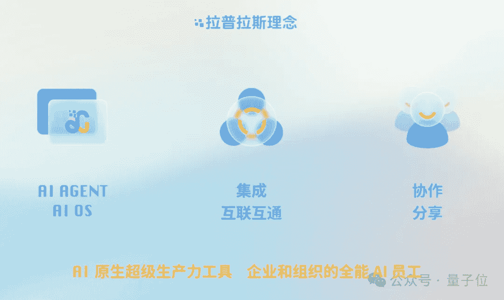
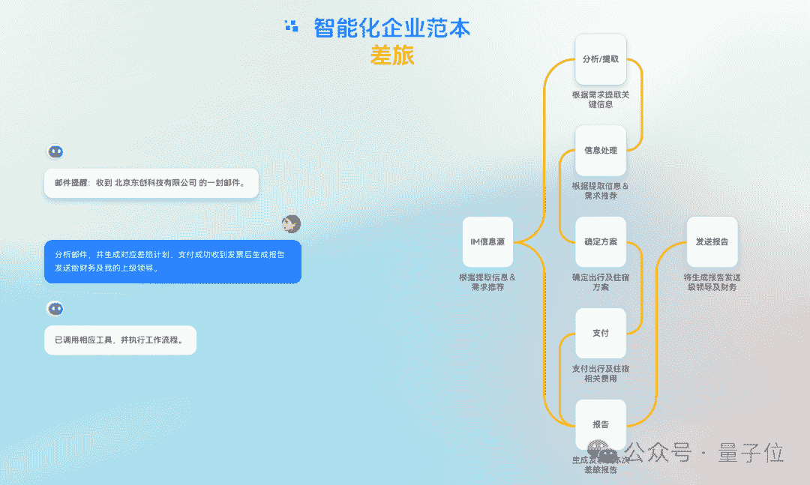

# AI Agent当牛做马，办公自动化带来超级生产力｜对话Laplace

> 来源：[https://agijuejin.feishu.cn/docx/NXlTdXAjlo216nxmMBCchL72nMb](https://agijuejin.feishu.cn/docx/NXlTdXAjlo216nxmMBCchL72nMb)

> 量子位智库 发自 凹非寺

> 量子位 | 👸号 QbitAI

> 原文：https://mp.weixin.qq.com/s/p3XGuEcY3yq7vvlDyjTxMQ

成立仅9个月的AI初创公司拉普拉斯智能（Laplace AI），已经用原生智能生产力操作平台帮助企业用户实现智能体落地了！

平台名为拉普拉斯智能实验室（Laplace AI Lab），入口统一，用自然语言即可沟通，不知不觉间就能实现工具调用，拥有极低的用户学习成本。

而且支持团队内的协作和流程智能分享，还能灵活切换角色，以承担各种类型的工作。

可以说，Laplace AI Lab打破了传统SaaS和RPA框架的局限，解决了功能繁杂、操作复杂、系统封闭等问题，能够满足企业对于高效、灵活、开放的智能化工具的需求。

而且迭代和落地速度也非常可观，成立仅三个月时就已发布第一版产品，如今新一代产品也已上线。

实际应用中，Laplace AI已经与某知名户外品牌运营客户共同打造出了品牌服装AI设计师，帮助把从设计到生产的整个周期从过去的3个月缩短至1个月。

在这些成绩的背后，是Laplace AI始终奉行的三个理念——打造AI OS系统、集成互联互通、协作与分享。

人才方面，创始人兼CEO衣冠锡博士毕业于UCLA，联合创始人CTO谷士德毕业于纽约大学，公司首席顾问何磊教授为UCLA终身教授、IEEE Fellow电气与电子工程师协会会士。

所以，Laplace AI具体如何实现快速入局AI Agent并占据一席之地？当快速发展的AI Agent和企业生产力相结合，又能否解决企业智能生产力的痛点？

上周，量子位智库访谈了Laplace的三位创始人，深入了解了Laplace将如何通过独特的AI Agent技术实现办公智能自动化和人机无缝协作。

此外，我们也讨论了AI 原生工作流、高度使用场景、Agent生态和出海策略等方面的内容。

让我们跟随本次访谈，一起探索AI Agent如何为未来的智能化企业铺平道路。

## **话题一：办公自动化**

**量子位智库： **办公自动化这个事情感觉国内外还是有点差异，国外 Adept AI是用大模型去捕捉交互动作，然后建模。

咱们当时是就为什么选到AI Agent这条路上？觉得优势或者说特性会在哪？

**Laplace： **他们捕捉动作形态，比如说鼠标操作习惯，其实还是上一代机器学习的思路。比如在网站热区的设计里，因为右下角点的比较多，所以要把功能放在那，但事实上这种数据是会骗人的。

我在那点来点去不是因为我在那操作的多，而是因为我的鼠标、我的手都在这，而且我闲也没事，可能就在这画一画。很多底层东西你如果通过捕捉动作其实很难看出来这个背后的逻辑是什么东西。

而Agent其实本质上跟这个东西有点不太一样。它是模仿人的这个大脑学习，他会理解你到底是在干什么啊？试图去理解这事本质是什么，然后再基于这个本质上往上生长出一些东西起来。

而前面那种机器学习的思路是强行要找到这两个的因果关系，无论强弱是多少，但找出来可能并不具备意义。

讲个极端例子的话，比如说犯罪的人都喝水，所以喝水的人容易犯罪，要禁止喝水。这听上去很扯淡，实际上统计上确实是个正确的事。

AI Agent这套思路是一套更累人的思路。嗯不是像之前那种不管是视觉AI还是机学习AI，它其实是更从统计和数据角度去做一套东西。这样来看肯定是AI Agent的思路会更优。

**量子位智库： **那相当于自动化领域，RPA玩的是套路，Adept他们是概率。然后Agent偏逻辑。那Copilot呢？还是说我们这个也算是一种Copilot。

**Laplace： **我们也算一种Copilot，但我们更强调人机交互，主驾和副驾的位置是可以随时交换的。

## **话题二：Agent生态现状**

**量子位智库： **既然如果我们的产品做的是Agent的一个调度和集成，它的使用效果应该是会受到Agent的数量、种类和质量的一个影响。

就现市面上可用Agent，您觉得达到一个可以支撑咱们的产品去向b端收费的完整性和质量了吗？

**Laplace： **首先尽量不做，但如果市面上的都不行，客户还是有需求，我们在有能力的时候也会顺手做一些。如果已经有很好的现成工具了，我们就没必要了。

Agent编排还是我们的核心，就是我们替你去编排这一套东西，工具该怎么用、该怎么执行，Agent怎么理解，这个反而是我们的核心，所以这一块的质量得我们去把控。

其实现成的工具，还有AI工具加起来，很多业务都已经其实是够用的了。

我举个例子，比如招聘的时候分析简历，AI处理这种信息一点问题都没有，并不涉及很复杂的东西。

分析、科研类的工作其实在市面上占了很大一个比例。比如PR舆情监控也是爬文章区去看正负面评价。

大部分工作其实真的没有大家想象的那么专业和需要技术，都是很类似的需求。

## **话题三：Agent编排技术**

**量子位智库： **编排的研发难点在哪？这件事情是怎么能做到的？而且为什么能比别人做得好？

**A1： **我们的产品会基于现有的这些逻辑接入不同的工具，编排一块是Agent方面的一个编排，一方面是Agent所用工具的编排。

在这之上我们还会让我们会给Agent分级，我们有一个叫Agent 0的概念，然后我们会有专家Agent，下面有工具，可能本身它也是一个Agent，就是我们可以让一个虚拟员工领导调动一个虚拟员工。

然后这个虚拟员工可能会调用他一个工具，相当于是一个多Agent协作的一个模式，也就是AI团队。

我们的编排是为了达到这个能力而诞生的，编排内部也可以做切换，有更好的AI工具或者是第三方的API工具，可以随时在编排的内核里面去底座切换。

现在市面上没有一个很好的逻辑去做这个事情，因为它涉及到数据库的一些操作，我们就研究了这个。

**A2： **Agent调用是一个多对多的一个过程。一个工具Agent可能会在某个场景下用这个工具，反过来一个工具也会在不同的场景下被不同的Agent使用。

就像工具箱拿着拿着就乱了，交互的维度越多、场景越多的话，ai逻辑越容易乱。

我们得保证ai逻辑的稳定性，它不是大语言模型的思维链，因为a和b，然后c。

我这个场景里他就不是链，甚至有时候也不是网，他更像一个graph，所以这东西甚至比大模型都要复杂很多。

## **话题四：Agent协作**

**量子位智库： **多Agent协作现在是已经直接落地生产了吗？

**Laplace： **在我们刚的演示里，你从🛰️里拿了信息，生成了日程文件，又把它发回去，这里面已经用了两个Agent了。

用Agent拿一个pdf总结再发回去，又和前面这个场景不一样。

Agent其实可以调用很多工具，虽然你看上去无非就是🛰️里面不同类型的信息，处理一下再发过去，但这里已经是多Agent协作了。

要保证他能精准拿取信息，就需要最上面的领导Agent，知道这个事是谁干，并进行唤醒，然后交接。

**量子位智库： **这种协作的技术难度会随着协作Agent的数量去增长。还是不太受影响？

**Laplace： **会的。所以编排不仅仅代码，还有知识库。随着你的工具 Agent越来越多，怎么去优化方案？

为什么我们现在底层要抽象成这个「信息收集、信息处理、信息分发」。

只有现在归类好底层，才能避免上层问题。如果现在就🛰️、飞书、企业🛰️、中间处理、分发等都是分开的Agent，这个交互逻辑就被复杂了，不如把信息源先给归结，在一定维度上去降低它这个交互出错的一些可能性。

这就考验了底层设计能力。不然你底层设计的越复杂，你往上走的时候它出错的概率越高。市场需求越多，就越考验你的归类和交互能力。

## **话题五：原生AI工作流**

**量子位智库： **现在很多人会讲这个AI原生工作流，其实也是新的交互和操作方式。那企业内部会有关于员工培训或者组织架构的顾虑吗?

**Laplace： **顾虑的人不一样。顾虑的是没有绝对决策权的人，就是这个公司打工的。

如果这个东西一旦流程优化，他就把我优化掉。如果你对接的人是他的话，他绝对会有。

那如果这个事是你站在更高层、决策层或者是老板的眼里，因为大部分只要你踏踏实实干过企业的，大家都能get到一个概念的事。

你的公司现在之所以这个形态是因为你的流程是这样的。

所以决策者的想法可能就是你这个流程好不好？然后我如果要基于你的流程去优化我的组织结构的话，那我的收益到底在什么地方？

他在乎的不是少招几个人，而是整体信息传递和组织运营的效率。

## **话题六：优先场景**

**量子位智库： **现在有哪些行业或者场景明显更积极兴奋吗？

**Laplace： **服务类的，不是客服，包括那个旅行咨询、留学咨询或者猎头。

这种服务业，其实它大量交换的是信息，然后最贵的是人，现在AI能让你的信息流转程度变得更高，特别处理信息量越来越大的时候。

比如说金融，各种内外部信息的收集、做表、做报告本质就是在处理数据，组合一些数据。那块实际上是AI现在确实是更擅长的，所以整体意愿会更强一些。

在这些场景里，信息流不通畅会对业务造成很大的影响。像非常硬核的研发和律师，他们会更关注信息本质的价值质量，早一天晚一天可能影响没那么大。

但对旅行规划等等，他更关注信息交换有没有更有效，量特别大，也不会特别在乎一点错误。

**量子位智库： **听起来很适合替公司行政干活。

**Laplace： **行政这不一定有价值。因为大部分行政在公司工资都是偏低的，并不在乎多一个少一个。

但是金融行业那些写专业报告的人，比如分析师，是特别容易被替代的。

在行业里需要找在对方看起来也比较有价值的一些事情，替代行政确实没问题，但这个事到底有多大价值？

但如果是旅行社，他可能要雇十来个顾问才能干这个事，每个工资可能都不低，那公司对用ai去做规划就很有动力了，无论接更多的客户还是更低的人力成本，对他来说这个业务是本身是有价值。

## **话题七：知识库**

**量子位智库： **咱们自己有一个模型叫LKHM，这个本质是知识库吗？

**Laplace： **是know-how知识的沉淀。它比较像一个不断去完善的模板库，就是Agent去编排的模板库。可以通过prompt、补充预训练、微调、还有RAG来达成。产品能吸收你后期改变的增量。

说白了就是增加知识库，一个增量式的，然后还有通过prompt，它会改良prompt进行版本控制。

还有的就是叫预训练，就是增量式预训练，可以不断的去微调，就微调是另一方面运行链就是你不断地去优化这个大模型，它是增量式的流程。

最后就是微调，嗯，不断地微调，就这就我们会结合了，但是对最好用的它目前来说就是RAG。

比如说你跟他在聊天、做事情，你指正他。或者是AI不断地把这些东边改边做，收集这种增量，然后他不断地学习。

他不需要刻意的准备这个东西，他在聊天记录中注意到这个东西。

## **话题八：LUI的微调**

**量子位智库： **很多人觉得LUI代表了新的交互时代。咱们的产品在理解意图方面会去做自己的模型训练吗？还是说用现成的就足够了？

**A1： **意图识别要做微调的，训不训练不一定，但是微调是一定的。

因为每个人的表达方式可能不太一样。举个最简单的例子，我要看🛰️，这个我说的每次说的都很长——帮我去调开🛰️。但你说的就很简短——我要看🛰️。

假设我们有两个工具，一个是🛰️，一个是企业🛰️，那这两个都叫🛰️，对吧？

那假设他第一次调起了一个企业🛰️，那用户说不是我要那个🛰️并换掉了，那我们需至少要收集到这条语境来判断下次你说的这个事就是这个🛰️，而不是企业🛰️。

这种语料我们还是要收集的，不一定要走到训练那么大，但一定是要跟着用户再做一层微调才能符合用户习惯。

**A2： **很多公司看起来在做同样的业务，但流程完全不一样，可能细节差别还挺大的。

比如服装设计，可能从风格到这个整个流程可能完全不一样。有的可能比较偏传统一点，需要提前备货和生产。

也有的公司觉得不想那么重的库存，发出去先看哪些反馈比较好，确定了我再去生产，但他也会承担风险。

如果从这个基础层面要确定实现流程，这两套工序是完全不一样的，可能用到每道工序上的工具相同，但先后顺序是不同的。我们的AI至少得理解这个事情。

不能有的AI完全不走流程，问了问题后就自说自话的开始了，中间完全无法停止。所以其实还是得有微调或者训练来帮他进一步理解你。

## **话题九：资源耗费**

**量子位智库： **在这样一套工作流里面，然后我们结合了多个Agent，它的 token的耗费量和它整个的响应时间会不会有一个很明显的倍增？我们会怎么做一个优化？

**Laplace： **一定要做优化。我觉得是没有倍增的。

我们的Agent不是线性的，它是有多个分叉的异步过程，多个Agent可以同步的进行。

**量子位智库： **token成本方面呢？

**Laplace： **token的成本其实是成本里最低的一项。

还有一个点就是不是所有的工具都一定要用到token。

我们会连接hugging face，也会有一些自己部署的模型，不一定非要用 token去处理我的问题，也可能只是接的第三方的API。实际上很多人在用工具的时候并没有花很多token。

那些真正消耗算力的东西，比如说生图和视频，他消耗算力不是因为token，是因为有研发成本的分摊，研发成本后面都会下降的

## **话题十：定制化**

**量子位智库： **咱们现在在国内是主要在做定制化吗？

**Laplace： **我们研发了底层框架基础之后，可能看起来交付的解决方案都不一样，但不同的场景和客户无非就是接上去的工具不一样，接入的流程都是标准的，所以实际上最核心的研发的动作没有太大区别。

就很像两个不同职业的人用的是同样的iphone，使用了完全不同的APP，但iphone也没有针对这两个人做定制，依然是一个标准化的载体。

我们也只是让开发者按照我们的规则开发应用，让用户能够方便的安上去，在场景里满足所谓定制化的诉求。以前的那种真定制化我们是没有的，实质上还是标准化。

同时我们也是可以模块化的。在更多的场景里面求同存异的一个过程。一开始没有通用的模板，得先去多做不同的场景，找到那个共同点。

**量子位智库： **现在有已经可以模块化的小段场景和工作流，可以直接标准售卖的吗？

**Laplace： **其实所有基本上所有的业务无非就是我的信息从哪来？中间这块要怎么处理？最后我要分到哪处理？

其实你会发现大家接收信息或者分发信息的渠道都是非常类似的。收取的渠道包括IM、邮件后台、CRM等等，都很细很标准。中间简单的处理都是文字总结或者生成思维导图，或者生成PPT，也是很标准。

比如化妆品研发和新能源研发，其实都是去抓竞品的材料，结合我现在的产品生产配方，然后进行调试。

这些信息最终也是写在excel或者word里，技术逻辑本质上都是一样的。

## **话题十一：海内外对比**

**量子位智库： **国外的产品API开放的风气很盛，基本上做的好的他都会去开放API，让咱们这样类中间件的或者集成方去调用。

但是国内的话就感觉要封闭很多，比如说像飞书、百度、钉钉，他们的Agent平台是不是允许再有第三方去调用在他们平台上开放出来的这些Agent？

那比如咱们在国内和国外做的话，是怎么看待国内生态的？

**Laplace： **像飞书就是选择性的去做具体互动合作的，一般去找可能别人会找不到。需要更深层次的关系才能开放API。

所以我们也会谈很多伙伴合作，比如句子互动。他们有IM的入口，他们有飞书和企业🛰️。

同时他们不会做智能化，就需要我们来提供智能化的处理能力，相当于1 +1大于2。

**量子位智库： **目前我们去和平台建立合作关系的难度如何？

**Laplace： **还是比较容易的。我们尽可能共生，不去抢别人的生意也不去嫖。

**量子位智库： **我看国外有product hunt的那种第三方网站，国内的话好像它没有一个自由的开放平台，只能放在大平台上。

**Laplace： **对，以后我们有能力，可能是生态网络方面去靠。但不是类似GPT store。我们的初衷就是为了帮我们生态项目的这些开发者，帮他们去找厂子。

## **话题十二：出海**

**量子位智库： **咱们是打算先做国内再出海，还是同步去推？

**Laplace： **可能先做国内再出海，因为我本来就在海外这个阶段或者对于我们来说不适合做海外。

这是真实案例的分享。我们其实第一版产品10月出来之后，海外的用户觉得这个产品对自己的侵入太深，还需要给一些数据，尽管有NDA，但内部还是有一些顾虑。

比如像三星就不让员工用GPT，更不用说我们大部分基于网上开发的东西，所以还更多的在看开源模型。

你看我们回国就简单了，一月二十几号我们才工商注册，出去走一圈就有很多客户马上就把我们拍定了给了数据。

能感觉到这个理念是完全不一样，而我们现在阶段是最需要的东西是实际场景，还不着急卖。

海外你们看到很多人做开源，可能名声达到就可以了，国内没人做开源，就是应用场景太多了。

我们在国内做其实有些像学术活动。我们转移到国内来，先把我们的产品打磨好，我们也看到了很多国内已经打磨得非常好的东西。

很多出海的应用前提是人家已经在国内卷出来了，我们目前还没有。

**量子位智库： **所以这个事本质是因为产品进他们工作流太深了，但国内对数据没有那么敏感。