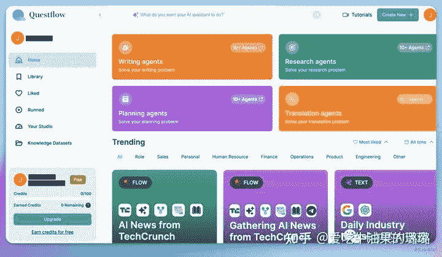
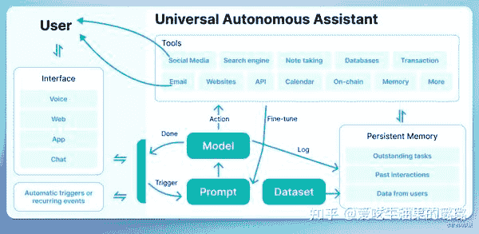
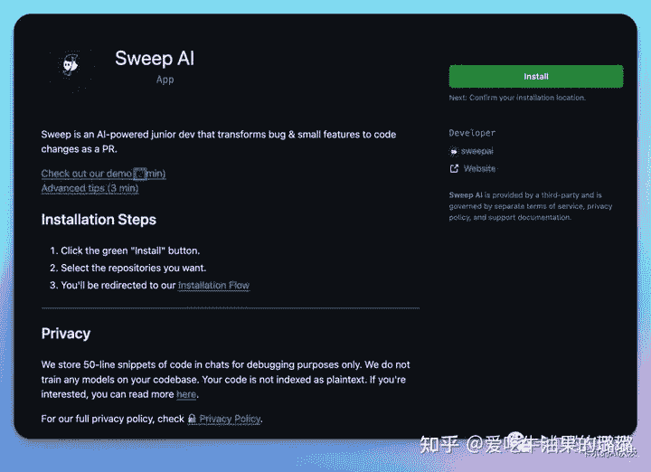
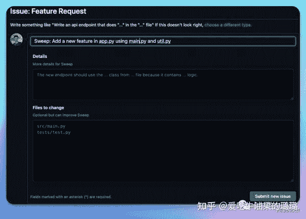
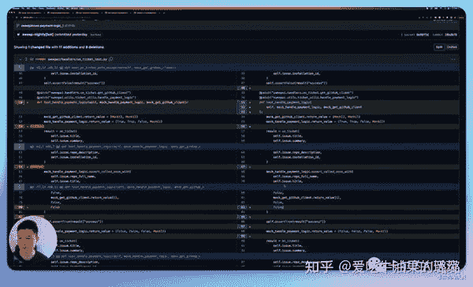

# AI Agent案例介绍（上）

> 来源：[https://agijuejin.feishu.cn/docx/WwwjdOz9YoriyjxSgnSc3rbcnuc](https://agijuejin.feishu.cn/docx/WwwjdOz9YoriyjxSgnSc3rbcnuc)

> 作者：爱吃牛油果的璐璐

> 原文：https://zhuanlan.zhihu.com/p/669276175

## 前言

爱吃牛油果的璐璐：多智能体之5 种不同类型的 AI Agents

爱吃牛油果的璐璐：细说AI-Agent（二更）

## 数据处理Agent: Adala

Adala是一个专注于数据处理的自动化代理框架，尤其擅长多样化的数据标记任务。这些代理能够通过迭代学习独立获得技能，学习过程受到操作环境、观察和反思的影响。

### Adala的优势：

+   可靠性：代理基于基准数据构建，提供一致且可信的结果。

+   可控输出：用户可以配置输出，设定具有不同灵活度的特定约束。

+   专业于数据处理：代理不仅擅长多样化的数据标记任务，还可以定制用于广泛的数据处理需求。

+   自主学习：智能体通过观察和反思而进化，而不仅仅是自动化。代理具有智能化的迭代独立学习能力。

+   灵活且可扩展的运行时：单一技能可以跨多个运行时部署，支持学生/教师架构等动态场景。

### 适用对象：

+   AI工程师：构建和设计AI代理系统。

+   机器学习研究者：实验复杂问题分解和因果推理。

+   数据科学家：应用代理进行数据的预处理和后处理。

+   教育工作者和学生：作为教学工具或高级项目和研究的基础。

### 安装和配置：

+   方法1: pip install adala。

+   方法2: pip install git+https://github.com/HumanSignal/Adala.git。

+   设置OPENAI_API_KEY。

### 可用功能：

+   包括文本分类、文本概括、问题回答、翻译、文本生成等。

### 未来发展路线图：

在Google Colab上运行笔记本示例、多任务学习、计算和存储顶级代理指标、创建命名实体识别技能、命令行工具、REST API交互以及视觉和多模式代理技能。

> 项目地址：[https://github.c](https://link.zhihu.com/?target=https%3A//github.com/HumanSignal/Adala)om/HumanSignal/Adala

## 自动化工作流程: Questflow

Questflow 是一个面向无代码的自主人工智能工作者的市场。他们帮助团队和个人发现和部署跨平台自动化的人工智能工作流程，且用户无需编码或 ML 经验。

### 特点

• 与 Upwork 类似，Questflow 提供了一个市场，用户可以利用人工智能代理跨各种数字工作空间完成任务。

• 创作者有机会将他们的专业知识转化为人工智能代理，扩大他们的影响范围并产生收入。

### 使用方法

使用起来确实很方便，整个流程的搭建类似Figma的卡片拖拽。可选的卡片有例如：什么情况下trigger（触发）该动作。以及配置邮箱。运行后可在后台看到该pipeline。

> 项目地址：https://v1.questflow.ai/

## Sweep 代码批量重构

这是一个 Github 内置助手，在code review时相当有用，可帮助修复小错误并实现功能。其作者对该应用的定位是AI初级开发工具，可重构和编写Python的单元测试。

### 使用

安装并使用Sweep非常简单，首先根据项目地址，直接在Github上安装。

打开一个Github Issue，例如：Sweep: 在Python代码app.py中新加一个feature：

然后Sweep将对代码进行修改，运行，并最后发起一个pull request：

### 特点

+   自动识别最佳的代码重构位置。

+   自动运行和调试您的代码，直接将问题转换为Pull Request （无需IDE）⚡

+   处理用户对其PRs的回复和评论

+   使用依赖图、文本和向量搜索理解代码库。

+   自动运行单元测试和自动格式化程序以验证生成的代码。

### Sweep提示技巧：

+   使用时，可以提及文件名或函数名来获取特定的帮助。

+   描述所需的更改或修复，可以选择性地提及实施细节。

+   提供额外的背景信息，以帮助理解需求，例如参考特定文件中的单元测试示例。

### Sweep的限制：

+   对于超过5000个文件的巨大仓库，Sweep可能无法完全排除所有不相关的文件和目录。在这种情况下，可能需要手动屏蔽一些目录。

+   Sweep不支持大规模的重构工作，例如超过5个文件或300行代码的更改。

+   Sweep不能将整个代码库从Tensorflow重构为PyTorch。

+   Sweep不支持编辑图片和其他非文本资产，例如不能使用标志创建网页的收藏图标。

+   Sweep无法访问外部API，包括获取API令牌。

### 支持：

+   所有用户都有无限制的GPT3.5来发起issue。每个用户每月开始时获得5个GPT4发起issue，每天可以使用2个GPT-4发起issue。

> 项目地址：[https://github.com/swe](https://link.zhihu.com/?target=https%3A//github.com/sweepai/sweep/tree/main)epai/sweep/tree/main

## 参考资料：

[AI进化的新纪元：AI Agents时代](https://link.zhihu.com/?target=https%3A//mp.weixin.qq.com/s/9gnXLPEo-VCYxd69PcHrXQ)（9/20）——生产力Agent案例盘点