# AI Agent应用案例介绍（下）

> 来源：[https://agijuejin.feishu.cn/docx/THB7dcIOWoYBqWxMYAHcTNIOnlf](https://agijuejin.feishu.cn/docx/THB7dcIOWoYBqWxMYAHcTNIOnlf)

> 作者：爱吃牛油果的璐璐

> 原文：https://zhuanlan.zhihu.com/p/672183749

## 前言

爱吃牛油果的璐璐：细说AI-Agent（二更）

爱吃牛油果的璐璐：开源社区AI Agent案例介绍

爱吃牛油果的璐璐：多智能体之5 种不同类型的 AI Agents

## AI Agent与大模型的区别

AI Agent和大模型的主要区别在于：大模型与人类之间的交互是基于prompt实现的。用户prompt是否清晰明确会影响大模型回答的效果，没有精确有效的prompt，即便是能力最强的ChatGPT也不行。

## 音乐领域

在音乐领域，一款基于大型语言模型的音乐理解和生成AI智能体MusicAgent。这是一个使用LLM作为控制器的系统，可以自动分析用户请求并调用适当的工具来完成音乐任务。

**论文题目：**

《MusicAgent: An AI Agent for Music Understanding and Generation with Large Language Models》

**论文链接：**[

https:// arxiv.org](https://link.zhihu.com/?target=https%3A//arxiv.org/pdf/2310.11954.pdf)/pdf/2310.1195 4.pdf

**项目地址：**https:// sourceforge.net/p/music agent/code/HEAD/tree/

## 医疗领域

在医疗领域，聚焦亚健康管理领域的医者AI（清华创业团队创建的公司）基于最前沿的自研MoE架构大模型，构建了健康管理Agent- Healthy Care Agents。

MoE相关介绍可以参考： 爱吃牛油果的璐璐：大模型LLM之混合专家模型MoE（上-基础篇）

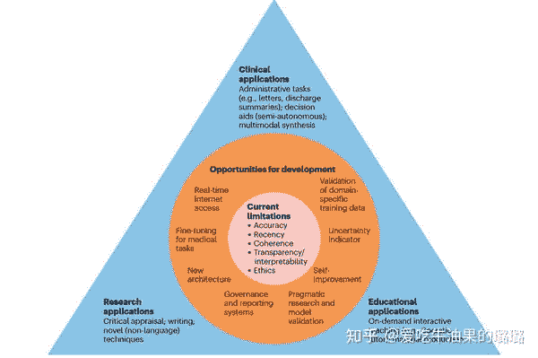

ChatGPT在医学领域引起了特别的关注，因为它在美国医学许可考试中取得了及格分数，而GPT-4的表现明显优于其前身GPT-3.5。Google推出的Med-PaLM 2，一种在医疗数据上进行细调的PaLM 2版本，取得了最先进的成果，达到了接近专业人类临床医生水平。当将ChatGPT对患者问题的回答与医生提供的回答进行比较时，根据医生评判的定性指标，LLM的输出在质量和共情方面更受欢迎。这导致了有人提出AI已经可以取代医生，但事实并不如此。即使在医学生考试中，其性能也远非完美，没有任何已知报告的分数接近100%。ChatGPT在医生专科考试中失败，并在回答有关心血管疾病预防的真实问题时提供不准确的信息。

C**hatGPT在不需要专业知识或在用户提示中提供专业知识的任务中表现出更强**的性能。这为其在实施方面提供了比临床决策辅助工具更为直接的前景。 LLM能够快速吸收、概括和重新表述信息，从而减轻临床医生的行政负担。出院总结是一个有意义的例子，它涉及到对信息的解释和压缩，几乎不需要问题解决或回忆。 新兴的多模态模型将扩展模型能力，并与更多的数据源兼容；甚至医生的手写字也可以自动准确地解释。

GPT-4和Med-PaLM 2在医学测试中的强劲表现表明，LLM可能是学生在这些测试中获得较低分数时有用的教学工具。GPT-4的元提示功能允许用户在对话过程中明确描述聊天机器人所扮演的期望角色；有用的示例包括“苏格拉底导师模式”，通过逐渐降低难度的问题来鼓励学生自己思考，直到学生能够解决更全面的问题。对话记录可以使人类教师监测进展并根据学生的弱点进行教学，以直接解决学生的不足之处。非盈利教育机构卡恩学院（Khan Academy）正在积极研究如何在“卡恩米格”中利用AI工具，来优化在线教学。

## 零售与电子商务领域

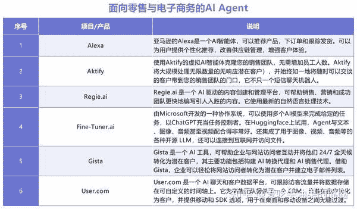

[代表产品：Alex](https://link.zhihu.com/?target=http%3A//regie.ai/)a、[Aktify、 Regie.](https://link.zhihu.com/?target=http%3A//fine-tuner.ai/)ai[ 、 Fine-T](https://link.zhihu.com/?target=http%3A//regie.ai/)un[er.ai 、 ](https://link.zhihu.com/?target=http%3A//user.com/)Regie.ai 、 User.com

由GPT等大语言模型驱动的AI Agent，可以成为零售和电子商务助手，能够为用户塑造与核心零售目标和目标相一致的定制且数据丰富的购物体验。亚马逊的Alexa是一个AI智能体，可以推荐产品，下订单和跟踪发货。

通过内置事实核查等功能，Agent可以从用户最新内容（产品列表、促销材料、在线目录以及其他系统）中进行自我学习和响应，以增强信任度，重塑购物旅程。

相对于直接应用LLM，AI Agent用于零售和电子商务所具备的主要优势如下：

+   **个性化购物之旅： **与完全可定制的代理商建立令人难忘的互动，反映您的品牌声音，从而提高销售额和忠诚度。

+   **内容感知产品洞察： **客户会收到准确的产品信息，增强购买决策的信心。

+   **人工智能驱动的购物分析： **通过我们的语言-AI/基于含义的分析，更深入地了解客户旅程。识别热门产品，辨别买家情绪，并根据其意图对查询信息进行分组。

+   **可靠和迅速的响应： **降低购物车放弃率。我们的无幻觉和事实核查功能可确保准确的产品信息，减少购买犹豫。

+   **可扩展且灵活： **轻松应对高流量的销售活动，适应不断变化的零售环境。

借助销售Agent，用户可以了解客户最常查询的产品或类别，以便进行库存调整和有针对性的营销工作，以深入产品分析；通过确保回头客做出明智的购买决定来培养回头客并降低退货率，进而提高客户忠诚度。

## **教育领域**

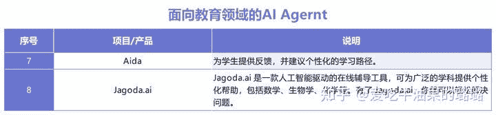

**代表产品： **Aida、Jagoda

AI Agent应用于教育领域，具备自适应学习、个性化推荐及数据分析等多种特性。

它可为教育者和学习者提供个性化、智能化和高效化的服务，能够在教育过程中提供帮助和优化学习体验，还能根据教育者和学习者的需求、特征、行为和反馈， 动态地调整自身的策略、内容和形式，实现与用户的交互和协作。

面向教育领域的AI Agent可以实现多种功能，比如智能推荐、智能辅导、智能评估、智能反馈、智能管理等。

无论是通过电子学习平台指导学生还是学院招生，AI Agernt都能从不断变化的教育内容中汲取灵感，提供准确、及时的响应，确保学习者的学习任务进展顺利。

教育类Agernt能够根据学习者需求建议相关课程或材料，通过个性化学习路径，为学生打造定制化学习体验。对于教学机构，它可以即时回答有关招生、校园设施、活动等方面的查询，确保即时的校园服务支持。

面向教育领域，AI Agernt的优势如下：

+   **参与式学习： **通过即时的、人工智能驱动的澄清和指导，营造一个更具参与度、互动性的学习环境。

+   **按需支持： **无论是解决电子学习平台故障还是了解大学的入学先决条件，都可以提供即时、准确的帮助。

+   **学习者的内容掌握： **学习者可以深入研究教育材料，确保理解和知识保留。

+   **AI驱动的洞察： **根据学习者的互动、偏好和查询，不断增强教育体验。

组织可以通过教育类Agent提供即时、准确的响应，提高学生、教育工作者和行政人员的满意度。借助生成式AI驱动的主动帮助，最大限度地减少手动支持查询，使教育工作者和员工能够专注于他们最擅长的事情。

AI Agent可以帮助教育者和学习者提高教学和学习的效果和效率，增强教学和学习的动力和兴趣，拓展教学和学习的资源和渠道，促进教学和学习的创新和发展。

还可以通过增强整体教育体验，吸引更多的学习者，提升入学率和保留率。

## **房产行业**

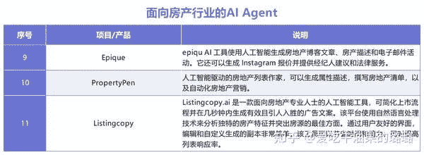

**代表产品： **Epique、propertypen、Listingcopy

在房地产行业应用AI Agent，可为房地产开发商、经纪人和客户提供更加智能和人性化的服务。

AI Agent能够理解自然语言，与用户进行流畅的对话，根据用户的需求和偏好，提供个性化的房源推荐、看房预约、合同签署等服务，并能够分析房地产市场的动态和趋势，为开发商和经纪人提供数据支持和决策建议。

AI Agent还能够根据用户的反馈和行为，不断优化和更新房源信息和推荐策略，提高用户满意度和转化率。

房产类Agent专为指导潜在买家和卖家而量身定制，根据用户最新的房产列表、区域数据库和常见问题解答进行运营。通过内置的准确性检查，房产类Agent能够提供可靠建议，确保客户满意度，同时扩大用户的数字房地产影响力。

因此它可以引导潜在买家和卖家找到需要的内容，提供针对他们独特需求和偏好量身定制的见解。通过即时AI 辅助响应，促进房产列表网站上的互动，提高用户满意度和转化率，优化客户参与度。

AI Agent应用于房产领域，主要优势包括：

+   **个性化物业互动： **通过可定制的代理有效地吸引客户，同时提供量身定制的房地产建议。

+   **内容掌握和列表保留： **通过内容感知技术，客户可以从各种列表中获得精确的详细信息，从而鼓励积极的互动和更高的信任感。

+   **AI驱动的查询分析： **基于AI语义分析了解客户深度需求，提供客户偏好和感兴趣领域的完整视图。

+   **可靠和及时的响应： **减少对人工干预的需求。我们提高的准确性确保了详细的答案，减少对额外跟进的需求。

+   **安全、适应性强且可扩展： **保护客户数据，随着房源的增长毫不费力地扩大规模，并适应房地产科技行业不断变化的需求。

这些特点和优势，使得房产类Agent能够深入的物业权益分析，增强的客户反馈，减少用户手动查询，提高客户满意度和保留率，并能够在一定程度上赋能销售、客服等部门。

## 旅游和酒店行业

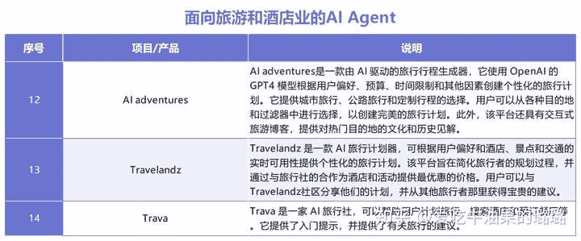

**代表产品： **AI adventures、Travelandz、Trava

AI Agent用于旅游和酒店业，以与客户进行自然、流畅和个性化的交互，提供各种信息、咨询、预订、退订、投诉等服务。它可以根据客户的语言、口音、情绪、偏好等特征，自动适应不同的场景和需求，提供定制化的服务。还能通过不断地学习客户的反馈和行为，不断优化自己的性能和智能水平。

数字礼宾服务想要获得成功，丰富客人和旅行者体验是第一步。旅游管理类Agent可以从不断更新的数据库（来自预订系统、网站、PDF及宣传材料等）中汲取信息，具有固有的事实核查功能，可提供可靠性和便利性。

此类Agent可以成为服务人员的知心助手，用以提高效率和客户满意度。能够即时回复有关预订、设施、套餐等的查询，提升客户体验。还能深入了解客人的喜好和好奇心，根据他们的需求定制您的产品。

AI Agent用于旅游和酒店业，优势如下：

+   **个性化的宾客互动： **通过完全可定制的代理商提供定制体验，反映您品牌的优雅和对优质服务的承诺。

+   **酒店业的内容掌握： **即时提供有关从房间可用性到旅游细节的准确及时的信息。

+   **AI驱动的旅行分析 **：借助LLM，可以快速识别热门目的地，评估客人情绪，并捕捉每个查询背后的本质。这有助于完善您的产品并预测市场变化。

+   **值得信赖的协助： **确保客人和旅行者每次都能收到准确可靠的信息。

+   **安全、可扩展且适应性强： **保护客人数据，适应旺季和需求，并拥抱充满活力的旅游和酒店业。

借助AI Agent，企业可以促进从初始查询到最终确认的无缝预订流程，确保高入住率和客人满意度。通过提供及时准确的信息，减少来回奔波，简化操作，减少客人查询。可以快速高效提供模范服务，带来正面评价、重复访问和推荐，并能够实时帮助销售前台等部门。

## 客户 **支持领域**

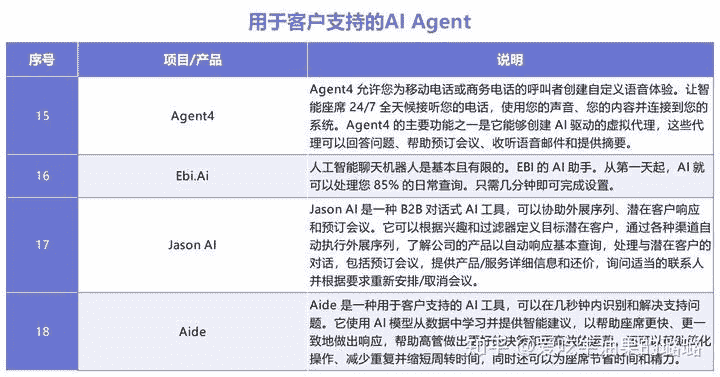

**代表产品： **Agent4、Ebi.Ai、Jason AI、Aide

由GPT等LLM驱动的客服助手正在成为游戏规则的改变者，为各种平台的用户提供精确、实时的帮助。它可以从用户最新数据库和常见问题解答（包括产品列表、文档、用户手册和其他资源）获取信息，时刻保持信息更新。

客户支持类Agent具有自动化、个性化、智能化及高扩展性等特点，可以通过多种渠道，如网站、手机应用、社交媒体、电子邮件和电话，与客户进行智能对话，解决他们的问题、满足他们的需求、提高他们的满意度和忠诚度。

AI Agent应用于客服服务领域，具备以下几点优势：

+   提高首次联系解决率 （FCR）： 实现即时第一响应时间

+   **提高销售和留存率： **在客户购物过程中为他们提供帮助，确保他们准确找到所需的商品。

+   **提升 SaaS 交互： **立即提供软件功能的清晰度，最大限度地提高产品实用性和用户体验。

+   **深入了解用户查询： **分析用户交互，以微调您的产品并更好地了解客户需求。

+   **直观的购物和产品使用： **为电子商务购物者和 SaaS 产品用户提供及时准确的帮助，提升他们的整体体验。

+   **增强的用户反馈： **实时衡量用户反映，为持续改进产品供应和支持提供途径。

+   **减少支持票证： **通过提供即时且值得信赖的答案，大大减少查询和手动干预。

+   **改进的NPS和保留率： **提供卓越的用户支持体验，对您的净推荐值产生积极影响并遏制用户流失。

由LLM驱动的交互分析，可以更好地确定趋势查询、衡量用户情绪并了解请求的性质，有助于预测客户行为和改进产品。经过高安全Agent审核机制的加持以及事实核查功能，能够得到准确且令人满意的答案。

AI Agent可以根据客户的需求、情感和行为，个性化地定制对话内容和风格，提高客户满意度和忠诚度。利用大数据分析和机器学习，不断地学习和优化自己的知识库和对话策略，提高服务质量和效率。

此外，它还能与其他系统和平台集成，如CRM、ERP、BI等，实现数据共享和协同工作，提高业务流程和决策的效率。

## 人力资源领域

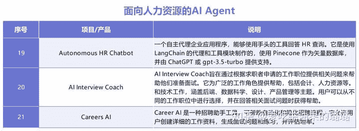

**代表产品： **Autonomous HR Chatbot、AI Interview Coach、Careers AI

人力资源类Agent可简化 HR流程并增强员工体验，能够利用当前数据（来自内部数据库、网站、PDF 及其他HR 系统）和事实核查等功能，确保可信度和效率，将用户的HR职能提升到新的高度。

此类Agent可以为HR团队提供 AI 工具，简化复杂的 HR 任务，提供即时解决方案和帮助。能够对员工查询提供即时响应，确保政策、福利等的清晰性。还能了解员工的核心关注点和需求，并积极主动地解决这些问题。

AI Agent用于人力资源，主要有以下几点好处：

+   **个性化的员工互动： **通过完全可定制的座席提供个性化体验，反映您公司的精神并增强员工信任度。

+   **面向 HR 的内容掌握： **借助我们的内容感知技术，OneAgent 从庞大的 HR 数据库中汲取信息，以提供准确且相关的信息。

+   **AI 驱动的 HR 分析： **识别反复出现的主题，评估情绪，并理解查询背后的内在含义，可以对员工需求、偏好和潜在改进领域的深入了解。

+   **值得信赖的人力资源回应： **尽量减少重复澄清的需要。具备逻辑推理及规划能力的Agent可提供准确的HR相关答案。

+   **安全、可扩展且适应性强： **保护员工数据，随着员工队伍的增长而扩展，并为不断变化的HR挑战做好准备。

借助人力资源Agent，组织可以帮助新员工轻松了解公司政策、文化和福利，确保顺利过渡到他们的角色，优化员工入职。通过提供即时和准确的答案来减少查询数量，简化HR 运营，减少人力资源工单。通过提供清晰和即时的帮助，确保积极的体验，提升员工保留率，提高员工满意度。

此外，Agent还能帮助HR协同招聘、培训等部门，提升整体业务效率。

## 金融领域

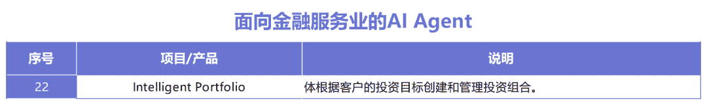

**代表产品： **Intelligent Portfolio

AI Agent用于金融服务，能够理解和处理自然语言，与人类用户进行流畅、自然的对话，根据用户的需求和情境提供个性化的服务和建议，并能够通过不断学习和优化，提高自身的智能水平和服务质量。

金融服务类Agent可为用户的客户提供对市场、账户详细信息、交易和保险单细节的即时洞察，从而促进明智的决策，赋能财务决策；能够简化和个性化客户入职流程。

AI Agent用于金融科技，主要优势如下：

+   **增强客户体验： **通过直观、人性化的交互，确保您的客户感到被理解、重视和高效服务。

+   **自动支持和查询： **通过即时处理常见的客户查询，减少对人工干预的需求，减少等待时间并提高准确性。

+   **客户对内容的掌握： **借助 OneAgent 的内容感知技术，客户可以访问准确和全面的信息，从而促进明智的财务决策。

+   **数据驱动的见解： **深入了解客户互动，以辨别新兴的财务趋势、客户偏好和潜在增长领域。

在金融科技中引入AI Agent，可以帮助用户通过提供快速、准确和量身定制的响应，全面提升客户满意度指标。能够通过自动化、准确的响应，最大限度地减少手动支持工单的数量，简化操作并减少开销。

可以通过主动支持、深入洞察和始终如一的卓越数字体验，提高客户忠诚度。还能为客户提供有关其财务状况、潜在增长领域和个性化建议的全面概述，提供透明的财务健康检查。

AI Agent可以为金融服务业提供多种功能，比如智能客服、智能投顾、智能风控、智能营销、智能审计等，进而帮助金融机构提高效率、降低成本、增加收入、优化风险管理、提升客户满意度等。

## **制造和供应链领域**

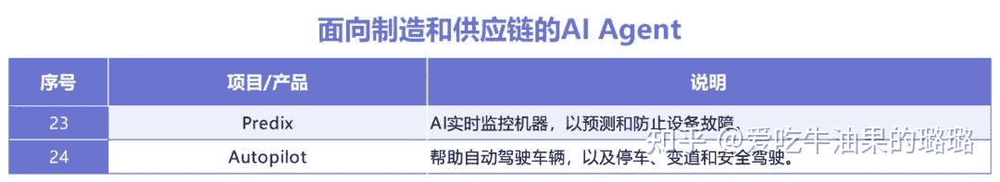

**代表产品： **Predix、Autopilot

面向制造业和供应链的AI Agent，可以与企业的现有系统和数据集成，实现自动化、智能化和协同化的决策支持，根据数据分析和业务规则，自动执行一系列的任务和决策。

它可以从最新数据库（产品规格、交付时间表及供应商详细信息等）中获取信息，加上严格的事实核查规则与技术，能够显著提高运营效率及利益相关者的满意度。

## **面向政府和市政服务领域**

**代表产品： **MetaGPT等能够进行私有化部署的框架

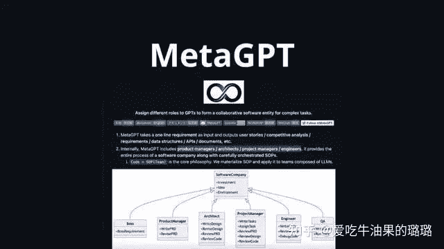

由Meta公司推出的MetaGPT是一个多智能体框架，采用单行输入来生成 API、用户故事、数据结构、竞争分析等。该框架可以充当产品经理、软件工程师和架构师。该框架可以充当整个软件公司，只需一行代码即可编排SOP。

MetaGPT与人类SOP流程设计集成。（SOP，标准作业流程，从字面意思上很好理解，就是将工作流程标准化和规范化，员工执行即可，不需要掺杂自己太多想法。）基于LLM的智能体生成高质量，多样化，结构化的文档和设计。MetaGPT 的设计使为复杂任务设计解决方案变得容易，并提供几乎可以与人类智能相媲美的问题解决能力。

在政府和市政服务中引入AI Agent，至少可以实现以下三点：

+   **高效的民事查询解决： **OneAgent 提供清晰准确的答案，解决有关许可证、许可、城市法规、公共服务时间表等的查询。

+   **提高透明度： **为市民提供对源文件和法规的直接参考，促进公共沟通的信任和清晰度。

+   **个性化公民参与： **自定义功能可以反映市政服务的基调和身份，确保有意义和有效的互动。

+   **全面的文档协助： **无论是关于财产税、废物管理时间表，还是社区活动许可证，都可以为市民提供及时准确的信息。

+   **即时响应减少等待时间 **：借助高效的AI功能，减少市民等待问题答案的时间，提高满意度。

+   **跨部门支持： **可以在住房、交通或公共工程等各个政府部门使用，确保统一高效的响应系统。

## 医疗保健领域

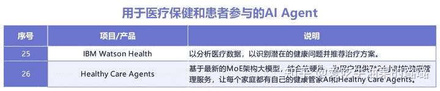

**代表产品： **IBM Watson Health 、Healthy Care Agents

AI Agent用于医疗保健领域，可以实现自主与医疗系统和患者交互和沟通，并能够模拟人类的语言和行为，为患者提供个性化的医疗服务和参与。

**论文：**

1.Thirunavukarasu, A.J., Ting, D.S.J., Elangovan, K. et al. Large language models in medicine. Nat Med (2023).

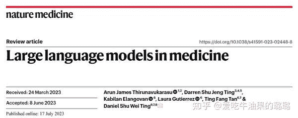

2.ChatGPT Utility in Healthcare Education, Research, and Practice: Systematic Review on the Promising Perspectives and Valid Concerns

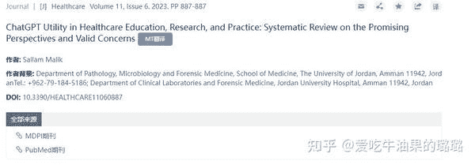

3.Towards Expert-Level Medical Question Answering with Large Language Models（论文链接： http:// arxiv.org/abs/2305.0961 7  ）

IBM Watson Health 是一个AI智能体，可以分析医疗数据，以识别潜在的健康问题并推荐治疗方案。医疗类Agent根据用户数据（数据库、一般健康指南、预约物流、用药详细信息及患者护理指令的那个）进行摄取和响应，辅之事实核查功能，可确保可靠性并提升患者的信任度和护理水平。

此类Agent基于LLM及知识图谱等技术构建，能够理解自然语言，适应不同的情境，学习和更新知识，可以理解患者的语言和意图，生成合适的回应和建议，以及根据患者的反馈和数据不断优化自己的性能和效果。

功能方面，AI Agent能够提供医疗信息，回答常见问题，提醒用药和预约，推荐健康行为，以及收集反馈和评估，可以广泛应用于健康咨询、预约挂号、用药提醒、康复指导及心理支持等业务场景。

将AI Agent应用于医疗及保健，可以实现以下好处：

+   **告知和教育： **提供简明扼要的健康信息，揭开医学术语的神秘面纱，让每个人都能更容易获得医疗保健。

+   **简化患者互动： **提供有关预约时间、医生可用性和就诊后护理说明的详细信息。

+   **制药协助： **明确药物、用法、潜在副作用，并解决一般药物问题。

+   **提高患者满意度： **借助 AI 支持的澄清，确保患者感到知情、受到重视和被照顾。

+   **减轻行政负担： **最大限度地减少针对医护人员的常规查询，使他们能够专注于危重患者护理。

+   **知情决策： **为患者提供知识，使他们能够做出明智的健康选择和用药决定。

+   **简化患者流程 **：提供快速的预约详细信息和重新安排选项，优化诊所和医院的运营。

## **面向媒体和娱乐领域**

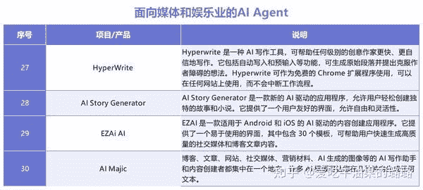

**代表产品： **HyperWrite、AI Story Generator、EZAi AI、AIMajic

为了应对更多的竞争，在引入LLM的基础上，现在的媒体和娱乐公司也开始尝试使用AI agent来辅助或替代人工的创作和制作过程。

AI agent应用于媒体与娱乐内容制作，能够自动或协同地完成特定任务的智能软件，它可以根据输入的数据或指令来生成输出的结果。AI agent彻底改变媒体内容制作方式，以更简单的自然语言交互让内容更加动态和个性化。同时指向支持内容的链接，不仅引导用户获得最相关的信息，还可以增强他们的参与度。

Hyperwrite是一款AI写作智能体工具，可帮助任何级别的创意作家更快、更自信地写作。它包括自动写入和提前打字等功能，可生成原始段落并提出克服作家障碍的想法。该工具作为免费的Chrome扩展程序提供，可以在任何网站上使用，而不会中断工作流程。它被世界各地的专业人士、学生和创作者使用和信任，以提高他们的生产力。

AI agent可以模仿或超越人类的创意能力，根据不同的风格、主题、场景和目标来生成各种类型的内容，如文字、图像、音频、视频等。还可以根据反馈和评价来自我学习和改进，提高内容的质量和效果。

此外AI agent还可以与人类或其他AI agent协作，实现更复杂和多元的创作和制作过程。将AI Agent应用于面向媒体和娱乐业的AI agent，可以实现以下好处：

+   **内容发现，告别无休止的搜索： **借助Agent，用户可以无缝地确定适合他们口味的特定文章、剧集或主题。

+   **互动问答： **激发好奇心和参与度，读者或听众可以发起关于文章、剧集或更广泛主题的动态问答环节，为他们的消费体验增加一层深度。

+   **参与度分析： **利用数据驱动型决策的力量。深入研究哪些文章、剧集或主题最能引起观众的共鸣。这些见解使创作者和编辑能够定制他们的内容，确保与受众不断变化的偏好建立更深层次的联系。

参考文章：

[他山之石丨AI Agent行业应用大盘点，](https://link.zhihu.com/?target=https%3A//mp.weixin.qq.com/s/vDa4OwA4SrLzAehi2hPzjg)十大领域30个产品助你深度认知AI智能体