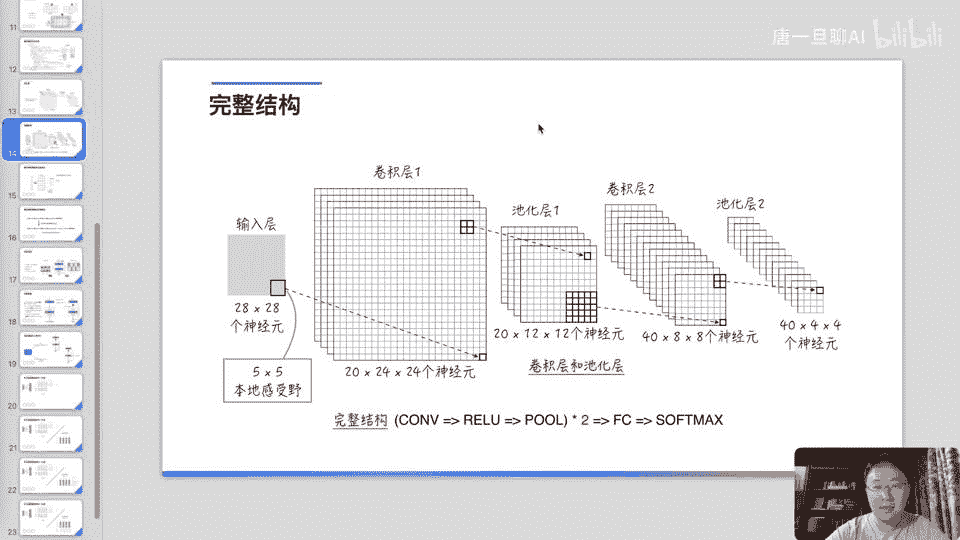

# 徒手实现卷积神经网络--残差网络（ResNet）

> 来源：[https://agijuejin.feishu.cn/docx/EIPpd3IWhoEeMMxLT8ncEf6tnRc](https://agijuejin.feishu.cn/docx/EIPpd3IWhoEeMMxLT8ncEf6tnRc)

# 👀快看👀

> **作者：**[**唐一旦聊AI**](https://space.bilibili.com/417265639)

> **原文链接：**徒手实现卷积神经网络--残差网络（ResNet）

> **代码链接：****https://github.com/GenTang/regre**ssion2chatgpt/blob/zh/video/resnet.ipynb

---

# ⚡️摘要·作者有话说⚡️

> 经典的卷积神经网络是由卷积层和池化层组合而成的。卷积层主要用于提取局部特征，池化层用于对图像数据进行压缩。卷积神经网络已经证明了深度学习的潜力，即通过增加网络的深度，模型性能可以显著提高。那么，如果继续增加网络的深度，是否会获得更好的效果呢？

> 从直觉上来看，答案应该是肯定的。如果神经网络包含多个卷积层，而且这些卷积层的结构相似，那么较浅的网络其实是较深网络的一个子集。然而，在实际生产中，增加网络的深度并不总是能够提高模型的性能，反而可能导致性能下降。其中最重要的原因之一是，随着网络深度的增加，模型训练面临越来越严重的梯度消失或梯度爆炸问题。

> 为了解决梯度不稳定性的问题，需要采用一些优化技术。本视频将讨论一种广泛应用的技术——残差连接（Residual Connection）。这种技术能够显著提高深度神经网络的训练效率，已经成为深度学习的基石优化工具，在实际场景中得到广泛应用。在详细讨论残差连接后，将演示如何利用构建经典的残差网络（Residual Network，ResNet）。

> 这些内容对理解神经网络，人工智能，特别是深度学习和大语言模型至关重要，欢迎对大家多多支持。

---

# 🤖分集🤖

# 徒手实现卷积神经网络--残差网络（ResNet）

从零开始构建 GPT-2 模型，帮助观众深入理解大语言模型的关键结构和实现技巧，特别是单向注意力模型的简单性和工程应用。

[徒手实现卷积神经网络--残差网络（ResNet）.mp4](https://internal-api-drive-stream.feishu.cn/space/api/box/stream/download/all/OSAGbLhaeoE0HnxRkrQcVhJwnxc)

---

# ✏️课代表✏️

+   深度神经网络的性能并不总是随着网络深度的增加而提高，可能会因为梯度消失或梯度爆炸问题而下降。

>

+   残差连接是一种有效的优化技术，可以显著提高深度神经网络的训练效率。

>

+   残差网络（ResNet）通过引入残差连接，解决了深度网络训练中的梯度不稳定性问题，使得构建更深的网络成为可能。

>

+   残差网络的实现对于理解深度学习和大语言模型的原理至关重要。