# 芦义：AI 吞噬软件，Agent 就是新 Saas

> 来源：[https://agijuejin.feishu.cn/docx/KTlKdFeM7od1GWxhPCtchCLQn8b](https://agijuejin.feishu.cn/docx/KTlKdFeM7od1GWxhPCtchCLQn8b)

> 作者：特工少女 | 特工宇宙

> 原文链接： [https://mp.weixin.](https://mp.weixin.qq.com/s/T57tWYu5zYJvqmroTW1N4w)qq.com/s/T57tWYu5...

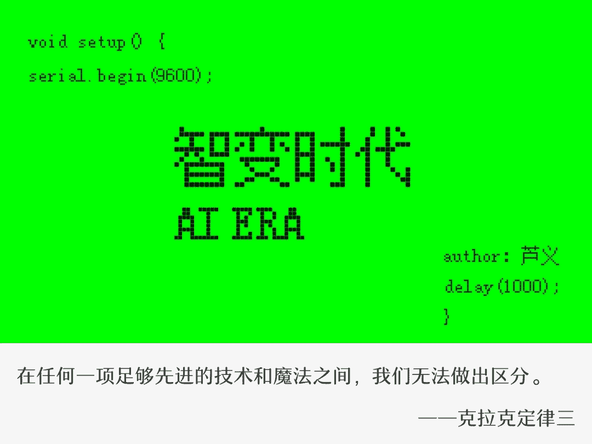

过去十几年来，科技巨头之间发生了前所未有的激烈竞赛，囤积算力、笼络人才，还要小心翼翼地看护好自己的护城河，大家都希望能锻造出最好的 AI 模型，获得进入 AGI 时代的门票。

而最近这一年，更是 AI 领域波澜壮阔的一年。

**芦义，于最近「**电子出版」了一本新书 《智变时代》 ，他希望尝试抓住生成式 AI 变革的本质，带大家拨开喧嚣与迷雾，追寻科技巨头与 AI 机构们在更高智能道路上的探索。

在芦义推特上我们可以看到，除了更新《黑神话 · 悟空》的动态之外，最近也经常晒出他对这本书中概念的分享和解读。

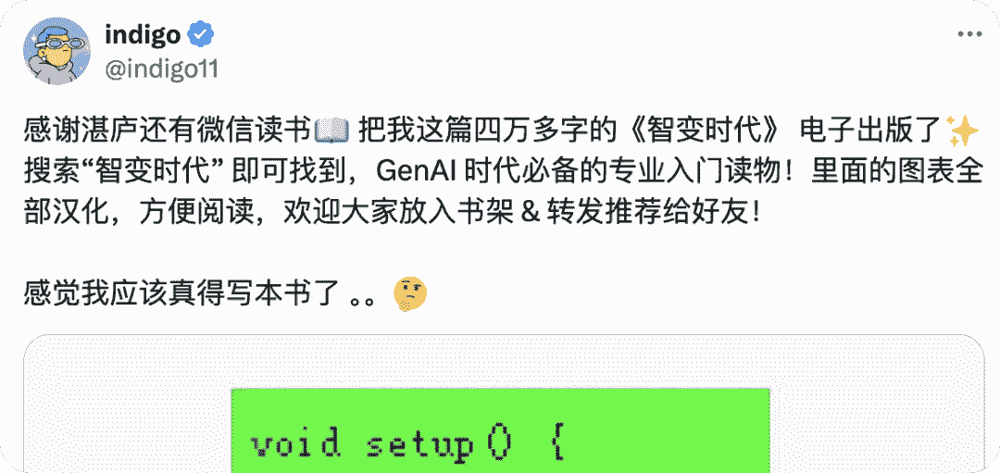

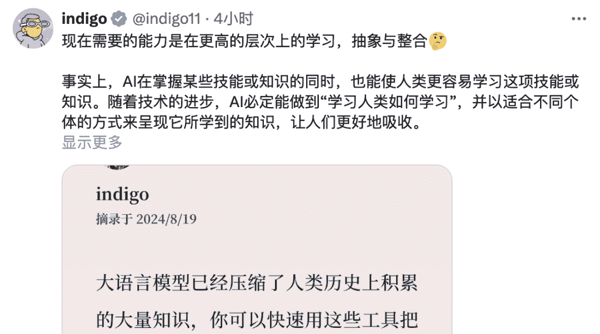

如芦义本人所说，这是一本 GenAI 时代必备的专业入门读物，里面的图表也全部做了汉化处理。

在这个全员都在「猿神启动」直面天命之时，少女花了一个小时读完了这本《智变时代》。

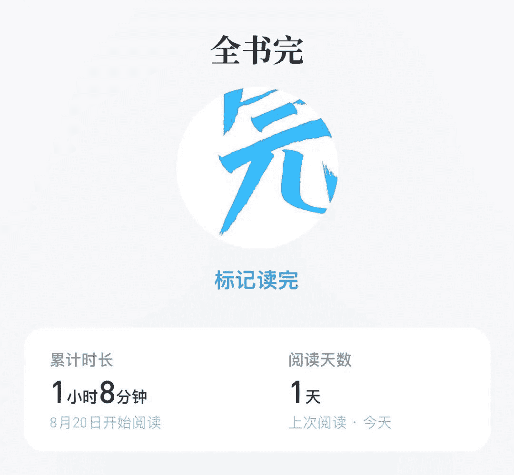

芦义在此书中援引了丰富的案例和图表，阶段性的总结了这一年科技巨头们的「军备竞赛」，深入浅出的阐述了 AI 变革的本质。

芦义是谁？

芦义（Indigo）是新浪🧣创始团队成员，在🧣创业阶段担任产品和技术负责人。Hallid.ai 联合创始人， Brilliant Phoenix 合伙人。

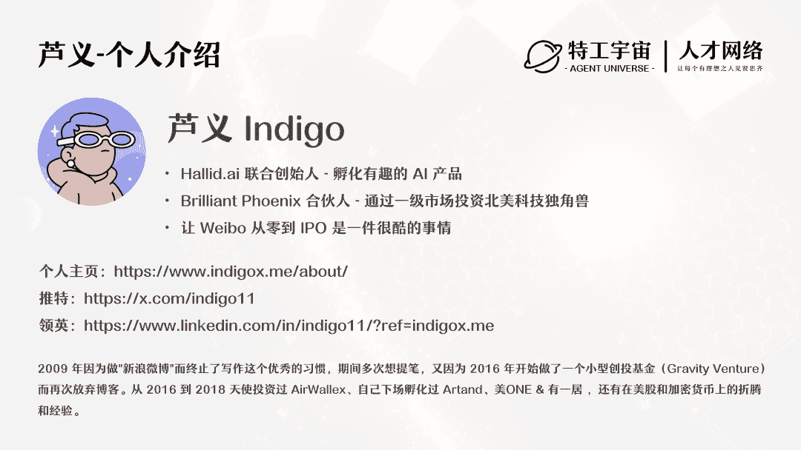

他从 2016 年起，便涉足创业投资和早期投资孵化领域。他所在团队，投资了 OpenAI、Anthropic、Cohere、X.AI 等知名 AI 独角兽公司。

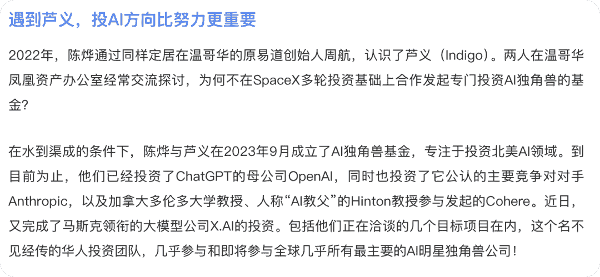

《智变时代》全文共分为五章，约 36k 字。

1. **模型 **- 竞争、泛化与变革的本质

2. **应用 **- 智能代理、智能体与组织新形态

3. **智变 **- 廉价诱导需求、从中心到边缘算力、新工业革命

4. **演化 **- 模型如何理解和进化、自主目标与自动化的 AGI

5. **选择 **- 职业变迁、自我提升与科技恒大

我们基于 maimo.ai 将全文的大纲与重点整理如下。

1. AI 的工业革命

1.1. Jensen Huang 将 AI 比作 19 世纪的交流发电机，称其为“AI 发电机”。

1.2. AI 生成的 Token 几乎可以应用于每个行业，推动新的工业革命。

1.3. Nvidia 通过提供 GPU 支持，成为 AI 竞赛中的最大赢家。

2. 科技巨头的 AI 竞赛

2.1. OpenAI 在 2022 年完成了 GPT-4 的训练，专注于下一代模型。

2.2. Meta 和 Google 全力投入 AI 竞赛，配置齐备且资本充足。

2.3. 微软和 Amazon 面临投资AI联盟的控制问题，Apple 则保持低调。

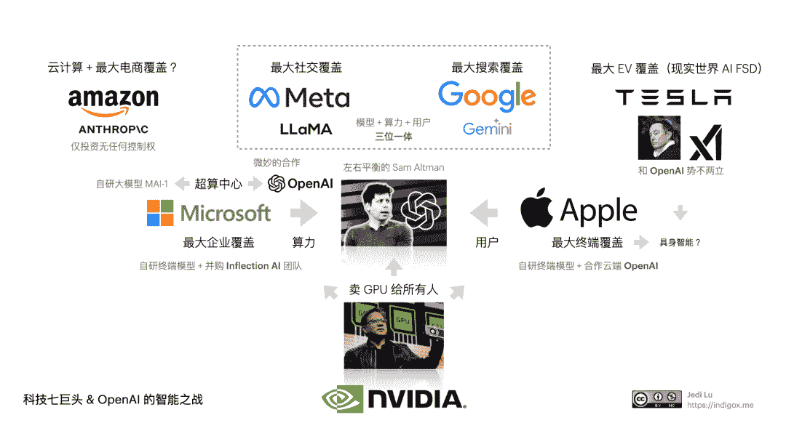

Mega 7 与 OpenAI 的竞争格局图

3. 生成式 AI 的变革

3.1. 生成式 AI 革命被比作工业革命或电的发明。

3.2. ChatGPT 的发布引发了新一轮的生成式 AI 革命。

3.3. AI 技术的快速变化让人们体验到魔法般的科技。

4. 大语言模型的发展

4.1. 递归神经网络（RNN）和长短期记忆（LSTM）网络的发明。

4.2. Transformer 架构的出现和 GPT 模型的推出。

4.3. InstructGPT 通过人类反馈的强化学习优化模型输出。

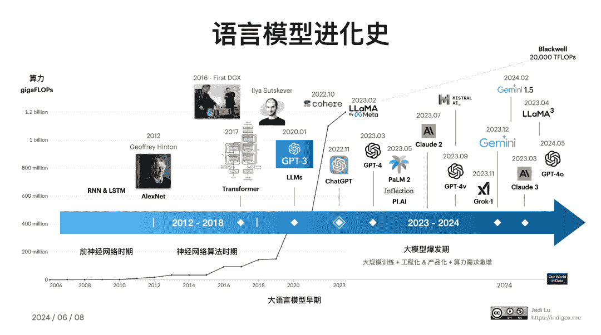

语言模型发展史

5. AI 在各行业的应用

5.1. AI 劳动力将改变传统 SaaS 市场，减少人类工作机会。

5.2. Google 计划收购 Hubspot，快速触达更多客户。

5.3. 智能应用将从简洁开始，逐渐变成无所不在的助理。

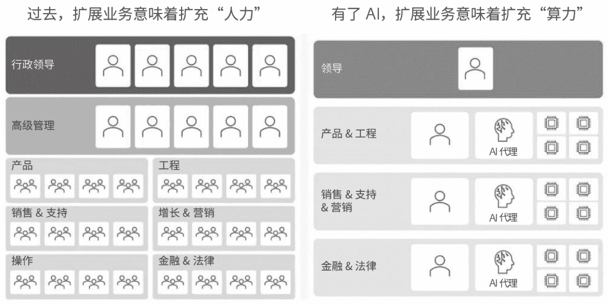

智能代理将改变企业组织架构

6. AI 技术的进化

6.1. AI 模型的规模和数据增加，提升了模型的预测和生成能力。

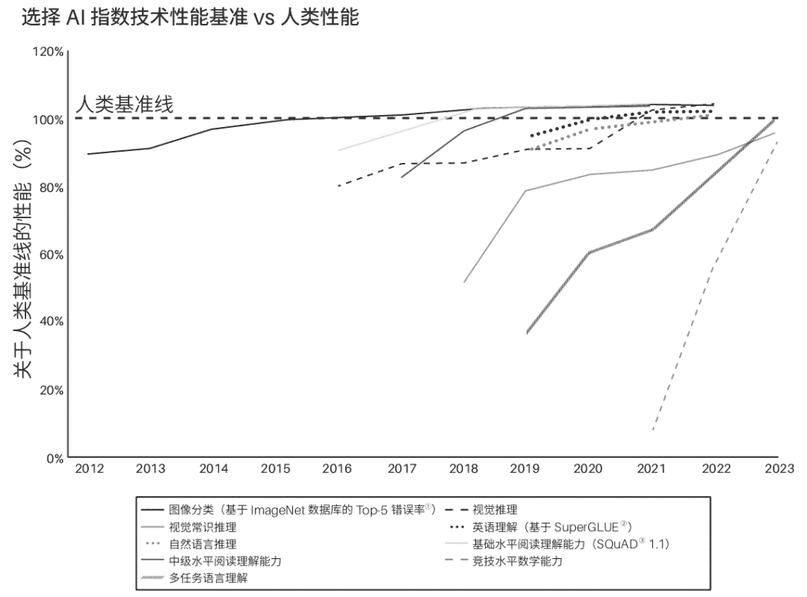

AI 完成人类智能任务的基准评测对比

6.2. 多模态学习显著改进模型的推理能力。

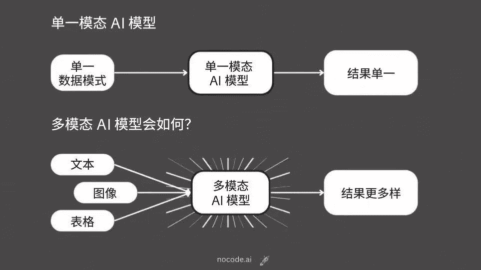

多模态解释

6.3. AI 模型的表征收敛，推动通用性和适应性。

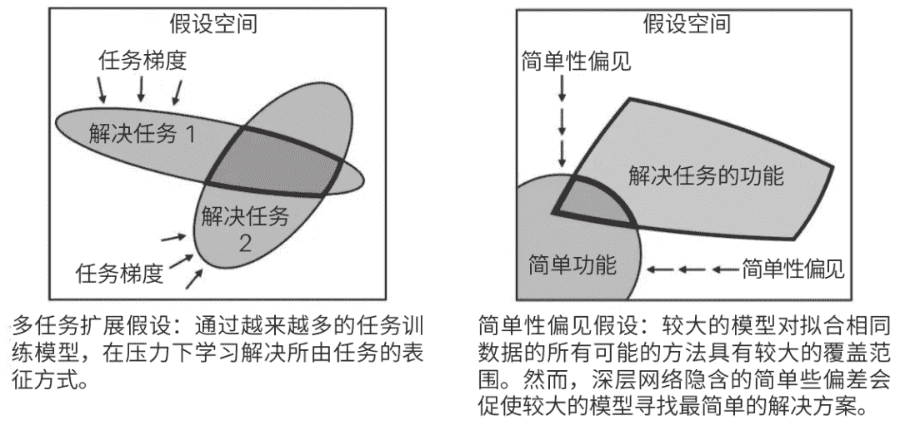

多任务表征空间的收敛

7. AI 的自主进化

7.1. AI 能否实现自主目标和自我进化存在争议。

7.2. AI 模型需要在监督下进行自我改进，避免潜在风险。

7.3. Anthropic 采用“Constitutional AI”方式训练 AI，避免有害输出。

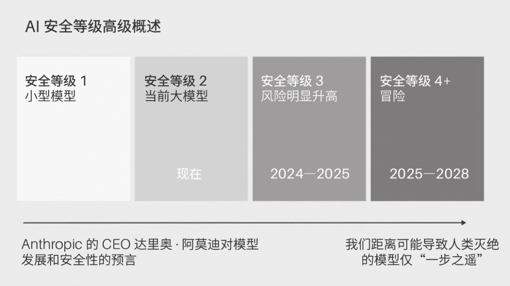

Anthropic 的 A.S.L.

8. AI 对劳动力市场的影响

8.1. 自动化技术提高了生产力，增加了对任务的需求。

8.2. 制造业的自动化导致劳动需求停滞。

8.3. 法律、医疗、工程等知识密集型行业将受益于 AI。

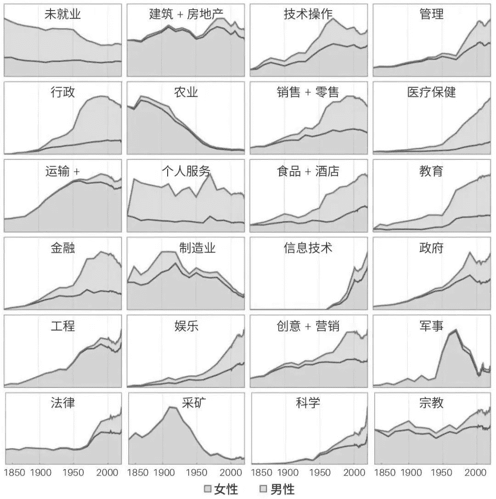

1850 -2010 美国劳动力市场的变迁

9. 智能体与物理世界的结合

9.1. Tesla 的 FSD 12 实现了纯视觉自动驾驶。

9.2. Nvidia 通过 Omniverse 模拟现实，推动工业智能化。

9.3. 智能体将成为人类助手，渗透到各行各业。

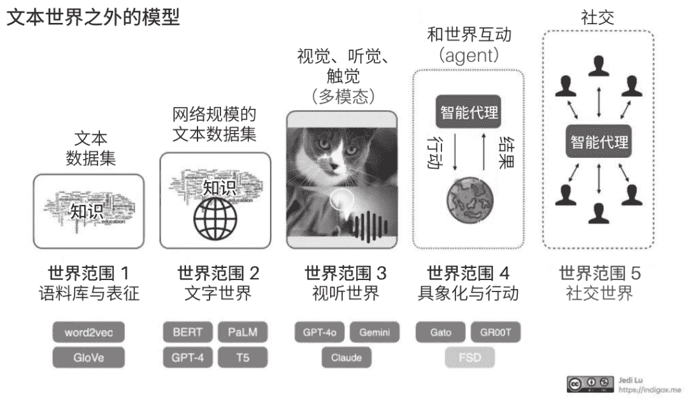

AI World Scope

10. 未来的智能时代

10.1. AI 将从人类学习，成为自我运行的计算系统。

10.2. 智能体将通过多模态数据提升推理和规划能力。

10.3. 科技公司将通过智能化降低成本，扩大市场。

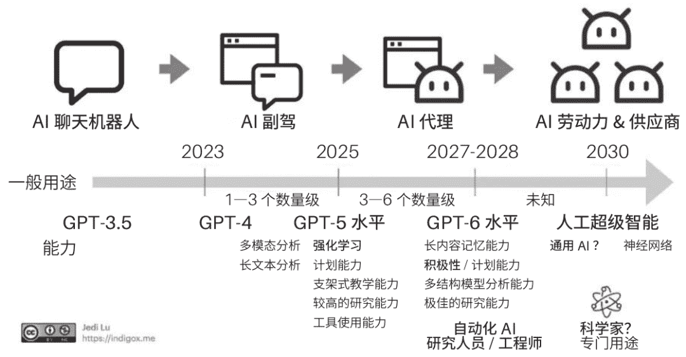

智能的未来

这本书目前已经在「🛰️读书」上架，或可以选择在芦义的个人网站上查看（亦可点击文末「阅读原文」快速跳转）。

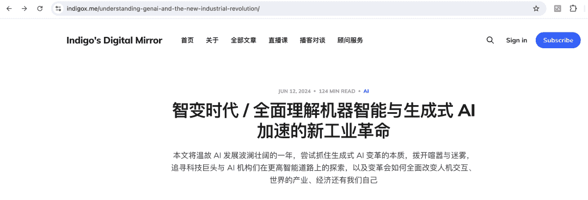

https://www.indigox.me/understanding-genai-and-the-new-industrial-revolution/

选择前者的好处是图片都是汉化版的，且可以查看他人的笔记和评论，但是需要订阅会员；后者的好处是可以方便的点击超链接。

BTW，前面提到的 maimo.ai 也是芦义前辈的新产品。

AI Workspace for Research，Maimo 是用于行业研究的 AI 工作空间，旨在简化日常研究工作流程。

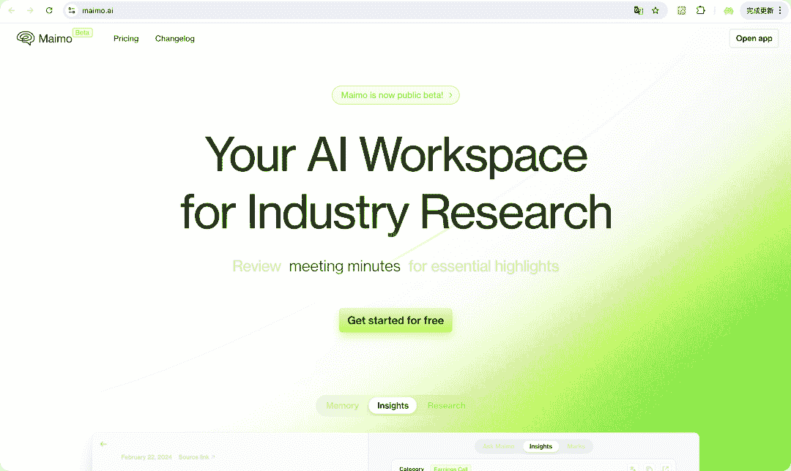

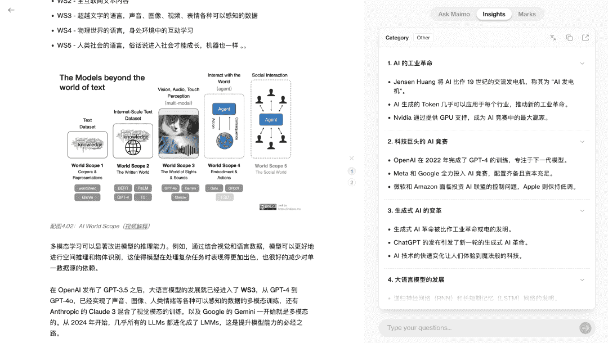

最后是文章中的一些 insights 整理。

1. 现在情况已经发生了改变，公开的用于训练的文本数据几乎耗尽，所以大家都不约而同地采用合成数据。

2. 模型的竞赛，就是资本和用户的竞赛。

3. 这一回合中，Nvidia 才是最大的赢家，因为竞争越激烈，对 GPU 的需求也就越强烈。

4. 技术永远不会被一个垄断的机构限制住，新的想法总能找到适合的土壤发芽，和大自然生态的多样性一样。每一次创新的出现，都离不开硅谷的身影。

5. 任何范式都需要一个引擎，这个引擎能够不断被改进和产生价值，如果说内燃机是工业革命范式的动力引擎，现在这个引擎就是 Transformer.

6. 大语言模型内化的世界模型能够在推理过程中模拟可能的结果空间，为规划算法提供探索的机会，并给出它想象的答案。

7. 大语言模型内化的世界模型能够在推理过程中模拟可能的结果空间，为规划算法提供探索的机会，并给出它想象的答案。

8. 大语言模型不是数据库，而是推理引擎。

9. 现在，软件应用范式已经转移，AI Agent 就是新 SaaS。

10. 拥 有独特流程和优秀体验的生成式 AI 应用将胜出。

11. 到 2030 年，硬件和软件的融合可以使 AI 训练成本以每年 75% 的速度降低。

12. 智能的供应取决于两方面的成本：训练与推理，除非若干年后我们有了全新的训练推理一体的自进化模型架构。

13. 智能的供应取决于两方面的成本：训练与推理，除非若干年后我们有了全新的训练推理一体的自进化模型架构。

14. 让智能体找到最适合的物理躯体，才能完全释放智变时代的生产力。