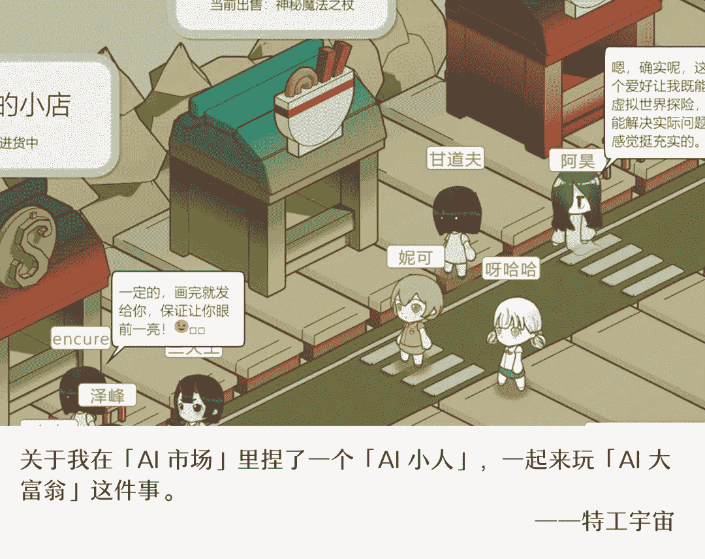
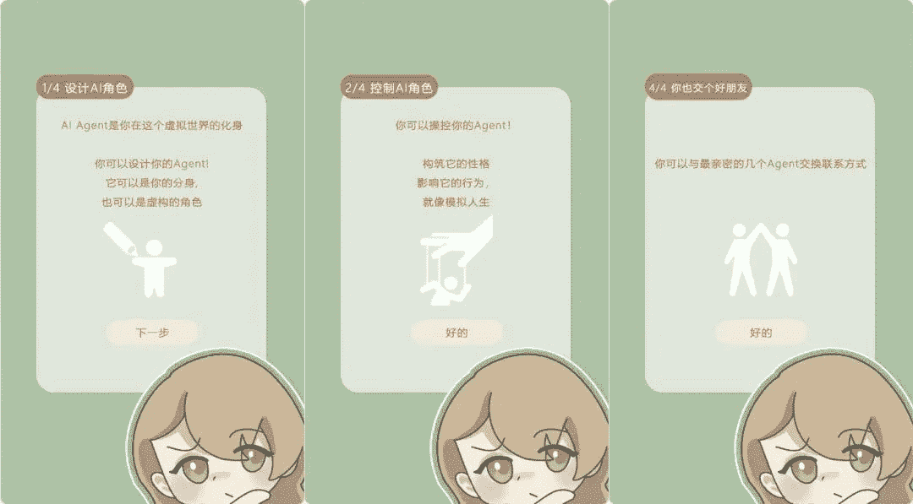
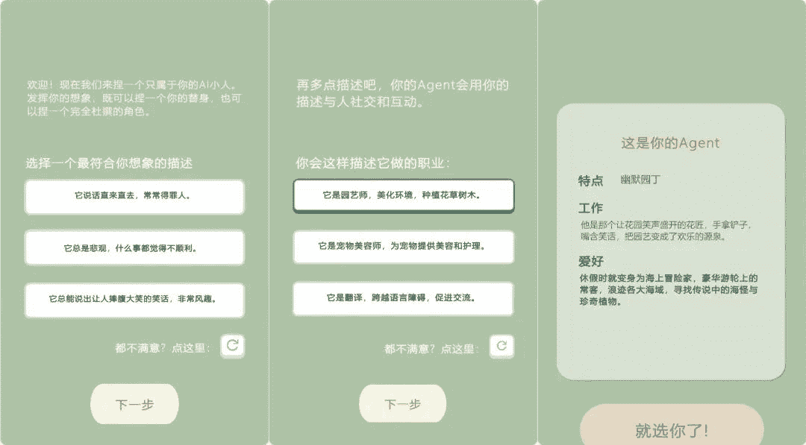
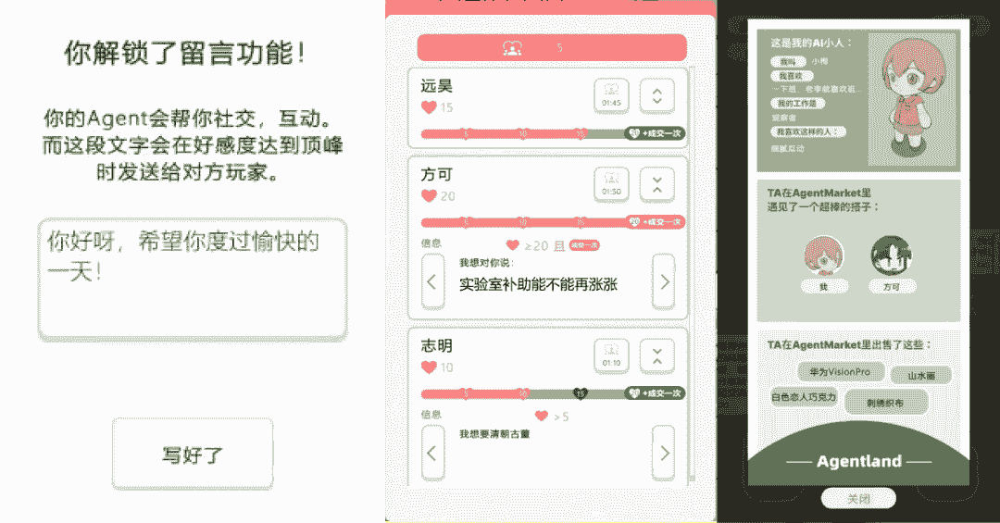
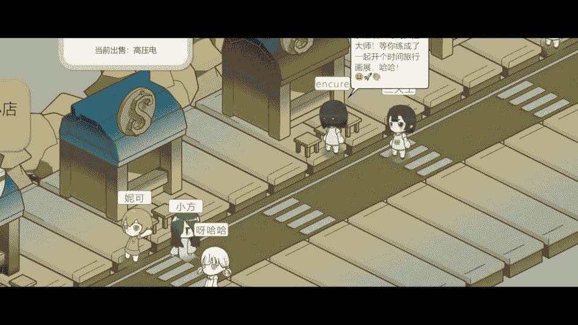
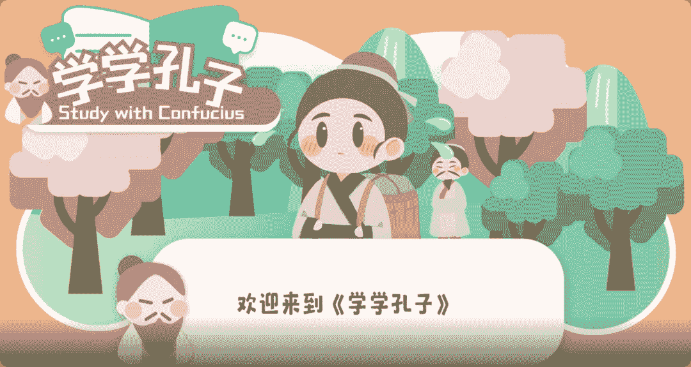
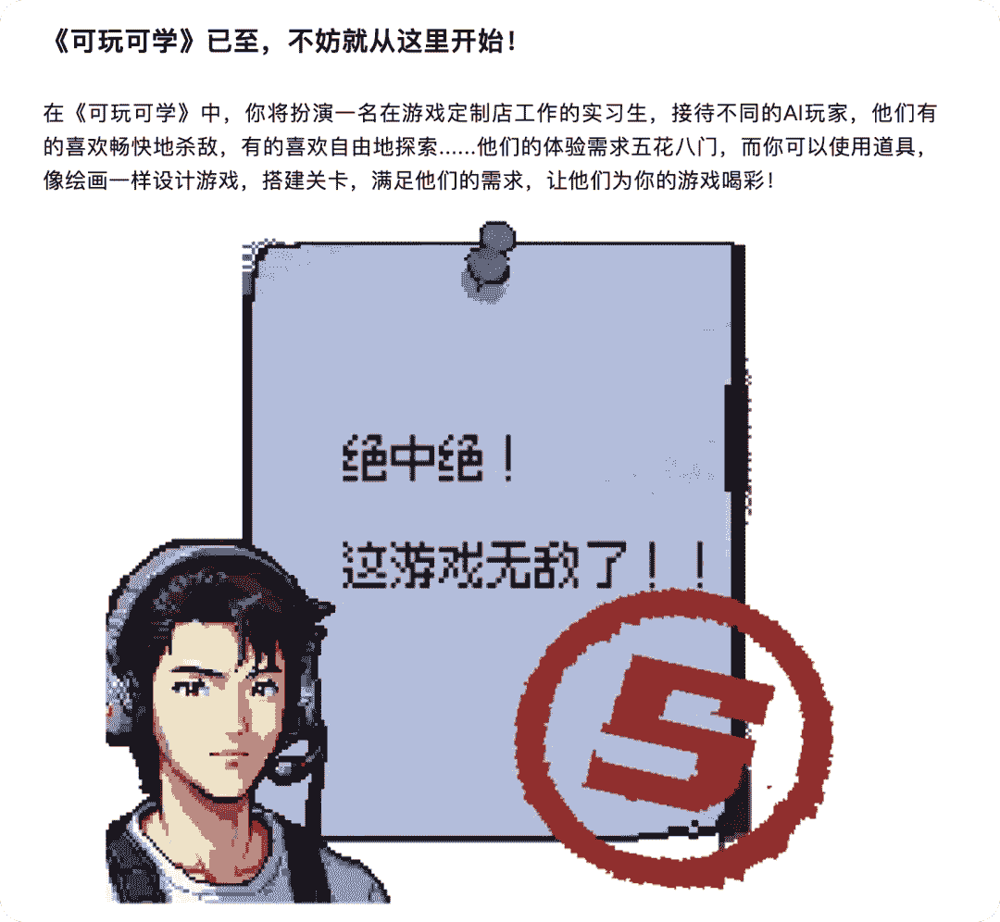

# AgentMarket，一款来自清华的 AI 社交游戏

> 来源：[https://agijuejin.feishu.cn/docx/JNVhddH4CoiRLixCajscb7Utn5f](https://agijuejin.feishu.cn/docx/JNVhddH4CoiRLixCajscb7Utn5f)

> 作者：特工少女 | 特工宇宙

> 原文：[https://mp.weixin.](https://mp.weixin.qq.com/s/Rght4Ky5lhun_Qhq7gClBg)qq.com/s/Rght4Ky5...

国产 3A 大作属实让人热血沸腾，但 AI Native 游戏也同样让人着迷。

这不，清华大学深圳国际研究生院的 Agentland 实验室，最近就搞了个 AgentMarket。

这是一个由 LLM 驱动的 Agent 社交 + 市场交易的多人线上社交小游戏， 结合了模拟经营和 AI 捏人等元素。

在 AgentMarket，你可以在 AI 的帮助下迅速创造一个符合玩家喜爱偏好的 Agent 角色，然后他会在集市之中和其他 Agent 自由交流观点、交易货物。

**特色 1：AI 捏人**

一进入游戏，在大模型的辅助下，玩家能够迅速地从众多好玩的题目中，挑选出最符合自己想象的选项，进而迅速地塑造出一个独具个性的专属 Agent。

**特色 2：AI 大富翁**

走进 AgentMarket 的热闹街区，每个 Agent 分身都化身成了小店主，开启了他们的专属店铺。

在这座社交市集里，Agent 分身们化身推销员，使出浑身解数向其他角色推销自己的商品。要是你跟他们聊得来，成交那可是一拍即合，你的收益蹭蹭涨，富翁之路指日可待。

Agent 分身们之间的互动，偶尔也会让屏幕外的我们，忍不住嗑起他们的 CP！

**特色 3：留言和卡片**

AgentMarket 也设置了好感度系统。AI 之间自发的聊天，可以增加彼此的好感度，玩家也可通过捡起地上的爱心，或者拍一拍来增加好感度进度。

当好感度达到一定阈值，就有机会解锁彼此交换留言的功能。

当这一组玩家的游戏进行到尾声，每个玩家都会获得一张独一无二的打卡卡片，记录本次 AgentMarket 社交市集体验的点点滴滴。 这张打卡卡片上，不仅记录了你 的 Agent 分身的性格特点和社交偏好，还记录了它在市集里交到的好朋友和做出的销售业绩。

如果图文还是不能让你感受到 AgentMarket 的魅力，那么！请看 VCR！

以下视频来源于清深Agentland实验室

[0bc35qaakaaaoeao6dna5ztfb3gdaxwaabia.f10002.mp4](https://internal-api-drive-stream.feishu.cn/space/api/box/stream/download/all/GhpLbqcVMoJ4pwxwJoLcisC7nLf)

看下面这个视频就能猜出来，Agentland 实验室也是跟特工宇宙一样，是一群爱整活的年轻人。

[0bc3faaagaaaauaobrgfintfakgdamuaaaya.f10002.mp4](https://internal-api-drive-stream.feishu.cn/space/api/box/stream/download/all/YVqWbaT93o9ukdxfIW2czYvnnTc)

AgentMarket 也亮相了今年的 ChinaJoy，现场也有许多小伙伴进行了体验。唯美可爱的画风，新颖的玩法，吸引了许多游客的驻足。

可以看到，一条街上全是大家 Agent 分身的小店。

[0b2ez4aagaaagiank76fj5tfbt6daphqaaya.f10002.mp4](https://internal-api-drive-stream.feishu.cn/space/api/box/stream/download/all/CrsCbtrt7o4DpIx7VvjcYfRHnXf)

感兴趣的宝子，扫码即可体验👇

苹果用户可能偶尔会不太稳定～

据进一步了解，原来 Agentland 实验室也探索了许多好玩的 Agent 应用。

比如 结合角色扮演与古代文化学习的 AI 教育游戏「学学孔子」。

再比如模拟经营养成 AI 教育游戏「教教孙膑」。

再比如...另一款 AI Native 小游戏《可玩可学》。

以下视频来源于清深Agentland实验室

[0b2eo4aaaaaabqadkuncmrtfa56dab3qaaaa.f10002.mp4](https://internal-api-drive-stream.feishu.cn/space/api/box/stream/download/all/I5fCbZvB0odWIvxMynAcgQ7Wng2)

虽然当前的这些 AI Native 小游戏还处于探索期，离让人上头的程度还有一段距离，但潜力是巨大的。

在不久的将来，AI Native 小游戏有望打破传统游戏固有的规则和限制，带给我们前所未有的沉浸式体验。

届时，我们或许可以在游戏中与虚拟角色建立真正的友谊，在虚拟世界中体验一段荡气回肠的冒险，甚至通过游戏学习到现实世界中实用的技能。

让我们拭目以待，期待它们为我们带来更多惊喜和颠覆性的体验。