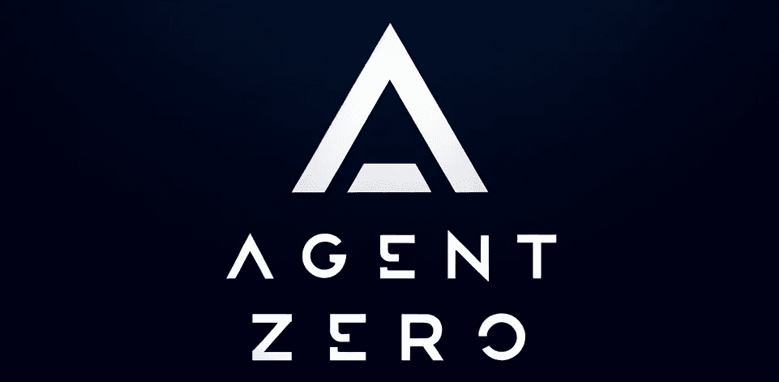
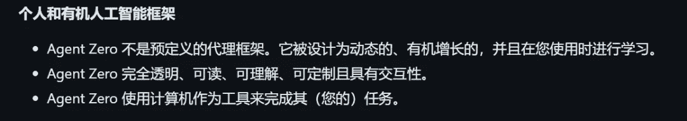
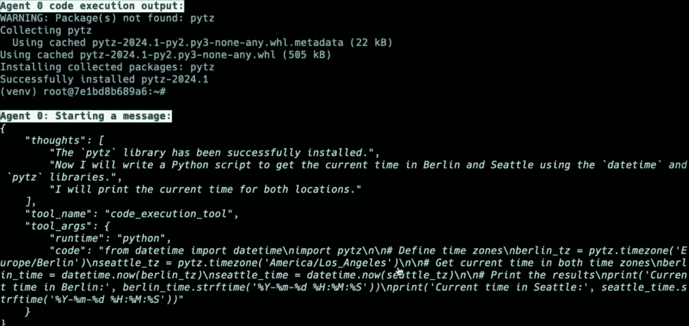
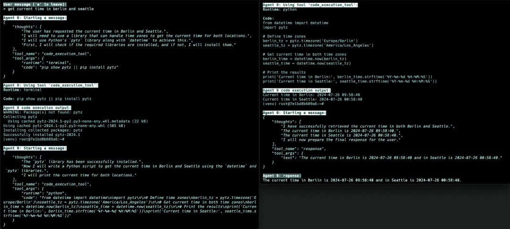
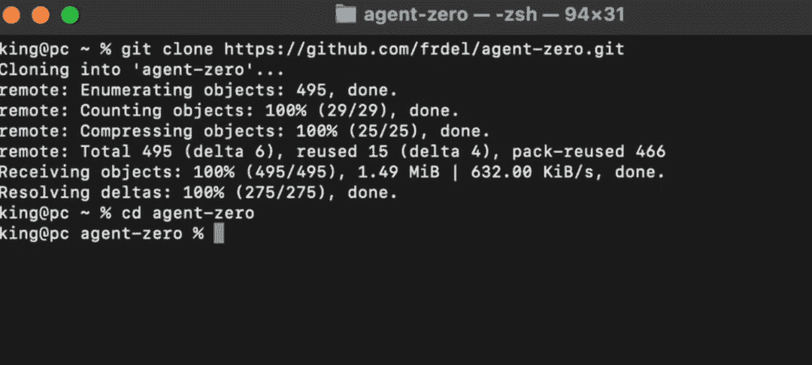
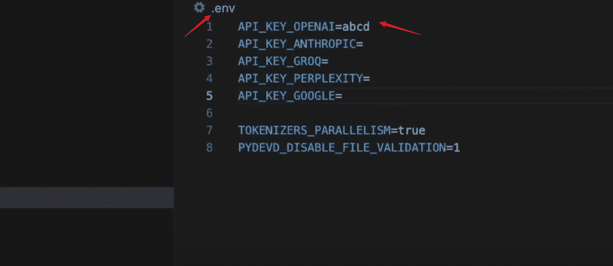
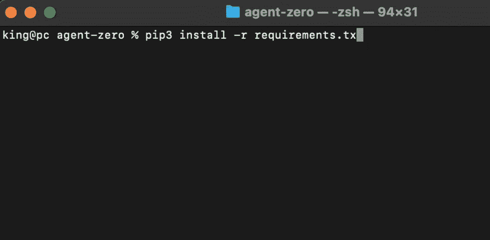
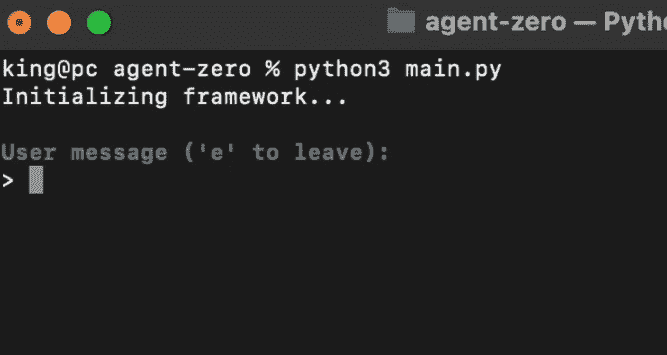
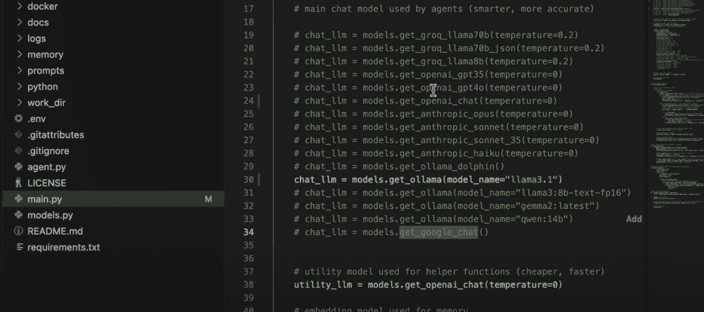

# Agent-zero：这个自动AI代理可以做任何事情！ （生成APP、代码、RAG 等）

> 来源：[https://agijuejin.feishu.cn/docx/BMHwdtL5HoE99MxB2mfcfRBNndg](https://agijuejin.feishu.cn/docx/BMHwdtL5HoE99MxB2mfcfRBNndg)

> 作者：Aitrainee | AI进修生

> 原文：[https://mp.weixin.](https://mp.weixin.qq.com/s/RHBrIK5mdO7whkTvix62lA)qq.com/s/RHBrIK5m...

Hi，这里是Aitrainee，欢迎阅读本期新文章。

我已经讨论了很多关于如何 **创建代理、应用程序和其他内容 **的主题，尤其是那些使用代理的内容，你不需  要配置任务，系统会自动完成，例如我在Maestro或最近的Olama Engineer中展示的内容。

最近，我看到一个类似的东西，看起来非常酷，那就是Agent Zero。如果我们查看它的GitHub页面，可以看到他们说Agent Zero并不是一个预定义的代理框架，它是动态的，随着你使用它而有机地成长和学习。

它还完全透明、可读、可理解、可定制和互动。从我能理解的来看，它基本上就像是一个动态的开放解释器。

更简单地说，它显然可以做一些简单的事情，就像一个大型语言模型（LLM）能做的那些，并且它可以通过多个代理来更好地完成这些任务。

但对于LLM无法完成的任务，比如获取当前时间等，它可以自动编写代码，在一个安全的Docker环境中执行，分析输出，并生成人类可读的文本输出。

例如，如果你让它获取瑞典的时间，它会编写一个Python程序，然后创建一个Python文件，并将代码放入其中，然后它会在一个安全的Docker环境中运行该代码，获取输出并分析，以给你结果。

现在，仅凭理解你就会知道它并不能做所有事情，特别是与现有代码文件之类的工作，因为它在Docker环境中运行代码，所以无法访问你可能拥有的文件。如果你想分析那个文件或代码，我认为它可能无法做到。

据说它也兼容OpenAI、Anthropic、Gemini、Claude等平台，不过话说回来，我们看看怎么使用它。

首先，我们需要将这个库克隆到我的电脑上。好了，现在完成了，让我们导航到文件夹中。

嗯，现在我们需要将EnV示例文件重命名为EnV。为此，让我们在VS Code中打开文件夹。现在在这里重命名。好了，现在完成了。

现在我们需要在这些变量中输入API密钥。默认推荐使用的模型是Perplexity，但我将使用OpenAI，因为如果你不使用Perplexity，它是默认的备选方案。所以我将在这里输入OpenAI的API密钥。现在编辑工作就完成了。

现在我们回到终端，运行pip install命令，确保所有依赖项都已安装。好了，一旦完成，我们现在可以使用它了。

要使用它，我们只需要运行主Python文件。

好了，现在它已经启动了。顺便说一句，请确保你已经安装了Docker，否则它不会工作，因为它需要在一个安全的沙箱环境中运行。

此外，如果你想配置它，你可以从网站上安装并在你的电脑上安装Llama 3.1等模型。完成后，只需进入主文件，注释掉这部分，并取消注释这一部分，

在这里输入你的模型名称，它应该就可以使用了，这也很酷。你也可以对Anthropic Gemini和其他平台做同样的事情。

它能够执行Python程序，这意味着它可以做一些有趣的事情，但当涉及到更高级的任务时，比如你希望它分析或简单地在你的电脑上创建文件，它就无法做到，它还能运行代码并找到LLM无法完成的事情。

我认为它从这里起还有很长的路要走。总的来说，对于某些事情来说，它还是挺不错的。

🌟 希望这篇文章对你有帮助，感谢阅读！

视频教程

https://www.youtube.com/watch?v=96FZgEAo4CY

参考链接：

[1] github：https://github.com/frdel/agent-zero

**知音难求，自我修炼亦艰**

抓住前沿技术的机遇，与我们一起成为创新的超级个体

**（把握AIGC时代的个人力量）**

**点这里 ****👇 关****注我，记得标星哦～**

一键三连「分享」、「点赞」和「在看」

**科技前沿进展日日相见 ~**