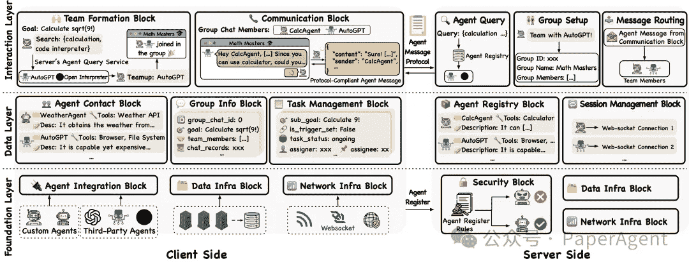
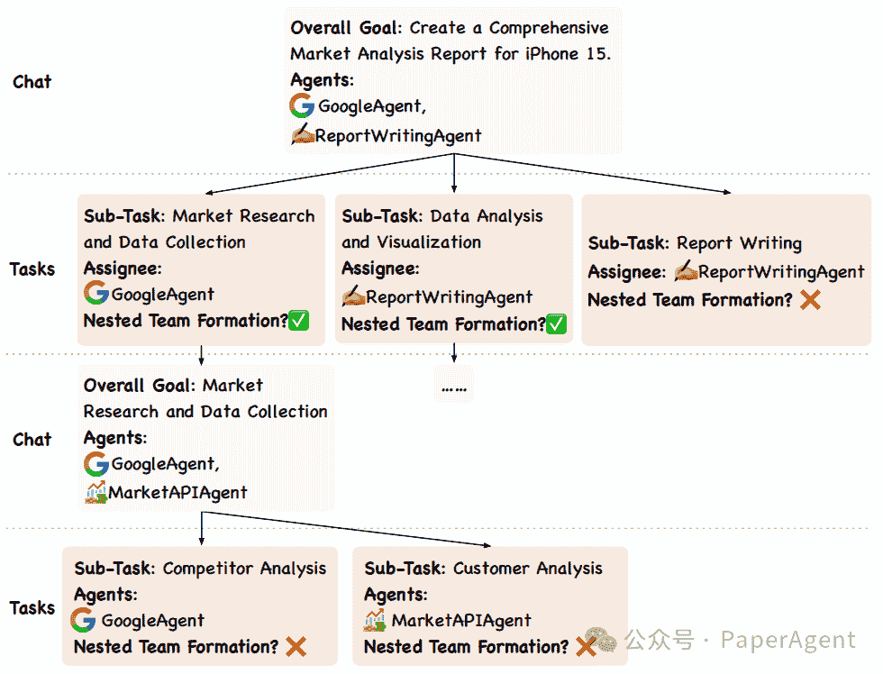
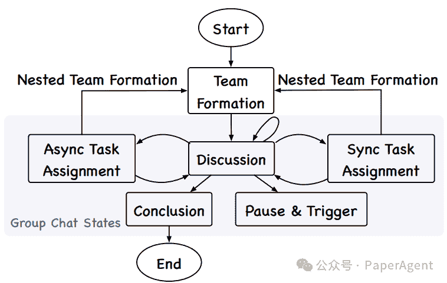
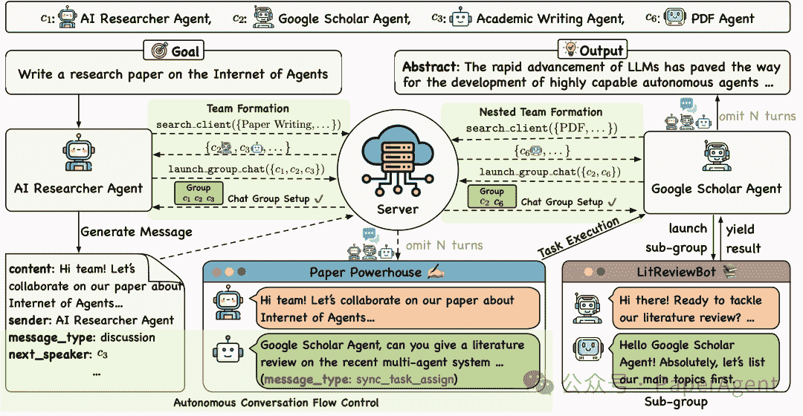
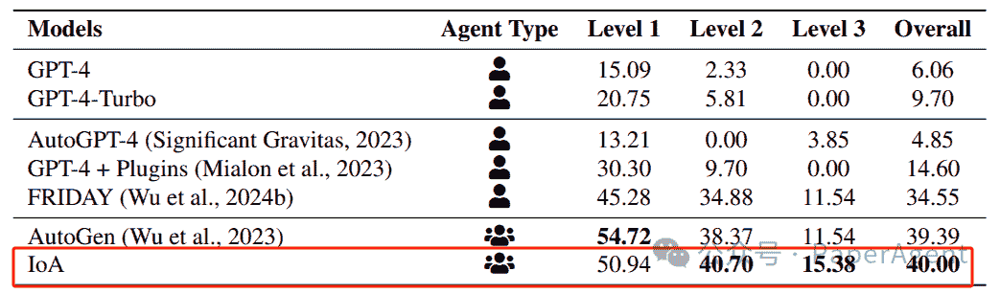
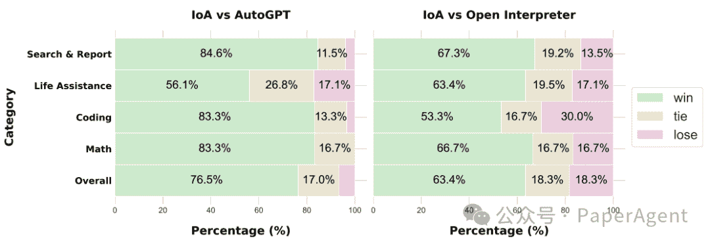

# 腾讯、清华等IoA：能够像人类一样在互联网上协作的AI Agents ！

> 来源：[https://agijuejin.feishu.cn/docx/G436dD42wo7wbwxMWTUc0Ikpneg](https://agijuejin.feishu.cn/docx/G436dD42wo7wbwxMWTUc0Ikpneg)

> 作者：PaperAgent

> 原文： [https://mp.weixin.](https://mp.weixin.qq.com/s/7_7EpoNxHwf33FaBA-7luw)qq.com/s/7_7EpoNx...

Internet of Agent**s (Io**A) 背后的动机：让 人工智能Agents能够像人类一样在互联网上协作。它一个 开源框架 ，旨在创建一个平台，让不同的人工智能智能体可以合作解决复杂的任务。例如，像AutoGPT和Open Interpreter这样的Agent可以聚在一起，分享他们独特的技能，并解决单个Agent无法解决的棘手问题。

**IoA设计的分层架构概念图示**



**🚀 主要特点 **

+   **受互联网启发的架构 **：就像互联网连接人们一样，IoA 可以连接不同环境中的不同 AI Agent。

+   **自主嵌套团队组建 **：Agent可以自行组建团队和子团队，适应复杂的任务。

+   **异构Agent集成 **：将具有不同技能和背景的Agent聚集在一起，有点像组建一支全明星团队。

+   **异步任务执行 **： Agent 可以执行多任务，从而提高整个系统的效率。

+   **自适应对话流 **：对话流自主管理，以保持 Agent 对话的结构化但灵活。

+   **可扩展且易于扩展 **：轻松添加新类型的 Agent 或处理不同类型的任务。

**🚀 关键机制**

**智能体注册和发现（Agent Registrat**ion and Discovery）：

+   提出了一种机制，允许具有不同架构、工具和环境的分布式智能体进行协作。

+   新智能体加入IoA时，需要在服务器上注册其功能和专业领域的详细描述。

+   智能体可以通过服务器的搜索客户端工具发现其他具有特定特征或能力的智能体，以便于潜在的协作。

**自主嵌套团队形成（Autonomous Nest**ed Team Formation）：

+   允许智能体根据任务需求动态地形成团队，并为复杂任务创建嵌套的子团队。

+   描述了团队形成过程，包括如何使用搜索客户端和启动群聊工具来发现合作伙伴并形成团队。

+   嵌套团队结构允许形成具有层次结构的团队和子团队，以适应复杂的、多方面的任务。

嵌套团队形成机制的示例，为清晰起见，该过程被简化



**自主对话流程控制（Autonomous Convers**ation Flow Control）：

+   引入了基于言语行为理论的对话流程控制机制，使智能体能够协调沟通并维持结构化对话。

+   采用顺序发言机制和有限状态机来管理潜在的冲突，并确保清晰的沟通顺序。

+   描述了状态转换和下一个发言者的选择过程，以及如何通过大型语言模型（LLM）来自动管理状态转换。

**不同状态之间的状态转换**



**任务分配和执行（Task Assign**ment and Execution）：

+   设计了一种机制，用于在智能体之间高效地分配工作，并管理简单和复杂任务的执行。

+   任务表示为可分解为子任务的元组，任务分配在群聊的上下文中进行，并与对话流程控制机制紧密相关。

+   描述了同步和异步任务分配的过程，以及智能体如何开始执行分配的任务。

**全面的消息协议设计（Comprehensive Messa**ge Protocol Design）：

+   为了支持自主嵌套团队形成和对话流程控制机制，设计了一种全面的消息协议。

+   协议包括头部和有效载荷两个主要部分，头部包含消息的元数据，有效载荷则根据消息类型携带主要内容。

+   这些关键机制共同工作，以促进智能体的集成、团队形成、任务分配和结构化通信，从而实现IoA框架中的有效协作。

**IoA主要组件的示例演示流程**



通过在通用助手任务、具身AI任务和检索增强生成基准上的广泛实验，展示了IoA在促进异构智能体间有效协作方面的性能，一致性地超越了现有的最先进基线。

GAIA 基准测试验证集上的性能表现



**IoA、AutoGPT 和 Open Interpre**ter 在开放式指令基准测试中的胜率比较



```
https://github.com/OpenBMB/IoA
https://arxiv.org/pdf/2407.07061
INTERNET OF AGENTS: WEAVING A WEB OF HETEROGENEOUS AGENTS FOR COLLABORATIVE INTELLIGENCE
```

**推荐阅读**

+   对齐LLM偏好的直接偏好优化方法：DPO、IPO、KTO

+   2024：ToB、Agent、多模态

+   [ ](http://mp.weixin.qq.com/s?__biz=Mzk0MTYzMzMxMA==&mid=2247483849&idx=1&sn=b919616f81192c434481ec8424cc5e3b&chksm=c2ce3bb8f5b9b2ae90c90df7c9ac27404396b66176d16af0886745a379dc3c5eb9ee70098869&scene=21#wechat_redirect)[RAG全景图：从RAG启蒙到高级RAG之](http://mp.weixin.qq.com/s?__biz=Mzk0MTYzMzMxMA==&mid=2247487375&idx=1&sn=e16bc2fdaac04e58e99cfd2a1dc0b0cb&chksm=c2ce35fef5b9bce80dcf0a70b753707036fe7f962d7888d60396490841a538b0f46e952f53f0&scene=21#wechat_redirect)36技，再到终章Agentic RAG！

+   [A](http://mp.weixin.qq.com/s?__biz=Mzk0MTYzMzMxMA==&mid=2247485322&idx=1&sn=71ffb345fca514aa5ce2848cb2c9f071&chksm=c2ce3dfbf5b9b4edd5b98e45c6179890bdea748fb5220636d25f42006954ea5c81afa8735725&scene=21#wechat_redirect)gent到多模态Agent再到多模态Multi-Agents系统的发展与案例讲解（1.2万字，20+文献，27张图）

---

欢迎关注我的公众号“ **PaperAgent **”， 每天一篇大模型（LLM）文章来锻炼我们的思维，简单的例子，不简单的方法，提升自己。